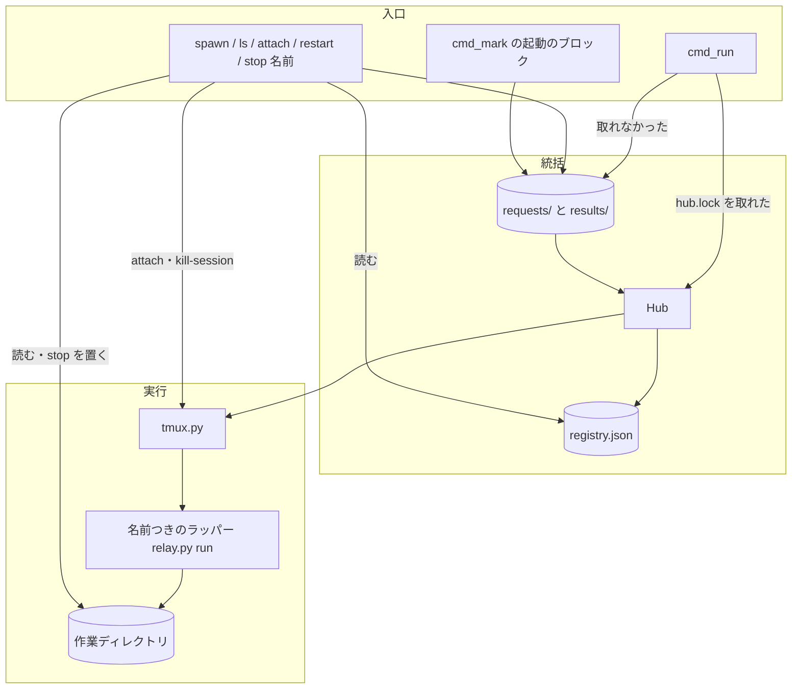
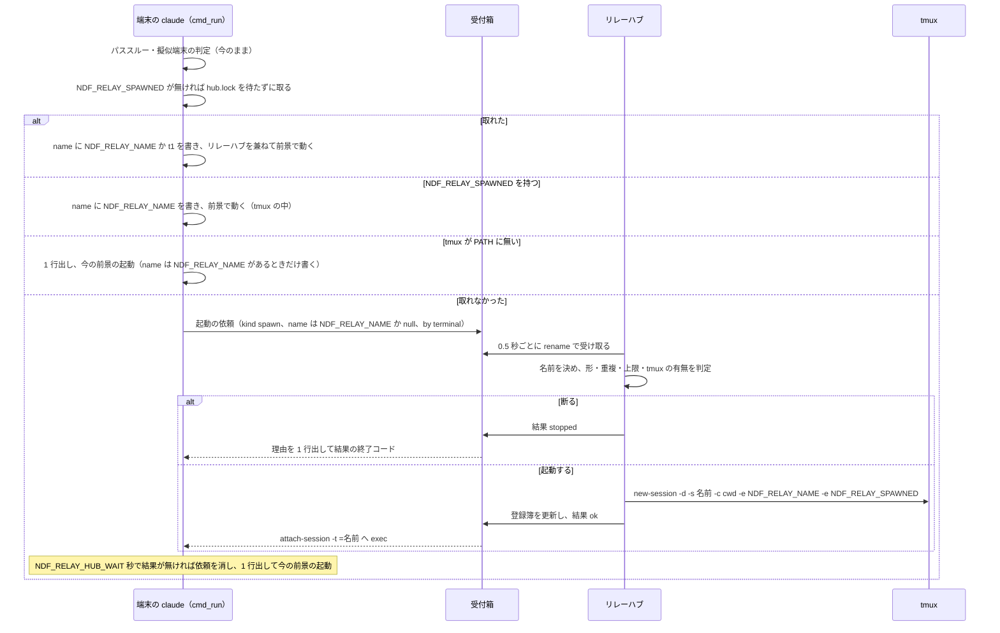
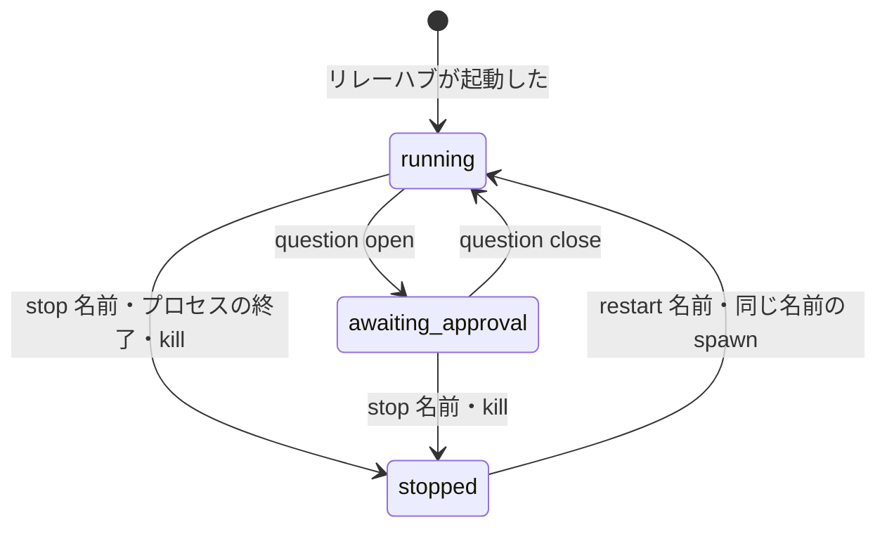

# 同じコンテナの複数のラッパーをリレーハブから起動し、1 つの表で見て 1 本ずつ止める

同じコンテナで最初に起動したラッパー（`relay.py run`）がリレーハブを兼ね、2 本目以降の `claude`・`relay.py spawn`・
conductor の応答の起動のブロックから頼まれた名前つきのラッパーを、tmux の専用のソケットのセッションで起動する。
`relay.py ls` は全ラッパーの状態と承認待ちを 1 つの表で出し、`stop <名前>`・`restart <名前>`・`attach <名前>` は
1 本だけを扱う。リレーハブは登録・起動・同時に動かす数の判定・一覧だけを持ち、各ラッパーの区間の切り替えには触れない。
tmux が無ければ今の 1 本ずつの起動に戻る。Claude Code だけが対象である。この文書は、副命令の入出力の契約・
状態の置き場所・判定の条件と、それぞれをそう決めた理由を残す。

**利用者向けの始め方と操作の一覧は Skill の文書が正である。**

| 何を読むか | 正本 |
| --- | --- |
| 複数のループを並べる始め方・操作の一覧・上限・リレーハブが落ちたとき | `plugins/ndf/skills/development-workflow/references/relay.md` の「複数のループを並べる（リレーハブ）」 |
| 1 本のラッパーの入出力・区間の切り替え・シグナルファイル・`mark` の判定 | [ndf-relay-segment-restart.md](ndf-relay-segment-restart.md) |
| 次のコマンドを出す形（`ndf-next` のブロック） | `plugins/ndf/skills/development-workflow/references/context-window.md` の「新しい会話で戻す」 |
| 環境変数の宣言 | `plugins/ndf/contracts/env/NDF_RELAY_NAME.json`・`NDF_RELAY_SPAWNED.json`・`NDF_RELAY_TMUX.json` |
| 残る状態の種類（受付箱の依頼と結果） | `plugins/ndf/scripts/lib/run_state_kinds.py` の `relay-hub-request` |

## 概要

**例: 同じコンテナで 3 本の開発ループ（`l20261031`・`lroot`・`lflow`）を回す（2026-11-01 の利用者の依頼）。**

| 順 | 誰が | 何をする | 何が起きるか |
| ---: | --- | --- | --- |
| 1 | 利用者 | 端末 1 で `claude` を打つ | 今どおり端末の前景でラッパーが動き、`hub.lock` を取ってリレーハブを兼ねる。作業ディレクトリの `name` は `t1` |
| 2 | 利用者 | 端末 2 で `NDF_RELAY_NAME=lroot claude` を打つ | `hub.lock` が取れないので受付箱へ起動の依頼を置く。リレーハブが tmux のセッション `lroot` に `relay.py run` を起動し、端末 2 はそのセッションへ `attach-session` で結び付く |
| 3 | conductor（端末 1 のセッション） | 応答に `ndf-spawn lflow` の囲み（中身は `/goal .ndf/handoff/loop-lflow.md を読んで続ける`）を置く | Stop hook の `mark` が依頼を置くだけで、区間は止まらない。リレーハブが端末の無いセッション `lflow` を起動する |
| 4 | 利用者 | 端末 2 を閉じる | tmux のクライアントが外れるだけで、`lroot` のラッパーは動き続ける。カットポイントの `ndf-next` も今どおり拾う |
| 5 | 利用者 | `relay.py ls` を打つ | `t1`・`lroot`・`lflow` の状態・承認待ち・区間・時刻・アカウント・結び付き・リレーハブかが 1 つの表に出る |
| 6 | 利用者 | `relay.py stop lroot` を打つ | `lroot` だけが止まり、ほかの 2 本は `running` のまま |
| 7 | — | 端末 1 のラッパー（リレーハブ）が終わる | tmux のサーバが親なので `lflow` は止まらない。次に端末で打った `claude` がリレーハブになり、一覧に `lflow` が出る |

**リレーハブが要らない使い方は今と同じに動く。** 1 本だけを使う利用者は、`hub.lock` を取って今の前景の起動を通る。
tmux が PATH に無い環境では、2 本目は `ndf-relay: tmux が PATH に無いため統括しない。この端末で 1 本のラッパーとして起動する`
を出して前景で動く。

**コンテキストは 3 つである。** 開発ワークフロー（`ndf-workflow`）がリレーハブ・名前つきのラッパー・登録簿・起動の依頼・
起動のブロックの語を持つ。ラッパー（`ndf-relay`）は作業ディレクトリ・シグナルファイル・区間の語を今のまま持ち、
リレーハブに対して供給者に立つ。リレーハブは作業ディレクトリの `relay.lock`・`question`・`log.jsonl`・`name` を読むだけで、
書くのは名前つきの `stop` のシグナルファイルだけである。Factory（`ndf-factory`）とは公開された言語の関係で、
状態と項目の名前を写して使い、コードは参照しない。

## 用語

リレーハブ・名前つきのラッパー・端末の結び付け・登録簿・起動の依頼・起動のブロックの定義は、設定の用語集
（`.ndf/glossary.json` の `document` が指す [docs/glossary.md](../glossary.md)）にある。ラッパー・区間・
シグナルファイル・停止シグナルファイルは [ndf-relay-segment-restart.md](ndf-relay-segment-restart.md) の用語のまま使う。

## 決定と理由

| 決定 | 理由 |
| --- | --- |
| tmux をラッパーごとの端末の親にし、各セッションで今の `relay.py run` を動かす。リレーハブが claude の擬似端末の親になる形は採らない | 今のラッパーの状態機械を変えずに使え、1 本が落ちてもほかは動く。端末の切り替えと結び付け直しを自作せずに tmux へ任せられる（2026-11-01 の利用者の決定） |
| リレーハブは `hub.lock` のファイルロックを待たずに取れた前景のラッパーにする。`hub.json` の pid の生死では判定しない | ロックは OS がプロセスの終了で放すため、リレーハブが kill されても次の `claude` が取れ、同時に 2 つ始まっても取れるのは 1 つだけになる。pid は再利用で死んだリレーハブを生きていると読む |
| tmux の中で起動された印 `NDF_RELAY_SPAWNED` を持つ `run` はリレーハブを取りに行かない | 取りに行くと、リレーハブが落ちた後に tmux の中のラッパーがリレーハブになり、「次に端末で打った `claude` がリレーハブになる」と食い違う |
| tmux のセッションはリレーハブが作り、依頼には名前・作業ディレクトリ・引数だけを載せる。window へ足すのは `NDF_RELAY_NAME` と `NDF_RELAY_SPAWNED` と、役割を付けた起動の `NDF_RELAY_ROLE`・`NDF_RELAY_PLAN` だけ | window の環境は専用サーバーのグローバルな環境を継ぐため、環境変数に入った token を依頼のファイルとしてディスクへ残さずに済む。リレーハブの環境が届くのはリレーハブが専用サーバーを起こしたときだけで、別のプロセスが先に起こしていればそのプロセスの環境が届く |
| `NDF_RELAY_SPAWNED` を持つ `run` は、入れ子とパススルーの判定より先に親のセッションの環境（`relay_lib/session_env.py` の `PARENT_ENV`・`LANE_ENV` と、`lib/claude_accounts.py` の `leave_account` が戻すアカウントの環境）を外す。役割と計画は tmux のセッションの環境（起動の `-e`）にある値だけを残す | 専用サーバーは最初に起こした claude のセッションの環境をグローバルな環境として持ち続け、そのまま継ぐとラッパーがパススルーし、上限に達したアカウントのまま起動する。受け取る側の 1 か所で外せば、リレーハブの起動と手で打つ `new-session` のどちらにも効き、動いている専用サーバーの環境を変えない。`NDF_RELAY_SPAWNED` は子の claude へ渡らないため、これを持つのは window で起動された `run` だけである |
| 名前つきのラッパー 1 本に tmux のセッション 1 つを割り当て、専用のソケット `-L ndf-relay` に置く | 1 つのセッションに window を並べると、ある端末で window を選ぶと同じセッションのほかの端末の表示も切り替わる。専用のソケットなら利用者の tmux サーバの一覧と操作に混ざらない |
| 依頼はファイルの受付箱で渡し、登録簿を書くのはリレーハブだけにする。Unix ドメインソケットは使わない | 名前の重複と上限の判定が入口ごとに分かれない。リレーハブが居ない間に置かれた依頼が残り、次のリレーハブが処理できる |
| 同時に動かす数の上限はマシンの設定（`<状態の根>/relay/hub/limits.json`。`relay.py cap --named <n>` が書く）→ 環境変数 `NDF_RELAY_MAX_NAMED` → 既定 3 の順で決め、`.ndf/` に置かない。リレーハブは判定のたびに読む | 上限が守るのは同じコンテナ・同じアカウントの資源である。そのため値はリポジトリごとに持たず、マシンに 1 つに決まる。判定のたびにファイルから読むため、リレーハブを兼ねるラッパーを起動し直さずに変えられる |
| 上限はリレーハブ・名前つき・名前の無い今のラッパーを合わせて数え、起動した直後でロックの前のものも数える | 1 回の応答に上限を超える数の起動のブロックを置いても、先に起動したものがロックを取る前に次を通さない |
| 並列の計画のオーガナイザーの印（役割 `organizer`）を持つ動いているラッパーは 1 本だけ数から外し、一時レーン（役割 `helper`）は数から外して同時に 1 本までに限る | オーガナイザーが上限の 1 本を使うと、既定の 3 でレーンを 3 本起動できない。外す経路を 1 本ずつに限り、印を置けば上限を越えられる道を増やさない |
| 人の起動（依頼の `by` が `terminal`）は上限で断らず、上限の数にも入れない。人の起動かは登録簿の行の `by` と tmux のセッションの有無で引く。上限を超えて起動したら、結果の `items[0].notice` の 1 行と記録の `started` の行の `over_limit` に残す | 上限は AI が自分で起動を増やす経路にだけ効く歯止めで、利用者が端末で打った起動は通す。数に入れると人が 1 本起動するたびに AI の起動の余地が減る。`by: terminal` を置くのは端末の 2 本目の経路だけで、新しい印を足さずに見分けられる。起動した直後の数えと同じ登録簿の行から引くため、ロックの前と後で判定が変わらない |
| 人の起動で始めたラッパーも、`relay.py restart` で起動し直すと登録簿の行の `by` が `restart` になり、以後は上限に数える | `restart` は端末を持たない依頼の経路で、人と AI を `by` でしか見分けられない。元の `by` を引き継ぐと、AI が `restart` するたびに上限に数えない起動が生まれ、AI の起動の歯止めが外れる |
| 上限を超えた人の起動の印は、記録の `reason` に混ぜず別の欄 `over_limit` に置く。知らせの文はリレーハブが作り、頼む側は `items[0].notice` をそのまま出す | `reason` は依頼の `by` を持つ欄で、1 つの欄に 2 つの意味を持たせない。上限の数と名前の並びを持つリレーハブの側だけで文が決まり、断りの理由の文と置き場がそろう。`summary` は `relay.py spawn` の出力と共有しているため変えない |
| 起動のブロックは情報文字列 `ndf-spawn <名前>` の囲みにし、`ndf-next` と同じ包み（`lib/md.py`）で拾う | 拾う規則が 1 つに残り、conductor の書き方も分かれない。区間を終えないので `next.json` を書かず、Stop hook の 5 秒の上限の中で依頼を置くだけにする |
| 承認待ち通知は各ラッパーの待ち通知が名前を付けて出し、リレーハブは見回さない | リレーハブが落ちて次の `claude` が来るまでの間も通知が出る。リレーハブが見回すと今の通知と 2 重になる。端末の結び付きは見ずに常に付ける（hook の中で tmux を呼ばない） |
| 一覧の状態は作業ディレクトリの今のファイルから導き、語は Factory の `awaiting_approval` に揃える | ラッパーの状態機械に書き込みを足さずに済み、kill された後も正しく止まったと出る。Factory の実行の状態と同じ名前になる |
| 名前つきの `stop` は停止シグナルファイルを置いた上で tmux のセッションを終え、5 秒で `relay.lock` が放されなければプロセスの木を止める | シグナルファイルだけでは動いている claude が残り、その行が `running` のまま出る。会話の記録は残るので `restart` で続けられる |
| `restart` は最後の区間の入力と最後の start の行の `cwd` で起動し直す。`claude --resume` は使わない | 最初の引数で起動し直すとループが始めの地点へ戻る。区間の切り替えで worktree へ移っている。止めた理由は会話の行き詰まりが多く、同じ会話へ戻すと同じ所で止まる |
| リレーハブ自身の `restart` は断り、`/ndf:restart` を案内する | リレーハブを止めると、起動し直す依頼を受ける者が居なくなり停止だけが起きる |
| tmux は CLI を `relay_lib/tmux.py` の 1 か所から呼び、libtmux を入れない | 使う操作は 1 回の呼び出しで終わる 6 つだけで、attach はどのライブラリでも exec になる。ラッパーの環境の依存を増やさない |
| リレーハブの仕事は前景のラッパーの thread で行い、端末へ書かない。thread の例外は記録に残して `hub.lock` を放す | 前景の端末は raw で claude の画面を中継している。別のデーモンにすると「1 本目の relay.py が 2 本目を立ち上げる」依頼と前景の 1 本目から外れ、止め方と寿命を別に持つことになる |
| 名前の形を `^[a-z0-9][a-z0-9_-]{0,31}$` に限り、無いときは `t<番号>` を付ける。作業ディレクトリの名前からは付けない | tmux はセッション名の `.` を `_` へ置き換え、`:` を対象の区切りに使うため、登録簿と tmux の名前が食い違う。形は Factory の `JOB_ID` の部分集合。作業ディレクトリ名は同じ場所で 2 本打つと重なり、区間の切り替えで移る |
| 端末から打つときの名前は `claude` の引数でなく `NDF_RELAY_NAME` で受ける | `claude` の引数は claude へ渡すもので、ラッパーの引数を混ぜない |
| リレーハブが `NDF_RELAY_HUB_WAIT`（既定 10 秒）答えなければ、2 本目は今の前景の起動に戻る | `hub.lock` が持たれているのに結果が来ないのはリレーハブの thread が止まったときで、待ち続けると利用者の `claude` が起動しない |
| リレーハブは依頼を `rename` で受け取り、頼む側は待ちを切るときに依頼を消す | 遅れてリレーハブが処理しても重複して起動しない。消せなければ受け取られた後なので、もう 1 度同じ秒数だけ待つ |

## 仕様

### 常に成り立つ条件

- **同じコンテナでリレーハブは高々 1 つである。** `hub.lock` の排他を持つプロセスだけがリレーハブで、取れなかった `run` は依頼する側になる
- **動いている名前つきのラッパーの名前は重ならない。** tmux のセッションが在る名前も取られているものとして扱う
- **動いているラッパーの数は上限以下である。** 数えるのは「`relay.lock` が取られている作業ディレクトリ（名前の無いものを含む）」と「登録簿の行のうち、tmux のセッションが在るのに同じ名前の作業ディレクトリがまだ `relay.lock` を取っていないもの」の和で、重複は名前で除く（`hub.py` の `live`）。この和から、人の起動で動いているもの（登録簿の行の `by` が `terminal` で tmux のセッションが在るもの）すべて・役割 `helper` のものすべて・人の起動でない役割 `organizer` のものを 1 本だけ外す。1 本は 2 つ以上に当てはまっても 1 回だけ外す。役割 `helper` の動いているラッパーは 1 本以下である。上限で断るのは AI の起動（`by` が `spawn`・`restart`・`block:<作業ディレクトリ>`）だけで、人の起動は名前の形・重複・tmux の有無だけで判定する
- **登録簿（`registry.json`）を書くのはリレーハブだけである。** 頼む側（`hub_client.py`）は受付箱へ依頼を置くだけにする
- **リレーハブは名前つきのラッパーの区間の切り替え・`ndf-next` の拾い方・アカウントの選び方に触れない。** tmux の中で動くのは今の `Relay` である
- **リレーハブが終わっても名前つきのラッパーは止まらない。** window の親は tmux のサーバで、リレーハブの終了は届かない
- **起動する名前は `^[a-z0-9][a-z0-9_-]{0,31}$` に合う**（`hub.py` の `NAME_RE`）
- **受付箱と結果の置き場はディレクトリ 0700・ファイル 0600 で、所有者だけが読み書きできる。** リレーハブは権限の違う受付箱・依頼を処理せずに記録へ 1 行残す（依頼は消す）
- **名前を付けない `relay.py stop` の振る舞いは 1 本のラッパーの仕様のままである**（`mark.py` の `cmd_stop`）
- **一覧と記録に最初の入力を出さない。** `ls` の項目と `hub-log.jsonl` の行に入力の欄が無い
- **リレーハブの置き場 `hub/` は作業ディレクトリとして読まれない。** `relay.lock`・`log.jsonl` を置かないので、名前の無い `stop` の走査に入らない。名前つきのラッパーの作業ディレクトリは今と同じ状態ディレクトリに作る

### 構成要素

| 要素 | 責務 |
| --- | --- |
| リレーハブ（`plugins/ndf/scripts/relay_lib/hub.py` の `Hub`） | `hub.lock` の取得（`claim`）と保持、受付箱の依頼の処理（`serve_once` → `handle` → `process`：名前の形・重複・上限の判定 `judge`、tmux の起動 `launch`、登録簿の更新、結果の書き込み）、リレーハブの記録。作業ディレクトリの読み取り（`scan_wrappers`・`by_name`・`live`）は依頼の口と共有する |
| 依頼の口（`relay_lib/hub_client.py`） | 依頼を受付箱へ置いて結果を待つ（`send_request`）。副命令 `spawn`・`ls`・`attach`・`restart` と名前つきの `stop` の本体、端末の 2 本目の依頼（`ask_hub`）、起動のブロックの拾い（`place_blocks`）、リレーハブの取得と解放（`claim_hub`・`serving`）、作業ディレクトリの名前の書き込み（`write_name`） |
| tmux の包み（`relay_lib/tmux.py`） | tmux を呼ぶ唯一のモジュール。専用のソケット `-L ndf-relay` で `new-session`・`has-session`・`list-sessions`・`show-environment`・`kill-session` を呼び、`attach-session` へ exec する。呼ぶときは環境から `TMUX` を外す |
| ラッパーの起動（`relay_lib/run.py` の `cmd_run`） | `NDF_RELAY_SPAWNED` があれば、判定より先に親のセッションの環境を外す（`session_env.py` の `drop_parent_env`）。パススルーと擬似端末の判定の後で、リレーハブを取る・依頼する・今の前景の起動に戻るを選ぶ。リレーハブなら前景のラッパーが動く間だけ受付箱を回す |
| Stop hook（`relay_lib/mark.py` の `cmd_mark`） | 応答の起動のブロックごとに依頼を置く（待たない。失敗しても Stop を止めない） |
| 副命令の表（`relay_lib/__init__.py`） | `spawn`・`ls`・`attach`・`restart` を足し、`stop` に名前があれば `cmd_stop_named`、無ければ `cmd_stop` へ渡す |
| 子の環境（`relay_lib/claude.py` の `child_env`） | 子の claude へ `NDF_RELAY_SPAWNED` を渡さない。`NDF_RELAY_NAME` は tmux の中の名前つきのラッパーの子にだけ渡す |
| 待ち通知（`plugins/ndf/scripts/lib/wait_notice.py` の `build_locator`・`Locator`） | Claude Code で `NDF_RELAY_NAME` があれば、本文の先頭に `ラッパー: <名前>（relay.py attach <名前>）` の 1 行を足す |

**配置。** すべて同じコンテナの同じ OS の利用者の中で動く。tmux のサーバはリレーハブの最初の起動で立ち、リレーハブとは
別のプロセスとして残る。最後のセッションが消えるとサーバも終わる。

### 処理の流れ

- **リレーハブの起動。** `hub.lock` を取った後、前景のラッパーの作業ディレクトリを作ってから `hub.json` を書き、
  記録に `claimed` を足して thread を始める。thread は最初に 10 分を過ぎた結果のファイルを消し、その後 0.5 秒ごとに
  受付箱を古い順（ファイル名の順）に処理する。リレーハブの居ない間に置かれた依頼（起動のブロックなど）もここで処理する。
  前景のラッパーが終わると `hub.lock` を放す。ラッパーを始められない（プラグインの名前と版・作業ディレクトリ）ときも、
  パススルーの前に放す
- **名前の自動。** 端末の 2 本目に名前が無ければ、リレーハブが `t2`・`t3`… のうち取られていない最小の番号を付ける。
  リレーハブのラッパー自身の名前は `NDF_RELAY_NAME`、無ければ `t1`
- **起動の引数。** tmux の中では `<python> <relay.py> run <引数>` を動かす（`-x 200 -y 50`）。端末の 2 本目は打った引数を
  そのまま渡す。`spawn`・起動のブロックは `--` の後の入力を空白でつないだ 1 つにし、`["--", <入力>]` を渡す（`-` で始まる
  入力を選択肢として読ませない。`by` が `terminal` でない依頼で入力以外の選択肢を足させない）
- **起動のブロック。** `cmd_mark` は最後の応答から、3 つのバッククォートの囲みで情報文字列がちょうど `ndf-spawn <名前>` の 2 語のものを
  拾い、ブロックごとに `by` を `block:<作業ディレクトリ>` とした依頼を置いて待たない。名前の形の判定はリレーハブが行う。
  結果はリレーハブの記録と `ls` で見る
- **名前つきの `stop`。** 対象は `by_name` の規則で選んだ作業ディレクトリと、登録簿の行のセッション（無ければ名前と同じ名前）。
  動いていれば `stop` のシグナルファイルを置き、セッションが在れば `kill-session -t =<名前>` を呼ぶ（ラッパーへ SIGHUP が届き、
  端末を戻して終わる）。`relay.lock` が放されるまで `NDF_RELAY_STOP_WAIT`（既定 5 秒）待ち、放されなければ `relay.pid` の木を
  `lib/procs.py` の `stop_tree` で止める。記録に `stopped` を足す。リレーハブは経由しない
- **`restart`。** 名前つきの `stop` の後、`kind: restart` の依頼を置く。リレーハブは `restart_input` で、区間 1 なら登録簿の `args`、
  区間 2 以降は最初の区間の起動の方針（`claude.py` の `carried_args`）に最後の start の行の `command` を足した引数と、最後の start の
  行の `cwd`（行に無ければ登録簿の `cwd`、それも無ければホーム。そのディレクトリが消えていれば `common.py` の `fallback_cwd`）で起動し直す
- **ラッパーの入れ替え（#1587）。** `os.execve` で `hub.lock` は放される。入れ替えた後の版は `claim_hub` を呼び直し、取れなければ
  リレーハブを兼ねずに続ける
- **同じ名前の作業ディレクトリが複数あるとき**（`restart` の後に新旧が残る）は、一覧・停止・再起動のどれも `pick_live` で 1 つに
  決める。`relay.lock` が取られているものを採り、無ければ `log.jsonl` の最後の start の行の時刻が最も新しいものを採る

名前つきのラッパーの状態:

### 副命令の入出力

`spawn`・`restart`・名前つきの `stop` の結果は `lib/step_result.py` と同じ形の辞書で、`--json` なら 1 行の JSON を標準出力へ、
無ければ `relay.py: 
` の 1 行を出す（終了コード 0 は標準出力、それ以外は標準エラー）。`step_result.py` は
バージョンディレクトリへ写さないため import せず、同じ形を組む。

| 副命令 | 引数 | 終了コード | 出力 |
| --- | --- | --- | --- |
| `run`（2 本目） | `[claude の引数 ...]`。名前は `NDF_RELAY_NAME` | リレーハブが起動したら `attach-session` へ exec し、その終了コード。断られたら結果の `metrics.exit_code`（`bad-name`・`name-taken`・`limit`・`no-tmux` は 3、`tmux-failed` は 1）。tmux が無い・リレーハブが答えないときは前景の起動になり、1 本のラッパーと同じ | 断り: `ndf-relay: 起動しない（
）`。tmux が無い: `ndf-relay: tmux が PATH に無いため統括しない。…`。答えない: `ndf-relay: リレーハブが <秒> 秒答えないため、…` |
| `spawn` | `--name <名前> [--role helper --plan <計画名>] [--json] -- <最初の入力>` | 0: 起動した / 2: `--name` が無い・`--role` が `helper` でない・`--role` に `--plan` が無い（使い方を出す）/ 3: 名前の形が違う（リレーハブに頼まずに断る）・名前が重なる・上限（`--role helper` は上限を見ず、動いている `helper` があれば断る）・リレーハブの側で tmux が無い / 1: リレーハブが居ない・答えない（`no-hub`）・tmux のセッションを作れない | 結果（`tool: relay-spawn`）。成功の `summary` は `<名前> を起動した（relay.py attach <名前> で結び付ける）` |
| `ls` | `[--json]` | 0 / 2: 状態ディレクトリを読めない | `--json` は 1 行の JSON（`tool: relay-ls`・`status: ok`・`summary`・`items`・`metrics`）。無ければ見出しつきの表（列: 名前・状態・承認待ち・区間・費用・時刻・アカウント・結び付き・リレーハブ。空は `-`、真偽は `yes` / `no`） |
| `role` | `organizer\|helper --plan <計画名> [--plan-dir <計画の置き場>]` / `--clear [--plan-dir <計画の置き場>]` | 0: 作業ディレクトリ（`NDF_RELAY_DIR`）へ役割のファイル `role.json`（`role`・`plan`・`at`、`--plan-dir` があれば `plan_dir`）を書いた・消した。`--plan-dir` があるとき、`organizer` は同じ `plan_dir` を持つ他のラッパーのオーガナイザーの印を消し、`--clear` はラッパーの外でも全ラッパーを走査して同じ `plan_dir` の印を消す（`plan_dir` を持たない印は消さない。消した数は `items[0].cleared`） / 2: 役割か `--plan` が無い / 1: ラッパーの外（`NDF_RELAY_DIR` が無い）で、`--clear --plan-dir` でもない | 1 行の JSON（`tool: relay-role`） |
| `attach` | `<名前>` | 名前の tmux のセッションへ `attach-session` で exec する / 3: セッションが無い / 2: 名前が 1 つでない・標準入力か標準出力が端末でない | 失敗の理由を `relay.py:` の 1 行で標準エラーへ |
| `stop` | `[<名前>] [--json]` | 名前なし: 1 本のラッパーの仕様のまま。名前あり: 0: 止めた / 3: 動いているものも tmux のセッションも無い（`not-found`） | 名前あり: 結果（`tool: relay-stop`） |
| `restart` | `<名前> [--json]` | 0: 起動し直した / 2: 名前が 1 つでない / 3: 登録簿の行も動いているものも無い（`not-found`）・リレーハブ自身（`hub_self`。止めない）・起動の判定で断られた / 1: リレーハブが居ない・答えない・tmux のセッションを作れない | 結果（`tool: relay-restart`） |

結果の形:

| キー | 値 |
| --- | --- |
| `tool` | `relay-spawn` / `relay-restart` / `relay-stop`。知らない種類の依頼への答えは `relay-hub` |
| `status` | `ok` / `stopped` |
| `summary` | 1 行の説明。断りでは理由（上限なら上限の数と動いている名前の並び。名前の無いものは `-`） |
| `items` | 1 件。`name`（文字列か null）と `result`。人の起動で上限を超えて起動したときだけ `notice`（上限の数と動いている名前の並びを含む 1 行。端末の 2 本目が結び付く前に出す） |
| `items[0].result` | `started`（起動・起動し直し）・`stopped`（名前つきの `stop` の成功）・`bad-name`・`name-taken`・`limit`・`not-found`・`no-tmux`・`tmux-failed`・`no-hub`・`hub_self`・`bad-request`（知らない種類の依頼。終了コード 2） |
| `metrics.exit_code` | 頼む側が終える終了コード |

`ls` の `items` の 1 件（`hub_client.py` の `_ls_item`）。並びは登録簿の名前と名前つきで動いている名前の和を名前順に、
その後に名前の無い動いているラッパーを置く。

| キー | 型 | 意味 |
| --- | --- | --- |
| `name` | str | 名前。名前の無い今のラッパーは `-` |
| `state` | `running` / `awaiting_approval` / `stopped` | `relay.lock` が持たれていて `question` も在れば `awaiting_approval`、`relay.lock` が持たれているか起動した直後（登録簿の行と tmux のセッションが在りロックの前）なら `running`、どちらでもなければ `stopped` |
| `awaiting_approval` | bool | 承認待ちの有無 |
| `sections` | int か null | `log.jsonl` の最後の start の行の `section` |
| `cost_usd` | null | ラッパーは費用を記録しないため常に null（0 と書かない） |
| `at` | str か null | 最後に動いた時刻。tmux のセッションが在れば `window_activity` を ISO 8601 UTC（`Z`）で、無ければ `log.jsonl` の最後の行の `at` |
| `account` | str か null | 最後の start の行の `account`。null は起動した環境のまま |
| `ndf_version` | str か null | 最後の start の行の `plugin_version` |
| `attached` | bool か null | 端末が結び付いているか。tmux のセッションが無ければ null |
| `hub` | bool | リレーハブを兼ねるラッパー（動いていて、作業ディレクトリが `hub.json` の `dir`）か |
| `role` | str か null | 役割（`organizer` / `helper`）。作業ディレクトリの `role.json`、無ければ登録簿の行の `role` |
| `restarts` | list | 再起動の試み `{at, result}` を古い順に並べたもの。リレーハブの記録から、`at`（最後に動いた時刻）より後の試みだけを載せる（`at` が null なら全件）。`result` は起動できれば `started`、断られれば理由（`limit`・`no-hub` など）。`kind` の無い古い記録の行は `restarted` だけを試みと数える |

`metrics` は `running`・`awaiting_approval`・`stopped` の数と `limit`（同時に動かす数の上限。マシンの設定 → `NDF_RELAY_MAX_NAMED` → 既定 3 の順で決まる値）、`hub`（リレーハブが動いているか）・`tmux`（tmux が PATH にあるか）を持つ。

## データ・設定

### リレーハブの置き場

置き場は `${XDG_STATE_HOME:-~/.local/state}/ndf/relay/hub/`（0700）で、作業ディレクトリと同じ状態ディレクトリの下にある。

| ファイル | 中身 | 書く側 | 消す側 |
| --- | --- | --- | --- |
| `hub.lock` | リレーハブの排他 | リレーハブ（`claim`） | —（OS がプロセスの終了で放す） |
| `hub.json` | `pid`・`dir`（リレーハブのラッパーの作業ディレクトリ）・`claimed_at` | リレーハブ（`start`） | — |
| `registry.json` | `version`（1）と `entries.<名前>`（`session`・`cwd`・`args`・`created_at`・`by`。`spawn --role helper` で起動した行は `role`・`plan` も持つ） | リレーハブだけ | —（名前ごとの行を上書きする。止まった行は同じ名前で起動し直すまで残る） |
| `requests/<id>.json` | `kind`（`spawn` / `restart`）・`name`（null は自動で付ける）・`cwd`・`args`・`by`・`at`、`spawn --role helper` なら `role`・`plan`。環境変数は載せない | 頼む側（0600） | リレーハブが `<id>.taken` へ `rename` して受け取った時点。待ちを切った頼む側 |
| `results/<id>.json` | 結果（上の「結果の形」） | リレーハブ | 頼む側が読んで消す。読まれずに 10 分を過ぎたものは次のリレーハブが消す |
| `hub-log.jsonl` | `at`・`event`（`claimed` / `started` / `restarted` / `refused` / `stopped` / `failed` / `version-switched`）・`name`・`reason` を 1 行ずつ。`version-switched` は、リレーハブを起こした python のバージョンディレクトリが消え、`relay.current` の仮想環境でレーンを起こしたときの行である。人の起動で上限を超えて起動した `started` の行だけ `over_limit`（`cap`・`running`）も持つ。起動の依頼から書いた `started` / `restarted` / `refused` の行は依頼の種類 `kind`（`spawn` / `restart`）も持つ。リレーハブへ届かなかった `restart`（リレーハブが居ない・答えない）は、頼む側が `refused`・`reason: no-hub`・`kind: restart` の行を書く | リレーハブ・名前つきの `stop`・リレーハブへ届かなかった `restart`（`lib/locks.py` の `append_locked`） | — |

`id` は `<時刻のナノ秒 20 桁>-<pid>-<乱数 6 桁>` で、ファイル名の順が置いた順になる。`by` は `terminal`（端末の 2 本目）・
`spawn`・`restart`・`block:<作業ディレクトリ>`（起動のブロック）のどれか。

**作業ディレクトリの `name`。** 名前つきのラッパーとリレーハブのラッパーが起動の最初に 1 行で書く（0600）。登録簿の行から
作業ディレクトリを引く鍵で、登録簿は作業ディレクトリのパスを持たない。`name` の無い作業ディレクトリは名前の無い今のラッパーで、
一覧には `-` で出て、上限には数える。人の起動で動いているラッパーも一覧には出し、上限には数えない。

### 環境変数

| 名前 | 既定 | 意味 |
| --- | --- | --- |
| `NDF_RELAY_NAME` | 無し | 端末から打つ `claude` の名前の指定。リレーハブが tmux のセッションへ渡し、名前つきのラッパーとその子の claude が持つ（子へ渡すのは tmux の中のラッパーだけ） |
| `NDF_RELAY_SPAWNED` | 無し | リレーハブが tmux で起動したラッパーの印。持つ `run` は親のセッションの環境を外してから判定し、リレーハブを取りに行かず、依頼もせずに前景で動く。子の claude へは渡さない |
| `NDF_RELAY_TMUX` | PATH の `tmux` | tmux の実行ファイル。見つからなければ 2 本目は今の前景の起動になる |
| `NDF_RELAY_MAX_NAMED` | 3 | 同時に動かすラッパーの数の上限（1 未満は 1）。マシンの設定（`relay.py cap --named <n>`）があればそちらが効く |
| `NDF_RELAY_HUB_WAIT` | 10 | 頼む側が結果を待つ秒数 |
| `NDF_RELAY_STOP_WAIT` | 5 | 名前つきの `stop` が `relay.lock` の解放を待つ秒数 |

`NDF_RELAY_NAME`・`NDF_RELAY_SPAWNED`・`NDF_RELAY_TMUX` は環境変数の契約（`plugins/ndf/contracts/env/`）に載る。
tmux のソケットの置き場は tmux の規則（`TMUX_TMPDIR`）のままである。

### Factory の契約との対応

`plugins/` は `factory/` を参照せず、名前と形だけを揃える（サービスの確定仕様 `ndf-factory-contracts-and-progress.md`・
サービスの確定仕様 `ndf-factory-runs-state-and-data.md`）。

| relay の項目 | Factory の項目（`factory/contracts/schemas/`） | 扱い |
| --- | --- | --- |
| `ls` の `state` の `running` | 実行ジョブの状態 `running` | 同じ名前 |
| `ls` の `state` の `awaiting_approval` | スプリントの実行の状態 `awaiting_approval` | 同じ名前 |
| `ls` の `state` の `stopped`・`stop` の結果 | 事象 `job.finished` の `payload.result` の `stopped` | 同じ名前 |
| `ls` の `at` | 事象の `at`（ISO 8601、UTC、`Z`） | 同じ名前と形 |
| `ls` の `cost_usd` | 事象 `usage.recorded` の `payload.cost_usd` | 同じ名前 |
| `ls` の `ndf_version` | 指示の `NDF_VERSION`・事象 `job.started` の `payload.ndf_version` | 同じ名前 |
| 結果の `summary` | 事象 `job.finished` の `payload.summary` | 同じ名前 |
| `name` | 指示の `JOB_ID` | 対応しない（実行ジョブは承認ゲートで終わり、名前つきのラッパーは続く）。形は `JOB_ID` の部分集合 |
| `spawn` の最初の入力 | 指示の `START`・`ISSUES` | 対応しない |
| `sections`・`account`・`attached`・`hub` | — | relay だけの項目 |

## エラー処理

| 場面 | 振る舞い |
| --- | --- |
| tmux が PATH に無い（端末の 2 本目） | 1 行出し、統括しない今の前景の起動として続ける（`NDF_RELAY_NAME` があれば作業ディレクトリの `name` に書く）。リレーハブの側で無ければ `no-tmux`・3 で断る |
| リレーハブが `NDF_RELAY_HUB_WAIT` 秒答えない | 頼む側は依頼を消して戻る。端末の 2 本目は 1 行出して前景の起動、`spawn`・`restart` は `no-hub`・1。依頼を消せなければリレーハブが受け取った後なので、もう 1 度同じ秒数だけ結果を待つ |
| `spawn`・`restart` でリレーハブが居ない | 依頼を置かずに `no-hub`・1（端末で `claude` を起動するとリレーハブになる、と出す）。起動のブロックはリレーハブが居なくても依頼を置き、次のリレーハブが処理する |
| `tmux new-session` の失敗 | tmux の出力（無ければ終了コード）を `summary` にして `tmux-failed`・1。登録簿は変えない |
| 作ったセッションが `NDF_RELAY_LAUNCH_CHECK` 秒（既定 2）後に無い | `tmux-failed`・1。`summary` に起動のコマンドを載せ、登録簿は変えない。tmux に聞けなければ起動した扱いのまま進める |
| リレーハブの thread の例外 | 記録に `failed` と例外の型を残して thread を終え、`hub.lock` を放す。前景のラッパーは動き続け、次に打った `claude` がリレーハブになる |
| 受付箱・依頼の権限が所有者だけでない | 処理せずに記録へ `refused` を残す。依頼のファイルは消す |
| Stop hook で依頼を置けない | 例外を握り、Stop を止めない |
| 記録（`hub-log.jsonl`）を書けない | 無視して起動・停止を続ける |
| 名前つきのラッパーが落ちた | `relay.lock` が放され、一覧で `stopped` になる。ほかとリレーハブは動き続ける |

## テスト観点

| 観点 | 確かめ方 |
| --- | --- |
| 名前の形の違い（`a.b`・`A`・33 文字・`-a`・`a:b`・空）を `bad-name`・3 で断る | `plugins/ndf/scripts/tests/test_relay_hub.py`（`test_bad_name_is_refused`） |
| 動いている名前を `name-taken`・3 で断る | 同上の `test_running_name_is_taken` |
| 上限の既定は 3 で、リレーハブ・名前つき・名前の無いラッパーを数え、断りの理由に上限と動いている名前が入る | 同上の `test_default_limit_is_three_and_counts_every_running_wrapper` |
| 起動した直後でロックの前のラッパーも上限に数え、セッションの無い登録簿の行は数えない | 同上の `test_limit_counts_launched_before_lock` |
| 名前の自動は `t2` から取られていない最小の番号 | 同上の `test_auto_name_takes_smallest_free_number` |
| リレーハブになるのは 1 つだけ | 同上の `test_only_one_hub_claims` |
| リレーハブの置き場は作業ディレクトリとして読まれない | 同上の `test_hub_dir_is_not_a_relay_dir` |
| リレーハブが居ないと依頼は時間切れで消される | 同上の `test_request_without_hub_times_out_and_withdraws` |
| 所有者以外が読める依頼をリレーハブが処理しない | 同上の `test_hub_skips_request_that_others_can_read` |
| 断りでは登録簿を変えない | 同上の `test_hub_answers_refusal_and_keeps_registry_untouched` |
| 起動のブロックの依頼は選択肢を足せない | 同上の `test_block_request_cannot_add_options` |
| 起動のブロックは依頼を置き、区間を終えない（`next.json` を書かない） | 同上の `test_spawn_block_places_request_without_ending_section` |
| `ls --json` が 1 行の結果で上の表のキーを持ち、最初の入力を持たない。`question` が消えると `running` へ戻る | 同上の `test_ls_json_lists_state_from_files`・`test_ls_question_cleared_returns_to_running` |
| 無い名前の `stop`・`restart`・`attach` は 3 と理由を返し、依頼を置かない | 同上の `test_unknown_name_changes_nothing` |
| `stop <名前>` はその 1 本だけを止める | 同上の `test_stop_name_stops_only_that_one` |
| リレーハブ自身の `restart` は止めずに `hub_self`・3 | 同上の `test_restart_of_the_hub_itself_does_not_stop_it` |
| `restart` は区間 1 なら登録簿の引数、区間 2 以降は最後の区間の入力と `cwd` を使う | 同上の `test_restart_input_uses_last_section` |
| 名前つきのラッパーの待ち通知に名前と `relay.py attach <名前>` の 1 行が入る | 同上の `test_wait_notice_names_wrapper_and_attach` |
| `spawn` で起動した端末の無いラッパーが最初の入力を受け、`ndf-next` で区間 2 へ進む。重複は 3。リレーハブを kill しても名前つきは動き、次の `claude` がリレーハブになって一覧に既存が出る。`stop <名前>` で止まる | 同上の `test_spawn_ls_stop_and_hub_handover`（使い捨ての tmux サーバと擬似端末） |
| 2 本目の `claude` が `t2` へ結び付き、端末を閉じてもラッパーが動き続ける | 同上の `test_second_claude_attaches_and_survives_terminal_close` |
| 上限で `spawn` を 3 で断り、端末の 2 本目は断らずに知らせの 1 行を出して起動し、一覧に出る | 同上の `test_limit_refuses_from_terminal_and_spawn` |
| 上限に達していても人の起動は起動し、`notice` と記録の `over_limit` を残す。上限未満では残さない | 同上の `test_terminal_request_is_started_over_the_limit_with_notice`・`test_terminal_request_under_the_limit_has_no_notice` |
| AI の起動（`spawn`・`restart`・`block:<作業ディレクトリ>`）は上限で `limit`・3 で断る | 同上の `test_ai_requests_are_refused_at_the_limit` |
| 人の起動で動いているラッパーは数えず、セッションの無い行は人の起動として外さない。人の起動の `organizer` は 1 回だけ外す | 同上の `test_human_wrappers_are_not_counted`・`test_human_organizer_is_taken_once` |
| 人の起動でも名前の形・重複・tmux の有無では断る | 同上の `test_terminal_request_keeps_other_refusals` |
| 人の起動で始めた名前を `restart` すると行の `by` が `restart` になり、数える | 同上の `test_restart_of_a_human_wrapper_counts_it_again` |
| `spawn`・`restart`・起動のブロックの依頼の `by` は `terminal` にならず、`by: terminal` は起動の印・`NDF_RELAY_DIR` が無く標準入力と標準出力が端末のときだけ置く | 同上の `test_ai_paths_never_put_terminal`・`test_terminal_request_only_from_a_human_terminal` |
| 通った結果の `notice` を結び付く前に 1 行出す | 同上の `test_ask_hub_says_the_notice_before_attach` |
| 名前つきのラッパーを kill すると `stopped`、リレーハブは `running` | 同上の `test_killed_named_wrapper_shows_stopped` |
| tmux が無いと 2 本目は前景で動く | 同上の `test_no_tmux_runs_second_in_foreground` |
| 1 本目と名前の無い `stop` の振る舞いが変わらない | `plugins/ndf/scripts/tests/test_relay.py` の既存のテスト一式 |
| 新しい環境変数が契約に宣言されている | 契約の検査（`python3 scripts/check-ndf-contracts.py`） |
| 実際の端末エミュレータで tmux の画面が崩れず、キー入力が claude に届く | リリース後テストで人が見る（端末が既に tmux の中なら `TMUX` を外して入れ子で結び付く） |

## 関連リンク

- [#2346](https://github.com/devbasex/ai-plugins/issues/2346) — 要求と決定（設計は [PR #2378](https://github.com/devbasex/ai-plugins/pull/2378)、実装は [PR #2390](https://github.com/devbasex/ai-plugins/pull/2390)）
- [ndf-relay-segment-restart.md](ndf-relay-segment-restart.md) — 1 本のラッパーの入出力と区間の切り替え
- [ndf-relay-install-and-restart.md](ndf-relay-install-and-restart.md) — 導入・`/ndf:restart`
- [#1587](https://github.com/devbasex/ai-plugins/issues/1587) — ラッパーの入れ替え（入れ替えた後にリレーハブを取り直す）
- [#2189](https://github.com/devbasex/ai-plugins/issues/2189) — Factory の手元のマシンで動くランナーのエージェント。起動・一覧・停止の名前と形を揃える相手
- サービスの確定仕様 `ndf-factory-runs-and-runner.md` — Factory の実行ジョブと実行の枠
