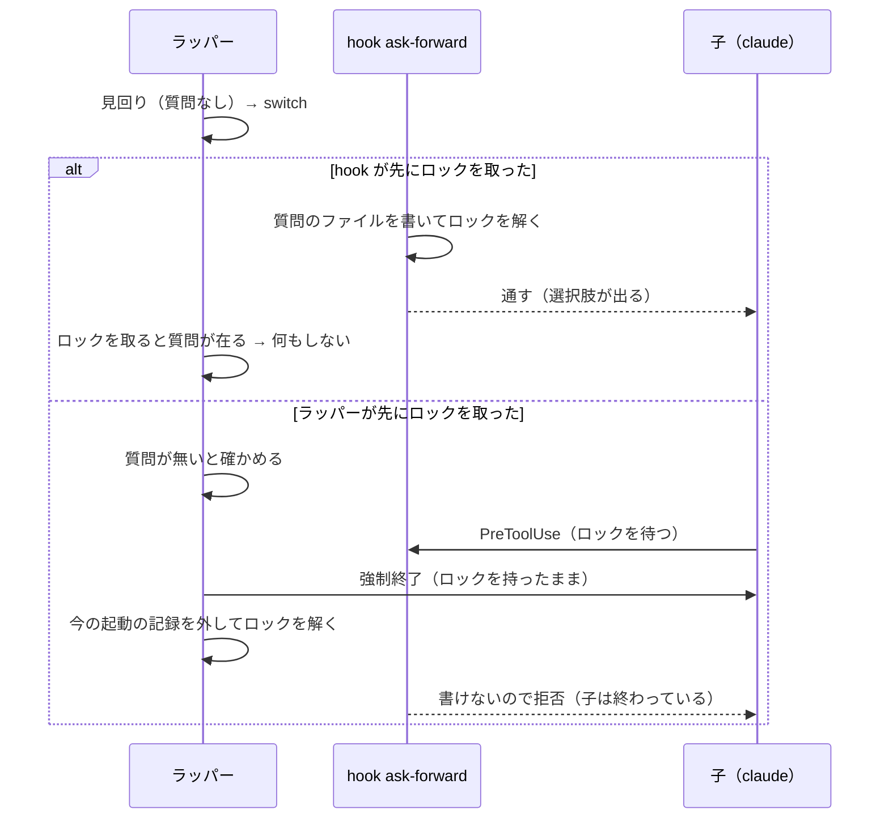

# 中継: 回答待ちの質問のあいだ子を止めず、子の端末へ書かない

11 系のラッパー（`ndf relay`。claude を包み、カットポイントで次の claude を新しい会話（セグメント）として起動する）は、
子の claude が `AskUserQuestion` の選択肢を画面に出している間は、子を止めず、子の端末へ何も書かない。質問の hook と
ラッパーは同じロックで順番をそろえ、質問が閉じたことは hook が知らせる。承認ゲートの質問は、利用者かオーガナイザーが
答えるまで画面に残る。この文書は、その振る舞い・ファイルと記録の形・常に成り立つ条件と、それぞれをそう決めた理由を残す。

| 何を読むか | 正本 |
| --- | --- |
| 利用者向けの案内（判断の順の表・質問の閉じ方の表・Stop の hook の扱い） | `plugins/ndf/skills/development-workflow/references/relay.md` の「承認ゲートを越えない守り」 |
| ラッパーの判断の純粋な関数（質問以外の分岐） | `plugins/ndf/src/ndf/domains/relay/switch_decide.py` |
| 本文で人の回答を待って終えた応答への変更要求（`stop-wait`。ルールの前置きの後に軽いモデルで判定する） | [ndf-hook-stop-wait-judge.md](ndf-hook-stop-wait-judge.md)（10 系の差し戻しの経緯は [ndf-relay-goal-skill-and-prose-wait.md](ndf-relay-goal-skill-and-prose-wait.md)） |
| プラグインの更新と、同じ会話を起動し直す手の更新の扱い | [ndf-relay-plugin-update.md](ndf-relay-plugin-update.md) |

[ndf-relay-segment-restart.md](ndf-relay-segment-restart.md)・[ndf-relay-install-and-restart.md](ndf-relay-install-and-restart.md) には、
10 系の守り（`/exit` の書き込み・`question.lock`・`asked`・`wait-held.json`）の記述が残る。質問の表示中の扱いについて
それらとこの文書が食い違うときは、この文書が正である（残る記述の直しは [#3897](https://github.com/devbasex/ai-plugins/issues/3897)・[#3900](https://github.com/devbasex/ai-plugins/issues/3900)・[#3901](https://github.com/devbasex/ai-plugins/issues/3901)）。

## 概要

**例: セグメント 1 の子が `ndf-next` のブロックを書いた後、`/goal` が未達のため応答を続け、設計承認ゲートの質問を出す。**

| 順 | 起きること |
| ---: | --- |
| 1 | Stop の hook（`relay-marker`）が次のセグメントのマーカー（`next.json`）を書く |
| 2 | 子が `AskUserQuestion` を呼ぶ。PreToolUse の hook（`ask-forward`）がロック `question.json.lock` の中で質問のファイル（`question.json`）を書いて通し、選択肢が出る |
| 3 | 次の見回りでラッパーが質問のファイルを読み、質問を人かオーガナイザーへ 1 回だけ転送する（`forward`）。質問のファイルは消さない |
| 4 | 静かな時間を過ぎてマーカーが残っていても、ラッパーは待つ（`wait`）。子を止めず、子の端末へ書かない |
| 5 | 利用者が答えると、PostToolUse の hook（`ask-answered`）が同じ `tool_use_id` の質問のファイルを消す |
| 6 | 次の見回りでラッパーはマーカーを見て、ロックの中で質問が無いと確かめてから子を強制終了し、セグメント 2 を起動する（`switch`） |

**コンテキストはラッパー（`ndf-relay`）と hook の guard の 2 つにまたがる。** 質問のファイル・ロック・今の起動の記録は
中継の作業ディレクトリ（`NDF_RELAY_DIR`）に置き、両者が `ndf.domains.relay.signals` の同じ関数で読み書きする。

### 構成要素と責務

| 要素 | 責務 |
| --- | --- |
| `switch_decide.decide`（`plugins/ndf/src/ndf/domains/relay/switch_decide.py`） | 質問があれば最初に見て、転送していなければ `forward`、転送していれば `wait` を返す。何も読まない純粋な関数 |
| `Wrapper._question`・`_state`（`plugins/ndf/src/ndf/domains/relay/wrapper.py`） | 見回りごとに質問のファイルを読み、子が終わった・今の子のものでない質問を消し、回答待ちか・転送したか・質問の ID を判断へ渡す。壊れた・読めないファイルは回答待ちとして渡す |
| `Wrapper._on_wait_like` | 質問を転送し、転送した質問の ID を残す。質問のファイルは消さない |
| `StopSteps._stop_if_clear`・`_stop_child`（`plugins/ndf/src/ndf/domains/relay/wrapper_stop.py`） | ロックを待たずに取り、質問のファイルが無いと確かめ、ロックを持ったまま子を強制終了し、今の起動の記録を外す。引継ぎ・止まりの起動し直し・見回りの切り替えでは、同じロックの中でバックグラウンドの作業の記録も読み直す（[ndf-relay-background-wait.md](ndf-relay-background-wait.md)） |
| `Wrapper._on_switch`・`_on_resume`・`_on_handover`・`_halt_broken` | 子を止める手（`switch`・`account`・`restart`・`handover`・設定が壊れたときの終わり）。どれも `_stop_if_clear` を通ったときだけ子を止める |
| `Wrapper._start` | 子ごとに起動の ID を作り、今の起動として記録し、環境変数 `NDF_RELAY_LAUNCH` で子へ渡す（保存先と会話の ID も `launch_env` で一緒に渡す） |
| `signals`（`plugins/ndf/src/ndf/domains/relay/signals.py`） | 質問のファイルの読み（`read_question`・`question_present`・`question_id`）と書き（`write_question`）、ロックの中で消す（`drop_question`）、今の起動の記録（`set_launch`・`current_launch`・`launch_env`・`relay_launch`） |
| hook `ask-forward`（`plugins/ndf/src/ndf/domains/hooks/guards/ask.py`） | 中継の下では、ロックの中で今の起動の質問として書けたときだけ `AskUserQuestion` を通し、書けなければ拒否する。先に動いた guard（`reading-check`。読み手役の確認の記録が無い質問を止める。[ndf-writing-criteria-and-reading-check.md](ndf-writing-criteria-and-reading-check.md)）が質問を止めていれば、何も書かない |
| hook `ask-answered`・`ask-closed`（`plugins/ndf/src/ndf/domains/hooks/guards/ask_clear.py`） | 質問が閉じたら、ロックの中で質問のファイルを消す。いつも通す |
| `dispatch.run`・`_call`・エントリポイントの締め切りの経路（`plugins/ndf/src/ndf/domains/hooks/dispatch.py`・`main.py`） | guard の表の列 `fail_closed` が真の guard を、締め切り・例外・拒否の数えで通す側へ倒さない |

## 用語

「回答待ちの質問」「質問の ID」の定義は、設定の用語集（`.ndf/glossary.json` の `document` が指す [docs/glossary.md](../glossary.md)）の
コンテキスト `ndf-relay` にある。ラッパー・セグメント・カットポイント・マーカーも同じコンテキストの語のまま使う。
「手」（`switch`・`account`・`restart`）は [ndf-relay-plugin-update.md](ndf-relay-plugin-update.md) の「用語」のとおりで、この文書は
`handover`（文脈の量が上限を超えたとき、同じ会話を引継ぎを頼む文で起動し直す手）を足して使う。

この文書だけで使う語:

| 語 | 意味 |
| --- | --- |
| 起動の ID | ラッパーが子の claude を 1 回起動するごとに作る値（`uuid4` の 16 進）。同じ会話を `--resume` で起動し直しても変わる。環境変数 `NDF_RELAY_LAUNCH` で子と、子が起動する hook へ渡る |
| 今の起動の記録 | 作業ディレクトリの `launch.json`。いま動いている子の起動の ID を持つ。子を止めたロックの中で外し（`null`）、次の子の起動の前に書く |

## 背景

ラッパーは 0.5 秒ごとの見回りで状態を集め、判断の純粋な関数が返す手を 1 つ打つ。判断は質問を最初に見る作りだったが、
質問を転送した直後に質問のファイルを消していたため、次の見回りからは質問が無いと読み、マーカー・文脈の上限・出力の止まりの
とおりに子を強制終了するか、引継ぎの 1 行と改行を子の端末へ書いていた。守りは見回り 1 回分しか続かず、承認ゲートの質問は
答える前に画面から消え、改行は人の代わりに選択肢 1 を選んだ（2026-11-19 に偽の子で再現）。

判断と手のあいだにも同じ穴があった。見回りが質問なしと読んでから子を止めるまでの間に、hook は質問を書け、子は選択肢を出せる。
hook がロックを取れない・書けないときは質問を記録せずに通し、hook の枠組みも guard の例外・締め切り・同じ拒否の繰り返しで
通す側へ倒れていた。

切り替えは 11 系のまま強制終了（`terminate(force=True)`）で行う。強制終了は子の端末へ何も書かないので、10 系が `/exit` の改行に
備えて要した時刻の記録と保留のファイルは要らない。11 系で足りなかったのは、質問が閉じるまで質問のファイルを残すことと、
hook とラッパーの順番をロックでそろえることである。

## 対象範囲

含む:

- ラッパーが、質問のファイルを質問が閉じるか子が終わるまで残し、その間は切り替え・起動し直し・引継ぎをしない
- 1 つの質問の転送を 1 回だけにする
- 質問の hook が、ロックの中で書けたときだけ質問を通す。ラッパーはロックを持ったまま質問が無いと確かめて子を止め終える
- 質問が閉じたら hook が質問のファイルを消す
- 引継ぎを子の端末へ書かず、同じ会話の起動し直しで頼む

含まない:

- 切り替えを `/exit` で行うこと
- 会話の記録から回答の無い質問を推し量ること・質問のファイルを手で消すコマンド
- マーカーの後の利用者の入力・背景の作業で切り替えを取り消すこと（`/goal` が未達でも切り替える。#2438）
- 手順書の「上限」（#3815）とリレーハブ（#3818）の記述

## 仕様

### 集約

**集約はラッパー 1 本の実行の「今の子」である。** 子 1 つにつき、起動の ID・会話の ID・転送した質問の ID・この見回りで読んだ質問・
壊れた質問の行を書いたかを持つ（`Section` の `launch`・`session_id`・`forwarded_question`・`pending`・`broken`）。
質問のファイルと今の起動の記録はこの子に属し、子が終われば消える・外れる。

### 常に成り立つ条件

| # | 対象 | 条件 | 破れたときの扱い |
| --- | --- | --- | --- |
| I1 | ラッパー 1 本の実行 | 回答待ちの質問がある間は、`switch`・`account`・`restart`・`handover` を打たない（子を止めず、子の端末へ書かない） | テストが落ちる |
| I2 | ラッパー 1 本の実行 | 1 つの質問の転送は 1 回だけで、`log.jsonl` の `forward` の行と `plan_question` の行（計画のレーン）は 1 つずつである。続けて別の質問が来ても、その質問の行は省かない | テストが落ちる |
| I3 | 中継の作業ディレクトリ | ラッパーが質問のファイルを消すのは、子が終わったとき・質問が今の子のものでない（起動の ID、無ければ会話の ID が違う）ときだけである | テストが落ちる |
| I4 | ラッパー 1 本の実行 | 子を止めるのは、ロック `question.json.lock` を取り、質問のファイルが無い（壊れていても・確かめられなくても在るとみなす）と確かめたときだけで、ロックは子が終わるまで持つ。取れない・在るなら、その見回りでは何もしない（マーカー・`account` の行・起動の回数はそのまま）。次の子は前の子の終わりを確かめてから起動する | テストが落ちる |
| I5 | 中継の作業ディレクトリ | 質問のファイルを消すのは、ロックの中で読み直した質問が消す条件に合う・壊れているときだけである。hook の起動の ID が今の起動の記録と違えば、hook は何も消さない | テストが落ちる |
| I6 | ラッパー 1 本の実行 | ラッパーは子の端末へ自分から書かない。書くのは利用者が端末で打った入力を渡すとき（`_pump`）だけである | テストが落ちる |
| I7 | 質問の hook | 中継の下（`NDF_RELAY_DIR` がある）で `AskUserQuestion` を通すのは、ロックの中で今の起動の質問として書けたときだけである。ロックを取れない・書けない・記録の途中の例外・締め切りのどれでも拒否し、拒否を案内へ下げない | テストが落ちる |

### 判断の順と質問の分岐

判断の順（質問 → 利用上限と認証の失敗 → マーカー → 子の終わり → 見回りの切り替え → 文脈の上限 → 出力の止まり）と各分岐の手は、
[relay.md の「承認ゲートを越えない守り」](../../plugins/ndf/skills/development-workflow/references/relay.md#承認ゲートを越えない守り)の表が正である。見回りの切り替えは子が動いている間だけ判断するので、子の終わりと重ならない。
質問の分岐は次のとおりで、質問が無いときの分岐は質問の扱いを足す前と同じである。

| 判断への入力 | 手と理由の文 |
| --- | --- |
| 質問あり・転送していない | `forward`。理由は `FORWARD`（質問の ID を入れる）。ID が無ければ `FORWARD_UNKNOWN` |
| 質問あり・転送した | `wait`。理由は `QUESTION_PENDING` |

理由の文に質問の ID が入るので、直前と同じ理由を省く `Wrapper._note` でも、続けて来た別の質問の `forward` の行が残る（I2）。

### 見回りの質問の扱い

`Wrapper._question` は上から順に最初に当たった行で決める。

| 条件 | 扱い |
| --- | --- |
| 読むと壊れている・読めない（`SignalError`。読めないのは子のクラス `QuestionUnreadable`） | 子が終わっていれば消して質問なし。生きていれば、最初の 1 回だけ `question_broken` の行を書き、回答待ち・転送済みとして渡す（`wait`。転送はしない） |
| 質問のファイルが無い | 転送した質問の ID と壊れた行の印を戻し、質問なし |
| 子が終わっている | 消して質問なし |
| 質問の `launch` が文字列で今の子の起動の ID と違う。`launch` が無く `session_id` が今の子と違う | 読んだ質問の `tool_use_id`・`at`・`launch` を条件にロックの中で消し、消せたら `stale_question` の行を書く。質問なし |
| 上のどれでもない | 回答待ち。転送したかは、転送した質問の ID と比べて決める（ID の無い質問は空の文字列として比べ、1 回だけ転送する） |

消せなかった質問は、その見回りでは質問なしとして返す。子を止める手が出ても、`_stop_if_clear` が質問のファイルを見て止めない（I4）。

### 質問の hook とラッパーの順番

- ラッパーはロックを待たずに取る。ロックを持つのは強制終了の最大 0.4 秒と、終わらなければ `relay.child-exit` の秒までである
- 子を止めた後は、結果に依らずロックの中で今の起動の記録を外す。止めた子の hook がロックを待っていても遅れて動いても、
  起動の ID が今の起動と一致しないので書けず、次の子の質問を上書きしない
- 強制終了が偽を返しても `relay.child-exit` の秒のうちに子が終われば止めたとする。終わらなければ次の子を起動せず、
  停止理由 `refused`（`CHILD_ALIVE`）で終わる
- 安全は時間に依らない。ラッパーが確かめから止め終えるまでに待たされても、hook はロックを待つか拒否するだけで、選択肢は出ない

### 質問が閉じる

| 閉じ方（Claude Code の hook の事象） | 消す guard | 消す条件（ロックの中で読み直す） |
| --- | --- | --- |
| 選択・自由入力で回答した（PostToolUse） | `ask-answered` | `tool_use_id` が入力と同じか、壊れている。入力の `tool_use_id` が欠落・空・文字列以外なら何もしない（続く Stop で消える） |
| Chat about this の後に応答を終えた（Stop） | `ask-closed` | 在る質問（壊れていても） |
| Esc で閉じ、人が次に入力を送った（UserPromptSubmit） | `ask-closed` | 同上 |

- どちらの guard も、中継の下で、hook の起動の ID があり、質問のファイルが在るときだけ働く。消すのは hook の起動の ID が今の起動の記録と同じときだけである
- `ask-closed` が質問を選ばずに消してよいのは、今の子が Stop か UserPromptSubmit を起こした時点で、その子の画面に質問は出ていないためである。会話の ID は `--resume` の前後で同じなので、見分けには起動の ID を使う
- ロックを取れない（`busy`）・読み直せない・消せない（`failed`）ときは何もせずに通し、結果を計測の `notes` の `cleared` に残す。質問のファイルは残り、ラッパーは子を止めない。残った質問は次の閉じる事象（回答の PostToolUse の後には Stop が続く）か子の終わりで消える

### 引継ぎ

文脈の量が上限以上で静かで、バックグラウンドの作業が残っていないときは、上と同じ手順で子を止め、同じ会話を `claude --resume <同じ ID> <引継ぎを頼む文>` で
起動し直す。新しい子は引数の文を最初の入力として受け取るので、選択肢が出ている画面へ改行が届くことは無い。
起動し直した子は引継ぎを頼んだ（`handover_asked`）として続き、起動し直しの回数には数えない。`account`・`restart` で同じセグメントを
起動し直したときも、前の子の `handover_asked` を引き継ぐ（同じセグメントで引継ぎを 2 回頼まない）。

### 設定が壊れたときの終わり

判断の途中でマーカーかアカウントの設定が壊れていると分かったら（`SignalError`・`AccountError`）、ラッパーは判断をやめ、
状態のファイルを `waiting`（理由は例外の文と `HALT_BROKEN`）にして、子の出力と利用者の入力だけを渡し続ける。
見回りごとに `_stop_if_clear` を試し、止められたか子が終わったら停止理由 `config_broken`（終了コード 2）で終わる。
回答待ちの質問がある間は子を止めない。

### hook の締め切りと例外

guard の表（`plugins/ndf/contracts/hooks/guards.json`）の列 `fail_closed` が真の guard（`ask-forward` と `relay-busy`）は、次のように扱う。

| 経路 | `fail_closed` が偽（ほかの guard） | `fail_closed` が真 |
| --- | --- | --- |
| `dispatch.run` の予算の締め切りを過ぎた | 呼ばずに飛ばす | 呼ぶ |
| guard が例外を出した | 通す | 拒否（`GUARD_FAILED`。例外の種類の名前だけを入れる） |
| 同じ拒否を上限より多く返した・数え手が使えない | 案内へ下げる | 拒否のまま |
| エントリポイントの締め切り（guard を呼ぶ前に残りが無い・途中で割り込みが来た） | 出力なし・終了コード 0 | guard のモジュールの `on_deadline(env, payload)` が理由を返せば拒否 |

`ask-forward` の `on_deadline` は、中継の外なら通す。同じ実行の `check` が中継へ記録し終えていれば、その後の転送の途中の
割り込みなので通す（記録した質問は消さない）。記録の途中の割り込みなら、同じ `tool_use_id` の質問をロックを待たずに消して拒否する。
`ask-forward` は、中継の環境変数の名前をコントラクト（`contracts/domains/env.json`）から引けなければ、どこにも書かずに通す（#4126）。
記録の後のオーガナイザーへの書き込みと待ちの知らせの例外を自分で捕まえて通し、例外の種類を計測の `forward_errors` に残す。

### ドメインイベント

| イベント | 引き金 | 失敗したとき | 順序の前提 |
| --- | --- | --- | --- |
| マーカーを書いた | 最後の応答が `ndf-next` のブロックを持ち、バックグラウンドの作業が無い（監視は残っていてもよい） | 作業が残る: 変更を要求して書かない | — |
| 子が質問を出した | `ask-forward` がロックの中で質問のファイルを書いた | ロックを取れない・書けない: 拒否し、選択肢は出ない | — |
| 質問を転送した | 見回りで転送していない質問を見つけた | 計画のリクエストへ載せられない: 理由を状態と `log.jsonl` に書く。ID は残す | 子が質問を出した |
| 質問が閉じた | 回答（PostToolUse）・回答せずに閉じた後の Stop か UserPromptSubmit | — | 子が質問を出した |
| 質問のファイルが消えた | 閉じた質問を hook が消した・ラッパーが子の終わりか今の子のものでない質問を消した | 消せない: 残り、ラッパーは子を止めない | 子が質問を出した |
| 子を止めて次の子を起動した | 子を止める手が出て、ロックの中で質問が無いと確かめた | 子が終わらない: `refused` で終わる | 質問があれば、そのファイルが消えた後 |

## データ・設定

### 中継の作業ディレクトリのファイル

| ファイル | 書き手 | 中身 |
| --- | --- | --- |
| `question.json` | `ask-forward`（`write_question`、原子的な置き換え） | `session_id`・`tool_use_id`・`questions`・`cwd`・`at`（ISO 8601）・`launch`（起動の ID。hook の環境に起動の ID がある書き込みだけ） |
| `question.json.lock` | `ask-forward`・`ask-answered`・`ask-closed`・`relay-busy`・ラッパー | 排他のロックのファイル（`signals.STOP_LOCK`）。`relay-busy` は作業と監視の開始の記録で取る |
| `launch.json` | ラッパー（`set_launch`） | `{"launch": <起動の ID か null>}` |
| `.question.forward.json` | ラッパー（`_ask_plan`） | 計画のリクエストへ渡す質問のコピー。渡し終えたら消す |

`write_question` の照らし方:

| hook の環境変数の起動の ID | 書く条件 |
| --- | --- |
| 在る | ロックの中で `launch.json` の値が同じ文字列のとき |
| 無い | `launch.json` が無いとき（起動の ID を渡さない前のバージョンのラッパーの下）。在れば書かずに偽 |
| 引数を渡さない（オーガナイザーの質問の保存先への書き込み。番兵 `UNCHECKED`） | 照らさずに書く |

### 環境変数

| 名前 | 書き手 | 意味 |
| --- | --- | --- |
| `NDF_RELAY_LAUNCH` | ラッパーが子を起動するとき（`launch_env`。`NDF_RELAY_DIR`・`NDF_RELAY_SESSION` と並べる） | その子の起動の ID |

### `log.jsonl` の行

| `kind` | 書く時点 | ほかのキー |
| --- | --- | --- |
| `forward` | 質問を転送した（`_note`） | `reason`（質問の ID を含む） |
| `plan_question` | 計画のレーンで質問を計画のリクエストへ載せた・載せられなかった | `ok`・`reason` |
| `question_broken` | 子が生きている間に壊れた・読めない質問のファイルを最初に読んだ | `reason` |
| `stale_question` | 今の子のものでない質問を消した | `reason` |

質問の本文と選択肢は書かない。

### 上限と表

| 場所 | 値 |
| --- | --- |
| `plugins/ndf/contracts/limits/` の `hook.ask-forward` | 0.3 秒。hook がロックを待つ上限（`ask-forward`・`ask-answered`・`ask-closed` で共通） |
| 同 `relay.child-exit` | 5 秒。強制終了が偽を返した後に子の終わりを待つ上限 |
| `guards.json` の `fail_closed` | どの行も必須の列。真は `ask-forward` と `relay-busy` |
| `guards.json` の `ask-answered` / `ask-closed` | PostToolUse・Tool `AskUserQuestion`・`order` 60 / Stop と UserPromptSubmit・Tool なし・`order` 10（`relay-marker` より前） |
| `plugins/ndf/contracts/hooks/runtimes.json` | Claude Code の PostToolUse の `optional` に `tool_use_id`。Codex の `skipped` に `ask-answered`・`ask-closed`（AskUserQuestion の Tool が無い） |
| `ndf relay decide` の入力 | `question_forwarded`（既定で偽）・`question_id`（既定で null）。無い入力の JSON も読める |

## 外部連携

| 相手 | 頼る振る舞い | 出典 |
| --- | --- | --- |
| Claude Code の hook | PreToolUse は選択肢の表示の前に動き、拒否（`permissionDecision: deny`）すると選択肢は出ない。PreToolUse と PostToolUse の入力に `tool_use_id` が入る | https://code.claude.com/docs/en/hooks （2026-11-19） |
| Claude Code 2.1.329 の `AskUserQuestion` | 回答（選択・自由入力）では回答の時点で PostToolUse が `tool_response.answers` を持って動く。Esc・Chat about this では PostToolUse も PostToolUseFailure も動かない。Chat about this の後は応答を終えたときに Stop、Esc の後は人が次に入力を送ったときの UserPromptSubmit まで hook は動かない。Ctrl+C では質問は閉じない。質問が出る前に端末へ送った Enter は、出た質問の 1 番目を選ぶ | 対話の起動で記録だけの hook を置いて実測（2026-11-20。回答 3 回・Esc 2 回・Chat about this 1 回・Ctrl+C 1 回） |
| ptyprocess 0.7.0 の `PtyProcess.terminate(force=True)` | SIGHUP・SIGCONT・SIGINT・SIGKILL を 0.1 秒おきに送り、子が終わった時点で真を返す。SIGKILL の後も終わらなければ偽。子の端末へは何も書かない | 手元の `inspect.getsource(PtyProcess.terminate)`（2026-11-19） |

## エラー処理

| 失敗 | 扱い | 利用者に見えるもの |
| --- | --- | --- |
| 質問のファイルが壊れている・読めない（権限・I/O・不正な UTF-8・ディレクトリ） | 回答待ちとして扱い、子を止めない。閉じる hook が壊れたファイルを消す（読めないファイルは条件つきの消去では消さない） | 状態 `waiting`。`question_broken` の行 |
| hook がロックを取れない・書けない（中継の下） | `AskUserQuestion` を拒否する（`QUESTION_NOT_RECORDED`） | 子の会話に拒否の理由。モデルが呼び直す |
| 閉じる hook が消せない | 通し、質問のファイルは残る。ラッパーは子を止めない | 次の閉じる事象か子の終わりまで切り替わらない |
| ラッパーがロックを取れない・質問が在る | その見回りでは何もしない | 次の見回りで決め直す |
| 強制終了しても子が終わらない | 次の子を起動しない | 停止理由 `refused`（`CHILD_ALIVE`） |
| マーカー・アカウントの設定が壊れた | 回答待ちの質問がある間は子を止めずに待つ | 状態 `waiting`。止められたら `config_broken`（終了コード 2） |
| 計画のリクエストへ載せられない | 理由を状態と `log.jsonl` に書き、同じ質問を転送し直さない | 状態 `waiting` の理由 |

## セキュリティ

- `log.jsonl` と計測には質問の本文と選択肢を書かない。`GUARD_FAILED` には例外の種類の名前だけを入れ、パスを含みうる例外の文を会話へ入れない
- 消すのは `Path.unlink` だけで、`question.json` がディレクトリでも再帰で消さない

## 運用

- 守りのうちラッパーが受け持つ部分の変更は、`/exit` でラッパーを抜けて `claude` と打ち直した後に効く。hook が受け持つ部分は次のセグメントから効く
- 起動の ID を渡さない前のバージョンのラッパーの下で今の hook が動いても、`launch.json` が無いので質問を書いて通す（質問を出せなくならない）
- Esc で閉じた質問は、人が次に入力を送るか子が終わるまで残り、その間は切り替え・起動し直し・引継ぎが止まる。閉じる hook が消し損ねたときも同じで、拾い直す仕組みと手で消すコマンドは置かない
- 回答待ちの間は、文脈の量が上限を超えても引継ぎが回答の後へずれる。引継ぎのたびに同じ会話を `--resume` で読み直す時間がかかり、入力欄に打ちかけた文は消える
- PreToolUse の hook がプロセスとして動かない（NDF の仮想環境が無くエントリポイントの `boot.py` が通す・登録の timeout 3 秒で打ち切られる）ときは、質問のファイルの無いまま選択肢が出て守れない

### 未確認のまま残ること

| 項目 | 内容 |
| --- | --- |
| 実際の claude での守り | 偽の子でしか確かめていない。リリースの後、ラッパーの下で `ndf-next` を出した応答の続きに `AskUserQuestion` を呼び、答えるまで切り替わらず答えた後に切り替わること、Esc の後は次の入力まで待つこと、引継ぎが `--resume` の引数で届くことを見る |
| 拒否された質問の後の claude | 子を止めている最中の拒否の後、子は直後に止まる見込みである。次の子で質問が出直すか（`--resume` したときの振る舞い）は確かめていない |

## 決定と理由

| 決定 | 理由 |
| --- | --- |
| 切り替えは強制終了のままにし、`/exit` を書かない | 強制終了は子の端末へ何も書かず、回答を代わりに送るおそれが無い。`/exit` へ戻すと 10 系の時刻の記録と保留のファイルを作り直すことになる |
| 質問のファイルを質問が閉じるまで残し、転送した質問の間は `wait` を返す | 判断は質問を最初に見るので、`wait` の間は子を止める手と書く手がすべて止まる。転送する中身は ID を取り出したのと同じ読みのコピーにし、ID と中身を食い違わせない |
| hook とラッパーを同じロックで並べ、hook は書けなければ拒否する | 「選択肢が出ている」と「質問のファイルが在る」が一致し、確かめから止め終えるまでに選択肢が出ない。ロックの待ちを延ばしても安全は変わらず、PreToolUse の予算を食う |
| 子ごとの起動の ID で、止めた子の hook を締め出す | 会話の ID は `--resume` の前後で同じなので見分けられない。ロックを次の子の起動まで持ち続けずに、今の起動の記録を外すだけで同じ効果が得られる |
| 質問が閉じたことは hook が知らせる | 会話の記録は非同期に書かれ遅れうる。画面の出力の再開は描き直しでも起き、回答の前に消してしまう。PostToolUse・Stop・UserPromptSubmit は質問の表示中には動かない（実測） |
| 消し損ねを拾い直す仕組みを置かない | 拾い直す記録を足すたびに、記録と質問の置き換わりの競合が生じた。消し損ねは止めない側で待ち、選択肢を越えない |
| 引継ぎは子の端末へ書かず、同じ会話の起動し直しで頼む | 子の端末へ書いた入力を子がいつ読むかはラッパーから決められず、選択肢の後に読まれれば改行が回答を決める |
| 壊れた・読めない質問のファイルは回答待ちとして扱い、設定が壊れたときもロックの確かめを通ってから止める | 質問の状態を読めないときに子を止めると、表示中の質問を消しうる。止めない側へ倒す |
| 質問を記録する guard のうち `ask-forward` を `fail_closed` にし、エントリポイントの締め切りでも拒否する | 枠組みの 3 つの経路とエントリポイントの締め切りは、どれも質問を記録しないまま通していた。ほかの guard の振る舞いは変えない |
| hook の環境変数に起動の ID が無く `launch.json` も無ければ照らさずに書く | 起動の ID を渡さない前のバージョンのラッパーの下で、質問をいつも拒否しないため。今のラッパーは起動の前に必ず記録を書くので、その下の振る舞いは変わらない |
| 記録の後の転送・知らせの失敗では拒否しない | 拒否すると、書いた質問のファイルが表示されない質問の回答待ちとして残り、ラッパーが子を止められなくなる |

## テスト観点

テストは `plugins/ndf/tests/domains/relay/test_relay_wrapper_question.py`・`test_relay_wrapper.py`・`test_relay_decide.py`・`test_relay_parts.py`
（偽の子は `plugins/ndf/tests/support/relay_children.py`）と、`plugins/ndf/tests/domains/hooks/test_ask_clear.py`・`test_guards.py`・`test_dispatch.py` にある。

- マーカーがあり静かな時間を過ぎても、転送した回答待ちの質問があれば `switch` が出ず子が生きていること（I1）
- 回答待ちの間、文脈の量が上限を超えても子の端末へ書かず、出力の止まりを超えても `restart` が出ないこと（I1）
- 1 つの質問で `forward` と `plan_question` の行が 1 つずつで、転送の後に質問が別の質問へ置き換わると行が質問ごとに 1 つずつ残ること（I2）
- 子が終わると質問のファイルが消え、起動の ID の違う質問（同じ会話を起動し直した後を含む）と、起動の ID が無く会話の ID の違う質問が消えて `stale_question` の行が 1 つ残ること（I3）
- `ask-answered` は同じ `tool_use_id` でだけ消し、`ask-closed` は Stop・UserPromptSubmit で在る質問を消すこと。hook の起動の ID が今の起動の記録と違う・無いと何も消さず、壊れたファイルはどれでも消えること。読み直す前に別の質問へ置き換わると消さないこと（I5）
- PostToolUse の入力の `tool_use_id` が欠落・空・文字列以外なら壊れたファイルも残り、続く Stop で消えること。ロックを別のスレッドが持つ・消せないときは質問が残り、ラッパーは子を止めず、続く Stop で消えた後にマーカーがあれば `switch` すること
- 実測の hook の入力の形（PostToolUse の `tool_name`・`tool_use_id`・`tool_response.answers`、Stop、UserPromptSubmit）をエントリポイントへ通すと消えること。中継の外では何もしないこと
- 切り替えで子の端末へ何も書かれずに強制終了されること。引継ぎで子の端末へ書かず、`--resume <同じ ID> <文>` で起動され、`handover_asked` が真で起動し直しの回数が変わらないこと。利用者の入力を渡すとき以外に子の端末へ書かれないこと（I6）
- 中継の下で、ロックを別のプロセスが持つ・書けない・今の起動と起動の ID が違うと `ask-forward` が拒否し、PreToolUse の出力が `permissionDecision: deny` になること。同じ拒否の繰り返し・数え手の不在・先の guard による予算の使い切り・エントリポイントの締め切りでも拒否のままで、中継の外では通すこと（I7）
- 記録の後の転送・知らせの例外では通して `forward_errors` に残し、記録し終えた後の締め切りの割り込みでは質問を消さずに通すこと
- 見回りが質問なしと読んだ直後に質問を書くと、`switch`・`account`・`restart`・`handover` のどれでも子が生きていて、次の見回りで `forward` が出ること。ロックを別のスレッドが持つ間は何もせず、マーカー・`account` の行・起動の回数が変わらないこと（I4）
- ラッパーが強制終了の最中にロックを持ち、その間の書き込みが偽を返すこと。止めた起動の hook を次の子が質問を書いた後に再開すると拒否され、質問のファイルは次の子の質問のまま、次の子が生きていること（I4・I7）
- 強制終了が偽を返し子が終わらないと次の子を起動せず `refused` で終わり、`relay.child-exit` の秒のうちに終われば起動すること（I4）
- 壊れた質問のファイル（不正な JSON・不正な UTF-8・読む権限が無い。root では飛ばす）で `wait` と `question_broken` の行が 1 つになり、子が止まらないこと。回答待ちの間にマーカーを壊すと子を止めず `waiting` になり、質問が消えた後に `config_broken` で終わること
- `question_forwarded` の無い `ndf relay decide` の入力が読め、質問があり転送していなければ `forward` になること。質問が無いときの切り替え・上限・認証の失敗の判断が変わらないこと
- `fail_closed` が偽の guard は、例外で通し・締め切りで飛ばし・同じ拒否を案内へ下げる振る舞いのままであること

## 関連リンク

- 課題: [#3814](https://github.com/devbasex/ai-plugins/issues/3814)
- 範囲の外として残る記述の直し: [#3897](https://github.com/devbasex/ai-plugins/issues/3897)（relay.md の冒頭の例と「止め方」の表）・[#3900](https://github.com/devbasex/ai-plugins/issues/3900)（hook の締め切りを書いた確定仕様）・[#3901](https://github.com/devbasex/ai-plugins/issues/3901)（`ndf-relay-segment-restart.md`・`ndf-relay-install-and-restart.md` の 10 系の守り）
- [ndf-relay-background-wait.md](ndf-relay-background-wait.md)・[ndf-relay-segment-restart.md](ndf-relay-segment-restart.md)・[ndf-relay-install-and-restart.md](ndf-relay-install-and-restart.md)・[ndf-relay-plugin-update.md](ndf-relay-plugin-update.md)・[ndf-relay-goal-skill-and-prose-wait.md](ndf-relay-goal-skill-and-prose-wait.md)
- [Claude Code の hook](https://code.claude.com/docs/en/hooks)
