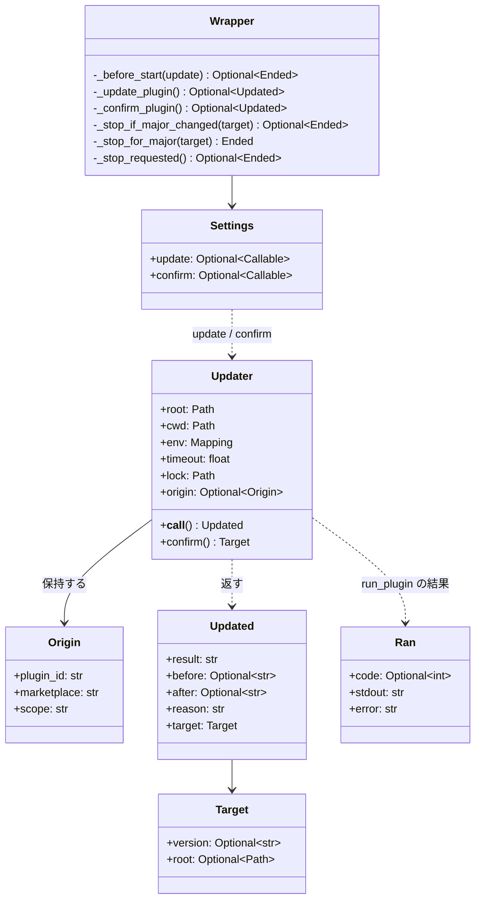
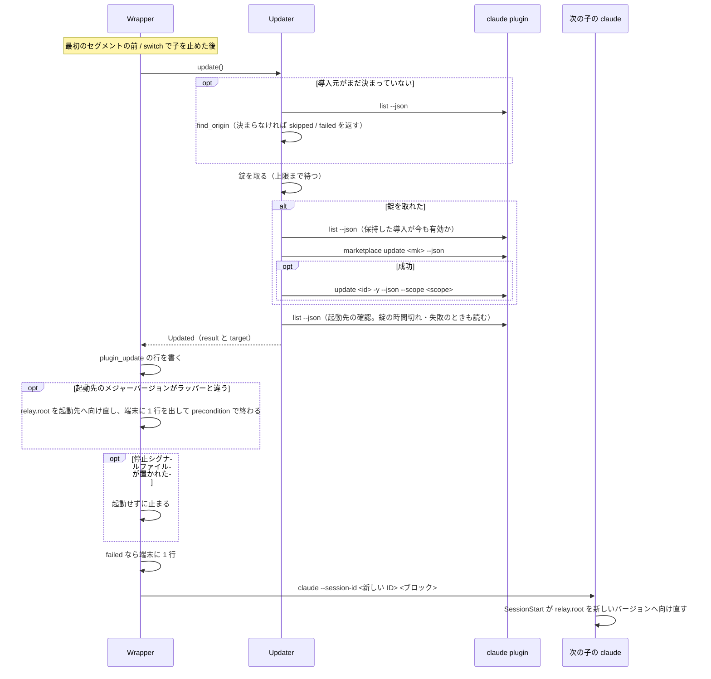

# 中継: 最初のセグメントの前とカットポイントでプラグインを更新し、次のセグメントを新しいバージョンで始める

11 系のラッパー（`ndf relay`。claude を包み、カットポイントで次の claude を新しい会話（セグメント）として起動する）は、
新しいセッションで始める最初のセグメントの前と、カットポイントの切り替え（`switch`）で、マーケットプレイスと NDF を
`claude plugin` のコマンドで最新のバージョンへ上げてから次の claude を起動する。リリースした直しは、利用者の操作なしで
次のカットポイントから動いているレーンへ届く。この文書は、更新の振る舞い・記録の形・常に成り立つ条件と、
それぞれをそう決めた理由を残す。

| 何を読むか | 正本 |
| --- | --- |
| 利用者向けの案内（変更が効く時点・端末の 1 行への対処・`log.jsonl` の行の種類と `jq` の例） | `plugins/ndf/skills/development-workflow/references/relay.md` の「プラグインの更新とラッパーのバージョン」「落ちたときの続け方」「記録の読み方」 |
| 更新の上限と錠の保存先 | `plugins/ndf/contracts/limits.json` の `relay.plugin-update`、`plugins/ndf/contracts/domains/locations.json` の `relay-plugin-update` |
| リレーハブ（`spawn`・`restart`・`ls`）の入出力 | [ndf-relay-multi-session-supervisor.md](ndf-relay-multi-session-supervisor.md) |

10 系のラッパーは、カットポイントの更新に失敗すると次のセッションを起動せずに終わり（`update-failed`）、ラッパー自身を
新しいバージョンへ入れ替えていた（reexec・`handover.json`）。11 系はどちらも持たない。[ndf-relay-segment-restart.md](ndf-relay-segment-restart.md)
などに残る 10 系の記述とこの文書が食い違うときは、この文書が正である（確定仕様と用語集の 10 系の記述の直しは
[#3847](https://github.com/devbasex/ai-plugins/issues/3847)）。

## 概要

**例: 11.0.8 のラッパーの下で、マーケットプレイスに 11.0.9 が出た後のカットポイント。**

| 順 | 起きること |
| ---: | --- |
| 1 | セグメント 1 の claude が `ndf-next` のブロックを出して応答を終える。ラッパーは `switch` を選び、今の子を止める |
| 2 | ラッパーが設定の保存先の錠を取り、`claude plugin marketplace update ai-plugins --json` → `claude plugin update ndf@ai-plugins -y --json --scope user` をこの順で 1 回ずつ打つ |
| 3 | 導入の一覧（`claude plugin list --json`）を読み直し、次の子が読む起動先のバージョン（11.0.9）と導入先を確かめる |
| 4 | `log.jsonl` に `{"kind": "plugin_update", "result": "updated", "from": "11.0.8", "to": "11.0.9", "launched": "11.0.9", ...}` の 1 行を書く |
| 5 | セグメント 2 の claude を起動する。子は 11.0.9 の導入先の hook と Skill で始まり、SessionStart が `relay.root` を 11.0.9 へ向け直す |
| 6 | 利用者が次に `/exit` して `claude` を打ち直すと、11.0.9 のラッパーが起動する |

**更新の処理はこの仕様で 11.0.8 に入った。** 11.0.7 以前のラッパーはカットポイントでも最初のセグメントの前でも更新せず、`plugin_update` の行も書かない。
そこから移るときは、手順 2 の 2 つのコマンドを 1 度だけ手で打つ。次のセグメントの SessionStart が `relay.root` を上げたバージョンへ向け直し、
利用者が `/exit` して `claude` を打ち直すと 11.0.8 以後のラッパーになる。以後は上の表のとおりカットポイントで更新する。

**コンテキストはラッパー（`ndf-relay`）の 1 つで閉じる。** 更新・記録・バージョンの混ざりの判定は、どれもラッパーとリレーハブの中にある。

### 構成要素と責務

| 要素 | 責務 |
| --- | --- |
| `plugin_update`（`plugins/ndf/src/ndf/domains/relay/plugin_update.py`） | 導入済みの一覧から自分の導入元を選ぶ判断（`find_origin`・`held_row`・`find_target`）と、2 つのコマンドの結果から更新の結果を決める判断（`read_update`）、メジャーバージョンの比べ（`major_changed`）。どれも純粋な関数。錠の中で 2 つのコマンドを打ち、起動先を一覧で確かめる手（`Updater`） |
| `ndf.adapters.claude`（`plugins/ndf/src/ndf/adapters/claude.py`） | `claude plugin <args>` を上限の秒で 1 回打ち、終了コードと標準出力を返す（`run_plugin`・`Ran`）。導入の一覧を読む（`list_plugins`。環境を受け取れる） |
| `Wrapper`（`plugins/ndf/src/ndf/domains/relay/wrapper.py`） | 子を起動する直前の準備（`_before_start`）で、更新の手か確認の手を呼び、`plugin_update` の行を書き、メジャーバージョンの違い・停止シグナルファイルで止め、更新の失敗を端末へ 1 行出す |
| `wrapper_settings`（`plugins/ndf/src/ndf/domains/relay/cli.py`） | `Updater` を組み、その呼び出しを `Settings.update`、`confirm` を `Settings.confirm` へ渡す |
| `tool_env`（`plugins/ndf/src/ndf/domains/relay/session_env.py`） | `claude plugin` のコマンドへ渡す環境（子へ渡さない変数と NDF の `src` の `PYTHONPATH` を外し、NDF が子に入れる値は入れない。`CLAUDE_CONFIG_DIR` は残す） |
| `hub_decide.mixed`（`plugins/ndf/src/ndf/domains/relay/hub_decide.py`） | 動いているラッパーとのバージョンの混ざりをメジャーバージョンで判定する |
| `install.follow`・`install.points_at`（`plugins/ndf/src/ndf/domains/relay/install.py`） | メジャーバージョンの違いで止まる前に `relay.root` を起動先へ向け直す・既に向いているかを確かめる |

## 用語

「プラグインの更新」の定義は、設定の用語集（`.ndf/glossary.json` の `document` が指す [docs/glossary.md](../glossary.md)）にある。
ラッパー・セグメント・カットポイント・リレーハブは用語集のコンテキスト `ndf-relay` の語のまま使う。

「手」はラッパーが子の claude に対して打つ操作の種類である。`switch` はカットポイントで次のセグメントを新しい会話として始め、
`account` は上限に当たったアカウントを替えて同じ会話を `--resume` で再開し、`restart` は子が終わった・止まったときに
同じ会話を `--resume` で起動し直す。リレーハブの `ndf relay restart`（レーンのラッパーを起動し直す）とは別である。

## 背景

- Claude Code の自動の更新は、既定でマーケットプレイス `ai-plugins` には働かない。働いても最初のメッセージから最長 10 分後に走り、今のセッションは読み込んだバージョンのまま続く（[Claude Code のプラグインの読み込み](https://code.claude.com/docs/en/plugins/loading.md)）。カットポイントの次のセグメントが新しいバージョンで始まる保証は、ラッパーが自分で更新しなければ得られない
- 更新したバージョンは次の起動から読み込まれる。旧いバージョンの導入先は `.orphaned_at` を付けて 14 日後に消える（同上）。次の claude を起動する前に更新すれば、その claude は新しいバージョンを読む
- 2 つのコマンドは結果を 1 行の JSON で返し、失敗は終了コード 1 で見分けられる（2026-11-19 に Claude Code 2.1.328 で実測。マーケットプレイスの更新が 4.0 秒、新しいバージョンが無いときの NDF の更新が 0.7 秒）

## 対象範囲

| 含む | 含まない |
| --- | --- |
| 最初のセグメントの前と `switch` のプラグインの更新、`account`・`restart` と `--resume` で始めた最初のセグメントの起動先の確認 | ラッパー自身のコードの入れ替え（10 系の reexec と `handover.json`） |
| `log.jsonl` の `plugin_update` の行と、端末の `ndf-relay:` の 1 行 | 同じ会話を `--resume` で続ける手での更新 |
| メジャーバージョンが変わったときに次のセグメントを起動せずに止まること | Codex のプラグインの更新（中継は Claude Code だけ） |
| リレーハブのバージョンの混ざりの判定をメジャーバージョンで行うこと | |

## 仕様

### 集約

| 集約 | オーナー（書き換えてよいもの） | 根 | エンティティ | 値オブジェクト |
| --- | --- | --- | --- | --- |
| ラッパー 1 本の実行 | `Wrapper` | `Wrapper` | `Section`（今のセグメント） | `Launch`・`Updated`（更新の結果）・`Target`（起動先） |
| 導入済みのプラグイン | Claude Code（`~/.claude/plugins/`）。NDF は `claude plugin` のコマンドでだけ変え、ファイルを直に書かない | `installed_plugins.json` | 導入の 1 件（ID・バージョン・導入先・スコープ） | `Origin`（ラッパーの導入元） |
| 動いているラッパーの一覧 | リレーハブと各ラッパー（`wrapper.json`） | 登録簿（`wrapper.json` の集まり） | 名前つきのラッパー | バージョン |

`Updated.result` は次の 4 つである。

| 値 | 意味 |
| --- | --- |
| `updated` | バージョンが上がった |
| `up_to_date` | 新しいバージョンが無かった |
| `skipped` | 更新の対象外（導入元が決まらない・保持した導入が無効になった・同じ会話を続ける手） |
| `failed` | 失敗した（一覧を読めない・錠を取れない・コマンドの失敗・時間切れ・起動できない・出力が読めない） |

### 常に成り立つ条件

| # | 条件 | 破れたときの扱い |
| --- | --- | --- |
| I1 | 新しいセッションで始めるセグメント（最初のセグメントと `switch`）の claude は、その直前のプラグインの更新が終わった（成功・失敗・対象外のどれでも）後にだけ起動する。`switch` は子を止める → 更新 → 起動の順である | テストが落ちる |
| I2 | 更新の失敗はラッパーを止めない。次のセグメントは起動先（I8）のバージョンで起動する | テストが落ちる |
| I3 | `account`・`restart` と、利用者が `--resume` を付けて始めた最初のセグメント（`Settings.first_resume`）では、更新のコマンドを打たず、起動先の確認だけを行う | テストが落ちる |
| I4 | 更新するのは、自分が動いている導入先と同じ導入の 1 件（有効で `installPath` を解決したパスがラッパーの根と一致する `ndf@` の ID とスコープ）だけである。一致が無い・2 件以上なら更新しない | `plugin_update` の行が `skipped` になり、コマンドを打たない |
| I5 | 同じ設定の保存先を使うラッパーどうしは、更新のコマンドを錠で 1 本ずつ打つ | 錠を上限まで取れなければ、そのラッパーは更新を `failed` としてコマンドを打たず、起動先だけ確かめて続ける |
| I6 | リレーハブがバージョンの違いで起動を断るのは、旧い NDF（登録したバージョンが無い）とメジャーバージョンの違うラッパーが動いているときだけである | テストが落ちる |
| I7 | 次の子を起動する前に確かめた起動先のメジャーバージョンがラッパーと違えば、次の子を起動しない。更新した手でも、更新しない手でも同じである。止める前に `relay.root` を起動先の導入先へ向け直す | テストが落ちる |
| I8 | 更新の成否と、次の子が読む起動先の確認は別に行う。起動先は、更新のコマンドの後（錠の時間切れ・更新の失敗のときも）と更新しない手の前に、導入の一覧を読み直して決める。読み直せなければ起動先は不明で、記録に null を書いて子を起動する | テストが落ちる |

### ドメインイベント

| # | イベント | 発生元 | 受け手 |
| --- | --- | --- | --- |
| E1 | ラッパーが自分の導入元（ID・マーケットプレイス・スコープ）を決めた | `Updater`（錠を待つ前。決まるまで呼ぶたびに読む） | `Updater`（以後の更新と確認で使い回す） |
| E2 | ラッパーがプラグインを更新した・起動先を確かめた | `Wrapper` | `log.jsonl`・端末（失敗とメジャーバージョンの違いのときだけ） |
| E3 | ラッパーが今のセグメントの子を止めた | `Wrapper`（`switch`・`account`・`restart`） | — |
| E4 | ラッパーが次のセグメントの子を起動した | `Wrapper`（E2 の後） | 子の claude |
| E5 | 次のセグメントの SessionStart が `relay.root` を更新後のバージョンへ向け直した | 子の claude の hook | 複製 `relay.py` |
| E6 | 利用者が次に打った `claude` が更新後のバージョンのラッパーで動いた | 利用者 | リレーハブのバージョンの混ざりの判定 |

### 処理の流れ

`account`・`restart` と `first_resume` の最初のセグメントでは、`update()` の代わりに `confirm()`（錠を取らず、一覧を 1 回読み直すだけ）を
呼び、`result` が `skipped`（理由「同じ会話を続ける手では更新しない」）の行を書き、同じくメジャーバージョンの判定を通す。
停止シグナルファイルがあるときは `switch`・`account`・`restart` を打たないので、更新も確認もしない。更新や確認を待つ間に
停止シグナルファイル（`ndf relay stop --all`）が置かれたときは、ラッパーは読み直して次の子を起動せずに止まる。

### 更新の結果の読み取り

`read_update` は次の表を上から当て、最初に当たった行で決める。行どうしは条件が重ならない。

| # | 条件 | 結果 |
| --- | --- | --- |
| 1 | マーケットプレイスの更新の終了コードが 0 でない・起動できない・時間切れ・JSON の最後の行の `outcome` が `ok` でない | `failed`（NDF の更新は打たない） |
| 2 | NDF の更新の終了コードが 0 でない・起動できない・時間切れ・JSON の行が無い・`outcome` が `ok` でない | `failed` |
| 3 | `oldVersion`・`newVersion` のどちらかが文字列でない | `failed`（読めない結果） |
| 4 | `updateOutcome` が `up_to_date` で `oldVersion` と `newVersion` が同じ | `up_to_date` |
| 5 | `updateOutcome` が `updated` で `oldVersion` と `newVersion` が違う | `updated` |
| 6 | 上のどれにも当たらない | `failed`（読めない結果。`from`・`to` は読めた値） |

標準出力は JSON のオブジェクトとして読める最後の行を読み、人向けの行は読み飛ばす。

### メジャーバージョンの違いで止まる

起動先のバージョン（`Target.version`。更新の結果の `to` ではない）のメジャー（最初の `.` の前）がラッパーのメジャーと違えば、
ラッパーは `install.follow` で `relay.root` を起動先の導入先へ向け直し、端末へ 1 行を出して停止理由 `precondition`（終了コード 3）で
終わる。向け直せたか（`follow` が向け直した、または `relay.version` が既に起動先のバージョン以上）で 1 行を選ぶ。

| いつ | 端末の 1 行 |
| --- | --- |
| `relay.root` を向け直せた | `ndf-relay: メジャーバージョンが <ラッパー> から <起動先> に変わった。次のセグメントを起動しない。claude を打ち直す` |
| 複製 `relay.py` が無い・向け直せない | `ndf-relay: メジャーバージョンが <ラッパー> から <起動先> に変わった。次のセグメントを起動しない。<起動先の導入先>/bin/ndf relay install を打ってから claude を打ち直す` |

利用者が `claude` を打ち直すと、複製 `relay.py` が向け直した `relay.root` から新しいバージョンのラッパーを起動する。
起動先が不明（一覧を読み直せない）なら止めない。

### バージョンの混ざりの判定

`hub_decide.mixed` は、動いているラッパーのうち、バージョンが無い（旧い NDF）か、メジャーバージョンが自分と違うものがあれば断る。
理由の文は動いている名前とバージョンを並べる。同じメジャーの中でバージョンが違うラッパー（例: `11.0.7` と `11.1.0`、`11.0.0-dev.4` と `11.1.0`）は断らない。
この判定は、ラッパーの起動（`ndf relay run`）・`ndf relay spawn`・`ndf relay restart` で使う。

## データ・設定

**`log.jsonl` の `plugin_update` の行**（`<状態の保存先>/relay/wrappers/<名前>/log.jsonl`。更新の手か確認の手を呼ぶたびに 1 行。
既存の行と同じく `at`・`section` が付き、最初のセグメントの前は `section` が null）

| キー | 値 |
| --- | --- |
| `kind` | `"plugin_update"` |
| `result` | `updated` / `up_to_date` / `skipped` / `failed` |
| `from`・`to` | 更新の前と後のバージョン（Claude Code の `oldVersion`・`newVersion`）。分からなければ null |
| `launched` | 次の子が読む起動先のバージョン（I8）。確かめられなければ null |
| `reason` | 1 行の理由（200 文字まで）。`failureCode` と `message` の 1 行目から作り、パスの形の語は `<パス>` に伏せる |
| `seconds` | 手を呼び始めてから返るまでの秒（小数第 1 位。錠の待ちと起動先の確認を含む） |

**端末の 1 行**（子が居ない間に出す）: `result` が `failed` で、次の子を実際に起動するときだけ
`ndf-relay: プラグインを更新できなかった（<理由>）。<launched か「不明なバージョン」> で次のセグメントを起動する` を出す。
メジャーバージョンの違いの 1 行は前の節の表のとおりである。

| 設定 | 値 | 置き場 |
| --- | --- | --- |
| `relay.plugin-update` | 120 秒（更新のコマンド 1 回ずつと、錠を待つ上限） | `plugins/ndf/contracts/limits.json` |
| `relay-plugin-update` | `root: config`・`path: ndf/plugin-update.lock`（`${CLAUDE_CONFIG_DIR:-~/.claude}/ndf/plugin-update.lock`） | `plugins/ndf/contracts/domains/locations.json` |
| 導入の一覧の上限 | 30 秒（`adapters/claude.py` の `PLUGIN_LIST_TIMEOUT`） | コード |

`ndf relay` のサブコマンドと引数・結果 JSON・終了コードは、この仕組みで変わらない。

## 外部連携

| 相手 | 使うもの |
| --- | --- |
| Claude Code の CLI | `claude plugin list --json`（要素の `id`・`version`・`scope`・`enabled`・`installPath`）、`claude plugin marketplace update <マーケットプレイス> --json`、`claude plugin update <ID> -y --json --scope <スコープ>`（`-y` で入力を待たない）。3 つとも標準入力なし・ラッパーの作業ディレクトリ・`tool_env` の環境で打つ（project・local のスコープは作業ディレクトリで決まるため） |

新しいバージョンへ上げたときの `claude plugin update` の行は `"outcome":"ok"`・`"updateOutcome":"updated"`・`oldVersion`・`newVersion` を持つ
（2026-11-19 に Claude Code 2.1.328 で、手元のマーケットプレイスで実測）。

## エラー処理

| 失敗 | 扱い |
| --- | --- |
| 導入元を決める一覧を読めない | `failed`。コマンドを打たない。導入元を保持せず、次の更新で読み直す |
| 一致する導入が無い（`--plugin-dir`・開発のチェックアウト・無効にした導入） | `skipped`（理由「動いている導入先と一致する有効な NDF の導入が無い」）。次の更新で読み直す |
| 一致する導入が 2 件以上（同じバージョンを複数のスコープへ入れた） | `skipped`（理由「同じ導入先を複数のスコープが指す」） |
| 錠を上限まで取れない | `failed`。コマンドを打たず、起動先だけ確かめる |
| 錠のファイルを作れない（`OSError`） | `failed`。起動先だけ確かめる |
| 錠の中で一覧を読めない | `failed`。コマンドを打たず、起動先を読み直して渡す |
| 保持した導入が一覧に無い・無効になった | `skipped`（理由「保持した NDF の導入が一覧に無いか、無効になった」） |
| コマンドの失敗・時間切れ・起動できない・出力が読めない | `failed`（「更新の結果の読み取り」の表）。例外を `Wrapper` へ上げない |
| 起動先を確かめられない | 更新の結果はそのまま、`launched` を null にして子を起動する |

## セキュリティ

- `reason` と端末の 1 行には、導入先のパス・コマンドの全出力・環境変数を出さない（メジャーバージョンの違いで複製が無いときの案内だけが起動先の導入先を出す）
- NDF は `~/.claude/plugins/` を直に書かず、Claude Code の CLI だけで変える
- `claude plugin` のコマンドへは、子へ渡さない変数と NDF の `src` の `PYTHONPATH` を外した環境を渡す

## 運用

- ラッパー自身のコードの変更は、`/exit` でラッパーを抜けて `claude` を打ち直した後に効く。hook と Skill の変更は、次のセグメントから効く
- 過去のバージョンへ固定した利用者（取得元をタグへ固定・別名のマーケットプレイスで `ref` を指す。`docs/versioning-and-distribution.md` の「利用者が過去の版へ戻る」）は、マーケットプレイスの更新がその `ref` のまま読み直すので、固定したバージョンから動かない
- ラッパーと hook のあいだのファイル（シグナルファイル・マーカー・`wrapper.json`）の形は、同じメジャーバージョンの中では古いラッパーが読める形のまま変える（キーを足すだけ）。読めない形へ変えるときはメジャーバージョンを上げる。更新の後は「起動したバージョンのラッパー」と「更新後のバージョンの hook」の組が毎回できるためである
- 成功したときの遅れは 1 回 5 秒ほど（新しいバージョンが無くてもマーケットプレイスの更新の 4 秒は毎回かかる）。最悪は、錠の待ち 120 秒・導入元を読む一覧 30 秒・2 つのコマンド 240 秒・起動先の確認の一覧 30 秒の 7 分で、その場合も止まらずに次のセグメントを起動する

### 未確認のまま残ること

| 項目 | 内容 |
| --- | --- |
| 旧い導入先で動き続けるラッパー | 旧いバージョンの導入先は 14 日後に Claude Code が消す。それより長く動くラッパーは、まだ読み込んでいないモジュールを読めずに落ちうる。落ちると無人のレーンは止まった状態で `ndf relay ls` に出て、打ち直すと新しいバージョンで戻る。`wrapper.json` の起動の時刻を集めれば頻度が分かる |
| 共有の `~/.claude` での錠 | `flock` の錠がコンテナどうしで効くのは同じホストのカーネルを使うときだけ確かである。devbase の共有の方式は確かめていない。2 つのコンテナから同時にカットポイントを出し、`seconds` が錠を待った値になるかで分かる |
| 起動先が不明なときのメジャーバージョンの違い | 一覧も読み直せないときは、メジャーバージョンが変わっていても止まらない。`launched` が null の行の数で頻度が分かる |
| 同時の更新の振る舞い | 同じ `~/.claude` を共有する複数のコンテナから同時に `claude plugin update` を打ったときの Claude Code の振る舞いは、公式の文書に記述が無く確かめていない |

## 決定と理由

| 決定 | 理由 |
| --- | --- |
| ラッパーが Claude Code の CLI で更新する | 自動の更新は `ai-plugins` に既定で働かず、時刻も決まらない。マーケットプレイスを自前で `git pull` して導入先へ写す方式は、Claude Code の導入の記録・バージョンの計算・旧いバージョンの片付けと食い違う |
| 更新するのは新しいセッションで始めるときだけ | 同じ会話の前半と後半で Skill の手順や hook が替わると、会話が覚えている手順と実際の振る舞いが食い違う。ただし導入は同じ設定の保存先のラッパーすべてで共有されるので、別のレーンが上げた後の `account`・`restart` は新しいバージョンを読む。これは手で `claude plugin update` を打ったときと同じ種類の食い違いで、同じメジャーの中では前提の互換で続き、メジャーが違えば I7 で止まる |
| 更新の失敗でも今のバージョンで続ける | 止めると無人のレーンが人の操作を待つ。バージョンの古さより作業の停止のほうが損が大きい。10 系の `update-failed` の形は引き継がない |
| 導入元を自分の導入先との一致で選ぶ | 開発のチェックアウトや別のスコープの導入を誤って上げない。マーケットプレイスの名前を決め打たないので、`ai-plugins` 以外の名前で入れた利用者にも働く。一致が 2 件以上なら、どのスコープが作業ディレクトリで効くかを CLI から確かめられないので上げない |
| 導入元は錠を待つ前に決め、錠の中で有効かを確かめ直す | 待つ間に先に錠を取ったラッパーが同じ導入を上げると、`installPath` がラッパーの根と一致しなくなるため |
| ラッパー自身の入れ替えを作らない | 子の claude は更新後の導入先を読むので、次のセグメントは入れ替えなしで新しいバージョンで始まる。入れ替えはバージョンごとの環境の用意・申し送り・exec の失敗の扱いを持ち込む |
| バージョンの混ざりはメジャーバージョンで判定する | 自動の更新の後は、動いているラッパーと更新後のバージョンのセッションが必ず並ぶ。完全一致を求めると、リリースのたびにレーンを足せなくなる。判定が守りたかったのは 10 系と 11 系の混ざりである |
| 起動先は更新の結果ではなく一覧の読み直しで決め、メジャーが違えば止める | 出力を読めなかったとき・錠を待ちきれなかったとき・別のレーンが上げた導入を更新しない手で読むときも、同じ判定を通せる。止まると新しいバージョンの SessionStart が走らないので、ラッパーが止まる前に `relay.root` を向け直す |
| 更新を設定の保存先の錠で 1 本ずつにする | 並列のレーンが同じ時刻にカットポイントへ来ると、同じ `~/.claude/plugins/` を同時に書き換える。錠は書き換える導入と同じ設定の保存先に置き、`~/.claude` を共有するコンテナどうしも守る。後のラッパーは `up_to_date` ですぐ終わる |
| 判断を純粋な関数に置く | 導入元の選び方と結果の読み取りを、端末と外部のコマンドから離して確かめられる。11 系の中継の形（`*_decide.py` は判断、`wrapper.py` は手を打つだけ）に揃える |

## テスト観点

テストは `plugins/ndf/tests/domains/relay/test_relay_plugin_update.py`・`test_relay_wrapper.py`・`test_relay_decide.py` にある。

- `switch` で、子を止めた後に更新の手が 1 回呼ばれ、その後に次の子が起動すること（I1）
- 2 つのコマンドがマーケットプレイスの更新 → NDF の更新の順で、導入元の ID・マーケットプレイス・スコープと `-y`・`--json` を付けて、同じ作業ディレクトリと環境で打たれること
- 新しいセッションで始める最初のセグメントの前に更新の手が 1 回呼ばれ、`first_resume` が真なら呼ばれず確認の手だけが呼ばれること
- 更新の手が `failed` を返しても次の子が起動し、`plugin_update` の行の `result` が `failed`、端末に `ndf-relay:` の 1 行が出ること（I2）
- 終了コードが 0 でない・時間切れ・起動できない・JSON でない出力・`outcome` が `failed`・矛盾した結果のどれも `failed` に畳まれ、例外が上がらないこと。人向けの行の後の最後の JSON の行を読むこと
- `account`・`restart` では更新の手が呼ばれず、確認の手だけが呼ばれ、`skipped` の行が書かれること（I3）
- `installPath` がラッパーの根と一致する有効な `ndf@` の行だけを導入元に選び、一致が無い・2 件以上なら `skipped` でコマンドを打たないこと。保持した導入が無効になれば `skipped` になること（I4）
- 錠を別のプロセスが持つ間は更新のコマンドを打たず、上限を過ぎたら `failed` を返し、起動先は確かめること（I5）
- 同じメジャーでバージョンの違うラッパーを断らず、旧い NDF とメジャーの違うラッパーを断ること（I6）
- 確かめた起動先が別のメジャーなら、更新が `failed` でも・更新しない手でも次の子を起動せず、`relay.root` を起動先へ向け直して `precondition` で終わること。続けて複製を打つと起動先の `bin/ndf` が呼ばれること。複製が無ければ `relay install` を添えた 1 行を出すこと（I7）
- 起動先が不明なら子を起動し、`launched` が null の行が残ること（I8）
- 更新や確認を待つ間に停止シグナルファイルが置かれたら、次の子を起動せずに止まること
- `plugin_update` の行が `kind`・`result`・`from`・`to`・`launched`・`reason`・`seconds` を持ち、`reason` に導入先のパスを含まないこと
- リリース後に、更新の処理を持つラッパー（11.0.8 以後）の下で `ndf-next` を出し、次のセグメントで `claude plugin list --json` の `ndf@ai-plugins` の `version` が出したバージョンになり、`log.jsonl` に `plugin_update` の行があること（実物のマーケットプレイスでの確かめ）

## 関連リンク

- 課題: [#3812](https://github.com/devbasex/ai-plugins/issues/3812)（#3813・#3816 を統合）
- 確定仕様と用語集の 10 系の記述の直し: [#3847](https://github.com/devbasex/ai-plugins/issues/3847)
- [ndf-relay-segment-restart.md](ndf-relay-segment-restart.md)・[ndf-relay-install-and-restart.md](ndf-relay-install-and-restart.md)・[ndf-relay-multi-session-supervisor.md](ndf-relay-multi-session-supervisor.md)
- [Claude Code のプラグインの読み込み](https://code.claude.com/docs/en/plugins/loading.md)・[マーケットプレイスの運用](https://code.claude.com/docs/en/plugins/host-marketplace.md)
