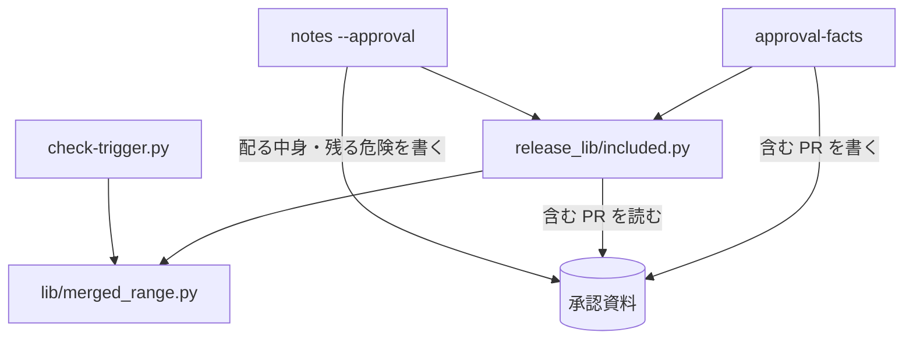

# 本番への配布の承認資料の「含む PR」: 直前の正式版のタグから承認したコミットまでにベースブランチへ入った PR をすべて載せ、配る中身と残る危険も同じ PR から書く

## 概要

**本番への配布の承認資料（`issues/approval-<プラグイン>-v<版>.md`）の「含む PR」は、直前の正式版のタグから承認したコミットまでに
ベースブランチへ merge commit か squash merge で入った PR（範囲の PR）と、`approval-facts --prs` で渡した PR の和を、番号の昇順に並べる。**
版上げの PR（head が `release/` で始まる PR）と、PR でない番号（squash の件名の `(#N)` が課題を指すもの）は範囲から外す。
「配る中身」「未検証・残る危険」を書く `notes --approval` は、承認資料の「含む PR」の欄から番号を読み、範囲を求め直さない。

例: ndf 10.17.69 の承認資料を dev.2 のプランで作るとき、`--prs` に dev.2 の PR だけを渡しても、「含む PR」には
`ndf--v10.17.68` から入った #1868 #1869 #1874 #1876 #1878 #1882 の 6 件が並ぶ。版上げの #1883 #1884 は並ばない。

この文書は、その形に**なぜしたか**（背景・決定と理由・常に成り立つ条件・部品の契約・既知の限界・テスト観点）を残す。
**打ち方・終了コード・`--prs` の意味の正は Skill にある。** [`release` の references/release-steps.md](../../plugins/ndf/skills/release/references/release-steps.md)
の `approval-facts` と `notes` の項を読む。承認したコミットそのものの扱いは [ndf-release-approved-commit.md](ndf-release-approved-commit.md) が持つ。

決定の番号は #1274 の設計の番号である。

## 用語

「範囲の PR」「版上げの PR」「承認したコミット」の定義は用語集（[docs/glossary.md](../glossary.md)）の「NDF のリリース（`ndf-release`）」が正である。

## 背景

「含む PR」は `approval-facts --prs` で渡した PR だけを並べていた。配布のプランはその開発版で渡した PR を `--prs` に入れるため、
開発版を 2 回出すと 1 回目に入った PR が承認資料から落ちた。10.17.30 では #1238 #1239 #1250 #1251 などが落ち、手で直して利用者へ出した。
承認する人が本番に入る変更の一部しか見ずに承認し、承認の意味が「直前の開発版の差分」に縮む。compare の起点と変更量は
既に直前の正式版から出ており、食い違っていたのは「含む PR」の一覧と、それを材料に書く 2 つの欄だった。

`git log --first-parent --format=%s ndf--v10.17.68..ndf--v10.17.69^2` は 9 件のマージを返し、版上げの 3 件を除くと承認資料に要る
6 件が過不足なく取れる（2026-10-10 の実測）。

## 決定と理由

| # | 決定 | 理由 | 採らなかった案 |
| ---: | --- | --- | --- |
| 1 | マージの拾い出し（件名の照合 2 つと squash の head の読み取り）を `lib/merged_range.py` へ移して検査（`check-trigger.py`）と配布の両方から呼び、外す規則は呼び手に残す | 拾い方は同じ役割で、分けて持つと片方だけが変わる。外す規則は違う。検査は `release/` と `check/` と記録の番号を外し、配布は `release/` だけを外して `check/` を並べる | `release-steps.py` から `check-trigger.py` の関数を読み込む（ファイル名にハイフンを含み、検査のスクリプトの全体を配布が読み込む）。外す規則まで共通にする |
| 2 | 範囲の終点を承認したコミット（`approval-facts` が決めた `origin/<base>` の 40 桁）にする | compare の URL（`<前のタグ>...<承認したコミット>`）と同じ範囲になり、承認資料の中で「含む PR」と差分の範囲が食い違わない | `HEAD` や `origin/<base>` を改めて読む（読む時点の間にベースブランチが進むと、承認したコミットより後の PR が並ぶ） |
| 3 | `notes --approval` は承認資料の「含む PR」の欄から番号を読み、`--prs` を欄に足さない。「含む PR」に無い番号があれば欄を書かずに 3 で止まる | 欄どうしが同じ集合を指すことが作り方から保たれる | `notes` が前のタグと範囲を求め直す（`--prev-tag` で起点を変えたときと、2 つのステップの間にベースブランチが進んだときに別の集合を指す）。範囲を別のファイルへ書いて渡す（消える時点と置き場の規約を持つファイルが増える） |
| 4 | 「含む PR」を番号の昇順に並べる | 承認する人が番号で探せる。merge commit と squash merge が混ざっても並びが決まる | マージの順に並べる（`--prs` の範囲の外の PR にはマージの順が無く、置く位置が決まらない） |
| 5 | 範囲から外すのは版上げの PR と PR でない番号の 2 つにする。`--prs` で明示した番号は `release/` の PR でも外さない | 版上げの PR は中身の変更を持たない。PR でない番号は `pr view` が失敗して承認資料が書けなくなる。`--prs` は呼び手が並べると決めた PR である | `check/` も外す |
| 6 | 結果 JSON の形を変えない。範囲から来たか `--prs` から来たかを示す欄は足さない | 読み手（配布のプラン・MVV 判定・conductor）は行の集合と件数だけを使う | 出所の欄を足す |

CHANGELOG の版の節も、開発版を出し直すと前の開発版の PR を失う（`notes` の `write_notes` が版の節を丸ごと置き換え、材料が `--prs` だけである）。
この形は承認資料の欄に限り、CHANGELOG の版の節は別の課題で扱う（決定 7）。

## 仕様

### 構成要素と責務

| 要素 | 責務 |
| --- | --- |
| `plugins/ndf/scripts/lib/merged_range.py` | `<起点>..<終点>` の first-parent のログから、merge commit（件名 `Merge pull request #N from <owner>/<branch>`、親が 2 つ）と squash merge（件名の末尾 `(#N)`、親が 1 つ）で入った PR を `Merge(sha, number, branch)` で返す（`merges_in`）。squash の head は GitHub からまとめて読む（`with_heads`）。**外す規則は持たない** |
| `plugins/ndf/scripts/release_lib/included.py` | 範囲の PR（`range_prs`。`release/` と PR でない番号を外す）・`--prs` との和と並び（`included_prs`）・承認資料の「含む PR」の欄からの番号の読み取り（`read_included`） |
| `release-steps.py approval-facts` | 「含む PR」・結果 JSON の `kind: pr` の items・要約の件数を、組み立てた集合から書く |
| `release-steps.py notes --approval` | 承認資料の「含む PR」の番号から「配る中身」「未検証・残る危険」を書く |
| `check-trigger.py` | 拾い出しを `merged_range` へ任せ、外す規則（`SKIP_BRANCHES`・記録の番号）・点数・行数は自分で持つ。記録の番号で外した後の squash の番号だけを `with_heads` へ渡す |

範囲の PR の集合は承認資料を書くたびに git と GitHub から作り直す値で、承認資料の「含む PR」の欄の外に保存しない。

### 常に成り立つ条件

| # | 条件 | 破れたときの扱い |
| --- | --- | --- |
| I1 | 「含む PR」の集合は、範囲の PR と `approval-facts --prs` の和である。同じ番号は 1 つだけ並ぶ | テストが落とす |
| I2 | 範囲の PR は、`<直前の正式版のタグ>..<承認したコミット>` の first-parent のログで merge commit か squash merge として入った PR のうち、版上げの PR と PR でない番号を除いたものである | テストが落とす |
| I3 | 範囲の PR の終点は承認したコミットで、compare の URL・変更量・`approved_sha` と同じ範囲である。この 3 つの値は範囲の PR の数に左右されない | テストが落とす |
| I4 | 「含む PR」の行は番号の昇順に並ぶ | テストが落とす |
| I5 | 「配る中身」「未検証・残る危険」を書く PR は、承認資料の「含む PR」の PR のうちマージ済みのものである | `--prs` に「含む PR」に無い番号があれば 3 で止まり、`summary` にその番号と `approval-facts` の打ち直しを出す。欄は書かない |
| I6 | 結果 JSON の `kind: pr` の items と要約の「PR N 件」は、「含む PR」の行と同じ番号・同じ件数である | テストが落とす |
| I7 | 範囲の PR を集められないとき（git のログ・GitHub の読み取りの失敗）、承認資料を書かない。`notes --approval` は「含む PR」の欄を読めないとき欄を書かない | 0 以外で止まり、既存の承認資料はそのまま残る |
| I8 | 検査（`check-trigger.py`）の範囲の PR・外すコミット・行数・終了コードは、拾い出しを共有しても変わらない。記録の番号で外した squash の PR は GitHub へ問い合わせない | テストが落とす |

### 部品の失敗の形

| 関数 | 失敗 |
| --- | --- |
| `merged_range.merges_in` | git が無い・`git log` が 0 以外: `StepError(…, 2)` |
| `merged_range.with_heads` | squash の head を読めない: `StepError(…, 1)` |
| `included.read_included` | 承認資料が無い・欄が無い: `StepError(…, 3)`。`#N` で始まらない行がある: `StepError(…, 2)`。欄が `—` なら空 |

`check-trigger.py` はこれらの `StepError` を自分の `Stop` へ読み替え、終了コードをそのまま使う。

## 運用

### 既知の限界

| 項目 | 内容 |
| --- | --- |
| 範囲の PR が多い版の待ち時間 | `approval-facts` は PR ごとに `pr view` と checks を 1 回ずつ読む。6 件では数秒で、数十件の版でどれだけ延びるかは測っていない |
| 承認資料を手で直したとき | 「含む PR」の行を手で消すと、`notes --approval` はその PR の欄を書かない（欄が「含む PR」に従う）。作り直しで手で足した節を残す形は [ndf-release-approval-rebuild-and-replacements.md](ndf-release-approval-rebuild-and-replacements.md) にある。「含む PR」の欄は `approval-facts` の節の中にあるため、作り直しで範囲から書き直される |
| 外す head の接頭辞 | `release/` の 1 つで、配布の工程が作るブランチ名（`release/v<版>`）と同じ NDF の側の規約である。別の名前で版上げを出すと範囲に並ぶ |

## テスト観点

範囲の PR と承認資料は `plugins/ndf/scripts/tests/test_release_included.py`、検査の側の退行は `test_check_trigger.py` にある。
一時の git リポジトリと `gh` の差し替えで再現する。

- 正式版のタグの後に PR A（merge commit）・開発版の版上げ・PR B を入れたリポジトリで `approval-facts --prs B` を打つと、「含む PR」に A と B が並び、`release/v<版>-dev.1` からの PR は並ばないこと。`check/` からの PR は並ぶこと
- `--prs A B` を渡しても A と B は 1 行ずつで、範囲の外のマージ前の PR を `--prs` に渡すとその行が状態（`OPEN`）つきで並ぶこと
- squash merge で入った PR が並び、head が `release/` の squash の PR と、件名の `(#N)` が課題を指す番号は並ばないこと
- 結果 JSON の `kind: pr` の items の番号の並びが「含む PR」の行と等しく、要約の件数が items の件数と等しいこと。`--prs` に大きい番号を先に渡しても番号の昇順であること
- `notes --prs B --approval <資料>` で「配る中身」と「未検証・残る危険」に A と B の箇条が載ること。「含む PR」に無い PR を `--prs` に渡すと 3 で止まり、欄が変わらないこと。「含む PR」の欄が無い承認資料で 0 以外になり、欄を書かないこと
- 範囲の git のログが失敗するとき（存在しない起点を `--prev-tag` に渡す）と squash の head の読み取りが失敗するとき、承認資料を作らず、既にあれば中身が変わらないこと
- 正式版のタグが無く `--prev-tag` も無いと 3 で止まること
- compare の URL・`metrics.files`・`insertions`・`deletions`・`approved_sha` が範囲の PR の数に左右されず、承認したコミットより後にベースブランチへ入った PR が並ばないこと
- `check-trigger.py` の既存のテスト（squash の PR と記録の PR の扱いを含む）が期待値を変えずに通ること
- ベースブランチを `develop` 以外の名前にした一時のリポジトリでも同じ結果になること

## 関連リンク

- [`release` の references/release-steps.md](../../plugins/ndf/skills/release/references/release-steps.md)（`approval-facts` と `notes` の打ち方・終了コードの正）
- [`lib/merged_range.py`](../../plugins/ndf/scripts/lib/merged_range.py)・[`release_lib/included.py`](../../plugins/ndf/scripts/release_lib/included.py)・[`release-steps.py`](../../plugins/ndf/scripts/release-steps.py)・[`check-trigger.py`](../../plugins/ndf/scripts/check-trigger.py)
- [ndf-release-approved-commit.md](ndf-release-approved-commit.md)（承認したコミットと承認の記録）
- #1274（この形を決めた課題）、#1885（CHANGELOG の版の節の欠け）、#1834（承認資料の手の節。[ndf-release-approval-rebuild-and-replacements.md](ndf-release-approval-rebuild-and-replacements.md)）
