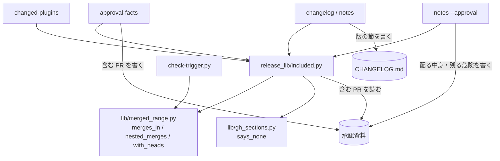

# 範囲の PR: 直前の正式版のタグからベースブランチへ入った PR とスプリント経由の PR を、承認資料の「含む PR」・CHANGELOG の版の節・上げ幅の候補が同じ処理から読む

## 概要

**範囲の PR は、直前の正式版のタグから終点までにベースブランチへ merge commit か squash merge で入った PR と、そのうち
merge commit で入った PR の 2 つ目の親の側（スプリントブランチ）へ merge commit で入った PR（スプリント経由の PR）の和である。**
版上げの PR（head が `release/` で始まる PR）と、PR でない番号（squash の件名の `(#N)` が課題を指すもの）は外す。
`release-steps.py` の `approval-facts`・`changelog`・`notes`・`changed-plugins` は、この範囲の PR と `--prs` の和を材料にする。
求めるのは [`release_lib/included.py`](../../plugins/ndf/scripts/release_lib/included.py) の `release_range` だけである。

| コマンド | 終点 | 範囲の PR をどう使うか |
| --- | --- | --- |
| `approval-facts` | 承認したコミット（打った時点の `origin/<base>` の 40 桁） | 「含む PR」に番号の昇順で 1 行ずつ並べ、スプリント経由と配布物の変化なしの印を付ける |
| `changelog`・`notes`（`--approval` なし） | `origin/<base>`（`git fetch` の後） | CHANGELOG の版の節の箇条にする。スプリント経由の PR と配布物の変化なしの PR は箇条にしない |
| `notes --approval` | — （範囲を求め直さない） | 承認資料の「含む PR」の欄から番号と経由の印を読み、「配る中身」「未検証・残る危険」「移行の手順」を書く |
| `changed-plugins --prs` | `HEAD`（起点は `--since` か前のタグ） | 範囲の PR の本文から他のプラグインの上げ幅の候補を出す |

例: 10.17.75 の後のスプリント m1982 の開発版のプランは `--prs {queue_pr:check}`（スプリント PR #1996）だけを渡す。
それでも「含む PR」と CHANGELOG の版の節には、develop へ直接入った確定仕様化 PR #1986 と設計 PR #1987〜#1990 が載る。
スプリントブランチへ入った実装 PR は「含む PR」の行にだけ載る。CHANGELOG の版の節と「配る中身」には載らない。
これらの変化はスプリント PR の本文が集めて持っているためである。「含む PR」の行は次の形になる（題名・SHA・CI の数は形の例）。

```text
#1986 確定仕様化（MERGED・9c0d1e2f・CI 12/12・配布物の変化なし）
#1993 スプリントの実装 A（MERGED・5e6f7a8b・CI 10/10・スプリント PR #1996 経由）
#1996 スプリント m1982（MERGED・1a2b3c4d・CI 12/12）
```

この文書は、その形に**なぜしたか**（背景・決定と理由・常に成り立つ条件・部品の契約・既知の限界・テスト観点）を残す。
**打ち方・終了コード・`--prs` の意味の正は Skill にある。** [`release` の references/release-steps.md](../../plugins/ndf/skills/release/references/release-steps.md)
の `approval-facts`・`changelog`・`notes`・`changed-plugins` の項を読む。承認したコミットそのものの扱いは [ndf-release-approved-commit.md](ndf-release-approved-commit.md) が、
承認資料の `## 検査の結果` と `## 未検証・残る危険` の材料は [ndf-release-approval-materials.md](ndf-release-approval-materials.md) が持つ。

決定の番号は、1〜6 が #1274 の設計、7〜10 が #1885（#1686 #1488 を取り込んだ）の設計の番号である。

## 用語

「範囲の PR」「スプリント経由の PR」「配布物の変化なし」「版上げの PR」「承認したコミット」の定義は
用語集（[docs/glossary.md](../glossary.md)）の「NDF のリリース（`ndf-release`）」が正である。

## 背景

「含む PR」は `approval-facts --prs` で渡した PR だけを並べていた。配布のプランはその開発版で渡した PR を `--prs` に入れるため、
開発版を 2 回出すと 1 回目に入った PR が承認資料から落ちた。10.17.30 では #1238 #1239 #1250 #1251 などが落ち、手で直して利用者へ出した。
承認する人が本番に入る変更の一部しか見ずに承認し、承認の意味が「直前の開発版の差分」に縮む。

#1274 は承認資料の欄だけを直し、CHANGELOG の版の節と上げ幅の候補は `--prs` だけを材料にしたまま残った。
10.17.69 では、develop へ直接入った #1869 が CHANGELOG・承認資料に載らなかった。#1869 は mcp-bigquery をリモート MCP へ置き換える PR で、
移行の手順を持つ。それでも mcp-bigquery は PATCH（2.0.1）で出た（承認資料 `issues/approval-ndf-v10.17.69.md`、PR 1883）。
10.17.71（#1911 ほか 4 本）と 10.17.75（#1986〜#1990 の 5 本）でも、conductor が `--prs` を手で足した。
同じ版の開発版を出し直すと、`notes` が版の節を丸ごと置き換えるため、前の開発版の PR の箇条も消えた。

スプリントブランチへ入った実装 PR（#1673 の #1671・#1672 など）は、first-parent のログに現れないため「含む PR」に載らなかった。
`ndf--v10.17.75..origin/develop` では first-parent のマージが 15 本で、その 2 つ目の親の側にさらに 9 本の `Merge pull request` があった（2026-10-17 の実測）。

## 決定と理由

| # | 決定 | 理由 | 採らなかった案 |
| ---: | --- | --- | --- |
| 1 | マージの拾い出し（件名の照合 2 つと squash の head の読み取り）を `lib/merged_range.py` へ移して検査（`check-trigger.py`）と配布の両方から呼び、外す規則は呼び手に残す | 拾い方は同じ役割で、分けて持つと片方だけが変わる。外す規則は違う。検査は `release/` と `check/` と記録の番号を外し、配布は `release/` だけを外して `check/` を並べる | `release-steps.py` から `check-trigger.py` の関数を読み込む（ファイル名にハイフンを含み、検査のスクリプトの全体を配布が読み込む）。外す規則まで共通にする |
| 2 | 「含む PR」の終点を承認したコミットにする | compare の URL（`<前のタグ>...<承認したコミット>`）と同じ範囲になり、承認資料の中で「含む PR」と差分の範囲が食い違わない | `HEAD` や `origin/<base>` を改めて読む（読む時点の間にベースブランチが進むと、承認したコミットより後の PR が並ぶ） |
| 3 | `notes --approval` は承認資料の「含む PR」の欄から番号と経由の印を読み、`--prs` を欄に足さない。「含む PR」に無い番号があれば欄を書かずに 3 で止まる | 欄どうしが同じ集合を指すことが作り方から保たれる | `notes` が前のタグと範囲を求め直す（`--prev-tag` で起点を変えたときと、2 つのステップの間にベースブランチが進んだときに別の集合を指す） |
| 4 | 「含む PR」を番号の昇順に並べる | 承認する人が番号で探せる。merge commit と squash merge が混ざっても並びが決まる | マージの順に並べる（`--prs` の範囲の外の PR にはマージの順が無い） |
| 5 | 範囲から外すのは版上げの PR と PR でない番号の 2 つにする。`--prs` で明示した番号は `release/` の PR でも外さない | 版上げの PR は中身の変更を持たない。PR でない番号は `pr view` が失敗して承認資料が書けなくなる。`--prs` は呼び手が並べると決めた PR である | `check/` も外す |
| 6 | 結果 JSON の形は足すだけにする。範囲から来たか `--prs` から来たかを示す欄は足さない | 読み手（配布のプラン・MVV 判定・conductor）は行の集合と件数だけを使う | 出所の欄を足す |
| 7 | 範囲の PR は `release-steps.py` の 4 つのコマンドの中で求め、プランの `--prs` は変えない | 漏れの根はコマンドの材料が `--prs` だけだったことにある。コマンドの中で和を取れば、スプリントのプランも単発の配布も手で組んだプランも同じ振る舞いになる | 雛形（`sprint_waves.plan_sprint_release`）で範囲の PR を組んで `--prs` へ渡す（プランを書く時点ではスプリント PR がまだマージされておらず、範囲が決まらない） |
| 8 | スプリント経由の PR は `merges_in` と別の関数（`nested_merges`）で拾い、件名 `Merge pull request #N` だけを読む | first-parent を外すと、`merges_in` を使う `check-trigger.py` の検査の起動の範囲まで変わる。2 つ目の親の側の squash の件名 `(#N)` は課題番号を指すことが多い | スプリント PR の本文の「集めた実装の PR」を読む（本文は書き換えられるが、git の履歴は入った事実である） |
| 9 | スプリント経由の PR の変化と移行の手順はスプリント PR の本文に任せ、危険だけを足す | スプリント PR の本文は `pr_materials.collect_changes` が実装 PR から変化と移行の手順を集めて持つ。危険は集めないため実装 PR から読む | 箇条の文面の一致で重複を消す（`（#n）` の付き方と文面の差で一致しなくなり、#1637 の重複が戻る） |
| 10 | `## 利用者向けの変化` が「無し」か「なし」だけの PR（配布物の変化なし）を CHANGELOG の版の節と「配る中身」から外し、「含む PR」に印を付ける。節の無い本文は今どおり題名で代える | CHANGELOG は利用者が版を選ぶ文書で、配布物の外の変更は判断に効かない。判定の語は `section_items` が箇条なしとする語（`NO_ITEMS`）と同じにする。節の無い本文まで外すと書き忘れを黙って落とす | PR のラベルや変えたパスで決める（本文の節は `/ndf:pr` が必ず書かせており、書き手の判断が入る唯一の場所である） |

## 仕様

### 構成要素と責務

| 要素 | 責務 |
| --- | --- |
| `plugins/ndf/scripts/lib/merged_range.py` | `<起点>..<終点>` の first-parent のログから、merge commit（件名 `Merge pull request #N from <owner>/<branch>`、親が 2 つ）と squash merge（件名の末尾 `(#N)`、親が 1 つ）で入った PR を `Merge(sha, number, branch)` で返す（`merges_in`）。squash の head は GitHub からまとめて読む（`with_heads`）。`nested_merges` は merge commit の `<sha>^1..<sha>^2` の first-parent のログから、merge commit で入った PR だけを返す（squash の `Merge` には空）。**外す規則は持たない** |
| `plugins/ndf/scripts/lib/gh_sections.py` の `says_none` | 節があり、箇条が `NO_ITEMS`（「無し」・「なし」）だけかを返す。節が無い・空の節は偽 |
| `plugins/ndf/scripts/release_lib/included.py` | 範囲の PR（`release_range` が `IncludedPr(number, via)` の列を返す。`release/` の外しは入れ子の PR にも当てる）・`--prs` との和（`with_extra` / `included_prs`）・CHANGELOG の版の節の候補（`section_range`）・「含む PR」の行と印（`included_row`・定数 `VIA`・`NO_CHANGE`）と読み取り（`read_included` / `read_included_rows`）・PR の中身のまとめ読み（`pr_fields` / `read_prs`）・配布物の変化なしの判定（`no_change`）・版の節の箇条（`titles_of`）と配る中身・危険・移行の手順（`notes_of`） |
| `release-steps.py approval-facts` | 「含む PR」・結果 JSON の `kind: pr` の items（`via`・`no_change` を足した）・要約の件数を、組み立てた集合から書く |
| `release-steps.py changelog`・`notes` | `section_prs` で候補を決め、`changelog` は版の節に無い番号だけを挿し、`notes` は版の節を候補から書き直す。`changelog` の `metrics` に `range`（候補の数）と `since`（前のタグ）を足した |
| `release-steps.py notes --approval` | 承認資料の「含む PR」の番号と経由から「配る中身」「未検証・残る危険」「移行の手順」を書く |
| `release-steps.py changed-plugins` | `--prs` があれば、範囲の PR と `--prs` の和の本文（`pr_fields`）から上げ幅の候補を出す（`changed.candidate_rows`） |
| `check-trigger.py` | 拾い出しを `merged_range.merges_in`・`with_heads` へ任せ、外す規則（`SKIP_BRANCHES`・記録の番号）・点数・行数は自分で持つ。`nested_merges` は使わない |



範囲の PR の集合は書くたびに git と GitHub から作り直す値で、承認資料の「含む PR」の欄の外に保存しない。

### 常に成り立つ条件

| # | 条件 | 破れたときの扱い |
| --- | --- | --- |
| I1 | 「含む PR」と CHANGELOG の版の節の候補は、範囲の PR と `--prs` の和である。同じ番号は 1 つだけ並ぶ。範囲にある番号は範囲の経由を保つ | テストが落とす |
| I2 | 範囲の PR は、`<前のタグ>..<終点>` の first-parent のログで merge commit か squash merge として入った PR と、その merge commit の `^1..^2` の first-parent のログで merge commit として入った PR の和から、版上げの PR と PR でない番号を除いたものである | テストが落とす |
| I3 | `merged_range.merges_in` の返す値は入れ子のマージを含まない（`check-trigger.py` の起動の範囲は変わらない） | テストが落とす |
| I4 | 「含む PR」の終点は承認したコミットで、compare の URL・変更量・`approved_sha` と同じ範囲である。この 3 つの値は範囲の PR の数に左右されない | テストが落とす |
| I5 | 「含む PR」の行は番号の昇順に並び、行の頭は `#<番号>` である。スプリント経由の PR と配布物の変化なしの PR も 1 行ずつ持ち、印は括弧の中の末尾に付く | 印の無い行（古い資料）は経由なしとして読む |
| I6 | CHANGELOG の版の節の PR の箇条は、候補のうちマージ済みで、スプリント経由でなく、配布物の変化なしでない PR から作る。同じ版の開発版を何度出し直しても、前の正式版からの PR の箇条がすべて残る | テストが落とす |
| I7 | 同じ変化の箇条が「配る中身」と CHANGELOG の版の節に 2 回並ばない（スプリント経由の PR は変化と移行の手順を返さない） | テストが落とす |
| I8 | 「配る中身」「未検証・残る危険」を書く PR は、承認資料の「含む PR」の PR のうちマージ済みのものである | `--prs` に「含む PR」に無い番号があれば 3 で止まり、欄は書かない |
| I9 | 結果 JSON の `kind: pr` の items と要約の「PR N 件」は、「含む PR」の行と同じ番号・同じ件数である | テストが落とす |
| I10 | 1 つのコマンドの中で、範囲の PR の中身を GitHub から 100 件ずつ 1 回でまとめて読む（`pr_fields`）。まとめて読めない・PR でない番号が混ざるときだけ PR ごとの `gh pr view` へ倒す | テストが落とす |
| I11 | 範囲の PR を集められないとき（git のログ・GitHub の読み取りの失敗）、承認資料と CHANGELOG を書かない | 0 以外で止まり、既存のファイルはそのまま残る |

### 部品の失敗の形

| 関数 | 失敗 |
| --- | --- |
| `merged_range.merges_in`・`nested_merges` | git が無い・`git log` が 0 以外: `StepError(…, 2)`。`nested_merges` は `^2` が無い（squash）とき空を返す |
| `merged_range.with_heads` | squash の head を読めない: `StepError(…, 1)` |
| `included.pr_fields` | 例外を投げず `(None, 理由)` を返す。`read_prs` が PR ごとの読み出し（`release-steps.py` の `pr_view`）へ倒し、そちらが `StepError`（失敗は 1・gh が無いと 3・出力を読めないと 2）を投げる |
| `included.read_included_rows` | 承認資料が無い・欄が無い: `StepError(…, 3)`。`#N` で始まらない行がある: `StepError(…, 2)`。欄が `—` なら空 |
| `included.titles_of`・`notes_of` | マージ済みが 0 件: `StepError(…, 3)`（既存の節や欄を空で上書きしない）。出力の題名を読めない: `StepError(…, 2)` |

`check-trigger.py` は `merged_range` の `StepError` を自分の `Stop` へ読み替え、終了コードをそのまま使う。

## データ・設定

ベースブランチは宣言の `release.base`、配るプラグインは `release.plugin` から読む。前のタグは `<プラグイン>--v<版>` の形で、
`changelog`・`notes` は渡した版の基底のタグより前の正式版のタグ（`release_tag_before`）を使う。新しい設定の項目は無い。

## エラー処理

前のタグが無いとき、`approval-facts` は 3 で止まる（`--prev-tag` を渡して打ち直す）。`changelog`・`notes` は初めての版として
`--prs` だけを候補にする。配るプラグインが決まらないときも `--prs` だけを候補にし、止めるのは版の節を書く側である。

## 運用

### 既知の限界

| 項目 | 内容 |
| --- | --- |
| スプリントブランチへの squash merge | 実装 PR をスプリントブランチへ squash で入れると、スプリント経由の PR として拾わない（決定 8）。今のスプリントの規則は merge commit である |
| スプリント PR の本文に頼る変化 | スプリント経由の PR の変化と移行の手順は、スプリント PR の本文（`collect_changes` が集めたもの）にあるものだけが載る。本文を手で削ると、その変化は CHANGELOG から落ちる |
| 範囲の PR が多い版の待ち時間 | PR の中身は 1 コマンド 1 回（100 件ずつ）で読むが、`approval-facts` の checks は PR ごとに 1 回ずつ読む。2026-10-17 の実測では、範囲の 24 本の中身をまとめて読んで 0.53 秒（`gh pr view` 1 回は 0.40 秒）。checks の読み出しが数十件の版でどれだけ延びるかは測っていない |
| 承認資料を手で直したとき | 「含む PR」の行を手で消すと、`notes --approval` はその PR の欄を書かない。「含む PR」の欄は `approval-facts` の節の中にあるため、作り直しで範囲から書き直される（手の節の扱いは [ndf-release-approval-rebuild-and-replacements.md](ndf-release-approval-rebuild-and-replacements.md)） |
| 外す head の接頭辞 | `release/` の 1 つで、配布の工程が作るブランチ名（`release/v<版>`）と同じ NDF の側の規約である。別の名前で版上げを出すと範囲に並ぶ |

## テスト観点

範囲の PR の組み立てと 4 つのコマンドは `plugins/ndf/scripts/tests/test_release_range.py`、「含む PR」の行と欄は `test_release_included.py`、
検査の側の退行は `test_check_trigger.py` にある。一時の git リポジトリと `gh` の差し替えで再現する。

- タグの後に直接マージ 1 本・スプリントブランチへの実装 PR 2 本（merge commit）・スプリント PR・版上げの PR を置くと、範囲の PR に直接マージとスプリント PR と実装 PR 2 本（経由つき）が入り、版上げの PR が入らないこと（I2）
- 同じリポジトリで `changelog`・`notes` を `--prs <スプリント PR>` だけで打つと、版の節に直接マージとスプリント PR の箇条が並び、実装 PR の箇条が並ばないこと（I6・I7）
- 開発版 1 で PR A を出した後、同じ版の開発版 2 を `--prs B` だけで出すと、版の節に A と B の箇条が両方残ること（I6）
- `approval-facts` の「含む PR」に全 PR が 1 行ずつ番号の昇順で並び、実装 PR の行に経由の印、「無し」の PR の行に配布物の変化なしの印が付くこと。`--prs` に範囲と同じ番号を渡しても 1 行であること（I1・I5）
- `notes --approval` が「含む PR」の行から欄を書き、実装 PR の変化を「配る中身」へ足さないこと（I7・I8）
- `## 利用者向けの変化` が「- 無し」の PR と「- なし」の PR は版の節に載らず、節の無い PR は題名で載ること（決定 10）
- 直接マージの PR が移行の手順を持ち別のプラグインを変えると、`changed-plugins --prs <スプリント PR>` の候補が MAJOR になること
- `merges_in` の返す PR が入れ子のマージを含まないこと（I3）。`check-trigger.py` の既存のテストが期待値を変えずに通ること
- 範囲の外のマージ前の PR を `--prs` に渡すとその行が状態（`OPEN`）つきで並ぶこと。squash の head が `release/` の PR と件名の `(#N)` が課題を指す番号は並ばないこと
- 結果 JSON の `kind: pr` の items の番号の並びが「含む PR」の行と等しく、要約の件数が items の件数と等しいこと（I9）
- 「含む PR」に無い PR を `notes --approval --prs` に渡すと 3 で止まり、欄が変わらないこと。範囲の git のログか squash の head の読み取りが失敗すると、承認資料を作らないこと（I8・I11）
- compare の URL・`metrics.files`・`insertions`・`deletions`・`approved_sha` が範囲の PR の数に左右されないこと（I4）。ベースブランチを `develop` 以外にしても同じ結果になること

## 関連リンク

- [`release` の references/release-steps.md](../../plugins/ndf/skills/release/references/release-steps.md)（4 つのコマンドの打ち方・終了コードの正）
- [`lib/merged_range.py`](../../plugins/ndf/scripts/lib/merged_range.py)・[`lib/gh_sections.py`](../../plugins/ndf/scripts/lib/gh_sections.py)・[`release_lib/included.py`](../../plugins/ndf/scripts/release_lib/included.py)・[`release-steps.py`](../../plugins/ndf/scripts/release-steps.py)・[`check-trigger.py`](../../plugins/ndf/scripts/check-trigger.py)・[`supervise_lib/pr_materials.py`](../../plugins/ndf/scripts/supervise_lib/pr_materials.py)
- [ndf-release-approval-materials.md](ndf-release-approval-materials.md)（承認の材料）・[ndf-release-approved-commit.md](ndf-release-approved-commit.md)（承認したコミット）・[ndf-release-approval-rebuild-and-replacements.md](ndf-release-approval-rebuild-and-replacements.md)（作り直しと置き換える箇条）・[ndf-release-readme-update-info.md](ndf-release-readme-update-info.md)（CHANGELOG の版の節の書き方）
- #1274（「含む PR」の範囲）、#1885（CHANGELOG の版の節と上げ幅の候補の漏れ）、#1686（スプリント経由の PR と配布物の変化なし）、#1637（箇条の重複）
