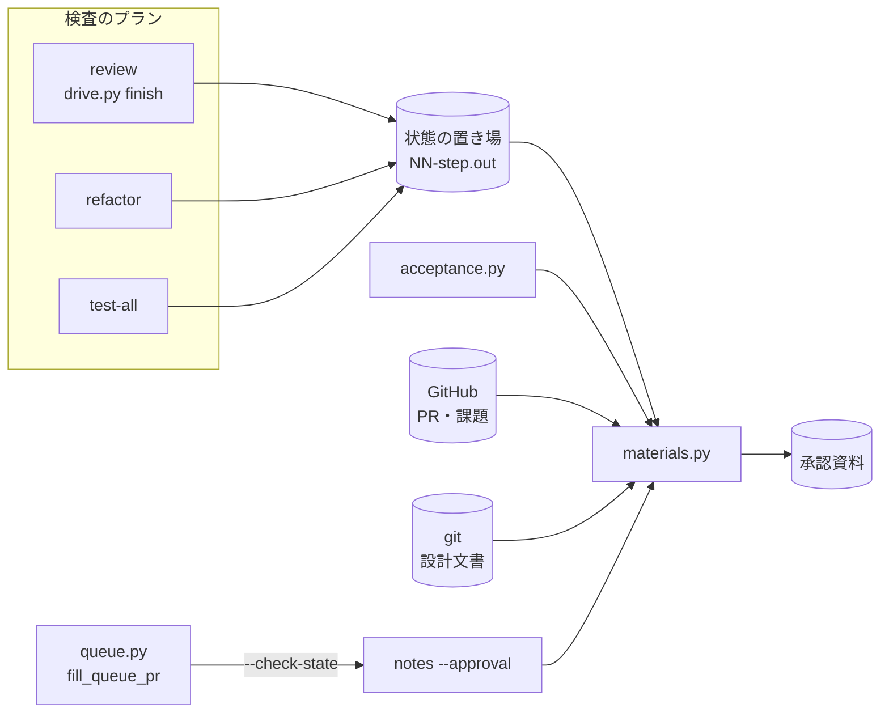
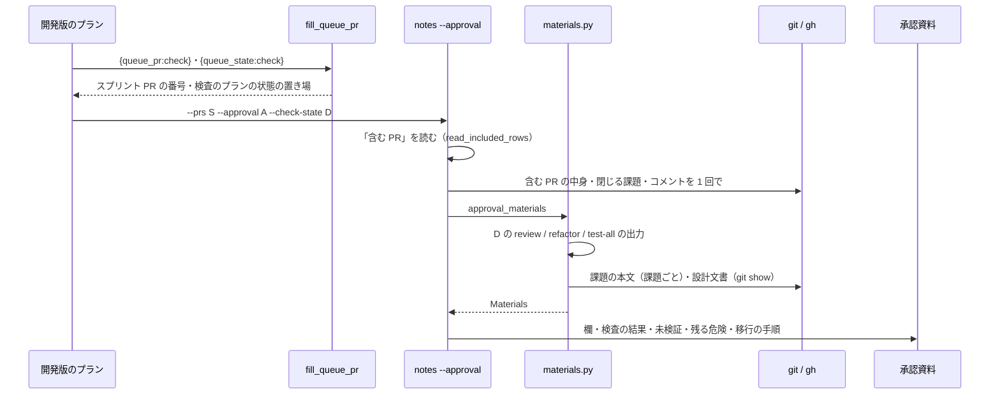

# 承認の材料: `notes --approval --check-state` が検査のプランの結果・設計文書の未確認・未実施のリリース後テストを承認資料へ集め、無い材料の名前を書く

## 概要

**`release-steps.py notes --approval <承認資料> --check-state <検査のプランの状態の置き場>` は、承認の材料を 5 つ読み、承認資料の
`## 検査の結果` と `## 未検証・残る危険` へ書く。** 材料は、レビュー・リファクタリング・全体テストと、設計文書の未確認・未実施のリリース後テストである。
材料が無いときは黙って空にせず、どの材料が無いかを名前で書く。5 つの材料も PR の本文の危険もすべて無いときだけ「記載が無い」の 1 行になる。
スプリントの開発版のプランは `--check-state '{queue_state:check}'` を持つため、conductor が手を加えなくても材料が載る。

例: スプリントの開発版のプランを流すと、承認資料に次の形の節が入る（中身は形の例）。

```markdown
## 検査の結果

- レビュー: cross-review 2 ラウンド、見送った指摘 1 件
  - `plugins/ndf/scripts/lib/body_findings.py:191` 再提出の照合に本文の一致を足す
- リファクタリング: 採用 1 件 / 取り消し 0 件
- 全体テスト: `uv run --frozen --project . --all-extras pytest . -q -n 4` 合格（落ちたテスト 0 件・変更起因 0 件）

## 未検証・残る危険

- （手で足した行。書き直しても残る）
- 設計の未確認 #1885: スプリントブランチへの squash merge: 実装 PR を squash で入れると拾わない
- 未実施のリリース後テスト #1885 の条件 3: 1885-3: 同じ版の開発版を出し直すと…（2026-10-17 12:00 JST 時点）
- 無い材料: PR の本文の未検証・残る危険
```

この文書は、その形に**なぜしたか**（背景・決定と理由・常に成り立つ条件・材料を読む元・既知の限界・テスト観点）を残す。
`notes --approval` の打ち方と、`## 未検証・残る危険` に PR の本文の箇条を足す規則は
[`release` の references/release-steps.md](../../plugins/ndf/skills/release/references/release-steps.md) の `notes` の項にある。
「含む PR」の範囲は [ndf-release-approval-included-prs.md](ndf-release-approval-included-prs.md)、作り直しで残す節は
[ndf-release-approval-rebuild-and-replacements.md](ndf-release-approval-rebuild-and-replacements.md)、
リリース後テストの表の読み方は [ndf-sprint-close-acceptance-criteria.md](ndf-sprint-close-acceptance-criteria.md) が持つ。

決定の番号は #1885（#1686 #1488 を取り込んだ）の設計の番号である。

## 用語

「承認の材料」「承認資料」「全体テスト」「設計文書」の定義は用語集（[docs/glossary.md](../glossary.md)）が正である
（「NDF のリリース（`ndf-release`）」と「NDF の開発ワークフロー（`ndf-workflow`）」）。「検査のプランの状態の置き場」は
`supervise.py` がプランごとに持つディレクトリ（`supervise_lib/paths.py` の `state_dir_of`）で、ステップの出力 `NN-<ステップ>.out` を置く。

## 背景

承認資料の `## 未検証・残る危険` は PR の本文の同じ節だけを集め、無ければ「PR の本文に記載が無い」の 1 行を書いていた。
10.17.66〜10.17.71 では、conductor がレビューで見送った指摘・リファクタリングの採用と取り消し・全体テストの結果・設計文書の
「未確認のまま残ること」・まだ行っていないリリース後テストを、毎版手で書き足していた（#1488）。
書き足しを忘れると、承認する人は未検証のまま残る危険を見ずに承認ゲート 2 を決めうる。

利用者の判断（2026-10-17）で、#1488 の依頼にある 5 つの材料をすべて対象にした。

## 決定と理由

| # | 決定 | 理由 | 採らなかった案 |
| ---: | --- | --- | --- |
| 5 | 検査の 3 つの材料は、検査のプランの状態の置き場の結果 JSON を `notes --approval --check-state` で読む。置き場は `{queue_state:check}` でプランへ渡す | 状態の置き場は `~/.local/state` の下にあり、cross-review の一時ディレクトリと違って配布の時点まで残る。`release-steps.py` はスプリントの置き場の規則を持たない。危険の節を書くのは前から `notes --approval` である | PR のコメントから読む（見送りの返信は文面が自由で、機械で見分けられない）。検査のプランに記録の工程を足す |
| 6 | 見送った指摘を `パス:行` つきで渡すため、cross-review の駆動の結果 JSON の `items` に `kind: deferred` を足す。読む元は状態ファイルの `deferred_nits` と、最終スイープの結果ファイルの `deferred[]` で、`waived` の付いた要素は外す | 結果 JSON は `metrics.deferred`（件数）しか持たなかった。`merge_fix` が各ラウンドの `deferred[]` をラウンド番号つきで `deferred_nits` へ写しているため、ラウンドごとの結果ファイルを引かずに同じ要素を読める。`waived` は返信を付けて閉じた基準外の見送りで、残る危険ではない | 各ラウンドの修正の結果ファイルを読む（置き場の名前を引く処理が増え、一時ディレクトリと一緒に消える） |
| 7 | 未実施のリリース後テストは書いた時点の判定とし、行の末尾に時刻（JST）を添える | 承認資料はふつう開発版の配布の直後に書かれ、リリース後テストはその後に行う。書き直すステップを足すと工程が 1 つ増え、本番の配布の手順（範囲外）にも触れる。次の `notes --approval` がその時点の表で入れ替える | `release-verification` の後に承認資料を書き直すステップを足す |
| 8 | リリース後テストの表の読み方（`verification_verdicts`・`IssueRows`）を `lib/acceptance.py` へ移し、`sprint-close.py` と承認の材料が同じ規則で読む | 課題の参照・条件の番号・`合格` で始まる結果を 2 つの規則で読むと、閉じる判定と承認資料で合否が食い違う | `release-steps.py` に読み方を写す |

## 仕様

### 構成要素と責務

| 要素 | 責務 |
| --- | --- |
| `plugins/ndf/scripts/release_lib/materials.py` | 材料を読み（`read_check`・`read_unconfirmed`・`read_unverified`・`approval_materials`）、行を組み（`check_lines`・`risk_lines`・`items_of`）、承認資料の欄と節を書く（`write_approval`・`write_sections`）。終了コードも出力も持たない |
| `plugins/ndf/scripts/lib/acceptance.py` | 受け入れ条件の番号・印・文（`criteria_lines`）、リリース後テストの表を課題と番号でまとめる処理（`verification_verdicts`・`IssueRows`）、版の一致するブロックだけを読む処理（`version_verdicts`） |
| `release-steps.py` の `cmd_notes` | `--check-state` を受け、`--approval` が無ければ引数の誤り（2）。「含む PR」の中身を `closingIssuesReferences` とコメントつきで 1 回でまとめて読み、課題の本文を課題ごとに `issue_body` で読んで `materials` へ渡す |
| `plugins/ndf/skills/cross-review/scripts/drive.py` の `Drive.finish` | 終わりの結果 JSON の `items` へ、見送った指摘を 1 件ずつ足す（決定 6） |
| `plugins/ndf/scripts/supervise_lib/queue.py` の `fill_queue_pr` | `{queue_state:<名>}` を、名前の一致するプランの状態の置き場の絶対パスで置き換える。一致するプランが無ければ空文字 |
| `plugins/ndf/scripts/supervise_lib/release_templates.py` の `_dev_approval_steps` | 出す PR が `{queue_pr:<名>}` の 1 語のとき、`explain` のステップの `notes --approval` へ `--check-state '{queue_state:<名>}'` を足す |



### 材料を読む元

| 材料 | 読む元 | 無い材料になるとき |
| --- | --- | --- |
| レビュー | `<D>/NN-review.out` の最後の結果 JSON（`tool` が `cross-review-drive`）の `metrics.rounds` と、`items` の `kind: deferred`（`path`・`line`・`summary`・`round`） | `--check-state` が空・置き場が無い・出力が無い・その `tool` の JSON が無い |
| リファクタリング | `<D>/NN-refactor.out` の最後の結果 JSON（`cross-refactoring-drive`）の `metrics.adopted`・`metrics.reverted` | 同上 |
| 全体テスト | `<D>/NN-test-all.out` の最後の結果 JSON（`test-run`）。`status` が `ok` なら合格、落ちたテストは `items` の `failed_tests` の数、変更起因は `metrics.caused`。コマンドは `items` に `ran` があればそれを、無ければ宣言（`.ndf/project.json` と `.ndf/supervise.json`）を `test_strategy` で解いた全体テストのコマンドを書き、CI に任せる戦略なら「CI に任せた」と書く | 同上 |
| 設計文書の未確認 | 「含む PR」が閉じる課題（`closingIssuesReferences` と本文の closing keywords の和）のうち今のリポジトリの課題について、`<ref>:issues/issue-<番号>-design.md` の `## 未確認のまま残ること`。表なら「項目: 内容」、箇条ならその文。「無し」だけの節は 0 件。`<ref>` は `origin/<base>`、無ければ `<base>`、それも無ければ `HEAD` | 閉じる課題のどれにも設計文書が無い |
| 未実施のリリース後テスト | 閉じる課題（他のリポジトリの課題も含む）の本文の `## 受け入れ条件` のうち、印（`[x]`）が無く、`--prs` の PR の本文とコメントの `## リリース後テスト` の表に合格の行が無い条件。表は `対象の版:` の基底が今の版の基底と一致する最後のブロックを読む。条件の番号を書かずに全行が合格した課題は 0 件 | 閉じる課題のどれにも受け入れ条件が無い |

`NN` は同じステップの出力が複数あるとき番号の最も大きいもの（再開で増える）。他のリポジトリの課題は、行の課題番号の前に `owner/name` を付ける。

### 常に成り立つ条件

| # | 条件 | 破れたときの扱い |
| --- | --- | --- |
| M1 | 材料の欄が `None` なら「材料が無い」、空の列なら「材料はあり、項目が 0 件」である（`Materials.missing` が前者だけを名前で返す） | テストが落とす |
| M2 | `## 未検証・残る危険` は、5 つの材料と PR の本文の危険がすべて無いときだけ `- 記載が無い（無い材料: …）` の 1 行になり、6 つの名前を並べる。一部が無いときは、ある材料の行の後に `- 無い材料: <名前>・…` を 1 行書く | テストが落とす |
| M3 | `## 未検証・残る危険` の行のうち、頭が `- 設計の未確認 #`・`- 未実施のリリース後テスト`・`- 無い材料:`・`- 記載が無い`・`- PR の本文に記載が無い` の行は機械の行で、書くたびに消してから入れ直す。それ以外の行（PR の本文の箇条と手で足した行）は残し、PR の本文の箇条は節に無いもの（1 行目で比べる）だけを足す | テストが落とす |
| M4 | `## 検査の結果` は無ければ `## 未検証・残る危険` の直前に置き、あれば中身を入れ替える。`approval-facts` の作り直す節（`APPROVAL_OWN`）には入らず、作り直しを越えて残る | テストが落とす |
| M5 | 検査の 3 つの材料がどれも無いとき、`## 検査の結果` は `- 無し（レビュー・リファクタリング・全体テストの結果が検査の状態に無い）` の 1 行になる | テストが落とす |
| M6 | 結果 JSON の `items` に、材料ごとに `{"kind": "material", "name": <材料の名前>, "result": "written" か "missing", "lines": <行の数>}` が 5 行ある | テストが落とす |
| M7 | 「含む PR」の中身は `closingIssuesReferences` とコメントつきで 1 回でまとめて読み、課題の本文は課題ごとに 1 回読む | テストが落とす |
| M8 | cross-review の駆動の結果 JSON の `items[0]`（`report`）と `metrics` は、見送りを足しても変わらない | テストが落とす |

### 処理の流れ



## データ・設定

新しい設定の項目は無い。ベースブランチは宣言の `release.base` から読む。全体テストのコマンドを宣言から補うときは、
`.ndf/project.json` の `test.suites[].command` と `.ndf/supervise.json` を `test_strategy` で解く（解けなければ合否だけを書く）。

プランの置き換えの語 `{queue_state:<名>}` は `{queue_pr:<名>}` と同じく、前のステージの結果に無ければ同じディレクトリのプランの報告を読む。

## エラー処理

| 場合 | 扱い |
| --- | --- |
| `--check-state` を `--approval` なしで渡した | 引数の誤り（2） |
| `--check-state` が空文字・置き場が無い・出力か結果 JSON が無い | 止まらず、その材料を無い材料として書く |
| 「含む PR」の中身・課題の本文を GitHub から読めない | `StepError` で止まり、承認資料を書かない（材料を黙って空にしない） |
| 設計文書を読む ref（`origin/<base>`・`<base>`・`HEAD`）がどれも無い | `StepError`（2）で止まる |

## 運用

### 既知の限界

| 項目 | 内容 |
| --- | --- |
| 全体テストのコマンド | `test-run.py whole` の結果 JSON は今 `ran` を出さない。コマンドはいつも宣言から補うため、宣言と違うコマンドで流したときは宣言のコマンドが書かれる |
| 開発版のリリース後テストの記録の置き場 | 表は `--prs` の PR（スプリント PR）の本文とコメントから読む。別の PR に表を置くと、合格の条件も未実施として並ぶ（危険の側に倒れる） |
| 書いた時点の判定 | リリース後テストを承認資料の後に行っても、`notes --approval` を流し直すまで行は書いた時点のまま残る。古さは行の末尾の時刻で示す（決定 7） |
| 確定仕様化の後の設計文書 | 設計文書を確定仕様へ移して消した後に承認資料を書くと、その課題の設計文書の未確認は読めず、無い材料になる |
| `--check-state` の付く形 | 雛形が `--check-state` を足すのは、出す PR が `{queue_pr:<名>}` の 1 語のときだけである。手で組んだプランは自分で渡す |
| 見送りの場所 | 場所を持たない見送り（レビューの本文の指摘）は要旨だけを、行を持たない見送りは `` `<path>` `` と要旨を書く |

## テスト観点

承認の材料は `plugins/ndf/scripts/tests/test_release_materials.py`、プランの置き換えと雛形は `test_release_check_state.py`、
cross-review の供給側は `plugins/ndf/skills/cross-review/scripts/tests/test_drive_deferred.py` にある。一時のリポジトリと `gh` の差し替えで再現する。

- review・refactor・test-all の出力を置いた状態の置き場で `notes --approval --check-state` を打つと、`## 検査の結果` にラウンド数・見送りの `パス:行`・採用と取り消しの件数・全体テストの合否と件数が出て、`## 未検証・残る危険` に設計文書の未確認と未実施の条件が課題番号つきで出ること
- リリース後テストの表が無ければ、受け入れ条件がすべて未実施として並ぶこと
- 材料も PR の危険も無いと「記載が無い」の 1 行に 6 つの名前が並び、一部だけ無いと、ある材料の行の後に無い材料の行が出ること（M2）
- 材料を変えて `notes --approval` を 2 回打つと、機械の行は 2 回目の材料だけになり、手で足した行は残ること（M3）
- `--check-state` を `--approval` なしで渡すと 2 で止まること。課題の本文を読めないと止まること
- 他のリポジトリの課題の条件は、行に `owner/name` が残ること
- `ran` の無い全体テストの出力から、宣言のコマンドが書かれること
- `{queue_state:check}` が名前の一致するプランの状態の置き場で埋まり、一致するプランが無ければ空になること。雛形が `{queue_pr:check}` のときだけ `--check-state` を足すこと
- 見送りを持つ状態で `Drive.finish` を通すと、`items` に `kind: deferred` が `path`・`line` つきで出て、`waived` の要素は出ないこと。見送りが無ければ何も足さないこと（M8）

## 関連リンク

- [`release` の references/release-steps.md](../../plugins/ndf/skills/release/references/release-steps.md)（`notes --approval` の打ち方の正）
- [`release_lib/materials.py`](../../plugins/ndf/scripts/release_lib/materials.py)・[`lib/acceptance.py`](../../plugins/ndf/scripts/lib/acceptance.py)・[`release-steps.py`](../../plugins/ndf/scripts/release-steps.py)・[`supervise_lib/queue.py`](../../plugins/ndf/scripts/supervise_lib/queue.py)・[`supervise_lib/release_templates.py`](../../plugins/ndf/scripts/supervise_lib/release_templates.py)・[`cross-review/scripts/drive.py`](../../plugins/ndf/skills/cross-review/scripts/drive.py)
- [cross-review の docs/04-contracts.md](../../plugins/ndf/skills/cross-review/docs/04-contracts.md)（状態ファイルの `deferred_nits` と `waived` の形）
- [ndf-release-approval-included-prs.md](ndf-release-approval-included-prs.md)・[ndf-release-approval-rebuild-and-replacements.md](ndf-release-approval-rebuild-and-replacements.md)・[ndf-sprint-close-acceptance-criteria.md](ndf-sprint-close-acceptance-criteria.md)
- #1488（この形を決めた課題）、#1885（代表の課題）、#1834（手で足した節を残す規則）
