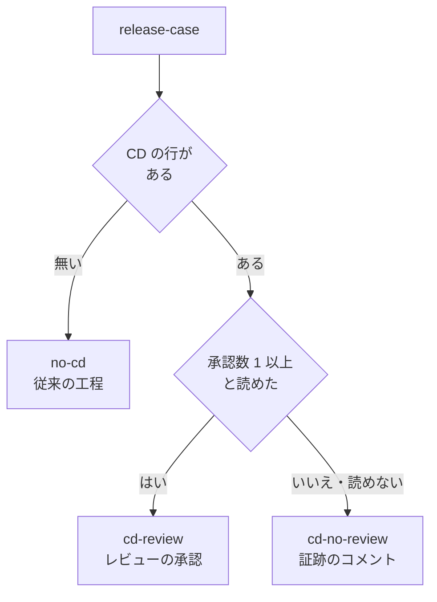
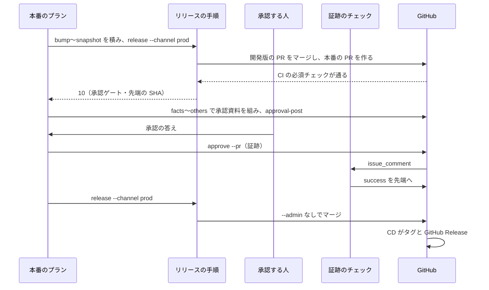

# リリース承認をリリースの PR へ残す: 承認の証跡・リリースの場合・開発版の workflow

## 概要

CD（本番チャネルへのマージで届くデプロイ）を持つリポジトリでは、リリース承認をマージの前にリリースの PR の上で取る。main へのマージは、人が承認したコミットとリリースの PR の先端（いちばん新しいコミット）が同じときだけ通る。マージの後は CD の workflow がタグ `ndf--v<版>` と GitHub Release を作る。開発版のデプロイも GitHub Actions の workflow がマージし、会話のセッションが切れても反映は止まらない。

例: v10.28.0 のリリースの PR の先端が `0123abc` のときに人が承認し、その後に誰かが `89abcde` を push した。

| | 振る舞い |
| --- | --- |
| 承認の記録 | リリースの PR にコメント「承認したコミット: `0123abc…`（40 桁）」が残る。誰がいつ承認したかを PR の画面で読める |
| `89abcde` が足されたとき | PR のチェック `ndf/release-approval` が落ち、「証跡 0123abc ≠ 先端 89abcde」と出る。本番のプランは終了コード 10 で止まり、承認し直しを求める |
| 人がすること | `89abcde` を見て、よければ承認し直す。新しい証跡が付くとチェックが通り、マージできる |

スプリントのブランチが承認の後に更新され、リリースブランチが組み直された場合も、先端が変わるため同じく止まる。

承認資料の欄・承認したコミットの照合の規則（CD の無い場合）は [ndf-release-approved-commit.md](ndf-release-approved-commit.md)、CD の結果の読み方は [ndf-release-via-cd.md](ndf-release-via-cd.md) が持つ。

## 用語

この文書の語（リリースの場合・承認資料のコメント・開発版の workflow・リリースの PR・承認の証跡・証跡のチェック・承認権限）の定義は、用語集 [docs/glossary.md](../glossary.md) の `ndf-release` にある。「承認の証跡」は `ndf-workflow` の同名の語（承認ゲートの記録・承認ラベル）とは別の意味で、この文書ではリリースの PR に置いたコメントだけを指す。

リリースの場合は 3 つある。

| 値 | 条件 | 承認を取る場所 | マージの主体 |
| --- | --- | --- | --- |
| `cd-no-review` | CD があり、レビューなしでマージできる | リリースの PR の証跡のコメント | 利用者のアカウント |
| `cd-review` | CD があり、レビューが必須 | PR のレビューの承認 | 利用者のアカウント |
| `no-cd` | CD が無い | 手元の承認資料（従来の経路） | NDF |

## 背景

承認の記録は手元の承認資料（`.gitignore` の対象）にしか残らず、main へのマージは管理者の権限の迂回（`gh pr merge --admin`）で行っていた。承認の後に先端が動いても GitHub は止められなかった。利用者の方針は「リリース承認 → main へのマージ → 自動でデプロイ」で、承認の証跡を PR にコメントの形で残す。CD があってレビューが必須のリポジトリでは、レビューの承認をリリース承認とみなし、証跡の仕組みを足さない。

主な決定と理由:

- **証跡のチェックは commit status で付け、ruleset の必須チェックで出元を GitHub Actions のアプリに限る。** `issue_comment` で起動した実行のチェックは既定ブランチの最新のコミットに付き、PR の先端に付かない。commit status は SHA を指定して付けられる。GitHub Environments の必須レビュアーや workflow の中で承認を待つ action は、承認がマージの後のジョブに付くため使わない
- **判定は `pull_request_target` と `issue_comment` で起動し、PR のコードを取り出さない。** どちらも既定ブランチの定義で動くため、PR が workflow や判定のスクリプトを書き換えても判定は変わらない
- **承認した人と時刻は GitHub がコメントに付けた作成者と作成の時刻で読み、作成の後に編集された証跡は数えない。** 書き込み権限を持つ人は他人の PR のコメントを編集できるため、編集を数えると書いた人と承認したコミットの組が崩れる
- **承認権限は共同作業者の権限の API の `role_name` で読む。** `permission` は maintain を write へ丸めるため使わない
- **承認の正本は PR の上の 1 つにする。** `cd-no-review` と `cd-review` の `release --channel prod` は承認したコミットの引数を受けない
- **`cd-no-review` と `cd-review` のマージは利用者のアカウントで `--admin` なしに行う。** `GITHUB_TOKEN` で main へマージした push は CD を起動しない
- **開発版の PR は手元で作り、マージだけを workflow が行う。** `GITHUB_TOKEN` で作った PR では CI が起動しない。秘密を置かずに済ませるためである。GitHub の自動マージはリポジトリの設定の変更が要るため使わない

## 対象範囲

- 証跡の書き手・リリースの場合の判定・プランの並びは、NDF を使うすべてのリポジトリで働く
- 証跡のチェックの workflow（`.github/workflows/release-approval.yml`）と開発版の workflow（`.github/workflows/release-dev.yml`）は ai-plugins が持つ。ほかのリポジトリの ruleset は変えない
- `no-cd` の工程は従来の `release` の工程のままである

## 仕様

### 集約

| 集約 | 持ち主 | 根 | 値オブジェクト |
| --- | --- | --- | --- |
| リリースの PR | 本番のリリースの手順（`release-steps.py release --channel prod`） | リリースの PR | 先端のコミット・宛先 |
| 承認の証跡 | 証跡の書き手（`release_lib/approval_trail.py` の `write_trail`。`approve --pr` と `promote` が呼ぶ） | 証跡のコメント | 承認したコミット・書いた人・作成の時刻 |
| 証跡のチェックの結果 | 証跡のチェックの workflow | 先端のコミットへの commit status | 判定・理由の 1 行 |
| リリースの場合 | 場合の判定（`lib/release_case.py`） | リリースの場合 | CD の有無・レビュー必須か・承認を取る場所・マージの主体 |

人が手で PR に置いたコメントも、証跡の判定が同じ書式の解釈に掛け、合わなければ数えない。

### 常に成り立つ条件

| # | 条件 | 破れたときの扱い |
| --- | --- | --- |
| I1 | 証跡のチェックは、承認権限を持つ人の最新の証跡が指すコミットと PR の先端が等しいときだけ通る | 落ち、証跡のコミットと先端の短い SHA を理由に出す |
| I2 | 証跡が 1 件も無い PR では落ちる（承認資料のコメントだけでも落ちる） | 「証跡が無い」を理由に出す |
| I3 | 承認権限（`role_name` が admin か maintain）を持たない人・権限を読めない人の証跡は数えない | 数えずに判定し、該当があれば書いた人を理由に出す |
| I4 | 承認した人と時刻はコメントの `user.login` と `created_at` で読み、本文の記述を使わない。`updated_at` が `created_at` と違う証跡は数えない | 理由に「編集された証跡」を出す |
| I5 | 判定は既定ブランチの定義で動き、PR のコードを取り出さない | — |
| I6 | リリースの手順は承認を求めた後にリリースのブランチへコミットを足さない | 足せば先端が動き、I1 で落ちる |
| I7 | `cd-no-review`・`cd-review` の本番の経路（`release --channel prod` と `merged-steps.py promote`）は、CI の必須チェックが通った先端でだけ、管理者の迂回なしで main へマージする | GitHub がマージを拒み、手順は止まって理由を出す |
| I8 | `cd-review` では証跡を書かず、証跡のチェックを付けない。必須レビューの承認者として有効な人（`permission` が admin か write）の最新の `APPROVED` のレビューの `commit_id` が先端と一致したときだけマージする | 一致しない・有効な承認が無ければ 10 で止まる |
| I9 | `no-cd` の工程は従来の `release` の工程と同じに進む | — |
| I10 | main 宛ての開いた PR のうち、判定する PR のほかに同じ先端の SHA を持つ PR があれば落ちる | もう一方の番号を理由に出す。`success` を付けた後に読み直し、同じ先端の PR が増えていれば `failure` に付け直す |

I10 があるのは、commit status が SHA に付き、同じ先端を持つ main 宛ての PR のすべてに効くためである。リリースの PR は 1 つの版に 1 本で、同じ先端の PR を並べる正当な場面は無い。

`cd-no-review` と `cd-review` では、先端と承認の完全な一致だけを通す。`docs/`・`issues/` の下だけを変えたコミットを承認の外でも許す許容（`no-cd` の照合）は使わない。証跡のチェックと手元の照合が別の答えを返さないためである。選んで集める取り込み方（`promotion: selected`）も同じ比較に掛ける（`release_lib/promotion.py`）。

### リリースの場合の判定



- CD の有無は、`.ndf/project.json` の `delivery` に本番チャネルへのマージで届く行があるかで決める。無ければネットワークを使わない
- 承認数は本番チャネルの ruleset（`GET /repos/{owner}/{repo}/rules/branches/{branch}`）の `pull_request` 規則から読み、規則が無ければ従来のブランチ保護の API を読む
- どちらも読めなければ `cd-no-review` とする。この経路は迂回を使わないため、レビューが本当は必須なら GitHub がマージを拒んで止まるだけで、承認なしのマージは起きない。`cd-review` へ倒すと、レビューが必須でないリポジトリで承認なしのマージが通る

### 本番のリリース（`cd-no-review`）

本番のプランは「版上げ → リリースの PR → 承認資料 → リリース承認ゲート → 証跡 → マージ」の順に並ぶ（`supervise_lib/release_cd.py` の `cd_prod_steps`）。承認を求める時点の先端に、版上げ・変更履歴・トークン消費の記録までのコミットがそろう。



- 承認資料を組むステップ（facts・explain・others と助言の MVV 判定）は本番のプランの release の後に置き、本番の PR の先端で組む
- MVV 判定のプラン（`pace: fast` / `auto`）は、承認資料を置いた後に MVV で判定し、従えば `approve --pr --by mvv` を打つ
- 利用者の承認を書く `approve-pr` のステップは、リリース承認ゲートの答えの記録を `--answer-from` で読む。そのため CD のある本番のプランは `--state`（スプリントの状態）なしでは組まず、組む時点で止める（`PlanRefused`）
- マージの後は `cd-result` と `record` が CD の結果を読み、リリース記録を書く

### 本番のリリース（`cd-review`）

`approve-pr` を置かない。承認資料を置いた所で承認ゲートとして終え、本番の PR のレビューの承認を得てから `release` から打ち直す。MVV 判定はレビューの承認を代えられないため、MVV 判定のプランでも判定の記録を置いた所で承認ゲートとして終える。

### リリースの PR で届く経路（`merged-steps.py promote`）

承認資料と `--approved-from` で先端を照らしてマージする経路も、CD のある場合は `--no-admin` でマージする。`cd-no-review` ではマージの前に `approve --pr` と同じ書き手で証跡を置き、`cd-review` ではレビューの承認と先端を照らす（`_trail_before_merge`）。証跡のチェックの workflow が無いリポジトリでも、GitHub に承認の記録が残る。

### 開発版のデプロイ

`.ndf/supervise.json` の `release.dev_workflow` に workflow のファイル名があれば、`release --channel dev` は手元で開発版の PR（`release/v<版>` → ベースブランチ）を作り、その workflow を `gh workflow run` で起動して結論を待つ。workflow は宛先がベースブランチで head が接尾辞のある `release/v<版>` であることを確かめ、`merge-when-green <PR> --no-cleanup --no-admin` で CI の通過を待ってマージする。

- 宣言が無いリポジトリは従来どおり手元でマージする
- 宣言の workflow がまだ既定ブランチに無い間（`workflow_dispatch` は既定ブランチの定義で動く）も手元でマージする（`dev_workflow_ready`）
- 起動した実行は、workflow の `run-name` に PR の番号を入れた表示名で見分ける

### 検査のプラン

CD のある場合（`cd-no-review`・`cd-review`）の検査のプランは、全体テスト（test-all と、それだけを入力に持つ judge・fix）を置かず、マージが CI の結果を待つ（`trim_check_steps` の `cd_case`）。`no-cd` は従来の全体テストを残す。承認資料の「全体テスト」の欄は CI の結果を載せる。

## データ・設定

### 証跡のコメントの書式

```markdown
<!-- ndf:release-approval -->
## リリース承認

承認したコミット: `0123456789abcdef0123456789abcdef01234567`
担い手: user
```

- 印 `<!-- ndf:release-approval -->` を持つコメントだけを証跡として読む。`承認したコミット:` の行の 40 桁の 16 進が 0 か 2 つ以上なら数えない
- `担い手:`（`user` か `mvv`）は MVV 判定で通したかを後から読むための記述で、判定に使わない
- 承認資料のコメントは別の印 `<!-- ndf:release-approval-request -->` と `先端のコミット:` の行を持ち、証跡に数えない
- 承認をやり直すときは、編集せずに新しい証跡を置く

### commit status

| 項目 | 値 |
| --- | --- |
| 付ける先 | PR の先端の SHA |
| 名前（context） | `ndf/release-approval` |
| 状態 | `success` / `failure`。判定の途中で読めないものがあれば `error` |
| 説明 | 理由の 1 行（140 字以下）。例: `証跡 0123abc ≠ 先端 89abcde` / `証跡が無い` / `承認: bob 2026-11-13T09:00:00Z` |

### 宣言と上限

| 置き場 | キー | 意味 |
| --- | --- | --- |
| `.ndf/supervise.json` | `release.dev_workflow` | 開発版の workflow のファイル名。ai-plugins は `release-dev.yml` |
| `plugins/ndf/contracts/limits.json` | `release-steps.trail-status` | 証跡を置いた後に `ndf/release-approval` が `success` になるまで待つ上限（600 秒） |
| `plugins/ndf/contracts/limits.json` | `release-steps.dev-workflow` | 開発版の workflow の実行の終わりを待つ上限（3900 秒） |
| `scripts/required-checks-allow.json` | `statuses` | API で付ける commit status の名前（`ndf/release-approval`）・付ける workflow・理由。`check-required-checks.py` はジョブの名前と同じく既知の必須として数える。証跡のチェックのジョブ（`approval-check`）そのものは必須にしない宣言に入れる |

## 外部連携

### コマンドの契約

| コマンド | 成功 | 失敗の形 |
| --- | --- | --- |
| `release-steps.py approval-check --pr <番号>` | commit status を付け、判定を結果 JSON で出して 0。宛先が本番チャネルでない PR・`cd-review` で証跡のチェックが必須でない PR には何も付けずに 0。閉じた PR では、同じ先端の開いた PR を判定し直す | API の失敗は `error` を付けて 1 |
| `release-steps.py approval-post --pr <番号> --approval <資料>` | 承認資料のコメントを置いて 0。同じ先端・同じ本文があれば置かずに 0 | 資料の承認したコミットが先端と違えば置かずに 3。投稿の失敗は 1 |
| `release-steps.py approve --pr <番号> --approved-sha <SHA>\|--facts-from <dir> --by user\|mvv` | 証跡を置いて 0。同じ人の同じ SHA の編集されていない証跡があれば置かずに 0 | SHA が先端と違えば置かずに 10。投稿の失敗は 1 |
| `release-steps.py release-case` | `metrics` に `case`・`approval_place`・`merger`・`reason` を出して 0 | 宣言を読めなければ 3 |
| `release-steps.py release --channel prod --version <版>`（CD のある場合） | 承認が先端と一致し CI が通っていれば迂回なしでマージして 0 | 未承認か先端と違えば 10（本番の PR は開いたまま。`metrics.approved_sha` は先端・`metrics.main_pr`）。`--approved-sha` か `--approval` を渡すと 3。GitHub がマージを拒めば 1 |
| `release-steps.py release --channel dev --version <版>`（`dev_workflow` あり） | workflow の結論が成功なら 0 | 失敗なら 1、待ちの上限なら 75 |
| `merged-steps.py merge-when-green <番号> --no-admin` | `gh pr merge` を `--admin` なしで打つ | GitHub が拒めば従来と同じ形で止まる |

`approve`（`--pr` 無し）と `release --channel prod --approved-sha` の従来の形は `no-cd` のために残る。

### workflow

| workflow | 起動 | 権限（`GITHUB_TOKEN`） | 中身 |
| --- | --- | --- | --- |
| 証跡のチェック（`release-approval.yml`） | `pull_request_target`（`opened`・`synchronize`・`reopened`・`edited`・`closed`）と `issue_comment`（`created`・`edited`・`deleted`） | `contents: read`・`pull-requests: read`・`issues: read`・`statuses: write` | 既定ブランチを取り出し、`approval-check --pr <番号>` を打つ。コメントの出来事は、本文か編集前の本文に証跡の印を含むものだけで起動する。同時実行は PR ごとに 1 本（`cancel-in-progress: true`） |
| 開発版（`release-dev.yml`） | `workflow_dispatch`（入力 `pr`） | `contents: write`・`pull-requests: write`・`checks: read`・`actions: write` | 宛先と版の接尾辞を確かめ、`merge-when-green <pr> --no-cleanup --no-admin` を打つ |

証跡のチェックの workflow は宛先で絞らない。必須チェックの照合（`check-required-checks.py`）がどの宛先の PR でもこのジョブを知るためで、本番チャネル宛てでない PR では `approval-check` が何も付けずに終える。

## エラー処理

| 場面 | 扱い |
| --- | --- |
| 1 人の権限を読めない | その人の証跡・承認を数えずに続け、説明に「権限を読めない <login>」を出す |
| コメント・PR・レビューを読めない | `approval-check` は先端へ `error` を付けて 1。打ち直せる |
| 承認ゲートの後に先端が動いた | 入れ直さず 10 で止まる。新しい先端で承認を取り直す |
| CI のチェックが落ちた・上限まで終わらない | 1 / 75 で止まる |
| 証跡を置いた後に `ndf/release-approval` が上限まで `success` にならない | 1 で止まり、commit status の説明を出す |
| 開発版の workflow を起動できない・実行が成功で終わらない | 1。実行の URL を出す |

## セキュリティ

- workflow は秘密を置かず `GITHUB_TOKEN` だけを使い、権限は上の表の範囲に限る
- 承認権限を持つ人のアカウントで AI が書いた証跡は、その人の承認として扱う（利用者の決定）
- **残るリスク**: 書き込み権限を持つ人は、PR に別の workflow を足し、同じ名前の commit status を GitHub Actions のアプリから付けられる。ruleset に管理者の迂回も残り、管理者は証跡なしでマージできる（NDF は迂回を使わない）。前者は共同作業者が admin の 1 人だけの間は起きないとして受け入れた。**共同作業者を足すとき、とくに書き込み権限だけの人を足すときに見直し**、ruleset の必須の workflow で塞ぐかを決める

## 運用

### ruleset の移行

ai-plugins を `cd-no-review` へ移す ruleset の変更は、人が次の順で行う（認証・認可の変更のため、NDF は行わない）。

1. 証跡のチェックの workflow を含む版を、移行の前の手順で出す
2. `protect main` の必須チェックへ `ndf/release-approval` を、出元を GitHub Actions のアプリ（id 15368）に限って足す。承認数は 1 のまま
3. main 宛てのマージしない確認用の PR で、証跡の無い状態では必須チェックが満たされず、`approve --pr` で証跡を置くと `success` が付いて満たされることを確かめ、PR を閉じる。満たされなければ手順 2 を戻して止める
4. 承認数を 0 にする。これ以降の本番のリリースは `cd-no-review` になる

移行の途中（手順 2〜3）は、本番チャネルの ruleset が証跡のチェックを必須にしていれば、`cd-review` の判定でも `approval-check` が判定して付ける。移行の途中は本番のリリースを出さない。出す必要が生じた場合は `cd-review` の経路になり、リリースの PR の作成者以外のコードオーナーがレビューを承認するまで止まる。

2026-11-13 の時点で `protect main`（id 22332172）は承認数 1 で、必須チェックに `ndf/release-approval` を持たない（`gh api repos/devbasex/ai-plugins/rulesets/22332172` の出力）。そのため ai-plugins の場合の判定は `cd-review` を返す。

### 確かめていないこと

| 項目 | 分かる時点 |
| --- | --- |
| `GITHUB_TOKEN` で付けた commit status を、ruleset が出元 15368 の status として数えるか | 移行の手順 3 |
| `GITHUB_TOKEN` で共同作業者の `role_name` を読めるか。読めなければ判定は落ち、説明に「権限を読めない」と出る | 証跡のチェックの workflow が main に入った後の最初の実行 |
| コメントの編集のほかに `updated_at` を変える操作（隠す・リアクションなど）があるか。変わるなら、その証跡は数えられず落ちる側に倒れ、置き直せば通る | 未定 |
| 移行の途中に本番のリリースが要るとき、作成者のほかにレビューを承認できる人がいるか | 移行の途中にリリースが要るとき |
| 開発版の workflow のマージ（`GITHUB_TOKEN`）が develop への push の workflow を起こさないことの影響 | 最初の開発版のデプロイで develop の実行の一覧を見る |

## テスト観点

- 宣言 `release.dev_workflow` があると `release --channel dev` が workflow を起動して結論を待ち、無いと手元でマージすること
- CD のある場合の本番の経路が自分でタグを打たず、CD の結果を読むこと
- `approve --pr` が印と 40 桁の SHA を持つコメントを置き、同じ SHA なら置き直さないこと
- 判定が承認した人と時刻をコメントの作成者と作成の時刻から返し、本文の記述を読まず、編集された証跡を数えないこと（I4）
- 証跡の SHA と先端が違えば落ち、説明に両方の短い SHA が出ること。前方一致で比べないこと（I1）
- 証跡が無い PR と、承認資料のコメントだけの PR で落ちること（I2）
- `role_name` が write・triage・読めない人の証跡では落ち、admin・maintain なら通ること（I3）
- 証跡のチェックの workflow が `pull_request_target` と `issue_comment` だけで起動し、PR の head を取り出さず、`secrets.` を参照しないこと（I5）
- `cd-no-review`・`cd-review` の本番の経路と `promote` が `--no-admin` を渡し、CI の必須チェックの通過を待ってからマージすること（I7）
- 選んで集める取り込み方でも、承認の後にリリースのブランチへコミットを足すと 10 で止まること（I6）
- 本番のプランの並びで、bump〜snapshot が承認ゲートの前、証跡とマージが後にあること
- CD のある場合の検査のプランと本番のプランに全体テストのステップが無いこと
- `release-case` が宣言と ruleset の組ごとに 3 つの場合を返し、読めない ruleset は `cd-no-review` になること
- `cd-review` では証跡を書かず、有効な権限の人の最新の承認のレビューのコミットが先端と一致すれば証跡なしでマージし、違えば 10 で止まること。旧先端への write の人の承認と新先端への read の人の承認が並ぶと 10 で止まること（I8）
- 同じ先端の main 宛ての開いた PR が 2 本あると証跡のある PR でも落ち、一方が閉じると判定し直して通ること。`success` を付けた後の読み直しで同じ先端の PR が見つかると `failure` に付け直すこと（I10）
- `no-cd` の本番の経路が従来のテストを通ること（I9）
- 宣言した commit status の名前が必須にあっても、`check-required-checks.py` がジョブが無いことを理由に落ちないこと

テストは `plugins/ndf/scripts/tests/` の `test_release_approval_trail.py`・`test_release_case.py`・`test_release_steps.py`・`test_release_selected.py`・`test_step_scripts.py`・`test_supervise_layout.py`・`test_supervise_ci_only.py` と、`tests/test_check_required_checks.py` にある。

## 関連リンク

- [ndf-release-approved-commit.md](ndf-release-approved-commit.md) — 承認資料と承認したコミットの照合
- [ndf-release-via-cd.md](ndf-release-via-cd.md) — CD を前提にしたリリースと CD の結果
- [ci-required-checks-reconcile.md](ci-required-checks-reconcile.md) — 必須チェックの照合
- `release` の [SKILL.md](../../plugins/ndf/skills/release/SKILL.md) と [references/release-steps.md](../../plugins/ndf/skills/release/references/release-steps.md) — 手順
- [docs/versioning-and-distribution.md](../versioning-and-distribution.md) — 正式版を出す手順
- GitHub の ruleset の規則: https://docs.github.com/en/repositories/configuring-branches-and-merges-in-your-repository/managing-rulesets/available-rules-for-rulesets
- GitHub Actions の起動の出来事: https://docs.github.com/en/actions/writing-workflows/choosing-when-your-workflow-runs/events-that-trigger-workflows
