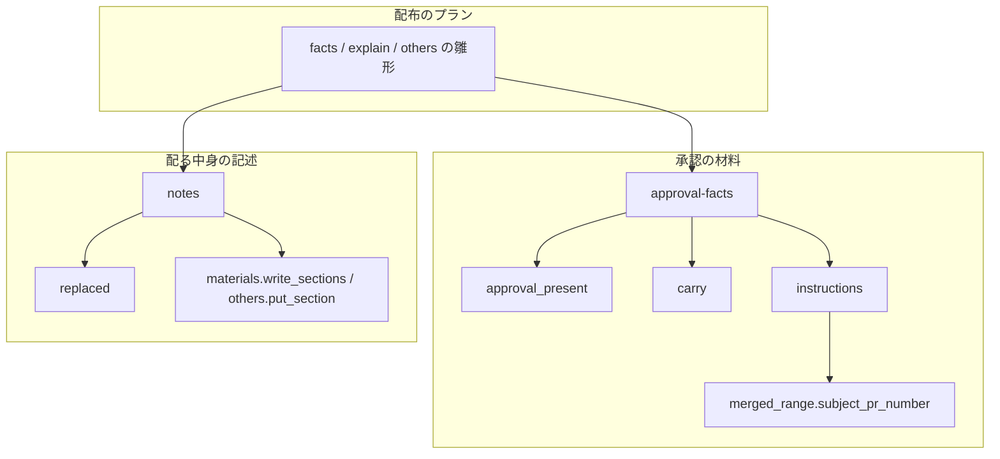
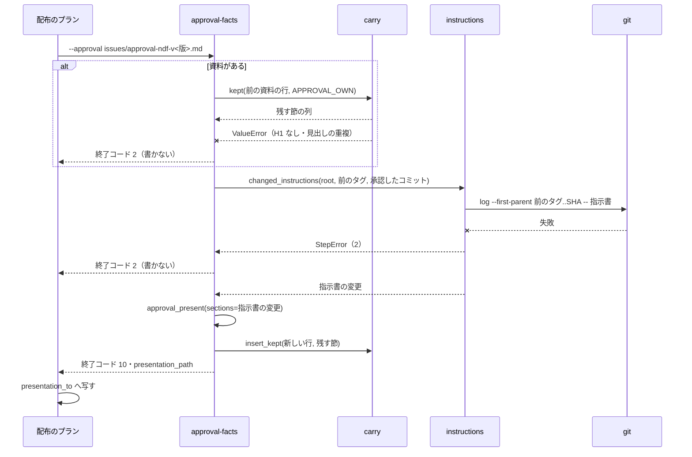

# 承認資料の作り直しと置き換える箇条: 開発版を出し直しても手で足した節と残る危険の中身を残し、指示書の変更を生成し、後の PR が置き換えた箇条を載せない

## 概要

**`approval-facts --approval <前の承認資料>` は、承認資料のうち自分の書く節（`## 1.`・`## 2.`・`## 指示書の変更`・
`## 同意を求めること`・`## 戻し方`）だけを作り直し、それ以外の `## ` の節を見出しも中身も変えずに前と同じ位置へ戻す。**
手で足した節も、`notes --approval` と `changed-plugins --approval` の節も残る。前の資料の形が壊れていれば書かずに止まる。

**`## 指示書の変更` の節は `approval-facts` が生成する。** 前のタグから承認したコミットまでの first-parent のログで、
指示書に触れたコミットを指示書ごとに並べる。

**後の PR の本文の `## 置き換える箇条` が指す前の PR の「利用者向けの変化」の箇条は、`notes` が CHANGELOG の版の節と
承認資料の「配る中身」から除く。** 前の PR の本文には触れない。`## 未検証・残る危険` は既にある行を消さず、無い箇条だけを足す。

例: ndf 10.17.66 の出し直しを今の形で通すと次のようになる。

1. dev.1 のプランの `facts` が承認資料 `issues/approval-ndf-v10.17.66.md` を作る。`## 指示書の変更` には前のタグから
   develop の先端までに指示書を変えたコミットが並ぶ（無ければ「- 無し」）
2. conductor が `## 未検証・残る危険` に箇条を書き足し、`## 補足` を足す
3. 承認ゲート 2 で差し戻され、#1827 が develop へ入る。#1827 の本文に `## 置き換える箇条` と
   `- #1825: <#1825 の箇条の 1 行目>` を書く
4. dev.2 のプランの `facts` が `--approval issues/approval-ndf-v10.17.66.md` で作り直す。`## 未検証・残る危険` と `## 補足` は
   前と同じ位置に残る
5. `explain`（`notes --approval`）と `notes`（CHANGELOG）が #1825 の該当する箇条を除いて #1827 の箇条を並べる。#1825 の本文は変わらない

この文書は、その形に**なぜしたか**（背景・決定と理由・節の持ち主・常に成り立つ条件・既知の限界・テスト観点）を残す。
**打ち方・終了コード・`## 指示書の変更` と `## 置き換える箇条` の書き方・結果 JSON の欄の正は Skill にある。**

| 何を | 正本 |
| --- | --- |
| `approval-facts --approval` の残し方・止まる場合・`metrics.kept` / `metrics.instructions`・`## 指示書の変更` の形 | [`release` の references/release-steps.md](../../plugins/ndf/skills/release/references/release-steps.md) の `approval-facts` の項 |
| `notes` の置き換えの除き方・`items[]` の `kind: replacement`・`metrics.replaced`・残る危険の足し方 | 同じく `notes` の項 |
| `## 置き換える箇条` の書き方と比べ方 | 同じく「置き換える箇条」の節と、[`pr` の SKILL.md](../../plugins/ndf/skills/pr/SKILL.md) の PR の本文の節の案内 |
| 「含む PR」の範囲 | [ndf-release-approval-included-prs.md](ndf-release-approval-included-prs.md) |
| 承認したコミットと承認の記録 | [ndf-release-approved-commit.md](ndf-release-approved-commit.md) |

決定の番号は #1834 の設計の番号である。

## 用語

「承認資料」「手で足した節」「置き換える箇条」の定義は用語集（[docs/glossary.md](../glossary.md)）の「NDF のリリース（`ndf-release`）」が、
「指示書」は「指示書（`ndf-instructions`）」が正である。配布は指示書の宣言の読み込み（`Declaration.load`）をそのまま使う
（顧客 / 供給者の関係）。

## 背景

承認ゲート 2 で差し戻して同じ版の開発版を出し直すと、配布のプランの `approval-facts` が承認資料を丸ごと作り直し、監督の写し
（`presentation_to`）がそれで承認資料を上書きしていた。ndf 10.17.66（スプリント m1743）では、conductor が手で足した節
（「未検証・残る危険」の中身・「指示書の変更」）が dev.2・dev.3 で消え、控え（`approval-ndf-v10.17.66.dev1.md`・`.dev2.md`）から
書き戻した。

あわせて、後の PR #1827 が前の PR #1825 の振る舞いを変えても、`notes` は前の PR の本文の「利用者向けの変化」から箇条を
作り直すため、古い箇条が CHANGELOG に戻った。置き換えの手段が無く、マージ済みの #1825 の本文を手で直すしかなかった。
書き戻しを忘れると、利用者が承認する資料から残る危険と指示書の変更が抜ける。

## 決定と理由

| # | 決定 | 理由 | 採らなかった案 |
| ---: | --- | --- | --- |
| 1 | `approval-facts` が `--approval` で前の承認資料を読み、自分の節だけを作り直す。`notes` と `changed-plugins` の節も残す | 残る危険の中身が作り直しを越えるには、その節を「作り直す側」から外す必要がある。後のステップの節は同じプランで書き直されるので、残しても古い中身は残らない | 監督の写し（`copy_presentation`）で合わせる（どのステップの承認ゲートにも使う汎用の処理で、承認資料の節の持ち主を知らない）。`approval-facts` が承認資料へ直接書く（写し先と一時の出力が同じファイルになり、`shutil.copyfile` が失敗する） |
| 2 | 残す節の錨を「前の資料で直前にあった `approval-facts` の節」にし、その後へ前と同じ順で戻す。錨が無くなれば `## 同意を求めること` の前に置く | `## 指示書の変更` は `## 2.` と `## 同意を求めること` の間に生成するため、1 回目と 2 回目で並びが変わらない | 錨を直前の任意の節（手の節を含む）にする（手の節が消されると錨が無くなり、後ろの手の節が連鎖して同意の前へ動く） |
| 3 | `notes --approval` は既にある `## 未検証・残る危険` へ無い箇条だけを足す。「PR の本文に記載が無い」の行は #1488 で機械の行の 1 つになり、書くたびに消して入れ直す | 節が作り直しを越えて残るようになると、出し直しで加わった PR の危険が載らなくなる。何を集めるかは #1488 が持ち、ここでは足し方だけを決める | 節を作り直す（手で足した危険が消え、同じ現象が残る危険の節で起き続ける） |
| 4 | 置き換えは後の PR の本文の `## 置き換える箇条` に `- #<前の PR>: <前の PR の箇条の 1 行目>` で書き、箇条の文で指す。比べるときは両側の末尾の `（#N…）` を外す | 書き手が CHANGELOG の案から写せ、読む人も何が外れるかを本文だけで読める。末尾の括弧を外すため、スプリント PR が実装の PR の番号を付けた箇条もそのまま写せる | PR 番号だけで指す（スプリント PR は箇条を 10 以上持ち、1 つだけを外せない）。番号と順番で指す（並びを数えて書く必要があり、写し間違いを本文から見つけられない） |
| 5 | 一致しない置き換えは何も除かず、終了コード 0 のまま `not_found` で知らせる | 意図しない箇条を黙って外すと、利用者が読む CHANGELOG から変化が抜け、承認する人も気づけない | 前方一致や近い文で除く |
| 6 | 宣言（`.ndf/instructions.json`）が無いリポジトリでは、指示書を `AGENTS.md` と `CLAUDE.md` に絞る（`release_lib/instructions.py` の `UNDECLARED_FILES`）。宣言があれば `files` に従う | #1834 の受け入れ条件 8 のとおり | 指示書のチェックの既定（`instructions_lib/declaration.py` の `DEFAULT_FILES`。`KIRO.md` を含む）を使う（設計の段階の案。受け入れ条件の文と食い違う） |
| 7 | 指示書の変更は `git log --first-parent <前のタグ>..<承認したコミット> -- <指示書>` を指示書ごとに打ち、件名から PR 番号を `merged_range` と同じ規則（`Merge pull request #N`・squash の末尾 `(#N)`）で読む | 承認するコミットの範囲で数え、「含む PR」と同じ読み方を共有する（`merged_range.subject_pr_number`） | `gh` で PR ごとの変更ファイルを読む（PR の数だけ呼び出しが増え、範囲の外の版上げの PR との区別が要る） |

## 仕様

### 承認資料の節の持ち主

**承認資料は 1 つのファイルだが、節ごとに書き手が決まっている。**

| 節 | 書き手 | `approval-facts --approval` の作り直しで |
| --- | --- | --- |
| H1・`## 1. 対象を開くためのもの`・`## 2. 承認の判断に使うもの`・`## 指示書の変更`・`## 同意を求めること`・`## 戻し方` | `approval-facts` | 作り直す（`APPROVAL_OWN`） |
| `## 検査の結果`・`## 未検証・残る危険`・`## 移行の手順` | `notes --approval` | 残す（後の `explain` が検査の結果と危険の機械の行を入れ替え、危険の PR の箇条は無い行だけを足し、移行の手順は書き直す。材料は [ndf-release-approval-materials.md](ndf-release-approval-materials.md)） |
| `## 版を上げる他のプラグイン` | `changed-plugins --approval` | 残す（後の `others` が書き直す） |
| それ以外の `## ` の節 | 人・conductor（手で足した節） | 残す |
| CHANGELOG の版の節 `## [<plugin> <版>]` | `notes`（`write_notes`） | — |

「配る中身」と「検証への配布で確かめたこと」の欄と同意の 1 行は `approval-facts` の節の中にあるため、作り直しで仮の値へ戻り、
同じプランの `explain`・`others` が書き直す。「承認の記録」も `## 2.` の中にあり、作り直しで消える（承認を取り直す）。
`changelog`（`_update_changelog`）は版の節の見出しと仮の中身（PR のタイトル）を置くだけで、最終の箇条は `notes` が決める。
置き換えは `notes` にだけ効き、`changelog` のタイトルには効かない。

### 常に成り立つ条件

| # | 条件 | 破れたときの扱い |
| --- | --- | --- |
| I1 | `approval-facts` は、前の承認資料のうち自分の書く見出しに当たらない `## ` の節を、見出しと中身を 1 字も変えずに作り直し後の資料へ残す | テストが落とす |
| I2 | 残した節は、前の資料で直前にあった `approval-facts` の節（無ければ H1）の後に、前の資料と同じ順で置く。その節が作り直し後に無ければ `## 同意を求めること` の前に置く | テストが落とす |
| I3 | 前の承認資料が読めない・同じ `## ` の見出しが 2 つある・H1 が無いときは、承認資料を書かずに止める | 終了コード 2。`presentation_path` を出さず、`presentation_to` の先の資料は前のまま |
| I4 | `## 指示書の変更` の行は、前のタグから承認したコミットまでの first-parent のログで指示書に触れたコミットだけから作る | 指示書の宣言が壊れている・git のログが失敗したら書かずに止める（終了コード 2。空の節で上書きしない） |
| I5 | 指示書に触れたコミットが無い版では、`## 指示書の変更` の節は `- 無し` の 1 行 | テストが落とす |
| I6 | `notes --approval` は `## 未検証・残る危険` の既にある行（PR の本文の箇条と手で足した行）を消さず、PR の本文の箇条のうち節に無いもの（1 行目で比べる）だけを足す。機械の行（頭が `- 設計の未確認 #`・`- 未実施のリリース後テスト #`・`- 無い材料:`・`- 記載が無い` のもの。古い資料の「PR の本文に記載が無い」も含む）だけは書くたびに消して入れ直す | テストが落とす |
| I7 | 置き換える箇条が指す PR の箇条のうち、文が一致するものだけを除く（同じ文が 2 つあれば両方）。指す PR が `notes` へ渡す PR に無い・文が一致しない置き換えでは何も除かない | `items[]` に `kind: replacement`・`result: not_found` で載せ、終了コードは 0 |
| I8 | `notes` と `changelog` は PR の本文を読むだけで書かない（`gh pr edit` を呼ばない） | テストが落とす |
| I9 | 置き換える箇条を持つ PR が無い版では、CHANGELOG の版の節と承認資料の欄の中身が変更前と同じ | テストが落とす |

前の PR の `## 未検証・残る危険` と `## 移行の手順` は置き換えで除かない。

### 構成要素と責務

| 要素 | 責務 |
| --- | --- |
| `plugins/ndf/scripts/lib/step_result.py` の `approval_present` | 節の見出しを定数 `PRESENT_HEADINGS` に持ち、`sections=[(見出し, 行)]` を `## 同意を求めること` の前へ置く。渡さない呼び手の出力は変わらない |
| `plugins/ndf/scripts/release_lib/carry.py` | 残す節を決める純粋な処理。`kept(old_lines, own)` が残す節（`Kept`: 見出し・中身・錨）を返し、形が壊れていれば `ValueError`。`insert_kept(new_lines, keep)` が作り直し後の行へ差し込む。読むのと書くのは呼び手 |
| `plugins/ndf/scripts/release_lib/instructions.py` | `files(root)` が指示書を決め（決定 6）、`changed_instructions` が指示書ごとの `InstructionChange`（ファイル・`(短い SHA, PR 番号)` の列）を返し、`instruction_lines` が節の行を作る。git が失敗すれば `StepError`（2） |
| `plugins/ndf/scripts/lib/merged_range.py` の `subject_pr_number` | first-parent のログの 1 行（親の列・件名）から PR 番号を読む。`merges_in` と同じ規則 |
| `plugins/ndf/scripts/release_lib/replaced.py` | `replacements_in(body, n)` が PR の本文の置き換える箇条（`Replacement`: 書いた PR・指す PR・文）と形に合わない行を返し、`apply(items, replacements)` が PR ごとの箇条から一致するものを除いて `items[]` の行を返す。`comparable` が比べる形に整える |
| `plugins/ndf/scripts/release-steps.py` の `cmd_approval_facts`・`kept_sections` | `--approval` を受け、承認資料を書く前に `carry.kept` で残す節を読み（読めなければ `StepError`（2））、`approval_present` の出力へ `carry.insert_kept` で差し込む |
| `release-steps.py` の `pr_notes`・`cmd_notes` と `release_lib/materials.py` の `write_approval`・`write_sections` | `pr_notes` が本文の `## 置き換える箇条` も読み、`cmd_notes` が `replaced.apply` の後の箇条で CHANGELOG と欄を書く。`write_sections` は残る危険の節の機械の行を消して入れ直し、PR の本文の箇条は無い行だけを足す |
| `plugins/ndf/scripts/release_lib/others.py` の `put_section` | 節の中身を入れ替え、節が無ければ作る |
| `plugins/ndf/scripts/supervise_lib/release_templates.py` の `_dev_approval_steps` | `facts` のステップの `approval-facts` へ `--approval {approval}`（`presentation_to` と同じパス）を渡す |

GitHub の PR の本文と git のログは読むだけで、書かない（I8）。

### 出し直しの `facts` の流れ

`--approval` を渡さない・ファイルが無いときは残す節を空として、新しく作る。

## 運用

### 既知の限界

| 項目 | 内容 |
| --- | --- |
| 指示書の既定が 2 つある | 宣言が無いとき、承認資料は `AGENTS.md`・`CLAUDE.md` だけを見る（決定 6）。指示書のチェック（`instructions-check.py`）と用語集の「指示書」の既定は `KIRO.md` を含む 3 つで、宣言の無いリポジトリで `KIRO.md` を変えても承認資料には載らない |
| スプリントの中の置き換え | スプリント PR の「利用者向けの変化」は `supervise_lib/pr_materials.py` の `collect_changes` が実装の PR から集める。同じスプリントの実装の PR どうしの置き換えはスプリント PR の本文へ写らないため、`notes` から見えない。スプリント PR の本文に直接書く |
| 生成する節の中の手の書き換え | `approval-facts` の節（表のセルなど）を手で直しても、作り直しで生成の値に戻る |
| 手で直した CHANGELOG の行 | 残す仕組みは持たない。古い箇条を載せないのは置き換える箇条で行う |
| 実機での出し直し | 手の節が残ること・指示書の変更が並ぶことは、次の開発版の出し直しでリリース後テストが確かめる |

## テスト観点

テストは `plugins/ndf/scripts/tests/test_release_carry.py`（作り直しと指示書の変更）と `test_release_replaced.py`（置き換えと残る危険）にある。
一時の git リポジトリと `gh` の差し替えで再現する。

- `## 補足` を足した承認資料で `approval-facts --approval` を 2 回続けて打つと、2 回目の後に `## 補足` の見出しと中身がバイト単位で残ること。手で書いた `## 未検証・残る危険` の行も残ること（I1）
- `## 2.` の後の手の節は `## 2.` の後に、`## 戻し方` の後の手の節は `## 戻し方` の後に戻ること。錨の見出しを消した資料では同意の前に置かれること（I2）
- 資料が無い状態で打つと、1・2・指示書の変更・同意・戻し方の順の節だけを持つ資料ができること
- H1 の無い資料・同じ見出しが 2 つある資料では終了コード 2 で、`presentation_path` を出さず、渡した資料のバイトが変わらないこと（I3）
- 範囲で `CLAUDE.md` に触れたマージがある履歴で、節にファイル・`短い SHA（#N）`・`git diff <前のタグ> <SHA> -- CLAUDE.md` が並ぶこと。squash の件名でも PR 番号が出ること。実装の PR の中のコミットは並ばないこと（I4）
- git のログが失敗すると終了コード 2 で、資料を書かないこと（I4）
- 指示書に触れていない範囲では `- 無し` の 1 行になること（I5）
- 宣言が無いリポジトリで `AGENTS.md`・`CLAUDE.md` の変更が並び、`KIRO.md` は並ばないこと。宣言の `files` があればそれに従うこと（決定 6）
- 後の PR が前の PR の箇条を指す版で、CHANGELOG の版の節と配る中身の欄に前の箇条が無く、後の PR の箇条があること。前の箇条の末尾が別の PR の `（#N）` でも外れること（I7）
- `notes`・`changelog` の実行で `gh pr edit` が 1 回も呼ばれないこと（I8）
- 一致しない置き換えでは何も除かれず、`items[]` に `result: not_found` の行が 1 つ載り、終了コードが 0 であること（I7）
- 置き換えの節を持たない PR だけの版で、CHANGELOG の版の節と承認資料の欄が変更前の出力と一致すること（I9）
- 既にある残る危険の節に、出し直しで加わった PR の危険だけが足され、手で足した行が残り、機械の行が 2 回目の材料だけになること（I6）

## 関連リンク

- [`release` の references/release-steps.md](../../plugins/ndf/skills/release/references/release-steps.md)（`approval-facts`・`notes` の打ち方と「置き換える箇条」の正）
- [`release-steps.py`](../../plugins/ndf/scripts/release-steps.py)・[`release_lib/carry.py`](../../plugins/ndf/scripts/release_lib/carry.py)・[`release_lib/instructions.py`](../../plugins/ndf/scripts/release_lib/instructions.py)・[`release_lib/replaced.py`](../../plugins/ndf/scripts/release_lib/replaced.py)・[`release_lib/others.py`](../../plugins/ndf/scripts/release_lib/others.py)・[`lib/step_result.py`](../../plugins/ndf/scripts/lib/step_result.py)・[`lib/merged_range.py`](../../plugins/ndf/scripts/lib/merged_range.py)・[`supervise_lib/release_templates.py`](../../plugins/ndf/scripts/supervise_lib/release_templates.py)
- [ndf-release-approval-included-prs.md](ndf-release-approval-included-prs.md)・[ndf-release-approved-commit.md](ndf-release-approved-commit.md)・[ndf-instruction-files-check.md](ndf-instruction-files-check.md)
- #1834（この形を決めた課題）、#1488（未検証・残る危険を集める仕組み）、#1637（CHANGELOG の箇条の重複。やらないと判断済み）、#1426（conductor の手当て）
