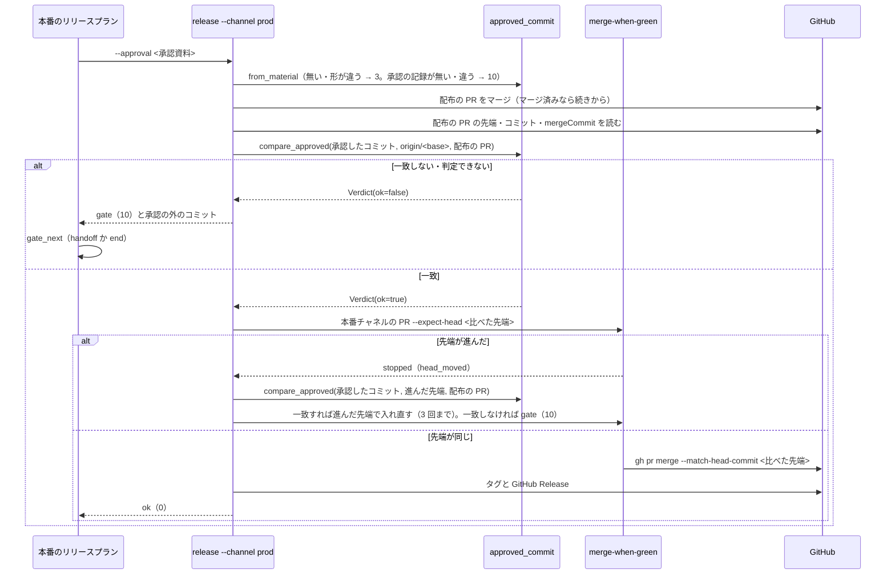
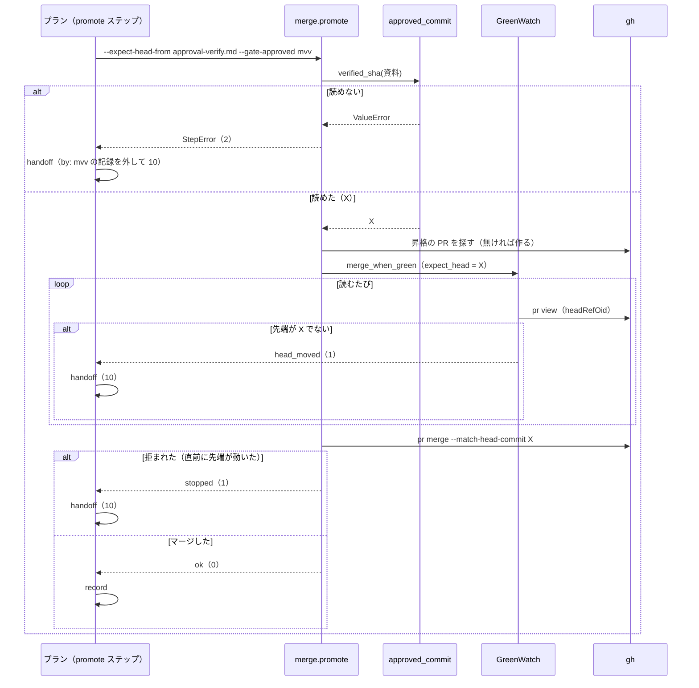

# 本番への配布の承認したコミット: 承認資料にベースブランチの先端を控え、本番チャネルへ入れる直前に承認の外のコミットがあれば承認ゲートで止まる

## 目的

- **本番への配布の承認（ゲート 2）の対象を、承認資料の「承認したコミット」（ベースブランチの先端の 40 桁）に固定する。**
  承認の後にベースブランチへ入った変更は、本番チャネル・タグ・GitHub Release のどれにも届かない
- **食い違いに気づくのは `release-steps.py` の手順の上の確認である。** 配布物の差分の数え直しのような偶然に頼らない
- **止まったときの結果 JSON だけで、承認したコミット・比べた先端・承認の外のコミットが読める。** LLM が git を
  照会し直さなくてよい
- **`pace: fast` / `auto` の昇格の経路では、本番チャネルへ入るのは MVV 判定が読んだ導入の確認の記録のコミット（確かめたコミット）に限る。**
  確認の後にベースブランチが進めば、マージせずに承認ゲート 2 へ戻る（#1529。「昇格の経路の照合」）
- **承認ゲート 2 の承認の後の昇格のマージ（`promote-approved`）は、利用者が承認資料に見た昇格の Pull Request の先端（承認したコミット）に限る。**
  承認の後にベースブランチが進めば、マージせずに承認ゲート 2 へ戻る（#2104。「昇格の承認の後の照合」）

例: ndf のある版を本番へ出すとき、承認の 6 分後に別の PR がベースブランチへマージされた。

| 順 | 起きること |
| --- | --- |
| 1 | 開発版のリリースプランの `approval-facts` が、打った時点の `origin/<ベースブランチ>` の 40 桁を承認資料の「承認したコミット」の行と `metrics.approved_sha` に書く。`next` は `release ... --channel prod --approved-sha <40 桁>` |
| 2 | 利用者が承認資料を見て承認する。conductor が `approve --approval <承認資料> --approved-sha <1 の metrics.approved_sha> --by user` で「承認の記録」を書く（MVV 判定で通したときは `mvv-gate.py` が `by: mvv` で書く） |
| 3 | 別の PR がベースブランチへマージされる |
| 4 | 本番のリリースプランの `release --channel prod --approval <承認資料>` が、承認の記録と承認したコミットが等しいことを確かめ、配布の PR（`release/v<版>` → ベースブランチ）をマージする |
| 5 | 承認したコミットから `origin/<ベースブランチ>` の先端までに、配布の PR の外のコミット（3 の PR のもの）があるので、本番チャネルの PR を作らずに `gate`・終了コード 10 で止まる。`items[]` に外のコミットの SHA・件名・PR 番号が並ぶ |
| 6 | 人が外のコミットを見て、`approval-facts` で承認資料を作り直し、承認を取り直して打ち直す |

**打ち方・`status` の読み方・止まったときの次の手は Skill が正である。** ここに書き写さない。

| 何を | 正本 |
| --- | --- |
| 承認の対象が「承認したコミット」であること、承認を得たら `approve` で承認の記録を書くこと | [`release` の SKILL.md](../../plugins/ndf/skills/release/SKILL.md) の「公開前の提示と承認」 |
| `--channel prod` に承認したコミットを渡すこと、承認ゲートで止まったら MVV 判定で通さず人へ戻すこと | 同上の手順 4（公開する） |
| `approval-facts` / `approve` / `release` の打ち方、終了コード、`gate` のときの `metrics.reason`・`metrics.approved_sha`・`metrics.compared_head`・`result: unapproved` の読み方 | [`release` の references/release-steps.md](../../plugins/ndf/skills/release/references/release-steps.md) |
| リリースの承認資料の「対象を開くもの」の項目 | `development-workflow` の [references/approval-request.md](../../plugins/ndf/skills/development-workflow/references/approval-request.md) の「配布（`release`）」 |
| MVV 判定が関門 2 を通す条件（`pace: fast` / `auto`） | `development-workflow` の [references/pace.md](../../plugins/ndf/skills/development-workflow/references/pace.md) |

この文書が扱うのは、Skill に書かない常に成り立つ条件・比較の順序・ライブラリと結果 JSON の契約（止まる時点を含む）・
決定の理由・テスト観点である。

## 用語

定義は [用語集](../glossary.md) の「NDF のリリース（`ndf-release`）」が正である（`.ndf/glossary.json` の `document`）。
この文書で使う語は「承認したコミット」「比べた先端」「承認の外のコミット」「承認の記録」「確かめたコミット」である。ほかに次の語を使う。

| 語 | 指すもの |
| --- | --- |
| 配布の PR | この版の `release/v<版>` → ベースブランチの Pull Request（開発版の接尾辞を外す bump・changelog・他のプラグインの bump を含む） |
| 本番チャネルの PR | ベースブランチ → 本番チャネルの Pull Request |
| 承認資料 | `issues/approval-<プラグイン>-v<版>.md`。`approval-facts` が書く |
| 導入の確認の承認資料 | 昇格のプランの `verify` ステップ（`release-steps.py verify-facts`）が書く `approval-verify.md`。確かめたコミットの行を 1 行持つ |
| 昇格の Pull Request | ベースブランチ → 本番チャネルの Pull Request を `merged-steps.py promote` が作ってマージするもの。head はベースブランチそのもの |
| 昇格の承認資料 | 昇格の承認ゲート 2 で利用者（か MVV 判定）が見る `{state_dir}/work/approval-promote.md`。`normal` では `promote` の承認ゲート 2 の停止が、`fast` / `auto` では `prepare` が書く。「承認したコミット」の行を 1 行持つ |

ベースブランチ・本番チャネル・プラグイン名は宣言（`.ndf/worktree.json` の `base_branch`・`production_branch` と `.ndf/supervise.json` の `release.plugin`）と引数から読み、
`develop` / `main` を埋め込まない。

## 対象範囲

| 扱う | 扱わない |
| --- | --- |
| `release-steps.py approval-facts` が承認したコミットを書くこと | `--channel dev` の振る舞い（開発版はマージした変更がそのまま載るチャネルで、承認を要しない。引数も結果も変わらない） |
| `release-steps.py approve` が承認の記録を書くこと、`mvv-gate.py check --gate release` が `by: mvv` で書くこと | 昇格の承認資料の「承認の記録」の行（`promote-approved` は承認したコミットの行だけで照合し、承認の記録を求めない） |
| `release-steps.py release --channel prod` が承認したコミットを受け取り、承認の外のコミットがあれば止まること | 承認資料のほかの欄、MVV 判定の判定の中身、導入の確認（`verify-facts`）の走らせ方 |
| `merged-steps.py merge-when-green --expect-head` が比べた先端だけをマージすること | 食い違ったときに承認資料を自動で作り直して再承認を求める仕組み、導入の確認と MVV 判定を自動でやり直す仕組み（止まって人へ戻すまでを扱う） |
| 本番のリリースプラン（`supervise.py new release --channel prod`。`--mvv` 付きを含む）が承認資料を渡すこと | 手動反映の本番系（`gate-2` のプラン。#1454） |
| `pace: fast` / `auto` の昇格のプラン（`plan_promote`）の `promote` ステップが、確かめたコミットのときだけ本番チャネルへマージし、違えば承認ゲート 2 へ戻ること（`merged-steps.py promote --expect-head-from`。#1529） | 経路 `merge` で宛先が自動反映の本番チャネルのときの `merge-approved`（`merge-when-green --gate-approved user`）の照合 |
| 昇格のプランの `promote-approved` が、昇格の承認資料の承認したコミットのときだけ本番チャネルへマージし、違えば承認ゲート 2 へ戻ること（`merged-steps.py promote --approved-from`。#2104） | |

## 背景

**承認は「承認した時点のベースブランチの中身」を前提にしていたが、`release` の手順はその中身をコミットで控えず、
本番チャネルへ入れる直前に比べていなかった。** ndf 10.16.0 の配布では、承認（2026-09-22T14:36Z）の 6 分後に
ミッションの外の PR #806 がベースブランチへマージされた。仕上げのフェーズが配布物の差分（119 → 124 ファイル）の
食い違いに気づいて止まり、再承認を経て配布したが、気づいたのは差分の数を数え直したからである（PR #810 の振り返り）。

**承認したコミットとマージの直前のベースブランチの先端は、正しく進めても一致しない。** 本番のリリースプランは承認の後に
配布の PR をベースブランチへマージしてから本番チャネルの PR をマージするためである。比べるのは「承認したコミットから
先端までに、配布の PR の外のコミットや中身が無いか」である。

**承認資料にコミットを書いて本番の範囲を縛る形は、手で反映する経路（`release-steps.py deploy-facts`）で既に使っていた。**
同じ形を `package-plugin` の本番の配布へ広げた。

**昇格の経路にも同じ欠けがあった（#1529）。** `pace: fast` / `auto` の昇格のプランは導入の確認をベースブランチの先頭で走らせ、
確かめたコミットを承認資料へ載せる（#1457）。しかし `promote` ステップは CI が通った昇格の Pull Request の先端をそのまま
マージしていた。確認の後にベースブランチが進むと（別のスプリントのマージなど）、確かめていないコミットが MVV 判定の後に
本番チャネルへ入りえた。

## 仕様

### 集約

| 集約 | 持ち主（書き換えてよいもの） | 根 | エンティティ | 値オブジェクト |
| --- | --- | --- | --- | --- |
| 承認資料 | `approval-facts`（資料を書く）。承認の記録の行だけは `approve` と `mvv-gate.py check --gate release` が書く | 承認資料（`issues/approval-<プラグイン>-v<版>.md`） | — | 承認したコミット・承認の記録・前のタグ・比較の URL |
| 本番の配布 | `release --channel prod` | 本番の配布（版 1 つ） | 配布の PR・本番チャネルの PR | 承認したコミット・比べた先端・承認の外のコミット |

本番の配布は承認資料から承認したコミットを値として読むだけで、承認資料を書き換えない。

### 常に成り立つ条件

| # | 条件 | 破れたときの扱い |
| --- | --- | --- |
| I1 | 承認したコミットを受け取っていない本番の配布は、配布の PR も本番チャネルの PR もマージしない（push もしない） | `stopped`。引数が無い・`--approved-sha` の形が違う・`--channel dev` に渡した → 2、承認資料が無い・欄が無い・欄の値の形が違う → 3 |
| I2 | 承認したコミットは比べた先端の祖先である | `gate`・10。本番チャネルの PR をマージしない |
| I3 | 承認したコミットから配布の PR の先端までのコミットは、配布の PR のコミットか、配布物に触れないコミットである | `gate`・10。外のコミットを `items[]` に並べる |
| I4 | 比べた先端の木は、配布物のパスで、承認したコミットに配布の PR を `git merge-tree --write-tree` で足した木と等しい | `gate`・10（`tree_differs`） |
| I5 | 本番チャネルへマージするのは比べた先端のコミットだけである | マージしない。進んだ先端で比べ直し、一致すればその先端で入れ直す（3 回まで）。一致しないか回数を超えれば `gate`・10 |
| I6 | 判定できない（`merge-tree` が衝突する・コミットを読めない・配布の PR のコミットを読めない）ときは通さない | `gate`・10（`undecidable`） |
| I7 | MVV 判定の承認では I2〜I6 の承認ゲートを通さない | 本番のリリースプランは `--mvv` 付きなら `handoff`、無しなら `end` へ進み、`verify` へ進まない |
| I8 | 承認資料の「承認したコミット」は `approval-facts` を打った時点の `origin/<ベースブランチ>` の 40 桁で、題の先頭 8 桁・比較の URL・`metrics.approved_sha`・`next` の `--approved-sha` と同じ値である | 1 つの変数から作る（`cmd_approval_facts`）。テストで縛る |
| I9 | 承認したコミットから比べた先端までのコミットは、配布の PR のもの（そのコミット・squash の `mergeCommit`・同じ patch-id のもの）か、配布物に触れないものである。木が一致しても別に確かめる | `gate`・10（`outside_commits`） |
| I10 | `--approval` で受け取るときは、承認資料の「承認の記録」の SHA が同じ資料の「承認したコミット」と等しい。`approval-facts` で資料を書き直すと承認の記録は消え、承認し直すまで通らない | `gate`・10（`not_approved`）。何もマージする前に止まる |

配布物は `plugins/`・`.claude-plugin/` の下のパスである（`release_lib/approval.py` の `SHIPPED`）。差分がこのどれにも触れない
コミット（設計文書・用語集だけの PR など）は、承認の外でも利用者へ届く中身を変えないため、承認を取り直さずに通し、
結果に残す（#2221）。

`--approved-sha` で手で渡すときは、打った人が承認した SHA そのものを渡すため、承認の記録を見ない（I10 は `--approval` だけに当たる）。

### 処理の流れ

ドメインイベントの発生元と受け手:

| イベント | 発生元 | 受け手 |
| --- | --- | --- |
| 承認資料を書いた（承認したコミットを含む） | `approval-facts` | 承認する人・MVV 判定・本番のリリースプラン |
| ゲート 2 を承認した（承認の記録を書いた） | 人（conductor が `approve --by user`）か MVV 判定（`mvv-gate.py check --gate release`。`--advise` では書かない） | conductor・本番の配布 |
| ほかの変更がベースブランチへマージされた | 利用者か別のプラン | 本番の配布（比較で見つける） |
| 承認したコミットからベースブランチの先端までを比べた | `lib/approved_commit.py` の `compare_approved` | `release --channel prod`（一致なら本番チャネルへ、違えば承認ゲート） |
| 比べた先端を本番チャネルへマージした | `merged-steps.py merge-when-green --expect-head` | `release --channel prod`（タグと GitHub Release へ） |

### 比較の順序（`compare_approved`）

A = 承認したコミット、T = 比べた先端、H = 配布の PR の先端とする。最初に当たったもので返す。

| 順 | 見ること | 当たったときの `reason` |
| --- | --- | --- |
| 1 | A を `git cat-file -e <SHA>^{commit}` で読めるか | `unknown_commit` |
| 1 | T と H を読めるか | `undecidable` |
| 2 | `git merge-base --is-ancestor A T` | 0 でなければ `not_ancestor` |
| 3 | `git rev-list A..H` のうち、配布の PR のコミット（`gh pr view --json commits`）に無いもの | `outside_commits`（I3） |
| 4 | `git rev-list --no-merges A..T ^H` から、配布の PR の `mergeCommit` と、配布の PR のコミットと同じ `git patch-id --stable` のものを除いた残り | `outside_commits`（I9） |
| 5 | `git merge-tree --write-tree A H` の木と `T^{tree}` | 等しければ `match`、違えば `tree_differs`、`merge-tree` が失敗すれば `undecidable` |

`shipped`（配布物のパスの接頭辞）を渡すと、3 と 4 で見つけたコミットのうち第 1 親との差分が `shipped` に触れないもの
（差分を読めないものは触れたとみなす）を `Verdict.tolerated` へ移して止めず、3 で見つけても 4 まで進む。5 は 2 つの木の
違いが `shipped` に及ぶときだけ `tree_differs` にする。本番の配布は `SHIPPED` を渡し、昇格の経路は渡さない。

`allowed`（入ってよい PR）を空にすると、5 は「T の木が A の木と等しいか」になる（昇格の経路はこの形を使わない。#1529）。
`allowed` が 2 つ以上のときは期待する木を作らず `undecidable` を返す。`git merge-tree --write-tree` は git 2.38 からで、
使えない git では 0 以外を返し `undecidable`（I6）に倒れる。

### `lib/approved_commit.py` の契約

git を読むだけで書かず、終了コードも出力も持たない。ブランチ名は受け取らず SHA だけを受け取る。
終了コードへの読み替えは呼び手（`release_lib/approval.py`・`mvv-gate.py`）が行う。

| 名前 | 契約 |
| --- | --- |
| `ROW` / `RECORD` | 承認資料の欄の名前 `承認したコミット` / `承認の記録` |
| `parse_sha(text)` | 40 桁の 16 進を小文字で返す。形が違えば `ValueError` |
| `material_sha(path)` | 「承認したコミット」の欄の SHA。資料・欄が無い・形が違えば `ValueError`（承認の記録は見ない） |
| `recorded_sha(path)` | 「承認の記録」の SHA。無ければ `None` |
| `from_material(path)` | 承認したコミットを返す。承認の記録が無いか SHA が違えば `Unapproved`（I10） |
| `record_approval(path, sha, by, at)` | 「承認したコミット」の行の直後へ `\| 承認の記録 \| <40 桁> を <by> が <ISO 8601> に承認 \|` を書く（あれば置き換える）。`sha` が資料の承認したコミットと違えば書かずに `Unapproved` |
| `record_all(approved, by, at)` | `{承認資料: SHA}` のそれぞれへ `record_approval` を打ち、`items`（`kind: approval`・`result: recorded` か `not_recorded`）を返す。`mvv-gate.py` が使う |
| `compare_approved(root, approved, tip, allowed)` | 上の比較の順序で `Verdict` を返す |
| `verified_line(base, sha)` | 導入の確認の承認資料の確かめたコミットの行 `` - ベースブランチ <base> の先頭: `<sha>`。導入の確認はこのコミットで走らせた `` を返す（形を作るだけ）。`release_lib/deploy.py` の `verify_markdown` がこれで書く |
| `verified_sha(path)` | 導入の確認の承認資料から確かめたコミットを小文字の 40 桁で返す。資料が無い・行が無い・行が 2 つ以上・`parse_sha` が通らなければ `ValueError` |

| 型 | 欄 |
| --- | --- |
| `Verdict` | `ok`（`match` のときだけ真）・`approved`・`tip`・`reason`・`outside: list[Outside]`・`expected_tree`・`actual_tree` |
| `Outside` | `sha`・`subject`・`pr`（`compare_approved` は空で返す。`release` が止まるときに `gh api repos/<owner>/<name>/commits/<SHA>/pulls` の先頭で埋め、読めなければ省く） |
| `AllowedPR` | `number`・`head`・`commits`・`merge_commit` |
| `Unapproved` | `ValueError` の子。`sha`（承認したコミット）と `recorded`（記録の SHA。無ければ `None`）。`release` は 10、`approve` は 1 に読み替える |

### 昇格の経路の照合（#1529）

`pace: fast` / `auto` の昇格のプラン（`supervise_lib/delivery_templates.py` の `plan_promote`）は
`verify` → `prepare` → `mvv` → `note` → `promote` → `record` の順に流れ、`note` か `promote` が落ちたら `handoff` へ進む。
`promote` ステップは `merged-steps.py promote ... --expect-head-from {state_dir}/work/approval-verify.md --gate-approved mvv` を打つ。

| 集約 | 持ち主（書き換えてよいもの） | 根 | 値オブジェクト |
| --- | --- | --- | --- |
| 導入の確認の承認資料 | `release_lib/deploy.py` の `verify_facts`（書く）。確かめたコミットの行の形は `lib/approved_commit.py` | `approval-verify.md` | 確かめたコミット（40 桁）・ベースブランチの名前・確認の終了コード |
| 昇格のマージ | `merged_lib/merge.py` の `promote` | 昇格の Pull Request | 先端（`headRefOid`）・照合する SHA（`expect_head`） |
| 昇格のプラン | `supervise_lib/delivery_templates.py` の `plan_promote` | プラン（エンティティはステップ） | 承認資料のパス（`VERIFY_MATERIAL`） |

昇格のマージは導入の確認の承認資料をパスで参照し、中身を書き換えない。確かめたコミットの行は書き手（`verify-facts`）と
読み手（`merged-steps.py promote`）が `lib/approved_commit.py` の 1 か所を共有して決める。

常に成り立つ条件:

| # | 条件 | 破れたときの扱い |
| --- | --- | --- |
| P1 | 照合する SHA を受けた `promote` は、昇格の Pull Request の先端がその SHA に等しいときだけ `gh pr merge` を呼び、`--match-head-commit` にその SHA を渡す | 読むたびに比べ、違えば `gh pr merge` を呼ばずに `items[].result: head_moved`（`head` と `expected` つき）で終了コード 1 |
| P2 | `--expect-head-from` を受けた `promote` は、資料から確かめたコミットを読めないまま照合を飛ばさない | `gh` を 1 度も呼ばずに終了コード 2（`EXIT_UNREADABLE`）で止まる |
| P3 | 確かめたコミットの行を書く形と読む形は `verified_line` / `verified_sha` の 1 か所が決める | 読めなければ P2 の扱い |
| P4 | `fast` / `auto` の `promote` ステップは、`mvv` ステップが材料に渡すのと同じパス（`VERIFY_MATERIAL`）を `--expect-head-from` に渡し、失敗は `handoff` へ進む | プランの組み立てのテストで落とす |
| P5 | `--expect-head-from` は `fast` / `auto` の `promote` ステップだけが持ち、`promote-approved` は持たない（昇格の承認の後の照合は `--approved-from`） | プランの組み立てのテストで落とす |

ドメインイベントの発生元と受け手:

| イベント | 発生元 | 受け手 |
| --- | --- | --- |
| 導入の確認がベースブランチの先頭 X で走り、承認資料に X を書いた | `verify` ステップ（`verify-facts`） | `mvv` ステップ（材料として読む）・`promote` ステップ（X を読む） |
| ベースブランチが X から Y へ進んだ | プランの外のマージ | `promote` ステップ（先端の Y として読む。`verify` と `prepare` の間に起きても同じ） |
| 昇格の Pull Request の先端を読み、X と比べた | `promote` ステップ（`GreenWatch` の 1 回の読み） | 一致なら本番チャネルへのマージ、違えば `handoff` |
| マージせずに止まり、`handoff` が MVV 判定の記録を外して承認ゲート 2 へ戻した | `promote`（非 0）→ `handoff` | 人（承認ゲート 2） |

`promote` の失敗の種類（`head_moved` の 1・読めない 2・マージの拒否 1・衝突 4）で行き先を分けず、どれも `on_fail: handoff` が
承認ゲート 2 へ戻す。戻った後の続きは `development-workflow` の `references/pace.md` の承認ゲート 2 の行が正で、照合で止まった
（`head_moved`・資料を読めない）ときは `run <プラン> --from verify` から流し直す。`--from promote-approved` は `prepare` が書いた
昇格の承認資料の承認したコミットで照合するが、導入の確認も MVV 判定もその先端では走っていないためである。

### 昇格の承認の後の照合（#2104）

`normal` の昇格のプランは `promote`（`--out {state_dir}/work/approval-promote.md`）→ 承認ゲート 2 → `promote-approved` の順に流れる。
`promote-approved` ステップは `normal` と `fast` / `auto` で同じコマンド
`merged-steps.py promote ... --approved-from {state_dir}/work/approval-promote.md --gate-approved user` を打つ。

| 集約 | 持ち主（書き換えてよいもの） | 根 | 値オブジェクト |
| --- | --- | --- | --- |
| 昇格の承認資料 | 本文と「承認したコミット」の行は `merged_lib/merge.py` の `gate_stop`（`normal`）と `_prepare_promote`（`fast` / `auto`）。「承認の記録」（`by: mvv`）の行は `fast` / `auto` の `mvv-gate.py` だけ。行の形は `lib/approved_commit.py` の `material_row` / `material_sha` | `approval-promote.md` | 承認したコミット（40 桁） |
| 昇格のプラン | `supervise_lib/delivery_templates.py` の `plan_promote` | プラン | 昇格の承認資料のパス（`PROMOTE_MATERIAL`） |

常に成り立つ条件:

| # | 条件 | 破れたときの扱い |
| --- | --- | --- |
| P6 | `promote` が昇格の Pull Request で承認ゲート 2 に止まる（終了コード 10）とき、止まる判定に使った読みの `headRefOid` が承認資料の「承認したコミット」の行・`metrics.approved_sha`・gate の `items[].head` に同じ値で載る。`--prepare` の資料にも同じ形の行が載る | 先端が 40 桁の 16 進で読めなければ資料を書かずに終了コード 2 |
| P7 | `--approved-from` を受けた `promote` は、先端が資料の承認したコミットのときだけ `--match-head-commit` でマージする | 違えば `gh pr merge` を呼ばずに `head_moved`（`head`・`expected`）で 1。`next` に承認ゲート 2 からのやり直しを書く |
| P8 | `--approved-from` の資料を読めないまま照合を飛ばさない。`--gate-approved user` は `--approved-from` 無しで受けない | `gh` を 1 度も呼ばずに終了コード 2。資料が無いときは `next` に資料つきの打ち方を書く |
| P9 | `normal` の `promote` の `--out`、両方の `promote-approved` の `--approved-from`、`fast` / `auto` の `prepare` の `--out` は同じ `PROMOTE_MATERIAL` である | プランの組み立てのテストで落とす |

照合で止まったときの続きは `pace.md` の承認ゲート 2 の行が正で、`normal` は `run <プラン> --from promote` から流し直して
新しい先端で承認ゲート 2 を取り直し、`fast` / `auto` は `--from verify` から流し直す。`promote-approved` は自分の `pace` を
知らないため、`next` には両方の打ち方を並べる。

## データ・設定

### 承認資料の欄

`approval-facts` が「2. 承認の判断に使うもの」の表の先頭に `| 承認したコミット | <40 桁> |` を書く。題の先頭 8 桁と
比較の URL（`compare/<前のタグ>...<40 桁>`）は同じ値から作る。資料を書き直すとき、承認の記録の行は書かない（I10）。
承認の記録の行は `approve` か `mvv-gate.py` が「承認したコミット」の行の直後へ書く。既存の読み手（`notes --approval`・
`mvv-gate.py`）は欄の名前で読むため、行が増えても壊れない。

### `release --channel prod` の止まる時点と結果

| 場合 | 終了コード | `status` | 止まる時点 |
| --- | --- | --- | --- |
| `--approved-sha` も `--approval` も無い・`--approved-sha` の形の誤り・`--channel dev` に渡した | 2 | `stopped` | 最初（push の前）。`summary` に `--approved-sha か --approval が要る` |
| `--approval` の資料が無い・欄が無い・欄の値の形の誤り | 3 | `stopped` | 最初 |
| `--approval` の資料に承認の記録が無い・記録の SHA が違う（I10） | 10 | `gate` | 最初（何もマージしない） |
| 承認したコミットを読めない・祖先でない（I2）、承認の外のコミット（I3・I9）、木が違う（I4）、判定できない（I6） | 10 | `gate` | 配布の PR のマージの後、本番チャネルの PR の前 |
| CI 待ちの間に先端が配布物に触れるコミットで進んだ・入れ直しが 3 回を超えた（I5） | 10 | `gate` | 本番チャネルの PR のマージの前 |

`gate` のときの結果 JSON のうち、[references/release-steps.md](../../plugins/ndf/skills/release/references/release-steps.md)
の読み方の表に無い欄:

| 欄 | 中身 |
| --- | --- |
| `items[]`（I10） | `{"kind": "commit", "name": <承認したコミット>, "result": "not_approved", "recorded": <記録の SHA か null>}`。`next` は `approve` で承認の記録を書いて `release --approval` を打ち直すこと |
| `items[]`（木が違う） | `{"kind": "tree", "name": <比べた先端>, "result": "differs", "expected": <木>, "actual": <木>}` |
| `items[]`（祖先でない・読めない） | `{"kind": "commit", "name": <承認したコミット>, "result": "not_ancestor" か "unknown"}` |
| `items[]`（先頭） | 配布の PR の `{"kind": "pr", ..., "result": "merged"}`（I10 では無い） |
| `metrics` | `approved_sha`・`compared_head`（I10 では `null`）・`reason`・`outside`（承認の外のコミットの件数）。`main_pr` と `tag` は `null` |
| `metrics.reason` が `head_moved` | 比べ直した結果が一致したまま先端だけが進んだとき。比べ直して一致しなければ、その `reason`（`outside_commits` など） |
| `next`（I10 以外） | `approval-facts` で承認資料を作り直して承認を取り直し、`release --channel prod --approved-sha <新しい承認したコミット>` を打ち直すこと |

`ok` のときは今の `items` / `metrics` に `metrics.approved_sha` と `metrics.compared_head` が加わる。配布物に触れないので通した
承認の外のコミットは `items[]` に `{"kind": "commit", "name": <SHA>, "result": "outside_unshipped", "subject": <件名>}` で並び、
件数が `metrics.tolerated` に入る。

### `merged-steps.py merge-when-green --expect-head <SHA>`

渡すと、PR を読むたびに先端をその SHA と比べる。違えば待ち直さず、**PR がマージ済みでも**マージを成功として返さずに
`stopped`（1）で止まり、`items[]` に `{"kind": "pr", "name": "#<番号>", "result": "head_moved", "head": <今の先端>, "expected": <SHA>}`
を載せる。待つ間に別の先端でマージされた PR へタグを打たないためである。一致すれば `gh pr merge --match-head-commit <SHA>`
でマージする。渡さないときは緑を確かめた先端を `--match-head-commit` に渡す。

### `merged-steps.py promote --expect-head-from <導入の確認の承認資料>`

`merged-steps.py promote --head <ベースブランチ> --base <本番チャネル> [--prepare] [--out <資料>] [--gate-approved user|mvv] [--expect-head-from <資料> | --approved-from <資料>]`。
`--expect-head-from` は任意で、渡すと最初に `verified_sha` で確かめたコミットを読み、`merge-when-green --expect-head` と同じ照合に使う。

| 場合 | 終了コード | 結果 |
| --- | --- | --- |
| 先端が確かめたコミットのまま CI が通った | 0 | 今と同じ。`items[]` に `{"kind": "pr", "result": "merged", "head": <X>, "gate_approved": "mvv"}` |
| 先端が確かめたコミットでない（待つ間に変わった・別の先端でマージ済みを含む） | 1 | `status: stopped`・`items[]` に `{"kind": "pr", "name": "#<番号>", "result": "head_moved", "head": <Y>, "expected": <X>}`。`gh pr merge` は呼ばない |
| 最後の読みとマージの間に先端が変わった | 1 | `--match-head-commit X` で GitHub がマージを拒み、既存の「`gh pr merge --admin` が失敗」になる |
| 資料が無い・確かめたコミットの行が無いか 2 つ以上・40 桁の 16 進でない | 2 | `status: stopped`。昇格の Pull Request を探さず・作らず、`gh` を呼ばない |

`--prepare` と一緒に渡したときも先に読み（読めなければ 2）、読めればマージへ進まない今の振る舞いのまま終える。

### `merged-steps.py promote --approved-from <昇格の承認資料>`

`--approved-from` は `--expect-head-from` と同時には受けない。渡すと最初に `material_sha` で承認したコミットを読み、同じ照合に使う。
`--gate-approved user` はこの引数が要る。`--out` は `--prepare` と承認ゲート 2 の停止で書く昇格の承認資料の置き場である。

| 場合 | 終了コード | 結果 |
| --- | --- | --- |
| 承認ゲート 2 で止まった（`--gate-approved` 無し） | 10 | `metrics.approved_sha` と gate の `items[].head` に先端。`next` は `promote ... --gate-approved user --approved-from <書いた資料>`（プランなら `--from promote-approved`） |
| 先端が承認したコミットのまま CI が通った | 0 | `items[]` に `{"kind": "pr", "result": "merged", "head": <X>, "gate_approved": "user"}` |
| 先端が承認したコミットでない | 1 | `items[]` に `head_moved`（`head`・`expected`）。`next` に `--from promote`（`fast` / `auto` は `--from verify`）から流し直すこと |
| 資料が無い・欄が無い・40 桁の 16 進でない、`--gate-approved user` に `--approved-from` が無い | 2 | `status: stopped`。`gh` を呼ばない |

### 本番のリリースプラン

`supervise.py new release --channel prod` の `release` のステップは、`--approval <承認資料>`（MVV 判定が読むのと同じ
`issues/approval-<プラグイン>-v<正式版>.md`）を `cmd` に持ち、`gate_next` を `--mvv` 付きなら `handoff`、無しなら `end` にする。
承認したコミットはプランの生成時ではなく、ステップの実行時に承認資料から読む。`--channel dev` のステップは変わらない。

## 決定の理由

| 決定 | 理由 |
| --- | --- |
| マージの方法によらず、木で比べる（I4） | merge / squash / rebase のどれで配布の PR を入れても、外の変更が無ければ `merge-tree` の木は一致し、外の変更が配布の PR の前に入っても後に入っても一致しない（git 2.53.0 の一時リポジトリで実測）。利用者へ届くのは木の中身である。本線のコミットを `mergeCommit` と突き合わせる形は rebase で方法ごとの分岐が要り、コミットごとに PR を照会する形は直接 push されたコミットと照会の上限に左右されるため採らない（PR 番号の照会は止まったときの表示にだけ使う） |
| 木の比較の前に、配布の PR のコミットを確かめる（I3） | 配布のブランチは `origin/<ベースブランチ>` から切られる。承認の後・プランの開始の前に外の変更が入ると、配布の PR の先端がそれを祖先に持ち、木の比較だけでは一致してしまう。GitHub は外の変更を PR のコミットに数えないため、ここで外れる |
| 木が一致してもコミットを確かめる（I9） | 外の変更とその revert が配布の PR の後に入ると木は一致する。用語集は承認の外のコミットがあれば止まると定めるため、木の結果によらずに確かめる |
| 承認したコミットの正本を承認資料の欄にし、プランは実行時に `--approval` で渡す | `pace: fast` / `auto` の本番のリリースプランはスプリントの計画の時点で組まれ、`approval-facts` はまだ走っていない。承認資料は人も MVV 判定も読む、承認したものそのものである。状態ファイルへ写すと同じ値が 2 か所にでき、食い違ったときにどちらを承認したかが決まらない。手で打つ人のために `--approved-sha` も受ける |
| 承認の記録を承認資料に書き、資料の書き直しで消す（I10） | I8 は資料を書いた時点の整合しか保証しない。承認の後に資料を書き直すと、`--approval` は新しい SHA を受け取ってしまう。`approve` には提示した資料を書いた `approval-facts` の `metrics.approved_sha` を渡す。資料を読み直した値は照合と常に一致し、提示の後の書き直しを拾えないためである。記録をスプリントの状態に置くと、スプリントの外で打つ経路で記録が無くなるため採らない。承認の前に流し直して資料を新しくするのは正しい使い方なので、書き直しは禁じない |
| `merge-when-green` に `--expect-head` を足し、読むたびに比べる（I5） | 本番チャネルの PR の先端はベースブランチそのもので、CI を待つ間にも進む。緑を確かめた先端をマージすると、進んだ分が入る。マージの後に比べ直して戻す形は、マージした時点で本番チャネルへ届いているため採らない。進んだ分は配布の PR の後に入ったものなので、比べ直すと必ず承認の外になる。配布物に触れなければ比べ直した先端で入れ直す |
| 配布物に触れない承認の外のコミットは通す（#2221） | 承認ゲートが守るのは、承認していない中身を利用者へ届けないことである。並行するスプリントが設計文書だけを develop へマージするたびに止まると、同じ承認を何度も求める（2026-10-31 に 3 回）。判定は PR 本文の自己申告（`no_change`）ではなく差分のパスで行う。develop へのマージを本番の配布の間だけ排他にする形は、並列を弱めるため採らない |
| 比べる時点は配布の PR のマージの後の 1 つ | 配布の PR はベースブランチへ入るだけで本番へは届かない。マージの前にも比べると判定の時点が 2 つになる。承認したコミットの形と有無・承認の記録だけは最初に確かめ、何もマージせずに止まる |
| 判定できないときは承認ゲートで止まる（I6） | 通すと承認の外の変更を見落としうる。失敗（1）にすると、本番のリリースプランの judge が直す（fix）か同じステップをもう一度（retry）を選び、人の承認を経ずに打ち直されうる |
| `--mvv` 付きのプランは承認ゲートで `handoff` へ進む（I7） | MVV 判定が承認したのは承認資料の中身で、承認の外のコミットは判定の材料に入っていない。人が外のコミットを見てから承認し直す。`gate_next` を置かないと、10 を受けて `next` の `verify` へ進み、配っていない版の導入を確かめに行く |
| 比べる関数を `lib/` に置く | 昇格の経路にも同じ欠けがあり、`release-steps.py` の中に置くと同じ役割の関数が 2 つになる。`allowed` を空にすれば promote の判定になると見込んだが、#1529 は木が等しい別のコミットを通すため採らず、昇格は `--expect-head` の照合を使う |
| 昇格の照合に `--expect-head` を使い、`compare_approved` を使わない（#1529） | `--expect-head` は CI を待つ間の読みのたびに先端を比べ、マージを `--match-head-commit` で比べた先端に固定する。待つ間の変化と、最後の読みとマージの間の変化の両方を既存のコードのまま塞げる。`compare_approved` に `allowed` を 0 個で渡す形は手元の git を 1 度読むだけで待つ間の変化を見ず、木が等しい別のコミット（中身の無いマージなど）を通す |
| `promote` は SHA ではなく承認資料のパスを受けて自分で読む（#1529） | プランのコマンドで `--expect-head "$(…)"` と SHA を置換して渡すと、読めなかったときに空の値が渡り、`_check_expected` は空を「照合しない」と扱う。パスを受けて中で読めば、読めないことを `promote` 自身が失敗として返せる（P2）。SHA を出す副命令を足してプランで繋ぐ形は、ステップが増え空の値の経路も残る |
| 確かめたコミットの行の形を `lib/approved_commit.py` に置き、`verify_markdown` もそれで書く（#1529） | 読み手だけを足すと、書き手の文言を直したときに読み手が黙って読めなくなる。承認資料に `\| 承認したコミット \|` の欄を足して `material_sha` で読む形は、`mvv-gate.py` がその欄を見て承認の記録を書き足すようになり、承認資料の中身を変える |
| プランは `mvv` と同じ定数 `VERIFY_MATERIAL` を `promote` に渡す（#1529） | MVV 判定が読んだ資料と照合に使う資料が同じファイルになる。資料を書くのは `verify` ステップだけで、`--from verify` で打ち直すと資料も作り直される。プランを組む時点の先端や `origin/<ベースブランチ>` を引き直すと、確認の後に進んだ先端を拾い照合の意味が無くなる |
| 昇格の承認資料に「承認したコミット」の行を置き、`material_row` / `material_sha` で読み書きする | 昇格の Pull Request の先端はベースブランチの先端で、本番の配布の承認資料と同じ語の意味が当たる。`verified_line` を流用すると、導入の確認を走らせない `normal` で「導入の確認をこのコミットで走らせた」と書くことになる |
| 照合の基準は承認したコミットの行だけにし、承認の記録を求めない | 承認ゲート 2 の承認は `sprint-state.py gate ... --by user` で既に残る。`approve` まで求めると昇格の経路だけ承認の後の操作が 1 つ増える。防ぐのは利用者が見た先端と違う先端のマージで、資料の SHA との一致で足りる |
| `--gate-approved user` は `--approved-from` 無しで受けない | 版の更新の前に書き出したプランの `promote-approved` を照合なしで通すと、照合を飛ばす経路が残る。止めても `--from promote` で流し直せば戻せる |
| 照合で止まった後を `on_fail` で自動に戻さない | `on_fail` は CI の失敗やマージの拒否にも掛かり、承認ゲート 2 の取り直しに読み替えてしまう。続きは `next` と `pace.md` が示す |
| `promote` の失敗の種類で行き先を分けない（#1529） | どれも `on_fail: handoff` が承認ゲート 2 へ戻す。`on_exit` で種類ごとに行き先を変えると、戻った後の人の手順が種類ごとに分かれる。代わりに人が選ぶ続き（`--from verify`）を `pace.md` に書く |

## 既知の制約

| 項目 | 内容 |
| --- | --- |
| 配布の PR のコミット数 | `gh pr view --json commits` は 250 件までを返す。超える配布の PR では I3 が外のコミットと誤り、止まる側に倒れる。配布の PR は bump・changelog・説明文・消費の記録の数件である |
| 照合で止まった後の続き（`fast` / `auto`） | 人が `--from promote-approved` を選ぶと、`prepare` が書いた承認したコミットのままなら、導入の確認と MVV 判定の後に進んでいない先端としてマージされる。`promote` が `head_moved` で止まった後は承認資料の先端と昇格の Pull Request の先端も違うため、`promote-approved` も止まる |
| 書き出し済みのプラン | 版の更新の前に書き出したプランの `promote-approved` は `--approved-from` を持たず 2 で止まる。`--from promote` で流し直すと、書き出し済みの `promote` は `--out` を持たないため資料は既定の置き場へ書かれ、`next` の手で打つ形で続ける |
| 経路 `merge` の `merge-approved` | 宛先が自動反映の本番チャネルのとき、`merge-when-green` の承認ゲート 2 の停止も先端を資料へ残さず、`--from merge-approved` は今の先端をマージする（この文書の範囲外。#2147） |
| 実機での昇格 | 本番チャネルへのマージを伴うため、手元では `gh` を差し替えたテストでだけ確かめた。実機はリリース後テストで、経路 `promote` を持つリポジトリが `fast` / `auto` で通るときに見る |
| rebase で入れた配布の PR の `mergeCommit` | 実物で確かめていない。`mergeCommit` は承認の外のコミットの一覧から除くのにだけ使い、木の比較には使わない。違っていても、patch-id で除けないものが一覧に余分に並ぶだけで、通す・止めるの向きは止まる側である |

## テスト観点

比較は一時の git リポジトリに対する単体テスト（`plugins/ndf/scripts/tests/test_approved_commit.py`）、本番の配布は
一時の git リポジトリと `gh` の差し替え（`test_release_approved_commit.py`）で担保する。実物の GitHub での確かめは
次の本番の配布のリリース後テストで行う。

| 観点 | 満たすこと |
| --- | --- |
| 承認資料と結果に載る（I8） | `approval-facts` の `metrics.approved_sha` が打った時点の `origin/<ベースブランチ>` の 40 桁で、承認資料の欄・比較の URL・`next` の `--approved-sha` と同じであること。`from_material` で読み戻せること |
| 配布の PR だけなら通る | 承認したコミットの後が配布の PR だけのとき、merge / squash / rebase のそれぞれで `match` になり、`release` が `ok`（0）・本番チャネルの PR のマージ・`metrics.approved_sha` を返すこと |
| 承認の外のコミットで止まる（I3・I4・I9） | 外の PR が配布の PR の前に入った場合・後に入った場合・後に外の変更とその revert が入った場合（木は一致する）・外の変更を入れたマージコミット（木が違う）のどれでも、外の変更が配布物に触れれば止まり、`release` は `gate`（10）でタグも GitHub Release も作らず、`items[]` に外のコミットの SHA が並ぶこと |
| 承認したコミットが無ければ何もマージしない（I1） | `--channel prod` で承認したコミットが無い・形が違う・資料に欄が無いとき、`gh pr merge` も `git push` も呼ばれずに 2 / 3 で止まること。`--channel dev` に渡すと 2 であること |
| 祖先でない・読めない・判定できない（I2・I6） | 履歴に無い SHA・祖先でない SHA・`merge-tree` が衝突する場合に `gate`（10）になり、失敗（1）で返さないこと |
| 配布物に触れない承認の外のコミットは通す（#2221） | 設計文書だけの PR が配布の PR の前に入った場合・後に入った場合・CI 待ちの間に入った場合に、`release` が承認を取り直さずに `ok` でタグを作り、`items[]` に `outside_unshipped` が並ぶこと。配布物に触れるコミットが混ざれば、そのコミットだけが `unapproved` で並んで `gate`（10）で止まること。マージのコミットの中で入れた変更は、配布物のパスに及ぶときだけ `tree_differs` になること |
| 先端が進んだらマージしない（I5） | `merge-when-green --expect-head` が、緑を確かめた先端が違えば `gh pr merge` を呼ばずに `head_moved` で止まり、待つ間に別の先端でマージされた PR も成功にしないこと（`test_sprint_close_merge_green.py`）。`release` がそれを受けて `gate`（10）で止まること |
| 承認の記録（I10） | 承認の記録の後に `approval-facts` で資料を書き直すと、`release --approval` が何もマージせずに `gate`（10）・`not_approved` になること。`approve` は提示した SHA と資料が違えば記録を書かずに 1 で止まること。記録があり SHA が同じなら先へ進むこと |
| MVV 判定の記録（I10） | `mvv-gate.py check --gate release` が従うと判定したときだけ承認資料へ `by: mvv` の承認の記録を書き、判定できない場合と `--advise` では書かないこと（`test_mvv_gate.py`） |
| 本番のリリースプラン（I7） | 本番の `release` のステップが `--approval <承認資料>` を持ち、`--mvv` 付きは `gate_next: handoff`、無しは `end` であること。開発版のステップに `--approval` も `gate_next` も無いこと（`test_supervise_new.py`） |
| 退行しない | `--channel dev` の引数・`items`・`metrics` が変わらないこと。`--channel prod` で配布の PR がマージ済みのとき、打ち直しで続きから進み、一致すれば `ok` になること |
| `allowed` が空の形 | `allowed` を空にしたとき、先端の木が承認したコミットの木と等しいかで判定すること |
| 昇格: 確かめたコミットならマージする（P1） | 先端が資料の X のまま CI が通ると、`promote --expect-head-from` が `gh pr merge … --match-head-commit X` を 1 度呼んで 0 で終わること |
| 昇格: 先端が進んだらマージしない（P1） | 最初の読みで先端が Y なら `gh pr merge` を呼ばずに `head_moved`（`head: Y`・`expected: X`）と終了コード 1。1 回目の読みは X・2 回目で Y でも同じ。待つ間に Y で既にマージされた PR も成功にしないこと |
| 昇格: 資料を読めなければ何もしない（P2） | 資料が無い・行が無い・行が 2 つ・SHA が 39 桁のそれぞれで、`gh` を 1 度も呼ばずに終了コード 2 になること |
| 昇格のプラン（P4・P5・P9） | `fast` / `auto` の `promote` ステップが `--expect-head-from` と `mvv` の `--material` に同じ `VERIFY_MATERIAL` を持ち、`on_fail` が `handoff` で、非 0 で `handoff` へ進み終了コード 10 になること。`promote-approved` が `--expect-head-from` を含まず、`normal` と `fast` / `auto` で等しく `--approved-from PROMOTE_MATERIAL` を持ち、`normal` の `promote` と `fast` / `auto` の `prepare` の `--out` が同じパスであること。`base` と `production_branch` を `develop` / `main` 以外で組むとその名前だけが現れること（`test_supervise_pace_verify.py`・`test_supervise_new.py`） |
| 昇格の承認の後の照合（P6〜P8） | 承認ゲート 2 の停止で資料・`metrics.approved_sha`・gate の `items[].head` が最初の読みの先端に等しく、先端が読めなければ資料を書かずに 2 であること。`--prepare` の資料も同じ行を持つこと。`--approved-from` の資料が X で先端が X なら `--match-head-commit X` で 1 度マージし、Y なら（最初の読みでも待つ間でも）マージせずに `head_moved` と `--from promote` を含む `next` で 1 であること。資料が無い・欄が無い・形が違う・`--gate-approved user` に資料が無いときは `gh` を呼ばずに 2 であること（`test_sprint_close_merge_green.py`） |
| 書き手と読み手（P3） | `verify_markdown` の出力を `verified_sha` で読むと書いた SHA が返り、出力の文字列が変わらないこと。`merged-steps.py promote --help` が `--expect-head-from` を出すこと（`test_approved_commit.py`・`test_sprint_close_merge_green.py`） |

## 関連リンク

- [`release` の SKILL.md](../../plugins/ndf/skills/release/SKILL.md)
- [`release` の references/release-steps.md](../../plugins/ndf/skills/release/references/release-steps.md)
- [`lib/approved_commit.py`](../../plugins/ndf/scripts/lib/approved_commit.py)
- [`release_lib/approval.py`](../../plugins/ndf/scripts/release_lib/approval.py)
- [`merged_lib/checks.py`](../../plugins/ndf/scripts/merged_lib/checks.py)（`--expect-head` の比較）
- [`supervise_lib/release_templates.py`](../../plugins/ndf/scripts/supervise_lib/release_templates.py)
- [`supervise_lib/delivery_templates.py`](../../plugins/ndf/scripts/supervise_lib/delivery_templates.py)（昇格のプラン `plan_promote`）・[`merged_lib/merge.py`](../../plugins/ndf/scripts/merged_lib/merge.py)（`promote`）・[`release_lib/deploy.py`](../../plugins/ndf/scripts/release_lib/deploy.py)（`verify_markdown`）
- `development-workflow` の [references/pace.md](../../plugins/ndf/skills/development-workflow/references/pace.md)（昇格のプランと承認ゲート 2 の続き）
- [用語集](../glossary.md)
- [版と配布](../versioning-and-distribution.md)
- [承認資料の「含む PR」](ndf-release-approval-included-prs.md)（直前の正式版から後に入った PR の集め方）
- [後片付けとスプリント課題を閉じる時点](ndf-cleanup-and-bundle-closing.md)（本番の配布の後の退避先の回収）
- 課題 [#815](https://github.com/devbasex/ai-plugins/issues/815)、昇格の経路の照合の課題 [#1529](https://github.com/devbasex/ai-plugins/issues/1529)（由来 #1457。手動反映の本番系は #1454）、昇格の承認の後の照合の課題 [#2104](https://github.com/devbasex/ai-plugins/issues/2104)
