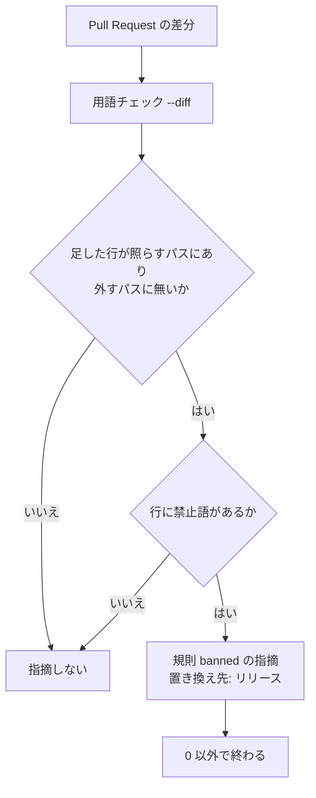

# リリースの Pull Request とリリースの承認資料: 本番チャネルへ変更を入れる道筋も「リリース」と呼ぶ

## 概要

ベースブランチから本番チャネルへ変更を入れる道筋（リリースの経路 merge）も、本番へのデプロイと同じく
「リリース」と呼ぶ。道筋の違いを語で区別せず、違いは「リリースの経路」の値（`template`・`merge`・`manual`・`none`）
だけが持つ。リリース承認ゲートで承認する利用者が、承認資料・停止の理由・自動で作られた Pull Request の題・記録の
フェーズ名で、用語集に定義の無い語に当たらないようにするためである。

この道筋を指していた旧い語は使わない。旧い語は、用語集で次の 4 語の廃止した語として引ける。
このリポジトリは旧い語を禁止語に宣言しており（`.ndf/glossary.json` の `check.banned.words`）、禁止語を新しく
書き足した Pull Request は継続的統合の用語チェックが落とす。この文書も検査する範囲にあるため、旧い語と旧い値を
本文に書き写さず、置き場を指す。

## 用語

語の定義は用語集（`.ndf/glossary.json` の `document`、[docs/glossary.md](../glossary.md) ）が正である。
この文書で使う語のうち、用語集にあるものは次のとおり。

- リリース・リリースプラン（コンテキスト `ndf-workflow`）
- リリースの Pull Request・リリースの承認資料・リリースの経路・比べた先端・確かめたコミット（コンテキスト `ndf-release`）
- 旧い値の読み替え・禁止語

## 背景

置き換え先の語は「リリース」を使う形にし、既存の「リリースプラン」と混じってよいとした（利用者の指示）。
語を 1 つに寄せれば、承認する利用者は道筋ごとに別の語を覚えずに済む。

一方、識別子の英語 `promote` は残す。主要なデプロイの製品が、リリースを本番側へ進める操作の識別子にこの語を
使っており（Google Cloud Deploy の `gcloud deploy releases promote`、Heroku Pipelines の
`heroku pipelines:promote`）、業界で流通している語だからである。

## 対象範囲

- このリポジトリの `plugins/`・確定仕様・用語集と、NDF を導入したすべてのリポジトリで NDF が出す文言に効く。
  NDF が出す文言は、承認資料・停止の理由・ヘルプ・記録のフェーズ名・自動で作る Pull Request の題である
- 禁止語の宣言はこのリポジトリの `.ndf/glossary.json` だけが持つ。プロジェクトごとに違う設定は無い
- 識別子（ステップ・引数・ファイル名・サブコマンド・関数名）は変えない
- 変更履歴（`CHANGELOG.md`・`docs/changelog/`）と `docs/archive/` は書いた時点の記録として書き換えない

## 仕様

### コンテキスト

| コンテキスト | 何の語が 1 つの意味に決まるか |
| --- | --- |
| NDF の開発ワークフロー（`ndf-workflow`） | リリース・リリースプラン・本番チャネル・承認資料 |
| NDF のリリース（`ndf-release`） | リリースの経路・リリースの Pull Request・リリースの承認資料・比べた先端・確かめたコミット |

2 つのコンテキストは共有カーネルの関係にある。同じ用語集（`docs/glossary/glossary.json`）を同じ担い手が持ち、
`ndf-release` の語は `ndf-workflow` の「リリース」をそのまま使う。

### 集約

| 集約 | 持ち主（書き換えてよいもの） | 根 | エンティティ | 値オブジェクト |
| --- | --- | --- | --- | --- |
| 用語集 | `docs/glossary/glossary.json`（`docs/glossary.md` は `glossary.py render` が作る） | 用語集 | 語の行 | 廃止した語・意味・識別子 |
| 禁止語の宣言 | `.ndf/glossary.json` の `check.banned` | 宣言 | — | 禁止語・照らすパス・外すパス |
| 旧い値の読み替えの表 | `plugins/ndf/scripts/data/legacy-values.json` | 表 | 値の集合（`phase` など） | 旧い値 → 新しい値の対応 |
| リリースプラン（経路 merge で本番チャネルへ入れるもの） | `plugins/ndf/scripts/supervise_lib/delivery_templates.py` の `plan_promote` | プラン | ステップ | フェーズ名・ステップの識別子 |

### 語の対応

旧い語は、次の 4 語のいずれか 1 つの廃止した語の欄にだけ置く。廃止した語から引ける置き換え先は 1 つに決まる。

| 置き換え先の語 | 意味 | 用語集での扱い |
| --- | --- | --- |
| リリース | 本番へのデプロイ。ベースブランチから本番チャネルへ変更を入れることもリリースと呼び、道筋の違いはリリースの経路の値が持つ | 既存の語。意味の欄に道筋の扱いを足し、廃止した語を持つ |
| リリースの Pull Request | 本番チャネルへ変更を入れる Pull Request。リリースの雛形では `release/v<版>` が、経路 merge ではベースブランチが head になる | 語を足し、廃止した語を持つ |
| リリースプラン | リリースの手順をステップの列として持つプラン。`plan_promote` は `release_plan` を呼んで組むリリースプランの 1 つである | 既存の語。意味は変えず、廃止した語を持つ |
| リリースの承認資料 | リリース承認ゲートで利用者か MVV 判定が見る承認資料。承認したコミットの欄を持つ | 語を足し、廃止した語を持つ |

「リリースの Pull Request」は識別子の欄を持たない。意味がリリースの雛形の経路も含むため、経路 merge だけの
識別子と対応しないためである。「リリースプラン」と表記だけが違う語は足さない。表記だけが違う語が 2 つの意味を
持つことになるためである。

「導入の確認」「比べた先端」「確かめたコミット」の意味の欄は、経路をリリースの Pull Request で届く経路として書き、
`promote` を経路の値として書かない。リリースの経路の値は `plugins/ndf/scripts/lib/delivery.py` の
`TEMPLATE`・`MERGE`・`MANUAL`・`NONE` と一致する。

### NDF が出す文言

| 出す場所 | 文言 | 置き場 |
| --- | --- | --- |
| 記録とプランのフェーズ名 | `リリース（本番チャネルへのマージ）` | `delivery_templates.py` の `PROMOTE_PHASE` |
| 自動で作る Pull Request の題 | `リリース: <head> → <base>` | `merged_lib/merge.py` の `_find_or_create_promote_pr` |
| 自動で作る Pull Request の本文 | `<head> の変更を本番チャネル <base> へ入れる（merged-steps.py promote が作った）。マージはリリース承認ゲートの後に行う。` | 同上 |
| リリースの承認資料の題 | `#<番号> のリリース（<head> → <base>。リリース承認ゲート）` | `merged_lib/merge.py` の `_prepare_promote` |

フェーズ名は、ほかのリリースプランのフェーズ名（`リリース`・`リリース（リリース承認ゲート）`・`リリース（CD の結果）`）
と重ならないよう、本番チャネルへマージすることを括弧で示す。

開いているリリースの Pull Request は head と base で探す（`_open_promote_pr`）。題では探さないため、
旧い題で作られた Pull Request もそのまま使われる。

停止の理由・ヘルプ・リリース記録の段階の注記（`release_lib/record.py`）・起動指示の文言（`sprint-close.py`・
`supervise_lib/sprint_routes.py`・`lib/sprint_loop_gate.py`・`lib/approved_commit.py`・`lib/parallel_plan.py`）も、
上の表の語で書く。

### 変えない識別子

次の識別子は変えない。`merged-steps.py` と `release-steps.py` の入出力はエントリポイントの契約
（`plugins/ndf/contracts/entrypoints/`）に載り、状態ファイルと承認資料のファイル名は動いているスプリントが読む
ためである。

| 識別子 | 値 |
| --- | --- |
| ステップの識別子 | `verify`・`prepare`・`mvv`・`note`・`promote`・`promote-approved`・`record`（順序も変えない） |
| 引数 | `--promote`（`release-steps.py record`） |
| 承認資料のファイル名 | `approval-promote.md`（`{state_dir}/work/` の下） |
| サブコマンド | `merged-steps.py promote` |
| 関数名 | `plan_promote` |

### 常に成り立つ条件

| # | 条件 | 破れたときの扱い |
| --- | --- | --- |
| I1 | 用語集の語の欄と意味の欄に旧い語が無く、旧い語の 4 つの形は上の 4 語の廃止した語の欄にそれぞれ 1 つずつある | 意味の欄の禁止語は `glossary.py check --rules structure` が落とす |
| I2 | 旧い語から引ける置き換え先は「リリース」の 1 つだけである | 禁止語の指摘が置き換え先を 2 つ並べる |
| I3 | 旧いフェーズ名は新しいフェーズ名 `リリース（本番チャネルへのマージ）` へ読み替わり、新しいフェーズ名は表の旧い値の欄に無い | 表の読み込みが終了コード 2 で止まる |
| I4 | ステップの識別子とその順序・引数・承認資料のファイル名・サブコマンドは変わらない | 既存のステージの並びのテストと、エントリポイントの契約のチェックが落ちる |
| I5 | 照らすパスの中で旧い語を足した行を、規則 `banned` が置き換え先「リリース」を添えて落とす | Pull Request の用語チェック（ジョブ `glossary-check`）が通ってしまう |
| I6 | 照らすパスに旧い語が残るのは、外すパスにあるファイルの行だけである | 照らすパスの検索に、外していない行が出る |

### 旧い値の読み替え

フェーズ名だけが、記録から読み戻される値である。旧いフェーズ名は `legacy-values.json` の集合 `phase` で
`リリース（本番チャネルへのマージ）` へ読み替わる。表は旧い値から旧い値への連鎖を許さないため、旧い値はすべて
新しい値へ直に向ける。記録を読む処理（`estimate.py`・`lib/estimate_records.py`・`lib/slow_step.py`・
`supervise_lib/queue.py`・`legacy_values.current_plan`）は既に表を通すため、読む側のコードは変えない。
キューの判定の集合 `RELEASE_PHASES` は表の新しい値の欄から作るため、新しいフェーズ名もリリースプランの
フェーズとして扱う。

段階の注記・停止の理由・Pull Request の題は読み戻す処理が無い（記録を読む `parse_record` は段階の注記を読まない）
ため、表に足さない。書かれた記録は書き換えない。

```mermaid
sequenceDiagram
  participant Loop as 動いているループ
  participant Rd as 記録を読む処理
  participant LV as 旧い値の読み替え
  participant Tb as 旧い値の読み替えの表
  Loop->>Rd: 報告・記録を読む（旧いフェーズ名）
  Rd->>LV: to_current("phase", 値)
  LV->>Tb: 集合 phase を引く
  Tb-->>LV: リリース（本番チャネルへのマージ）
  LV-->>Rd: 新しい値
  Rd-->>Loop: 新しい値と同じに集計・判定する
```

### 禁止語の検査

旧い語は `.ndf/glossary.json` の `check.banned.words` に入っている。検査の仕組み（規則 `banned`・照らすパス・
出力）は [ndf-deploy-and-release-terms.md](ndf-deploy-and-release-terms.md) の「禁止語の検査」のとおりである。



`check.banned.exclude` は、旧い語を持つ次のファイルを照らす範囲から外す。

| ファイル | 外す理由 |
| --- | --- |
| `.ndf/glossary.json`・`docs/glossary/glossary.json`・`docs/glossary.md` | 禁止語の宣言と、廃止した語の欄を持つ |
| `plugins/ndf/scripts/data/legacy-values.json`・`plugins/ndf/scripts/tests/test_legacy_values.py` | 旧い値と、その読み替えのテストを持つ |
| `plugins/ndf/skills/qa-security-scan/02-auth-checklist.md`・`03-report-template.md` | セキュリティの診断の分野の語（権限を不正に得ることを指す語）が同じ文字を含む。分野で定着した語のため本文は変えない |

セキュリティの語のほかに、NDF のリリースの意味でない旧い語の使用は、別の語へ書き換えて照らす範囲に残す。
ファイルごと外すと、そのファイルでリリースの意味の旧い語を新しく書いても検査が落とさないためである。

## 運用

- 新しい文書・コード・テストでは、本番チャネルへ変更を入れる道筋を上の 4 語で書く。語に迷ったら用語集の
  廃止した語の欄から置き換え先を引く
- 照らすパスの検索で旧い語が出るのは、外すパスのファイルの行だけである

```bash
grep -rn '<旧い語>' plugins docs/specifications .github AGENTS.md CLAUDE.md README.md
```

## テスト観点

- 用語集の語の欄に旧い語が無く、4 語がそれぞれ 1 つの語の廃止した語の欄にあること
- `glossary.py check --rules structure` が 0 で終わること
- 「リリースの経路」の意味の欄の値が `delivery.py` の `TEMPLATE`・`MERGE`・`MANUAL`・`NONE` と一致し、どの意味の欄にも
  `promote` を経路の値として書いていないこと
- 照らすパスの検索結果が、外すパスのファイルの行だけであること
- 旧いフェーズ名を `to_current("phase", …)` に与えると `リリース（本番チャネルへのマージ）` になり、旧いフェーズ名を
  持つ報告と履歴を、キューと遅いステップの集計が新しい値と同じに扱うこと（`test_legacy_values.py`）
- 照らすパスのファイルへ旧い語を含む行を足した差分で、`glossary.py check --diff` が規則 `banned` を出し、置き換え先に
  「リリース」を示して 0 以外で終わること
- リリースプランのステップの識別子と順序が変わらないこと（`test_supervise_pace_verify.py`・`test_sprint_loop.py`・
  `test_supervise_new.py`）

## 関連リンク

- [ndf-deploy-and-release-terms.md](ndf-deploy-and-release-terms.md) — デプロイとリリースの呼び分け、旧い値の読み替えの表、禁止語の検査
- [ndf-release-approved-commit.md](ndf-release-approved-commit.md) — リリースの承認資料の承認したコミット
- [docs/glossary.md](../glossary.md) — 用語集
- Google Cloud Deploy: https://docs.cloud.google.com/deploy/docs/promote-release
- Heroku Pipelines: https://devcenter.heroku.com/ja/articles/pipelines
