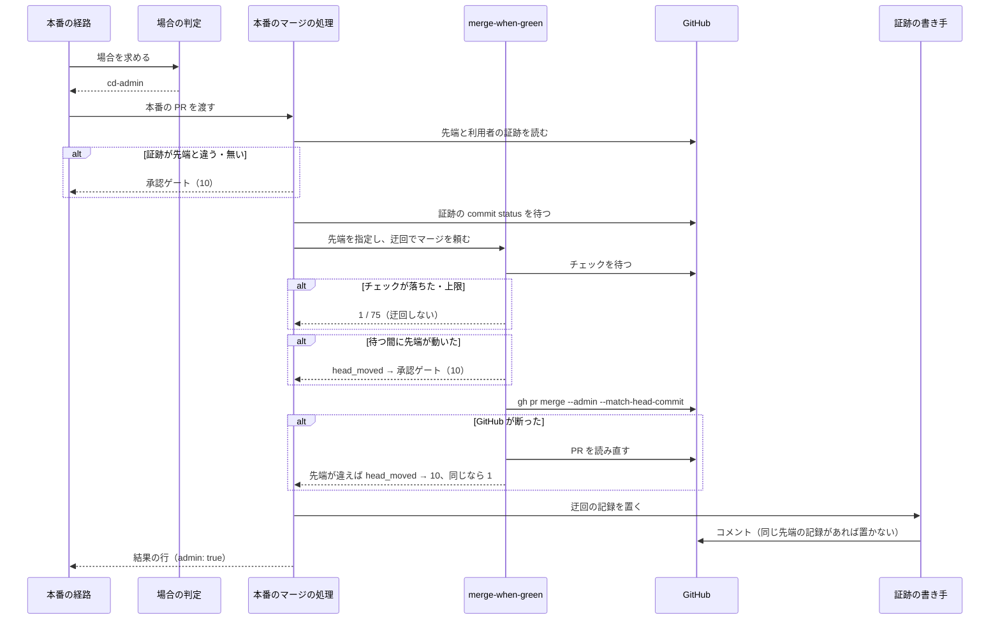

# 本番の PR を宣言に従って管理者の迂回でマージする

## 概要

本番チャネル（`main`）の ruleset が承認レビューを必須にし、利用者が自分のアカウントで本番の PR を出すリポジトリでは、作者本人の承認レビューを GitHub が受け付けない。そのため、リリース承認ゲートを通っても人が手でマージするまでリリースが止まる。

リポジトリが迂回の宣言を置くと、NDF は承認ゲートの利用者の承認（承認の証跡）を本番の PR の先端と照らし、必須のチェックが通った後に、管理者の迂回で本番の PR をマージする。宣言の無いリポジトリの振る舞いは変わらない。

この文書は、迂回の宣言・迂回の記録・再開・作り直し（`plugins/ndf-next/`）の側の振る舞いと、その設計判断を持つ。リリースの場合の表と、承認の証跡・本番のプランの並びの全体は [ndf-release-approval-on-pr.md](ndf-release-approval-on-pr.md) が正本である。

## 用語

定義は用語集 [docs/glossary.md](../glossary.md) にある（コンテキスト `ndf-release`）。この文書で使う語は、本番の PR・リリースの場合・承認の証跡・管理者の迂回・迂回の宣言・迂回の記録である。

## コンテキスト

変更はリリースのコンテキスト（`ndf-release`）に収まる。作り直しも同じ語を使い、同じ宣言のキーを読む。作り直しは旧いプラグイン（`plugins/ndf/`）のコードを読み込まない別のパッケージのため、マージの処理は共有しない。

置き換えの期間の本番のマージの振る舞いの正本は、旧いプラグインの `merge-when-green`（`merged_lib/merge.py` の `_merge_pr`）である。迂回の条件は下の「常に成り立つ条件」の表が 1 か所で持ち、2 つの実装はそれぞれのテストで同じ行を縛る。食い違ったら作り直しの側を旧いプラグインに合わせる。

## 仕様

### 集約

| 集約 | 持ち主（書き換えてよいもの） | 根 | エンティティ | 値オブジェクト |
| --- | --- | --- | --- | --- |
| リリースの場合 | 場合の判定（`lib/release_case.py`） | リリースの場合 | — | CD の有無・承認数・迂回の宣言・承認を取る場所・マージの主体 |
| 本番の PR | 旧いプラグインは `merge-when-green` の `_merge_pr`。作り直しは `domains/release/land.py` の `Lander` | 本番の PR | — | 先端のコミット・宛先・マージの方式（迂回の有無） |
| 承認の証跡 | 証跡の書き手（`release_lib/approval_trail.py`。作り直しは `domains/release/trail.py`） | 証跡のコメント | 迂回の記録 | 承認したコミット・書いた人・作成の時刻 |

迂回の宣言は利用者が書く値で、NDF は読むだけである。

### 常に成り立つ条件

| # | 条件 | 破れたときの扱い |
| --- | --- | --- |
| I1 | `production_merge.admin` が JSON の `true` のときだけ迂回の宣言があるとみなす。キーが無い・`true` 以外の値・型の違い・`Unknown` は宣言なし | 宣言なしの場合（`cd-no-review` / `cd-review`）で進む |
| I2a | 旧いプラグインで `cd-admin` になるのは、CD があり、本番チャネルの承認数が 1 以上と読め、宣言があるときだけである | 承認数が 0 か読めないときは、宣言があっても `cd-no-review` で進む |
| I2b | 作り直しが迂回するのは、宣言があり、宛先が本番ブランチで、そのブランチの承認数が 1 以上と読めるときだけである | 迂回せず、記録を置かず、出力の `admin` を `false` にする |
| I3 | 管理者の迂回でマージするのは `cd-admin` のときだけである | — |
| I4 | 迂回は、利用者の証跡が本番の PR の先端と完全に一致するときだけ打つ | 承認ゲート（終了コード 10）で止まり、PR は開いたまま残る |
| I5 | 迂回は、本番の PR のチェックがすべて通った後にだけ打つ | 落ちたら 1、上限までに終わらなければ 75 で止まる |
| I6a | 迂回は照らした先端を指定して打つ。チェックを待つ間に先端が動いたらマージしない | 待ちの読み直しが `head_moved` で止める。`release --channel prod` は 10、`promote` は 1 |
| I6b | 最後の読み直しの後に先端が動いたらマージしない | GitHub が断り、`_merge_pr` が PR を読み直して `head_moved` を返す。止まり方は I6a と同じ |
| I7 | 迂回でマージした本番の PR には、マージした先端と照らした証跡を指す迂回の記録が 1 件だけ残る。再開のときに「迂回でマージしたか」は、場合の判定の迂回の有無と、利用者の証跡がマージした先端と一致することの 2 つから決め直す。PR の `reviewDecision` は使わない | 書けなければ本番の完了と分けて 1 で報告し、打ち直しで記録だけを書く |
| I8 | 結果 JSON の本番の PR の行（`"result": "merged"`）は `admin` を必ず持ち、迂回したら `true`、迂回なしなら `false` である | — |
| I9 | `cd-admin` の承認に数えるのは、担い手が `user` の証跡だけである。MVV 判定の証跡（担い手が `mvv`）は数えない。作り直しも利用者の証跡だけを迂回の前提にする | 承認ゲート（10）で止まり、迂回しない |

I6b の読み直しは迂回の有無に依らず働く。宣言の無いリポジトリでも、最後の読み直しの後に先端が動いて断られた場合は、止まる理由が「先端が動いた」（本番の経路は 10）になる。

### リリースの場合の属性

場合の値どうしを比べず、値から導く属性で分岐する。属性の唯一の置き場は `lib/release_case.py` の集合（`TRAIL_APPROVAL`・`ADMIN_MERGE`・`HUMAN_APPROVAL`）である。値を足すときに分岐の書き換えが 1 か所で済むためである。

| 値 | `trail_approval`（証跡で承認を取る） | `admin_merge`（迂回でマージする） | `human_approval`（MVV 判定で承認ゲートを代えない） |
| --- | --- | --- | --- |
| `cd-no-review` | 真 | 偽 | 偽 |
| `cd-review` | 偽 | 偽 | 真 |
| `cd-admin` | 真 | 真 | 真 |
| `no-cd` | 偽 | 偽 | 偽 |

`user_trail_only`（利用者の証跡だけで照らす。`cd-admin`）と `mvv_may_trail`（MVV 判定が証跡を書ける。`cd-no-review`）は、この 2 つの集合の積と差から導く。

`cd-admin` を独立した値にするのは、承認を取る場所（証跡）とマージの主体の権限の使い方（迂回）が `cd-review` とも `cd-no-review` とも違うためである。`cd-review` のまま迂回を許すと照らす相手（レビュー）が無く、`cd-no-review` に寄せると場合の理由（承認数 0）が事実と食い違う。

`cd-admin` は MVV 判定で承認ゲートを代えない。ruleset が人の承認レビューを求める本番チャネルを、人が見ないまま迂回で通すことになるためである（共通原則の C2）。

### 本番の経路とマージの持ち主

旧いプラグインの本番の経路は 3 つあり、どれも最後は `merge-when-green` の `_merge_pr` で `gh pr merge` を打つ。迂回の有無を付けるのはこの 1 か所で、ほかの処理は場合の属性から迂回の有無を決めて渡すだけである。

| 経路 | マージまでの呼び出し |
| --- | --- |
| `release-steps.py release --channel prod` | `release_lib/reviewed.py` の `release_prod` → `merge_on_pr_approval` → `release-steps.py` の `wait_and_merge` → `merged-steps.py merge-when-green` → `_merge_pr` |
| 選んで集める取り込み方の `release` | `release_lib/promotion.py` の `release_selected` → `_merge_exact` → `merge_on_pr_approval` → 以降は上と同じ |
| `merged-steps.py promote` | `merged_lib/merge.py` の `promote` → `merge_when_green` → `_merge_pr` |

迂回は既存の `merge-when-green` の `--admin` の経路を使う。`merge-when-green` はチェックの通過を待ち、`--expect-head` で先端を照らし、`--match-head-commit` 付きでマージするため、I4・I5・I6a が既存の待ちと照合で成り立つ。迂回の指定を GitHub の API で直に打つと、待ちと先端の照合を 2 つ目に持つことになる。

### 処理の流れ（旧いプラグイン・`release --channel prod`）



`promote` は、マージの前に証跡を書き（`merged_lib/promote_trail.py` の `trail_before_merge`）、同じ `merge_when_green` を同じプロセスで呼ぶ。迂回の記録は、`promote` が `merge_when_green` へ渡す `after_merge`（`promote_trail.admin_after_for`）が、結果を出す前に置く。`cd-admin` で `--gate-approved mvv` を受けたら、証跡を書かずに承認ゲート（10）で止まる。

### 本番のプラン

`supervise_lib/release_cd.py` の `cd_prod_steps` は、`human_approval` の場合（`cd-review`・`cd-admin`）、MVV 判定のプランでも判定の記録を置いた所で承認ゲートとして終える。`cd-admin` はその後に `approve-pr` を `--by user` で置き、利用者の承認の後に `run <計画> --from approve-pr` で証跡を書いてマージまで進む。MVV 判定でないプランの `cd-admin` は `cd-no-review` と同じ並びである。

宣言を置いたリポジトリの利用者が手で行う操作は、承認ゲートでの承認の 1 回だけである。

### 作り直しのマージ

作り直しの `release-steps merge`（`domains/release/cli.py` の `cmd_merge`）は、`declaration.production_admin` で同じ宣言を読み、`Lander` へ渡す。

- `Lander._bypass` は、宣言があり、宛先が本番ブランチで、`Lander.approvals` が 1 以上のときだけ真を返す。戻す PR は常に迂回しない
- `Lander.approvals` は ruleset の承認の規則の最大を返す。規則が無ければ従来の保護の承認数、保護が無ければ 0、読めなければ `None` を返す
- 迂回するときは、既存の順（チェックの待ち → 証跡の読み直し → 先端を添えたマージ）で進め、マージを `adapters/github.py` の `GitHub.merge_as_admin` で打つ。迂回しないときは同期の REST のマージのままである
- `merge_as_admin` は GraphQL の `mergePullRequest` を `expectedHeadOid` 付きで打つ。`merge` と同じ先の確認とマージの方式の選択を通り、断られたら PR を読み直して `refusal_kind` の種類を返す。届かない誤り・上限は投げ直す（`_refused_by_graphql`）
- 迂回でマージしたら、戻す PR の後に `Lander._record` が迂回の記録を置く。記録は戻す PR の結果に依らず書く

迂回に `mergePullRequest` を使うのは、`gh pr merge --admin` も同じ呼び出しを迂回の引数なしで打っており、要件を満たさない PR をマージできると `gh` の文書が書いているためである。同期の REST のマージが迂回を認めるかは文書に記述が無い。非同期のマージ（`bypass_rules`）は結果が後から届き、先端を添えたマージの結果を同じ呼び出しで受けられない。

## データ・設定

### 迂回の宣言（`.ndf/project.json`）

```json
{
  "production_merge": {
    "admin": true
  }
}
```

| キー | 型 | 既定 | 意味 |
| --- | --- | --- | --- |
| `production_merge` | オブジェクトか `Unknown`（`{"unknown": "<理由>"}`） | 無し | 本番の PR のマージの方式 |
| `production_merge.admin` | 真偽 | 無し（偽と同じ） | 真なら、本番チャネルが承認レビューを必須にするとき、本番の PR を管理者の迂回でマージする |

- 型は `project_lib/model.py` の `ProductionMerge`・`ProjectDecl.production_merge` で、スキーマ（`plugins/ndf/skills/development-workflow/schemas/project.schema.json`）は型から作る
- 解析（`project_lib`）はこのキーを書かず、利用者が書いた値を残す
- 設定の契約（`plugins/ndf/contracts/settings/project.json.json`）の置き場は `main` で、`delivery` と同じくメインディレクトリから読む。PR の変更だけで迂回を選べないようにするためである
- 置き場を `.ndf/project.json` の最上位にするのは、旧いプラグインと作り直しの両方が既に読む宣言だからである。`delivery` の行の属性にすると、届け先ごとに値が食い違いうる
- 引数では受けない。リポジトリの決まりであり、打つたびに変わるものではない
- ai-plugins の `.ndf/project.json` は `production_merge.admin: true` を持つ

### 宣言が読めないとき

| 読めない形 | 振る舞い |
| --- | --- |
| キーが無い・`admin` が `true` 以外・型の違い・`Unknown` | 宣言なし（I1）。迂回なしでマージし、承認レビューが無ければ承認ゲート（10）で止まる |
| `.ndf/project.json` 自体が JSON として読めない（旧いプラグイン） | `release_case.case_of` が `CaseUnreadable` にし、`case_or_stop` が 3 で止める。マージを頼まない |
| ファイルが無い・読めない・壊れている（作り直し） | 宣言なし。出力の `admin` が `false` |

ファイルが壊れているときにマージまで進めると、CD の宣言（`delivery`）も読めないまま本番へ入れることになる。旧いプラグインが 3 で止めるのはこのためである。

### 迂回の記録（本番の PR のコメント）

```markdown
<!-- ndf:admin-merge -->
## 管理者の迂回でマージした

マージした先端: `<40 桁の SHA>`
照らした承認の証跡: <証跡のコメントの URL>
宣言: `.ndf/project.json` の `production_merge.admin`
```

- 印 `ndf:admin-merge` は証跡の印（`ndf:release-approval`）と別で、証跡の判定と `release-approval.yml` の起動の条件に掛からない
- 書き手は `approval_trail.write_admin_record`（作り直しは `trail.write_admin_record`）で、同じ先端の記録があれば置かない
- 作り直しは旧いプラグインを読み込まないため、同じ印と行を別に持つ。両者が揃っていることは両方のテストが同じ本文の形で縛る
- 置き場を本番の PR にするのは、誰がどの先端を承認し、それをどう通したかを 1 つの画面で読めるためである

### 結果 JSON

| 出力 | 項目 |
| --- | --- |
| `release --channel prod`・`promote` の本番の PR の行 | `admin`（真偽。I8） |
| 迂回の記録の行 | `{"kind": "comment", "name": "<URL>", "result": "written" \| "kept" \| "unwritten"}` |
| `release-steps.py release-case` の `metrics`（`cd-admin`） | `approval_place`: リリースの PR の証跡のコメント・`merger`: 利用者のアカウント（管理者の迂回） |
| 作り直しの `release-steps merge` の値の項目（`{"kind": "value", "name": <名前>, "value": <値>}`） | `admin`（真偽）と、記録を書いたときは `admin_record`（URL）。`outputs` は出した版の `version` だけを持つ |

終了コード（0・1・10・75・3）の意味は変わらない。

## エラー処理

| 失敗 | 扱い | 利用者に見える出力 |
| --- | --- | --- |
| 承認数を読めない（旧いプラグイン） | `cd-no-review` で迂回なしにマージする | レビューが本当に必須なら GitHub が断って 1 |
| 承認数を読めない（作り直し） | 迂回しない | 出力の `admin` が `false` |
| 証跡が無い・先端と違う・担い手が `mvv` だけ | マージしない | `gate`・10 |
| GitHub が迂回のマージを断った | PR を読み直す（`merge._moved_after_refusal`）。先端が動いていれば `head_moved`、衝突なら 4、ほかは 1 | 本番の経路は `head_moved` を 10 にする |
| 迂回の記録を書けない（旧いプラグイン） | 本番は出ているため公開の後の手順は止めず、`reviewed.admin_back` が本番の完了と分けて報告する | `stopped`・1。要約に「迂回の記録を書けなかった（本番は出ている）」。戻すマージも止まっていればその終了コード |
| 迂回の記録を書けない（`promote`） | `after_merge` が文を返す | `stopped`・1「#<番号> をマージした。迂回の記録を書けなかった（本番は出ている）」 |
| 迂回の記録を書けない（作り直し） | `Landed.record_error` に理由を入れる | `stopped`。要約に「記録を書けなかった（本番は出ている）: <理由>」を足す。`production_sha` は出力に残り、workflow の publish へ渡る |

記録はマージした事実を書くため、マージの前には書けない。そのため、記録を書けないことを理由にマージを止めない。

### 再開

記録を書けずに止まった後は、打ち直しで記録だけを書く。どの経路も、本番の PR がマージ済みで、迂回する場合で、利用者の証跡がマージした先端と一致し、迂回の記録が無いときだけ書く（I7）。

| 経路 | 打ち直しで通る所 | 記録を書く所 |
| --- | --- | --- |
| `release --channel prod`（選んで集める取り込み方を含む） | 既存のマージ済みからの再開 | `reviewed.admin_record_on_resume` |
| `promote --gate-approved user` | `merge_when_green` の待ちがマージ済みを見て `already_merged` の項目を置く | `merge_when_green` が結果を出す前に呼ぶ `after_merge` |
| 作り直しの `release-steps merge` | `Lander.land` がマージ済みの本番の PR を見る | 戻す PR の後。`_bypass` が真で、利用者の証跡がマージした先端と一致するとき |

PR の `reviewDecision` を条件に使わないのは、承認レビューがそろった PR も `cd-admin` では迂回でマージするためである。

## セキュリティ

- 迂回は、利用者の証跡が先端と一致し、チェックが通った後にだけ打つ（I4〜I6b）
- 宣言が `true` でなければ迂回の場合にならない（I1・I2a・I2b）
- 宣言の置き場は `main` で、PR の変更だけでは迂回を選べない
- MVV 判定の証跡は `cd-admin` の承認に数えない（I9）
- ruleset そのもの（承認数・迂回を許す役割）は変えない。ruleset が定めた「誰の承認でマージできるか」を、承認ゲートの利用者の承認で代える運用になる

## 運用

- ruleset の迂回は ruleset ごとに許す仕組みで、規則ごとに迂回の範囲を分けられない。迂回は必須のチェックも満たさずに通す前提で、NDF が迂回の前にチェックの通過を確かめる
- 迂回のマージは利用者のアカウントで打つ。`GITHUB_TOKEN` で本番チャネルへ push すると CD が起動しない
- 同じ本番の PR へ打ち直しを 2 つ同時に打つと、迂回の記録が 2 件になりうる。プランは本番のマージを 1 本ずつ流すため、手で同時に打った場合だけ起きる。2 件になっても、マージの判定と証跡の判定には数えない

### 未確認・残リスク

| 項目 | 内容 |
| --- | --- |
| `mergePullRequest` の迂回 | 作り直しの迂回が通る根拠は `gh` の文書と実装で、NDF から打って試してはいない。作り直しで本番の PR をマージする最初のリリースで分かる。断られたときは既存の拒否の種類で止まり、記録は置かれない |
| 同期の REST のマージの迂回 | 迂回を許された人の token で打った同期の REST のマージを、承認レビューを満たさない PR で GitHub が通すかは文書に無く、試していない。作り直しの迂回はこの経路を使わない |
| `--match-head-commit` で断られたときの出力 | 断られたときの `gh` の出力の文言は試していない。`_merge_pr` は文言を読まず、PR を読み直して先端を比べる |
| `gh pr merge --admin` が必須のチェックも迂回するか | チェックが落ちた PR で試していない。NDF はチェックの通過を迂回の前に確かめるため、どちらでも振る舞いは変わらない |
| 迂回のマージの push が CD を起動するか | 利用者のアカウントでの手のマージが CD を起動することは確かめた。NDF が打った迂回のマージでは、次の本番のリリースのリリース後テストで確かめる |

## テスト観点

- `cd-admin` で証跡が先端と一致し、チェックが通ると、迂回ありでマージを頼み、本番の PR の行が `admin: true`、終了コード 0 になること
- `cd-admin` で証跡が無いと、マージを頼まずに 10 で止まること
- `cd-admin` でチェックが落ちると 1、上限なら 75 で止まり、マージを打たないこと
- 待つ間に先端が動くと 10 で止まり、`gh pr merge` が断られ読み直した先端が違うと `head_moved` を返すこと。読み直した先端が同じなら 1 であること
- `promote --gate-approved user` の `cd-admin` で、証跡を書いてから迂回でマージし、止まるべきときはマージしないこと
- 迂回の記録が 1 件置かれ、打ち直しても増えず、書けないと本番の完了と分けて 1 で報告すること。3 つの経路のマージ済みからの打ち直しが、記録の無いときだけ書くこと（`reviewDecision` が `APPROVED` の PR を含む）
- 宣言が無い・`"admin": "true"` のような型の違い・`Unknown` では、承認数 1 なら `cd-review` で迂回なしに頼むこと
- 宣言を書いた `.ndf/project.json` が JSON として読めないとき、`release --channel prod` と `promote` がマージを頼まずに 3 で止まること
- 承認数 0 か読めないときは、宣言があっても `cd-no-review` になること
- `cd-admin` で担い手が `mvv` の証跡しか無いと迂回しないこと（`release --channel prod` は 10、`promote --gate-approved mvv` は証跡を書かずに 10、作り直しは `refused`）
- 作り直しが、宣言があり承認数 1 のとき `mergePullRequest` を先端付きで打ち、記録を置いて `admin: true` を出すこと。証跡が無い・チェックが落ちた・先端が動いたときはマージしないこと
- 作り直しが、宣言が無いか承認数 0・読めないときは同期の REST のマージのまま、記録を置かず `admin: false` を出すこと
- ai-plugins の宣言を場合の判定に通すと、承認数 1 で `cd-admin` になること
- MVV 判定のプランで `cd-admin` が承認ゲートで止まり、その後の `approve-pr` が `--by user` で置かれること

テストは `plugins/ndf/scripts/tests/test_release_case.py`・`test_release_steps.py`・`test_release_cd.py`・`test_sprint_close_merge_green.py` と、`plugins/ndf-next/tests/domains/release/test_release_approval.py` にある。

## 関連リンク

- [ndf-release-approval-on-pr.md](ndf-release-approval-on-pr.md) — リリースの場合の判定・承認の証跡・本番のプランの正本
- [GitHub: Creating rulesets for a repository](https://docs.github.com/en/repositories/configuring-branches-and-merges-in-your-repository/managing-rulesets/creating-rulesets-for-a-repository)
- [gh pr merge](https://cli.github.com/manual/gh_pr_merge)
- [GitHub REST API: Pulls](https://docs.github.com/en/rest/pulls/pulls) ・ [GitHub GraphQL: Pulls](https://docs.github.com/en/graphql/reference/pulls)
