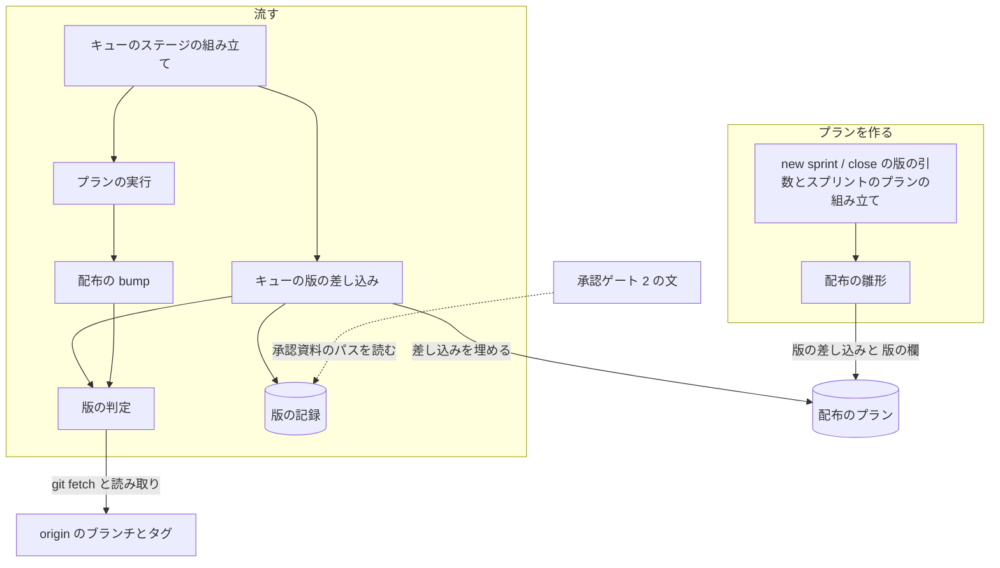
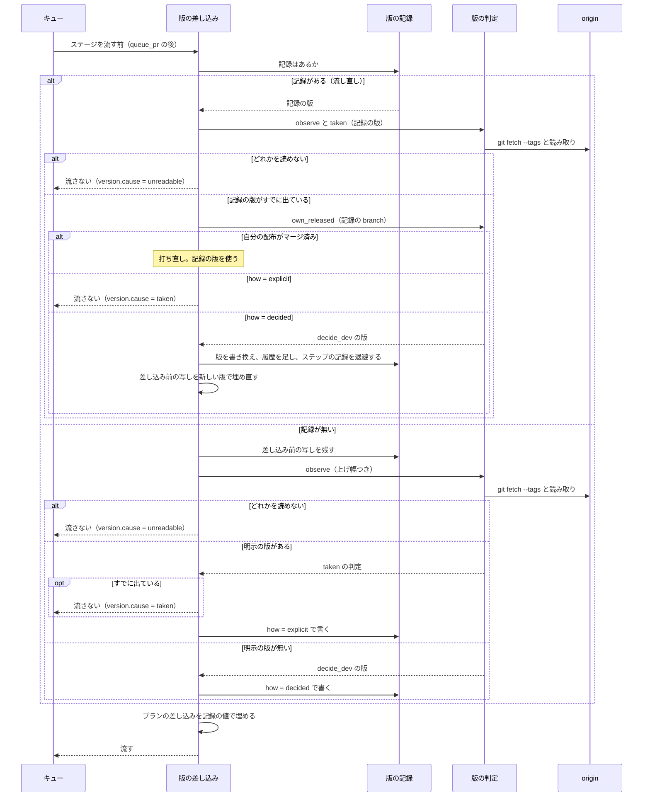

# スプリントの配布の版を、配布のプランを流す時点に決める

スプリントの開発版と本番のプランは、版を明示しなければ具体的な版数を持たず、キューがプランを流す直前に
origin のベースブランチ・本番のブランチ・リリースタグを読んで版を決める。並行する別のスプリントが先に版を
出しても、プランを作り直さずに次に空いている版で開発版を出す。明示した版がすでに出ていれば、`bump` より前に
止まる（#2164）。

**手順は各 Skill の本文と、コードのドキュメント文字列が正である。** この文書は、決めたことの理由と、
書く側と読む側が共有する形を残す。

| 何を読むか | 正本 |
| --- | --- |
| `new sprint` / `new close` の打ち方・版が決まる時点・止まったときの扱い | `plugins/ndf/skills/development-workflow/references/pace.md`・`references/waiting.md` |
| queue の差し込みの規則 | `plugins/ndf/scripts/supervise_lib/plan.py` の説明 |
| 版の付け方と開発版の配布 | [docs/versioning-and-distribution.md](../versioning-and-distribution.md) |
| `release-steps.py` の終了コード | `plugins/ndf/skills/release/references/release-steps.md` |

## 概要

変更前は、スプリントのプランが作った時点の版数を開発版と本番のプランへ書き込んだ。配布までの間に並行する
別のスプリントがその版を出すと、conductor がプランを作り直すか版を書き換えるまでキューが止まった（m2087・m26-1）。
古いプランのまま流すと、開発版の `bump` は版を戻したまま進み、本番の `release` がタグの重複に気づく時点では
開発版の PR がすでにベースブランチへ入っていた。

適用範囲は、`.ndf/supervise.json` の `release.form` が `package-plugin`（雛形で配る形）で、`delivery.needs_version` が
真の経路である。ベースブランチと本番のブランチは `.ndf/worktree.json`、配るプラグインは `release.plugin` から読む。

## 用語

版の差し込み・版の記録・版の決め直し・明示の版・開発版・正式版の定義は、用語集（[docs/glossary.md](../glossary.md)）にある。

## コンテキスト

リリース（`ndf-release`）が供給者、開発の工程（`ndf-workflow`）が顧客である。リリースは「次に空いている版」と
「その版はもう出ているか」の判定を `lib/release_version.py` の 1 か所で提供し、キューの差し込みと `bump` がそれを呼ぶ。
キューは判定の結果を版の記録とプランへ写すだけで、版の規則を持たない。

## 構成要素

| 要素 | 責務 |
| --- | --- |
| `plugins/ndf/scripts/lib/release_version.py` | origin を `git fetch` してベースブランチと本番のブランチの `plugin.json` の版・リリースタグを読み（`observe`）、次に空いている開発版を決め（`decide_dev`）、ある版がもう出ているかを判定する（`taken`）。`release/v<版>` → ベースブランチのマージ済みの PR を照会する（`own_released`）。`bump` の前の判定（`bump_check`）を持つ。ファイルを書かない |
| `plugins/ndf/scripts/supervise_lib/queue_fill.py` の `fill_release_version` | プランの「版」の欄を読み、版の記録を書いて（または読んで）版の差し込みを埋める。開発版の流し直しでは決め直しを行う。埋められなければ理由と判定の結果を返す |
| `plugins/ndf/scripts/supervise_lib/queue.py` の `fill_stage` | `{queue_pr:…}` の差し込みの後に `fill_release_version` を呼び、判定の結果を流さなかった項目の `version` に載せる |
| `plugins/ndf/scripts/supervise_lib/release_templates.py` | 版が無ければ版を書く箇所すべてに版の差し込みを書き、プランへ「版」の欄を置く。版があれば具体の値を書き、「版」の欄の `明示` に入れる。`bump` のステップに `on_exit: {"2": "stop", "3": "stop"}` を置く |
| `plugins/ndf/scripts/supervise_lib/sprint_waves.py`・`sprint.py` | 開発版と本番のプランへ明示の版（無ければ空）と上げ幅を渡す。本番は明示が無ければ系列（開発版のプランの名前 `release`）を渡す |
| `plugins/ndf/scripts/supervise_lib/sprint_routes.py` の `normal_gate_2_stage` | 承認資料のパスを、開発版のプランの版の記録の `base` から作るパスとして書く |
| `plugins/ndf/scripts/supervise_lib/new_args.py` | `--version`・`--prod` を雛形の配布でも任意にし、`--level` を `sprint` と `close` に置く |
| `plugins/ndf/scripts/release-steps.py` の `cmd_bump` | 書き換える前に `release_version.bump_check` を呼び、当たれば `stopped` で返す |

## 仕様

### 集約

| 集約 | 持ち主（書き換えてよいもの） | 根 | エンティティ | 値オブジェクト |
| --- | --- | --- | --- | --- |
| 配布のプラン | 作るのは配布の雛形、作った後に書き換えるのはキューの版の差し込みだけ | 1 本のプランのファイル | — | 「版」の欄・版の差し込み |
| 版の記録 | キューの版の差し込み | 状態ディレクトリの `version.json` | 差し込み前のプランの写し（`version-plan.json`） | 決めた版・基底の版・決め方・根拠・決め直しの履歴 |
| 作業場所の版 | 配布の `bump` | 作業場所の `plugin.json` の `version` | 版数を持つほかのファイル | 旧版・新版 |

### 常に成り立つ条件

| # | 条件 | 破れたときの扱い |
| --- | --- | --- |
| I1 | 版を明示せずに作ったプランのファイルと `sprint.json` は具体的な版数を持たない。版を名前に持つ値（作業場所・`branch`・承認資料のパス・ステップの引数）は版の差し込みで書く | 雛形のテストが落とす |
| I2 | 決めた開発版は、読んだ origin のベースブランチの版より大きく、その基底の版のリリースタグは無い | 判定のテストが落とす |
| I3 | 版の記録は、自分の `release/v<版>` がベースブランチへマージされるまでで、記録の版がすでに別のスプリントに出ていると分かったときに限り決め直す。それ以外の流し直しは記録の版を使う。明示の版（`how = explicit`）は決め直さない | 差し込みのテストが落とす |
| I4 | 本番のプランの版は、明示が無ければ同じスプリントの開発版の記録の基底の版に等しい。開発版の記録が変わったら、承認ゲート 2 の前なら本番も新しい基底の版を使い、後なら流さない | 開発版の記録が無ければ流さない（`no_series`）。承認の後に変わっていれば `stopped`（`series_changed`） |
| I5 | 明示の版がすでに出ていれば記録を書かず、差し込みを埋めず、プランを流さない（開発版はベースブランチの版が同じか大きい、正式版は同じ版のタグがある） | キューの結果が `stopped`。既に出ている版と次に空いている版を項目に載せる |
| I6 | origin のベースブランチ・本番のブランチ・タグのどれかを読めなければ記録を書かない | 流さず、読めなかったものを項目に載せる |
| I7 | `bump` は、新しい版がベースブランチの版以下か、新しい版が正式版でそのタグがあれば、ファイルを書き換えない | `stopped`・終了コード 3 で返し、ステップは `on_exit` で judge を通らずに止まる |
| I8 | 明示の版がまだ出ていなければ、差し込みの後のプランのステップと版は、版を書き込む雛形が組むものと同じである | 雛形のテストが落とす |
| I9 | 決め直したときは、差し込み前のプランの写しを新しい版で埋め直し、前の版のステップの記録を退避し、前の版・新しい版・理由・時刻を記録の履歴へ足す。履歴は消さない | 差し込みのテストが落とす |

### 開発版を決める規則（`decide_dev`）

ベースブランチの版を B、最新の正式版のタグの版を T、本番のブランチの版を P とする。

1. B が `X-dev.N` で、タグ `<plugin>--vX` が無ければ `X-dev.(N+1)`
2. そうでなければ、T・P・B の基底の版のうち最も大きいものを上げ幅で上げた Y の `Y-dev.1`

例: B = `10.27.5`・T = `10.27.5`・PATCH なら `10.27.6-dev.1`。B = `10.27.6-dev.1` でタグ `ndf--v10.27.6` が無ければ
`10.27.6-dev.2`。プランを作った時点の B が `10.27.5` で、配布の前に別のスプリントが `10.27.6` を本番へ出したなら
`10.27.7-dev.1`。

`taken` は、開発版（接尾辞つき）ならベースブランチの版が同じか大きいとき、正式版なら同じ版のタグがあるときに、
`existing`（既に出ている版）と `next_free`（次に空いている版）を返す。`next_free` は人へ戻す材料で、自動では使わない。

### 開発版のプランを流す

### 版を決め直す

開発版の流し直しで記録の版がもう出ていて、自分の `release/v<記録の版>` のマージ済みの PR が無く、`how` が `decided` の
ときだけ、`decide_dev` で新しい版を決め、次をこの順に行う。

1. 状態ディレクトリのステップの記録（版の記録・差し込み前の写し・`plan.json`・退避先を除くもの）を `superseded/v<前の版>/` へ移す
2. 版の記録の `version`・`base`・`observed`・`at` を新しい値にし、`history` の末尾へ前の版の 1 件を足す
3. 差し込み前の写しを新しい版で埋め、プランのファイルを書き直す

順序は、落ちたときに流し直しで同じ結果へ戻るように選んである。1 の後に落ちれば記録はまだ前の版で、流し直しが同じ判定で
決め直しに入る。2 の後に落ちれば記録はもう新しい版でまだ出ていないため、写しから埋め直す。作業場所と `branch` は
新しい版の名前でプランの実行が作り、プランは頭から流れる。前の作業場所・`branch`・開いたままの PR は消さずに
`history` の `left` に残し、後片付けに任せる。決め直したプランは進捗ログへ 1 行書いて流す（`stopped` にしない）。

例: 記録の版 `10.27.6-dev.1` で `bump` まで流して止まり、その間に別のスプリントが `10.27.6` を本番へ出した。自分の
`release/v10.27.6-dev.1` のマージ済みの PR は無いので `10.27.7-dev.1` に決め直し、`release/v10.27.7-dev.1` の名前で
作業場所と `branch` を作り直してプランを頭から流す。

### 本番のプランを流す

記録が無ければ次の順に決める。

1. 「版」の欄に `明示` があればその版、無ければ `系列` の名前の開発版のプランの記録（同じディレクトリの、名前の一致する
   プランの状態ディレクトリ）の `base`。開発版の記録が無ければ流さない（`no_series`）
2. `observe` の後に `taken` で `<plugin>--v<版>` のタグを調べ、あれば流さない（`taken`。`next_free` を添える）
3. `how` を `explicit` か `series` にして記録を書き、差し込みを埋める

**本番は次に空いている版へ自動で移らず、自分では決め直さない。** 本番の記録がある流し直しで、`系列` の開発版の記録の
`base` が本番の記録の版と違うときは、本番のプランの状態に承認ゲート 2 の通過（`approve` のステップの結果）が無ければ
決め直しと同じ手順で新しい基底の版に取り直し（`reason: series_changed`）、あれば流さない（`series_changed`）。

### `bump` の止まり方

`cmd_bump` は旧版を読んだ後、書き換えの前に `origin/<base>` の版を読み、`--to` との比較と、`--to` が正式版のときのタグの
判定を打つ。

| 状況 | 結果 |
| --- | --- |
| 作業場所がすでに `--to` で、ベースブランチの版が `--to` より小さい | 打ち直しとして `ok`（`already: true`） |
| 作業場所がすでに `--to` で、ベースブランチの版が `--to` と等しい | `release/v<to>` → ベースブランチのマージ済みの PR を 1 回照会し、あれば自分の配布の打ち直しとして `ok`（`already: true`）。無ければ下の行 |
| `--to` がベースブランチの版以下、または正式版でタグがある | ファイルを書き換えず `stopped`・終了コード 3（`EXIT_PRECONDITION`）。`metrics` に `from`・`to`・`base_version`・`existing`・`next_free` |
| `--to` の版の形が違う・ベースブランチの版を読めない・照会できない | ファイルを書き換えず `stopped`・終了コード 2（`EXIT_UNREADABLE`） |

終了コードは `emit` へ明示する（`stopped` の既定は 1 で、それでは雛形の `on_exit` が働かない）。他のプラグインを上げる
`bump-others` も同じ `bump` を呼び、同じ止まり方が当たる。

## データ・設定

### プランの「版」の欄

配布のプランの最上位（`作業場所` と同じ階層）に置く。

| 列 | 型 | 空を許すか | 意味 |
| --- | --- | --- | --- |
| `プラグイン` | 文字列 | 許さない | 版を上げるプラグイン（`release.plugin`） |
| `チャネル` | `dev` / `prod` | 許さない | 開発版か本番か |
| `上げ幅` | `patch` / `minor` / `major` | 許さない | 開発版を新しい系列で始めるときの上げ幅。既定 `patch` |
| `明示` | 文字列 | 許す | 明示の版。空（`null`）は「流す時点に決める」 |
| `系列` | 文字列 | 許す | 本番のプランだけ。版を読む開発版のプランの名前（スプリントでは `release`）。本番で `明示` と `系列` が両方空なら雛形が作らない |

版の差し込みの語は `{release_version}`（出す版）と `{release_base}`（その接尾辞を外した版）である。**この欄を持たない
プランには、キューは何もしない。** その版は `bump` の止まり方（I7）だけが守る。

### 版の記録（`<プランの状態ディレクトリ>/version.json`）

| 列 | 型 | 空を許すか | 意味 |
| --- | --- | --- | --- |
| `version` | 文字列 | 許さない | 出す版（開発版は `X.Y.Z-dev.N`、本番は `X.Y.Z`） |
| `base` | 文字列 | 許さない | `version` の接尾辞を外した版。承認資料のパス `issues/approval-<plugin>-v<base>.md` の版 |
| `how` | `decided` / `explicit` / `series` | 許さない | 決めた・明示を確かめた・開発版の記録から読んだ |
| `level` | 文字列 | 許さない | 使った上げ幅 |
| `observed` | オブジェクト | 許さない | 読んだ値（`base_ref`・`base_version`・`production_ref`・`production_version`・`latest_tag`）。本番のブランチを読まなかったときは `production_ref` が空 |
| `series_from` | 文字列 | 許す | `how` が `series` のときだけ、読んだ開発版の記録のパス |
| `at` | 文字列（ISO 8601） | 許さない | 今の版を書いた時刻 |
| `history` | 配列 | 許す（空の配列） | 決め直しの履歴。1 回につき 1 件を末尾へ足す |

`history` の 1 件は `from`（前の版）・`to`（新しい版）・`reason`（`taken` / `series_changed`）・`existing`・`observed`・
`left`（前の版の `作業場所`・`branch`・退避先 `superseded`）・`at` を持つ。

差し込み前のプランの写し（`version-plan.json`）は、版の差し込みを最初に埋める直前のプランのファイルをそのまま写したもので、
書き換えない。

### `supervise.py new sprint` / `new close` の引数

| 引数 | 意味 |
| --- | --- |
| `--version` | 任意。渡せば明示の版（版を書き込んだプラン） |
| `--prod`（`close`） | 任意。渡せば本番の明示の版。渡さなければ開発版の記録の基底の版 |
| `--level`（`sprint`・`close`） | `patch` / `minor` / `major`。既定 `patch`。明示の版には使わない |

`supervise.py new release` は `--version` が必須で、明示の版として「版」の欄を持つ。

### キューの結果

版の差し込みを埋められなかったプランは、`result: 流さなかった`・`unfilled: true`・`reason` に `version` を足して返し、
キューの `status` は `stopped` になる。

| `version` の鍵 | 意味 |
| --- | --- |
| `cause` | `taken`（明示の版か本番の版がすでに出ている）/ `unreadable`（origin を読めない、または自分の配布の照会ができない）/ `no_series`（本番が読む開発版の記録が無い）/ `series_changed`（承認ゲート 2 の後に、本番が読む開発版の記録の版が変わった） |
| `version` | 確かめた版（`unreadable` で開発版を決められなかったときは空） |
| `existing` | 既に出ている版（ベースブランチの版かタグ） |
| `next_free` | 次に空いている版（`taken` のときだけ） |
| `unreadable` | 読めなかったものの名前の並び（`origin/<base>`・`origin/<production>`・`tags`） |

埋めたプランは記録のパスを進捗ログへ 1 行書く。決めた版は `release` のステップの結果 JSON の `metrics.version` に載る。

## 設計判断

| 決めたこと | 理由 |
| --- | --- |
| 版をキューの差し込みで決める | 版は作業場所のパス・`branch`・承認資料のパス・ステップの引数のすべてに入り、プランの実行は最初のステップより前に作業場所を作る。差し込みはプランの実行より前にファイルを書き換える既存の層で、埋められなければ流さずに `stopped` を返す扱いもそのまま使える |
| 決めた版を版の記録に書いて使い続ける | 記録を書いてからプランを書き換える間に落ちたときと、`release` が開発版を出した後の流し直しで、判定をやり直すと次の版へ進んでしまう。そのため `bump` も、ベースブランチの版が等しいときに自分の配布のマージ済みの PR を照会して打ち直しを見分ける |
| 本番の版は開発版の記録から読み、タグがあれば止めて人へ戻す | 承認ゲート 2 で人が承認した承認資料の版と、出す版を食い違わせない。承認資料の材料の正しさは効率より下に置かない（Value 10 の但し書き） |
| 判定を `lib/release_version.py` の 1 か所に置く | キューの差し込み（開発版・本番・明示）と `bump` で版の規則を分けない。`release-steps.py` に置くと `supervise_lib` が `release-steps.py` を読み込み、層の向きが逆になる |
| `bump` に下限の比較とタグの判定を足し、終了コード 3 で `on_exit` から judge を通らずに止める | 既に作ったプランのファイルを書き換えずに版の戻りを止める。どのプランも必ず `bump` を通る。judge を通すと修正の担当が版を書き換えて別の版で進みうる。3 は `lib/step_result.py` の `EXIT_PRECONDITION` が「正常な否定の結果」を含むため使い、再試行の対象になる 75 は使わない |
| `new sprint` / `new close` に `--level` を置き、プランの「版」の欄に載せる | 上げ幅を中身から推さずに渡す。他のプラグインの上げ幅の表（承認資料）は開発版の後にしかできず、開発版の版を決める時点で読めない |
| 差し込みの語を `{release_version}`・`{release_base}` にする | `.ndf/release.json` の手順が `{version}` を `release-steps.py run` の語として使っており、取り違えるとキューが手順の語まで埋める |
| 自分の配布のマージまでは記録の開発版を決め直す（2026-11-01 の承認ゲート 1 で利用者が選んだ） | 記録を 1 回だけ書く形では、記録の後に別のスプリントがその版を出すと `bump` が止まり続け、プランを作り直すしかない。作り直す対象は差し込み前の写しとして持ち、雛形と記録で版の置き場を二重に持たない。差し込みは GitHub へ書かない層のため、前の作業場所・`branch`・PR は消さずに履歴に残す |

## エラー処理

- 明示の版・本番の版がすでに出ている、origin を読めない、本番が読む開発版の記録が無い、承認の後に系列が変わったときは、
  プランを流さずにキューの結果を `stopped` にし、項目の `version` に理由を載せる
- `bump` は推定で進めず、書き換えずに終了コード 2・3 で止まる

## 運用

- 「版」の欄を持たない、この変更より前に作ったプランは、そのまま流れる。版が戻る呼び方だけを `bump` が止める
- 並行するスプリントが同じ系列の開発版を出した（先のスプリントが `10.27.6-dev.1` をベースブランチへ出しただけ）なら、後の
  スプリントは `10.27.6-dev.2` になり、後に本番へ進む方はタグの判定で止まって人へ戻る
- `sprint-state.py loop sprint` は `--dev` を `new sprint --version` へ渡すため、開発ループのプランは明示の版として扱われる

## テスト観点

- `--version` を省いた `new sprint`（pace の normal・fast・auto）と `new close` が書いた `sprint.json` と開発版・本番のプランに
  `X.Y.Z` の形の版が無く、作業場所・`branch`・承認資料のパスが版の差し込みを持つこと
- `decide_dev` が上の例の版を返し、結果がつねにベースブランチの版より大きいこと
- 一時の git リポジトリで、プランを作った後に origin のベースブランチと本番へ `10.27.6` とタグを足してから差し込みを流すと、
  プランの版が `10.27.7-dev.1` に埋まること
- 明示の開発版がベースブランチの版以下のとき、プランを流さず `version.cause` が `taken` で `existing` を持ち、プランのファイルが変わらないこと
- ベースブランチが `10.27.5` のとき `bump --to 10.27.5-dev.1` が終了コード 3 で止まり、ファイルが変わらないこと。打ち直しと
  自分の配布の打ち直しは `ok`。雛形の `bump` のステップの `on_exit` のキーが `bump` の返す 2・3 と一致すること。タグのある正式版への `bump` も止まること
- 本番の差し込みが開発版の記録の `base` で埋まり、そのタグがあれば流さずに `existing` と `next_free` を載せること
- 開発版の記録の後、自分の配布のマージ済みの PR がある状態で流し直すと、同じ版で埋まり記録が変わらないこと
- マージ済みの PR が無く記録の版が出た状態で流し直すと、版・作業場所・`branch` が新しい版で埋まり直し、`history` に 1 件入り、
  前のステップの記録が `superseded/v<前の版>/` にあること。手順の途中で止めて流し直しても `history` は 1 件だけであること
- `how = explicit` の記録では決め直さずに流さないこと
- 本番の記録の後に開発版の記録の `base` を変えると、承認の前なら新しい基底の版で埋まり直し、後なら `series_changed` で流さないこと
- origin か自分の配布の照会を読めないと、記録とプランを変えずに流さず、`unreadable` に名前が入ること
- 差し込みを埋めた開発版のプランの `release` のステップが決めた版を `--version` に持つこと
- `--version` を渡したプランが、差し込みの後に版を書き込む雛形の出力と同じであること（「版」の欄を除く）
- 版の記録の `observed` と `level` が、読んだブランチとタグの版と渡した上げ幅に一致すること
- 「版」の欄を持たないプランをキューが書き換えないこと

## 関連リンク

- [docs/versioning-and-distribution.md](../versioning-and-distribution.md) — 版の付け方と開発版の配布
- [ndf-release-steps-and-token-usage-snapshot.md](ndf-release-steps-and-token-usage-snapshot.md) — `release-steps.py` の終了コード
- [ndf-release-other-plugin-levels-and-migration.md](ndf-release-other-plugin-levels-and-migration.md) — 他のプラグインの上げ幅
- [ndf-production-release-record.md](ndf-production-release-record.md) — 本番のリリースプラン
- [ndf-supervise-queue-concurrent-files-and-prerequisites.md](ndf-supervise-queue-concurrent-files-and-prerequisites.md) — queue
