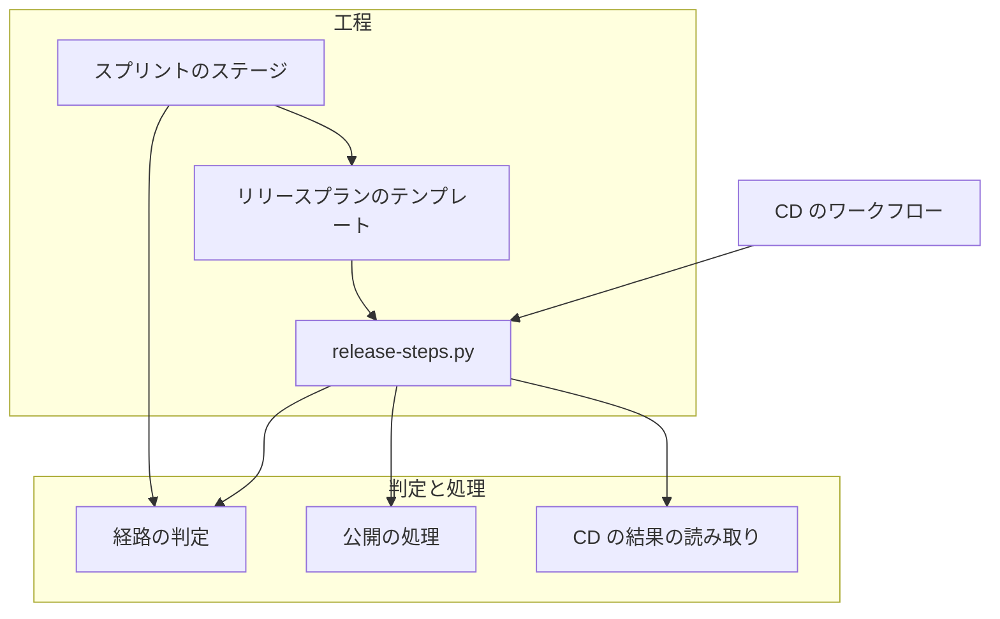
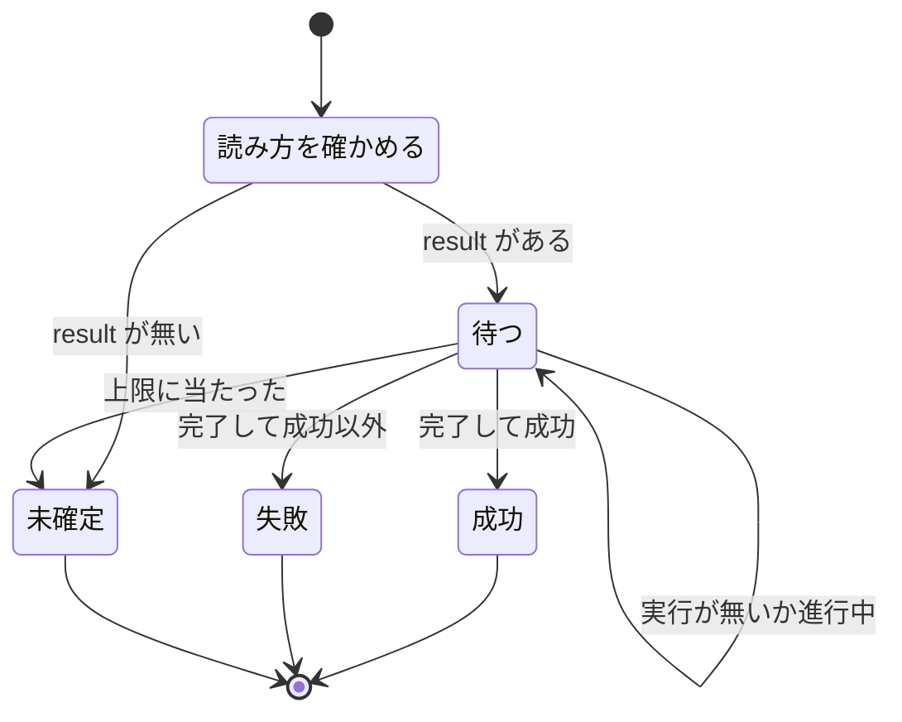
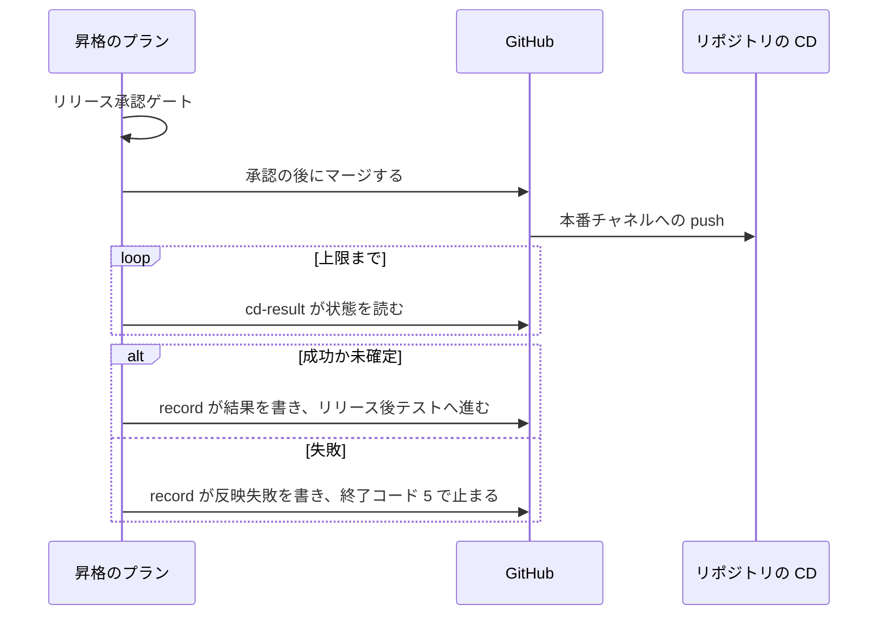

# CD を前提にしたリリース: 環境へ届ける手順は CD が持ち、NDF はマージ・承認・結果の確かめを受け持つ

デプロイとリリースを CD（継続的デリバリー）の責務とし、NDF の工程を CD を起こすマージ・その前のリリース承認ゲート・CD の結果の
確かめの 3 つに絞った仕組みの、決定と理由、常に成り立つ条件、入出力の契約を残す。

**工程の進み方と打ち方は Skill が正である。ここに書き写さない。**

| 何の正か | 置き場 |
| --- | --- |
| 宣言の形ごとの工程、公開と CD の結果の確かめ | [`release` の SKILL.md](../../plugins/ndf/skills/release/SKILL.md) |
| CD の設定の 3 手順、`delivery` の欄の意味、CD を置かない理由の書き方 | [`release` の references/cd-setup.md](../../plugins/ndf/skills/release/references/cd-setup.md) |
| `cd-result`・`record`・`publish`・`cd-guidance` の打ち方と終了コード | [`release` の references/release-steps.md](../../plugins/ndf/skills/release/references/release-steps.md) |
| ai-plugins の正式版を CD で出す手順と、CD が失敗したときの手での補い | [docs/versioning-and-distribution.md](../versioning-and-distribution.md) の「正式版を出す」 |
| リリース記録の形とスプリントを閉じる手順 | [`progress-tracking` の SKILL.md](../../plugins/ndf/skills/progress-tracking/SKILL.md) |

## 概要

**リリースの経路は `.ndf/project.json` の `delivery` の宣言だけから決める。** リポジトリの CI の設定は読まない。宣言の形ごとに、
NDF が打つ手順は次のように分かれる。

| 宣言の形 | 版上げ・変更履歴 | タグと GitHub Release | 結果の確かめ | CD の案内 |
| --- | --- | --- | --- | --- |
| CD の形（`release.form` が無く、行がすべて `kind: auto`） | NDF は打たない | NDF は打たない | `cd-result` | 出ない |
| 版を持つ CD の形で `release.form` がある（ai-plugins） | 本番のプランが `release/v<版>` で打つ | 行の `publishes_release` が真なら CD が作る。偽か無ければ NDF が作る | `cd-result` | 出ない |
| 版を持つ CD の形で `release.form` が無い | プロジェクトの CD か手順が持つ | プロジェクトの CD か手順が持つ | `cd-result` | 出ない |
| 手動の形で全行に手動反映の理由がある | `trigger` の手順 | `trigger` の手順 | 手順の結果 | 出ない |
| 宣言が無い・不明、または理由の無い手動の行がある | 同上 | 同上 | 同上 | 出る |

`delivery: []`（どこへも届けない）は経路 `none` になり、案内も結果の読み取りも行わない。

| 構成要素 | 責務 |
| --- | --- |
| `plugins/ndf/scripts/lib/delivery.py` | 宣言から経路を決める（`routes`）。CD の案内（`cd_guidance`）と公開の担い手（`publishes_by_cd`）を返す。ファイルを読む `load_delivery` 以外は純粋な処理 |
| `plugins/ndf/scripts/release_lib/publish.py` | リリースタグと GitHub Release のうち足りないものを作る。CD のワークフローと手動の経路が共用する |
| `plugins/ndf/scripts/release_lib/cd_result.py` | 行の結果の読み方で CD の状態を読み、成功・失敗・未確定へ畳んで結果のファイルへ書く |
| `plugins/ndf/scripts/release-steps.py` | 副コマンド `publish`・`cd-result`・`cd-guidance` と、`record` の `--cd-result`・`--merged` |
| `plugins/ndf/scripts/lib/dist_record.py`・`release_lib/record.py` | リリース記録の `CD の結果:` の行と、段階の値「反映失敗」 |
| `plugins/ndf/scripts/supervise_lib/verify_steps.py`・`delivery_templates.py`・`release_templates.py` | 本番チャネルへのマージと記録の間に `cd-result` のステップを置く |
| `plugins/ndf/scripts/supervise_lib/sprint_routes.py`・`sprint.py` | 「CD の結果」のステージを足し、スプリントの目録と結果へ CD の案内を載せる |
| `plugins/ndf/scripts/project_lib/model.py`・`merge.py`・`development-workflow/schemas/project.schema.json` | `delivery` の行の任意の欄を受け、解析をやり直しても残す |
| `.github/workflows/release-cd.yml` | ai-plugins の CD。`main` への push で公開の処理を呼ぶ |



## 用語

この文書で使う語（CD・CD の案内・手動反映の理由・CD の結果・結果の読み方・公開物・反映失敗・リリース記録・昇格の Pull Request・
昇格のプラン）の定義は、用語集 [docs/glossary.md](../glossary.md) が正である。デプロイとリリースの呼び分けは
[ndf-deploy-and-release-terms.md](ndf-deploy-and-release-terms.md) にある。

宣言の形は、この文書の中だけで次のように呼ぶ。「CD の形」は `release.form` が無く `delivery` の行がすべて `kind: auto` の宣言、
「版を持つ CD の形」は `kind: auto`・`versioned: true` の行を持つ宣言、「手動の形」は `kind: manual` の行を持つ宣言である。

## 背景

NDF はデプロイとリリースを自分の工程（`release` の Skill とスクリプト）で打つ前提で作られ、CD を持つリポジトリを例外として
扱っていた。プラグインでないアプリのリポジトリで並列の計画を流すと、リリースの依頼に対して耐久ワークフローがプラグインの版を
読もうとし、読めずに計画全体が止まった（#2616）。そのリポジトリはマージを起点に CD が反映しており、版を上げてまとめて出す工程は
要らなかった。ai-plugins 自身にも CD が無く、版上げ・本番チャネルへの Pull Request・タグ・GitHub Release を NDF のスクリプトが
順に打っていた。

業界の定義でも、Continuous Delivery は「いつでも出せる状態を保ち、出すかは別の判断として残せる」規律である
（ https://martinfowler.com/bliki/ContinuousDelivery.html ）。NDF が持つべきは出すかの判断（リリース承認ゲート）と結果の確かめで、
届ける手順は CD が持つ。

手元の 10 リポジトリ（`.ndf/project.json` のあるもの）の `delivery` は、自動の行だけ 3 件・手動の行だけ 5 件・混在 1 件・不明 1 件で、
3 つの形はいずれも現に使われている（2026-11-06 の実測）。インフラの定義のリポジトリのように、人が差分を確かめてから反映するため
意図して CD を置かないものもある。

## 決定と理由

| 決定 | 理由 |
| --- | --- |
| CD の有無は `delivery` の宣言だけで判定し、CI の設定を読まない | CI の設定の読み方は CI ごとに違い、読む処理を足すと特定の CI の形が既定に入る。宣言と実際の CD の食い違いは検出しない |
| 経路は `kind` とブランチだけで決め、版を持つ自動の行を手で行うステージから外す | 版を持つかと、誰が届けるかは別の話である。経路の値（`template`・`merge`・`manual`・`none`）を増やさないため、宛先の判定（`judge_target`）と並列の計画の判定はそのまま効く |
| `release.form` を持つ形の版上げ・変更履歴・トークン消費の記録は NDF の工程に残す | 版の大きさはリリース承認ゲートで人が見る対象である。CD の実行環境には消費の記録の元になる手元の記録が無い。CD が `main` へコミットするには保護のルールの迂回と新しい権限が要る |
| 公開の処理を 1 か所（`release_lib/publish.py`）に置き、CD と手動の経路で共用する | 再実行の補い・タグの照合・接尾辞の判定を 1 か所のテストで縛れる。切り戻しは同じコマンドを手元で打つだけで済む。ワークフローの部品（`softprops/action-gh-release`）は別のコミットのタグと接尾辞を判定できず、手元でも使えないため採らない |
| テンプレート・昇格のプラン・並列の計画のまとめたリリースは残す | 版を持つ形のテンプレートと、CD の形のマージと承認を担う昇格のプランは、どちらも CD と重ならない。行き先を変えたのは公開の処理だけである |
| CD の案内は読むだけの出力にし、起票も回数の記録もしない | 起票すると案内のたびに新しい作業が始まる。回数を書くと宣言の外に状態ができる。同じ状態なら次のデプロイでも同じ案内が出る |
| 手動の反映は `kind` を増やさず、任意の欄 `manual_reason` で表す | `kind: manual` は読み手が多く、値を足すと判定をすべて直すことになる。理由の有無で「まだ CD が無い」と「あえて置かない」を分ける |
| 結果の読み方はワークフローの名前とコマンドの 2 つにする | 手元のリポジトリには GitHub Actions と AWS の CD が両方ある。コマンドだけにすると、GitHub Actions の利用者が同じ変換を毎回書くことになる |
| 製品ごとの状態の値を、成功・失敗・未確定の 3 つに畳む | GitHub の Deployments などは状態の値が製品ごとに違う |
| `cd-result` のステップをテンプレートと昇格のプランへ宣言に依らず常に置く | 版を組む経路（`new release`）は宣言を持たないため、組み立ての時点の分岐を避ける。判定は実行時に宣言から行い、CD の行が無ければ `none` を返す |
| 結果の失敗を別の分岐にせず、`record` が書いた後に終了コード 5 で止める | 失敗も記録に残すことと、デプロイの工程を完了にしないことを 1 本の順序で満たす |
| ベースブランチが本番チャネルの CD の形に「CD の結果」のステージを足す | 昇格のプランが無く、リビジョンの記録を書く主体が無いとスプリントを閉じられない |
| 開発ループの `loop sprint` は開発版の版数を求めない | 版数を要るのはテンプレートで組む経路だけである。省いたループの 1 回は `--version` を渡さず、版数の要る経路は流す直前に版を決める |
| ai-plugins の CD の起点を `main` への `push` にし、パスで絞らない | `pull_request` の `closed` は head の情報を扱い、書き込みの権限と分けにくい。パスで絞ると結果の読み取りが実行を見つけられない経路が増える。版を上げずに `main` へ入った変更は、同じタグが別のコミットにあるためワークフローの失敗として見え、版上げの漏れの検知として働く |
| 公開の担い手を行の欄 `publishes_release` で宣言し、無ければ NDF が作る | 版を持つ自動の行がタグと GitHub Release を作る CD とは限らない（コンテナイメージを届ける行など）。推定で公開を省くと誰も作らず、欠落が失敗として現れない。CD と重なっても再実行の補いで 1 組に収まる側を既定にする |

## 対象範囲

- 工程の定義・経路の判定・CD の案内・結果の確かめは、NDF を使うすべてのリポジトリで働く。CD のワークフローは ai-plugins だけにある
- CD の案内は `documentation` を除くすべてのモードのデプロイの工程で働く。`documentation` モードの提出とモバイルアプリのストアへの提出は CD に含めず、`release` の形ごとの手順で進む
- 取得元（`main`・`develop` のブランチ）・版の形・タグの形・承認ゲートの数と置き場所は変えない
- 他のリポジトリの宣言の書き換えと、CD のワークフローのテンプレートの生成は行わない。案内は手順と宣言の例を示すところまでである
- `ndf` 以外のプラグインへタグを打たない

## 仕様

### 常に成り立つ条件

| 条件 | 破れそうなときの扱い |
| --- | --- |
| CD の形のプランに、版上げ・変更履歴・リリースタグ・GitHub Release を打つステップが無い | テストで落とす |
| 本番チャネルへの自動反映のマージは、リリース承認ゲートの承認の後にだけ行う。承認ゲートの数は 2 つのままである | マージを止める（終了コード 10） |
| CD の案内の有無で、承認の問いの数・プランのステージの数・終了コードが変わらず、宣言のファイルが書き換わらない | テストで落とす |
| 宣言を読めないときは案内を出さず、読めない理由で止まる | `cd-guidance` は終了コード 3。スプリントの組み立ては案内を載せない |
| 案内の対象は、宣言が無い・不明か、手動反映の理由の無い手動の行だけである | `delivery: []`・自動の行・理由のある手動の行には出さない |
| 解析をやり直しても、`target` が同じ行の `manual_reason`・`result`・`publishes_release` が残る | 解析の答えに無い欄を前の行から引き継ぐ |
| `documentation` モードのスプリントに CD の案内を載せない | — |
| 同じ名前のリリースタグは 1 つのコミットだけを指し、既存のタグを書き換えない | 公開を拒み、終了コード 1 |
| 版に接尾辞（`-dev` など）があるコミットには公開物を作らない | 公開を拒み、終了コード 1 |
| 公開の再実行は足りないものだけを作り、そろっていれば何も変えずに成功する | — |
| 本番チャネルへ自動で届く版を持つ行が `publishes_release: true` を宣言するときだけ、NDF の工程はタグと GitHub Release を作らない | 宣言が無ければ NDF の工程が作る |
| CD の書き込みの権限は公開のジョブだけが持ち、新しい秘密を使わない | テストで落とす |
| リリース記録に「成功」と書くのは、CD の状態を読んで成功を確かめたときだけである | 読めないか上限に当たれば「未確定」 |
| CD の結果が失敗の記録は、スプリントを閉じる条件を満たさない | 段階を「反映失敗」で書き、終了コード 5 |

### リリースの経路

経路の判定（`delivery.routes`）のうち、自動の行は版の有無によらず次のように決まる。`release.form` があれば宣言の `delivery` を読まずに
`template` で決まる。

| 行 | 経路 | ステージ |
| --- | --- | --- |
| `kind: auto` で、ブランチがベースブランチ | `merge` | `merged-by-check`（ベースブランチへのマージで届く） |
| `kind: auto` で、ブランチが本番チャネル | `merge` | `promote`（昇格の Pull Request） |
| `kind: auto` で、ブランチが無いか別のブランチ | `merge` | `manual`（手で行う） |
| `kind: manual` | `manual` | `manual`。注記は `trigger` を持つ |

行の `channel`（`production` / `base`）は、読んだ時点でブランチ名へ解く。並列の計画がまとめたリリースを組むか（`release_way`）は、
この経路がテンプレートで組むときだけ「組む」になり、CD の形では組まない（[ndf-parallel-organizer.md](ndf-parallel-organizer.md) ）。

### CD の案内

CD の案内（`delivery.cd_guidance`）は上から順に最初に当たった条件で決まる。ファイルを読まず、呼ぶたびに宣言から作る。

| 条件 | 戻り値 |
| --- | --- |
| 宣言に読めない問題がある | なし（読めない理由は経路の判定が示す） |
| `delivery` が無い・不明 | 案内 1 件。何が無いかは「`delivery` の宣言」 |
| `manual_reason` が無いか空白だけの手動の行がある | 案内 1 件。その行の `target` だけを並べる |
| 残り（`delivery: []`・自動の行だけ・すべて理由あり） | なし |

案内は 4 つの中身（何が無いか・CD の設定の手順の参照先・`delivery` への記録の例・手動反映の理由を記録する方法）を持つ。出す場所は
2 つで、どちらも読むだけである。

- `release` の Skill が手順の先頭で打つ `release-steps.py cd-guidance`
- `supervise.py new sprint` / `new close` が、スプリントの目録の `CD の案内` のキーと結果の `items` へ載せる

### CD の結果



- 対象は本番チャネルへのマージで自動で本番系へ届く行（`production: false` の行を除く）である。無ければ値は `none`
- 照会の間隔は 15 秒、行ごとの待ちの上限は `result.timeout_seconds`（既定 1800 秒）、1 回の読み取りの合計は 7200 秒で切る
- `gh` の起動・認証の失敗や出力を読めないときは、待たずに未確定にする
- 行が 2 つ以上あれば、1 行でも失敗なら失敗、すべて成功なら成功、それ以外は未確定に畳む
- 読むリビジョンは、`--prs` があれば最後の Pull Request のマージのコミット（読めなければ未確定）、`--head` があれば最後にマージした
  head → base の Pull Request のマージのコミット、どちらも無ければ本番チャネルの先端である

### 公開物

`publish` は `--revision` のコミットの `plugin.json` から版を読む（手元の worktree の版を使わない）。タグ名は `<プラグイン>--v<版>`、
GitHub Release の題は `<プラグイン> v<版>`、本文は同じコミットの `CHANGELOG.md` の版の節（無ければ題と同じ 1 行）で、Latest で作る。
origin か手元の同名タグが別のコミットを指していれば、push も作成もせずに止まる。

本番チャネルへのリリース（`release --channel prod`）は、公開物を CD が作ると宣言されていれば（`publishes_by_cd`）公開の処理を呼ばず、`metrics.tag` を `null`、`metrics.publisher` を `cd` にする。
偽なら同じ公開の処理を呼び、`metrics.publisher` は `ndf` になる。

### プランのステップ

本番チャネルへのマージの後、`cd-result` → `record` の順に流す。置く場所は 3 つである。

| プラン | 並び |
| --- | --- |
| 版を組む本番のプラン（`release_templates.py`） | `release` → `cd-result` → `record --version` → `verify` |
| 昇格のプラン（`delivery_templates.py`） | 承認の後のマージ → `cd-result --head` → `record --promote` |
| 「CD の結果」のステージ（ベースブランチの行のブランチが本番チャネルで、昇格が無い形） | `cd-result --prs` → `record --merged` |

`record` が終了コード 5 を返すとプランは記録の判定（`judge-record`）を通らずに止まる。



## データ・設定

### `delivery` の行の任意の欄

欄の意味と書き方は [cd-setup.md](../../plugins/ndf/skills/release/references/cd-setup.md) が正である。どれも任意で、欄の無い宣言はそのまま読める。

| 欄 | 型 | 読む行 | 形が違うとき |
| --- | --- | --- | --- |
| `manual_reason` | 文字列（空白だけは無いものとして扱う） | `kind: manual` | 宣言を読めない問題にして止める |
| `result.workflow` / `result.command` | 空でない文字列。同時に書けない | `kind: auto` | 同上 |
| `result.timeout_seconds` | 正の整数 | `kind: auto` | 同上 |
| `publishes_release` | 真偽値 | `kind: auto`・`versioned: true` | 同上 |

`result.command` は `{revision}` を 40 桁のリビジョンへ置き換えてシェルで実行し、終了コード 0 を成功、75 を待つ、1 を失敗、それ以外と
時間切れを未確定と読む。ai-plugins の宣言は `.ndf/project.json` にあり、`kind: auto`・`channel: production`・`versioned: true`・
`publishes_release: true`・`result.workflow: release-cd.yml` の 1 行である。

### 結果のファイル

`cd-result` は結果を計画の状態ディレクトリの `work/cd-result.json` に書き、`record --cd-result` が読む。作り直してよい作業用の値で、
過去の結果はリリース記録のコメントが追記で残す。

```json
{"value": "success", "revision": "<40 桁>", "reason": "", "evidence": [{"target": "...", "via": "release-cd.yml", "value": "success", "reason": "", "url": "https://github.com/.../runs/1"}]}
```

`value` は `success` / `failure` / `undetermined` / `none`。ファイルが無いか `none` なら、記録に CD の行を足さない。壊れていれば未確定として読む。

### コマンドの契約

| コマンド | 出力 | 終了コード |
| --- | --- | --- |
| `release-steps.py cd-guidance` | 結果 JSON。`items` に `kind: cd-guidance` を 0 か 1 件、`metrics.guided` | 案内の有無によらず 0。宣言を読めなければ 3 |
| `release-steps.py cd-result --base <本番チャネル> [--head <ブランチ> \| --prs <PR番号>...] --out <ファイル>` | 結果のファイルと結果 JSON。`metrics.cd_result`・`revision`・`reason`、`items` は行ごとの読み取り | 値によらず 0 |
| `release-steps.py publish --revision <SHA> [--plugin <名前>]` | `items` に `tag`・`release` を 1 件ずつ（`pushed` / `created` / `exists`）、`metrics` に版・タグ・リビジョン | 接尾辞あり・別のコミットのタグ・版を読めない・`gh` の失敗は 1 |
| `release-steps.py record ... --cd-result <ファイル>` | リリース記録へ `CD の結果:` の行を足す。`--merged` は最後の `--prs` の Pull Request へ書き、版は `<本番チャネル> <短い SHA>` | 値が `failure` なら記録を書いた後に 5 |

### リリース記録の CD の行

```markdown
段階: 本番（...）
版: main 1a2b3c4 → main 5d6e7f8（...）
スプリント: PR #2701 / #2702
CD の結果: 成功（リビジョン 5d6e7f8… https://github.com/.../runs/1）
```

`CD の結果:` の行は `成功` / `失敗` / `未確定` で始まる。失敗のときは段階の行を `段階: 反映失敗（<理由>）` にし、スプリントを閉じる
判定（`released()`）はこの段階を閉じてよい段階と読まない。読む側は最後の記録を使うため、CD を直して `cd-result` と `record` を
打ち直すと成功の記録で閉じられる。同じ版・同じスプリントの Pull Request でも、CD の結果が違えば新しい記録として書き足す。
未確定の記録は段階が本番のままで、閉じる条件はリリース後テストの記録を別に求める。記録のほかの行は
[ndf-production-release-record.md](ndf-production-release-record.md) にある。

公開物を CD が作ると宣言され、結果のファイルがあるとき、版を組む経路の記録（`record --version`）はタグと GitHub Release の存在の照会を CD の結果で置き換える。

## 外部連携

### ai-plugins の CD（`.github/workflows/release-cd.yml`）

| 項目 | 値 |
| --- | --- |
| 起点 | `main` への `push` だけ。パスで絞らない |
| 権限 | 最上位は `contents: read`。公開のジョブ（`publish`）だけが `contents: write` |
| 同時実行 | グループ `release-cd`。進行中を取り消さず、待ちの実行も後続の push で取り消さない（`queue: max`）。取り消すとその版の公開物が作られない |
| 処理 | 全履歴とタグを取得し、`release-steps.py publish --root . --revision "$GITHUB_SHA"` を打つ |
| 秘密 | `GITHUB_TOKEN`（`GH_TOKEN` へ渡す）だけ。コミッタは `github-actions[bot]` |
| 上限 | 15 分 |

`GITHUB_TOKEN` が起こしたイベントは新しいワークフローの実行を作らないため、タグの作成から別のワークフローは動かない。
`v10.27.41` のリリースでは、CD がマージのコミット `6e24732` へタグ `ndf--v10.27.41` を打ち、`github-actions[bot]` が GitHub Release を
作った（`gh run list --workflow release-cd.yml` が `success`、`gh release view ndf--v10.27.41` の作成者が `github-actions[bot]`。2026-11-08 17:14 JST）。

### GitHub CLI

結果の読み方 `workflow` は `gh run list --commit <SHA> --workflow <名前> --json status,conclusion,url --limit 1` で読む。公開は
`gh release view` と `gh release create --latest` を使う。

## エラー処理

| 起きたこと | 扱い |
| --- | --- |
| 宣言を読めない | `cd-guidance` は 3。`cd-result` は未確定を書いて 0。経路の判定は手で行うステージへ落とし、宛先の判定は決められない側へ倒す |
| 結果の読み方が宣言されていない | その行を未確定にする。リリース後テストが本番の状態を直接確かめる |
| CD の結果が失敗 | `record` が反映失敗を書いて 5。プランは止まり、スプリントは開いたまま残る |
| 待ちの上限に当たった | 未確定。成功と書かない |
| 版に接尾辞がある、同じ名前のタグが別のコミットにある | `publish` は何も作らず 1。ワークフローは失敗し、既存のタグは動かない |
| タグだけがある | `publish` が GitHub Release を補う |
| CD のワークフローが失敗した、CD を外した | `main` のコミットを指定して `publish` を手元で打つ（手順は [versioning-and-distribution.md](../versioning-and-distribution.md) の「正式版を出す」） |

## セキュリティ

- 書き込みの権限を持つジョブは `push` で起こし、Pull Request の head のコードを書き込みの権限で実行しない
- ワークフローの権限は公開のジョブの `contents: write` だけで、新しい秘密を要さない
- `main` と `develop` の保護ルールはブランチだけを対象にし、タグを対象にしない。タグの書き換えは公開の処理が拒む
- `result.command` は宣言を書いた利用者のコマンドをシェルで実行する。宣言はリポジトリの中のファイルで、書き換えは Pull Request のレビューを通る

## 運用

- CD の案内が出たリポジトリは、CD を設定して宣言するか、手動の行へ `manual_reason` を書く。どちらかを行うまで、デプロイのたびに同じ案内が出る（工程は止まらない）
- `delivery` は Pull Request の head でなくメインディレクトリの宣言から読む。メインディレクトリの宣言が `publishes_release` を持つ前の状態だと、NDF の工程が公開物を作り、CD は既存として成功で終える。両方が同時に動いたときの振る舞いは未確認である（同じ名前のタグは 1 つのコミットだけを指すため、2 組目は作られない設計である）
- `release.form` を持たずに版を持つリポジトリの版上げの運用は未確認である。NDF は版を打たず、昇格のプランだけを流す
- `documentation` モードの提出とストアの審査の提出が CD の案内を受けずに通ることは、テストで `documentation` のスプリントに案内が載らないことまでを確かめた。提出の手順全体を通した確認は未実施である

## テスト観点

- CD の形で `supervise.py new sprint` / `new close` が組むプランに、版上げ・変更履歴・タグ・GitHub Release を打つステップが無いこと
- 版を持つ自動の行の経路が版を持たない行と同じ（`promote` か `merged-by-check`）になり、版を持つ手動の行は手で行うステージのままであること
- 版を持つ CD の本番チャネルへのマージが、承認なしでは終了コード 10 で止まること
- 宣言が無い・不明のとき案内が 1 件出て 4 つの中身を持ち、理由の無い手動の行の `target` だけが並ぶこと。`delivery: []`・CD の形・全行に理由があるときは出ないこと
- 壊れた行（`manual_reason` が文字列でない、`publishes_release` が真偽値でない、`result` の形が違う）で案内を出さず、宛先の判定が決められない側へ倒れること
- 理由のある手動の行が、`trigger` を注記に持つ手で行うステージへ進むこと
- `cd-guidance` が案内の有無で終了コードを変えず宣言のファイルを書き換えないこと、壊れた宣言で 3 になること
- スプリントの目録と結果の `items` に案内が載ってもステージが変わらないこと。`documentation` のスプリントには載らないこと
- 解析をやり直しても、`target` が同じ行の 3 つの欄が残ること
- 結果の読み取りが、完了まで待って成功を読むこと、完了して成功以外を失敗にすること、上限で未確定にして成功にしないこと、照会の失敗で待たずに未確定にすること、読み方の無い行を未確定にすること、本番チャネルへ届く行が無ければ `none` にすること
- コマンドの読み方が終了コード 0・1・75・それ以外を成功・失敗・待つ・未確定に読み、`{revision}` を置き換えること。複数行を失敗優先で畳むこと
- 3 つの値がリビジョン付きでリリース記録の行に書かれ、失敗の段階が閉じられず、後の成功の記録で閉じられること。未確定はリリース後テストの記録なしに閉じないこと
- `cd-result --prs` が本番チャネルの先端でなく最後の Pull Request のマージのコミットを読むこと
- 昇格のプランと「CD の結果」のステージで、マージの後に `cd-result` を読み、失敗で止まること。本番チャネルでないブランチの行には「CD の結果」のステージを置かないこと
- `publish` がリビジョンの `plugin.json` の版でタグと Latest の GitHub Release を作ること、タグだけの状態で GitHub Release を補い両方ある状態で何も変えないこと、接尾辞と別のコミットのタグ（手元だけのタグを含む）と読めない版で何も作らず失敗すること
- `release --channel prod` が、`publishes_release` の行があるときだけ公開の処理を呼ばないこと
- ai-plugins の宣言が CD の行を持ち、ワークフローのファイルがあること。ワークフローの起点が `main` への `push` だけで、書き込みの権限が公開のジョブだけにあり、新しい秘密を使わないこと
- テストの置き場: `plugins/ndf/scripts/tests/test_release_cd.py`・`test_delivery.py`・`test_release_steps.py`・`test_supervise_new.py`・`test_sprint_loop.py`

## 関連リンク

- [ndf-deploy-and-release-terms.md](ndf-deploy-and-release-terms.md) — デプロイとリリースの呼び分け
- [ndf-approval-gate-names.md](ndf-approval-gate-names.md) — 承認ゲートの呼び名
- [ndf-production-release-record.md](ndf-production-release-record.md) — 本番のリリースプランが書くリリース記録
- [ndf-release-approved-commit.md](ndf-release-approved-commit.md) — 本番へのリリースの承認したコミット
- [ndf-sprint-close-record-pr-at-run-time.md](ndf-sprint-close-record-pr-at-run-time.md) — 記録の PR を流す時点に決めること
- [ndf-parallel-organizer.md](ndf-parallel-organizer.md) — 並列の計画のまとめたリリースと組み方の判定
- [docs/versioning-and-distribution.md](../versioning-and-distribution.md) — 版とリリース（正式版を出す）
- [`release` の references/form-service.md](../../plugins/ndf/skills/release/references/form-service.md) — 反映の起動によって工程の形が変わる
- [`development-workflow` の references/pace.md](../../plugins/ndf/skills/development-workflow/references/pace.md) — 経路ごとのペースの扱い
- [docs/glossary.md](../glossary.md) — 用語集
