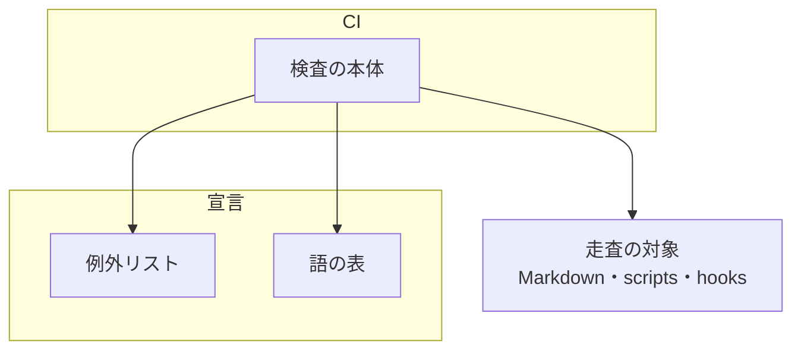

# リポジトリ前提の検査: ai-plugins の値を既定に足す変更を CI で止める

プロジェクト MVV の Value 6「どのプロジェクトでも使える形を保つ」を、リリース対象の Skill とスクリプトで機械的に守る
検査（`scripts/check-skill-repo-assumptions.py`、CI のジョブ `skill-repo-assumptions-check`）の決定と理由、
常に成り立つ条件、入出力の契約を残す。あわせて、ベースブランチ・本番のブランチ・テストのコマンドを宣言から読む
4 か所の契約と、既知の違反の行き先を置く。

**Skill とスクリプトの書き方（探し方を書く・形で分岐する・無いときの振る舞いを書く）は
[`plugins/ndf/skills/AUTHORING.md`](../../plugins/ndf/skills/AUTHORING.md) の「対象リポジトリを仮定しない」が正である。**
ここに書き写さない。例外リストの読み込みの共通の規則は [ndf-entrypoint-contracts.md](ndf-entrypoint-contracts.md) が持つ。

## 概要

**検査が見るのは、ai-plugins にしか無い語がリリース対象の本文に現れるかどうかだけである。** 書き方が正しいか
（宣言を読んでいるか、既定が何か）は判定しない。語を含まないまま ai-plugins の形を前提にした論理は、
このリポジトリのレビューの重点（`.ndf/review.json` の `focus`）で受ける。

**既存の当たりは、語とファイルの組ごとに当たりの数で宣言する。** 数を超えれば新しい箇所として落とし、数より
少なければ宣言の直し忘れとして落とす。同じファイルの新しい箇所も止まり、直した箇所の宣言も残らない。

| 構成要素 | 責務 |
| --- | --- |
| `scripts/check-skill-repo-assumptions.py` | 語の表（Markdown 用とスクリプト用）を持ち、走査の範囲を集め、当たりを語とファイルの組で数えて例外リストと突き合わせる |
| `scripts/repo-assumptions-allow/` | 既知の当たりを 1 項目 1 ファイルで持つ例外リスト |
| `scripts/lib/allowlist.py` | 例外リストの読み込み（ファイル名の規則・必須のキー・理由の必須）。構造チェックと共有する |
| `.github/workflows/runtime-plugin-validate.yml` | ジョブ `skill-repo-assumptions-check` が引数なしで検査を実行する |
| `.ndf/review.json` | 語で拾えない前提を cross-review の担当へ重点として渡す |



## 用語

この文書で使う語（リポジトリ前提の検査・既知の当たり・例外リスト）の定義は、用語集 [docs/glossary.md](../glossary.md)
が正である。この文書で「当たり」は、走査の対象の 1 行に語の正規表現が 1 回一致したことを指す。1 行に 2 回一致すれば
2 件と数える。「組」は、走査の対象のファイルと語の ID の組を指す。

## 背景

Value 6 の棚卸しで、ai-plugins の形を前提にした箇所が 27 件見つかった（2026-11-06）。検査はあったが、
`skills/*/scripts/` の 143 本と hook の定義 2 本を走査せず、`"main"`・`--admin`・`release/v`・`pytest` などの語も
検知しなかった。リリースのスクリプト 3 本はファイルごと除外されており、その中に足した語も通っていた。

穴のある検査は、違反が 1 件入るたびに「CI が通った」という根拠を与える。棚卸しで直すだけでは同じ形が再び入るため、
走査の範囲と語を広げ、既存の違反は行き先の課題とともに宣言して残す形を取る。

## 決定と理由

| 決定 | 理由 |
| --- | --- |
| 例外リストを 1 項目 1 ファイルで置く | 構造チェック（`scripts/script-structure-allow/`・`scripts/contract-allow/`）と同じ形にし、読み込みを `allowlist.py` へ寄せる。並列の計画が別の項目を変えても衝突しない |
| 項目に当たりの数を持たせ、実際の数との一致を求める | 組だけでは宣言のある組の 2 件目を見分けられない。PHPStan の baseline の `count` と同じ持ち方である。減った場合も落とすことで、直した Pull Request が同じ変更で項目を消す |
| `main` は引用符つきの形で照合する | 引用符なしでは関数の名前と `__main__` が当たり、差分を読めなくなる。ブランチ以外の意味の `"main"`（HTML のランドマーク・コードの区分など）は違反でない当たりとして宣言する |
| Skill のスクリプトは manifest に載る Skill に限る | リリースしないスクリプトを数えない。Markdown と同じく `manifests/*-skills.txt` の和集合を使い、family を問わず同じ規則で走査する（playwright-kit も入る） |
| 語の照合は Python の標準ライブラリで行う | Semgrep などの導入は、標準ライブラリだけで動くジョブへ Tool の導入を足す |
| `issues/` と `gh` は語にしない | 置き場が固定である状態が直るまで、当たりのほとんどが同じ行き先の既知の違反になり、検査の差分を読めなくなる |
| 「宣言を読む」の観点はこのリポジトリの重点だけに置く | NDF を作るリポジトリの事情であり、NDF の共通の手順として他のプロジェクトへ決まりを足さない |

## 仕様

### 常に成り立つ条件

| # | 条件 |
| --- | --- |
| 1 | 宣言の無い組の当たりがあると、検査は終了コード 1 で落ちる |
| 2 | 組の当たりの数が宣言の数を超えると、検査は終了コード 1 で落ち、その組の当たりをすべて出す（どの行が新しいかを決められないため） |
| 3 | 組の当たりの数が宣言の数より少ない（0 を含む）と、検査は終了コード 2 で落ち、書き直す値と項目のファイル名を出す |
| 4 | 項目はすべて理由を持つ。`pending` の項目は行き先の課題の番号を持ち、`not-a-violation` の項目は持たない |
| 5 | 終了コード 2 の判定は 1 より先に行う。`--report` は出力を足すだけで、終了コードを変えない |
| 6 | manifest に載る Skill のうち、走査できる Markdown を 1 本も持たないものがあれば、例外リストより先に終了コード 2 で落ちる |
| 7 | リリース対象のファイルに、ファイル全体の除外は無い。除外は常に語とファイルの組で宣言する |

### 走査の範囲

検査は `plugins/` の下で `manifests/` と `skills/` を持つディレクトリを plugin family とみなし、family ごとに次を走査する。

| 対象 | 掛ける語の表 |
| --- | --- |
| manifest に載る Skill のディレクトリの下の `*.md`（`SKILL.md`・`references/` などすべて） | Markdown 用 |
| family の `scripts/` の下の `.py`・`.sh`・`.js` | スクリプト用 |
| manifest に載る Skill の `scripts/` の下の `.py`・`.sh`・`.js` | スクリプト用 |
| family の `hooks/*.json` | スクリプト用 |
| family の `agents/*.md`（エージェントの本文） | Markdown 用 |

パスのどこかに `tests` か `experimental` のディレクトリを含むファイルは対象にしない。manifest に載らない Skill も対象にしない。

`--report` の 1 行目は family ごとの規模である（2026-11-12 の実測）。

```text
plugins/ndf/skills: 公開する Skill 49 個 / Markdown 218 本 / スクリプト 572 本（family 420・Skill 152） / hook 2 本 / エージェント 11 本 / ヒット 236 件
plugins/playwright-kit/skills: 公開する Skill 4 個 / Markdown 24 本 / スクリプト 8 本（family 0・Skill 8） / hook 0 本 / エージェント 0 本 / ヒット 14 件
```

### 検知する語

語の正本は検査の本体の 2 つの表（Markdown 用 18 語・スクリプト用 17 語）である。例外リストの `name` には語の ID を書く。
語そのものは `/` や `"` を含み、ファイル名にできないためである。スクリプト用の表のうち、境界に注意が要る語を次に示す。

| ID | 正規表現 | 当たらない例 |
| --- | --- | --- |
| `quoted-main` | `["']main["']` | `"__main__"`・`def main`・`"domain"` |
| `quoted-develop` | `["']develop["']` | — |
| `base-main` | `--base[ =]main\b` | `--base mainline` |
| `admin-merge` | `--admin\b` | — |
| `tag-form` | `--v(?![A-Za-z-])` | `--verbose`・`--version`・`--view` |
| `release-branch` | `release/v(?![a-z])` | `release/verification` |
| `plugin-manifest` | `plugin\.json` | — |
| `spec-dir` | `docs/specifications` | — |
| `pytest` | `\bpytest\b` | `PYTEST_ADDOPTS`・`pytest_x` |

残りのスクリプト用の語は ai-plugins の置き場とチェックのコマンド（`ndf-dir`・`playwright-kit`・`build-runtime-plugins`・
`check-skill-frontmatter`・`check-markdown-links`・`check-doc-line-limit`・`runtime-list`・`origin-develop`）である。
Markdown 用の表は、特定のブランチ名で書いた手順も拾う（`develop-branch` の `\bdevelop\b`・`origin-main` の `origin/(?:main|master)\b`・
`base-branch-name` の `--base[ =](?:main|master)\b`・`main-branch` の `` `(?:main|master)` ``）。手順はベースブランチ・本番チャネル・
スプリントの起点の語で書き、名前は `.ndf/worktree.json` の宣言から読む。
語の表は網羅ではない。新しい形が見つかったら表へ足し、同じ変更で既知の当たりを宣言する。

### 宣言を読む 4 か所

検査を広げたときに同時に解消した 4 か所である。いずれもリリース先のリポジトリで働く。

| 箇所 | 契約 |
| --- | --- |
| コードレビューのエージェント（`plugins/ndf/agents/code-reviewer.md`） | 差分は `origin/<ベースブランチ>...HEAD` で取る。ベースブランチは `.ndf/worktree.json` の `base_branch`、無ければ `git symbolic-ref --short refs/remotes/origin/HEAD` から `origin/` を外した名前。どちらも無ければ差分を取らずに止まって報告する |
| 並列の計画のリリースの照会（`plugins/ndf/scripts/lib/parallel_external.py` の `stages_of`・`prod_pr_url`） | 照会の `--base` は `repo.production_branch` の結果だけを使う。決まらなければ Pull Request を照会せず、届いた段は `release_branch` まで、URL は空になる |
| Pull Request の宛先（`plugins/ndf/scripts/pr-steps.py` の `plan`・`create`） | 宛先は `--base` → `.ndf/worktree.json` の `base_branch` → 既定ブランチ（`origin/HEAD` → ローカルの `main` → `master`）の順に決める。どれも決まらなければ `gh_pr.require_base` が `EXIT_PRECONDITION` で止め、Pull Request を作るコマンドを打たない |
| プランの見本（`supervise.py example`・`plugins/ndf/scripts/supervise_lib/plan.py`） | テストのステップの `cmd` は `<テストのコマンド>` のプレースホルダーで、`pr` のステップは `base` を持たない。書き換えずに走らせるとシェルが失敗するので、誤った成功にならない |

本番のブランチを決める規則は `plugins/ndf/scripts/lib/repo.py` の 1 か所が持つ。宣言の無いリポジトリで既定ブランチを
本番とみなす扱いはこの関数のままで、行き先は #1338 である。

## データ・設定

### `check-skill-repo-assumptions.py`

```text
python3 scripts/check-skill-repo-assumptions.py [--skills-dir D]... [--allow DIR] [--report]
```

| 引数 | 意味 |
| --- | --- |
| `--skills-dir` | 検査する Skill ディレクトリ（plugin family を含むパス）。複数指定できる。省くと family をすべて見る |
| `--allow` | 例外リストのディレクトリ。既定は `scripts/repo-assumptions-allow/` |
| `--report` | 走査の規模と、当たりの一覧（`[既知]` / `[検知]`）を標準出力へ出す |

| 終了コード | 意味 |
| --- | --- |
| 0 | 宣言の外に当たりが無く、宣言の数と実際の数が一致する |
| 1 | 宣言の無い組の当たり、または宣言の数を超えた当たりがある |
| 2 | 引数・走査の範囲・例外リストの形が合わない。または宣言の数より当たりが少ない |

当たりの出力は `<ファイル>:<行>: '<語>' — <行の中身>` の形で、標準エラーへ出す。

`--skills-dir` を指定したときは、指定した family に属する項目だけを突き合わせる。省いたときは、どの family にも
属さない項目も陳腐化として終了コード 2 にする。

### 例外リストの項目（`scripts/repo-assumptions-allow/*.json`）

```json
{
  "path": "plugins/ndf/scripts/lib/parallel_external.py",
  "name": "release-branch",
  "kind": "pending",
  "reason": "並列の計画のまとめたリリースが delivery を読まず、版を plugin.json から決める。#2616 が宣言を読む形へ直すまで残す",
  "count": 3,
  "issue": 2616
}
```

| キー | 型 | 必須 | 意味 |
| --- | --- | --- | --- |
| `path` | 文字列 | 必須 | 走査の対象のパス。`--skills-dir` と同じく family を含む書き方にする |
| `name` | 文字列 | 必須 | 語の ID。2 つの語の表のどちらかにあるもの |
| `kind` | `not-a-violation` / `pending` | 必須 | 違反でない当たりか、行き先の課題が直すまで残す当たりか |
| `reason` | 文字列 | 必須 | 違反でない理由、または残す理由。空白だけは不可 |
| `count` | 1 以上の整数 | 必須 | その組の当たりの数 |
| `issue` | 1 以上の整数 | `pending` だけ必須 | 行き先の課題の番号。`not-a-violation` には書かない |

ファイル名は `allow_file_name()` が決める（`<path の / を __ へ>--<name>--<kind>.json`）。名前が合わない項目、
キーの過不足がある項目、同じ組の項目が 2 つあるときは終了コード 2 になる。

### CI のジョブ

ジョブ `skill-repo-assumptions-check`（`.github/workflows/runtime-plugin-validate.yml`）は、Python 3 を用意して
`python3 scripts/check-skill-repo-assumptions.py` を引数なしで実行する。依存のパッケージは無い。

### レビューの重点

`.ndf/review.json` の `focus` に「リリース対象のスクリプトへ足す経路が、プロジェクトごとに違う値を宣言から読むこと」が
ある。`plugins/ndf/scripts/lib/review_criteria.py` がこれを cross-review の担当へ渡す基準の文へ載せる。

## エラー処理

| 状況 | 終了コード | 出力 |
| --- | --- | --- |
| 検査する Skill ディレクトリが見つからない・存在しない | 2 | 対象のパス |
| manifest に載る Skill に走査できる Markdown が無い | 2 | Skill のパスと、manifest から外す案内 |
| 例外リストが読めない・形が違う・置き場がファイル | 2 | 項目のファイル名と、満たすべき形 |
| 項目の対象が走査の範囲に無い・どの family にも属さない | 2 | パスと、消す項目のファイル名 |
| 宣言より当たりが少ない | 2 | 宣言の数・実際の数・直す値（0 なら項目を消す） |
| 宣言の外の当たり・数を超えた当たり | 1 | 当たりの一覧と、宣言か引数で受ける案内 |

例外リストの置き場が存在しないときは、項目 0 件として読む。この場合、既知の当たりがすべて宣言の外になり終了コード 1 で落ちる。

## 運用

**語を足す変更が CI で落ちたら、値を宣言か引数で受ける形へ直す。** 直せない理由があるときだけ項目を足す。
違反でないなら `not-a-violation` と理由を、違反のまま残すなら `pending` と行き先の課題を書く。

**既知の違反を直したら、同じ Pull Request で項目の `count` を下げるか項目を消す。** 下げ忘れは終了コード 2 で落ちる。
並行するブランチが同じ組の当たりを変えると、マージの順で数がずれて CI が落ちる。項目は 1 ファイルずつなので、
衝突は同じ組を変えたときだけである。

**既知の違反の行き先**（2026-11-08 の例外リストの集計。違反でない当たり 44 項目・行き先のある当たり 34 項目）:

| 課題 | 扱う前提 | 例外リストの項目 |
| --- | --- | ---: |
| #1756 | リリースの形 package-plugin の部品にあるプラグインの置き場・タグの形 `<plugin>--v`・版の読み書き | 15 |
| #2623 | リリースの形 package-plugin の `release/v<版>` のブランチと承認の外で通すパス。CD を前提にしたリリースの工程 | 7 |
| #2616 | 並列の計画のまとめたリリースが `delivery` を読まず、版を `plugin.json` から決める | 5 |
| #1338 | `--admin`・merge commit のマージ、宣言が無いと既定ブランチを本番とみなす扱い | 4 |
| #2725 | 確定仕様の置き場 `docs/specifications` の固定（マイルストーンの命名・言語とコミットの規約・指示書の参照・案内の既定も同じ課題が持つ） | 3 |

語で拾えない棚卸しの残りは、課題の置き場（#2724）、`issues/` の置き場（#2600）、検査の既定値の ai-plugins のファイル（#1968）、
単独起動の場所の例外（#1707・#2448）、`--repo` を見ない Pull Request の照会（#2446）、`main` 宛ての closing keywords
（#2082・#2228）、版数の無いサービスの開発版（#2354）が持つ。

**未確認・残リスク**:

| 項目 | 内容 |
| --- | --- |
| 行き先の課題の状態 | 検査は `issue` の番号の課題が開いているかを見ない。#2616 は 2026-11-07 に閉じたが、その番号を持つ 5 項目は残っている（`grep -l '"issue": 2616' scripts/repo-assumptions-allow/*.json`）。行き先を付け直すかは未決である |
| 語で拾えない前提 | 語を含まずに ai-plugins の形を前提にした論理は検査で拾えない。このリポジトリのレビューの重点で受ける |
| エージェントの本文 | `plugins/ndf/agents/` は走査の範囲の外で、コードレビューのエージェントの手順が `main` へ戻っても検査では止まらない |

## テスト観点

検査のテストは `scripts/tests/test_check_skill_repo_assumptions.py`、4 か所のテストは `plugins/ndf/scripts/tests/` の
`test_parallel_external.py`・`test_pr_steps.py`・`test_supervise_layout.py` にある。

- manifest に載る Skill の Markdown・Skill の `scripts/`・family の `scripts/`・`hooks/*.json` に語を置くと終了コード 1 になること。`tests/`・`experimental/`・manifest に無い Skill では 0 であること
- スクリプト用の 9 語のそれぞれで、新しいファイルが終了コード 1 になること。「当たらない例」の語では 0 であること
- 同じ行の 2 語が別々に数えられ、同じ語の 2 回が 2 件と数えられること
- 宣言のある組へ 1 件足すと終了コード 1 になり、その組の当たりが出力に載ること
- 当たりが 0 件または宣言より少ない項目で終了コード 2 になり、新しい当たりがあっても 2 が先に判定されること
- 理由が空・`pending` に `issue` が無い・`not-a-violation` に `issue` がある・同じ組が 2 つ・置き場がファイルのとき終了コード 2 になること
- リリースのスクリプト 3 本（`release-steps.py`・`lib/step_result.py`・`release-verification-steps.py`）にファイル全体の除外が無いこと
- family を 1 つだけ指定した走査で、実物のリポジトリの他の family の項目で落ちないこと。実物のリポジトリで終了コード 0 で終わることは、全体テストの suite `skill-repo-assumptions-check`（`python3 scripts/check-skill-repo-assumptions.py`）が確かめる
- `--report` が規模の行を出し、当たりがあれば終了コード 1 のままであること
- `production_branch: prod` の宣言で、並列の計画の 2 つの照会が `--base prod` を渡すこと。宣言が無く既定ブランチが `main` なら `--base main` を渡すこと。本番が決まらないとき照会を打たないこと
- 宣言も既定ブランチも無いリポジトリで、`pr-steps.py` の `plan`・`create` が止まり、Pull Request を作るコマンドを呼ばないこと
- `supervise.py example` の出力に `pytest` が無く、`pr` のステップが `base` を持たず、`supervise.py expected` が読めること

## 関連リンク

- [`plugins/ndf/skills/AUTHORING.md`](../../plugins/ndf/skills/AUTHORING.md) の「対象リポジトリを仮定しない」（書き方の正）
- [ndf-entrypoint-contracts.md](ndf-entrypoint-contracts.md)（例外リストの共通の規則）
- [out-of-scope-issue-file.md](out-of-scope-issue-file.md)（`issue-file.py` の項目を違反でない当たりとする理由）
- [cross-refactoring-lint-suite-and-ci-coverage.md](cross-refactoring-lint-suite-and-ci-coverage.md)（CI のチェックの一覧）
- [PHPStan の baseline](https://phpstan.org/user-guide/baseline)
- [ESLint の bulk suppressions](https://eslint.org/docs/latest/use/suppressions)
