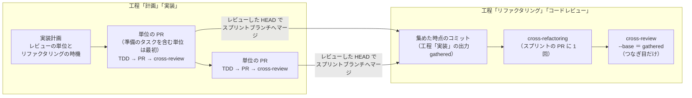
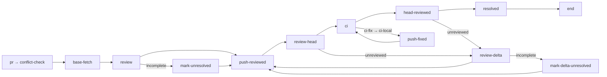

# 工程表のレビューの単位とリファクタリングの時機

NDF は、課題ごとの実装計画が決めた「レビューの単位」ごとに PR をスプリントブランチへ出し、その PR を実装の工程の
中で cross-review に掛け、レビューした HEAD でだけマージする。スプリントの PR（スプリントブランチからベースブランチ
への PR）では、すべての単位を集めた後に入ったコミット（つなぎ目）だけをレビューし、つなぎ目にコードが無ければ
工程「コードレビュー」を飛ぶ。リファクタリングは実装の前・実装の中・スプリントの終わりの 3 つの時機に置く。
文書を省いても工程の行と承認ゲートは残し、省いた条件が実装の後に外れたら、新しいステートマシンで工程「設計」から
流し直す。この文書は、その形の契約と、そう決めた理由を持つ。

例: 課題 #1（受け入れ条件 3 つ）の実装計画が、条件 1・2 を満たす単位 U1 と条件 3 を満たす単位 U2 を決めたとする。
supervisor は U1 の実装のプランを次のコマンドで組む。プランは U1 の PR を `sprint/x` へ出して cross-review を
収束まで回し、CI が通った時点の HEAD がレビューした HEAD と同じときにだけ終わる。supervisor はそのコミットを
`--reviewed` に渡してマージする。U1・U2 をマージした後、工程「実装」は `sprint/x` の HEAD を `gathered` に書き、
工程「コードレビュー」は `gathered` から後のコミットだけをレビューする。

```sh
ndf route render implement --set branch=u1 --set base=sprint/x --set issue=1 \
  --add acceptance=--issue --add acceptance=1 \
  --add acceptance=--criteria --add acceptance=1:1 --add acceptance=--criteria --add acceptance=1:2 \
  --out <プラン>
# → acceptance のステップは ndf loop acceptance check --issue 1 --criteria 1:1 --criteria 1:2
# → review のステップの起点は origin/sprint/x
```

**手順は Skill が正である。** 表・手順をここに書き写さない。

| 何を | どこが正か |
| --- | --- |
| 工程表（モードごとに起動する Skill・工程が動く単位とリファクタリングの時機・工程ごとの決まり・文書を省いたときの工程） | [development-workflow の SKILL.md](../../plugins/ndf/skills/development-workflow/SKILL.md) |
| 工程が動く単位の詳細・リファクタリングの 3 つの時機と候補の渡し方・つなぎ目のレビュー | [development-workflow の references/parallel-work.md](../../plugins/ndf/skills/development-workflow/references/parallel-work.md)・[stage-notes.md](../../plugins/ndf/skills/development-workflow/references/stage-notes.md) |
| 実装のフェーズの supervisor が単位ごとに打つコマンドと、単位のマージ・`gathered` の記録 | [development-workflow の references/agent-layers.md](../../plugins/ndf/skills/development-workflow/references/agent-layers.md) |
| 実装計画の「レビューの単位」「リファクタリングの時機」の欄の形と、欄の行の行き先 | [implementation-plan の SKILL.md](../../plugins/ndf/skills/implementation-plan/SKILL.md) |
| 実行計画の実装の行の作り方（仮の行から単位の行へ置き直す） | [issue-plan-strategy の references/execution-plan.md](../../plugins/ndf/skills/issue-plan-strategy/references/execution-plan.md) |
| 省いてよい文書と条件 | [requirements-design の references/document-roles.md](../../plugins/ndf/skills/requirements-design/references/document-roles.md)（理由は [ndf-development-document-roles.md](ndf-development-document-roles.md)） |
| 設計書を省いた変更の数え直しと流し直しの判定 | [quality-gates の references/design-match.md](../../plugins/ndf/skills/quality-gates/references/design-match.md) |
| コマンドの引数・停止理由・結果 JSON | 契約 `plugins/ndf/contracts/`（生成物は [plugins/ndf/docs/contracts/](../../plugins/ndf/docs/contracts/index.md)） |

## 概要

工程表の行・行名・モードごとの要否は変えていない。ステートマシンはスプリントで 1 つで、行は工程ごとに 1 行で
ある。単位ごとの成否はステートマシンの行ではなく、単位ごとの実装のプランの結果が持つ。



| 工程 | 動く単位 | リファクタリングの時機 |
| --- | --- | --- |
| 作業場所の用意（実装のフェーズ） | レビューの単位ごとに 1 つの worktree をスプリントブランチから切る | — |
| 計画 | 課題。実装計画がレビューの単位とリファクタリングの時機を決める | 実装の前の対象を決める |
| 実装 | レビューの単位。準備のタスクを含む単位を最初に流してマージし、残りを並列に流す | 実装の前（準備のタスク）・実装の中（TDD の整理のステップ） |
| リファクタリング | スプリント。すべての単位を集めた後に `cross-refactoring` を予算付きで 1 回 | スプリントの終わり |
| コードレビュー | スプリント。集めた時点（`gathered`）から後のコミットだけ。コードのファイルが無ければ飛ぶ | — |
| 完了判定 | スプリント（すべての課題の受け入れ条件を照らす） | — |
| Pull Request | 単位（スプリントブランチ宛て）とスプリント（ベースブランチ宛て） | — |

進め方（`pace`）の `normal`・`auto`・`fast` に同じく当たる。単位のレビューは、工程「コードレビュー」を持つ
5 つのモードのすべてに当たる（`operation` では実行の記録を載せた PR が対象）。工程「リファクタリング」は、今と同じく
`standard`・`legacy-refactor` で CI テストの設定があるリポジトリだけに当たる。

## 用語

用語の定義は、用語集の設定（`.ndf/glossary.json` の `document`）が指す [docs/glossary.md](../glossary.md) にある。
この文書で使う語は「レビューの単位」「単位の PR」「つなぎ目」「集めた時点」「リファクタリングの時機」である。
「レビューの単位」は、ブランチ戦略の宣言の `reviews`（PR の種類ごとに掛けるレビューと対象の差分の組）の意味を
この仕様で置き換えた。旧い意味の語の行き先は [#3881](https://github.com/devbasex/ai-plugins/issues/3881) が決める。

字の近い 3 つの語は次の意味で使う。

| 語 | 何か | 誰が書く・組むか |
| --- | --- | --- |
| 実装計画 | 課題ごとの Markdown の文書（`issues/issue-<番号>-plan.md`）。レビューの単位とリファクタリングの時機の欄を持つ | 工程「計画」で `implementation-plan` |
| 実行計画 | スプリントの行の表。行 1 つが 1 本の PR・1 つの worktree | conductor |
| 実装のプラン | 実装のテンプレート（`contracts/templates/impl.json`）から組んだ `ndf plan` の JSON | supervisor が `ndf route render implement` で組む |

## 背景

工程表は、課題の PR をレビューなしでスプリントブランチへ集め、スプリントの PR に cross-review を 1 回だけ掛けて
いた。並列の計画のレーンが出した PR [#3870](https://github.com/devbasex/ai-plugins/pull/3870) は課題 3 件を 1 本に
まとめ、追加と削除で 4,127 行になり、レビュー担当が差分の全体をつかめず、どの指摘がどの課題のものかを人が追え
なかった（[#3879](https://github.com/devbasex/ai-plugins/issues/3879)）。リファクタリングの置き場も工程表からは
実装の後の 1 か所しか読めず、工程の要否と、[#3868](https://github.com/devbasex/ai-plugins/issues/3868) が決めた
文書の要否が別々に決まっていた。

一次資料は 2 つを採った。Google の [Small CLs](https://google.github.io/eng-practices/review/developer/small-cls.html)
（変更を 1 つの自己完結した単位にし、大きな変更はレビューの前に分ける）を単位ごとの PR とレビューに、
Martin Fowler の [Preparatory Refactoring](https://martinfowler.com/articles/preparatory-refactoring-example.html)
（変更を入れやすくするために先に構造を整える）を、準備のタスクを含む単位を最初に流す決まりに使った。

## 仕様

### 決めたことと理由

| 決めたこと | 理由 |
| --- | --- |
| 実装計画のレビューの単位 1 つを実行計画の実装の行 1 つにし、supervisor が単位ごとの値を渡して実装のプランを組む。実装計画を省いた課題と、単位の欄が無い実装計画の課題は、課題 1 つを 1 単位にする | ステートマシンに単位ごとの行を足すと、行のキーとステートマシンの形と記録の読み手を作り直す。行は工程の通過を、単位の成否は実装のプランの結果を持てば足りる |
| 単位のレビューは工程表に行を足さず、実装のテンプレートの `pr` の後に置く。工程「実装」は単位の PR のレビューとマージまでを持つ | 行を足すと 5 つのモードの文書・工程表の検査・ステートマシンの行・フェーズの表を同時に変える。どの単位で止まったかを 1 本のプランの結果で読める |
| レビューの判定をレビューした HEAD にひも付け、CI の後に HEAD が変わっていたら、変わった分だけを差分のレビューに掛けてから CI を待ち直す。マージはレビューした HEAD を `--reviewed` に渡し、PR の head と違えば止まる | CI の直しやスプリントブランチの取り込みでも振る舞いは変わり得て、それらは集めた時点より前なので、つなぎ目のレビューにも入らない |
| レビューした HEAD は cross-review が `--reviewed-out` で書く（最後のラウンドでレビュー担当が読んだ HEAD） | 直しを送った後の HEAD を書くと、最後のラウンドの直しがレビューを経ないまま「レビューした HEAD」になる |
| 単位のレビューが未解決の指摘を残して終わったら、CI までは進めるが、プランは `resolved` のステップで `incomplete` で止まり、マージへ進まない | 未解決の指摘を残した単位がスプリントブランチへ入らないようにする。CI まで進めるのは、直しの結果を CI で確かめた状態で人に渡すためである |
| つなぎ目は、すべての単位の PR をスプリントブランチへマージした時点（集めた時点）の後に入ったコミットとする。工程「実装」の出力 `gathered` に集めた時点のコミットを書き、工程「コードレビュー」がそれを `--base` にする | 工程は行ごとに別のプランで流れ、値は文脈のキーでだけ渡る。単位の PR のマージのコミットから算出すると、マージの方式とブランチ戦略で求め方が変わる。記録した 1 つのコミットはどの方式でも同じ |
| `gathered` は supervisor が手で書かず、`ndf progress gathered` が確かめてから書く | 開いた単位の PR が残る・未 push などの状態で集めた時点を記録すると、つなぎ目から単位の差分が漏れる |
| つなぎ目にコードのファイルが無ければ工程「コードレビュー」を飛ぶ。手元に加えてリモートのスプリントブランチの HEAD までも見る | 文書だけの差分に cross-review を掛けない。別の worktree から push されたコードを見落として工程を飛ばさない |
| 文脈に `gathered` が無いスプリントは、今までのとおりベースブランチを起点にスプリントの差分全体をレビューする | `gathered` を書く前に始まったスプリントの記録をそのまま読めるようにする |
| リファクタリングの 3 つの時機を工程「計画」「実装」「リファクタリング」に割り当て、工程の行は足さない。準備のタスクを含む単位を最初に流し、マージしてから残りの単位を始める | 準備のリファクタリングの要否は実装計画の判断で決まり、行にすると多くのスプリントで通らない行になる。残りの単位はスプリントブランチから切るので、マージの前に始めると準備の変更を含まない |
| スプリントの終わりの候補は、工程「リファクタリング」のプランを組むコードが実装計画から集めて `--candidates` で渡す | supervisor に集めさせると、読み元と渡し方が毎回変わる |
| 文書を省いても工程の行・設計 PR・設計承認ゲートを残す。省いた条件が実装の後に外れたら、今のステートマシンを中止し、元と違う名前の新しいステートマシンで工程「設計」から流し直す | 要否が課題ごとに変わる条件を、モードごとの固定の並びで表せない。承認ゲートの数を変えない。終えた行は戻せない |
| 受け入れ条件の確かめを単位の分に絞る（`--issue` の繰り返しと `--criteria`）。漏れた条件はスプリントの完了判定がすべての課題の条件を照らして拾う | 課題を 2 つの単位に分けると、1 本目は残りの条件の記録が無くて止まる。小さな課題を束ねた単位は、2 つ目の課題の条件を確かめられない |

### 実装のプランのステップ

実装のテンプレート（`contracts/templates/impl.json`）は、`pr` の後に次のステップを持つ。



| ステップ | 振る舞い |
| --- | --- |
| `base-fetch` | `git fetch <リモート> <base>`。レビューの起点 `<リモート>/<base>` を新しくする。手元のスプリントブランチは他の単位のマージを取り込んでいないことがあり、そのまま起点にすると他の単位の差分が混ざるため |
| `review` | `{{review}}`（cross-review）を収束まで回し、`--reviewed-out` で `{state_dir}/reviewed-head` を書く。未解決の指摘を残して `incomplete` で終われば `mark-unresolved` が `{state_dir}/unresolved` を置く |
| `review-head` | HEAD が `reviewed-head` と違うか、差分のレビューの未解決が残るとき（`delta-recheck`）は `unreviewed` で `review-delta` へ回す |
| `head-reviewed` | CI が通った後に HEAD が `reviewed-head` と違えば（`ci-fix`・`base-sync` の後のコミット）`unreviewed` で `review-delta` へ回す |
| `review-delta` | `reviewed-head` を `{state_dir}/delta-base` へ写し、差分のレビューが通るまで同じ起点で `--base <delta-base>` の cross-review を打つ。状態ディレクトリは `{state_dir}/cross-review-delta` で最初のレビューと分ける。未解決が残れば `mark-delta-unresolved` が `{state_dir}/unresolved-delta` を置く。通れば `unresolved-delta` と `delta-base` を消し、消せなければ通った結果を出さずに `precondition` で止まる |
| `resolved` | `unresolved` か `unresolved-delta` が残っていれば `incomplete` で止まる。どちらも無いときだけプランを終える |
| `acceptance` | `ndf loop acceptance check {{acceptance}}`。既定は `--issue <issue>` |

周回の数は今の CI の予算（`ci_budget`）と `repeat-check` が縛る。

### 差し込みの補い

`{{review}}` と `{{acceptance}}` の既定は、単発の経路（`ndf route render`）でも工程から組む経路
（`ndf.progress.invoke`）でも、同じ関数 `ndf.core.route.launched`（中で `launch_values` と `check_acceptance` を
通す）が補う。

- `review`: `branch` と `base`（`base` が無く `repo` があれば既定のベース）から `review_launch` で組む。テンプレートが
  `impl` なら起点を `<リモート>/<base>`（リモートが無ければ `origin`）にする
- `acceptance`: 値が無く `issue` があれば `--issue <issue>`。渡した並びに `--issue` が無いか、`--issue`・`--criteria`
  の後に値が無ければ、プランを組む時点に `RouteError` で止まる。`acceptance` を渡したときは `issue` を求めない
  （課題を束ねた単位は代表の課題を 1 つに決められないため）
- 工程「コードレビュー」の工程のステップの範囲が `unreviewed_diff` で文脈に `gathered` があれば、`--base` を
  確かめた `gathered` にする。既定の起動なら `review_launch` を組み直し、リポジトリの設定（`workflow.launch.review`）の
  起動なら並びの後ろに `--base <gathered>` を足す（cross-review は後に書いた引数が勝つ）
- 工程「リファクタリング」のプランを組むとき、文脈の `issues` の実装計画（worktree の `issues/issue-<番号>-plan.md`）の
  「リファクタリングの時機」の表から「スプリントの終わり」の行を集めて `{state_dir}/refactor-candidates.md` に書き、
  `{{refactor}}` の後ろに `--candidates <そのファイル>` を足す。1 行も無ければファイルも引数も足さない

### コマンドの引数

どれも足した引数で、渡さなければ今までと同じに動く。

| コマンド | 引数 | 振る舞い |
| --- | --- | --- |
| `ndf loop acceptance check` | `--issue` の繰り返し・`--criteria <課題>:<条件>`（値 1 つごとに繰り返す） | 課題ごとに照らして 1 つにまとめる。`--criteria` にその課題の組があればその条件だけを照らす。欠けの `name` は `<課題>:<条件>`。`--issue` 1 つ・`--criteria` なしの結果は今までと同じ。渡した `--issue` に無い課題か本文に無い条件の番号は `invalid` |
| `ndf ci merge` | `--reviewed <sha>` | 作業場所の HEAD と違えばマージせずに `refused` |
| `ndf cross-review run` | `--reviewed-out <ファイル>` | 最後のラウンドでレビュー担当が読んだ HEAD をファイルへ書く |
| `ndf refactor run` | `--candidates <ファイル>` | 中身を提案のプロンプトに「実装計画が挙げた候補」の節として載せる。完了と再開の照らしには中身の SHA-256（`--candidates-sha256`）を使い、パスは入れない |
| `ndf progress gathered` | `[--branch <スプリントブランチ>] [--remote <リモート>]` | スプリントブランチを取得し、その HEAD を出力 `gathered` に返す。工程「実装」の最後のステップ `gathered`（`kind: record`）が打つ |
| `ndf progress new` | `--carry <ステートマシンの ID>` | 無効にした工程（`--disable`）の定義の `outputs` のキーを、中止したステートマシンの文脈から新しい文脈へ写す |

`ndf refactor run` の候補の中身が前回と違うときは、完了の記録を再利用せずに提案から打ち直す。提案の後で止めた
状態からの再開では `invalid` で止まり、前の候補で選んだ項目を使い続けない。

### 常に成り立つ条件

- **単位のプランは、HEAD がレビューした HEAD と同じで、未解決の指摘が残っていないときにだけ終わる。** 違えば
  差分のレビューへ回り、未解決が残れば `incomplete` で止まる
- **差分のレビューの未解決は、その指摘を持つ差分のレビューが通るまで残す。** 途中で止まった差分のレビューを
  再開しても起点（`delta-base`）は動かない
- **単位のマージはレビューした HEAD でだけ行う。** `ndf ci merge --reviewed` は HEAD が違えば `refused` で止まり、
  GitHub の側でも `expect_head` で PR の head を照らす
- **工程の条件とレビューは同じ範囲を見る。** 範囲は `gathered..<HEAD>` で、条件（`code_in_unreviewed_diff`）と
  レビューの起点は同じ関数 `unreviewed_range` で確かめる。`gathered` がコミットとして読めない・worktree のブランチが
  文脈の `branch` と違う・`gathered` が HEAD の祖先でない（集めた後に rebase や force push で書き換えた）ときは、
  判定できないとして止まり、ベースブランチの起点へ倒さない
- **`gathered` は確かめてから書く。** `ndf progress gathered` は、detached HEAD・worktree のブランチが `--branch` と
  違う・マージ先がスプリントブランチの開いた PR が残る・リモートが GitHub でない・`<リモート>/<ブランチ>` を取得
  できない（未 push）・worktree の HEAD が `<リモート>/<ブランチ>` を含まない、のどれかなら書かずに `precondition` で
  止まる。スプリントブランチがスプリントの PR のマージ先と同じとき（単位の PR が無い）は開いた PR を問わない
- **同じ課題への受け入れ条件の記録は消し合わない。** `ndf loop acceptance record` は、Git の共通ディレクトリの
  下の `<プラグインの名前>/acceptance-<課題>.lock`（今は `ndf/`）のロックの中で読む・書く・読み直すを行い、自分の
  記録が残っていなければ読み直した本文へ当て直す。消失を防ぐのは同じ Git 共通ディレクトリを使うプロセスどうしに
  限る。GitHub の課題の更新は条件付きの書き込みを受けないため、ロックの外の書き手との競合は書く時点に検出せず、
  次の `check` が欠けとして `incomplete` を返して見つける
- **流し直しは元と違う名前で作る。** ステートマシンの ID は階層・リポジトリ・名前から決まり、中止したものと同じ
  名前では作れない
- **工程の定義の範囲の語と入力の語は読み込みで照らす。** 範囲の語は `sprint_diff`・`issue_diff`・`unreviewed_diff`
  で（I9）、`unreviewed_diff` のレビューは `sprint_diff` のリリースより前になければ断る（I8a）。`optional_inputs` に
  文脈のスキーマに無いキーを書いた定義は読み込みで断る

## データ・設定

| 置き場 | 中身 |
| --- | --- |
| `contracts/workflow/context.schema.json` | 文脈のキー `gathered`（40 桁の 16 進のコミット。集めた時点のスプリントブランチのコミット） |
| `contracts/workflow/stages/implement.json` | `outputs: ["gathered"]`。最後のステップ `gathered` が `ndf progress gathered` を打つ |
| `contracts/workflow/stages/code-review.json` | `optional_inputs: ["gathered"]`（文脈にあるときだけ渡す入力）・`when` に `code_in_unreviewed_diff`・ステップの範囲 `unreviewed_diff` |
| `contracts/workflow/stages/refactor.json` | `inputs: ["worktree", "branch", "issues"]` |
| `contracts/workflow/ndf.schema.json` | 範囲の語 `unreviewed_diff`・条件の語 `code_in_unreviewed_diff`・`optional_inputs` |
| `contracts/templates/params.json` | 差し込み `acceptance`（並び） |
| `contracts/causes/`・`contracts/schemas/result.schema.json`・`contracts/version.json` | 停止理由 `unreviewed`（レビューを経た HEAD の後にレビューを通っていないコミットがある）、結果 JSON の `gathered`、契約のバージョン 8 |
| 実装のプランの状態ディレクトリ | `reviewed-head`・`unresolved`・`unresolved-delta`・`delta-base`・`delta-recheck`・`cross-review-delta/`。工程「リファクタリング」のプランの状態ディレクトリに `refactor-candidates.md` |

## エラー処理

| 起きること | 扱い |
| --- | --- |
| 単位のレビューか差分のレビューが未解決の指摘を残す | CI まで進めたうえで、`resolved` が `incomplete` で止める |
| 差分のレビューが通ったが、フラグか起点の記録を消せない | 通った結果を出さずに `precondition` で止まる |
| `--issue` を含まない `acceptance` を渡す | プランを組む時点に `RouteError` |
| 受け入れ条件の記録のロックを待ちの上限までに取れない | `store_in_use`（記録を書かない）。`ndf loop` の既存の扱いに合わせた |
| 当て直しを 3 回しても自分の記録がそろわない | `incomplete`（欠け `gaps` 付き）。`check` の欠けと同じ形で読める |
| `unreviewed_range` が判定できない | 工程の条件は判定できないとして止まり、工程「コードレビュー」のプランも組まない |
| `--carry` のステートマシンが中止されていない・名前が写し元と同じ・課題が違う・リポジトリの識別が違う・`--loop` と併用した・写すキーが写し元に無い・写すキーが無いのに `--carry` を渡した | ステートマシンを作らずに断る |
| 出力のキーを持つ工程を無効にし、`--carry` が無い | 作る時点に断る（後の工程が入力の欠けで止まるのを前倒す） |

## 運用

- **流し直しの手順。** 設計書を省いた変更が完了判定の数え直しで条件を外れたら、工程「完了判定」は失敗で返る。
  conductor は `ndf progress cancel <元の ID> --reason …` の後に、元と違う名前で
  `ndf progress new <新しい名前> --issues <同じ課題> --disable 要求と受け入れ条件=<既にある> --disable 作業場所の用意=<既にある> --carry <元の ID>`
  を打つ。新しいステートマシンは工程「設計」から設計承認ゲートを通る
- **費用。** cross-review の起動は「単位の数 + 1（つなぎ目）」回になる。1 回に読む差分は 1 単位分（#3868 の目安は
  400 行以下、上限 1,000 行）か、集めた後の差分だけである
- **つなぎ目のレビューが見ないもの。** 並列に作った 2 つの単位を合わせたときの振る舞いの食い違いは、それぞれの差分
  に現れない。集めた後のスプリントブランチで走る CI（全体テスト）と、完了判定が見る
- **残る食い違い。** 工程表で `legacy-refactor` のコードレビューの欄は `pr-review` だが、工程の定義はモードによらず
  cross-review を呼び、単位のレビューも同じ起動を使う

## テスト観点

`.md` の文言を照らすテストは置かない。

- 実装計画が決めた単位ごとの実装のプランが、`pr` の後・`ci` の前に `review` を持ち、`{{review}}` の `--base` が
  `<リモート>/<スプリントブランチ>` になること。単発の経路と工程から組む経路で同じ値になること
- CI の後に HEAD がレビューした HEAD と違えば差分のレビューへ進み、同じになるまでプランが終わらないこと。未解決の
  指摘が残ればマージへ進まないこと。`ndf ci merge --reviewed` が違う head でマージしないこと
- `--criteria` で単位の条件だけを照らし、`--issue` の繰り返しで束ねた課題をすべて照らすこと。同じ課題への並列の
  記録が両方残ること
- 文脈に `gathered` があれば工程「コードレビュー」の `--base` が `gathered` になり、つなぎ目にコードが無ければ工程が
  飛ぶこと。`gathered` が無ければベースブランチを起点に今までのとおり起動すること。`gathered` が祖先から外れたか
  ブランチが違えば判定できずに止まること。別の worktree から push したコードも見ること
- 工程「コードレビュー」の範囲が `unreviewed_diff` で、デプロイの後ろへ動かした定義を I8a が断ること
- 実装計画に「スプリントの終わり」の行がある課題で、工程「リファクタリング」のプランに `--candidates` が付き、
  提案のプロンプトに候補が載ること。候補の中身が変われば前回の結果を使わないこと
- `--carry` で中止したステートマシンの `worktree`・`branch` が写り、工程「設計」の入力が解決すること
- 工程表の行・行名・モードごとの要否が工程の定義と一致すること（`tests/skills/test_stage_table.py`）と、`ndf check`・
  PR の CI が通ること
- 次のスプリントの実装のフェーズで単位の PR ごとに cross-review の判定のコメントが付き、スプリントの PR のコード
  レビューの範囲が集めた後のコミットだけであること（リリース後テストで確かめる）

## 関連リンク

- [#3879](https://github.com/devbasex/ai-plugins/issues/3879) — 工程表の見直し（レビューの単位・リファクタリングの時機・文書の要否を工程にそろえる）
- [#3868](https://github.com/devbasex/ai-plugins/issues/3868) — 開発の文書の書き方。実装計画の欄と省いてよい文書の条件を持つ（[ndf-development-document-roles.md](ndf-development-document-roles.md)）
- [#3881](https://github.com/devbasex/ai-plugins/issues/3881) — ブランチ戦略の宣言の `reviews`（旧い意味のレビューの単位）の扱い
- [#3905](https://github.com/devbasex/ai-plugins/issues/3905) — 自動の経路（`ndf progress run`）が単位の展開とマージを持たない
- 関係する確定仕様: [cross-review-review-scope.md](cross-review-review-scope.md)（cross-review のレビュー範囲）・[ndf-parallel-issue-bundles.md](ndf-parallel-issue-bundles.md)（10 系の課題のまとまりの記録）
