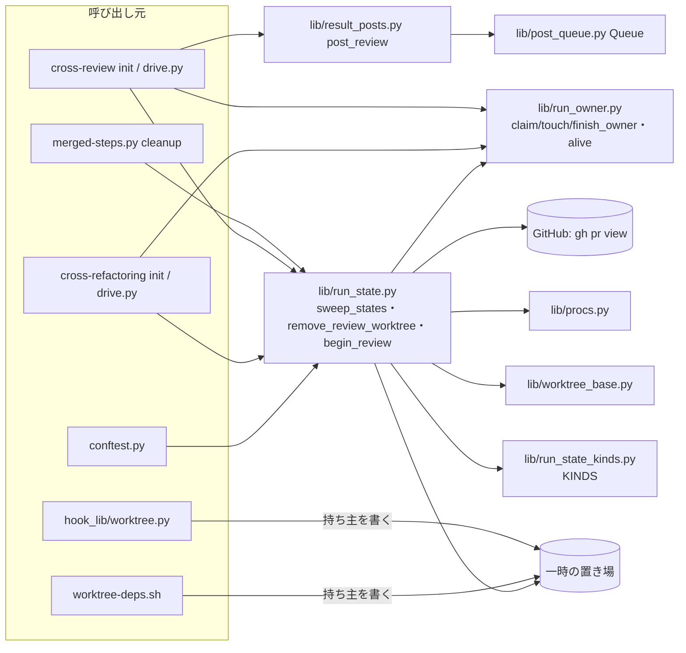
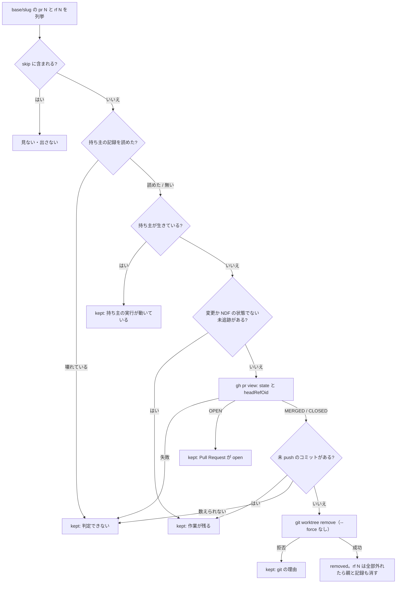
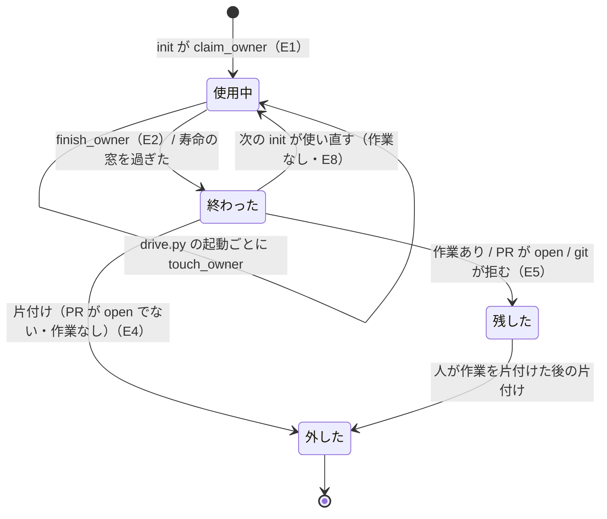
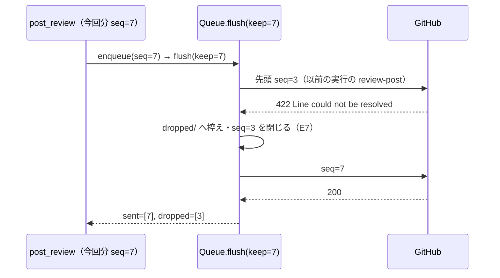

# 実行をまたいで残る状態: 持ち主と寿命を記録し、終わった実行の残骸を次の実行で片付ける

NDF の実行（cross-review・cross-refactoring・merged の後片付け・セッションの hook・`worktree-deps.sh`・テストのセッション）は、
実行が終わった後もディスクに状態を残す。レビュー worktree（`pr<n>`・`rf<n>`）・セッションの状態ファイル・一時ファイル・
投稿キューの項目である。これらに持ち主と寿命を記録し、持ち主の終わった状態は、次の cross-review と cross-refactoring の開始・
merged の `cleanup`・テストのセッションの終わりが自動で外す。持ち主が生きている状態と作業の残る worktree は外さず、
理由を結果の `items` に出す。投稿キューの先頭に残った以前の実行の位置エラーの項目は、待ち行列から控えへ外れ、
今回分の投稿を止めない。

例: PR #2152 の cross-refactoring が終わり、PR はマージされたが、`/tmp/ndf-worktrees/devbasex--ai-plugins/rf2152/`
（中に `work`・`claude`・`codex`・`kiro` の 4 本の worktree）が残っている。翌日、別の PR で cross-review を始めた。

| 順 | 起きること |
| --- | --- |
| 1 | cross-review の `init` が `run_state.begin_review` を呼ぶ。開始する `pr<n>` だけを見ずに、`sweep_states` が置き場 `<base>/devbasex--ai-plugins/` を順に見る |
| 2 | `rf2152.owner.json` は `finished_at` を持つ（cross-refactoring の終わりで書かれた）ため、持ち主は終わっている |
| 3 | 4 本の worktree のどれにも追跡ファイルの変更・NDF の状態でない未追跡のファイルが無いので、`gh pr view 2152 --json state,headRefOid` を 1 回打つ。`MERGED` |
| 4 | worktree を 1 本ずつ、未 push のコミットを数えてから `git worktree remove`（`--force` なし）で外す。4 本とも外れたので `rf2152/` と記録を消す |
| 5 | 結果の 5 件（`worktree` × 4・`run-dir` × 1、どれも `removed`）が `init` の出力 `SWEPT` に載り、`drive.py` の終わりの結果の `items` へ足される |
| 6 | 同じ置き場にある `pr2201` は記録の `seen_at` が 2 時間前で `finished_at` が無いため、PR がマージ済みでも `kept`（「持ち主の実行 … が動いている（最後に動いた時刻 …）」）で残る |

**状態の種類の一覧は写さない。** 一覧の正本はコードの表
[`scripts/lib/run_state_kinds.py`](../../plugins/ndf/scripts/lib/run_state_kinds.py) の `KINDS` で、種類ごとの置き場・持ち主・寿命・
片付ける時点・作るスクリプトを持つ。片付けとテストが同じ表を読む。

| 何を | 正本 |
| --- | --- |
| 状態の種類の一覧（置き場・持ち主・寿命・片付ける時点・作るスクリプト） | [`scripts/lib/run_state_kinds.py`](../../plugins/ndf/scripts/lib/run_state_kinds.py) の `KINDS` |
| 片付けの判定と外し方 | [`scripts/lib/run_state.py`](../../plugins/ndf/scripts/lib/run_state.py) の冒頭の説明と関数 |
| 持ち主の記録の読み書きと生存の判定 | [`scripts/lib/run_owner.py`](../../plugins/ndf/scripts/lib/run_owner.py) |
| cross-review・cross-refactoring・merged の使い方 | 各 Skill の本文（[`cross-review`](../../plugins/ndf/skills/cross-review/SKILL.md)・[`cross-refactoring`](../../plugins/ndf/skills/cross-refactoring/SKILL.md)・[`merged`](../../plugins/ndf/skills/merged/SKILL.md)） |

この文書が扱うのは、決定の理由、構成要素の責務と契約、常に成り立つ条件、種類ごとの判定の規則と記録の形である。

## コンテキスト

| コンテキスト | 何の語が 1 つの意味に決まるか |
| --- | --- |
| NDF の worktree（`ndf-worktree`） | 残る状態・状態の持ち主・状態の寿命・以前の実行・持ち主の記録・寿命の窓・片付け |
| NDF の cross-review（`ndf-cross-review`） | 投稿キュー・項目・位置エラー・控え（`dropped/`）・今回分 |
| NDF の cross-refactoring（`ndf-cross-refactoring`） | `rf<n>`・書き込み用の作業ディレクトリ（`work`） |

関係は**顧客 / 供給者**である。`ndf-worktree` の共通の層（`lib/run_state.py`・`lib/run_owner.py`・`lib/run_state_kinds.py`）が
供給者で、持ち主の記録の書き方・生存の判定・片付けを提供する。cross-review・cross-refactoring・merged は顧客で、開始と終わりに
記録を書き、片付けを呼ぶだけで、判定の規則を自分で持たない。投稿キューの項目の扱いは `ndf-cross-review` の中で閉じ、
`ndf-worktree` は投稿キューを片付けない（一覧に載せるだけ）。

## 用語

定義は [用語集](../glossary.md) が正である（`.ndf/glossary.json` の `document`。文脈 `ndf-worktree` と `ndf-cross-review`）。
この文書で使う語は「残る状態」「状態の持ち主」「状態の寿命」「以前の実行」「持ち主の記録」「寿命の窓」「片付け」「投稿キュー」
「レビュー worktree」である。

## 背景

実行をまたいで残る状態に持ち主と寿命が無かった。merged の `cleanup` は `pr<n>` しか外さず `rf<n>` が残り（#1680）、
`ndf-worktree-*.json`・`ndf-deps.*`・`fix-pr<n>-*`・`ndf-tests-*` は誰も消さなかった。2026-10-23 にホストのディスクが埋まり（#2085）、
2026-10-31 の手元の `/tmp` には、マージ済みの `rf` 4 本（2.0 GB）・`ndf-worktree-*.json` 79 件・`ndf-tests-*` 36 件が残っていた。
手で片付ける側は、実行中のものを消すおそれがあった。

投稿キューでは、前の実行が積んだ `review-post` が位置エラー（422 と `could not be resolved`）で先頭に残ると、次の実行の review が
止まり続けた（#2084、carmo PR #352、2026-10-21）。位置エラーで退避するのは今回分だけで、先頭にある他の項目を外す者がいなかった。

前提として確かめたこと（一時の git リポジトリ、2026-10-31）:

- `git worktree remove`（`--force` なし）は、無視されたファイルだけなら成功（0）、未追跡のファイルがあれば拒む（128）
- detached の HEAD に未 push のコミットがあっても成功（0）する。git は未 push のコミットを守らない
- `rf<n>/` は worktree を束ねる親ディレクトリで、中の `work` と各ランタイムのディレクトリがそれぞれ登録済みの worktree である

## 対象範囲

| 扱う | 扱わない |
| --- | --- |
| `KINDS` の種類ごとの持ち主と寿命の判定、片付け（`sweep_states`）と呼ぶ時点 | 開発 worktree（`.worktrees/<ブランチ名>`）の外し方（merged の `_remove_pr_worktrees` のまま） |
| レビュー worktree の持ち主の記録（`{pr,rf}<n>.owner.json`）と、開始・動いた・終わったの書き込み | 退避した残骸（`*.stale-<時刻>`。種類 `stale-copy`）の片付け |
| cross-review と cross-refactoring の開始が、以前の実行・別の実行の worktree を見つけたときの振る舞い | Skill の置き場（`ndf/`）・`ndf-stages`・`ndf-guards`・`ndf-checks`・`ndf-usage` などの持ち主と寿命（種類 `out-of-scope` で一覧に載せるだけ。#2243） |
| セッションの状態ファイルと `ndf-deps.*` の持ち主（プロセス）の記録 | 承認ゲート 2 の後の別セッションのマージの扱い（#2221。[ndf-release-approved-commit.md](ndf-release-approved-commit.md)） |
| 投稿キューで今回分でない位置エラーの `review-post` を控えへ外すこと、外された今回分を取り戻すこと | 寿命の窓の設定化 |

**働く範囲は配布先のリポジトリを含む**（`plugins/ndf/scripts/` と cross-review・cross-refactoring・merged の配布物）。片付けるレビュー
worktree は、実行したリポジトリの slug の下（`<base>/<slug>/`）だけである。一時ファイルはリポジトリに依らず、システムの一時の置き場
（`tempfile.gettempdir()`）の下を見る。`<base>` は `lib/worktree_base.worktree_parent()`（`NDF_WORKTREE_BASE` か
`<tmp>/ndf-worktrees`）である。

## 決定と理由

| # | 決定 | 理由 |
| ---: | --- | --- |
| 1 | 持ち主・寿命・片付けを共通の層（`lib/run_state.py`・`run_owner.py`・`run_state_kinds.py`）に置き、`worktree_base.py` は置き場の解決だけを持つ | cross-review・cross-refactoring・merged・テストの 4 か所が同じ判定を使う。各所に書くと、`pr<n>` と `rf<n>` で外し方が分かれた不具合（#1680）を繰り返す。片付けは一時ファイルとセッションの状態も扱い、置き場の解決とは責務が違う |
| 2 | 状態の一覧をコードの表（`KINDS`）に置き、文書に写さない | 片付けとテストが同じ表を読み、表に載せずに一時の置き場へ書くスクリプトを足すとテストが落ちる。文書に置くと 2 か所になり、更新を検査できない |
| 3 | レビュー worktree は `--force` を使わずに外し、未 push のコミットは自分で数え、持ち主の記録は worktree の外（隣）に置く | git は detached の HEAD の未 push のコミットを守らない。`headRefOid` を数えの除外に加え、squash でマージされ head のブランチが消えた PR でも未 push と取り違えない。記録を外に置くと、レビュー対象のリポジトリの `.gitignore` に頼らずに未追跡の判定から外れ、worktree を外した後も同じ場所で扱える |
| 4 | 生存は「記録の終わり・最後に動いた時刻と 24 時間の寿命の窓・プロセスの生存」で決め、窓は設定にしない | cross-review と cross-refactoring は LLM の判断の地点で止まるたびにプロセスが終わるため、プロセスでは実行の生存を読めない。セッションと `worktree-deps.sh` はプロセスが実行そのものなので pid で読む。PR の状態だけで決めると、マージ済みでも動いている実行の状態を消す。窓の値を変えたい利用例はまだ無い |
| 5 | 今回分でない位置エラーの `review-post` は待ち行列の層（`Queue.flush(keep=seq)`）が控えへ外し、外された今回分は積んだ側が `Queue.outcome(seq)` で知って総評へ移す | 位置エラーは送り直しても変わらず、今回分でない項目は決める者がいないため先頭に残り続ける。並行する別の実行の今回分を先に外しても、その持ち主が取り戻すため項目は失われない。外した項目を総評へ移す形は、以前の実行の指摘のファイルが残る保証が無く組み直せない |
| 6 | 片付けは常駐のプロセスを置かず、cross-review と cross-refactoring の開始・merged の `cleanup`・テストのセッションの終わりで呼ぶ。失敗は呼び出し元を止めない | セッションの終わりの hook は全ランタイムに無い。片付けは付随の処理で、失敗で本来の実行を止める理由が無い |

## 仕様

### 集約

| 集約 | 持ち主（書き換えてよいもの） | 根 | エンティティ | 値オブジェクト |
| --- | --- | --- | --- | --- |
| 状態の一覧 | `run_state_kinds.py` の `KINDS`（コードの定数） | 一覧 | — | 種類（`Kind`: 名前・置き場・持ち主・寿命・片付ける時点・作るスクリプト） |
| 持ち主の記録（レビュー worktree 1 つにつき 1 つ） | 記録の `run` と同じ実行だけが書く（`touch_owner` / `finish_owner`）。別の実行が書いてよいのは、記録が無いか以前の実行の記録を `claim_owner` で引き継ぐときだけ。片付けは読んで、状態と一緒に消すだけ | 記録 | — | 実行の識別子・開始・最後に動いた時刻・終わった時刻 |
| 片付け（1 回） | `run_state.sweep_states` | 結果の並び | 結果の 1 件（状態 1 つ） | `removed` / `kept`・理由・置き場・種類 |
| 投稿キュー | `lib/post_queue.py` の `Queue` | 待ち行列 | 項目（連番 `seq` で識別） | 試行の結果（`sent` / `skipped` / `dropped` / `unsent`）・控え |

片付けは持ち主の記録を書き換えない。持ち主の記録はほかの集約を識別子（Pull Request の番号・実行の識別子）でだけ指す。1 回の片付けは
状態 1 つごとに判定し、ほかの状態の判定へ結果を持ち越さない。セッションの状態ファイルと `ndf-deps.*` の持ち主（プロセス）は、
状態そのものの中に書く（「データ・設定」）。

### 構成要素

| 要素 | 責務 |
| --- | --- |
| `scripts/lib/run_state_kinds.py` | 状態の一覧 `KINDS` と、`sweep_states` が既定で見る種類 `SWEPT_KINDS`（`review-worktree`・`session-state`・`deps-work`・`fix-files`・`test-tmp`） |
| `scripts/lib/run_owner.py` | 寿命の窓 `WINDOW`（24 時間）、持ち主の記録の読み書き（`read_owner`・`claim_owner`・`touch_owner`・`finish_owner`）、開始と `drive.py` が共有する `adopt_owner`・`mark_owner`・`run_args`、生存の判定 `alive` と理由の文 `alive_reason` |
| `scripts/lib/run_state.py` | レビュー worktree の外し方（`remove_review_worktree`・`remove_pr_dir`・`remove_run_dir`）、作業の判定（`worktree_work`）、PR の照会（`view_pr`）、開始の判定（`check_start`・`begin_review`）、片付け（`sweep_states`）。`python3 run_state.py sweep` で単独でも呼べる |
| `scripts/lib/worktree_base.py` | 一時の置き場の解決の唯一の場所。`run_state` と merged が使う |
| `scripts/merged-steps.py` の `cleanup` | PR ごとに `pr<n>` と `rf<n>` を `run_state` で外し、最後に `sweep_states` を呼んで結果を `items` へ足す |
| cross-review の `review_lib/commands/init.py`・`drive.py` | `init` が `begin_review` で片付けと既存の `pr<n>` の判定を行い、`adopt_owner` で記録を書き、`RUN`・`SWEPT` を出す。`drive.py` は `init` に `--run` を足し、起動のたびに `touch`、終わりで `finish` を書き、`SWEPT` を結果の `items` へ載せる |
| cross-refactoring の `refactor_lib/commands/setup.py`・`refactor.py`・`drive.py` | `init`（`setup.py`）が `begin_review` と `adopt_owner` を `rf<n>` で行い、`RUN`・`SWEPT` を出す。`refactor.py init` は `--run` を受ける。`drive.py` は `init` の後に `touch`、終わり（`finalize` の後）に `finish` を書き、`SWEPT` を結果の `items` へ載せる |
| `scripts/hook_lib/worktree.py` | セッションの状態ファイルに持ち主（`session_owner()`。hook の親をたどって最初に当たるランタイムのプロセスの pid と開始時刻）を書く。持ち主の無い既存のファイルには、次に読んだときに 1 度だけ足す |
| `scripts/worktree-deps.sh` | `ndf-deps.XXXXXX/owner` に自分の pid を書く |
| `conftest.py`（リポジトリの直下と `plugins/ndf/`） | テストのセッションの終わり（`pytest_sessionfinish`）に `sweep_states(None, kinds=("test-tmp",), tmp_only=True)` を呼ぶ。`plugins/ndf/conftest.py` はテストごとに `NDF_WORKTREE_BASE` と `TMPDIR` を一時ディレクトリへ向け、片付けが手元の状態に触れないようにする |
| `scripts/lib/post_queue.py` | `Queue.flush(keep=None)` が今回分でない位置エラーの `review-post` を控えへ外して続ける。`Queue.outcome(seq)` が項目の最後の記録を返す |
| `scripts/lib/result_posts.py` | `post_review` が `flush(keep=seq)` を呼び、今回分が位置エラーで拒まれたか外されたら総評へ移して積み直す |



### 種類ごとの判定の規則

置き場・持ち主・作るスクリプトは `KINDS` を見る。ここでは `sweep_states` の判定だけを書く。寿命の窓は `run_owner.WINDOW`
（24 時間）の 1 つで、どの種類も同じ値を使う。

| 種類 | 生存の判定 | 外すとき | 片付ける時点 |
| --- | --- | --- | --- |
| `review-worktree`（`pr<n>`・`rf<n>`） | 持ち主の記録の `finished_at` があれば終わり。無ければ `seen_at`（無ければ `started_at`、記録が無ければ状態の最終更新）から窓の中なら生きている | 持ち主が終わり、作業（追跡ファイルの変更・NDF の状態でない未追跡のファイル・未 push のコミット）が無く、PR が `OPEN` でない。`rf<n>` は中の worktree がすべて外れたときだけ親と記録を消す | merged の `cleanup`・cross-review と cross-refactoring の開始 |
| `session-state` | 状態の `owner` の pid が生きていて、開始時刻が記録と 1 秒未満で一致すれば生きている（pid の使い回しを除く） | 持ち主のプロセスが居ない。`owner` が無いか `null` なら、最終更新から窓を過ぎた | 開始・merged の `cleanup`（`sweep_states` を呼ぶ時点） |
| `deps-work` | `owner` の pid が生きていて、起動の引数に `worktree-deps.sh` を含めば生きている（読めなければ生きているとみなす） | 持ち主のプロセスが居ない。`owner` が無ければ最終更新から窓を過ぎた | 同上 |
| `fix-files` | `fix-pr<n>-` の組ごとに、いちばん新しい最終更新から窓の中なら残す | 窓を過ぎた。組の全ファイルを消す | 同上 |
| `test-tmp` | 最終更新から窓の中なら残す | 窓を過ぎた | 同上と、テストのセッションの終わり |
| `post-item` | — | `Queue.flush` が扱う（送った・既投稿・控えへ外した・取り下げた）。`sweep_states` は扱わない | `Queue.flush` |
| `stale-copy`・`out-of-scope` | — | 片付けない | — |

最終更新の時刻は、ディレクトリなら `.cross_review/`・`.cross_refactoring/` の時刻も見て新しい方を使う（`run_owner.mtime`）。

### 常に成り立つ条件

| # | 集約 | 条件 | 破れたときの扱い |
| --- | --- | --- | --- |
| I1 | 状態の一覧 | NDF のスクリプト（テスト・`conftest.py`・`scripts/experimental/` を除く）のうち、一時の置き場（`gettempdir(`・`TMPDIR`・`worktree_parent(`・`mktemp`）を使うものは、`KINDS` のどれかの行の作るスクリプトに載る。各行は置き場・持ち主・寿命・片付ける時点を持ち、作るスクリプトのパスは実在する | テストが落ちる |
| I2 | 片付け | 持ち主が生きている状態は外さない。PR がマージ済みでも同じ | `kept` と理由「持ち主の実行 <run> が動いている（最後に動いた時刻 <時刻>）」か「持ち主のプロセス <pid> が動いている」 |
| I3 | 片付け | `OPEN` の PR のレビュー worktree は外さない | `kept` と理由「Pull Request #<n> が open」 |
| I4 | 片付け | 追跡ファイルの未コミットの変更・NDF の状態でない未追跡のファイル・未 push のコミットを持つレビュー worktree は外さない。片付けは `--force` も `-D` も使わない | `kept` と理由（件数とパスの先頭 5 件） |
| I5 | 片付け | 判定の材料が読めない（記録が壊れている・PR の照会が失敗した・PR の head が手元に無い・git が失敗した・例外が起きた）状態は外さない | `kept` と理由「判定できない: …」 |
| I6 | 片付け | 見た状態 1 つにつき結果の 1 件が出る（`rf<n>` は外す経路に入れば中の worktree ごとの 1 件と `run-dir` の 1 件）。`skip` に渡した状態だけは見ず、結果にも出さない。1 つの状態・1 つの種類の失敗は、ほかの片付けを止めない。`sweep_states` は例外を外へ出さない | テストが落ちる |
| I7 | 片付け | GitHub への照会はレビュー worktree 1 本（`rf<n>` は 1 つ）につき `gh pr view` 1 回までで、持ち主の生存と手元の作業の判定の後に行う。一時ファイルの判定では GitHub を呼ばない | テストが落ちる |
| I8 | 投稿キュー | 試行が位置エラーで拒まれた `review-post` の連番が `keep` でなければ、控え（`dropped/`）を書いて状態 `dropped` で閉じ、後ろを送り続ける | テストが落ちる |
| I9 | 投稿キュー | 先頭の項目の失敗が上限か一時の失敗なら、外さずにそこで止まる（`waitable` が真）。位置エラーでない 422・400・404 などの `review-post` も、外さずにそこで止まる | テストが落ちる |
| I10 | 投稿キュー | 今回分が位置エラーで拒まれたら、自分の流しで拒まれたときも、別の実行の流しが控えへ外したときも、総評へ移して積み直して送る。外された今回分を積んだまま（`queued`）と報告しない | テストが落ちる |
| I11 | 持ち主の記録 | 以前の実行（記録が終わっているか窓を過ぎた、または記録が無い）が残したレビュー worktree は、作業が無ければ次の開始が使い直す。作業があれば消さず、開始を止める | 開始が止まる（終了コードは「開始」の節）。理由「以前の実行が残した <path> に作業が残る: …」 |
| I12 | 持ち主の記録 | 終わっていない窓の中の記録を持つレビュー worktree は、記録の `run` と同じ実行（`--run <id>`）だけが続きとして使う。違う実行・`--run` の無い開始は、同期も記録の更新もせずに止まる。`touch_owner` / `finish_owner` も記録の `run` と渡した `run` が一致するときだけ書く | 開始が止まる（終了コードは「開始」の節）。理由「別の実行 <run> が <path> を使っている …」。`touch` / `finish` は書かずに `(False, 理由)` を返し、`drive.py` が終了コード 1 で止まる |

### ドメインイベント

| # | イベント | 発生元 | 受け手 | 失敗したとき |
| --- | --- | --- | --- | --- |
| E1 | 実行が残る状態を作り、持ち主を記録した | cross-review と cross-refactoring の `init`（`adopt_owner`）・セッションの hook（`session_owner`）・`worktree-deps.sh` | 片付け（生存の判定で読む） | 持ち主のプロセスが見つからなければ `owner` を `null` にし、寿命の窓で判定する |
| E2 | 実行が終わった | cross-review の `drive.py` の報告・cross-refactoring の `drive.py` の `finalize` の後（`finish_owner`）・プロセスの終わり | 片付け（`finished_at` か、プロセスの不在で読む） | 異常終了で `finished_at` が書かれなければ、窓を過ぎて終わったとみなす |
| E3 | Pull Request がマージされた、または閉じられた | 人か conductor（merged を通るとは限らない） | 片付け（`gh pr view` で読む） | 照会の失敗は I5 |
| E4 | 片付けが持ち主の終わった状態を外した | `sweep_states`・merged の `cleanup` | 呼び出し元の結果の `items`（`removed`） | — |
| E5 | 片付けが持ち主の生きている状態・作業の残る状態を残した | `sweep_states`・merged の `cleanup` | 呼び出し元の結果の `items`（`kept` と理由） | — |
| E6 | 次の実行が以前の実行の積んだ `review-post` を送り、GitHub が位置エラーで拒んだ | `Queue.flush` | `Queue.flush`（E7 を起こす） | — |
| E7 | その項目を待ち行列から外し、控えに残した | `Queue.flush` | `post_review`（今回分なら総評へ移して送り直す）・流しの結果の `dropped` | — |
| E8 | 次の実行が以前の実行・別の実行のレビュー worktree を見つけた | cross-review と cross-refactoring の `init`（`check_start`） | 開始の判定（使い直す / 止める。I11・I12） | 記録が読めなければ止まる |

### 入出力の契約

#### `run_state.sweep_states`

```text
sweep_states(root: Path | str | None, *, kinds: Iterable[str] | None = None, tmp_only: bool = False,
             skip: Iterable[Path | str] = (), now: float | None = None,
             view: Callable[[Path, int], Any] | None = None) -> list[dict]
```

| 引数 | 意味 |
| --- | --- |
| `root` | リポジトリの中のディレクトリ。slug（`<base>/<slug>`）と `git worktree list` をここから読む。`None` か `tmp_only` ならレビュー worktree を見ない |
| `kinds` | 見る種類を絞る。既定は `SWEPT_KINDS` |
| `skip` | 呼び出し元が今使うレビュー worktree（開始する `pr<n>`・`rf<n>`、merged が先に扱った `pr<n>`・`rf<n>`）。見ず、結果にも出さない |
| `now` / `view` | 判定の時刻と PR の照会（既定は `time.time()` と `view_pr`）。テストが差し替える |

結果の 1 件は merged の `items` と同じ形で、キーは `kind`・`name`・`result`・`reason`（`kept` のときだけ）である。`result` は
`removed` か `kept` だけである。

```json
{"kind": "worktree", "name": "/tmp/ndf-worktrees/devbasex--ai-plugins/rf2152/work", "result": "removed"}
{"kind": "session-state", "name": "/tmp/ndf-worktree-abc.json", "result": "kept", "reason": "持ち主のプロセス 4123 が動いている"}
{"kind": "fix-files", "name": "/tmp/fix-pr2233-*", "result": "kept", "reason": "寿命の窓の中（最終更新 2026-10-31T01:00:00Z）"}
```

| `kind` | いつ出るか |
| --- | --- |
| `worktree` | `pr<n>` 1 本、または `rf<n>` の中の worktree 1 本 |
| `run-dir` | `rf<n>` のディレクトリと記録。持ち主が生きている・判定できない・PR が open のときは `rf<n>` で 1 件、外す経路では中の worktree の後に 1 件 |
| `session-state` / `deps-work` / `test-tmp` | 一時の状態 1 つ |
| `fix-files` | `fix-pr<n>-` の組で 1 件（`name` は `<tmp>/fix-pr<n>-*`） |

#### `run_state.py sweep`（単独の起動）

```text
python3 plugins/ndf/scripts/lib/run_state.py sweep [--root <dir>] [--tmp-only]
```

`--root` の既定は今のディレクトリ。`{"tool": "run-state", "status": "ok", "summary": "残る状態 <N> 件を外し、<M> 件を残した",
"items": [...], "metrics": {"removed": <N>, "kept": <M>}}` を 1 行で出す。終了コードは 0 = 片付けた（`kept` があっても 0）/
2 = 引数が読めない。

#### `run_state.remove_review_worktree`

```text
remove_review_worktree(root: Path | str, path: Path | str, pr_state: dict | None) -> tuple[bool, str | None]
```

順に見て、最初に当たった理由で `(False, 理由)` を返す。

| 順 | 見るもの | 理由 |
| ---: | --- | --- |
| 1 | `git worktree list` に登録されているか | 「この repo の作業ツリーとして登録されていない」 |
| 2 | detached か | 「detached でない」 |
| 3 | 追跡ファイルの未コミットの変更 | 「追跡ファイルに未コミットの変更が <N> 件ある（<先頭 5 件>）」 |
| 4 | NDF の状態（`.cross_review/`・`.cross_refactoring/`・worktree の中の `CROSS_REVIEW_TMP_DIR`）でない未追跡のファイル | 「NDF の状態でない未追跡のファイルが <N> 件ある（…）」 |
| 5 | 未 push のコミット（`git rev-list --count HEAD --not --remotes <headRefOid>`。`headRefOid` は `pr_state` から） | 「未 push のコミットが <N> 件ある」。head が手元に無い・数えられなければ「判定できない: …」 |

どれにも当たらなければ NDF の状態のディレクトリを消してから `git worktree remove <path>`（`--force` なし）を打ち、拒まれたら
「git worktree remove が拒否: <git の出力の先頭 300 文字>」を返す。`remove_pr_dir` は外れたら記録も消し、`remove_run_dir` は
中の worktree を 1 本ずつ外し、すべて外れて他に何も残らなければ `rf<n>` と記録を消す（残れば `run-dir` を `kept`、理由
「中の worktree が残る」か「worktree でないものが残る（…）」）。

#### `merged-steps.py cleanup`

引数・終了コード・`status` はこの変更で変えていない（[`merged-steps.py`](../../plugins/ndf/scripts/merged-steps.py) の冒頭の説明が持つ。
戻せる操作で止めない理由は [ndf-cleanup-and-bundle-closing.md](ndf-cleanup-and-bundle-closing.md)）。

- PR ごとに `pr<n>` と `rf<n>` を `remove_pr_dir`・`remove_run_dir` で外す。記録が読めない・持ち主が生きている（記録があり窓の中で
  終わっていない）ものは外さず `kept`。PR の照会は `pr<n>` と `rf<n>` で 1 回を共有する
- その後、扱った `pr<n>`・`rf<n>` を `skip` に入れて `sweep_states(root)` を呼び、結果を `items` へ足してから `git worktree prune` を打つ
- `metrics` の既存のキー（`removed_worktrees`・`deleted_branches`・`absent_branches`・`kept`・`stopped`）は PR ごとの片付けの行だけを
  数え、`sweep_states` の行は `swept_removed`・`swept_kept` で別に数える
- 開発 worktree（`.worktrees/<ブランチ名>`）の外し方（未追跡と無視されたファイルを退避してから外す）は変えない

#### 開始（cross-review の `state.py init`・cross-refactoring の `refactor.py init`）

`init` は `--run <id>` を受ける。`drive.py` は `run_owner.run_args` で今の耐久ワークフローの ID を渡す（打ち直しでも同じ ID）。
置き場を渡した開始（cross-review の `--worktree`・cross-refactoring の `--worktree-root`）は呼び出し元が置き場を持つため、片付けだけを
行い、既存の worktree の判定も記録の書き込みもしない（`RUN` は空）。

| 見つけたもの | 振る舞い |
| --- | --- |
| 記録が無いか以前の実行の記録で、作業が無い（`rf<n>` は `work` を見る） | 今までどおり用意して使い直し、`claim_owner` で新しい記録を書く（`--run` があればその ID） |
| 以前の実行の記録（または記録が無い）で、作業がある | 消さずに止め、どの作業か（件数・パス）と「手で確かめて外すか、続きの実行なら記録を戻してから開始する」を出す |
| 終わっていない窓の中の記録で、`--run` が記録の `run` と一致する | 同じ実行の続きとして使い、`touch_owner` で動いた時刻だけを書く |
| 終わっていない窓の中の記録で、`--run` が無いか一致しない | 同期も記録の書き換えもせずに止め、「別の実行 <run> が <path> を使っている（最後に動いた時刻 …）。その実行の続きなら --run <run> を渡す。終わっていれば寿命の窓（24 時間）を過ぎるか finish の後に開始する」を出す |
| 記録が読めない | 止め、「… 手で確かめてから記録を直すか消す」を出す |

止まるときの終了コードは、cross-review の `state.py init` が 1、cross-refactoring の `refactor.py init` が中断の 4（`refactor_lib.ABORT`）である。
成功した `init` は `RUN=<id>` と `SWEPT=<片付けの結果の JSON 配列>` を出す。

#### 持ち主の記録の関数（`run_owner.py`）

| 関数 | 契約 |
| --- | --- |
| `claim_owner(state, *, tool, pr, run=None) -> str` | 記録を新しく書き（以前の実行の記録は上書きして引き継ぐ）、`run`（渡さなければ新しい UUID）を返す |
| `touch_owner(state, run) -> (bool, str \| None)` | 記録の `run` と一致するときだけ `seen_at` を書く。無い・読めない・違えば書かずに `(False, 理由)` |
| `finish_owner(state, run) -> (bool, str \| None)` | 同じ条件で `finished_at` を書く |
| `adopt_owner(state, *, tool, pr, run) -> str` | 同じ実行の続きなら `touch_owner`、そうでなければ `claim_owner` |
| `mark_owner(state, run, what) -> str \| None` | `what` が `finish` なら `finish_owner`、それ以外は `touch_owner`。書けなければ理由を返す。置き場か `run` が無ければ何もしない |
| `alive(state, record, now) -> bool` | 「種類ごとの判定の規則」の `review-worktree` の判定 |

#### 投稿キュー

| 呼び出し | 契約 |
| --- | --- |
| `Queue.flush(keep=None) -> FlushResult` | 連番の順に送り、1 件でも送れなければそこで止める。恒久の失敗（400・404・410・422 で上限でないもの）の項目は `review-post` を除いて控えへ外して続ける。試行が位置エラーで拒まれた `review-post` は、`seq != keep` なら控えへ外して状態 `dropped` で閉じ、`FlushResult.dropped` に載せて続ける。`keep` を渡さない呼び出し（`reflush`・`post_queue.py flush`・`judge`・`post_fix` など）は、位置エラーの `review-post` をすべて外す |
| `Queue.outcome(seq) -> dict \| None` | その連番の項目の最後の記録（`state` は `queued` / `unsent` / `sent` / `skipped` / `dropped` / `withdrawn`、`item` は項目）。無ければ `None` |
| `result_posts.post_review(...) -> ReviewOutcome` | 今回分を積んで `flush(keep=seq)` を呼ぶ。今回分が位置エラーで拒まれたら取り下げ（`drop`）、送れておらず `outcome(seq)` が位置エラーの `dropped` なら、どちらもインラインをすべて総評へ移して積み直し、もう一度 `flush(keep=seq)` を呼ぶ。`failed` は送れず、止まった失敗が上限か一時の失敗でないとき真。`ReviewOutcome` の形は変えない |

位置エラーの判定は `rejected_by_position`（`last_status` が 422 で、`last_error` が `could not be resolved` を含む）である。

### 処理の流れ

#### 片付け（レビュー worktree 1 つ）の判定



一時ファイルの種類は、記録（プロセスか時刻）の判定だけで外すか残すかを決め、作業と照会の枝を通らない。

#### レビュー worktree の状態



#### 投稿キューの流し



今回分が位置エラーで拒まれたとき（`seq == keep`）は先頭で止まり、`post_review` が取り下げて総評へ移し積み直す。別の実行の
`flush`（`keep` が違うか無い）が今回分を先に外していたときは、`post_review` が `outcome(seq)` で見つけて同じく積み直す。

#### 呼び出しの時点

| 時点 | 呼ぶもの | `skip` |
| --- | --- | --- |
| merged の `cleanup`（PR ごとの片付けの後・`git worktree prune` の前） | `sweep_states(root, skip=…)` | 扱った `pr<n>`・`rf<n>` |
| cross-review の `init`（worktree を用意する前） | `begin_review(pr<n>, run, owned=…)`（中で `sweep_states(Path.cwd(), skip=[pr<n>])`） | 開始する `pr<n>` |
| cross-refactoring の `init`（PR の状態を確かめた後、`work` を用意する前） | `begin_review(rf<n>, run, owned=…)` | 開始する `rf<n>` |
| テストのセッションの終わり | `sweep_states(None, kinds=("test-tmp",), tmp_only=True)` | 無し |

## データ・設定

### レビュー worktree の持ち主の記録

置き場は `<base>/<slug>/pr<n>.owner.json` と `<base>/<slug>/rf<n>.owner.json`（worktree の外、隣）。一時ファイルへ書いてから
置き換える。

```json
{
  "version": 1,
  "kind": "review-worktree",
  "tool": "cross-review",
  "pr": 2233,
  "run": "3b1f0c9e-…",
  "started_at": "2026-10-31T01:00:00Z",
  "seen_at": "2026-10-31T02:10:00Z",
  "finished_at": null
}
```

| キー | 書く者・時点 | 読む者 |
| --- | --- | --- |
| `tool` | `claim_owner`（`cross-review` か `cross-refactoring`） | 人 |
| `run` | `claim_owner`（開始で、記録が無いか以前の実行の記録のとき） | 開始の判定（同じ実行の続きか）・`touch_owner` / `finish_owner` の照合 |
| `started_at` / `seen_at` | `claim_owner`（両方）・`touch_owner`（`seen_at`。`drive.py` の起動ごと） | 生存の判定（寿命の窓） |
| `finished_at` | `finish_owner`（E2） | 生存の判定 |

時刻は UTC の `YYYY-MM-DDTHH:MM:SSZ`。`run` が無い・JSON でない記録は「読めない」として扱う（I5）。

### プロセスの持ち主

| 状態 | 置き場 | 形 |
| --- | --- | --- |
| セッションの状態ファイル | `<tmp>/ndf-worktree-<session>.json` のキー `owner` | `{"pid": 123, "started": 1761872400.12}`（`started` は `procs.start_time(pid)`）。ランタイムのプロセス（名前が `claude`・`codex`・`kiro-cli`・`kiro`・`agy` で始まる最初の祖先）が見つからなければ `null` |
| `worktree-deps.sh` の作業ディレクトリ | `<tmp>/ndf-deps.XXXXXX/owner` | pid の 1 行（シェルから書くため開始時刻を持たない） |

設定は無い。寿命の窓（24 時間）はコードの定数（`run_owner.WINDOW`）で、一時の置き場は `NDF_WORKTREE_BASE` →
`tempfile.gettempdir()` で決まる。

## 運用

### 手で片付けるとき

- 結果の `kept` の理由を先に読む。作業が残る worktree は、中身を確かめて退避してから `git worktree remove` で外す。`--force` で外すと
  未 push のコミットが失われる
- 一時の置き場だけを片付けるなら `python3 plugins/ndf/scripts/lib/run_state.py sweep --tmp-only`、レビュー worktree も含めるなら
  リポジトリの中で `--tmp-only` を外して打つ
- 以前の実行の作業で開始が止まり、その作業が続きの実行のものなら、記録の `run` をその実行の ID に戻して `--run` で開始する

### 制約

| 項目 | 内容 |
| --- | --- |
| 寿命の窓と長い止まり | 収束ループが修正待ちで 24 時間を超えて止まり、その間に PR が閉じられると、作業の無い worktree は外れる。再開の `init` は worktree を作り直すが、`.cross_review/` の状態は失われる |
| 記録の無い worktree | 記録の無い `pr<n>`・`rf<n>` は、片付けでは最終更新から寿命の窓で判定する。merged の `cleanup` が PR ごとに扱う `pr<n>`・`rf<n>` は、記録が無ければ窓を見ずに外す判定へ進む（作業と PR の状態は見る） |
| `keep` の無い流し | `judge`・`reflush` などの `keep` の無い `flush` は、並行する別の実行の今回分の位置エラーも外す。項目は控えに残り、持ち主の `post_review` が `outcome` で取り戻す（I10） |
| セッションのプロセスの見つけ方 | 祖先のプロセスの名前で探す。見つからない環境（psutil が無い・名前が違う）では `owner` を `null` にし、寿命の窓で判定する |
| 対象外の置き場 | 種類 `out-of-scope` と `stale-copy` は一覧に載るだけで片付けない |

## テスト観点

| 観点 | 確かめること |
| --- | --- |
| 一覧（I1） | 一時の置き場を使うスクリプトがすべて `KINDS` の作るスクリプトに載り、各行が置き場・持ち主・寿命・時点を持つこと。載せずに一時の置き場を使うスクリプトを足すと落ちること |
| merged の `rf<n>` | マージ済みの PR で `cleanup` を打つと、作業の無い `rf<n>` の中の worktree が `git worktree list` とディレクトリから消え、`items` に `removed` で出ること |
| 閉じた PR（I3） | merged を通らずに閉じた PR（照会が `CLOSED` / `MERGED`）の作業の無い `pr<n>`・`rf<n>` が、片付けの後に無いこと |
| open の PR（I3） | `OPEN` の PR の `pr<n>`・`rf<n>` は、持ち主が終わっていても残り、理由「Pull Request #<n> が open」が出ること |
| 生きている持ち主（I2） | 終わっていない窓の中の記録を持つ `pr<n>` が、PR がマージ済みでも残ること |
| セッションの状態 | 持ち主のプロセスが居ない `ndf-worktree-*.json` が消え、居るものは残ること。開始時刻が違う（pid の使い回し）記録は居ないとみなすこと |
| `ndf-deps.*` | `trap` が走らずに止められた `worktree-deps.sh` の作業ディレクトリが消えること。`worktree-deps.sh` が `owner` を書くこと |
| 寿命の窓 | 窓を過ぎた `fix-pr<n>-*`・`ndf-tests-*` が片付けとテストのセッションの終わりの後に無く、窓の中のものは `kept` で残ること |
| 作業（I4） | 追跡ファイルの変更・未追跡のファイル・未 push のコミット（detached に 1 つ足す）を持つレビュー worktree が残り、理由が出ること。どの経路も `--force` / `-D` を打たないこと |
| 判定できない（I5・I6） | 壊れた記録・照会の失敗・git の失敗のどれでも `kept`「判定できない」で、ほかの状態の片付けが続くこと |
| `skip` | 開始する `pr<n>` が結果に出ず、触られないこと |
| 照会の回数（I7） | 片付け 1 回の照会がレビュー worktree の数（`rf<n>` は 1 つ）以下で、一時ファイルだけの片付けでは 0 回であること |
| 位置エラーの先客（I8） | 先頭に以前の実行の `review-post`（422 position）があるとき、今回分の review が送れ、`failed` が偽で、先頭の控えが `dropped/` に残ること。続けてもう一度送っても同じ項目の 422 が起きないこと |
| 止まる失敗（I9） | 先頭の項目が 429・5xx で送れないとき外れず `waitable` が真であること。位置エラーでない 422・400・404 の `review-post` では止まること |
| 外された今回分（I10） | 今回分を別の流しに外させた後の `post_review` が総評へ移して送り、`queued` を返さないこと |
| 開始の判定（I11・I12） | 以前の実行の記録を持つ作業の無い `pr<n>`・`rf<n>/work` で開始が成功し、作業のあるものでは止まり中身が残ること。窓の中の記録で `--run` 無し・違う `--run` の開始が止まり、HEAD と記録が変わらないこと。一致する `--run` で再開すること。違う `run` の `touch_owner` / `finish_owner` が記録を変えないこと |
| 結果の形 | `cleanup` の `items` のキーと `result` の値が今までの集合に収まること |
| 全体テスト | `uv run --frozen --project . --all-extras pytest plugins/ndf/scripts/tests -q -n 4` が通ること |

テストは [`scripts/tests/test_run_state.py`](../../plugins/ndf/scripts/tests/test_run_state.py)・[`test_post_queue.py`](../../plugins/ndf/scripts/tests/test_post_queue.py)・
[`test_result_posts.py`](../../plugins/ndf/scripts/tests/test_result_posts.py) にある。

## 関連リンク

- [issue #2229](https://github.com/devbasex/ai-plugins/issues/2229) — 要求（子: [#2084](https://github.com/devbasex/ai-plugins/issues/2084) 投稿キューの先頭に残る位置エラー・[#2085](https://github.com/devbasex/ai-plugins/issues/2085) 一時の worktree と状態ファイルが溜まる・[#2221](https://github.com/devbasex/ai-plugins/issues/2221) 承認の後の別セッションのマージ）
- [PR #2264](https://github.com/devbasex/ai-plugins/pull/2264) — 実装（スプリントの統合は [PR #2268](https://github.com/devbasex/ai-plugins/pull/2268)）
- [ndf-release-approved-commit.md](ndf-release-approved-commit.md) — #2221 の扱い（承認したコミットから外のコミットを許可リストで通す）
- [ndf-cleanup-and-bundle-closing.md](ndf-cleanup-and-bundle-closing.md) — merged の後片付けを戻せる操作で止めない理由
- [cross-review-transient-post-failure.md](cross-review-transient-post-failure.md) — 投稿キューの一時の失敗と流し直し
- [ndf-worktree-declaration-and-entry-points.md](ndf-worktree-declaration-and-entry-points.md) — worktree の設定とセッションの状態ファイル
- [ndf-usage-ledger-by-runtime.md](ndf-usage-ledger-by-runtime.md) — テストの隔離（`plugins/ndf/conftest.py`）
- [`lib/run_state.py`](../../plugins/ndf/scripts/lib/run_state.py) / [`lib/run_owner.py`](../../plugins/ndf/scripts/lib/run_owner.py) / [`lib/run_state_kinds.py`](../../plugins/ndf/scripts/lib/run_state_kinds.py) / [`lib/post_queue.py`](../../plugins/ndf/scripts/lib/post_queue.py) / [`lib/result_posts.py`](../../plugins/ndf/scripts/lib/result_posts.py) / [`merged-steps.py`](../../plugins/ndf/scripts/merged-steps.py) / [`hook_lib/worktree.py`](../../plugins/ndf/scripts/hook_lib/worktree.py) / [`worktree-deps.sh`](../../plugins/ndf/scripts/worktree-deps.sh)
