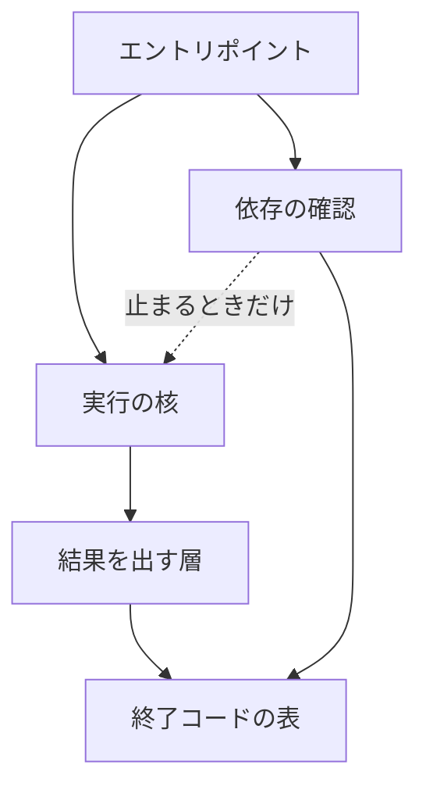
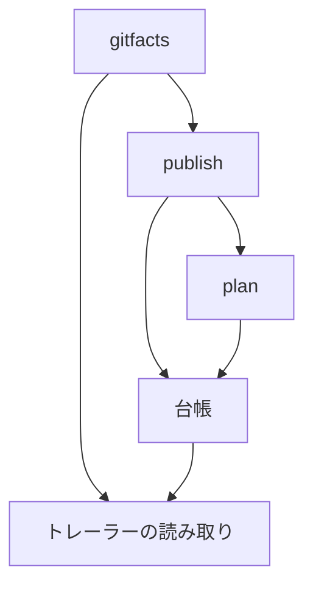
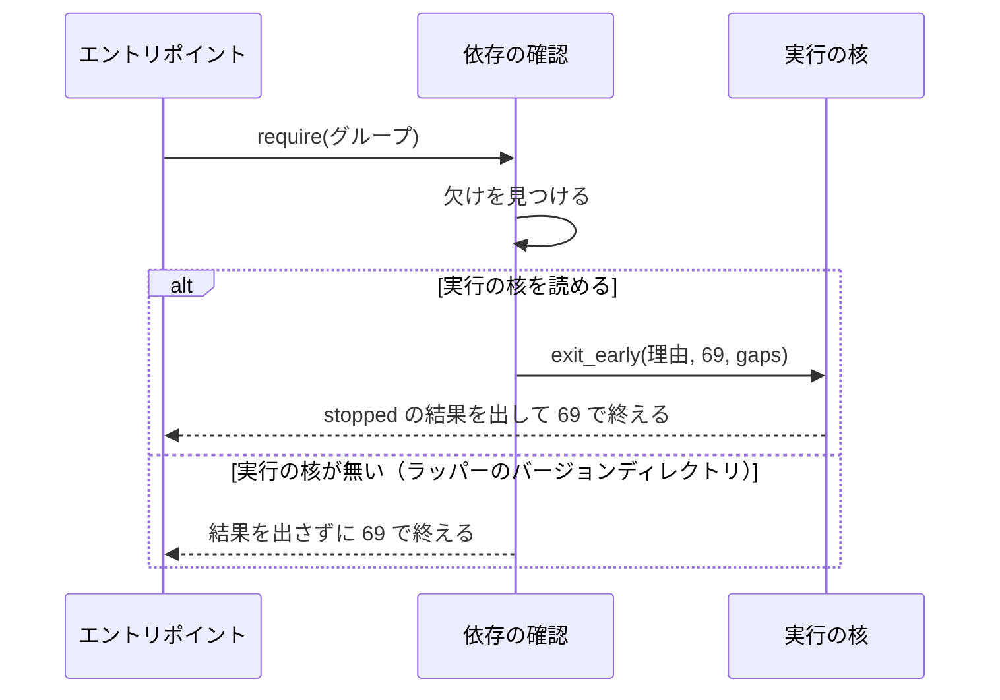

# スクリプトの import の向き: 結果を出す層と cross-refactoring の台帳は上の層を読まずに読み込める

## 概要

NDF のスクリプトのうち次の 2 組は、import の輪を持たない。輪を足し直すとテストが落ちる。

| 組 | 対象のモジュール | 数える import |
| --- | --- | --- |
| 一番下の層のまわり | `plugins/ndf/scripts/lib/` の結果を出す層（`step_result`）・依存の確認（`deps`）・実行の核（`run_core`） | 最上位・関数の中・`if TYPE_CHECKING:` の中の import と、`importlib.import_module` の文字列の定数（遅延を含む） |
| cross-refactoring の台帳のまわり | `plugins/ndf/skills/cross-refactoring/scripts/refactor_lib/` の `gitfacts`・`publish`・`plan`・台帳（`ledger`） | 最上位の相対の import だけ |

輪が無いため、読み込みの順序に頼る「循環を避ける」注意書きは要らない。終了コードの値・結果 JSON の形・各エントリポイントの
引数と出力は、輪をほどく前と同じである。

## 用語

定義は [用語集](../glossary.md) が正である（`.ndf/glossary.json` の `document`）。この文書で使う語は
「import の輪」「一番下の層」「終了コードの表」である。

- 実行時の輪: 最上位の import だけで輪になるもの
- 遅延の輪: 関数の中の import などを含めて初めて輪になるもの

## 背景

輪の中のモジュールは、初期化の途中の状態で読まれうる。import を関数の中へ移す回避は失敗だけを避け、輪そのものは残す
（Python の FAQ「How can I have modules that mutually import each other?」 https://docs.python.org/3/faq/programming.html ）。
そこで輪を作る辺そのものを除く。

輪を作っていた辺は 2 本である。

- 結果を出す層が、終了コード 69 の定数を自分の名前で公開するためだけに依存の確認を読んでいた。依存の確認は止まるときに
  実行の核を読み、実行の核は結果を出す層を読む
- 台帳が、コミットのトレーラーを読むためだけに `gitfacts` を読んでいた。そのため
  `gitfacts → publish → plan → ledger → gitfacts` と `publish → ledger → gitfacts → publish` が実行時の輪になっていた

#1142（スクリプトの分割と重複の整理）を始める前の足場として、この 2 組だけをほどいた。ほかの遅延の輪
（`parallel_*`・`supervise_lib` など）は扱わない。

## 仕様

### 構成要素と責務

| 要素 | 責務 |
| --- | --- |
| 終了コードの表（`plugins/ndf/scripts/lib/exit_codes.py`） | 終了コードの定数・承認ゲートと判断待ちの範囲（`GATE_CODES`・`PAUSE_CODES`）・見出しの表と `label_of` を持つ。標準ライブラリも NDF のモジュールも読まない |
| 結果を出す層（`lib/step_result.py`） | 終了コードの表の名前を同じ名前で公開する（`step_result.EXIT_*`・`EXIT_LABELS`・`label_of`・`GATE_CODES`・`PAUSE_CODES`）。依存の確認と実行の核を読まない |
| 依存の確認（`lib/deps.py`） | `EXIT_DEPS_MISSING` を終了コードの表から読み、同じ名前で公開する。止まるときだけ実行の核を関数の中で読む |
| ラッパーのバージョンディレクトリ（`plugins/ndf/scripts/relay_lib/version_dir.py`） | コピーするファイルの一覧（`LIB_FILES`）に `lib/exit_codes.py` を含める |
| 契約の検査（`scripts/contracts_lib/core_checks.py`） | 終了コードの定数の持ち主（`EXIT_OWNERS`）を `lib/exit_codes.py` の 1 つにする |
| トレーラーの読み取り（`refactor_lib/trailers.py`） | `commit_trailers`・`_parse_trailer_paragraph`・`trailer_value` を持つ。`refactor_lib` の中では `paths` だけを読む |
| `refactor_lib/gitfacts.py` | トレーラーの読み取りの名前（`commit_trailers`）と、`publish` などの分けた先の関数を再エクスポートする（#1142 の C4 の形） |
| 台帳（`refactor_lib/ledger.py`） | `trailer_value` をトレーラーの読み取りから最上位で読む。`gitfacts` を読まない |
| 輪の検査（`plugins/ndf/scripts/tests/test_import_cycles.py`） | 2 組の import を `ast` で集め、下の I7〜I9 を確かめる |

### import の向き

`lib/` の向き（矢印は import。点線は関数の中の import）:

`refactor_lib` の向き（最上位の import だけ）:

### 常に成り立つ条件

| # | 条件 | 破れたときの扱い |
| --- | --- | --- |
| I1 | `EXIT_` で始まる整数の定数を値で書くのは、終了コードの表のモジュールだけである | 契約の検査（`exit-meaning`）が落とす |
| I2 | 依存の欠けの終了コードは 69 で、値は終了コードの表のモジュールが持つ | テストが落ちる |
| I3 | 実行の核を読めるとき、依存の欠けの結果の `status` は `stopped` である | テストが落ちる |
| I4 | 実行の核を読めるとき、依存の欠けの結果の `gaps` の `kind` は `deps` である | テストが落ちる |
| I5 | 実行の核を読めるとき、依存の確認が核より先に読み込まれても、I2〜I4 の値と結果になる | テストが落ちる |
| I6 | 実行の核を読めないとき（ラッパーのバージョンディレクトリ）、依存の確認は結果を出さずに 69 で終える | テストが落ちる |
| I7 | 結果を出す層は、依存の確認と実行の核を import しない（最上位・関数の中・`importlib.import_module` のどれでも） | テストが落ちる |
| I8 | 結果を出す層・依存の確認・実行の核のうち 2 つ以上を含む輪が、`lib/` の import の辺（遅延を含む）に無い | テストが落ちる |
| I9 | `refactor_lib` の `gitfacts`・`publish`・`plan`・`ledger` のどれも、最上位の import の輪に入らない | テストが落ちる |

### 依存の欠けで止まる流れ

依存の確認が外部パッケージの欠けを見つけると、実行の核の早い出口（`run_core.exit_early`）を通して止まる。読み込みの順序
（依存の確認が先か、核が先か）に関わらず同じ結果になる。

止まり方の経路と終了コードの読み方は [ndf-deps-missing-exit-code.md](ndf-deps-missing-exit-code.md) が持つ。

### 扱わない輪

結果を出す層を `python3 step_result.py pick` で直接起動したときだけ、`main` が関数の中で `json_pick` を読み、`json_pick` と
`step_read` は結果を出す層を最上位で読む。この輪はライブラリとして読んだときには辿られず、ほどくには Skill の手順と
`lib/README.md` が案内する起動の形を変えることになるため、残している。I8 は「3 つのうち 2 つ以上を含む輪」の形で書き、
この輪では落ちない。#1142 の残りの遅延の輪と同じ扱いにする。

## 決定と理由

- **終了コードの表を `exit_codes.py` へ移し、結果を出す層と依存の確認はどちらもそこから読む。** 69 の値を 1 か所に置いたまま、
  結果を出す層が依存の確認を読まずに済む。結果を出す層は同じ名前で公開するため、結果を出す層を使うファイルの呼び出しは
  変わらない。依存の確認が結果を出す層を読む形は採らない。依存の確認はラッパーにも使われ、結果を出す層をコピーすると
  `proc` もコピーすることになる。69 を 2 か所に書く形は値が割れうるため採らない
- **依存の確認は、実行の核を止まるときだけ関数の中で読む。** ラッパーのバージョンディレクトリは核をコピーしないため、最上位で
  読むとラッパーが起動できない。核は契約の一覧・上限の宣言・秘密の伏せ字の部品を読み、コピーすると増えるファイルが多い
- **トレーラーの読み取りを `refactor_lib/trailers.py` へ分け、台帳はそこから読む。** 台帳から `gitfacts` への辺が消えると、
  2 つの輪はどちらも台帳で止まる。`paths` はコミットの中身の解釈を持たないため、置き場にしない
- **`gitfacts` の再エクスポートは残す。** 輪をほどいた後、`gitfacts → publish` の辺は輪に入らない。呼び出し元
  （`fix_intake.py`・`commands/flaky.py`・テスト）を変えずに済み、`test_module_owners.py` が名前の持ち主を縛る
- **輪の検査は標準ライブラリの `ast` で書き、到達の判定を自前で持つ。** import-linter と grimp は対象をパッケージとして
  受け取り、`lib/` は `sys.path` へ足して読む平らなディレクトリでパッケージでない。`graphlib` の `CycleError` は輪を 1 つしか
  返さず、対象の組と関係の無い輪でも落ちる。どのライブラリを使っても開発の依存と lock が増える

## 運用

- 終了コードを足すときは `lib/exit_codes.py` に値を書き、結果を出す層で同じ名前を公開する。ほかのモジュールに `EXIT_` の
  整数を値で書くと契約の検査が落とす
- `lib/exit_codes.py` は NDF のモジュールを読まない形を保つ。ラッパーのバージョンディレクトリへコピーされる（中身が変わると
  バージョンディレクトリの名前も変わる）
- 台帳がコミットの情報を要るときは、`gitfacts` ではなく分けた先のモジュール（`trailers`・`paths` など）から読む

## テスト観点

- 結果を出す層の import に、どの形でも依存の確認と実行の核が無いこと
  （`plugins/ndf/scripts/tests/test_import_cycles.py` の `test_step_result_does_not_import_deps_or_run_core`）
- `lib/` の遅延を含む辺で、結果を出す層・依存の確認・実行の核のうち 2 つを含む輪が無いこと
  （`test_the_lowest_layer_has_no_cycle_even_with_lazy_imports`）
- `refactor_lib` の 4 モジュールのどれも、最上位の import で自分へ戻れないこと（`test_refactor_lib_ledger_set_has_no_top_level_cycle`）
- 輪の判定が、輪を含む辺の組で輪を報告し、輪の無い組で報告しないこと（`test_the_cycle_check_reports_a_cycle_and_only_a_cycle`）
- 辺の集計が、`lib/` では関数の中と `importlib.import_module` の文字列を数え、`refactor_lib` では関数の中と
  `if TYPE_CHECKING:` の中を数えないこと（`test_the_edge_collectors_see_lazy_and_top_level_imports`）
- 依存の確認を核より先に読み込んだエントリポイントが欠けで止まると 69・`stopped`・`deps` の欠けになり、核の無い置き場では
  結果を出さずに 69 で終えること（`plugins/ndf/scripts/tests/test_deps.py`）
- 結果を出す層と依存の確認の `EXIT_DEPS_MISSING` が終了コードの表の定数そのものであること
  （`plugins/ndf/scripts/tests/test_step_result.py`）
- トレーラーの読み取りの関数の持ち主が `trailers` であること
  （`plugins/ndf/skills/cross-refactoring/tests/test_module_owners.py`）
- 既存のテスト一式・`python3 scripts/check-ndf-contracts.py`・`python3 scripts/check-script-structure.py` が 0 で終わること

## 関連リンク

- [ndf-deps-missing-exit-code.md](ndf-deps-missing-exit-code.md)（依存の欠けの終了コード）
- [`plugins/ndf/scripts/lib/README.md`](../../plugins/ndf/scripts/lib/README.md)（共通の終了コードの表）
- [`plugins/ndf/scripts/lib/exit_codes.py`](../../plugins/ndf/scripts/lib/exit_codes.py)
- [`plugins/ndf/scripts/tests/test_import_cycles.py`](../../plugins/ndf/scripts/tests/test_import_cycles.py)
- 課題: #2988（親 #1142）
