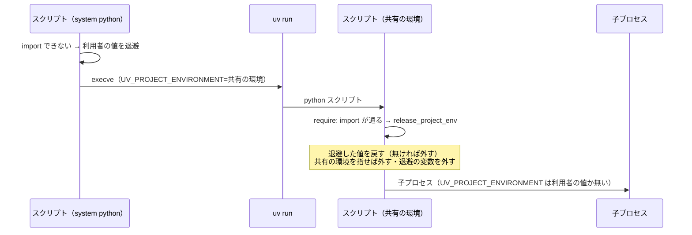
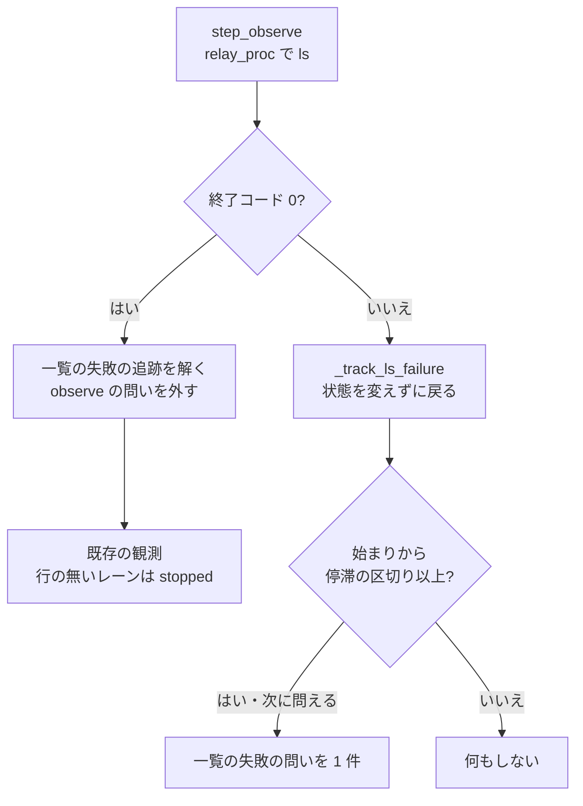

# 共有の環境と状態の一覧の失敗: 利用者の uv run が共有の環境を作り直さず、一覧の失敗で並列の計画を終えない

## 概要

NDF のスクリプトが共有の環境へ起動し直すときに設定した `UV_PROJECT_ENVIRONMENT` を、子プロセスへ渡さない。
あわせて、並列の計画のオーガナイザーは、状態の一覧の失敗をレーンの停止と読まない。

**例: carul の計画 l20261104（2026-11-04、NDF 10.27.16、時刻は UTC）で起きた組み合わせ。**
レーンのスプリントが利用者のリポジトリのテスト `uv run --project infra pytest infra/tests` を打つと、継いだ変数のために
共有の環境が `infra` の環境として同期し直され、Python が 3.13 に変わり、ラッパーの extras が消えた（22:19:46）。
状態の一覧は終了コード 3 で失敗し、オーガナイザーは全レーンを止まったと読んで `finished` で終えた（22:19）。
`finished` は耐久の記録に残るため、打ち直しても `resumed: true` の `finished` が返るだけだった。

この仕様の下では、同じ状況は次のように進む。

| 順 | 誰が | 何をする | 何が起きるか |
| ---: | --- | --- | --- |
| 1 | NDF のスクリプト | 共有の環境へ起動し直し、`deps.require` の中で `UV_PROJECT_ENVIRONMENT` を起動し直す前の値へ戻す | 子プロセスの環境変数に共有の環境を指す値が無い |
| 2 | 利用者のコマンド | `uv run --project infra pytest infra/tests` を打つ | `infra/.venv` を使い、共有の環境は変わらない |
| 3 | オーガナイザー | ほかの理由で状態の一覧が 0 以外で終わった回の観測を捨てる | レーンの状態は同じまま、計画は終わらない |
| 4 | オーガナイザー | 失敗が停滞の区切りより長く続いたら、終了コードと理由を添えて 1 件問う | 利用者が `ラッパーの環境を作り直す` か `待つ` を選ぶ。一覧が成功に戻れば問いは外れる |

オーガナイザーの全体は [ndf-parallel-organizer.md](ndf-parallel-organizer.md) が持つ。この文書は上の 2 つの振る舞いの決定と条件を持つ。
コードのコメントにある `#2509 の I<番号>`・`#2509 の決定 <番号>` は、この文書の番号を指す。

## 用語

| 用語 | 意味 |
| --- | --- |
| 共有の環境 | NDF のスクリプトとラッパーが使う Python の環境。置き場は `~/.cache/ndf/venv/<版>`（`NDF_DEPS_VENV` で変えられる） |
| 状態の一覧 | ラッパーの `relay.py ls --json` が返す、名前つきのラッパーごとの状態と最後に動いた時刻の一覧 |
| 一覧の失敗の問い | 状態の一覧の失敗が停滞の区切りより長く続いたときに、オーガナイザーの耐久ワークフローが自分で立てる問い（`kind` は `observe`） |

定義の正本は [docs/glossary.md](../glossary.md)（`docs/glossary/glossary.json`）である。

## コンテキスト

変更は NDF の工程（`ndf-workflow`）とラッパー（`ndf-relay`）の 2 つのコンテキストにまたがる。関係は顧客 / 供給者で、ラッパーが状態の一覧を提供し、
オーガナイザーがそれを読む。供給者の出力の形は同じで、顧客の側が終了コードを読む。

## 背景

- `uv run` は `UV_PROJECT_ENVIRONMENT` を継ぐと、`--project` で指した別のプロジェクトの環境としてその置き場を同期し直す。同期は exact で、NDF の extras が消える
- `uv run` が子へ渡す `VIRTUAL_ENV` は、利用者の `uv run --project <x>` では使われず、共有の環境を変えない（2026-11-05 に手元の uv で確認）。外す対象は `UV_PROJECT_ENVIRONMENT` だけである
- 利用者が自分で設定した値を NDF が黙って消さない（共通原則 C6）

## 対象範囲

- **働く範囲**: NDF を使うすべてのリポジトリ。プロジェクトごとの設定は無い
- **対象外**: `finished` で終わった計画を、レーンが動いたまま打ち直したときの戻り方。ラッパーの環境の作り方。利用者のリポジトリの `uv run` の書き方

## 仕様

### 常に成り立つ条件

| # | 対象 | 条件 | 破れたときの扱い |
| --- | --- | --- | --- |
| I1 | 並列の計画の実行 | 状態の一覧が 0 以外で終わった回の観測は、レーンの状態・最後に観測した時刻・起こし直しの待ち・停滞と一時レーンの問いのどれも変えない | テストが落ちる |
| I2 | 並列の計画の実行 | 計画を `finished` で終えるのは、最後の観測が成功した回だけである | テストが落ちる |
| I3 | 並列の計画の実行 | 一覧の失敗の問いは、失敗が停滞の区切りより長く続いたときだけ出し、同じ区切りの間に 2 件目を出さない | テストが落ちる |
| I4 | 並列の計画の実行 | 一覧が成功に戻ったら、答えていない一覧の失敗の問いを一覧から外す | テストが落ちる。外さないと、答えを待って計画が終われない |
| I5 | スクリプトの環境変数 | `require()` が import の通る状態で戻った後、起動し直す前の値が利用者の値（I7）なら `UV_PROJECT_ENVIRONMENT` はその値に戻り、無ければ無い。起動し直す前から共有の環境を指していた値は戻さずに外す（I6） | テストが落ちる |
| I6 | スクリプトの環境変数 | `require()` から戻った後と、ラッパーの `enter()` を通った後、`UV_PROJECT_ENVIRONMENT` が共有の環境を指していない | テストが落ちる |
| I7 | スクリプトの環境変数 | 共有の環境とも、`require()` が向けたリポジトリの根の `.venv` とも違う利用者の値は、変えずに残す | テストが落ちる |

### 構成要素

| 要素 | 責務 |
| --- | --- |
| `plugins/ndf/scripts/lib/deps.py` の `require` | 起動し直すときに利用者の値を退避の変数へコピーする。無ければ退避の変数を置かない。import が通って戻るときに `release_project_env` を呼ぶ |
| 同 `release_project_env` | 自分を起動し直した回なら退避した値を戻す（無ければ外す）。続けて、値が共有の環境を指していれば外す。退避の変数も外す |
| 同 `is_shared_venv` | 渡したパスが共有の環境の置き場か（`NDF_DEPS_VENV` と同じか、親が `~/.cache/ndf/venv`）を返す。標準ライブラリだけで判定する |
| `plugins/ndf/scripts/relay_lib/runtime.py` の `enter` | 振り分けの前に、`UV_PROJECT_ENVIRONMENT` が共有の環境を指していれば外す。古い版の NDF のスクリプトから継いだ値を含む |
| `plugins/ndf/scripts/lib/parallel_repo.py` の `relay_proc` | 統括役の CLI を打ち、終わったプロセスと統一 JSON レポートを返す。`relay` はこれを使い、戻り値の形を保つ |
| `plugins/ndf/scripts/lib/parallel_run.py` の `step_observe` | 観測の結果に、一覧の終了コード（`code`）・標準エラーの末尾 1 行（`err`）・問える版の記録の印（`can_ask`）を足す |
| 同 `_observe_run` | 終了コードを `ls_ok` に控え、先に `_track_ls_failure` を呼ぶ。失敗の回はそこで戻る |
| 同 `_track_ls_failure` | 失敗の回は始まりの時刻を持ち、区切りを超えたら区切りごとに 1 回問う。成功の回は追跡を解き、答えていない一覧の失敗の問いを外す |
| 同 `_run_finished` | `ls_ok` が偽の間は偽を返す |
| `plugins/ndf/scripts/lib/parallel_answer.py` の `owner_restart` | `observe` の問いへの答えでは、選んだ答えの `commands` を返す |

`plugins/ndf/scripts/hook-env.py` の環境の用意と `relay_lib/runtime.py` の `sync` は、`uv sync` の子にだけ `UV_PROJECT_ENVIRONMENT` を渡す。
どちらも自分の `os.environ` を書き換えない。

### 起動し直したスクリプトが環境変数を戻す

`release_project_env` は、自分を起動し直した回かを `NDF_DEPS_REEXEC` が自分のスクリプトのパスと同じかで決める。そのため、この印を外す処理より前に呼ぶ。
起動し直していない回では退避の値を読まず、共有の環境を指す値を外すことだけを行う。

### オーガナイザーの観測

答えていない一覧の失敗の問いがある間は問いの一覧が空でないため、計画は終わらない。問いへ答えた後でも、最後の観測が失敗なら `ls_ok` が偽のため終わらない（I2）。

### 一覧の失敗の問い

コマンドの引数・終了コード・統一 JSON レポートの形は変わらない。`parallel.py questions` が返す問いに次の種類がある。

| 項目 | 値 |
| --- | --- |
| `kind` | `observe` |
| `id` | `<計画名>-observe-<観測の時刻のエポック秒>` |
| `lane`・`attach` | 持たない |
| `source` | `ndf-ask:human-action` |
| `question` | `レーンの状態の一覧（relay.py ls）が <分> 分続けて失敗している（終了コード <コード>: <標準エラーの末尾 1 行>）` |
| `options` | `ラッパーの環境を作り直す`・`待つ` |
| `commands` | `{"ラッパーの環境を作り直す": "python3 <relay.py> status"}`（`status` は環境が無ければ作り直す副命令） |

答えは `parallel.py answer <計画名> <id> --choice <選んだ答え>` で送る。`ラッパーの環境を作り直す` を選ぶと、`metrics.next` に `commands` の 1 行が返る。
耐久ワークフローは答えを受けて問いを外すだけで、ほかの値を変えない。

### 決定と理由

| # | 決定 | 理由 |
| --- | --- | --- |
| 決定 1 | 環境変数はプロセスのエントリポイント（`require` と `enter`）で戻し、子を起動する箇所では外さない | 子を起動する箇所はスプリントのステップ・`parallel_run.relay`・`child_env`・`startup_env`・`passthrough`・tmux のセッションなど多く、1 か所ずつ外すと足し忘れが残る |
| 決定 2 | 起動し直す前の値を退避の変数で渡して戻す | `require` は値を上書きするため、起動し直した後の値からは利用者の値が分からない |
| 決定 3 | 共有の環境を指す値は、退避の有無に依らず外す。判定は置き場の親と `NDF_DEPS_VENV` で行い、版の名前に依らない | 古い版の NDF から起動されたレーンは退避の変数を持たずに値を継ぐ。ラッパーの複製からは版を読めない。利用者が共有の環境を自分で指した値も外れる。その使い方は共有の環境を壊すため残さない |
| 決定 4 | 一覧の失敗の回は観測の全体を捨て、成功した観測だけでレーンの状態と時刻を動かす | 失敗した回は行を持たず、止まったレーンの判定・停滞の問い・起こし直しの解除がどれも誤った入力で動く。前回の行の使い回しは、停滞の判定を実際の動きと食い違わせる |
| 決定 5 | 観測の結果の `code` が無い記録は成功として読み、`can_ask` が無い記録の再生では問わない。形式の版（`durable.FORMAT`）は上げない | 記録の時点の振る舞いを保つため。問いは `DBOS.set_event` を呼ぶので、問いの無い版の記録の再生中に立てると呼び出しの順が衝突する。形式の版を上げると全種類の記録に効き、更新前の計画が回復されず待ち続ける。失敗の始まりの追跡は続けるので、再生の後の最初の観測で失敗が続いていれば問う |
| 決定 6 | 一覧が成功に戻ったら、答えていない一覧の失敗の問いを外す | 一覧が戻れば問いの前提が無くなり、残すと計画が終われない。外した後に届いた答えは既存の `reply` が保留し、警告を残す。`id` は時刻を含み同じ問いが立たないため、計画の終わりを止めない |
| 決定 7 | 問うまでの長さと問いの間隔に、停滞の区切り（`stall_seconds()`、`NDF_PARALLEL_STALL_MINUTES`、既定 60 分）を使う | 新しい設定値を足さない。停滞の問いの「区切りごとに 1 回」と同じ形にそろう |
| 決定 8 | 変更は観測に限り、ほかの `relay.py ls` の読み手（`parallel.py` の起動前の確かめ・`parallel_lane.lane_waits`）は変えない | 取り消せない `finished` を作るのは観測だけである。ほかの読み手は耐久の記録に何も残さず、打ち直せば読み直す |

## データ・設定

| 環境変数 | 誰が書くか | 誰が読むか | 値 |
| --- | --- | --- | --- |
| `NDF_DEPS_SAVED_UV_PROJECT_ENVIRONMENT` | `require` が `os.execve` の直前に | 起動し直した後の `release_project_env` | 起動し直す前の `UV_PROJECT_ENVIRONMENT`。無かったときは置かない |
| `UV_PROJECT_ENVIRONMENT` | `require` が `uv run` のために設定する | `uv run` だけ。NDF が設定した値は子プロセスへ渡らない | 共有の環境か `<根>/.venv` |

耐久の記録のテーブルは変わらない。観測の結果はステップの戻り値で、`code`・`err`・`can_ask` を持つ。`_Run` の `ls_ok`・`ls_failed_since`・`ls_ask_until` は、
打ち直すと記録からの再生で同じ値に戻る。

## 運用

**既知の限界。**

| 項目 | 内容 |
| --- | --- |
| ラッパーの中身が見つからないとき | ランチャーは `enter` を通らずに本物の claude を起動するため、継いだ値を外さない。レーンはこの経路で動かない |
| 実験版の起動し直し | `experimental/deps-trial.py`・`hook-trial.py` は自分の置き場を同じ変数で渡して起動し直す。呼んだときだけ働き、既定の振る舞いから参照されない。本体へ移すときに同じ形へそろえる |
| `PATH` | `uv run` は共有の環境の `bin` を先頭にした `PATH` を子へ渡す。子が素の `python3` を打つと共有の環境の Python で動く |
| 古い親から継いだ `<根>/.venv` | 退避の変数を持たない値は利用者の値と区別できないため、外さない。その値は共有の環境を指さない |

## テスト観点

| 観点 | 縛るテスト |
| --- | --- |
| 一覧が 0 以外で終わった回の後も、レーンの状態と最後に観測した時刻が同じであること（I1） | `test_a_failed_ls_keeps_lane_states_and_the_last_observation` |
| 一覧が失敗する間、計画が `finished` を返さず、記録にも残らないこと（I2） | `test_after_a_failed_ls_the_plan_is_not_finished`・`test_the_plan_does_not_finish_while_ls_keeps_failing` |
| 一覧が 0 で終わり行の無いレーンは止まったと読み、全レーンがそうなら終えること | `test_char_lane_missing_from_ls_counts_as_stopped_and_finishes` |
| 失敗が区切りより長く続くと問いが 1 件立ち、本文に終了コードと標準エラーの末尾 1 行が入り、同じ区切りの間に増えないこと（I3） | `test_step_observe_carries_the_exit_code_and_the_last_stderr_line`・`test_a_long_ls_failure_raises_one_question_per_limit`・`test_a_waited_ls_question_is_not_asked_again_before_the_next_limit` |
| 一覧が成功に戻ると問いが外れ、計画が終われること（I4） | `test_a_recovered_ls_drops_the_question_and_restarts_the_tracking`・`test_a_recovered_ls_lets_the_plan_finish_with_the_question_gone` |
| `can_ask` の無い記録の再生では問わないこと（決定 5） | `test_replaying_a_record_from_before_the_question_keeps_the_recorded_calls` |
| 起動し直したスクリプトとその子に、NDF が設定した値が無いこと（I5・I6） | `test_a_reexeced_script_does_not_pass_the_shared_venv_to_children`・`test_a_shared_venv_inherited_from_an_old_parent_is_dropped`・`test_an_importable_require_drops_an_inherited_shared_venv` |
| 子の `uv run --project <別のプロジェクト>` の後も、共有の環境の `pyvenv.cfg` の中身と更新時刻が変わらず、`import psutil` が通ること | `test_a_child_uv_run_of_another_project_leaves_the_shared_venv_alone` |
| ラッパーの子の claude に共有の環境を指す値が無く、利用者の値はそのまま渡ること（I6・I7） | `test_enter_drops_a_shared_project_env_before_starting_claude` |
| 起動し直した後の子が別のグループを要るとき、子が自分で起動し直すこと | `plugins/ndf/scripts/tests/test_deps.py` |

上の表のうち一覧の失敗は `plugins/ndf/scripts/tests/test_parallel_run.py`、環境変数は `test_deps.py`、ラッパーは `test_relay.py` にある。

`test_a_child_uv_run_of_another_project_leaves_the_shared_venv_alone` はネットワークを使わずに本物の uv で動かす。Python は手元の 2 つを使い
（マイナー版の違うものがそろわなければ skip）、psutil は `uv sync --frozen --offline` で uv のキャッシュから入れる。
`.pth` で psutil を見せる組み方は使わない。uv の同期は `.pth` の先のパッケージを入っていると扱わず、起動し直すたびに PyPI へ取りに行くためである。

## 関連リンク

- [issue #2509](https://github.com/devbasex/ai-plugins/issues/2509) — 要求と受け入れ条件
- [ndf-parallel-organizer.md](ndf-parallel-organizer.md) — 並列の計画のオーガナイザーの全体
- [ndf-deps-missing-exit-code.md](ndf-deps-missing-exit-code.md) — `deps.require` の止まり方
