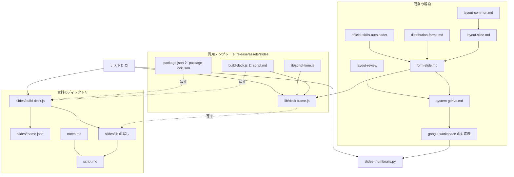
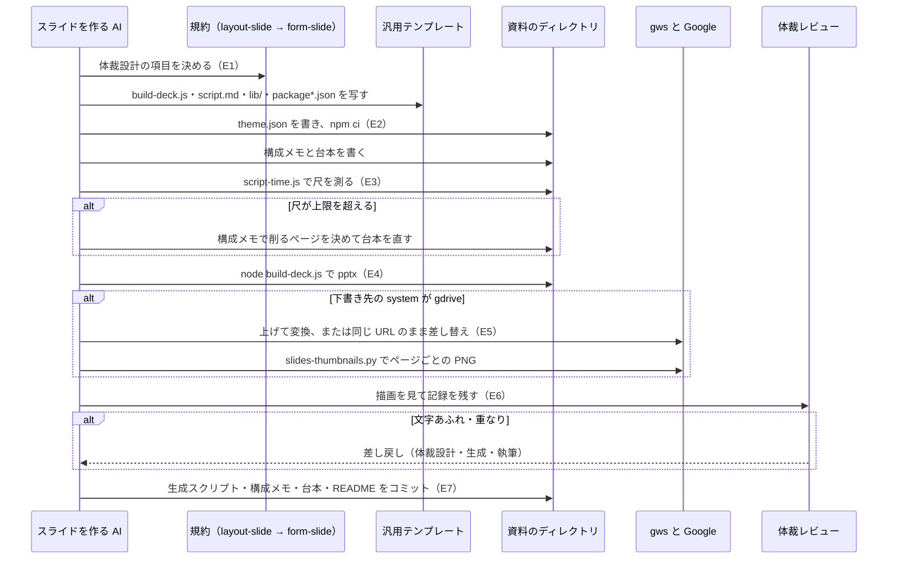
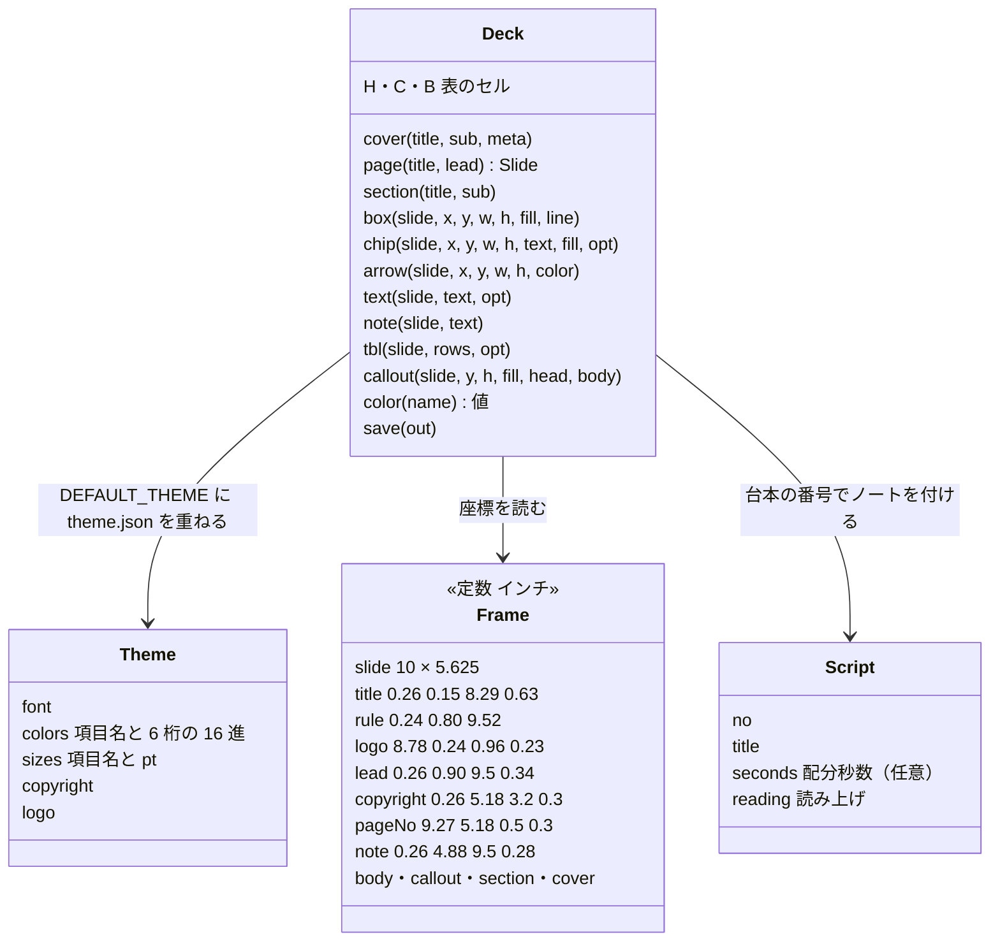

# スライドの生成スクリプト: 汎用テンプレート（pptxgenjs）がページの枠組みを持ち、`theme.json` がトーン＆マナーを差し替え、台本がスピーカーノートと尺を決め、gws が Google Slides へ変換してサムネイルで確かめる

## 概要

**NDF のスライドは、生成スクリプト（pptxgenjs）の 1 つの経路で作る。** `release` Skill の
[assets/slides/](../../plugins/ndf/skills/release/assets/slides/) にある汎用テンプレートを資料のディレクトリへ写し、
変える値だけを `slides/theme.json` に書き、台本（`script.md`）からスピーカーノートと尺を出す。出た pptx は
下書き先が Google Drive のとき Google Slides へ変換し、ページごとのサムネイルで体裁を見る。

例: このリポジトリの発表資料 [docs/presentations/2026-10-17-skill-plugin-development/](../presentations/2026-10-17-skill-plugin-development/README.md)
は、次の並びと 3 つのコマンドで作る。

```text
2026-10-17-skill-plugin-development/
├── README.md        # 成果物・トーン＆マナー・写した時点の lib/ の内容のハッシュ
├── notes.md         # 構成メモ（台本の 21 ページの表）
├── script.md        # 台本（スピーカーノートの正本）
└── slides/
    ├── build-deck.js    # 生成スクリプト（スライドの正本）
    ├── theme.json       # {"copyright": "NDF — github.com/devbasex/ai-plugins"} だけを書く
    ├── package.json・package-lock.json   # pptxgenjs 4.0.1
    └── lib/             # 汎用テンプレートの枠組みの写し（書き換えない）
```

```bash
(cd slides && npm ci)
node slides/lib/script-time.js script.md --limit 35      # 21 ページの字数・尺の表。35 分を超えると 1
node slides/build-deck.js /tmp/skill-plugin-development.pptx
# → /tmp/skill-plugin-development.pptx: 27 ページ（章扉 6）
```

この文書は、その形に**なぜしたか**（決定と理由・常に成り立つ条件・入出力の契約・構成・テスト観点）を持つ。
作り方の手順（写し方・構成メモと台本の書き方・ページの文言・変換と確認の順）は
[`release` の references/form-slide.md](../../plugins/ndf/skills/release/references/form-slide.md) が、
体裁設計で決める項目は [`design` の references/layout-slide.md](../../plugins/ndf/skills/design/references/layout-slide.md) が、
gws のコマンドは [`google-workspace` の SKILL.md](../../plugins/ndf/skills/google-workspace/SKILL.md) の「操作の対応表」が持つ。

## 用語

「トーン＆マナー」「ページの枠組み」「生成スクリプト」「汎用テンプレート」「構成メモ」「台本」「トーン＆マナーのファイル」「尺」の
定義は用語集（[docs/glossary.md](../glossary.md)）の「NDF のスライドの作成（`ndf-slide`）」が正である。
「章扉」は枠組みの `section` が作るページで、構成を見せ、台本のページを消費しない。

## コンテキスト

| コンテキスト | 何の語が 1 つの意味に決まるか |
| --- | --- |
| スライドの作成（`ndf-slide`） | 汎用テンプレート・ページの枠組み・トーン＆マナー・生成スクリプト・構成メモ・台本・尺 |
| Google Workspace（`ndf-google-workspace`） | gws の操作・ファイルの ID・変換・サムネイル |

**スライドの作成が顧客、Google Workspace が供給者である。** スライドの作成は、変換とサムネイルの取得を
`google-workspace` の操作の対応表とスクリプトに頼み、gws のコマンドを自分の規約に写さない。供給者は
顧客の要求（pptx の変換・同じ URL のままの差し替え・ページごとのサムネイル）を対応表に持つ。

## 背景

スライドの規約（体裁設計・生成・描画・体裁レビュー）が原則だけを持つと、AI は資料ごとにその場で作り方を組み立て、
同じ台本からでも作りが揃わない。手本のプロジェクトの資料は、同じ値の定数と同じ枠組みの関数と同じ gws の変換手順を
資料ごとに写して持っていた。枠組み・トーン＆マナー・変換手順は資料をまたいで繰り返されるため、共通の部品として
NDF が持つ。

## 決定と理由

| # | 決定 | 理由 |
| ---: | --- | --- |
| 1 | Skill を増やさず、体裁設計（`layout-slide.md`）・生成（`form-slide.md`）・変換と描画（`system-gdrive.md` と `google-workspace`）・体裁レビュー（`layout-review`）の既存の持ち場へ足す | 足すものはどれかの持ち場に収まる。新しい Skill を作ると、同じ手順の持ち場が 2 つになる |
| 2 | 汎用テンプレートは `release` Skill の `assets/slides/` に置く | Skill のディレクトリは 4 ランタイムへディレクトリごと配られ、生成の手順とテンプレートが同じ版で届く。`docs/` は配布物に含まれない |
| 3 | スライドの生成の経路は「生成スクリプトを書く（pptxgenjs）」の 1 つだけにする。変換器（Markdown から作るもの）・python-pptx・AI エージェントがその場で組む経路は使わない | 変換器の出力は開いた後に文字と図形を直せない。ほかの 2 つは同じ台本から同じ資料が出ない。生成スクリプトは決定的で、Google Slides と PowerPoint で開いて直せる |
| 4 | トーン＆マナーは `theme.json` で既定値に重ね、枠組み（`lib/`）は写して書き換えない。座標は枠組みの定数だけが持つ | 枠組みの更新は `lib/` を写し直すだけで済み、プロジェクトの値が上書きされない。環境変数や引数で渡すと資料ごとの値がリポジトリに残らず、同じ資料を作り直せない |
| 5 | 既定の書体は Noto Sans JP、強調の色は 1 色（`2B6CB0`）。著作権表示とロゴは既定で描かない | 会社色を持たない。Noto Sans JP は Google Slides の書体の一覧にあり、作業の端末の描画（Noto Sans CJK JP）とも字形が揃う。著作権表示とロゴは持ち主ごとに違う |
| 6 | 枠組みが台本を読み、ページを作るたびに同じ番号の読み上げをスピーカーノートへ付け、保存の前にページ数を照合する | 生成スクリプトに読み上げを写すと、台本を直したときに片方だけが古くなる |
| 7 | 尺の計算（`script-time.js`）は枠組みと同じ JavaScript で、同じ台本の読み取り（`readScript`）を使う | 同じ形を読む関数が 2 つの言語に分かれると、片方だけが直る |
| 8 | サムネイルの取得はスクリプト（`slides-thumbnails.py`）にし、変換と差し替えは対応表のコマンドを AI が打つ | サムネイルはページ数だけ同じ手順を繰り返す。変換と差し替えは 1〜2 回で、アップロード先の共有範囲を確かめる判断を挟む。Google Slides は PDF を経ずにその描画をそのまま見られる |
| 9 | このリポジトリの発表資料は枠組みを `slides/lib/` に写して持ち、`plugins/` の汎用テンプレートを直接読まない | `docs/presentations/` は発表日時点の記録で、枠組みを変えても過去の資料の生成結果が変わらない。配布先と同じ手順をこのリポジトリでも通す |
| 10 | pptx をコミットせず、Google Slides を成果物にする。公開ページの入口（`index.html`）に足さず、`docs/presentations/README.md` の資料一覧にだけ足す | pptx は作り直せる。社外へ出す前の資料を公開の場所へ置かない |
| 11 | CI の pytest のジョブに Node.js 22 を入れ、生成のテストが `npm ci` で依存を入れて pptx を検査する | 生成のテストを手元だけで回すと、版面と差し替えの壊れを CI が見逃す |
| 12 | 章扉は台本のページを消費しない。ページの文言は台本の文を縮めて載せず、1 ページ 1 メッセージにする | 章扉に読み上げは無く、台本に区切りを置くと尺の計算と台本の番号が章扉の数だけずれる。読み上げはスピーカーノートが持ち、ページには要点だけを置くと聞き手が読める |

## 対象範囲

| 対象 | 置き場 |
| --- | --- |
| 体裁設計の項目（トーン＆マナー・ページの枠組み・章立て・ページの文言・構成） | `plugins/ndf/skills/design/references/layout-slide.md`、経路ごとの渡し方は `layout-common.md` |
| 生成の経路・起点・1 ページの区切り・生成スクリプトの経路の手順 | `plugins/ndf/skills/release/references/form-slide.md`、形の一覧は `distribution-forms.md` |
| 汎用テンプレート | `plugins/ndf/skills/release/assets/slides/`（`build-deck.js`・`script.md`・`package.json`・`package-lock.json`・`lib/deck-frame.js`・`lib/script-time.js`） |
| Google Slides への変換・差し替え・描画の手段 | `plugins/ndf/skills/document-systems/references/system-gdrive.md` |
| gws のコマンドとサムネイルの取得 | `plugins/ndf/skills/google-workspace/SKILL.md` の操作の対応表、`scripts/slides-thumbnails.py`・`scripts/gws_common.py` |
| 描画して見る手段（Google スライドはページごとのサムネイル） | `plugins/ndf/skills/layout-review/SKILL.md` |
| スライドの新規作成の振り分け（公式の `pptx` は既存の .pptx を読む・直す依頼だけ） | `plugins/ndf/skills/official-skills-autoloader/SKILL.md` |
| 発表資料の置き場と追加の仕方 | `docs/presentations/README.md` と各資料のディレクトリ |

`docs/presentations/` の `2026-08-06-ai-plugins-intro`（md・html・pdf）は発表日時点の記録で、この仕様の対象に入らない。

## 仕様

### 集約

| 集約 | 持ち主（書き換えてよいもの） | 根 | エンティティ | 値オブジェクト |
| --- | --- | --- | --- | --- |
| 汎用テンプレート | NDF の配布物（`release/assets/slides/`）。プロジェクトは写すだけで書き換えない | ページの枠組み（`lib/deck-frame.js`） | — | 枠組みの座標（`FRAME`）・既定のトーン＆マナー（`DEFAULT_THEME`） |
| 資料 | プロジェクトの資料のディレクトリ（生成の作業をする AI） | 生成スクリプト（`slides/build-deck.js`） | ページ | トーン＆マナー（`theme.json` の値）・読み上げ・尺 |
| 変換したスライド | 利用者の Drive（gws を通して操作する） | Google Slides のファイル | ページ（`objectId`） | サムネイル |

資料は汎用テンプレートを、写した時点の `lib/` の内容のハッシュ（`cat slides/lib/*.js | sha256sum`。資料の `README.md` に書く）で参照する。

### 構成要素と責務

| 要素 | 責務 |
| --- | --- |
| `lib/deck-frame.js` の `createDeck` | `theme` と `script` を読み、枠組みの関数を持つ `Deck` を返す。色を項目名から値へ置き換え、ページ番号・台本の番号・章扉の数を数え、`save` で照合して書き出す |
| `lib/deck-frame.js` の `run` | 生成スクリプトの入口。引数を読み、`theme.json` の置き場を決め、`build(deck)` の後に保存し、失敗を `DeckError` の `code` で終える |
| `lib/deck-frame.js` の `mergeTheme`・`parseScript` | `theme.json` の検査と重ね合わせ、台本の読み取りと番号の検査 |
| `lib/script-time.js` | `readScript` で台本を読み、ページごとと合計の字数・尺・配分秒数を表か JSON で出す |
| `build-deck.js`（見本） | 表紙・章扉・本編（表と注）の 3 ページを作る。写した後に資料の中身へ書き換える出発点 |
| `script.md`（見本） | 表紙と本編の 2 ページの台本。章扉の区切りを持たない |
| `package.json`・`package-lock.json` | pptxgenjs `4.0.1`（MIT）を固定する。資料へ写して `npm ci` で入れる |
| `google-workspace/scripts/slides-thumbnails.py` | Google Slides の全ページの ID を取り、ページごとのサムネイルを PNG で保存し、結果 JSON で保存先を返す |
| `google-workspace/scripts/gws_common.py` | gws の出力の末尾の切り出し（20 行）と、`stopped` の結果を出して終える関数 |



### 常に成り立つ条件

| # | 集約 | 条件 | 破れたときの扱い |
| --- | --- | --- | --- |
| I1 | 汎用テンプレート | 枠組みの関数が置く見出し・罫線・ロゴ・著作権表示・ページ番号・注の座標は、`FRAME` の定数だけが持ち、`theme.json` の値を変えても動かない | `theme.json` に座標の項目は無い（知らない項目は終了コード 1）。テストが落とす |
| I2 | 資料 | トーン＆マナーの差し替えは `slides/theme.json` だけで済み、`slides/lib/` を書き換えない。`lib/` を写し直してもプロジェクトの値が残る | `lib/` の内容のハッシュが `README.md` の値と違えば書き換えた資料とみなし、プロジェクトの値を `theme.json` へ移してから写し直す。ハッシュは NDF の版数で代えない（同じ版数のまま `develop` で `lib/` が変わる）。写し直したら `README.md` のハッシュを書き換える |
| I3 | 資料 | 生成スクリプトと枠組みの関数の本体に書体名と色の値を書かない。色は `theme.colors` の項目名で指す | 項目名でない色を渡すと終了コード 1 で止まり、その値を出す。テストが落とす |
| I4 | 資料 | スピーカーノートは台本の読み上げから入れ、生成スクリプトに読み上げを写さない | 枠組みが台本を読み、台本の番号でノートを付ける |
| I5 | 資料 | 作ったページ数から章扉を除いた数は、台本のページ数と等しい。章扉はノートを持たず、台本の番号を進めない。ページ番号は章扉も数える | 保存の前に終了コード 1 で止まり、台本のページ数・章扉を除いて作ったページ数・章扉の数を出す。pptx は書かない |
| I6 | 資料 | 尺は読み上げの字数を 1 分あたりの字数（既定 350）で割った値で、合計はページごとの値の和に等しい | `--limit` を超えると終了コード 1。構成メモで削るページを決めて台本を直す |
| I7 | 汎用テンプレート・資料 | 手本のプロジェクトの社名・案件名・コーポレートカラーの値・ロゴを入れない | 差分の追加行を検索して 1 件でもあれば直す |

### 処理の流れ



| # | イベント | 発生元 | 受け手 |
| --- | --- | --- | --- |
| E1 | 版面・トーン＆マナー・ページの枠組みを決めた | 体裁設計（`layout-slide.md`） | 生成（`form-slide.md`） |
| E2 | 汎用テンプレートを写し、トーン＆マナーをプロジェクトの値へ差し替えた | 生成 | 生成スクリプト（`theme.json` を読む） |
| E3 | 構成メモと台本を書き、尺を測った | 執筆 | 生成スクリプト（台本を読む）・体裁設計（尺が超えたら削るページを決める） |
| E4 | pptx を作った | 生成スクリプト | 変換（gws） |
| E5 | pptx を Google Slides へ変換した（同じ URL のままの差し替えを含む） | 変換（`google-workspace`） | サムネイルの取得 |
| E6 | ページごとの描画を見て、体裁レビューの記録を残した | 体裁レビュー（`layout-review`） | 差し戻し先か、コミット |
| E7 | 生成スクリプト・構成メモ・台本・README をコミットした | 生成の作業をする AI | Pull Request |

**Google Slides への変換は、下書き先（`.ndf/document.json` の `draft`）の `system` が `gdrive` のときだけ行う。**
ほかの下書き先では pptx を Drive へ上げず、Google の認証も求めない。描画の手段は下書き先の `system-<名前>.md` が持つ。
プロジェクトに生成スクリプト（`slides/build-deck.js`）が既にあれば、汎用テンプレートを写さずにそれに従う。

### ページの枠組み

`deck-frame.js` が公開する型と関数だけを描く。ページの中身（資料ごとの図形）は描かない。



- `createDeck({ theme, script, title, author, baseDir })` が `Deck` を返す。`theme` は `theme.json` のパスか値、`script` は台本のパス（省略するとノートを付けず、照合もしない）。pptxgenjs は `baseDir`、次に枠組みの置き場から探す
- 色（`color`・`fill.color`・`line.color`・`border.color`）は `theme.colors` の項目名で受ける。文字の大きさは pt か `theme.sizes` の項目名で受ける（I3）
- `cover` と `page` は台本の番号を 1 つ進め、`section` は進めない（I5）。著作権表示は `copyright` が空なら描かず、ロゴは `logo` が `null` なら描かない
- 版面は pptxgenjs の `LAYOUT_16x9`（10 × 5.625 インチ）

## データ・設定

### トーン＆マナーのファイル（`slides/theme.json`）

**書いた項目だけが既定値を上書きする。** `colors` と `sizes` は項目ごとに重ね、ほかは値ごと置き換える。
項目名と既定値の正本は `deck-frame.js` の `DEFAULT_THEME` で、この文書は値を写さない（決定 5 の書体と強調の色を除く）。

| 項目 | 型 | 検査（違えば終了コード 1） |
| --- | --- | --- |
| `font` | 文字列 | 空でない |
| `colors.<項目名>` | 6 桁の 16 進（`#` なし） | 項目名が `DEFAULT_THEME.colors` にある。値は大文字にそろえる |
| `sizes.<項目名>` | pt | 項目名が `DEFAULT_THEME.sizes` にある。正の数 |
| `copyright` | 文字列 | 文字列。空なら描かない |
| `logo` | 文字列か `null` | `theme.json` の置き場からの相対パスで、ファイルがある。`null` なら描かない |

最上位に `font`・`colors`・`sizes`・`copyright`・`logo` 以外の項目があると、項目名を出して終了コード 1 で止まる
（書き損じが既定値のまま通らない）。JSON として読めないときも 1。

### 台本（`script.md`）

形（区切り・読み上げ・ほかの行・章扉）は `form-slide.md` の「台本を書き、尺を測る」が持つ。読み取りの契約は次のとおり。

| 規則 | 内容 |
| --- | --- |
| 区切り | `## <番号>. <見出し>`。見出しの末尾の `（<秒>秒）`（半角の括弧も可）を配分秒数として外す |
| 読み上げ | 区切りの中の `>` の行。`**` と `` ` `` を外す。`>` だけの行とほかの行が段落を切り、段落は改行でつなぐ |
| 番号の無い見出し | `#` か `##` で始まる番号の無い行の下は、次の区切りまで読まない |
| 番号の検査 | 区切りが無い・番号が重なる・1 から最大の番号までに欠けがある → 終了コード 2 と、重なる番号か欠けた番号を出す |
| ファイルが無い | 終了コード 1 |

### 構成メモ（`notes.md`）

`## 構成` の節の表の行数はページ数（章扉を除く）と等しく、番号は 1 から続く。形は `form-slide.md` の「構成メモを書く」が持つ。

### コマンド

| コマンド | 出力 | 終了コード |
| --- | --- | --- |
| `node slides/build-deck.js <出力>.pptx [<theme.json>]` | pptx と、標準出力の `<出力>: <N> ページ（章扉 <M>）` | 0 成功 / 1 引数（出力が無い・`.pptx` で終わらない）・渡した `theme.json` が無い・`theme.json` の検査・項目名でない色・ページ数の照合（I5）・台本が無い / 2 台本の番号の検査 |
| `node slides/lib/script-time.js <台本> [--wpm 350] [--limit <分>] [--json]` | 既定は Markdown の表（番号・見出し・字数・尺の秒・配分秒数と合計の行）。`--json` は `{wpm, pages[{no, title, chars, seconds, planned}], total{pages, chars, seconds, planned}, limit{minutes, over}}` | 0 / 1 合計が `--limit` を超えた・引数の誤り・台本が無い / 2 台本の番号の検査 |

- `theme.json` を引数で渡さなければ `slides/theme.json` を読み、無ければ既定値で作る
- 字数は読み上げの空白を除いた文字の数。尺の秒は `字数 ÷ wpm × 60` を 0.1 秒に丸め、合計はページごとの値の和
- 配分秒数の合計は、どのページにも配分が無ければ `null`（表では `—`）

### 依存と追跡

| 項目 | 決まり |
| --- | --- |
| pptxgenjs | 汎用テンプレートと資料の `slides/package.json`・`package-lock.json` で `4.0.1` に固定し、`npm ci` で入れる |
| 追跡から外すもの | `node_modules/` と `*.pptx`（根の `.gitignore`） |
| CI | `.github/workflows/pytest.yml` が `actions/setup-node` で Node.js 22 を入れる。`npm ci` はテスト（`slide_deck_support.ensure_node_modules`）が打つ。`node` と `npm` が無いときの扱いは根の `conftest.py` の `REQUIRED_COMMANDS`（既定は失敗） |

## 外部連携

### gws の操作

変換（pptx を `ignoreDefaultVisibility` 付きで上げ、`mimeType` を Google Slides に指定して複製する 2 手）・同じ URL のままの
差し替え（`files update --upload`。pptx のあるディレクトリで打つ）・ページの ID の取得のコマンドは、
[`google-workspace` の SKILL.md](../../plugins/ndf/skills/google-workspace/SKILL.md) の「操作の対応表」が正である。
置き場所と順は [`system-gdrive.md`](../../plugins/ndf/skills/document-systems/references/system-gdrive.md) の「投稿の手段」が持つ。

### `slides-thumbnails.py`

```bash
python3 "$SKILL_DIR/scripts/slides-thumbnails.py" <presentationId> <出力のディレクトリ> [--size SMALL|MEDIUM|LARGE]
```

1. `gws slides presentations get`（`fields` は `slides(objectId)`）でページの ID をページ順に取る
2. ページごとに `gws slides presentations pages getThumbnail` を打ち、返った `contentUrl` を `curl -fsSL` で取る
3. `<出力のディレクトリ>/p<番号>.png`（番号は 1 から、ページ順）へ保存する

結果は `step_result` の形の 1 行の JSON（`tool` は `slides-thumbnails`）。

| 終了コード | `status` | 意味 | `items` |
| --- | --- | --- | --- |
| 0 | `ok` | 全ページを保存した。`metrics` は `pages`・`size`・`out_dir` | ページごとに `name`（`p<番号>`）・`objectId`・`detail`（保存先） |
| 1 | `stopped` | gws か curl が失敗した・起動できない | 失敗した操作と、出力の末尾 20 行 |
| 2 | `stopped` | 引数の誤り・gws の応答が JSON でない・`slides[].objectId` か `contentUrl` が無い | 読めなかった操作 |
| 3 | `stopped` | gws か curl が無い | — |
| 11 | `gate` | gws が未認証（`gws-check.py` と同じ値）。利用者に `gws auth login` を頼む | 失敗した操作（`result` は `unauthenticated`） |

- 未認証かどうかは、gws が失敗したときだけ `gws auth status` を 1 回打ち、`credential_source` が `none` かで決める。gws のエラーの文言に頼らない
- `contentUrl` は要求した利用者の権限で開ける一時的な URL で、認証なしで取る

### npm レジストリ

pptxgenjs は `package-lock.json` が固定した版を `npm ci` で取る。使用許諾は MIT。

## エラー処理

| 場合 | 扱い |
| --- | --- |
| Node.js か npm が無い | 導入の手順を示して止まる（`form-slide.md`）。テストは `conftest.py` が既定で失敗にする |
| `theme.json` の知らない項目・形の違う値・項目名でない色 | 終了コード 1 で止まり、項目名か値を出す。pptx は書かない |
| 台本と作ったページ数が合わない | 終了コード 1 で、両方の数と章扉の数を出す。pptx は書かない |
| 台本の番号が欠ける・重なる・区切りが無い | 生成も尺の計算も終了コード 2 で、番号を出す |
| 尺が上限を超える | `script-time.js` が表を出した後に終了コード 1 |
| gws が未認証 | `slides-thumbnails.py` が 11 を返す。`google-workspace` の手順で利用者に認証を頼む |
| サムネイルが取れない | 1 か 2 で止まる。体裁レビューは止めて人へ渡す（`layout-review`） |
| 変換した Google Slides で書体が代わる | サムネイルで見て、差し替えを打ち直す（`system-gdrive.md` の「既知の失敗」） |

## セキュリティ

- 生成スクリプト・規約・発表資料に Drive のフォルダ ID・ファイル ID・トークンを書かない。例は `<フォルダID>` の形にし、
  Google Slides の URL は資料の `README.md` に置かず、Pull Request の記録に残す
- gws の認証情報はリポジトリに置かず、`slides-thumbnails.py` も読まない。認証は gws が自分の設定ディレクトリに持つ
- アップロードはフォルダを指定しない（マイドライブの直下、非公開）か、共有範囲を確かめた利用者の非公開フォルダに限る。
  どちらの手も `ignoreDefaultVisibility` を外さない
- 下書き先が `gdrive` でなければ、pptx を Google Drive へ送らない（利用者が指定していないサービスへ資料を送らない）
- `docs/presentations/` は `main` へ入ると GitHub Pages で公開されるため、公開されてよい内容だけを置く

## 運用

| 項目 | 内容 |
| --- | --- |
| 汎用テンプレートの更新の取り込み | 資料の `slides/lib/` を写し直し、`README.md` のハッシュを書き換える。`theme.json` には触れない（I2。手順は `form-slide.md`） |
| 発表資料の追随 | `docs/presentations/` の資料は発表日時点の記録で、汎用テンプレートを変えても写しを取り込み直さない |
| 上げた pptx | 変換の 1 手目で上げた pptx は Drive に残る。消すかは利用者が決める |
| 図の多いページ | pptxgenjs は Mermaid を描かないため、図は枠組みの図形（`box`・`chip`・`arrow`）か画像で組む |
| 書体の代替 | pptx で差し替えた Google Slides の本文が Arial になることがある。サムネイルで見て差し替えを打ち直す（`system-gdrive.md`） |

## テスト観点

汎用テンプレートは `plugins/ndf/skills/release/tests/test_slide_template.py`（部品は `slide_deck_support.py`）、
発表資料は `tests/test_presentation_decks.py`、サムネイルの取得は
`plugins/ndf/skills/google-workspace/tests/test_slides_thumbnails.py` にある。生成は node で実行し、pptx を zip と XML で読む。
`.md` の文言は照合しない（構成メモは表の行数と番号だけを数える）。

- 汎用テンプレートの見本を生成すると終了コード 0 で、版面が 10 × 5.625 インチ、ページが 3 つ（表紙・章扉・本編）で、本編に表と注があること
- 本編の見出し・罫線・著作権表示・ページ番号・注の位置が手本の座標と一致し、`theme.json` で書体・文字の大きさ・色を変えても動かないこと（I1）
- 書体・全色・著作権表示・ロゴを差し替えた `theme.json` で生成すると、XML の書体名と色が差し替えた値だけになり既定値が残らず、ロゴが枠組みの位置に入ること。`lib/` を写し直しても同じ結果になること（I2・I3）
- 一部の項目だけを書いた `theme.json` では、書いていない項目が既定値のまま残ること
- 知らない項目・知らない色の項目名・`#` 付きの色で終了コード 1 になり、項目名を出し、pptx を書かないこと
- 生成スクリプトに色の値を直接書くと終了コード 1 で止まり、その値を出すこと（I3）
- スピーカーノートが台本の同じ番号の読み上げと一致し、章扉はノートを持たず、章扉の後のページが台本の次の番号を受け、`>` だけの行が段落を分けること（I4・I5）
- ページ番号が章扉も数え、章扉を足しても台本との照合が通ること。台本のページを増やすと終了コード 1 で 3 つの数を出し、pptx を書かないこと（I5）
- 台本の番号が欠ける・重なると、生成と尺の計算がどちらも終了コード 2 で番号を出すこと
- 字数が分かっている台本で、ページごとの字数と秒（350 字/分）と合計が期待どおりで、空白・強調の記号・`>` 以外の行を数えず、`--limit` を下回る値で終了コード 1 になること（I6）
- `docs/presentations/` の生成スクリプトの資料がそれぞれ終了コード 0 で生成でき、章扉を除いたページ数が台本と構成メモの表の行数に等しく、全ページのノートが台本と一致すること
- 資料の生成スクリプトが `./lib/deck-frame` を読み、`slides/lib/` の内容のハッシュが `README.md` に書いた値と一致すること
- 発表資料「独自プラグイン開発の薦め」が台本の 21 ページと章扉 6 つの 27 ページになること
- 偽の gws の前で、`slides-thumbnails.py` がページの ID の順に `p<番号>.png` を保存し、結果 JSON にページ数と保存先が出ること。成功の経路で `gws auth status` を打たないこと
- gws が失敗すると終了コード 1 で gws の出力が `items` に載り、未認証なら 11、引数の誤りなら 2 になること
- 人が見る観点: 規約に書いた gws のコマンド（変換・差し替え・ページの ID・サムネイル）を実際に打った記録と、変換した全ページのサムネイルを見た体裁レビューの記録（文字あふれ・重なりが 0 件）が Pull Request にあること
- 完了判定の観点: `plugins/ndf/manifests/` の Skill の行が増えないこと。差分の追加行に手本のプロジェクトの名前とコーポレートカラーの値、ページの数え方の直訳の和語が出ないこと

## 関連リンク

- [`release` の references/form-slide.md](../../plugins/ndf/skills/release/references/form-slide.md)（作り方の手順の正）・[references/distribution-forms.md](../../plugins/ndf/skills/release/references/distribution-forms.md)
- [`release` の assets/slides/](../../plugins/ndf/skills/release/assets/slides/)（[lib/deck-frame.js](../../plugins/ndf/skills/release/assets/slides/lib/deck-frame.js)・[lib/script-time.js](../../plugins/ndf/skills/release/assets/slides/lib/script-time.js)・[build-deck.js](../../plugins/ndf/skills/release/assets/slides/build-deck.js)）
- [`design` の references/layout-slide.md](../../plugins/ndf/skills/design/references/layout-slide.md)・[references/layout-common.md](../../plugins/ndf/skills/design/references/layout-common.md)
- [`layout-review` の SKILL.md](../../plugins/ndf/skills/layout-review/SKILL.md)・[`document-systems` の references/system-gdrive.md](../../plugins/ndf/skills/document-systems/references/system-gdrive.md)
- [`google-workspace` の SKILL.md](../../plugins/ndf/skills/google-workspace/SKILL.md)・[scripts/slides-thumbnails.py](../../plugins/ndf/skills/google-workspace/scripts/slides-thumbnails.py)・[`official-skills-autoloader` の SKILL.md](../../plugins/ndf/skills/official-skills-autoloader/SKILL.md)
- [docs/presentations/README.md](../presentations/README.md)（発表資料の置き場と追加の仕方）
- [ndf-google-workspace-gws.md](ndf-google-workspace-gws.md)（gws への一本化と `gws-check.py` の終了コード）
- #2065（この形を決めた課題）
