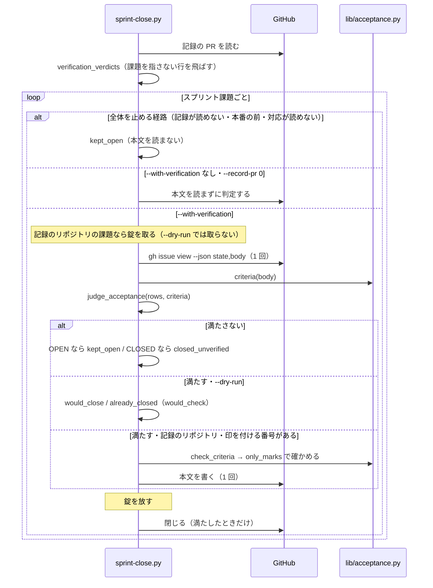

# スプリントを閉じる: 受け入れ条件の番号ごとの合格で閉じて本文に印を付け、工程表はモードで通る工程だけを持つ（sprint-close.py・progress-record.sh）

## 概要

**「スプリントを閉じる」（`plugins/ndf/scripts/sprint-close.py`）は、`--with-verification` の経路で、課題の本文の
`## 受け入れ条件` のチェックボックスの番号のすべてにリリース後テストの合格の行がある課題だけを閉じ、閉じる前に
その番号のチェックボックスへ印（`[x]`）を付ける。** 既に閉じていた課題が条件を満たさなければ `closed_unverified` で
知らせ、開き直さない。リリース後テストの表で `課題` の列が課題を指さない行（導入の確認の `—`・`PR 1869` など）は
読み飛ばす。あわせて、工程表（課題の本文の `## 進行`）は、その課題のモードで通る工程と記録の済んだ工程の行だけを持つ
（`plugins/ndf/scripts/progress-record.sh`）。

この文書は、その形に**なぜしたか**（背景・決定と理由・常に成り立つ条件・表と本文の読み方の境界・`reason` の文・
既知の限界・テスト観点）を残す。**手順・引数・結果の読み方の正は Skill とスクリプトにある。** 閉じる条件・`result` の
値・`checked` / `would_check`・工程表の行の絞り方は
[`progress-tracking` の SKILL.md](../../plugins/ndf/skills/progress-tracking/SKILL.md) の「スプリントを閉じる」と
「issue の本文に残る形」、リリース後テストの表の列の書き方は
[`release-verification` の SKILL.md](../../plugins/ndf/skills/release-verification/SKILL.md) の「出力物」、
処理の順序と終了コードは [`sprint-close.py`](../../plugins/ndf/scripts/sprint-close.py) の冒頭の説明を読む。

決定の番号は #1683 の設計の番号である。

## 用語

「受け入れ条件の番号」「受け入れ条件の印」「合格の行」「スプリント課題」の定義は用語集（[docs/glossary.md](../glossary.md)）が正である。

## 背景

本番の配布の後に課題を閉じるとき、本文の `## 受け入れ条件` のチェックボックスが 1 つも付かなかった。リリース後テストの
表に受け入れ条件の番号が無く、どの条件を確かめたかを閉じる判定に使っていなかった。#1870 は受け入れ条件 7 件が
未チェックのまま閉じ（#1822・#1843・#1847・#1867・#1492 も同じ）、閉じた課題の本文から受け入れ条件を確かめたかを
読めなかった。

表の書き方が 1 行崩れるだけで閉じる工程が全件止まる経路もあった。10.17.69 のリリース後テストの表（PR #1887）は
`課題` の列に `—`（導入の確認）と `PR 1869` を持ち、表全体が読めずに `--with-verification` の dry-run で全件が
`kept_open`（条件と課題の対応が読めない）になった。工程表には、その課題のモードで通らない工程が未チェックで残っていた。

コミットの件名の closing keywords（`Closes #N` など、GitHub が課題を自動で閉じるキーワード）で GitHub が先に閉じる経路は
塞がない。2026-10-03 以降に閉じた 60 件の closer はすべて API で、先に閉じた課題も `closed_unverified` で人へ戻る。

## 決定と理由

| # | 決定 | 理由 | 採らなかった案 |
| ---: | --- | --- | --- |
| 1 | `課題` の列のセルの頭が課題の参照（`#<番号>` / `<所有者>/<リポジトリ>#<番号>`）でない行を読み飛ばす。課題を指す行が 1 行も無い表は読めないものとして全件を開いたまま残す | 頭に固定すると `PR #1869` を課題 #1869 と誤って読まない。導入の確認のように課題に結び付かない検証も、表に書く場所を失わない | 書く側（`release-verification`）で課題の無い行を禁じる |
| 2 | 受け入れ条件の番号は本文の位置（節のコードブロックの外にある、字下げの無い `- [ ]` / `- [x]` の行を上から数えた順）で決め、行頭に書いた番号は読まない | 数え方が 1 つに決まり、書いた番号の有無や書式に左右されない | 書いた番号を読んで位置と照らす（食い違いの扱いを新しく決める必要があり、今の本文では得るものが無い） |
| 3 | 印付けは元の本文の文字の位置で行い、チェックボックスの空白 1 文字だけを `x` に置き換える。書く前に、長さが等しく違う位置がすべて置き換えた位置であることを確かめ、外れたら書かない | `gh_sections.replace_section` は改行を `\n` へ揃えて組み直すため、画面で編集した本文（`\r\n`）を書き戻すと節の外の全行が変わる | 節ごと `replace_section` で差し替える |
| 4 | 既に閉じていた課題が条件を満たさないときは新しい値 `closed_unverified` を返し、`status` と終了コードを変えない | `kept_open` は「開いたまま残した」を意味し、閉じた課題に使うと結果の値と課題の状態が食い違う。GitHub が先に閉じる経路を塞がない以上、止めると起きるたびに棚卸しが止まる | `kept_open` に `reason` で区別する。`stopped` で止める |
| 5 | 本文の書き換えに失敗した課題のやり直しは、同じ `sprint-close.py` の呼び出しを打ち直す形にする（`cmd` に載せる） | 打ち直すと閉じた課題は `already_closed` になり付いた印も変わらないため、繰り返しても結果が変わらない。`gh issue close` は印を付けずに閉じてしまう | 課題 1 件だけをやり直す引数を足す |
| 6 | `progress-record.sh` は `WF_MODES` と `WF_STAGE_MATRIX` を環境変数で埋め込みの Python へ渡し、Python が本文のモードから列を引く | モードは本文の見出しから決まるため、行を絞る判定は Python の側で行う。分類の表を写さずに済む | 工程ごとに `wf_stage_class` をシェルで呼んで渡す（モードが決まる前に呼ぶことになり、全モード分を前もって作る） |
| 8 | PR #1887 の直す前の表の期待値は、閉じた 3 件（#1867・#1492・#1870）がすべて `closed_unverified` になることとする | 3 件とも記録の時点で閉じており、表は番号を持たないか保留の行を持つ。受け入れ条件 3・7 の判定と両立する値はこれだけである（承認ゲート 1、2026-10-11 に課題の本文を直した） | 今の閉じる条件での値（#1867 が `already_closed`）で縛る |

工程表の「後片付け」の行が記録されない件（`merged-steps.py` が工程を記録しない）は閉じる条件とは別の経路で、#1893 にした（決定 7）。

## 仕様

### 構成要素と責務

| 要素 | 責務 |
| --- | --- |
| `plugins/ndf/scripts/lib/acceptance.py` | 受け入れ条件の節の見出し（`HEADING`）・番号の数え方（`criteria`）・印付け（`check_criteria`）・書く前の確かめ（`only_marks`）の唯一の置き場。純粋な文字列の処理で、GitHub を呼ばない |
| `plugins/ndf/scripts/lib/gh_sections.py` の `section_bounds` | 節の中身を元の本文の文字の位置 `(始め, 終わり)` で返す。改行（`\r\n`）を正規化しない |
| `plugins/ndf/scripts/sprint-close.py` | 表を課題と番号でまとめる（`verification_verdicts`）・閉じる条件 2 の判定（`judge_acceptance`）・錠の中での本文の読み書き・`closed_unverified` と集計 |
| `plugins/ndf/scripts/supervise_lib/sprint_inputs.py` | 見出しの定数 `HEADING` を `acceptance.HEADING` から引く（同じ役割の定数を 2 か所に置かない） |
| `plugins/ndf/scripts/progress-record.sh` | モードの列が `-` で記録の無い工程の行を書かない |

**受け入れ条件の節と工程表は同じ課題の本文に乗る別の節で、持ち主も別である。** 印は `sprint-close.py`、
`## 進行` は `progress-record.sh` が書く。どちらも課題ごとの錠（`lib/gh_parts.py` の `issue_lock`）の中で読みから書きまでを
行い、相手の節を書き戻さない。

### 常に成り立つ条件

| # | 条件 | 破れたときの扱い |
| --- | --- | --- |
| I1 | `課題` の列が `^(<所有者>/<リポジトリ>)?#<番号>` に当たらない行は、どの課題の判定にも使わず、表全体の読みも止めない | — （読み飛ばす） |
| I2 | 課題を指す行が 1 行も無い表は、どの課題にも対応を持たない | 全件を `kept_open`（条件と課題の対応が読めない）。閉じた課題も `closed_unverified` にしない |
| I3 | 受け入れ条件の番号は、節のコードブロックの外にある行頭（字下げなし）のチェックボックスの行を上から数えた順（1 から）である。取り消し線で差し替えた行は数えない | — （数え方の定義） |
| I4 | `closed_unverified` は課題ごとの判定（その課題の行が無い・合格でない行がある・合格の行が無い番号がある）にだけ使う。全体を止める経路（配布の記録が読めない・本番の前・対応が読めない）では閉じた課題も `kept_open` のままにする | — |
| I5 | 印付けで変わるのは、節の中のチェックボックスの `[ ]` の空白 1 文字だけである（節の外・取り消し線の行・説明の行・改行の形は変わらない） | 書き込まず、その課題を `failed`（受け入れ条件の印を書けない） |
| I6 | 記録のリポジトリの課題で印を付ける番号があるとき、課題を閉じるのは印を書き終えた後だけである | 印を書けなければ閉じずに `failed`（`cmd` は同じ `sprint-close.py` の呼び出し） |
| I7 | 他のリポジトリの課題の本文は書かない。判定は同じ規則で行う | — （書く経路を持たない） |
| I8 | `--with-verification` が無い呼び出しと `--record-pr 0` の呼び出しは、本文を読まず書かない | — （読む経路に入らない） |
| I9 | 閉じた課題を開き直さない | — （開き直す経路を持たない） |
| I10 | 工程表は、モードが `WF_MODES` のどれかなら、`WF_STAGE_MATRIX` のその列が `-` で記録の無い工程の行を持たない。記録の済んだ行は列が `-` でも残る。モードが `—` か知らない値なら全工程の行を持つ | — （書き直すたびに組み直す） |

### リリース後テストの表の読み方（`verification_verdicts`）

| 入力 | 出力 |
| --- | --- |
| 表が無い・見出しに `課題` か `結果` が無い | `None`（全件を `kept_open`） |
| 課題を指す行が 1 行も無い（0 行の表を含む） | `None` |
| `課題` の列が課題の参照で始まらない行 | 飛ばす |
| `受け入れ条件` の列が無い・セルの頭が `<番号>.` でない行 | その課題の「行がすべて合格」には効き、合格の番号には足さない |
| 同じ番号に合格の行と合格でない行がある | その番号は合格に数えない |

課題ごとのまとめは `IssueRows(all_pass, passed)` で、`passed` は合格の行にある番号から合格でない行にある番号を引いたものである。
`結果` の列が `合格` で始まる行を合格の行とする。

### 判定と本文の読み書きの流れ

**錠の範囲は本文の読みから書きまでで、閉じる操作は錠の外に置く。** 錠が守るのは本文だけで、状態の変更は本文と
ぶつからない。錠の待ちは `body-lock` の既定と同じ 30 秒（`LOCK_TIMEOUT`）である。GitHub の呼び出しは、本文を読む課題
1 件につき読み 1 回、印を付ける番号があるときだけ書き 1 回が加わる。

## データ・設定

### 結果 JSON の `reason`

| 場面 | `result` | `reason` |
| --- | --- | --- |
| 表にその課題の行が無い | `kept_open`（閉じていれば `closed_unverified`） | `リリース後テストの行が無い` |
| その課題に合格でない行がある | 同上 | `リリース後テストに合格でない条件がある（不合格・保留）` |
| 合格の行が無い番号がある | 同上 | `合格の行が無い受け入れ条件: 3, 5` |
| `closed_unverified` のとき | — | 上の文の頭に `閉じているが閉じる条件 2 を満たさない: ` を付ける |
| 錠を取れない | `failed` | `本文の錠を取れない` |
| 本文を読めない | `failed` | `本文を読めない` |
| 印を書けない（I5 の確かめに落ちたときも含む） | `failed` | `受け入れ条件の印を書けない` |

`checked` と `would_check` は番号の昇順の整数の配列で、記録のリポジトリの課題に印を付けた（付ける予定の）番号が
1 つ以上あるときだけ載る。`metrics` は `closed_unverified` の件数を持ち、`summary` は「開いたまま」の前に
「閉じているが条件を満たさない N 件」を入れる。

## 運用

### 既知の限界

| 項目 | 内容 |
| --- | --- |
| 本文に書いた番号と位置の食い違い | 位置を正にした（決定 2）。行頭の番号が位置と食い違う本文では、書いた番号と違う行に印が付く |
| GitHub が先に閉じる経路 | 塞がない。条件を満たさなければ `closed_unverified` で人へ戻る |
| 閉じる前に印を付けた課題の後戻り | 印を書いた後で閉じる操作が失敗すると、印だけが残る。打ち直せば閉じ、印は変わらない |
| 既に閉じた課題の本文 | さかのぼって直さない。条件を満たす閉じた課題は、次に `sprint-close.py` が通ったときに印が付く |
| 工程表の「後片付け」の行 | `merged-steps.py` の後片付けは工程を記録せず、行は未チェックで残る。閉じる条件とは別の経路である |

## テスト観点

受け入れ条件の判定と印付けは `plugins/ndf/scripts/tests/test_sprint_close_acceptance.py`、工程表の行の絞り方は
`plugins/ndf/scripts/tests/test_progress_record.py` にある。gh は偽物で置き換える。

- PR #1887 の直す前の表（`—` と `PR 1869` の行を持つ）の判定が、その 2 行を除いた表の判定と同じで、「条件と課題の対応が読めない」が出ず、閉じた 3 件が `closed_unverified` になること。`PR #1869` を課題と読まないこと
- 課題を指す行が 0 行の表で、全件が `kept_open`（条件と課題の対応が読めない）になること
- 3 個の受け入れ条件に番号 1・2 の合格の行だけのとき `kept_open` で `reason` に `3` が載り、本文の書き込みも閉じる操作も 0 回であること。1〜3 がそろうと `closed`・`checked` が `[1, 2, 3]` で、書き込みが閉じる操作より前であること
- `\r\n`・節の外・取り消し線の行・説明の行を含む本文で、書いた本文と元の本文の違いがチェックボックスの文字だけであること。確かめに外れたときは書かずに `failed` になること
- 同じ番号に合格と保留の行があると、その番号を合格として扱わないこと
- 閉じた課題が条件を満たさなければ `closed_unverified`（`reason` に「閉じているが」と番号）で、`gh issue reopen` を呼ばず `status` が `ok` であること。満たせば `already_closed` で印が付くこと
- `--dry-run` で `would_check` が載り、本文を書かないこと
- 本文の書き込みが失敗すると `failed`・`cmd` が同じ呼び出し・閉じる操作が 0 回・終了コード 1 になること
- 節が無い本文とチェックボックスが 0 個の節で、表の合否だけで判定され本文を書かないこと
- `--with-verification` なしと `--record-pr 0` で本文を読まないこと。他のリポジトリの課題は同じ規則で判定し、本文を書かないこと
- コードブロックの中・字下げしたチェックボックス・取り消し線の行を数えないこと
- 本文の読み書きの間は同じ課題の錠が取られ、錠を取れないと `failed` になること
- モード `light` の課題へ工程を記録すると列が `-` の 9 工程の行が無く `作業場所の用意`・`設計` の行があること。記録済みの `計画` の `[x]` 行は残ること。モード `—` では全 19 工程の行があること

## 関連リンク

- [`progress-tracking` の SKILL.md](../../plugins/ndf/skills/progress-tracking/SKILL.md)（閉じる条件・結果の読み方・工程表の形の正）
- [`release-verification` の SKILL.md](../../plugins/ndf/skills/release-verification/SKILL.md)（表の列の書き方の正）
- [`sprint-close.py`](../../plugins/ndf/scripts/sprint-close.py)・[`lib/acceptance.py`](../../plugins/ndf/scripts/lib/acceptance.py)・[`progress-record.sh`](../../plugins/ndf/scripts/progress-record.sh)
- [ndf-sprint-close-referenced-issues.md](ndf-sprint-close-referenced-issues.md)（参照だけの課題と 0 件の停止）
- [ndf-production-release-record.md](ndf-production-release-record.md)（`--record-pr` が読む配布の記録とリリース後テストの選び方）
- #1683（この形を決めた課題）、#1893（後片付けの行）、PR #1887（表の読みが止まった事例）
