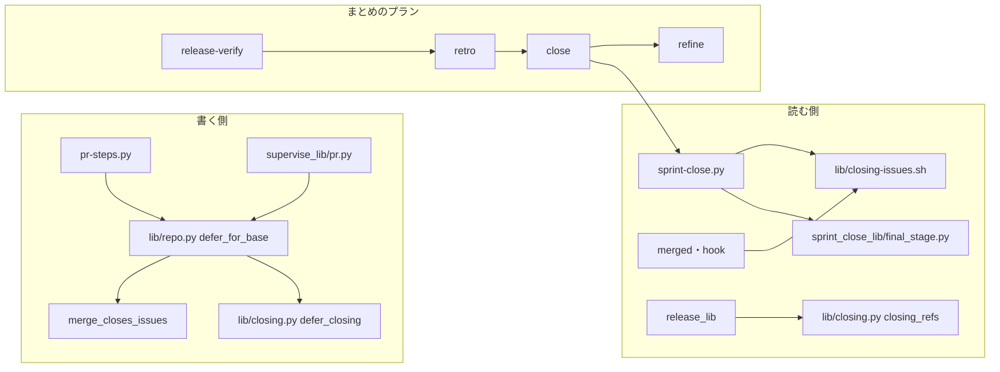
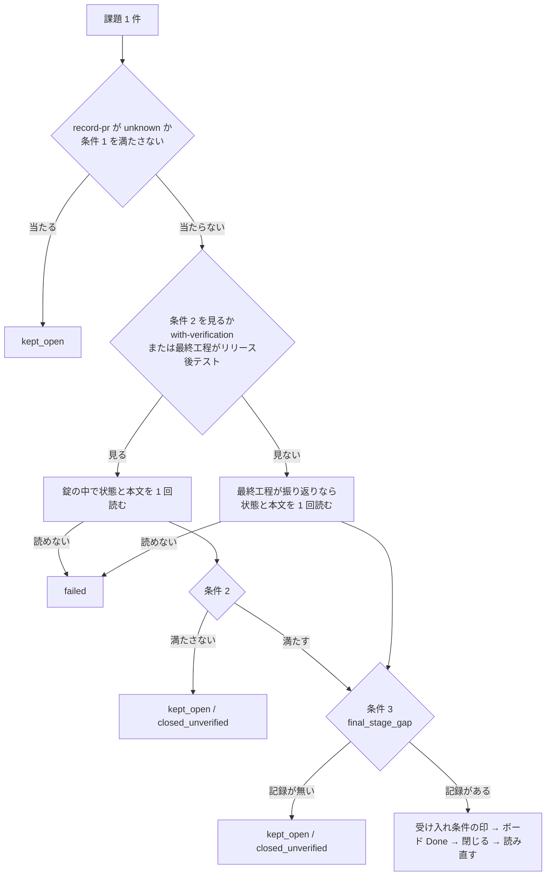
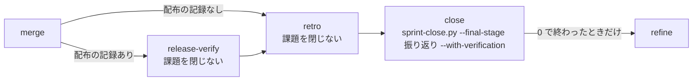

# スプリント課題を最終工程の記録を確かめてから閉じ、既定ブランチ宛の Pull Request のマージでは閉じない

NDF のどの経路で閉じても、閉じた課題はその実行の最終工程の記録を持つ。`sprint-close.py` が課題ごとに
最終工程の記録（閉じる条件 3）を確かめ、まとめのプランは振り返りの後に課題を閉じ、既定ブランチ宛の
Pull Request の本文には GitHub がマージで課題を閉じる closing keywords を残さない（#2228。子の #2082・#2119 を含む）。

**手順は各 Skill の `SKILL.md` が正である。** 閉じる条件の表・呼ぶ Skill と `--final-stage` の値の対応・
プランの並びの正本は `plugins/ndf/skills/progress-tracking/SKILL.md` の「スプリントを閉じる」にあり、
ここへ書き写さない。この文書は、決めたことの理由と、書く側と読む側が共有する形を残す。

| 何を読むか | 正本 |
| --- | --- |
| 閉じる条件 1〜3・呼ぶ側と `--final-stage` の値・まとめのプランの並び | `plugins/ndf/skills/progress-tracking/SKILL.md` の「スプリントを閉じる」 |
| closing keywords を本文だけに書くことと、既定ブランチ宛での置き換え | `plugins/ndf/skills/pr/SKILL.md` |
| 後片付けの止まり方・閉じる条件 1・2 の理由・リリース記録の形 | [ndf-cleanup-and-bundle-closing.md](ndf-cleanup-and-bundle-closing.md) |

## 概要

閉じる経路は 3 つあり、変更前はどれも工程の通過を見なかった。

| 経路 | 変更前に起きたこと | 今の扱い |
| --- | --- | --- |
| GitHub が既定ブランチへのマージで本文の closing keywords の課題を閉じる | volareinc/carmo-screening の PR 344 の `Closes #342` で、受け入れ条件 11 件が未チェックのまま閉じた（#2082） | 既定ブランチ宛の本文を NDF の手順で書くとき、closing keywords を閉じる予定の参照へ置き換える |
| `sprint-close.py` をプラン・conductor・Skill のどれかが打つ | s2086 で #2086 がリリース後テストの前に閉じ、不合格の条件を持ったまま閉じて残った（#2119） | `sprint-close.py` が最終工程の記録を確かめ、無ければ閉じない |
| ボードの `Done` でボードの自動化が閉じる | 上の経路の中の 1 手 | 判定を通った課題だけ `Done` にする（変わらない） |

閉じる時点の決まりは `progress-tracking` の 1 か所、判定は `sprint-close.py`（と `sprint_close_lib/`）の 1 か所、
閉じる指定の形は `lib/closing.py` の 1 か所に置く。まとめのプランと Skill の本文は `--final-stage` の値を渡すだけで、
閉じてよいかを判定しない。

## 用語

最終工程・最終工程の記録・閉じる予定の参照・スプリント課題・closing keywords・参照だけの課題の定義は、
用語集（[docs/glossary.md](../glossary.md)）にある。

## 構成要素

| 要素 | 責務 |
| --- | --- |
| `plugins/ndf/scripts/sprint-close.py` | 引数 `--final-stage` を受け、課題ごとに閉じる条件 1〜3 を判定して閉じる |
| `plugins/ndf/scripts/sprint_close_lib/final_stage.py` | 閉じる条件 3 の判定 `final_stage_gap(stage, body, since)` と、満たさない課題の項目 `gap_item` |
| `plugins/ndf/scripts/lib/dist_record.py` | `parse_record(text, parts)` が、最後の配布の記録のコメントの識別子 `dist_comment_id` を返す |
| `plugins/ndf/scripts/sprint_close_lib/collect.py` | `read_record` が記録の PR を 1 回読み、本文とコメントを連結した文字列と部分ごとの（先頭の行の番号, コメントの識別子）を返す |
| `plugins/ndf/scripts/lib/closing.py` | 閉じる予定の参照の語 `DEFERRED`（`最終工程の後に閉じる`）、置き換え `defer_closing`、2 つの形を読む `closing_issues` / `closing_refs` / `closing_numbers`、closing keywords だけを読む `closing_words` |
| `plugins/ndf/scripts/lib/closing-issues.sh` | シェルの読み手。閉じる予定の参照も取り出す。出力の形（`<リポジトリ>\t<番号>`）は変わらない |
| `plugins/ndf/scripts/lib/repo.py` | `merge_closes_issues(root, base)`（宛先のマージで GitHub が閉じるか）と `defer_for_base(root, base, text)`（当たるときだけ `defer_closing` に通す） |
| `plugins/ndf/scripts/pr-steps.py`・`plugins/ndf/scripts/supervise_lib/pr.py` | 本文を送る前に `defer_for_base` を通す |
| `plugins/ndf/scripts/supervise_lib/sprint.py`・`sprint_close_steps.py`・`release_templates.py` | まとめのプランを `merge →（release-verify）→ retro → close → refine` の順に組む |



## 仕様

### 常に成り立つ条件

| # | 条件 | 破れたときの扱い |
| --- | --- | --- |
| I1 | 課題を閉じてボードを `Done` にするのは、その課題のその実行の最終工程の記録があるときだけである。振り返りの行は、前の実行のものを数えない | 閉じない。`kept_open`（既に閉じていれば `closed_unverified`）と、通っていない工程の名前を含む `reason` で返す |
| I2 | 最終工程の記録を読む置き場（課題の本文）を読めないとき、記録があるとは読まない | 閉じない。`failed` と打ち直しの `cmd`、`status: stopped`（終了コード 1） |
| I3 | `--final-stage` を省いたときの最終工程は `振り返り`（最も後ろ）である。省いても閉じる条件は緩まない | — |
| I4 | 最終工程が `リリース後テスト` のとき、閉じる条件 2 を `--with-verification` の有無にかかわらず見る | 閉じない |
| I5 | `--record-pr 0`（本番の記録なし）と `--record-pr unknown` の扱いは条件 3 の前と変わらない。`unknown` は本文を読まずにすべて `kept_open` で返す | — |
| I6 | まとめのプランの `next` のつながりで、`close` は `retro` の後、`refine` の前にある。`retro` と `release-verify` の指示は課題を閉じない。`close` は `--final-stage 振り返り` を明示して渡す | プランを組む関数のテストで落ちる |
| I7 | 宛先が既定ブランチ（既定ブランチか宛先を決められないときを含む）の Pull Request を NDF の手順で書くと、本文に closing keywords が残らず、置き換えた指し先は同じ課題を指す閉じる予定の参照になる | — |
| I8 | 宛先が既定ブランチでない Pull Request の本文は書き換えない | — |
| I9 | 閉じる予定の参照は closing keywords を含まない | `closing_words` が一致を返したらテストで落ちる |
| I10 | スプリント課題は closing keywords・閉じる予定の参照・`--issues` の和であり、閉じる予定の参照が指す課題を参照だけの課題にしない | — |

### `sprint-close.py` の入出力

```text
sprint-close.py --record-pr <PR番号|0|unknown> [--final-stage 配布|リリース後テスト|振り返り]
                [--prs 1,2] [--issues 3,4] [--with-verification] [--label …] [--dry-run] [--root <dir>] [--repo <owner/name>]
```

| 項目 | 値 |
| --- | --- |
| `--final-stage` | 3 つの値のどれか。省けば `振り返り`。それ以外は呼び出しの誤り（終了コード 3） |
| 条件 3 を満たさない課題 | `result: kept_open`・`reason: 最終工程（<工程>）の記録が無い: <何が無いか>`。既に閉じていれば `closed_unverified`（`閉じているが閉じる条件 3 を満たさない: …`。開き直さない） |
| 課題の本文を読めない | `result: failed`・同じ呼び出しの `cmd`。`status: stopped`・終了コード 1 |
| `metrics.final_stage` | 判定に使った最終工程 |
| `decisions` | `{"decision": "最終工程を <工程> として判定した", "basis": "--final-stage <値>（省略時は振り返り）"}` を 1 件 |
| 終了コード | 0 / 1 / 2 / 3 の意味は条件 3 の前と同じ |

最終工程ごとの記録と読む置き場:

| 最終工程 | 最終工程の記録 | 読む置き場 |
| --- | --- | --- |
| `配布` | 閉じる条件 1（最後の配布の記録の `段階:` が `本番` か `配布なし`。`--record-pr 0` は満たす） | 記録の PR |
| `リリース後テスト` | 閉じる条件 2（`--with-verification` を付けたのと同じ判定） | 記録の PR |
| `振り返り` | 課題の本文に、行頭から `振り返り: https://github.com/<所有者>/<リポジトリ>/(issues|pull)/<番号>#issuecomment-<識別子>` の行があり、そのうち最大の `<識別子>` が比べる基準（`dist_comment_id`）以上である | 課題の本文と記録の PR |

`振り返り` で満たさないときの `<何が無いか>` は 3 つである。

| 状態 | `<何が無いか>` |
| --- | --- |
| 比べる基準が `None` | `比べる配布の記録のコメントが無い` |
| 行が 1 つも無い | `課題の本文に振り返りの記録の行が無い` |
| 行の識別子がすべて基準より小さい | `課題の本文の振り返りの行が今回の配布の記録より前のもの` |

### 比べる基準（`dist_comment_id`）

振り返りの行は課題の本文に残り続ける。前のスプリントで振り返りを通り、開いたまま持ち越した課題が、
今回の振り返りの前に条件 3 を満たさないよう、行が指すコメントの識別子を記録の PR の最後の配布の記録と比べる。

| 最後の配布の記録の置き場 | 基準 |
| --- | --- |
| 記録の PR のコメント | そのコメントの識別子（`comments[].url` の `#issuecomment-<識別子>` の数字） |
| 記録の PR の本文 | 記録の PR の最初のコメントの識別子。コメントが 1 件も無ければ `None` |
| `--record-pr 0` | `0`（`NO_BASE`。配布の記録が無いため、行があれば満たす） |

比べ方は「以上」である。本文にある記録で、今回の振り返りを記録の PR の最初のコメントとして投稿したとき、
その識別子が基準と等しくなるためである。記録の PR は条件 1 と同じ 1 回の `gh pr view --json body,comments` で読み、
`gh` の呼び出しを増やさない。

### 課題 1 件の判定の流れ



条件 3 は条件 2 と同じ 1 回の本文の読みを使う。印を書くのは条件 3 も満たしたときだけで、満たさない課題の
本文は書かない。`--dry-run` は判定まで行い、書かない。

### まとめのプランの並び



まとめのプランはどのモードでも `retro` を持つため、プランの中の最終工程はどのモードでも振り返りになる。
`配布` と `リリース後テスト` は、プランの外で最終工程を担う Skill（`light` の `release`、振り返りを通らない
`operation` の `release-verification` か `release`）だけが渡す。

### 閉じる予定の参照と本文の置き換え

```text
最終工程の後に閉じる: <指し先>
```

`<指し先>` は closing keywords と同じ 3 つ（`#<番号>`・`<所有者>/<リポジトリ>#<番号>`・課題の URL）。`:` の前後の
空白は 0 個以上を許す。1 つの指し先に 1 つ書く。

置き換えるかは Pull Request の宛先（新しく作るなら `--base` か起点、既存なら `baseRefName`）で決める。
`merge_closes_issues` は、既定ブランチ（`default_branch`）を決められない・宛先が分からない・宛先が既定ブランチ
（`origin/` を外して比べる）のときに真を返す。

`pr-steps.py create` / `update` の結果:

| 項目 | 値 |
| --- | --- |
| 本文 | 当たれば `Closes #12` などを `最終工程の後に閉じる: #12` へ置き換えてから送る。指し先の字面は変えない |
| `metrics.deferred_closing` | 置き換えた指し先の字面の配列（置き換えなければ空） |
| `items` | 置き換えた指し先ごとに `{"kind": "closing", "name": "<指し先>", "result": "deferred"}` |
| `metrics.closing_issues_in_body` | 2 つの形の指し先をどちらも載せる |
| `status` | 置き換えは `ok` のまま（欠けではない） |

プランの pr のステップ（`supervise_lib/pr.py`）も同じ判定で置き換え、置き換えた指し先をステップの状態の
`deferred_closing` に残す。

## 決定の理由

- **最終工程の記録は GitHub に残った記録から読む。** 配布の記録・リリース後テストの行・課題の本文の振り返りの行は
  どれも GitHub にあり、conductor・supervisor・別の機械のどこから打っても同じものを読む。プランの状態ディレクトリと
  通過記録は手元のファイルで、別の機械や手打ちの経路からは読めない。振り返りの行は記録の PR ではなく課題の本文から
  読む（#2086 の行は記録の PR と違う PR を指していた）
- **最終工程は引数で受け、省けば振り返りにする。** 課題の本文の `モード:` は実例でどれも `—` で、最終工程を導けない。
  省いたときに最も厳しい値になるため、呼ぶ側の書き違いで閉じる条件が緩まない
- **`--final-stage リリース後テスト` は条件 2 を必ず見る。** 2 つの引数を別々に必須にすると、片方の付け忘れで
  最終工程を確かめずに閉じる経路が残る
- **前の版で工程を通った課題のための移行の手段を作らない。** 振り返りを通った課題はすでに本文に行を持つ。
  判定を飛ばす引数を足すと、新しい経路でも判定を飛ばす手段になる。行を持たない課題は `kept_open` で残り、
  `next` が「振り返りを通すか、確かめて手で閉じる」を示す
- **既定ブランチ宛の closing keywords は止めずに置き換える。** プランの pr のステップは本文を機械で組むため、
  止めると既定ブランチを起点にするリポジトリでスプリントのたびに無人の実行が止まる。置き換えは宛先で決める。
  GitHub が閉じるかを決めるのは各 Pull Request の宛先であり、起点の設定ではない
- **閉じる予定の参照は専用の形にする。** `Refs #N` は参照だけの課題の意味と衝突する。`NDF-Closes` のような造語は
  語の境界の後に `Closes` が来て closing keywords として一致する。`--issues` だけで集めると、付け忘れで閉じる課題が
  0 件になる
- **振り返りの行は形だけを見て、指すコメントは読まない。** コメントを読むと課題ごとに `gh` の呼び出しが 1 回増える。
  行は `retrospective` が投稿の後にだけ書く
- **プランで閉じるのは `close` だけにし、Skill からの呼び出しも残す。** プランを通らない実行にも閉じる担い手が要る。
  判定は `sprint-close.py` が行うため、両方が打っても早すぎる時点では閉じず、2 度目は `already_closed` になる。
  プランの `retro` に閉じさせないのは、担当が `--with-verification` を省くと条件 2 を見ずに閉じるためである

## 運用

- 振り返りを通らずに開いたまま残った課題は、振り返りを通すか、確かめて手で閉じる（手で `gh issue close` を打つ
  経路は NDF の判定の外）
- GitHub の画面で本文を書き直したときは置き換えない（NDF の手順を通らない書き込み）

### 確かめていないこと

| 項目 | 内容 |
| --- | --- |
| コメントの識別子の大小と投稿の順 | 識別子が投稿の順に大きくなることに頼る（#2086 と記録の PR 2109 の 1 組で確かめた）。順に並ばない例が出たら投稿時刻の比較へ替える |
| 配布の記録が本文だけにある記録の PR | 最初のコメントを基準にする。コメントの無い記録の PR では、振り返りを最終工程とする課題が閉じない（安全側）。実例は確かめていない |
| `--record-pr 0` の前の実行の行 | 比べる基準が無く、前のスプリントの行を持つ持ち越しの課題は、その実行の振り返りの前に条件 3 を満たしうる |
| 振り返りの行の中身 | 行の URL のコメントが実在するかは読まない |
| `--with-verification` を省いた振り返りの経路 | 条件 2 を見ずに閉じうる（#2293） |

## テスト観点

テストは `plugins/ndf/scripts/tests/` の `test_sprint_close_final_stage.py`・`test_closing.py`・`test_supervise_pr_closing.py`・
`test_sprint_close_issues.py`・`test_sprint_close_references.py` ほかにある。

- 本文に振り返りの行が無い課題は、`--final-stage` を省いて打つと `--with-verification` の有無の両方で `kept_open` と
  「振り返り」を含む `reason` が返り、閉じる・ボードを書く `gh` の呼び出しが無いこと
- 振り返りの行の識別子が最後の配布の記録のコメントの識別子より小さい課題は閉じず、大きい行を足すと閉じること
- 最後の配布の記録がコメントにあればその識別子、本文にあれば最初のコメントの識別子、コメントが無ければ `None` が
  基準になり、`None` では閉じないこと。基準と等しい識別子を数えること。記録の PR を読む `gh` の呼び出しが 1 回であること
- 課題の本文の読みが失敗すると `failed`・`status: stopped`・終了コード 1 になること
- 行がすべて合格で振り返りの行がある課題で、印・`Done`・閉じるが同じ順で起きること。`--record-pr 0` で行があれば閉じ、
  `unknown` では本文を読まずにすべて `kept_open` になること
- `--final-stage リリース後テスト` で `--with-verification` を付けずに打つと、不合格の行を持つ課題が閉じないこと
- まとめのプランの `next` をたどった並びが `release-verify → retro → close → refine`（記録なしでは `retro → close → refine`）で、
  どのモードでも `close` が `retro` の後、`refine` の前にあること
- 既定ブランチと起点が同じ一時のリポジトリで `pr-steps.py create` / `update` と `supervise_lib/pr.py` の `_publish` が
  `gh` に渡す本文に closing keywords が無く、閉じる予定の参照が同じ指し先で残ること。既定ブランチを決められない構成でも
  同じであること
- 閉じる予定の参照だけを持つ Pull Request で `sprint-close.py --prs <番号> --dry-run` を打つと、その課題が閉じる対象として
  判定され、参照だけの課題にも終了コード 2 にもならないこと。`closing-issues.sh` と `closing.closing_refs` が同じ本文から
  同じ指し先を返すこと
- 宛先が既定ブランチでない構成（`develop` 宛）では本文が書き換わらないこと

## 関連リンク

- [ndf-cleanup-and-bundle-closing.md](ndf-cleanup-and-bundle-closing.md): 閉じる条件 1・2 と後片付け
- [docs/glossary.md](../glossary.md): 用語集
- #2228・#2082・#2119
