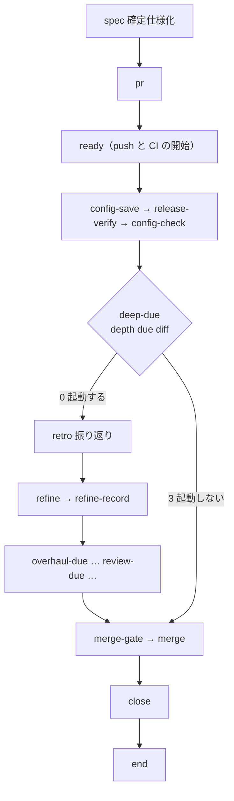

# 仕上げのプランの費用と所要時間: 振り返りと差分の棚卸しを数回に 1 回にまとめ、CI の待ちを後ろの作業と重ねる

## 概要

開発ループの仕上げのプラン（`supervise.py new close`）1 本は、直す前の中央値で費用 $8.21・所要時間 38.0 分かかっていた。
費用の約半分は、ループの 1 回ごとに新しい `claude -p` で起動する振り返りと棚卸しから、所要時間の約 3 分の 1 は、確定仕様化の
Pull Request の CI を待ってから後ろの作業を始める直列の待ちから来ていた。

そこで仕上げのプランは次の 2 つの形をとる。

- 確定仕様化の Pull Request を ready にしてから、リリース後テスト・振り返り・棚卸しを進め、マージをプランの最後に置く。CI はその間に GitHub の上で進む
- 開発ループでは、振り返りと差分の棚卸しを既定で 3 回のループの 1 回に 1 回だけ起動する。見送った回の課題は、次に起動する回の振り返りの範囲に入る。開発ループの外のスプリントは毎回起動する

リリース後テストは回数を減らさず、リリース記録があれば毎回走る。

**この文書が持つのは、仕上げのプランの並びと起動の判定の決まり・振り返りの範囲の形・最終工程の選び方・常に成り立つ条件・
直す前の実測と原因である。** 各ステップの中身と既存の決まりは、関連リンクの確定仕様が正本である。

## 用語

語の定義は用語集（ [docs/glossary.md](../glossary.md) ）が正である。この文書で使う主な語は次のとおり。

| 用語 | この文書での使い方 |
| --- | --- |
| 仕上げのプラン | `supervise.py new close` が組む、確定仕様化からマージ・課題を閉じるまでのプラン（記録の `フェーズ` の値は「まとめ」） |
| 起動の判定 | 振り返りと差分の棚卸しをその回で走らせるかを決める判定。ここでは `upkeep.py depth due diff` を指す |
| 振り返りの範囲 | 1 回の振り返りと差分の棚卸しが扱うループの 1 回の並び（見送った回と今の回）・課題の番号・範囲の始まりの時刻 |
| 走らなかったステップ | 起動の判定などの終了コードで飛ばされたステップ。フェーズレポートに 1 行で載る |

## 背景

| 決めたこと | 理由 |
| --- | --- |
| 確定仕様化の Pull Request のマージ（`merge`）を仕上げのプランの最後へ回し、その後には課題を閉じる `close` だけを置く | CI の待ち（中央値 15.0 分・費用 $0）の結果を、リリース後テスト・振り返り・棚卸しは使わない。ready で CI を始めてから後ろの作業を進めれば、待ちがその間に進む |
| 仕上げのプランは 1 本のまま保ち、2 本へ分けてステージで並べない | 記録と報告の単位（1 本の仕上げのプラン）と、ループの記録が読むまとめの報告の形を変えないため |
| 開発ループでは振り返りと差分の棚卸しを既定で 3 回のループの 1 回に 1 回にまとめる | 振り返り・差分の棚卸し・見直し・大整理が 9 本の費用の 51% を占め、どれもループの 1 回ごとに新しい会話で走っていた。ループの 1 回は数時間で終わる短い単位で、スクラムガイドは短いスプリントの振り返りを短くし、整理の頻度を定めない |
| 間隔の既定を 3 にする | リリース後の最初の 3 本のうち 2 本が見送る回になり、中央値が見送る回の値（試算 $2.81・18.5 分）になる。直す前の半分（$4.10・19.0 分）を下回る |
| 開発ループの外のスプリントは毎回振り返り、棚卸しする | ループの外のスプリントは 1 回が長く、数回をまとめる単位を持たない |
| `diff` の判定を既存の `upkeep.py depth due` に足し、振り返りも同じ判定で起動する | 見直しと大整理の判定がすでに回数の数え方・判定の行・終了コード 3 で飛ばす約束を持つ。振り返りは差分の棚卸しが拾う起票の元で、同じ回に走らせると順序（振り返り → 棚卸し）が保たれる |
| 振り返りを走らせない回は、最終工程をリリース後テストとして課題を閉じる | 課題を閉じる判定（`sprint-close.py`）はリリース後テストの最終工程をすでに受ける。閉じるステップを 1 つにし、どちらの経路でも `merge` の後に置く |
| マージの前に走る棚卸しは、今の回の課題を閉じる区分のすべてから外す | 棚卸しが今の回の課題を「閉じてよい」「重複の正本でない側」「やらない」と判定して閉じると、確定仕様化の Pull Request がマージされる前に課題が閉じる |
| 走らなかったステップを報告に 1 行で載せる | 振り返りを見送った回でも、いつ次に走るかを後から読めるようにするため |
| ループの記録の持ち越しは、差分の棚卸しを走らせた最後の回から取る | 見送った回で前の結果を写すと、古い値が記録に残る |
| 1 回の会話を安くする手（材料を前もってスクリプトで集める・接頭辞を小さくする・振り返りと棚卸しを 1 つの会話にまとめる）は入れない | どれも効果を実測していない。1 つの会話にまとめると文脈が積み重なり読み込みが増える。機械的なターンをスクリプトへ移す手は https://github.com/devbasex/ai-plugins/issues/2909 が扱う |

## 仕様

### プランの並び

`supervise_lib/sprint.py` の `close_plan` が組む。リリース記録が無いとき（`release-verify` を持たない並び）は、`ready` の次が `deep-due` になる。

| ステップ | 遷移 |
| --- | --- |
| `ready` | リリース記録があれば `config-save`、無ければ `deep-due` |
| `config-check` | `deep-due`（`release_verify_steps` の引数 `after` で受ける） |
| `deep-due` | 0 なら `retro`、3 なら `merge-gate`（`skip_to`）。`timeout` は 300 秒 |
| `retro` | `refine` |
| 見直しと大整理の判定と実行の最後 | `merge-gate` |
| `merge-gate` | 宛先がリリース承認ゲートに当たればプランを終える（`gate_next: end`）。当たらなければ `merge` |
| `merge`・`merge-approved` | `close` |
| `close` | `end` |

見直しと大整理の起動の判定は、差分の棚卸しを走らせた回だけ打つ（判定の条件は [ndf-backlog-refinement-depths.md](ndf-backlog-refinement-depths.md) ）。

### 起動の判定

`deep-due` のステップは `upkeep.py depth due diff --sprint <名前> --issues <番号のカンマ区切り>` を打つ。開発ループのまとめでは
`--loop <名前> --lap <回数>` を足し、ループの外では渡さない。判定は `upkeep_depth_diff.py` の `diff_due` が組み、
判定の行を `.ndf/backlog/depths.jsonl` に残す。

| 条件 | 終了コード | 判定の行 |
| --- | --- | --- |
| `--loop` が無い（ループの外） | 0 | `due`（`trigger` は `no_loop`） |
| まだどの範囲にも入っていない見送った回の数 + 1 が `every` 以上 | 0 | `due`（`count`） |
| `--manual`（開発ループの中） | 0 | `due`（`manual`） |
| どれにも当たらない | 3 | `not_due`。`values` は `count`・`every`・`next_in` |
| 宣言や記録を読めない | 3 | `not_due`（`values.reason` が `unreadable`） |

- 起動しないときの要約は「振り返りと差分の棚卸しは起動しない（前に走らせてから N 回目。次は M 回後）」の形である
- 同じループの 1 回で打ち直したときは、そのループの 1 回の前の `due` の判定（条件と範囲）をそのまま使う
- 見送った回は、ループの名前と回数ごとに最後の `not_due` の行を 1 回と数え、今のループの 1 回は数えない

### 振り返りの範囲

起動するとき、`due` の行の `values.scope` に振り返りの範囲を置く。

| キー | 中身 |
| --- | --- |
| `laps` | まだどの範囲にも入っていない見送った回の値（古い順）と今の回の値。値はそれぞれ `loop`・`lap`・`sprint`・`issues` |
| `issues` | `laps` の課題の番号の和集合（昇順） |
| `since` | 範囲に入る最も古い行より前にある、最後の `diff` の `due` の行の時刻（無ければ `null`） |

| 判定 | 範囲に入るもの | 消費する見送った回 |
| --- | --- | --- |
| 開発ループの `due`（`count`・`manual`） | 見送った回と今の回 | 範囲に入れたすべて |
| ループの外の `due`（`no_loop`） | 今のスプリントだけ | 無し。見送った回は開発ループで次に起動する回まで残る |

見送った回が範囲に入ったかは、後の `due` の行の `values.scope.laps` にそのループの名前と回数が載っているかで決まる。
振り返りと差分の棚卸しの worker は、深さの記録を直接読まず、`upkeep.py depth scope --sprint <名前>` が返す範囲
（結果の `items` が `laps`、`metrics` が範囲の全体）を扱う。そのスプリントの範囲が無ければ終了コード 3 を返す。
範囲の扱い（振り返りが辿る経路の行を範囲のすべての課題へ足すこと、差分の棚卸しが `since` より後に作られた課題へ見積の段階を付けること）は、
`retrospective` と `backlog-refinement` の Skill の本文が持つ。

### 課題を閉じる最終工程

`close` のステップは `sprint-close.py --record-pr <記録の PR> --issues <課題> --final-stage-from {state_dir}/progress.jsonl --with-verification` を打つ。
`--final-stage-from` は `--final-stage` より優先し、`sprint_close_lib/final_stage.py` の `stage_from_progress` が最終工程を選ぶ。

| 進捗記録 | 選ぶ最終工程 |
| --- | --- |
| 同じプランで `retro` のステップが終了コード 0 で通った | 振り返り |
| `retro` が通っていない（見送った回） | リリース後テスト |
| 進捗記録を読めない | リリース後テスト |

見る範囲は、`from` の無い最後の実行（`kind: run` の行）より後である。承認の後に `merge-approved` から続きを流した実行は同じプランとして見て、
前の実行の `retro` は数えない。閉じる条件そのものは [ndf-sprint-close-final-stage.md](ndf-sprint-close-final-stage.md) が正本である。

### マージの前の棚卸しが閉じない課題

`refine`・`review`・`overhaul` のプロンプトは、今の回の課題の番号を「閉じない課題」として渡す。`backlog-refinement` は、渡された番号を
閉じてよい・重複の正本でない側・やらないのどの区分にも入れず、重複の組に入るときは閉じない課題を正本にする。本文の訂正と見積の段階の付与は行う。
見送った回の課題は、その回の仕上げのプランの `close` ですでに閉じているため、閉じない課題に含めない。

### 走らなかったステップ

フェーズレポート（`report.md`）の「通ったステップ」の後に「走らなかったステップ」の行を置く（`supervise_lib/state.py` の `write_report`）。
`skip_to` で飛んだ run のステップの id と、その出力の最後の統一 JSON の `summary`（無ければ出力の要約。200 文字まで）を `; ` で並べる。
飛んだステップが無ければ「無し」と書く。見直しと大整理の判定（`review-due`・`overhaul-due`）が飛んだときも同じ行に載る。

### ループの記録の持ち越し

ループの 1 回を締めるとき（`lib/sprint_loop_gate.py` の `refine_summary`）、そのループの 1 回の深さの記録に `diff` の `not_due` があり
`ran` が無ければ、棚卸しの要約を `{"report": "", "rank_changes": [], "deferred": [], "skipped": true}` にする。次の仕上げのプランへ渡す
`--carry` は、`skipped` の印の無い最後のループの 1 回の `refine.deferred` から取る（`build_close`）。

### 常に成り立つ条件

| 条件 | 破れたときの扱い |
| --- | --- |
| 開発ループのどのループの 1 回の課題も、いずれ 1 回の振り返りの範囲に入る。見送った回は、開発ループで次に起動する回の範囲に入るまで消費されず、ループの外で起動しても消費されない | 範囲に漏れが出る。テストで落とす |
| リリース記録があれば、起動の判定によらずリリース後テストを毎回走らせる | リリース後テストの回数が減る。テストで落とす |
| `merge` の後に置くステップは `close` だけで、LLM を使うステップと CI を待つステップは `merge` の前にある | CI の待ちが後ろの作業と重ならない。テストで落とす |
| 開発ループの外では、振り返りと差分の棚卸しを毎回起動する | ループの外で振り返りが消える。テストで落とす |
| `close` は、同じプランで `retro` が通っていれば振り返り、通っていなければリリース後テストを最終工程にする | 課題が閉じない、または振り返りの記録が無いまま閉じる。テストで落とす |
| 持ち越しは、差分の棚卸しを最後に走らせたループの 1 回の値である | 持ち越しが消えるか、古い値が記録に残る。テストで落とす |
| 起動の判定で見送った回の報告に、いつ次に走るかが載る | 走らなかったことが後から読めない。テストで落とす |
| `close` へ入る遷移は `merge` と `merge-approved` の次だけで、`merge-gate` がプランを終える経路と `merge` が失敗した経路では課題を開いたまま残す。マージの前の棚卸しは今の回の課題を閉じない | 確定仕様化が本流に入らないまま課題が閉じる。テストで落とす |

## データ・設定

| 項目 | 置き場 | 既定 |
| --- | --- | --- |
| 振り返りと差分の棚卸しの間隔（ループの 1 回の数） | `.ndf/backlog.json` の `depths.diff.every` | 3（`upkeep_depth.py` の `DEFAULTS`） |
| 起動の判定と振り返りの範囲 | `.ndf/backlog/depths.jsonl` の `depth: diff` の行（`event` が `due` か `not_due`。`loop`・`lap`・`sprint`・`issues` を持つ） | — |

- 見直しと大整理の回数は、今と同じく差分の棚卸しを走らせた回（`ran` の行）で数える。`not_due` の行は数えないため、ループの 1 回で数えた見直しの間隔は既定で 9 回になる

## 運用

### 直す前の実測と原因

2026-11-10 時点で記録が最後まで残っていた仕上げのプラン 9 本（`.ndf/loop/*/lap-*/close*/1-close-state/progress.jsonl`）の
`kind: step` の行の `cost` と `seconds` を 1 本ごとに足した。中央値は費用 $8.21・所要時間 38.0 分（最小 $1.41・18.5 分、最大 $16.98・63.0 分）である。

| ステップ | 走った本数 | 所要時間の中央値（分） | 費用の合計 | 費用の中央値 |
| --- | ---: | ---: | ---: | ---: |
| 確定仕様化（`spec`） | 9 | 3.5 | $17.95 | $1.71 |
| リリース後テスト（`release-verify`） | 8 | 8.4 | $17.28 | $1.88 |
| 振り返り（`retro`） | 8 | 4.6 | $16.44 | $1.97 |
| 差分の棚卸し（`refine`） | 8 | 3.7 | $13.88 | $1.68 |
| 見直し（`review`） | 3 | 7.7 | $5.46 | $1.85 |
| 大整理（`overhaul`） | 1 | 3.2 | $1.16 | $1.16 |
| マージの待ち（`merge`） | 9 | 15.0 | $0 | $0 |
| Pull Request の本文（`pr`） | 9 | 0.0 | $0.81 | $0.08 |
| 課題を閉じる（`close`） | 8 | 0.2 | $0 | $0 |
| ほかの 13 の run のステップ | — | 各 0.1 以下 | $0 | $0 |

LLM を使うステップの費用（9 本の合計 $72.98）は、キャッシュ作成 $33.04（45%）・キャッシュ読み込み $24.72（34%）・出力 $15.21（21%）・入力 $0.01 に分かれる。

| 確かめた原因 | 確かめた手段 |
| --- | --- |
| LLM を使うステップは、それぞれ新しい `claude -p` の会話 1 つで走る | `progress.jsonl` の `models` の `calls` がすべて 1 |
| 各会話の 1 ターン目は 6 万トークン前後を読み込み、うち約 4.3 万トークンは何も足さない `claude -p` の起動の分である | transcript の 1 ターン目の `usage` と、`claude -p "ok とだけ返す" --output-format json` の `usage` |
| 会話は 9〜52 ターンで、文脈は終わりに 8〜27 万トークンまで伸びる。ターンの大半は Bash である | transcript のターンごとの `usage` と Tool の数 |
| 振り返りと差分の棚卸しは、記録の残る 8 本すべてで毎回走っていた | 上の表の走った本数 |
| マージの待ちの後に、リリース後テスト以降のすべてのステップが順に走っていた | 直す前の `close_plan` の並びと `merge` のステップの出力 |

1 ステップの費用のうち 30〜40% は起動ごとの接頭辞の作成と各ターンでの読み直しと推定する（実測ではない）。

### 直した後を確かめる

直した版（ndf v10.27.53）をリリースした後に走った仕上げのプランのうち、最初の 3 本以上で、上と同じ集計（`progress.jsonl` の
`kind: step` の行の `cost` と `seconds` を 1 本ごとに足した中央値）を出す。見直しは期限が来た回だけ走るため、3 本に見直しを含む回と含まない回が混ざってよい。
費用は帳簿 `python3 plugins/ndf/scripts/usage-report.py --ledger claude --by plan --since <日付> --format json` の仕上げのプランの値とも照らす。
起動する回は 3 回分の範囲を扱うため、その回の費用も同じ集計で残す。

## テスト観点

- 直した後の仕上げのプラン 1 本の費用の中央値が $4.10 以下であること（リリース後に上の手順で確かめる）
- 直した後の仕上げのプラン 1 本の所要時間の中央値が 19.0 分以下であること（同上。マージの待ちの短縮 https://github.com/devbasex/ai-plugins/issues/2907 ・ https://github.com/devbasex/ai-plugins/issues/2925 のリリース後の値で判定してよい）
- 起動する回の仕上げのプランが `spec`・`release-verify`・`retro`・`refine` のステップを持ち、各ステップの結果ファイルが走った回の分だけ `status` 付きで残ること
- `skip_to` で飛んだ run のステップがある実行の報告に、そのステップの id と要約が「走らなかったステップ」の行で載ること
- `every` が 3 のとき、前に起動した後の見送った回が 0・1 回なら 3、2 回なら 0 を返し、範囲に 3 回分のループの 1 回と課題が並ぶこと
- 見送った回が 2 回 → ループの外の `due` → 開発ループの `due` の順でも、最後の範囲に見送った 2 回が並び、範囲の始まりの時刻がループの外の `due` より前になること
- `--loop` を渡さない `depth due diff` が 0 を返し、`.ndf/backlog.json` の `depths.diff.every` と `--manual` が判定を変えること
- リリース記録のある仕上げのプランが、起動しない回の経路でも `release-verify` を通ること
- `merge` と `merge-approved` の次が `close`、`close` の次が `end` で、`merge` から辿れるのは `close` だけであり、`merge-gate` がプランを終える経路では `close` を通らないこと
- `refine`・`review`・`overhaul` のプロンプトが、今の回の課題を閉じない課題として持つこと
- `--final-stage-from` の進捗記録で `retro` が通っていれば振り返り、通っていなければリリース後テストを最終工程にし、前の実行の `retro` を数えないこと
- 差分の棚卸しを見送った回の棚卸しの要約が `skipped` になり、次の回の持ち越しが最後に走らせた回の値になること

テストは `plugins/ndf/scripts/tests/test_supervise_pace.py`・`test_supervise_pace_verify.py`・`test_supervise.py`・`test_sprint_close_final_stage.py`・`test_sprint_loop.py` と
`plugins/ndf/skills/backlog-refinement/tests/test_upkeep_depths.py` にある。

## 関連リンク

- 要求: https://github.com/devbasex/ai-plugins/issues/2914 （設計 https://github.com/devbasex/ai-plugins/pull/2946 、実装 https://github.com/devbasex/ai-plugins/pull/2966 ）
- 棚卸しの深さと見直し・大整理の起動の条件: [ndf-backlog-refinement-depths.md](ndf-backlog-refinement-depths.md)
- 仕上げのプランの棚卸しのステップ: [ndf-backlog-refinement-stage.md](ndf-backlog-refinement-stage.md)
- 課題を閉じる条件と最終工程: [ndf-sprint-close-final-stage.md](ndf-sprint-close-final-stage.md)
- 記録の PR を流す時点に探す決まり: [ndf-sprint-close-record-pr-at-run-time.md](ndf-sprint-close-record-pr-at-run-time.md)
- 開発ループとまとめの組み方: [ndf-workflow-development-loop.md](ndf-workflow-development-loop.md)
- リリース後テストのステップ: [ndf-production-release-record.md](ndf-production-release-record.md) ・ [ndf-supervise-verification-mark-after-ok.md](ndf-supervise-verification-mark-after-ok.md)
