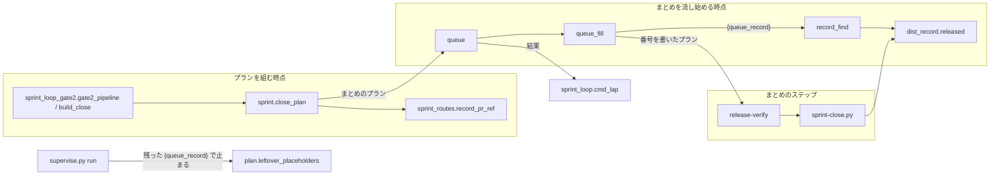
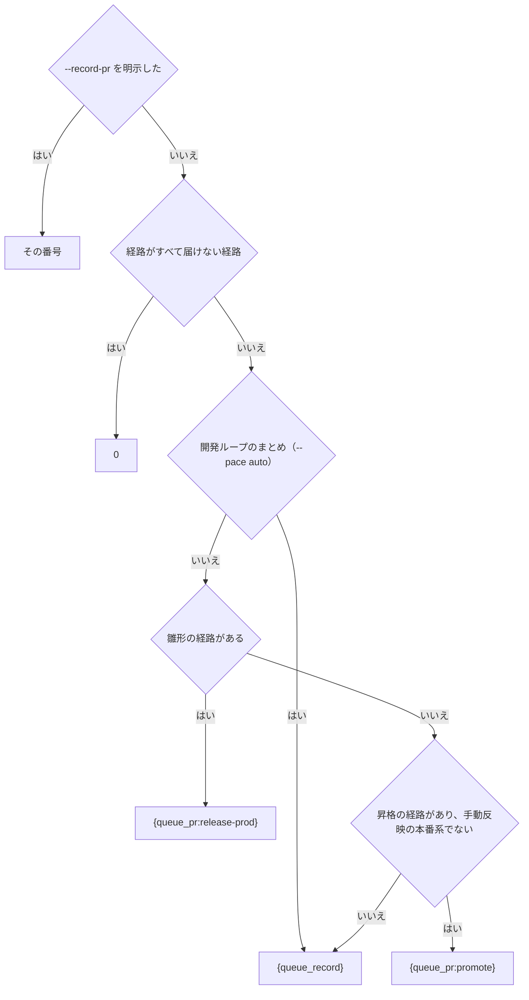
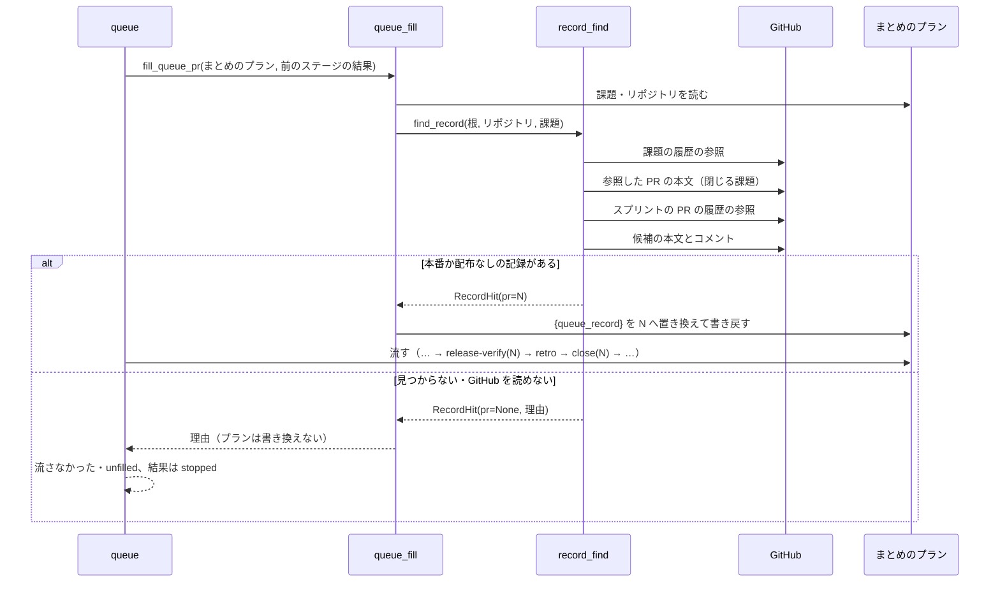

# まとめの close が、まとめを流し始める時点にリリース記録の PR を見つけて課題を閉じる

まとめ（`supervise.py new close`・`new sprint` のまとめのステージ、開発ループの周回のまとめ）は、リリース記録
（`## 配布の記録`）を置いた Pull Request を、プランを組む時点でなく **まとめのステージを流し始める時点** に
決める。どのリリースの経路でも、リリース後テストと close は同じ記録の PR を受け取る。見つからなければまとめは
流れずに止まり、探した課題と PR を理由に載せる（#2230。子の #2044・#2121 の問題 1 を含む）。

**手順は各 Skill の本文と、コードのドキュメント文字列が正である。** この文書は、決めたことの理由と、
書く側と読む側が共有する形を残す。

| 何を読むか | 正本 |
| --- | --- |
| queue の差し込みの規則（`{queue_pr:…}`・`{queue_state:…}`・`{queue_record}`） | `plugins/ndf/scripts/supervise_lib/plan.py` の説明 |
| スプリントの終わりの `--record-pr` の渡し方 | `plugins/ndf/skills/development-workflow/references/pace.md` |
| `--record-pr unknown` の扱い・閉じる条件 | `plugins/ndf/skills/progress-tracking/SKILL.md` の「スプリントを閉じる」 |
| `unknown` の結果 JSON と境界 | [ndf-sprint-misjudgments-unknown-record-and-manual-none.md](ndf-sprint-misjudgments-unknown-record-and-manual-none.md) |
| リリース記録の形 | [ndf-cleanup-and-bundle-closing.md](ndf-cleanup-and-bundle-closing.md)・`plugins/ndf/scripts/lib/dist_record.py` |

## 概要

変更前は、merge（`merged-by-check`）・手で届ける・検証の環境だけ・手動反映の本番系の経路では、まとめのプランを
組む時点に記録の PR が無く、プランが `--record-pr unknown` を組んで課題が閉じないまま ok で返った（#2044）。
開発ループの承認ゲート 2 の後のまとめは、検査のスプリント PR（止まった記録の `values.pr`）を記録の PR として
受け取った（#2121）。

今は、記録の PR を決めるのは queue の差し込み `{queue_record}` の 1 か所で、通常の起動と開発ループの
どちらも同じ関数（`sprint_close_lib/record_find.find_record`）を通る。

## 用語

記録の PR・記録の置き場が分からない・リリース記録の定義は、用語集（[docs/glossary.md](../glossary.md)）にある。

## コンテキスト

開発の工程（`ndf-workflow`）はリリース（`ndf-release`）の順応者である。まとめはリリース記録の形
（`lib/dist_record.py`）をそのまま読み、形を変えない。GitHub へは `gh` で読むだけで、書かない。

## 構成要素

| 要素 | 責務 |
| --- | --- |
| `plugins/ndf/scripts/sprint_close_lib/record_find.py` | まとめの課題から GitHub の参照を辿り、本番か配布なしの段階のリリース記録を置いた PR を 1 本決める（`find_record`）。結果は値オブジェクト `RecordHit` |
| `plugins/ndf/scripts/supervise_lib/queue_fill.py` | 差し込み `{queue_record}` を、計画の `課題` と `リポジトリ` から `find_record` で解決した番号で置き換える。解決できなければ計画を書き換えずに理由を返す |
| `plugins/ndf/scripts/supervise_lib/plan.py` | 置き換わらずに残った差し込みの検出（`QUEUE_NAMED`・`leftover_placeholders`）に `{queue_record}` を含める |
| `plugins/ndf/scripts/supervise_lib/sprint_routes.py` | `record_pr_ref` がまとめの記録の PR の参照を返す（下の表）。`has_record` は `0` でなければ真 |
| `plugins/ndf/scripts/lib/sprint_loop_gate2.py`・`lib/sprint_loop_gate.py` | 開発ループの承認ゲート 2 の後の `gate2_pipeline` が、`build_close` を記録の PR なしで呼ぶ |
| `plugins/ndf/scripts/lib/sprint_loop.py` | `cmd_lap` が、差し込みを埋められずに流さなかった計画（`unfilled`）を失敗として数える |
| `plugins/ndf/scripts/lib/dist_record.py` | リリース記録の段階が本番か配布なしかの判定 `released` を持つ。`sprint-close.py` と `record_find` が共有する |

## 仕様

### 集約

| 集約 | 持ち主（書き換えてよいもの） | 根 | エンティティ | 値オブジェクト |
| --- | --- | --- | --- | --- |
| まとめのプラン | 組み立ては `supervise_lib/sprint.close_plan`。組んだ後に書き換えてよいのは `supervise_lib/queue_fill` の差し込みの置き換えだけ | まとめのプラン（`close.json`） | ステップ（`release-verify`・`close`） | 記録の PR の参照 |
| リリース記録 | `release`（`release-steps.py record`・手で行う `/ndf:release`）。まとめは読むだけ | 記録を置いた PR | `## 配布の記録` のブロック | 段階・スプリントの PR の並び |
| 開発ループの周回 | `lib/sprint_loop` | 周回（`lap`） | — | 周回の結果（完了 / 失敗） |

### 常に成り立つ条件

| # | 条件 | 破れたときの扱い |
| --- | --- | --- |
| I1 | 組んだまとめのプランは `--record-pr unknown` を持たない | 組み立ての単体テストが落とす |
| I2 | 記録の PR の参照が `0` でないとき、`release-verify` のステップと `close` のステップは同じ参照を持つ | 組み立ての単体テストが落とす |
| I3 | `{queue_record}` を解決できない（記録が見つからない・GitHub を読めない）ときは、プランを書き換えずに流さず、理由にまとめの課題と探した PR を載せる | queue の結果が `stopped` になり、まとめは流れない |
| I4 | `{queue_record}` が採る記録は、`段階:` が本番か配布なしのものだけである | 本番の前の記録だけなら見つからない扱い（I3） |
| I5 | `{queue_record}` が採る記録は、閉じる PR が見つかったまとめの課題の 1 件ごとに、その課題を閉じる PR を `スプリント:` に 1 本以上含むものだけである。閉じる PR を持たない課題は条件に入れない。条件を満たす記録の `スプリント:` の並びが 2 通り以上残れば採らない | 特定できなければ見つからない扱いで止める（I3） |
| I6 | 開発ループを使わない起動で、雛形の経路は `{queue_pr:release-prod}`、昇格の経路は `{queue_pr:promote}` を組む | 組み立ての単体テストが落とす |
| I7 | 届けない経路だけのスプリントは `0`、`--record-pr <番号>` を明示した `new close` はその番号を組む | 組み立ての単体テストが落とす |
| I8 | 差し込みを埋められずに流さなかった計画がある周回は、完了で締めない | 周回を失敗で締める |

### まとめのプランが組む記録の PR の参照

明示の番号は `close_plan` が、それ以外は `record_pr_ref` が決める。

| 起動 | 経路 | `close` の `--record-pr` | `release-verify` |
| --- | --- | --- | --- |
| `new close --record-pr <番号>` | どれでも | その番号 | 置く |
| `new sprint` / `new close`（開発ループの外） | 届けない経路だけ | `0` | 置かない |
| 同上 | 雛形（`release.form`） | `{queue_pr:release-prod}` | 置く |
| 同上 | 昇格（手動反映の本番系を除く） | `{queue_pr:promote}` | 置く |
| 同上 | merge・手で届ける・検証の環境だけ・手動反映の本番系 | `{queue_record}` | 置く |
| 開発ループ（`new close --pace auto`、承認ゲート 2 の後の `gate2_pipeline` を含む） | 届けない経路だけ | `0` | 置かない |
| 同上 | それ以外 | `{queue_record}` | 置く |

`close` のステップは `sprint-close.py --record-pr <参照> --issues <課題> --final-stage 振り返り --with-verification`、
`release-verify` のプロンプトは「配布の記録は Pull Request #<参照> にある」の形で、参照だけが経路で変わる。

### 差し込み `{queue_record}`

| 項目 | 内容 |
| --- | --- |
| 書ける場所 | 計画の JSON のどこでもよい（コマンドとプロンプトの両方） |
| 入力 | 計画の `課題`（整数の並び。空なら解決できない）と `リポジトリ`（`gh` を打つ作業場所。無ければ計画の置き場） |
| 成功 | 計画の中の `{queue_record}` をすべて記録の PR の番号（10 進の文字列）で置き換えて書き戻す |
| 失敗 | 計画を書き換えず、`差し込みを埋める前の計画の結果が見つからない: {queue_record}（<理由>）` を返す。queue はその計画を `流さなかった`・`unfilled` にし、結果は `stopped`（`{queue_pr:…}` と同じ） |
| `run` で流したとき | 残った `{queue_record}` を `leftover_placeholders` が拾い、コマンドのステップを打たずに止まる |

理由の文は `RecordHit.reason()` が組む。

| 状況 | 理由の形 |
| --- | --- |
| 記録が無い | 課題 #a #b を閉じる PR #x #y と、それを参照する PR #p #q を読んだが、本番か配布なしの段階のリリース記録が無い。本番の前の記録だけがあれば「（本番の前の記録だけ: PR #r）」を足す |
| 対象スプリントを特定できない | 課題 #a #b を閉じる記録が 2 つ以上のスプリントにある: PR #r（スプリント: #x #y）・PR #s（スプリント: #u #v）。`--record-pr <番号>` を明示して組み直す |
| GitHub を読めない | GitHub を読めない: <gh の出力の先頭> |

### 記録の PR を決める規則（`find_record`）

| 順 | すること |
| --- | --- |
| 1 | まとめの課題ごとに、課題の履歴の参照（`cross-referenced`）のうち Pull Request のものを集める |
| 2 | 1 の PR のうち、本文の closing keywords か閉じる予定の参照（`lib/closing.closing_refs`）がまとめの課題を指すものを、スプリントの PR とする。課題ごとに「課題 → その課題を閉じる PR の集合」の対応を保つ。閉じる PR が見つからない課題は対応に入れない。対応が空なら見つからない扱い |
| 3 | 候補を、スプリントの PR と、スプリントの PR の履歴の参照のうち Pull Request のものの和にする |
| 4 | 候補ごとに本文とコメントを読み（`collect.read_record`）、最後のリリース記録（`parse_record`）を取る |
| 5 | 段階が本番か配布なし（`released`）で、`スプリント:` の PR が 2 の対応の課題の 1 件ごとにその課題を閉じる PR を 1 本以上含む記録だけを残す |
| 6 | 残った記録の `スプリント:` の並び（番号の集合）が 2 通り以上なら見つからない扱いにし、記録の PR と `スプリント:` の集合の組を `RecordHit.ambiguous` に入れる |
| 7 | 残った中で、記録を置いたコメントの識別子が最も大きいもの（本文の記録は 0、同じなら PR の番号の大きいもの）を採る |

`RecordHit` の欄: `pr`（決めた PR。`None` なら見つからない）・`issues`・`closers`（閉じる PR）・`searched`（記録を読んだ PR）・
`pre_release`（記録はあるが段階が本番の前だった PR）・`ambiguous`・`error`（GitHub を読めなかった理由）。

### 流れ

まとめのステージを流し始める時点の流れは、通常の起動と開発ループで同じである。

開発ループの承認ゲート 2 の後は、`gate2_pipeline` が `build_close` を記録の PR なしで呼び、組んだまとめのプランは
`{queue_record}` を持つ。続きの 1 行（`run <本番> --from <ステップ> && queue <残り> --then <まとめ> && wait && loop lap`）
の中で、まとめのステージを流し始める時点に解決する。解決できずにまとめを流さなかったら、`loop lap` が周回を
失敗で締める（I8）。

### `sprint-close.py --record-pr`

`<PR番号|0|unknown>` を受ける。`unknown` は課題を理由つきの `kept_open` で返して終了コード 0 で終わる。まとめの
プランは `unknown` を組まないため、`unknown` を渡すのは手で打つ入口と、#2230 より前に組んだまとめのプランだけである。
閉じる条件の判定は `dist_record.released` を使う。

## 設計判断

| 決めたこと | 理由 |
| --- | --- |
| まとめの課題から GitHub の参照（課題 → 閉じるスプリントの PR → それを参照する PR）を辿ってリリース記録を探す | merge・手で届ける経路では記録の PR を人の `/ndf:release` が作り、どのプランもその番号を持たない。記録は必ず Pull Request にあり `スプリント:` でスプリントの PR を指すため、2 段で届く（#2089 で実測）。記録を書く手順も形も変えずに済む |
| 「課題を参照する PR」でなく「課題を閉じる PR」で絞り、閉じる PR が見つかった課題すべてについて `スプリント:` に含む記録に限る。並びが 2 通り以上残れば止める | 参照するだけの PR で絞ると、後のスプリントの確定仕様化の PR を通じて後のスプリントの記録を選ぶ（#2089 では #2128 を通じて #2138）。別のスプリントの記録を採ると対象外の課題まで閉じ、課題を閉じるのは戻しにくいため、推測で採らずに人の `--record-pr <番号>` へ戻す |
| 段階を本番か配布なしに限る | `sprint-close.py` が閉じてよいとする段階と同じにするため。本番の前の記録を採ると close が閉じずに ok で返り、「未記録を ok で返さない」（#2227）に反する |
| 解決は queue の差し込みとして、まとめのステージを流し始める時点に 1 回行う | プランの中で値を後のステップへ渡す手段は差し込みだけで、リリース後テストと close が同じ番号を受け取れる（I2）。見つからないときにまとめ全体を流さないのは、本番へ届いていないスプリントで確定仕様化と振り返りを先に進めないため |
| 開発ループの外の雛形と昇格の経路は `{queue_pr:…}` のまま | プランが記録の PR を持ち今の形で解けており、GitHub を読む回数も増やさない |
| 開発ループのまとめは経路にかかわらず `{queue_record}` | 承認ゲート 2 の後のまとめは本番のプランと別の queue・別のディレクトリにあり `{queue_pr:release-prod}` を解けない。承認ゲートの有無でプランを 2 通りにしない。`values.pr` は検査のスプリント PR で、記録の PR ではない |
| `sprint-close.py --record-pr unknown` の受け付けと振る舞いを変えない | 実行中のスプリントには前の版で組んだプランが残り、組み直しを求めずに流せるようにする（移行性）。手で打つ入口としても残す |
| 開発ループは `unfilled` の計画を失敗に数える | 差し込みを埋められなかったまとめは前のステージがすべて完了のため、数えないと周回が完了で締まる |

## エラー処理

- 記録が見つからない・対象スプリントを特定できない・GitHub を読めないときは、まとめのプランを書き換えずに流さず、
  queue の結果を `stopped` にする。課題は開いたまま残る
- 特定できないときは、人が `new close --record-pr <番号>` を明示して組み直す

## 運用

- `{queue_record}` を持たない計画では、`queue_fill` は GitHub を読まない
- GitHub の呼び出しは、課題 1 件・スプリントの PR 1 本の #2089 で 13 回（履歴の参照 2・本文 8・記録の読み取り 3）だった
- 課題を持ち越して 2 つのスプリントで閉じる PR を出した形と、手で書いた記録が `スプリント:` に番号を書かなかった形は、
  見つからない扱いで止まる

## テスト観点

- merge・手で届ける・検証の環境だけ・手動反映の本番系の経路で `new close` が組むまとめの `close` が
  `--record-pr {queue_record}` を持ち、`unknown` を持たないこと
- 上の経路と開発ループで、まとめのプランが `release-verify` を持ち、そのプロンプトと `close` のコマンドが同じ参照を持つこと
- `{queue_record}` を持つプランを `fill_queue_pr` に通すと、`release-verify` と `close` の両方が同じ番号で置き換わること
- 見つからない・GitHub を読めないとき、計画を書き換えずに理由（まとめの課題と読んだ PR）を返し、queue の結果が `stopped` になること
- `{queue_record}` が残ったプランを `run` で流すと、コマンドのステップを打たずに止まること
- 最後の記録が本番の前の段階だけなら見つからない扱いになり、理由に本番の前の記録の PR が載ること
- 課題を参照するが閉じない PR を通じた後のスプリントの記録を採らないこと（#2089 の #2126 と #2138 の形）
- `スプリント:` の並びが違う本番の記録が 2 つ残ると見つからない扱いになり、理由に両方の記録の PR が載ること
- まとめの課題の一部しか閉じる PR を `スプリント:` に含まない記録を採らないこと
- 閉じる PR を持たない課題が混ざっても、条件を満たす記録が 1 つなら採ること。どの課題にも閉じる PR が無ければ記録を読まずに見つからない扱いになること
- 同じスプリントの記録が本文とコメントの両方にあれば、コメントの識別子が最も大きい記録の PR を採ること
- 雛形と昇格の経路の `new close` が組むまとめのプランが変わらないこと
- 届けない経路だけなら `--record-pr 0` で `release-verify` を持たず、`--record-pr <番号>` を明示するとその番号を組むこと
- 開発ループの承認ゲート 2 の後の `gate2_pipeline` が組むまとめのプランが、`values.pr` でなく `{queue_record}` を持つこと
- 差し込みを埋められずに流さなかったまとめを含む結果を `loop lap` に渡すと、周回が失敗で締まること

## 関連リンク

- [ndf-sprint-misjudgments-unknown-record-and-manual-none.md](ndf-sprint-misjudgments-unknown-record-and-manual-none.md) — `--record-pr unknown` の扱い
- [ndf-sprint-close-final-stage.md](ndf-sprint-close-final-stage.md) — まとめのプランの並びと最終工程の記録
- [ndf-production-release-record.md](ndf-production-release-record.md) — 本番のリリース記録の書き方
- [ndf-workflow-development-loop.md](ndf-workflow-development-loop.md) — 開発ループ
- [ndf-supervise-queue-concurrent-files-and-prerequisites.md](ndf-supervise-queue-concurrent-files-and-prerequisites.md) — queue
