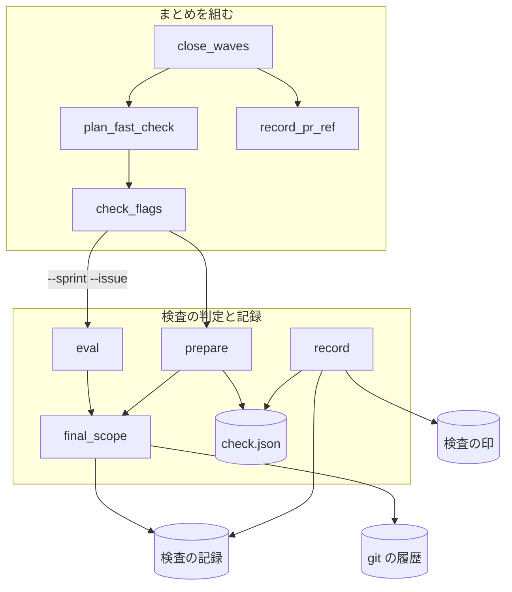
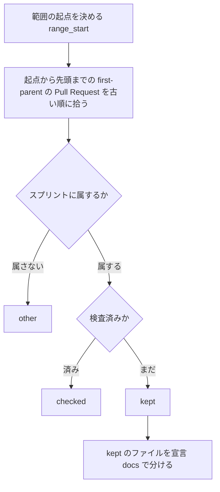

# 最後の検査: 確定仕様化の後に、そのスプリントのまだ検査していない差分だけを見る

スプリントのまとめ（`supervise.py new close`）の最後の検査は、確定仕様化の Pull Request をマージした後に流れる。
範囲は、そのスプリントに属する Pull Request のうち、どの検査もまだ見ていないものだけである。範囲が空か文書のファイル
だけなら、最後の検査・開発版・本番を飛ばす（#3126）。

検査の印はリポジトリに 1 本ずつしか無いため、範囲を印からベースブランチの先頭までの全部で決めると、スプリントの検査で
cross-review 済みの差分・ほかのレーンの確定仕様化・リリースの版が範囲に入る。2026-11-12 のレーン lci では、その決め方で
範囲が PR 4 本・ファイル 99 件になり、cross-review が 40 分を超えても終わらなかった。

**手順の正本は Skill とスクリプトにある。** この文書は、決めたことの理由と、書く側と読む側が共有する形を残す。

| 何を読むか | 正本 |
| --- | --- |
| スプリントの終わりの並びと `final` のトリガー | [`development-workflow` の `references/pace.md`](../../plugins/ndf/skills/development-workflow/references/pace.md) |
| 範囲の判定・`eval`・`prepare`・`record` | [`check-trigger.py`](../../plugins/ndf/scripts/check-trigger.py) の説明 |
| 文書のファイルの分け方 | [ndf-diff-kinds-and-docs-only-checks.md](ndf-diff-kinds-and-docs-only-checks.md) |
| まとめが読むリリース記録の参照 | [ndf-sprint-close-record-pr-at-run-time.md](ndf-sprint-close-record-pr-at-run-time.md) |

## 概要

| 順 | 起きること |
| ---: | --- |
| 1 | まとめのステージで、確定仕様化 → マージ → 課題を閉じる が流れる |
| 2 | 最後の検査の実行条件 `check-trigger.py eval --final --sprint <名前> --issue <番号>...` が範囲を決める |
| 3 | 範囲が空か文書のファイルだけなら終了コード 3 で、最後の検査・開発版・本番が飛ぶ |
| 4 | 範囲があれば `prepare` が検査の Pull Request の起点と先頭を範囲に合わせ、cross-refactoring と cross-review が流れる |
| 5 | `record` が検査の行を `scope: sprint` で書き、検査の印を進めてよい位置まで進める。変更があれば開発版 → 本番が流れる |

`--sprint` を渡さない呼び出し（スプリントの途中の検査と `new check --final` の手打ち）は、範囲とトリガーを変えていない。

## 用語

最後の検査・最後の検査の範囲・スプリントの検査・検査の印・スプリントに属する Pull Request・まとめのステージの定義は、
用語集（[docs/glossary.md](../glossary.md)）にある。

## コンテキスト

NDF の開発ワークフロー（`ndf-workflow`）の中で閉じる。cross-review と cross-refactoring の呼び出しは変えず、
どちらも Pull Request 1 本を入力に取る。

## 構成要素

| 要素 | 責務 |
| --- | --- |
| `check-trigger.py` の `final_scope` | 範囲の起点から先頭までの Pull Request を「範囲に入る」「ほか」「検査済み」に分け、文書だけか・印を進めてよい位置・間に挟まったほかの Pull Request の数を返す。git と検査の記録を読むだけで書かない。結果は値オブジェクト `FinalScope` |
| `check-trigger.py` の `eval`（`evaluate_sprint`） | `--sprint` があれば `final_scope` を使い、`final`（`--review` なら `review`）のトリガーだけを判定する |
| `check-trigger.py` の `prepare` | `--sprint` があれば、`check-base/<名>` を範囲の最初の Pull Request の手前に置き、作業ブランチを範囲の最後の Pull Request のマージのコミットへ合わせ、`check.json` に範囲と印を進めてよい位置を書く |
| `check-trigger.py` の `record` | `check.json` に `sprint` があれば、検査の行を `scope: sprint` で書き、`to` と印を進める位置を印を進めてよい位置にする |
| `supervise_lib/sprint_waves.py` の `plan_fast_check` | 最後の検査を組むときにスプリントの名前（`final_sprint`）を渡す |
| `supervise_lib/decl.py` の `check_flags` | `eval`・`prepare` へ渡す範囲の引数に `--sprint <名前> --issue <番号>...` を足す |
| `supervise_lib/sprint.py` の `close_waves` | まとめを先頭のステージにし、最終の検査・開発版・本番を `then_of: まとめ` で後ろに置く |
| `supervise_lib/sprint_routes.py` の `record_pr_ref` | まとめのリリース記録の参照を、届けない経路だけなら `0`、それ以外は `{queue_record}`（まとめより前の本番の記録）にする |

## 仕様

### 集約

| 集約 | 持ち主 | 値オブジェクト |
| --- | --- | --- |
| 検査の記録（リポジトリごとの jsonl。追記だけ） | `check-trigger.py` の `append_event` | 範囲（起点・先頭）・Pull Request の番号の並び |
| 検査の印（origin の `check-done/check`・`check-done/review`） | `check-trigger.py` の `record`（fast-forward だけで送る） | 見終えた位置のコミット |
| 最後の検査の範囲 | `final_scope`。そのつど検査の記録と git の履歴から作り、保存しない | `FinalScope` |
| まとめのステージの並び | `close_waves` | ステージの名前と `then_of` |

### 常に成り立つ条件

| # | 条件 | 破れたときの扱い |
| --- | --- | --- |
| I1 | 範囲に入る Pull Request は、すべてスプリントに属する | ほかのレーン・ほかのスプリントの Pull Request は `other` に数えるだけ |
| I2 | 検査済みの Pull Request は範囲に入らない | `checked` に数える |
| I3 | 範囲のファイルにコードのファイルと振る舞いを決める文書が 0 件なら、トリガーは立たない | 要約に「文書のファイルだけ」と出し、終了コード 3 |
| I4 | 検査の印を、まだその種類の検査を通していない Pull Request の後へ進めない | 通していない最初の Pull Request の手前で止める。手前に進める位置が無ければ進めない |
| I5 | 検査の行の `to` は、その検査が印を進めた位置と同じである（進めなかった検査は空） | `record` が同じ値から両方を書く |
| I6 | `pace: fast` / `normal` のまとめでは、最後の検査は確定仕様化の Pull Request をマージした後に流れる | `close_waves` の並び |
| I7 | `pace: auto` のまとめはまとめのステージだけである | — |
| I8 | 新しい項目を持たない検査の記録の行は今と同じに読める | 読む側は新しい項目が無ければ今の扱いにする |

### スプリントに属する Pull Request

head のブランチの最後の区切りがスプリントの名前に等しい（`sprint/<名前>`・`spec/<名前>`）か、ブランチ名がスプリントの
課題の番号（`--issue`）を `issue-<番号>` の形で持つ Pull Request である。検査の Pull Request（記録の `pr`）と、
ブランチが `release/`・`check/` の Pull Request は範囲から外す。

### 検査済み

結果が `merged` か `no_change` の検査の行について、次のとおり数える（`checked_prs`）。

| 最後の検査の種類 | 検査済み（範囲から外す。I2） | その種類の検査を通した（印を越えてよい。I4） |
| --- | --- | --- |
| リファクタリングを含む（`--final`） | PR を指す検査の行（`scope: pr`）の `target_pr`（コードレビューだけの回を含む）と、リファクタリングを含む検査の行（`only` が `review` でない）の `prs` | リファクタリングを含む検査の行の `target_pr` と `prs` |
| コードレビューだけ（`--review`） | PR を指す検査の行の `target_pr` と、すべての検査の行の `prs` | 同じ |

PR を指す検査の行をコードレビューだけの回でも検査済みに数えるのは、その行がスプリントの検査で、最後の検査の役割は
その後に入った差分を拾うことだからである。止めていたリファクタリングを取り戻すのは、検査の印が残る次の
リファクタリングを含む検査である。`pace: fast` のコードレビューのステージ（差分の検査で `only: review`）は、範囲の判定でも
リファクタリングを含む検査に数えない。

### 範囲の判定（`final_scope`）

範囲の起点は今と同じ決め方（検査の印 → 手元の記録 → `--since` → 正式版のタグ → 分岐点）で決める。印を進めてよい位置
（`advance_to`）は、古い順に Pull Request を見て、次のどれかに当たる限り進めた最後のマージのコミットである。

- この検査の `kept`
- 検査の Pull Request と、ブランチが `release/`・`check/` の Pull Request
- その種類の検査を通した Pull Request

| `FinalScope` の項目 | 意味 |
| --- | --- |
| `kept` | 範囲に入る Pull Request（`merged_prs` と同じ形）。ベースブランチに入った順 |
| `other` / `checked` | 外した Pull Request の番号。スプリントに属さない（I1）／検査済み（I2） |
| `interleaved` | `kept` の最初と最後の間に入ったほかの Pull Request の数（cross-review の差分に残る） |
| `files` | `kept` の Pull Request が変えたファイルの和。移動は移動元も数える（`git diff --no-renames`） |
| `docs_only` | `files` が 1 件以上で、コードのファイルと振る舞いを決める文書が 0 件 |
| `frm` / `to` | `kept` の最初の Pull Request のマージのコミットの 1 つ目の親／最後の Pull Request のマージのコミット。`kept` が空なら範囲の起点と先頭 |
| `advance_to` | 検査の印を進めてよい位置。空なら進めない |
| `lines` | `kept` の Pull Request の変更行数の和 |

### まとめのステージの並び

| `pace` | ステージの並び |
| --- | --- |
| `fast` / `normal`（リリースのテンプレートあり） | `まとめ` → `最終の検査` → `開発版` → `本番` |
| `fast` / `normal`（テンプレートで組まない経路） | `まとめ` → `最終の検査` → 経路ごとのステージ |
| `auto` | `まとめ` |

`最終の検査`・`開発版`・`本番`・経路ごとのステージは `then_of: まとめ` を持つ。開発版・本番の実行条件
（`check.py changed --id <名前>-final`）と `new close` の引数は変えていない。

## 外部連携

### `check-trigger.py eval`

| 項目 | 内容 |
| --- | --- |
| 入力 | 省略可能な `--sprint <名前>` と `--issue <番号> [<番号> ...]`。`--issue` は `--sprint` と一緒にだけ渡す |
| 出力（`--sprint` あり） | トリガーは `final`（`--review` なら `review`）だけを判定し、しきい値のトリガー（`score`・`lines`・`escapes`・`hours`）は見ない。`kept` が 1 本以上で `docs_only` でなければ立つ。`metrics` に `start`・`sprint`・`other`・`checked`・`interleaved`・`docs_only`・`advance_to` を足す。`prs`・`score`・`lines` は `kept` から数える |
| 要約（立たないとき） | `スプリント <名前> の検査していない Pull Request が無い` か `スプリント <名前> の範囲は文書のファイルだけ（<件数> 件）`。どちらも `外した: ほか <n> 本・検査済み <m> 本` を添える |
| 判定の行（`kind: eval`） | `--sprint` があるときだけ `sprint`・`how`（起点の決め方とスプリントの名前）・`excluded`（`{"other": n, "checked": m}`）を足す |
| 終了コード | 立った 0 / 立たない 3 / 宣言・git・範囲が読めない 2。`--issue` だけを渡したら 2 |

### `check-trigger.py prepare`

| 項目 | 内容 |
| --- | --- |
| 入力 | 省略可能な `--sprint <名前>` と `--issue <番号>...` |
| 動き（`--sprint` あり） | `check-base/<名>` を `frm` に置いて送り、作業ブランチを `git reset --hard <to>` で範囲の最後へ合わせる |
| 出力 | `check.json` に `sprint`・`advance_to`・`other`・`checked` を書く。`prs` と `files` は `kept` から書く |
| 失敗の形 | `kept` が空（`eval` の後に履歴が変わった）なら 2。作業ツリーかインデックスにコミットしていない変更があれば、`reset --hard` の前に変更を残したまま前提違反の終了コードで止める |

### `check-trigger.py record`

`check.json` に `sprint` があれば、検査の行を `scope: "sprint"`・`sprint: <名前>`・`to: <advance_to>` で書き、結果が
`merged` / `no_change` で `advance_to` が空でなければ検査の印をそこへ送る（コードレビューだけの回は `check-done/review`
だけ）。`stats` は `scope` が `since` の行だけで時刻の窓を切るため、`scope: sprint` の行は窓を切らない。

## 決定と理由

- **最後の検査を確定仕様化の Pull Request のマージの後に置く。** 拾うべき差分の代表は、まとめの中で作られる確定仕様化の Pull Request である。本番の前に置くには `new sprint` のステージを変えることになり、置いても確定仕様化の差分は本番の後に入るため拾えない。まとめのリリース記録の参照は、まとめより前の本番の記録（`{queue_record}`）にする。最後の検査で変更があったときの開発版と本番は、それぞれのプランの導入の確認で確かめる
- **範囲をスプリントに属する Pull Request に絞り、所属をブランチ名で判定する。** NDF が組むスプリントのブランチは `sprint/<名前>`・`spec/<名前>`・`feat/issue-<番号>-<名前>` で、ブランチ名は `merged_prs` が既に読んでいる。スプリントごとの検査の印を origin に足す形は、印のブランチがスプリントの数だけ増え、消す時点を新しく決める必要があるため採らない
- **印を進める位置を範囲の判定が求め、検査の行の `to` と揃える。** 範囲を絞ると、範囲の手前にまだ検査していないほかのレーンの Pull Request が残る。範囲の先頭まで進めるとその差分がリファクタリングの範囲から落ちる。印を一度も進めない形は、`pace: fast` の直列の計画で最後の検査が印を進める唯一の検査になることがあるため採らない
- **検査の Pull Request の起点と先頭を範囲の最初と最後に置く。** GitHub の Pull Request の差分は merge base から head までの 3 点の比較である。起点だけを動かすと、範囲の最後より後にマージされたほかのレーンの変更が差分に入る。起点に打ち消しのコミットを積む形は、merge base が変わらず差分を絞れないため採らない。範囲の間に挟まったほかの Pull Request は差分に残り、数を `interleaved` に出す
- **`--sprint` のある判定では `final` / `review` のトリガーだけを見る。** `escapes` と `hours` は範囲が空でも立ちうるため、範囲が空か文書だけのときに立たないことをしきい値によらず保つ

## 運用

未確認のまま残っていることは、次の並列の計画のまとめで判定の出力を読むと分かる。

| 項目 | 読む値 |
| --- | --- |
| 範囲の間に挟まったほかの Pull Request の件数 | `metrics.interleaved` |
| スプリントの名前も課題の番号も持たないブランチの Pull Request が範囲から外れる件数 | `metrics.other` の内訳 |
| 確定仕様化の Pull Request がコードのファイルを含み、最後の検査が流れる頻度 | `metrics.docs_only` |

## テスト観点

- コードレビューだけの回で記録したスプリントの検査の後に S の変更が無いとき、`eval --final --sprint S` が `metrics.prs` 0・終了コード 3 を返すこと
- スプリントの検査の後に T のスプリント PR と `release/v<版>` の Pull Request が入っても、`eval` の `metrics.prs` と `prepare` の `check.json` の `prs`・`files` に現れないこと
- スプリントの検査の後に S の課題のブランチ（コードを触る）がマージされると、その 1 本だけが範囲に入り `final` が立つこと
- PR を指す検査の行が無く、`only: review` の差分の検査の行だけがある S の実装の Pull Request が範囲に入り `final` が立つこと
- 範囲が振る舞いを決める文書の外の `.md` だけなら終了コード 3、`skills/**/*.md` を 1 件含めると立つこと
- `new close --pace fast` のステージが「まとめ → 最終の検査 → 開発版 → 本番」の順で後ろの 3 つが `then_of: まとめ` を持ち、まとめの `--record-pr` が `{queue_record}` であること
- `new close --pace auto` の並び、`--sprint` 無しの `eval` の範囲とトリガー、`new sprint` の検査のプランの実行条件が変わらないこと
- lci と同じ並びで範囲が空になること
- 範囲の起点の直後にリファクタリングを通していないほかの Pull Request があると `advance_to` が空、全部が検査済みかこの検査の範囲なら最後の Pull Request のマージのコミットになること
- `sprint` のある `record` の行の `to` が `advance_to` と等しく、送る位置も同じであること
- 新しい項目を持たない行だけの記録で、`--sprint` 無しの `eval` と `stats` の出力が変わらないこと
- `prepare --sprint` の後、`check-base/<名>` が `frm`、作業ブランチの先頭が `to` にあること

テストは `plugins/ndf/scripts/tests/test_check_trigger.py` と、まとめの並びを縛る `test_supervise_pace.py`・
`test_supervise_close_auto.py`・`test_supervise_new.py`・`test_supervise_pace_verify.py`、`new close` の契約のコピー
（`tests/fixtures/supervise-contract/plans/close/`）にある。

## 関連リンク

- [ndf-sprint-close-record-pr-at-run-time.md](ndf-sprint-close-record-pr-at-run-time.md)
- [ndf-diff-kinds-and-docs-only-checks.md](ndf-diff-kinds-and-docs-only-checks.md)
- [ndf-production-release-record.md](ndf-production-release-record.md)
- GitHub の Pull Request の比較: https://docs.github.com/en/pull-requests/collaborating-with-pull-requests/proposing-changes-to-your-work-with-pull-requests/about-comparing-branches-in-pull-requests
- git log の `--first-parent`: https://git-scm.com/docs/git-log
