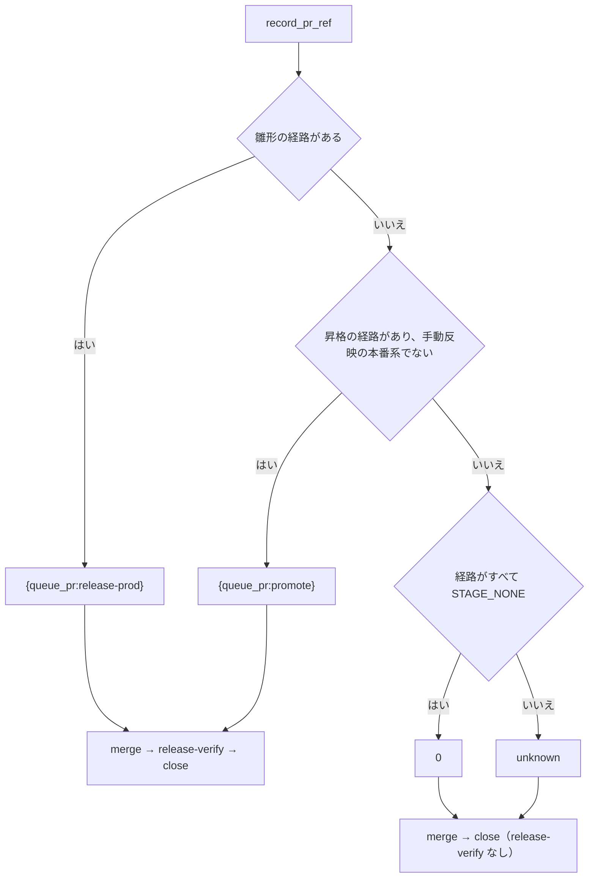

# スプリントの誤判定: 記録の置き場が分からない close は課題を開いたまま残し、「無し」の手動確認の行を数えない

## 概要

スプリントの機械の判定が、記録の無い状態や「確かめる中身が無い」行を取り違えないようにする決まりを 2 つ置く。

- **記録の置き場が分からないまとめの `close` は、課題を閉じない。** リリースの経路が雛形（`release.form`）でも昇格（promote）でも
  なく、届ける経路を 1 つでも含むとき、まとめのプランは `sprint-close.py --record-pr unknown` を打つ。`sprint-close.py` は
  配布の記録を読まず、どの課題も閉じず、ボードも書かずに、`--issues` の課題を理由つきの `kept_open` で返す（終了コード 0）
- **「手動確認は無い」と書いた行は、手動確認の行として数えない。** 要求の「検証手段」の表で 2 列目が「無し」の形の行は、
  PR 本文の `## 手動確認` の節に載らず、merge-gate も承認ゲート（終了コード 10）で止まらない

**手順・引数・結果の読み方の正は Skill とスクリプトにある。** この文書は、その形にした理由・常に成り立つ条件・既知の限界を残す。

| 何を | どこが正か |
| --- | --- |
| まとめのプランの組み方と `close` ステップの `--record-pr` の値 | `development-workflow` の [references/pace.md](../../plugins/ndf/skills/development-workflow/references/pace.md) の「スプリントの終わり」 |
| 経路ごとの `--record-pr` と `release-verify` の有無の表 | [ndf-production-release-record.md](ndf-production-release-record.md) の「まとめのプランの記録の PR と `release-verify`」 |
| `sprint-close.py` の処理の順序・引数・終了コード | [`sprint-close.py`](../../plugins/ndf/scripts/sprint-close.py) の冒頭の説明 |
| 「スプリントを閉じる」の呼び方と `status` ごとの次の手 | [`progress-tracking` の SKILL.md](../../plugins/ndf/skills/progress-tracking/SKILL.md) の「スプリントを閉じる」 |
| 要求の「検証手段」の表の書き方（手動確認が無ければ行を消す） | `requirements-design` の [references/spec-template.md](../../plugins/ndf/skills/requirements-design/references/spec-template.md) |

## 用語

「記録の置き場が分からない」「手動確認の行」「リリース記録」の定義は用語集（[docs/glossary.md](../glossary.md)）が正である。

## 背景

- **`--record-pr 0` が 2 つの意味を兼ねていた。** `sprint-close.py` の `0` は「本番の記録なし（本番を飛ばした・配布なし）」で、
  閉じる条件を見ずに課題を閉じる。一方、まとめのプランの記録の参照（`supervise_lib/sprint_routes.py` の `record_pr_ref`）は、
  雛形と昇格以外のすべての経路で `0` を返していた。merge（`merged-by-check`）・手で届ける経路で本番まで出たスプリントの課題が、
  リリース記録とリリース後テストの記録を見ずに閉じ、`close` の結果から「配布しなかった」と「記録を読まなかった」を区別できなかった
- **「無し」と書いた行で承認ゲートが止まっていた。** 要求に `| 手動確認（マージ前） | 無し（AC はテストで確かめられる） |` と
  書いた課題が、PR 本文の `## 手動確認` に未チェックの行（`- [ ] #<番号> マージ前: 無し（…）`）として載り、merge-gate が
  未確認の手動確認として数えて止まった。利用側のリポジトリで 3 回のスプリント続けて起き、毎回人が印を付けて
  `run <プラン> --from merge-gate` で続けていた

## 対象範囲

| 含む | 含まない |
| --- | --- |
| まとめのプランの記録の参照の決め方（`record_pr_ref`・`has_record`）と `close_plan` の分岐 | リリース記録の PR を `close` へ受け渡す手段（手で行うリリース・merge の経路の記録ステップ） |
| `sprint-close.py --record-pr unknown` の振る舞い・結果 JSON | 雛形（`{queue_pr:release-prod}`）と昇格（`{queue_pr:promote}`）の経路の振る舞い |
| 要求から手動確認の行を読む規則（`lib/manual_checks.py` の `rows_of`） | merge-gate（`merged_lib/merge.py` の `manual_gate`）と `unchecked_before_merge` の判定、要求の雛形の文 |

## 仕様

### 常に成り立つ条件

| # | 条件 | 破れたときの扱い |
| --- | --- | --- |
| I1 | まとめのプランの記録の参照が `0`（`RECORD_NONE`）になるのは、リリースの経路がすべて届けない経路（`STAGE_NONE`）のときだけである | テストが落とす |
| I2 | 記録の参照が `{queue_pr:…}` でない（`has_record` が偽）とき、プランに `release-verify` を置かず、merge の次は `close` になる | テストが落とす |
| I3 | `--record-pr unknown` の実行は、どの課題も閉じず、ボードも書かず、課題の本文も読まない（gh へ書き込まない） | テストが落とす |
| I4 | `--record-pr 0` の意味（記録を読まず、閉じる条件を見ずに `--issues` を閉じる。`--issues` が無ければ終了コード 2）は変わらない | 既存のテストが落とす |
| I5 | 要求の 2 列目が「無し」の形の行は `ManualRow` にならない。それ以外の空でない 2 列目は手動確認の行になる | テストが落とす |

### 入出力の契約

#### まとめのプランの記録の参照

`record_pr_ref` は上から順に判定し、最初に当たった値を返す。`close_plan` は `has_record(record_pr)` で `release-verify` を置くかを決める。

| 経路 | 返す値 |
| --- | --- |
| 雛形の経路がある | `{queue_pr:release-prod}` |
| 昇格の経路があり、開発版のチャネルが手動反映の本番系（`delivery.MANUAL_PRODUCTION`）でない | `{queue_pr:promote}` |
| 経路がすべて `STAGE_NONE`（`delivery` が `[]` を含む） | `0`（`RECORD_NONE`） |
| それ以外（merge・手で届ける・検証の環境だけ・手動反映の本番系の昇格） | `unknown`（`RECORD_UNKNOWN`） |

語 `0` と `unknown` と `has_record` は `supervise_lib/sprint_routes.py` に置き、`close_plan` はそれを呼ぶだけにする。

#### `sprint-close.py --record-pr`

`--record-pr` は 0 以上の整数か語 `unknown` を受ける（`record_pr_arg`）。それ以外の文字列と負の数は呼び出しの誤り（終了コード 3）である。

| 値 | `--issues` が無いとき | 配布の記録 | 課題 | 終了コード（失敗なし） |
| --- | --- | --- | --- | --- |
| 正の整数 | 記録の `スプリント:` の行の PR から集める | 読む | 閉じる条件を満たせば閉じる | 0 |
| `0` | `stopped`・終了コード 2（`--record-pr 0（本番の記録なし） は --issues と一緒に渡す`） | 読まない | 条件を見ずに閉じる | 0 |
| `unknown` | `stopped`・終了コード 2（`--record-pr unknown（記録の置き場が分からない） は --issues と一緒に渡す`） | 読まない | 閉じない。ボードも書かない | 0 |

`unknown` の結果は `lib/step_result.py` の形の 1 行の JSON で、次の形を持つ。

| 欄 | 中身 |
| --- | --- |
| `status` | `ok`（後続の振り返りへ進む） |
| `summary` | 先頭に `記録の置き場が分からないため閉じない（リリースの経路が雛形でも昇格でもない）: ` を付け、その後に件数の要約（`_close_summary`）が続く。`0` で閉じたときの `summary` にこの先頭の文は付かず、2 つはこの文で区別できる |
| `items` | `--issues` の各課題が `result: kept_open` と `reason`（`UNKNOWN_REASON`: 配布の記録の置き場が分からない。リリース記録を確かめて手で閉じる） |
| `next` | `リリース記録とリリース後テストの記録を確かめ、受け入れ条件を満たした課題を手で閉じる` |

#### 手動確認の行の「無し」の形

`rows_of` は、2 列目の前後の空白を除いた文が `_NONE`（`^(無し|なし|不要|ない|-|—|―)(?:$|[（(。、\s])`）に当たる行を落とす。
項目が「手動確認」でも「手動確認（マージ前）」でも同じに扱う。

| 2 列目 | 手動確認の行か |
| --- | --- |
| `無し（AC はテストで確かめられる）`・`なし`・`不要。`・`-`・`— 自動で足りる` | ならない |
| `無しの場合は画面で見る`（語の続きがある） | なる |
| `画面で一覧の並びを見る` | なる |

### 処理の流れ

`sprint-close.py` の中では、`cmd_close` が `--issues` の有無を確かめ、`_read_sprint_record` が `0` と `unknown` で記録を読まずに
PR の一覧を空で返す。`_closing_blocker` は `unknown` のとき全課題を止める理由（`kept_all`）に `UNKNOWN_REASON` を入れ、
`_close_item` はそれを見て全課題を `kept_open` で返す。最後に `cmd_close` が `summary` の先頭の文と `next` を付ける。

「無し」の行は読む入口の `rows_of` で落ちるため、`manual_section`（行が 0 件なら節を置かない）と merge-gate の
`unchecked_before_merge` は変えずに、節が出ず数えもしない。

### 決定と理由

| 決定 | 理由 | 採らなかった案 |
| --- | --- | --- |
| `--record-pr` に語 `unknown` を足し、`0` の意味は変えない | 語ならプランの `cmd` と結果を読む人がそのまま意味を取れる。`0` を手で打つ既存の手順の意味が黙って変わらない | 負の数（`-1`）で表す。`0` を「置き場を知らない」に変え、配布なしに別の値を足す |
| 検証の環境だけ（本番の行の無い）経路・手動反映の本番系の昇格も `unknown` にする | 開いたまま残った課題は人が 1 回の操作で閉じられるが、条件を見ずに閉じた課題は確かめていないことが結果から読めない | 検証の環境だけの経路を配布なしとして `0` で閉じる |
| 「無し」の判定を `rows_of` の 1 か所に置き、語の直後を括弧・句読点・空白・文末に限る | PR 本文の節も merge-gate の数え方も `rows_of` の出力から作られる。後続を限れば「無しの場合は〜」のような確認の文を落とさない | merge-gate で「無し」の行を数えない（PR 本文に未チェックの行が残り続ける）。要求の雛形の文を変える（雛形に「無ければ行を消す」が既にある） |

## データ・設定

新しい設定・引数は無い。リリースの経路は今どおり `.ndf/project.json` の `delivery` と `.ndf/supervise.json` の `release.form` から決まる。
変わるのは `sprint-close.py --record-pr` の受ける値が 1 つ増えることだけで、既存の値の意味は変わらない（互換あり）。

## エラー処理

| 状況 | 扱い |
| --- | --- |
| `--record-pr unknown` に `--issues` が無い | `stopped`・終了コード 2。何も書かない |
| `--record-pr` が整数でも `unknown` でもない・負の数 | 呼び出しの誤り。終了コード 3 |
| 要求の写しが無い課題 | 今どおり手動確認の行を読まずに飛ばす（`issue_rows`） |

## 運用

- `close` が `unknown` で返ったら、運用者はリリース記録とリリース後テストの記録を確かめ、受け入れ条件を満たした課題を手で閉じる
  （`next` の文）。`kept_open` は止める理由にならないため、まとめのプランは振り返り・棚卸しへ進む
- 既に作られた PR 本文に残る「無し」の未チェック行は、検査のプランの pr ステップを流し直すと節ごと作り直されて消える
  （`manual_section` は要求から節を作り直す）

## テスト観点

| 観点 | テスト |
| --- | --- |
| merge・手で届ける・検証の環境だけの経路で、`close` の `cmd` が `--record-pr unknown` になり `release-verify` が無いこと（I1・I2） | `test_supervise_pace_verify.py` の `test_close_without_a_known_record_keeps_the_issues_open` |
| `delivery: []` で `--record-pr 0` のまま変わらないこと（I1） | 同じファイルの `test_close_of_no_delivery_keeps_record_pr_zero` |
| `--record-pr unknown --issues …` で全課題が `kept_open`・理由つき・終了コード 0、gh の書き込みが 0 回で、`summary` が先頭の文を持つこと（I3） | `test_sprint_close_issues.py` の `test_record_unknown_keeps_the_given_issues_open_with_a_reason` |
| `unknown` に `--issues` が無ければ終了コード 2、それ以外の値・負の数は終了コード 3 | 同じファイルの `test_record_unknown_alone_returns_two`・`test_record_pr_rejects_other_values` |
| `0` の既存の振る舞いが変わらないこと（I4） | 同じファイルの `test_record_zero_closes_the_given_issues_without_reading_a_record` |
| 「無し」だけの要求で行が 0 件・節が空・merge-gate が数えないこと（I5） | `test_manual_checks_none.py` の `test_a_none_row_makes_no_section_and_no_gate` |
| 「無し」の 7 語の単独と後続つきの形を、両方の項目で落とすこと（I5） | 同じファイルの `test_none_forms_are_not_manual_rows` |
| 語の続きがある文と実際の確認の文が、マージ前の未チェック行として載り merge-gate が数えること（I5） | 同じファイルの `test_real_checks_still_stop_the_merge_gate` |

## 既知の限界

| 項目 | 内容 |
| --- | --- |
| 記録の PR を `close` へ渡す手段が無い | merge・手で届ける・検証の環境だけの経路の課題は、`unknown` で開いたまま残り、人が手で閉じる。受け渡しの手段は課題 #2044 が扱う |
| 手動反映の本番系の昇格はテストで縛っていない | 見本のリポジトリ（`make_repo`）は起点 develop・本番 main で、起点と本番が同じ形を組めない。`record_pr_ref` の分岐（`manual_prod`）は昇格を飛ばして `unknown` へ落ちる形で入っている |
| 語 `unknown` が 2 か所にある | `sprint-close.py` は `supervise_lib` を import しない独立のスクリプトで、`RECORD_UNKNOWN` を `sprint_routes.py` と別に持つ（コメントで指し合う） |
| 既に閉じた課題も `kept_open` で載る | `unknown` は課題の状態を読まずに返すため、closing keywords で GitHub が先に閉じた課題も `kept_open` に並ぶ |
| 流し直さない PR 本文 | 既に作られた PR 本文の「無し」の未チェック行は、pr ステップを流し直さない限り残る |

## 関連リンク

- 課題: #1875（記録の置き場が分からない close）・#1675（「無し」の手動確認の行）。実装は PR #2051
- [ndf-production-release-record.md](ndf-production-release-record.md): 経路ごとの記録の PR と `release-verify`
- [ndf-sprint-close-acceptance-criteria.md](ndf-sprint-close-acceptance-criteria.md): 閉じる条件 2 と受け入れ条件の印（`unknown` で本文を読まない条件 I8）
- [ndf-sprint-close-referenced-issues.md](ndf-sprint-close-referenced-issues.md): 参照だけの課題（`unknown` ではスプリントの PR を読まない）
- 実装: [`supervise_lib/sprint_routes.py`](../../plugins/ndf/scripts/supervise_lib/sprint_routes.py)・[`supervise_lib/sprint.py`](../../plugins/ndf/scripts/supervise_lib/sprint.py)・[`sprint-close.py`](../../plugins/ndf/scripts/sprint-close.py)・[`lib/manual_checks.py`](../../plugins/ndf/scripts/lib/manual_checks.py)
