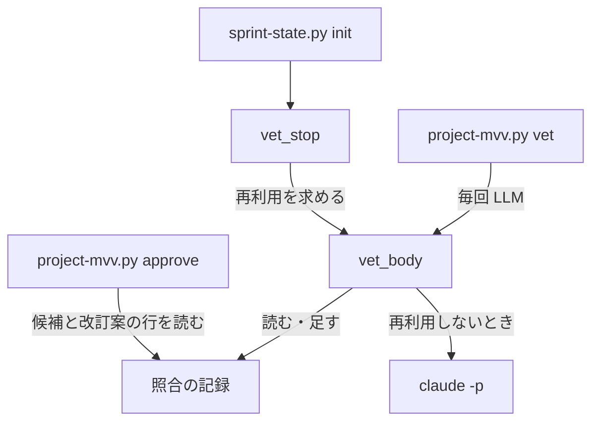
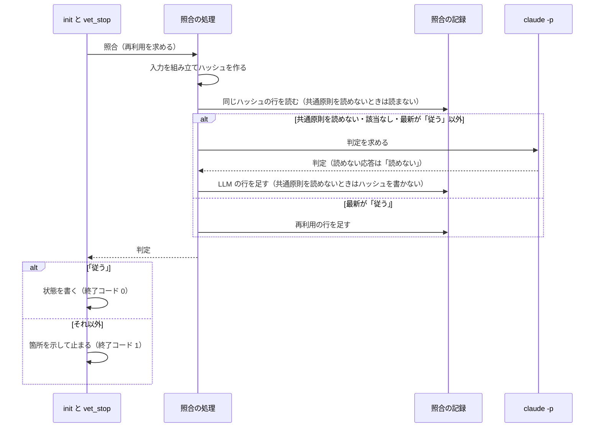

# スプリント MVV の照合: 入力が同じなら「従う」の判定を再利用する

スプリントの状態を作る `sprint-state.py init` は、スプリント MVV を照合するときに、照合の入力が前と 1 字も
変わらず、同じ入力の最新の判定が「従う」なら LLM を呼ばずにその判定を使う（#2614）。LLM の判定の揺れだけを
理由に開発ループが止まることを無くし、結果の変わらない LLM の呼び出しをやめるためである。

**手順は Skill の手順書が正である。** `init` の照合の振る舞いは
`plugins/ndf/skills/development-workflow/references/pace.md`、照合の記録の読み方は同じディレクトリの
`project-mvv.md` にあり、ここへ書き写さない。この文書は、決めたことの理由と、照合の記録の形を残す。

## 概要

| 呼ぶ側 | 照合のしかた |
| --- | --- |
| `sprint-state.py init`（`fast` / `auto`・承認済みのプロジェクト MVV・スプリント MVV あり） | 同じ照合の入力の最新の判定が「従う」なら再利用する。それ以外は LLM で判定する |
| `project-mvv.py vet`（種類を問わない） | 毎回 LLM で判定する。判定をやり直す手段として残す |
| 候補・改訂案・起票する課題の本文の照合 | 毎回 LLM で判定する |

`sprint-state.py` と `project-mvv.py` の引数・終了コード・結果の形は、再利用の有無で変わらない。

## 背景

開発ループ lfactory3 のループの 11 回目（2026-11-06）で、本文が 1 字も変わっていないスプリント MVV が「反する疑い」と
判定され、`init` が断られて開発ループが `refused` で止まった。同じ本文の 18 回の照合のうち「反する疑い」は
1 回だけで、4 分後には「従う」に戻っていた。判定を変える入力の変化は、プロジェクト MVV の版 4→5 の 1 回だけ
だった。18 回で 1.43 ドル・167 秒（1 回あたり 0.08 ドル・9 秒）を使っていた。

## 用語

照合・照合の入力・照合の記録の定義は用語集（[docs/glossary.md](../glossary.md) ）にある。

## 仕様

### 構成要素

| 要素 | 責務 |
| --- | --- |
| 照合の処理（`plugins/ndf/scripts/project_lib/mvv_llm.py` の `vet_body`） | 照合の入力を組み立てる。引数 `reuse`（既定は偽）が真なら同じ入力の最新の判定を読み、再利用か LLM かを決める。どちらでも照合の記録へ 1 行足す |
| スプリント MVV の照合の呼び出し（`plugins/ndf/scripts/lib/sprint_mvv.py` の `vet_stop`） | `reuse=True` で照合し、「従う」以外なら止まる理由を返す |
| 明示の照合（`plugins/ndf/scripts/project-mvv.py vet`） | `reuse` を渡さず、毎回 LLM で判定する |
| 承認（`project-mvv.py approve` の `last_vet`） | 照合の記録のうち候補・改訂案の行だけを読む。再利用の行は種類がスプリント MVV なので読まない |

### 処理の流れ

### 常に成り立つ条件

| # | 条件 | 破れたときの扱い |
| --- | --- | --- |
| I1 | 再利用するのは、同じ照合の入力の行のうち最新の行の判定が「従う」のときだけである。最新は時刻が最も後の行で、時刻が同じなら後ろの行である | 再利用せず LLM で判定する |
| I2 | 照合の入力のハッシュは、判定の指示・共通原則・プロジェクト MVV・判定の決まり・本文の種類の名前・照合する本文の全体から作る。1 字でも違えば別の値になる | 別の入力として LLM で判定する |
| I3 | 再利用の行は元の判定の時刻を持ち、費用と秒を持たない。元の判定の時刻は、再利用の行を元にした再利用でも LLM が判定した行の時刻を指す | テストで落とす |
| I4 | 既存の行を書き換えない。足すだけである | テストで落とす |
| I5 | 記録を読めない・壊れた行があることは、照合を止める理由にならない | 該当する記録なしとして LLM で判定する |
| I6 | 再利用は `sprint-state.py init` の経路だけが求める。`project-mvv.py vet` は種類によらず毎回 LLM で判定する | テストで落とす |
| I7 | 共通原則のファイルを読めないときの照合は、再利用せず、再利用の元にもならない。その行は `input_sha256` を持たない | 再利用せず LLM で判定する |

I7 を置くのは、共通原則を読めないときに入る代わりの文がパスと例外の文だけからなり、読めない状態が続くと毎回
同じ文字列になって、入力のハッシュでは切り分けられないためである。共通原則を読めたかは、代わりの文を返す
関数の戻り値ではなく、共通原則のファイルを読めたか（`principles_readable`）で決める。

### 決定の理由

- **最新の判定が「従う」のときだけ再利用する。** 開発ループを止める判定を固定すると、揺れで出た「反する疑い」で
  止まり続ける。古い「従う」があっても後の判定が「従う」でなければ LLM に戻し、後から出た疑いを隠さない。
  再利用に期限は設けない。再利用を止める手段は、明示の照合（`project-mvv.py vet`）で「従う」以外の行を最新にすることである
- **照合の入力の全体のハッシュをキーにする。** 本文とプロジェクト MVV の組をキーにすると、共通原則や判定の
  指示を変えた版でも古い「従う」が使われ続ける。LLM へ渡す文字列そのものをハッシュにすれば、入力へ材料を
  足したときにキーの側を直し忘れることもない。入力全体のハッシュをキーにし、失敗の結果を保存しない形は、
  Bazel の Remote Execution API と promptfoo のキャッシュに倣った
- **新しいキャッシュを作らず照合の記録を読む。** 照合の記録はすでに判定とその順序を持つ。別の保存先を足すと、
  最新の判定がどちらにあるかを揃える処理が要る
- **承認したスプリント MVV の sha256 では照合を外さない。** 承認の記録はスプリント MVV の本文だけを持つため、
  承認の後にプロジェクト MVV が改訂されても照合を通らなくなる。承認の記録は開発ループの記録にしか無く、
  開発ループを通らない `sprint-state.py init` にも効かない
- **再利用も 1 行として残す。** 行を残さないと、照合が行われたことと費用の効果が記録から読めない
- **言語モデルの違いはキーに含めない。** モデルの変更で判定の基準が動くことは、判定の指示の変更で扱う
- **再利用は呼ぶ側が求めたときだけ行う。** 既定を再利用にすると、候補・改訂案・起票する課題の照合と
  `project-mvv.py vet` へ広がり、判定をやり直す手段が無くなる

## データ・設定

照合の記録（`project-mvv.jsonl`）は 1 行 1 判定の JSONL で、主キーを持たない。置き場は `NDF_MVV_STATE_DIR`、
無ければ利用者の状態の根（[ndf-state-home-by-owner.md](ndf-state-home-by-owner.md) ）である。機械ごとに 1 つあり、
`repo` の値で絞らずに読むため、メインディレクトリと worktree のどちらから打っても同じ行を再利用する。

| 項目 | 型 | 空を許すか | 意味 |
| --- | --- | --- | --- |
| `input_sha256` | 文字列 | 許す | 照合の入力の sha256（`sha256(判定の指示 + "\0" + プロンプト全体)`）。LLM を呼ぶ経路の行と再利用の行が持つ。項目が無い行は、項目を足す前の行、LLM を呼ばなかった行（形の検査で止めた候補・改訂案）、共通原則を読めなかった行である |
| `reused_from` | 文字列（`at` と同じ形の時刻） | 許す | 再利用した元の LLM の判定の時刻。項目があれば再利用の行である |
| `cost_usd`・`seconds` | 数 | 許す | 再利用の行は項目ごと持たない。呼び出しが無いためで、0 と書かない |
| `locations` | 配列 | 許さない | 再利用の行は元の行の箇所をコピーする |

プロンプトには本文の種類の名前が入るため、種類の違う行は別のハッシュになる。読む側は種類で絞らない。
`input_sha256` を持たない行は再利用の対象にならず、読んでも落ちない。読み取りは壊れた行を飛ばし、読めない
ファイルは空として扱う（`project_mvv_signals.read_jsonl`）。書き込めないときは、追記の関数（`append_jsonl`）の
例外がそのまま上がる。

## セキュリティ

照合の記録は利用者の権限で書けるファイルであり、書き換えると再利用の判定に効く。`project-mvv.py approve` も
同じ記録を信頼しており、再利用で新しい境界は増えない。

## 運用

- 判定をやり直したいときは `project-mvv.py vet --kind sprint` を打つ。その行が「従う」以外なら、次の `init` は LLM で判定する
- LLM が一度誤って「従う」を返すと、入力が変わるまで再利用される。毎回照合していたときも 1 回の「従う」で進むため、差は同じ入力で判定の機会が減ることである
- 新しい本文や、プロジェクト MVV の改訂後の最初の照合は LLM を呼ぶ。そこで揺れて「反する疑い」が出れば、今までどおり止まって人へ戻る
- 別の機械では、最初の 1 回だけ LLM を呼ぶ

## テスト観点

テストは `plugins/ndf/scripts/tests/test_project_mvv.py` の「スプリント MVV の照合の再利用」の節にあり、偽の LLM の
呼び出しの回数と照合の記録の行で確かめる。

| 観点 | 確かめる振る舞い |
| --- | --- |
| 再利用して進む | 最新が「従う」の記録がある `init --pace fast` が LLM を呼ばず、終了コード 0 で状態を書くこと |
| 課題の事象を再現しない | LLM の応答を「反する疑い」にしたまま、開発ループの `init` が断られないこと |
| 再利用の行の形 | 再利用の行が `reused_from` を持ち、`cost_usd`・`seconds` を持たないこと。2 回続けて再利用しても LLM の行の時刻を指すこと |
| 入力の変化 | 本文・プロジェクト MVV・共通原則・判定の決まり・判定の指示のどれを変えても LLM を 1 回呼ぶこと |
| 最新の判定 | 古い「従う」の後に「反する疑い」「判定できない」「読めない」の行があると LLM を 1 回呼ぶこと |
| 記録の欠落 | 記録のファイルが無い・壊れた行を含むとき、`init` が LLM の判定で進むこと |
| リポジトリの違い | `repo` の値が違う行を再利用すること |
| 共通原則を読めない | 2 回続けて打つと LLM を 2 回呼び、どちらの行も `input_sha256` を持たないこと |
| 退行しない | 再利用できる記録が無く「反する疑い」なら終了コード 1 で状態を書かないこと。`project-mvv.py vet --kind sprint` は記録があっても LLM を呼ぶこと。`pace: normal` の `init` は照合しないこと。再利用の行があっても `approve` の結果が変わらないこと |

## 関連リンク

- `plugins/ndf/skills/development-workflow/references/pace.md`（`init` の照合）
- `plugins/ndf/skills/development-workflow/references/project-mvv.md`（照合の記録）
- [ndf-state-home-by-owner.md](ndf-state-home-by-owner.md)（記録の置き場）
- Bazel Remote Execution API: https://github.com/bazelbuild/remote-apis
- promptfoo のキャッシュ: https://www.promptfoo.dev/docs/configuration/caching/
