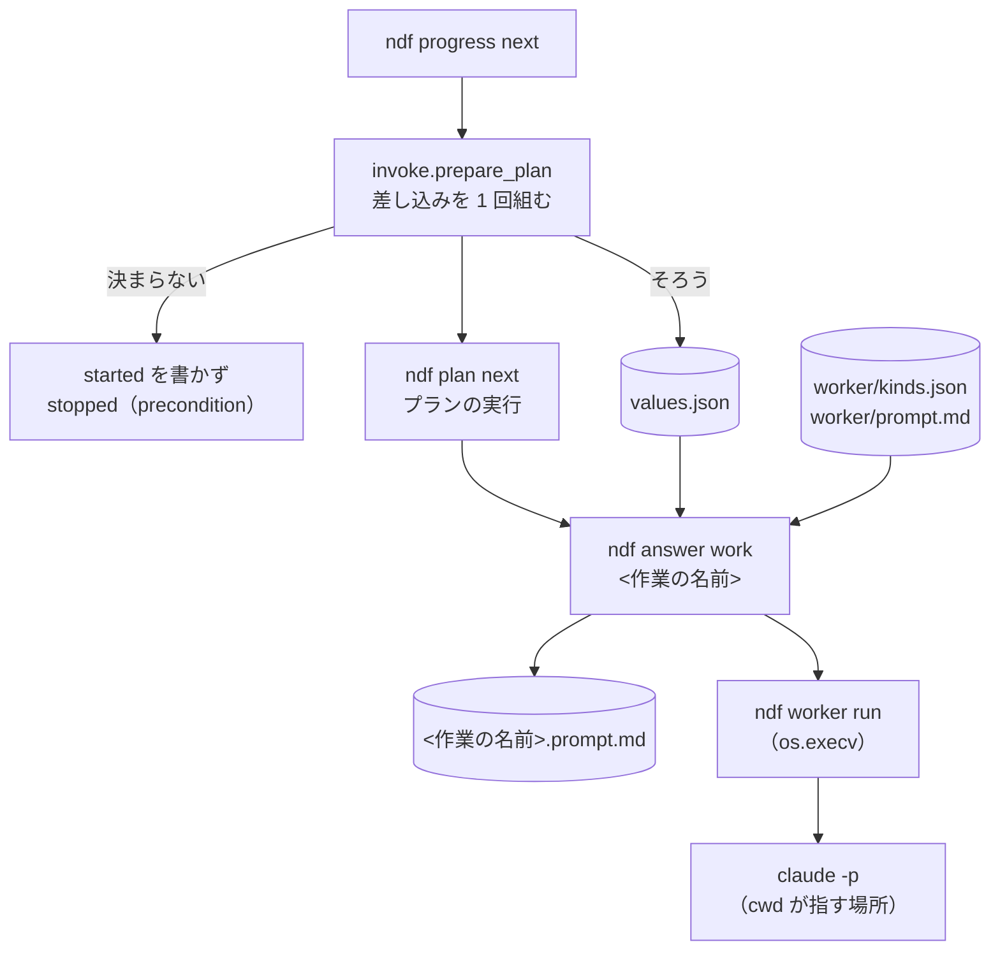

# 工程のプラン: 仕組みが worker の起動指示を組み、工程が手を借りずに流れる

## 概要

**工程のプランは worker を起動する argv の既定（`ndf answer work --state-dir <保存先>`）を持ち、`ndf answer work` が起動指示を組んでから `ndf worker run` へ置き換わる。** スプリントのステートマシン（`ndf progress`）の工程は、conductor と supervisor が作業を手で済ませなくてもプランで流れる。

例: `standard` のスプリントで `ndf progress next <ステートマシンの ID>` が工程「要求と受け入れ条件」を始めるときの順。

| 順 | 起きること |
| ---: | --- |
| 1 | `ndf progress next` が、行を始める前にプラン `requirements` の差し込みを組み、作業 `requirements` が読む値（`issues`・`mode`）がそろうことを確かめ、ステップの保存先の `values.json` へ残す |
| 2 | 工程の行に `started` を書き、組んだ値でプランを描いて `ndf plan next` を起動する |
| 3 | プランのステップが `ndf answer work --state-dir <保存先> requirements` を打つ |
| 4 | `ndf answer work` が `values.json`・作業の定義（`contracts/worker/kinds.json`）・共通のテンプレート（`contracts/worker/prompt.md`）から起動指示を組み、`<保存先>/requirements.prompt.md` へ書く |
| 5 | 同じプロセスが `ndf worker run --kind requirements --prompt-file …` へ置き換わり、作業の定義の `cwd`（`requirements` は `repo`）が指す場所で `claude -p` を起動する |
| 6 | worker が書いた結果ファイルの `status` が `ndf worker run` の結果になり、プランの結果を通って工程へ返る。必須の出力を持つ作業（`worktree` の `worktree`・`branch`、`release` の `delivery`・`product_version`）では、`--require-output` で確かめた値も工程の出力へ渡る |

差し込みを決められない工程は、行に `started` も `failed` も書かずに `stopped`（`precondition`）で返し、決まらない名前とその値の出所を結果の `items` に並べる。手で閉じるときの出力の値の取り場所は、スプリントの文脈のスキーマの `x-source` が持ち、`ndf progress check` が欠けたキーの行に添える。

## 用語

| 用語 | 意味 |
| --- | --- |
| 作業の名前 | 工程のプランが worker へ渡す作業の識別子（`requirements`・`impl` など）。唯一の基準は `plugins/ndf/contracts/worker/kinds.json` の `kinds` のキー |
| 差し込みの値 | プランのテンプレートの `{{名前}}` に入る値。`ndf.progress.invoke.template_values` が組む。起動指示のテンプレートの差し込み（`$名前`）とは別の仕組みである |
| 起動指示 | worker へ渡すプロンプト。作業・入力・手順・読む Skill・返す形・保存先・作業の結果ファイルの 7 項目と、worker が守る規則 7 個を持つ |
| 試行 | 工程の行の `started` 1 件から、その行の `failed` か `completed` までの 1 回。初回の開始と、失敗の後の打ち直しがそれぞれ 1 つの試行になる |
| 代表の課題 | 課題を複数持つ工程で、題と本文と番号をコピーする対象になる課題。番号の最も小さいもの |
| 起点 | 差分を取る参照。作業場所で読めればマージ先のブランチ名、読めなければ `<リモート名>/<マージ先>` |

## 背景

工程の定義（`plugins/ndf/contracts/workflow/stages/*.json`）は、工程ごとにプランのテンプレート（`plugins/ndf/contracts/templates/`）を呼ぶ。テンプレート 24 件のうち 22 件が差し込み `{{worker}}` の後ろに作業の名前を 1 要素足した argv を持ち、`standard` の 18 工程のうち 17 工程が当たる。この差し込みに既定が無かったため、どの工程も起動のたびに値が決まらず、`started` の後に `failed` を書いていた。2026-11-19 以降の 11 のスプリントで、プランで流れたのはクリーンアップ（テンプレート `merged`。`{{worker}}` を使わない）だけだった。

欠けていたのは起動指示を書く処理だけである。`ndf answer work` は作業の名前を `ndf worker run` の引数へ合わせて同じプロセスで打つところまで持っていた。

| 決めたこと | 理由 |
| --- | --- |
| 起動指示を組むのは `ndf answer work` にする | テンプレート 22 件に同じ形を書くと、起動指示の形を変えるたびに 22 か所を直す。プランの実行の層（`ndf.core.plan`）は工程と作業の規約を持たない層である |
| 起動指示の材料は保存先の `values.json` で渡す | `ndf answer work` が受ける引数は `--state-dir`・`--cwd`・作業の名前の 3 つで、課題の番号・作業場所・受け入れ条件は保存先から読むしかない。組んだ層が書けば、プランを描いた値と起動指示の値が食い違わない |
| 作業ごとの定義は `kinds.json` の 1 か所に置く | 作業の名前がコードの定数（7 件）と差し込みの説明文（18 件）に分かれて食い違っていた。作業ごとに起動指示のテンプレートを持つと、共通の 7 項目と規則 7 個が 18 か所に分かれる |
| 決められない差し込みは行を始める前に見つける | `started` → `failed` を書くと履歴が失敗で埋まり、`ndf progress retry` を打たないと次へ進めない。既定の値で埋めて起動すると、誤った値で worker が動く |
| 起動指示のテンプレートの差し込みは `string.Template` の `$名前` にする | Python 標準ライブラリで足り、依存を足さない。`substitute()` は欠けた差し込みで `KeyError` を上げて止まる（Jinja2 の既定は欠けた値を空で描画する） |
| 出力の値の取り場所は文脈のスキーマに置く | 手順書に表を書くと、文書とスキーマの 2 か所に同じ事実が分かれ、片方だけが古くなる |

## 対象範囲

含む:

- 差し込み `worker` の既定と、作業の名前ごとの定義（`contracts/worker/kinds.json`）・起動指示の共通のテンプレート（`contracts/worker/prompt.md`）
- 作業が読む値の受け渡し（`values.json`）。工程から組むプランと、`ndf route render`・`ndf route run` で組む単発のプランの両方
- 差し込みを 1 回だけ組むことと、決められないときに工程を始めずに返すこと
- worker の結果ファイルの `outputs` をプランの結果へ渡すことと、欠けをプランの停止結果へ運ぶこと
- 課題を複数持つ工程の差し込み（代表の課題・受け入れ条件の確かめ・スプリントの Pull Request の `Refs`）と、リファクタリングの既定の起動
- 欠けた文脈のキーの値の取り場所（`x-source`）を `ndf progress check` が示すこと

含まない: 工程表の工程の増減、工程「実装」の単位の展開とマージ、デプロイの工程がスプリントの Pull Request へリリース承認ゲートを出すこと、報告の保存先のパスの決め方（[ndf-worker-agent-and-skill-excerpts.md](ndf-worker-agent-and-skill-excerpts.md) の `report_paths` が持つ）。

## 仕様

### 構成要素と責務

| 要素 | 責務 |
| --- | --- |
| `plugins/ndf/contracts/templates/params.json` の `worker` | 既定 `["ndf", "answer", "work", "--state-dir", "{state_dir}"]`。作業場所は既定の argv に置かず、作業の定義の `cwd` が持つ |
| `plugins/ndf/contracts/worker/kinds.json` | 作業の名前 18 件ごとに、作業種別・作業の 1 行・読む Skill・手順の抜粋のパス・読む値・作業場所・必須の出力を持つ |
| `plugins/ndf/contracts/worker/prompt.md` | 起動指示の 7 項目と規則 7 個の共通のテンプレート |
| `plugins/ndf/src/ndf/contracts/worker_kinds.py` | 作業の定義を読み、作業が読む値と作業場所の欠けを名前と出所で返す。`values.json` の読み書きと、単発のプランが持つ値（`work_values`）の受け渡しも持つ |
| `plugins/ndf/src/ndf/progress/invoke.py` | 工程がプランを組む層。差し込みを 1 回だけ組んで `values.json` へ残し（`prepare_plan`）、組めなかった例外を停止の結果 JSON へ分ける（`plan_failure`） |
| `plugins/ndf/src/ndf/progress/run.py` | 行に `started` を書く前に、前の試行の値を消して次に流すプランの差し込みを組む（`_prepare`） |
| `plugins/ndf/src/ndf/progress/gate/entry.py` | `ndf answer work`。起動指示を組んで保存先へ書き、`ndf worker run` へ置き換わる |
| `plugins/ndf/src/ndf/progress/refactor_values.py` | 設定を持たないリポジトリのリファクタリングの既定の起動と、実装計画からの候補 |
| `plugins/ndf/src/ndf/core/route/__init__.py` | テンプレートの描画。単発のプランへ worker の入力を持たせ（`work_values`）、リファクタリングの既定の argv を組む（`refactor_launch`） |
| `plugins/ndf/src/ndf/core/worker_outcome.py` | 結果ファイルの `outputs` を `--require-output` の名前で確かめ、`ndf worker run` の結果へ載せる |
| `plugins/ndf/src/ndf/core/plan/records.py`・`runner.py` | 止まったステップが残した欠けを記録し、プランの停止結果へ載せる |
| `plugins/ndf/src/ndf/progress/definition.py`・`command.py` | 欠けた文脈のキーの値の取り場所（`x-source`）を読み、`ndf progress check` の結果に添える |



### 常に成り立つ条件

1. **`ndf answer work` が受ける作業の名前は `kinds.json` の `kinds` のキーだけである。** ほかは `stopped`（`invalid`）で断る
2. **起動指示を書き終える前に worker へ置き換わらない。** 作業の名前・`values.json`・作業が読む値・作業場所のどれかが足りなければ、報告のファイルも結果ファイルも触らずに止まる
3. **差し込みを組む処理（設定の読み取り・`git` の呼び出し・課題の読み取り）は、1 つの試行の 1 プランにつき 1 回だけ走る。** プランを描くときは `values.json` の値をそのまま使う
4. **差し込みか作業が読む値を決められない工程は、ステートマシンに `started` も `failed` も増やさない。** 行は未着手のままで、`values.json` も書かれない
5. **`ndf worker run` が `ok` で返す `outputs` は、`--require-output` に挙げた名前の値だけである。** 結果ファイルの確かめていないキーはプランへ渡らない
6. **`incomplete` で止まったプランの結果は必ず欠け（`gaps`）を持つ。** 止まったステップが欠けを残していなければ、ステップの名前と理由で 1 件を補う
7. **`{{worker}}` を使わないテンプレート（`fix`・`merged`）の argv は、既定の有無によらず変わらない**
8. **`values.json`・描いたプラン・起動指示は、呼んだ利用者が持ちグループとほかの利用者が書き込めないファイルとしてだけ読み書きする。** 共有の保存先で差し替えられた値を worker へ渡さない

### 作業ごとの定義（`kinds.json`）

作業の名前 18 件（`impl`・`fix`・`ci-fix`・`fix-base`・`fix-push`・`design`・`design-detail`・`document-sources`・`implementation-plan`・`quality-gates`・`plan-to-spec`・`requirements`・`worktree`・`release`・`release-verification`・`layout-review`・`retrospective`・`backlog-refinement`）ごとに 7 つのキーを持つ。`ndf.contracts.worker_kinds` の関数が読む。

| 関数 | 返すもの |
| --- | --- |
| `work_kinds()` | 作業の名前 → 定義 |
| `kind_values(kind, values, inputs)` | 定義の `inputs` の名前ごとの値。差し込みの値にあればそれ、無ければ工程の入力から取る |
| `work_dir_of(kind, values)` | 定義の `cwd`（`worktree` か `repo`）が指す差し込みの値。空か無ければ `None` |
| `kind_gaps(kind, values, inputs, sources=…, covers=…)` | 定義の `inputs` と `cwd` が指す値のうち、どちらにも無い（または空の）名前 → 出所の人が読む文。そろえば空 |

`covers`（呼び手が `route.LAUNCH_SOURCES` を渡す）は、別の値があれば要らない名前の対応である。受け入れ条件の確かめ（`acceptance`）を明示した工程は、単独の `issue` を持たなくてよい。

コードを編集する作業（`impl`・`design`・`plan-to-spec` など 11 件）の `cwd` は `worktree` で、作業場所をこれから作る作業と作業場所を持たない作業（`requirements`・`worktree`・`release`・`release-verification`・`layout-review`・`retrospective`・`backlog-refinement`）は `repo` である。

### 起動指示の組み立て

`ndf answer work` は、保存先を祖先のリンクを解きながら 1 回だけ開き、同じ記述子で `values.json` を読み、報告の一式を初期化してから起動指示を書く。起動指示の本文は名前の無い私有のファイル（Linux は `memfd_create`、使えなければ作ってすぐ名前を消す一時ファイル）へも書き、`ndf worker run` には `--prompt-file /dev/fd/<番号>` で渡す。保存先のファイルを後から差し替えられても、worker へ渡る指示は確かめた `values.json` から組んだ本文のままになる。

共通のテンプレートの差し込みは `string.Template` の `$名前` で、次の値が入る。

| 差し込み | 入る値 |
| --- | --- |
| `$work`・`$summary` | 作業種別（調査・修正・検証・集計）と作業の 1 行（定義の `work`・`summary`） |
| `$inputs` | 作業が読む値を 1 行 1 件で並べた字面。値は JSON の値にして、値の中の改行や見出しが指示の行にならないようにする |
| `$workdir` | worker が動く作業場所の絶対パス（`--cwd` か、定義の `cwd` が指す差し込みの値を解いたもの） |
| `$steps`・`$skills` | 手順の抜粋（定義の `excerpt` のファイルの中身。無ければ 1 行）と、読む Skill の名前と `SKILL.md` の絶対パス（無ければ「無し」） |
| `$report`・`$done`・`$result` | 報告・完了マーカー・作業の結果ファイルの絶対パス（`report_paths` が返す 4 つのうち 3 つ） |
| `$report_arg`・`$result_arg` | 上の 2 つをシェルで 1 つの引数になるよう引用した値。コマンドの見本に使い、空白や `$` を含むパスでも割れない |
| `$outputs` | 結果ファイルに必ず入れる `outputs` のキーと `ndf contracts emit --outputs` の見本（無ければ「無し」の 1 行） |

`$inputs` は組んだ後の 1 つの文字列なので、`substitute()` では内訳の欠けを見つけられない。欠けは組む前に `kind_gaps` で名前ごとに確かめる。

### 作業が読む値の受け渡し（`values.json`）

`values.json` は、プランを組んだ差し込みの値と工程の入力をプランの実行の保存先へ残すファイルである。書く側は 2 つある。

| プランの作り方 | 誰が書くか |
| --- | --- |
| 工程から組むプラン | `invoke.prepare_plan`。行を始める前（`progress.run._prepare`）か、その試行でそのステップを初めて流すとき（`invoke.plan_path`）に 1 回 |
| 単発のプラン（`ndf route render`・`ndf route run`） | 描画がプラン本体の最上位のキー `work_values` に値を持たせ、`ndf plan next` が回を始める・続けるたびに実行の選んだ保存先（`--state-dir` を含む）へ書く（`worker_kinds.hand_plan_values`） |

単発のプランでも値が渡るので、`ndf answer work` が `precondition` で止まるのは、`work_values` を持たないプランを手で組んだときだけである。描画の時点ではなく流す時点の保存先へ書くため、保存先を変えて流してもプラン本体と値が食い違わない。単発のプランで作業が読む値のうちテンプレートの差し込みに無いもの（`requirements` の `issues`・`mode` など）は、`ndf route render --set`・`--add` で渡す。渡っていなければ描画の時点で `RouteError` にし、実行の途中の worker で止めない。

### 差し込みを 1 回だけ組み、決められなければ始める前に返す

`ndf progress next` が工程の行を始めるとき（初回と打ち直しのどちらも）、`progress.run._prepare` が次の順で進む。

1. その工程の今の世代のすべてのステップの保存先から、前の試行の `values.json` と課題のコピーを消す（`invoke.clear_values`）。消せなければ `stopped`（`precondition`）
2. この試行で次に流すステップ（初めから流し直すなら最初のステップ、ほかは終わっていない最初のステップ）がプランなら、`invoke.prepare_plan` を呼ぶ
3. `prepare_plan` は設定を 1 回読み、差し込みを組み、プランが使う作業の名前ごとに `kind_gaps` を当て、そろえば `values.json` を書く。決まらなければ `TemplateValuesMissing`（差し込み）か `KindInputsMissing`（作業が読む値・作業場所）を上げ、`values.json` を書かない
4. 上がった例外は `invoke.plan_failure` が停止の結果 JSON へ分ける。結果が返れば `started` を書かずにその結果で止まる

工程の 2 つ目以降のプランのステップ（工程「設計」の `cross-review` など）は、前のステップが作った Pull Request やレビューの範囲を差し込みに使うので、行を始める時点では組まない。そのステップを流すときに `invoke.plan_path` が同じ `prepare_plan` を呼び、同じ試行の以後の描画（承認の回答の後・打ち直し）は書かれた `values.json` を読むだけになる。

`plan_failure` の分類は、工程から流す経路（`invoke._call_plan`）と始める前の確かめで同じである。差し込みと作業が読む値の欠けだけが `invalid` から `precondition` へ変わり、`items` に `{"key": 名前, "source": 出所}` が並ぶ。

### 作業の出力をプランの結果へ渡す

`ndf answer work` は、作業の定義の `outputs` の名前ごとに `--require-output <名前>` を `ndf worker run` へ渡す（作業 `worktree` なら `worktree` と `branch`、作業 `release` なら `delivery` と `product_version`）。`ndf worker run` は作業の定義を読まず、必須の名前を引数で受ける。

結果ファイルが `ok` のとき、`core/worker_outcome.py` の `require_outputs` が名前ごとに確かめる。

| 結果ファイルの状態 | `ndf worker run` の結果 |
| --- | --- |
| `--require-output` の名前の値があり、結果 JSON の `outputs` の形（`contracts/schemas/result.schema.json` の `$defs/outputs`）に合う | `ok`。`outputs` にはその名前の値だけを載せる |
| 名前が `outputs` に無い | `stopped`（`incomplete`）。欠けは `{"kind": "output", "name": <名前>, "reason": "作業の結果ファイルの outputs に無い"}` |
| 名前の値の形が違う | `stopped`（`incomplete`）。欠けの理由に形の誤りを書く |
| `--require-output` が無い（定義の `outputs` が空） | 今までどおり `ok`。`outputs` は載せない |

確かめた値は結果ファイルへ戻さない。戻すと、worker が同じキーを結果ファイルへ書いて確かめを迂回できる。プランの実行はステップの結果 JSON の `outputs` を `outputs.json` に重ねてプランの結果へ載せる処理を既に持つので、そこから先は工程の出力まで今の経路で渡る。

### 欠けをプランの停止結果へ運ぶ

止まったステップの欠けは、`core/plan` の記録で運ぶ。耐久ワークフローの状態（`transition_decide` の `Outcome`・`StepState`）の形は変えない。

| 層 | すること |
| --- | --- |
| `core/plan/steps.py` の `outcome_of` | ステップの結果 JSON が `stopped` のとき、その `gaps`（空でない並び）を拾う。`probe` が止まったときも同じ値を運ぶ |
| `core/plan/records.py` | ステップの id → 欠けを `<保存先>/step-gaps.json` に記録する。打ち直して通ったステップの記録は外す。欠けの形（`$defs/gap`）に合わない要素は読み出さない |
| `core/plan/runner.py` の `_stop_gaps`・`_result_of` | `incomplete` で止まった回の結果に、最後のステップの欠けを載せる。記録が無ければステップの名前と理由で 1 件を補う。記録があれば説明（`summary` と `cause.detail`）の末尾に「（欠け: branch, worktree）」の形で欠けた名前を添える |

工程の `failed` の理由はプランの説明をそのまま載せるので、作業場所の用意が `outputs` を書かずに終わったとき、工程の記録に `bad_report` ではなく欠けた名前が残る。

### 課題を複数持つ工程の差し込み

| 差し込み | 決め方 |
| --- | --- |
| `title`・`body_file`・`issue` | 代表の課題（番号の最も小さい課題）から取る。題と本文は試行ごとに保存先へ 1 度だけコピーし、同じ試行の以後の呼び出しはそのコピーを使う |
| `acceptance` | 工程の入力の課題が 2 件以上なら、課題ごとの `--issue <番号>` を番号の順に並べる（代表の課題だけでは残りの課題の条件を検証しない） |
| `refs` | 工程の入力のすべての課題の番号。テンプレート `pr` の Pull Request を作るステップが、本文の末尾へ課題ごとの `Refs #<番号>` を並べる |

`refs` が空なら本文はコミットから作る（`gh pr create --fill`）。既にある Pull Request の本文は書き換えず、`Refs` の行が無い課題があれば欠けに並べて `incomplete` で止める。この行は「スプリントを閉じる」が本文から課題を拾う形（[ndf-sprint-close-referenced-issues.md](ndf-sprint-close-referenced-issues.md) の「参照の読み方の境界」）に合う。

### リファクタリングの既定の起動

`.ndf/project.json` に `workflow.launch.refactor` を持たないリポジトリでも、工程「リファクタリング」の差し込み `refactor` が決まる。`ndf refactor run` の必須の引数 5 つを、決まる時点で分けて渡す。

| 引数 | 出所 | 決める時点 |
| --- | --- | --- |
| `--branch` | 差し込み `branch`（工程の入力） | プランを組むとき |
| `--base` | 起点。マージ先は読み込み済みの設定から（`branch_strategy.of_project(project).pr_target("sprint")`）、参照は工程の条件 `code_in_diff` と同じ規則（`progress.command.base_ref`）で決める | プランを組むとき |
| `--required` | `.ndf/project.json` の `ci.required_checks` | プランを組むとき |
| `--pr` | ブランチの Pull Request の番号（`gh pr view`） | ステップを打つとき |
| `--scope` | 起点からの差分のファイル（`git diff --name-only -z --diff-filter=d <起点>...HEAD`） | ステップを打つとき |

Pull Request の番号と差分は前の工程（実装の Pull Request の作成と push）が終わるまで決まらないので、`bash -c` の包み（`route.REFACTOR_WITH_PR`）が打つ時点に読んで足す。Pull Request が無い・差分を読めない・差分が空のときは `ndf refactor run` を打たず、`stopped`（`precondition`）の結果 JSON を出して終える。差分のパスは NUL 区切りで読んで 1 ファイル 1 引数で渡し、先頭がハイフンのパスを引数と取り違えないよう `./` を前置する。

起点は 1 つの値として、差分の列挙と `--base` の両方へ同じ文字列で渡す。工程の条件・差分の列挙・リファクタリングの内部が別の起点に解決されることはない。行を始める処理は `progress.command.base_refs_once` の中で走り、同じ作業場所とマージ先の起点を 1 回だけ求める。

実装計画の「リファクタリングの時機」のスプリントの終わりの行がある課題は、その対象と理由を候補のファイル（`<保存先>/refactor-candidates.md`）へ書き、既定の argv の後ろに `--candidates` を足す。

### 出力の値の取り場所

スプリントの文脈のスキーマ（`plugins/ndf/contracts/workflow/context.schema.json`）の `properties` のキーは、値の取り場所を 1 行で書く `x-source` を持てる。`progress.definition.context_source` が読み、欠けたキーの行を「`outputs: 文脈のキー delivery が無い（取り場所: …）`」にする。この行は `ndf progress check` の `summary` と `ndf progress finish` の断る理由にそのまま載り、`ndf progress check` の `items` には `{"kind": "missing", "key": <キー>, "source": <取り場所か null>}` が並ぶ。`x-source` を持たないキーの行は括弧を付けない。

`x-source` は JSON Schema の語彙に無い接頭辞付きのキーで、検証では無視される。値の取り場所の唯一の保存先はこのスキーマで、手順書には書かない。

## データ・設定

### `<プランの実行の保存先>/values.json`

| キー | 型 | 中身 |
| --- | --- | --- |
| `plan` | string | プランの名前（テンプレートの `template`） |
| `values` | object | 差し込みの名前 → 値（文字列か文字列の並び）。`template_values` が組んだ値そのもの |
| `inputs` | object | 工程の入力。テンプレートの差し込みに無い入力（工程「要求と受け入れ条件」の `issues` など）はここから取る。単発のプランでは空 |
| `local_tests` | boolean | 描画の条件（手元のテストのステップを含めるか）。描き直すときに設定を読み直さない |
| `at` | string | 書いた時刻（ISO 8601） |

キーか型がこの形と違えば、読まなかったものとして扱う。単発のプランがプラン本体に持つ `work_values` は、`at` を除いた 4 つのキーを持つ。

### `plugins/ndf/contracts/worker/kinds.json` の作業の定義

| キー | 型 | 中身 |
| --- | --- | --- |
| `work` | string | 作業種別（調査・修正・検証・集計） |
| `summary` | string | 起動指示の「作業」の 1 行 |
| `skills` | array | 読む Skill の名前。無ければ空 |
| `excerpt` | string / null | 手順の抜粋のパス（プラグインの根からの相対）。無ければ `null` |
| `inputs` | array | 作業が読む値の名前（`issue`・`issues`・`branch`・`acceptance`・`mode`・`pr`・`product_version` など） |
| `cwd` | string | worker が動く場所を指す差し込みの名前（`worktree` か `repo`） |
| `outputs` | array | 結果ファイルに必ず入れる `outputs` のキー。無ければ空 |

### ほかの保存先

| 保存先 | 中身 |
| --- | --- |
| `plugins/ndf/contracts/templates/params.json` | 差し込み `worker` の既定と、差し込み `refs`（既定は空の並び） |
| `plugins/ndf/contracts/worker/prompt.md` | 起動指示の共通のテンプレート。本文に `$` の字を書くときは `$$` で逃がす |
| `<プランの実行の保存先>/step-gaps.json` | 止まったステップの id → 欠けの並び |
| `<プランの実行の保存先>/<作業の名前>.prompt.md` | 組んだ起動指示。ほかの 3 つのパスとともに `report_paths` が決める |
| `.ndf/project.json` | `workflow.launch.refactor`（置けば既定より優先する）・`ci.required_checks`・`branch_strategy`・`test.ci.only` |

## 外部連携

```text
ndf answer work --state-dir <保存先> [--cwd <作業場所>] <作業の名前>
```

引数は `--cwd` を省けるようになった。省くと作業の定義の `cwd` が指す差し込みの値で worker が動く。工程から起動するときは渡さない。`ndf worker run` へは `--prompt-file`・`--result-file`・`--cwd`・`--state-dir` のほかに、開いた保存先の識別子（`--result-dir-id <st_dev>:<st_ino>`）と、必須の出力ごとの `--require-output <名前>` を渡す。

```text
ndf progress next <ステートマシンの ID>
```

差し込みか作業が読む値を決められない工程に当たると、その行を `running` にせず `stopped`（`precondition`）で返す。`summary` は「工程 \<名前\> のプラン \<テンプレート\> の差し込み \<名前\>… を決められない」で、`items` に名前と出所が並ぶ。課題を GitHub から読めない一時的な失敗は、今までと同じ `transient` と `retry_after` になる。

```text
ndf progress check <ステートマシンの ID> <工程> --output <ファイル>
```

欠けた文脈のキーごとに取り場所を添える。入出力のほかの規則は [ndf-progress-check-stage-output.md](ndf-progress-check-stage-output.md) が持つ。

```text
ndf route render <用途> --out <ファイル> [--set <名前>=<値>] [--add <名前>=<値>]
ndf plan next <プラン>
```

既定の worker を使う単発のプランは、`work_values` をプラン本体に持ち、`ndf plan next` が回ごとに保存先へ書く。書けなければプランを流さずに `stopped`（`precondition`）で返す。

## エラー処理

| 止まるところ | 原因 | 返り |
| --- | --- | --- |
| `ndf answer work` | 作業の名前が定義に無い | `stopped`（`invalid`）。定義にある名前を並べる |
| `ndf answer work` | `values.json` が無い・形が違う | `stopped`（`precondition`）。保存先のパスと、値を書く経路を `summary` に書く |
| `ndf answer work` | 作業が読む値か作業場所が足りない | `stopped`（`precondition`）。足りない名前と出所を `summary` と `items` に書く |
| `ndf answer work` | 起動指示のテンプレートの差し込みが足りない・手順の抜粋を読めない | `stopped`（`precondition`）。worker を起動しない |
| `ndf answer work` | 起動指示を書けない。保存先の名前がリンクか、所有者と権限を保てない | `stopped`（`precondition`）。前の報告・完了マーカー・結果ファイルを残して止まる |
| `ndf progress next`（行を始める前） | 差し込み・作業が読む値を決められない | `stopped`（`precondition`）。`started` も `failed` も書かない |
| `ndf progress next`（行を始める前） | 前の試行の値を消せない・`values.json` を書けない | `stopped`（`precondition`）。プランを起動していないので打ち直せる |
| `ndf progress next`（行を始める前） | 課題を GitHub から読めない | `transient`（上限・不達・5xx）か `precondition`。`retry_after` を添える |
| `ndf worker run` | 必須の出力が無い・形が違う | `stopped`（`incomplete`）。欠けの名前がプランの結果と工程の `failed` の理由まで返る |
| `ndf worker run` | 結果ファイルを読めない・`status` が無い | `stopped`（`bad_report`） |
| リファクタリングの包み | Pull Request が無い・起点を読めない・差分が空 | `stopped`（`precondition`）。`ndf refactor run` を打たない |
| `ndf progress finish`・`check` | 出力に文脈のキーが欠ける | `stopped`（`refused`）。欠けた行に取り場所が付く |

## 運用

- **既定が入った後、今まで止まっていた 17 工程が流れるようになる。** 工程が意図しない作業をしたときは、conductor がその工程を `ndf progress` で止めて手で閉じる経路が残る。直しは `kinds.json` の行とテンプレートの文で行い、全体を戻すときは `params.json` の `worker` の既定を外す
- **設定を持たないリポジトリでも工程が流れる。** 作業場所・課題の番号・受け入れ条件は差し込みの値として渡り、読む Skill と手順の抜粋は `kinds.json` が持つ。リファクタリングの起動は設定を持たなければ既定を組む。工程の条件 `ci_declared` が真なのに `ci.required_checks` が空のときだけ、`refactor` が決まらずに止まる
- **工程「ドキュメント再構成」の差し込み `rebuild` は既定を持たない。** その工程を流すときに、リファクタリングと同じ形で足す

### 既知の限界

- 実機のスプリントで通したのは「要求と受け入れ条件」と「計画」の 2 工程である。残り 16 工程の起動指示が作業を終えるのに足りるかは、流すまで分からない。足りない項目は `kinds.json` と共通のテンプレートへ足す
- リファクタリングの工程は、描画と `--scope` の受け渡しだけを確かめた。包みのシェルの分かれ（Pull Request が無い・差分が空）は実機で流していない

## テスト観点

テストのパスは `plugins/ndf/` からの相対である。

| 観点 | どの振る舞いで縛るか | テスト |
| --- | --- | --- |
| 工程がプランで起動する | `standard` のステートマシンで工程「要求と受け入れ条件」を起動すると、`worker` の差し込みで止まらずにプランが起動する。工程表の最後の行まで実際のテンプレートで通る | `tests/progress/test_sprint_templates.py` |
| 退行（`{{worker}}` を使わないプラン） | 工程「クリーンアップ」が変更の前と同じ argv でプランを起動する | `tests/progress/test_sprint_templates.py` |
| 作業の名前の唯一の基準 | テンプレートが `{{worker}}` の後ろに置く名前の集合と `kinds.json` のキーの集合が一致する。`cwd` が `worktree` の作業を使うテンプレートは `params` に `worktree` を持つ。定義に無い名前は `stopped`（`invalid`） | `tests/contracts/test_worker_kinds_shape.py`・`tests/progress/gate/test_gate_work.py` |
| 起動指示の組み立てと作業場所 | 本文に 7 項目の見出しと規則 7 個がそろう。テンプレートの差し込みに無い工程の入力（`issues` 2 件）が入力の欄に両方載る。`repo` と `worktree` が違う値のとき、`impl` は作業場所で、`requirements`・`worktree` はリポジトリの根で起動する | `tests/progress/gate/test_gate_work.py` |
| 材料が無いときに起動しない | `values.json` が無い保存先では `stopped`（`precondition`）で、プロセスの置き換えが呼ばれない。作業が読む値が欠けるときは `items` に名前と出所が載る | `tests/progress/gate/test_gate_work.py` |
| 差し込みを 1 回だけ組む | 工程を起動してプランを描くまでに、差し込みを組む処理が 1 回だけ呼ばれる。新しい試行では設定・課題・工程の入力を取り直す | `tests/progress/test_invoke_values.py`・`tests/progress/test_invoke_issue_copies.py` |
| 決められないときに記録を増やさない | 決められない工程を起動すると `started` も `failed` も増えず、名前と出所が結果に並ぶ。GitHub の一時的な失敗では `transient` と `retry_after` が返る | `tests/progress/test_run.py`・`tests/progress/test_invoke_values.py` |
| 代表の課題と受け入れ条件の確かめ | 課題 1 件と 2 件以上で `title`・`body_file`・`issue` が代表の課題から決まり、`acceptance` が課題ごとの `--issue` になる | `tests/progress/test_invoke_template_values.py`・`tests/route/test_templates.py` |
| リファクタリングの既定 | `workflow` を持たず `ci.required_checks` を持つリポジトリで既定の argv が組まれ、設定があればそれが優先する。必須のチェックが無ければ `refactor` が欠けに挙がる | `tests/progress/test_invoke_refactor.py`・`tests/route/test_templates.py` |
| 単発のプランの値の受け渡し | 既定の worker を使うプランが `work_values` を持ち、`ndf plan next` が回ごとに保存先へ書く。作業が読む値が渡っていなければ描画の時点で断る | `tests/route/test_cli.py` |
| 必須の出力の受け渡し | 結果ファイルの `outputs` のうち `--require-output` の名前の値だけが `ok` の結果に載る。無い・形が違うときは欠けの付いた `incomplete` になる | `tests/core/test_worker_outcome.py` |
| 欠けがプランの停止結果まで渡る | 欠けを持つ `incomplete` のステップで、ステップとプランの両方の結果に同じ欠けが載る。欠けの無い `incomplete` では補った 1 件が載る。止まった説明の末尾に欠けた名前が付く | `tests/core/plan/test_steps.py`・`tests/core/plan/test_runner.py` |
| 出力の値の取り場所 | `ndf progress check` が欠けた `delivery`・`mvv_gate` の行に取り場所を添え、`items` に載せる。取り場所を持たないキーの行は変わらない | `tests/progress/test_command_check.py`・`tests/progress/test_definition.py` |

## 関連リンク

- [ndf-worker-agent-and-skill-excerpts.md](ndf-worker-agent-and-skill-excerpts.md) — worker のエージェント定義・報告の保存先のパス・手順の抜粋
- [ndf-progress-check-stage-output.md](ndf-progress-check-stage-output.md) — `ndf progress check` の入出力
- [ndf-step-result-gaps-and-reading.md](ndf-step-result-gaps-and-reading.md) — 結果 JSON の欠け（`gaps`）の規約
- [ndf-sprint-close-referenced-issues.md](ndf-sprint-close-referenced-issues.md) — Pull Request の本文から課題を拾う規則
- [ndf-review-units-and-refactoring-timing.md](ndf-review-units-and-refactoring-timing.md) — 実装の単位と代表の課題・リファクタリングの時機
- [ndf-workflow-unit-and-gates.md](ndf-workflow-unit-and-gates.md) — 工程と承認ゲートの並び
- Issue #3908
