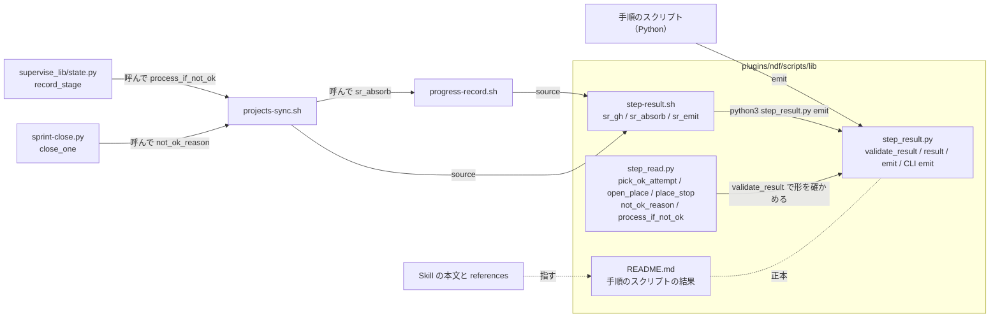
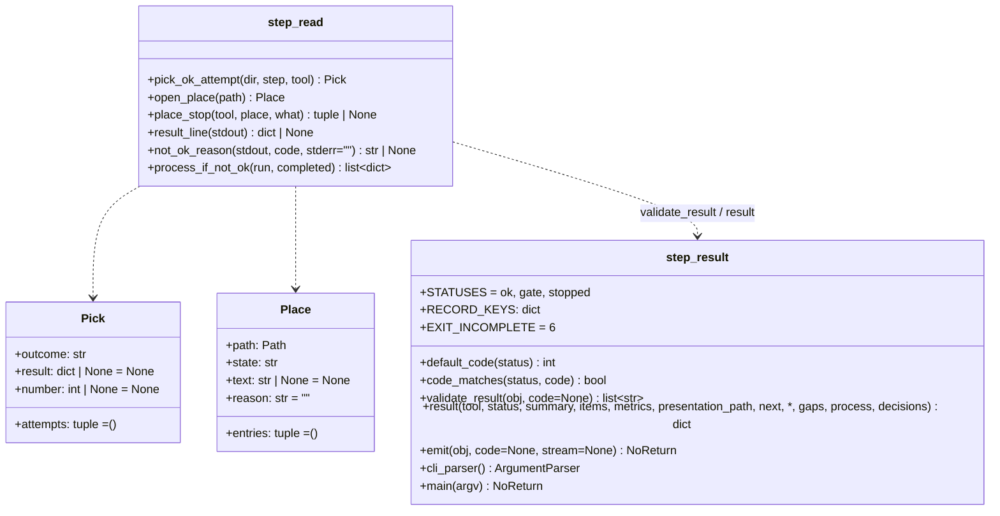
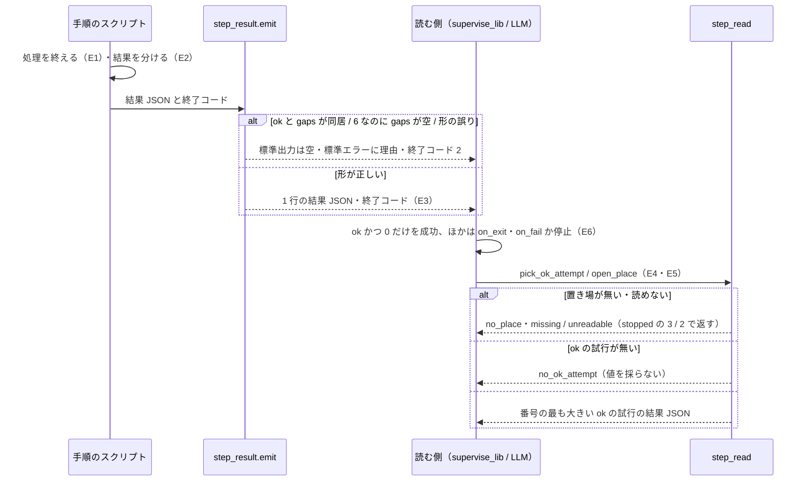
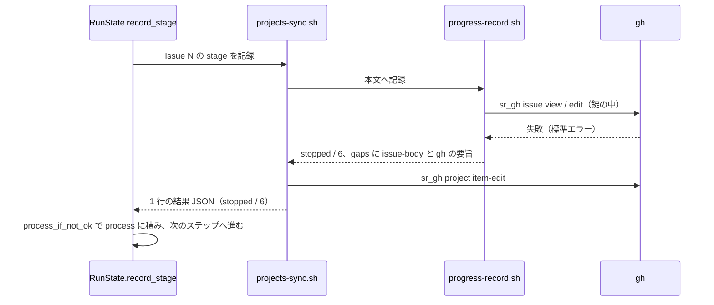

# 手順のスクリプトの結果: 欠け・過程・判断を持たせ、ok を欠けの無いときだけにし、読む側は ok の試行だけを採る

NDF の手順のスクリプト（Skill の本文かプランのステップから呼ばれ、結果を `supervise.py`・LLM・承認資料の組み立てが読むもの）は、
最後に 1 行の結果 JSON を出して終了コードで終える。結果 JSON は欠け（`gaps`）・過程（`process`）・判断（`decisions`）を持てる。
**`ok` は手順が成功し、目標（収束など）に届き、欠けが無いときだけ返す。** 欠けが残るときは `stopped` と終了コード 6 で返し、
`ok` と欠けの同居は形の誤りとして `emit` が出さない。読む側は `ok` の試行だけから値を採り、置き場が無い・読めないことを
「0 件」と分けて返す。シェルのスクリプトも同じ形を `step_result.py emit` で出す。

例: プランの工程が `設計` へ進み、`supervise.py` が Issue #42 の進行を記録しようとしたが、Projects のボードが HTTP 502 を返した。

| 順 | 起きること |
| --- | --- |
| 1 | `supervise_lib/state.py` の `record_stage` が、プランの `記録` のスクリプト `projects-sync.sh 42 stage 設計` を子プロセスで打つ |
| 2 | `projects-sync.sh` が中で `progress-record.sh 42 設計` を打つ。本文は書け、`progress-record.sh` は `ok`（0）の 1 行を返す。`projects-sync.sh` はその `items`・`process` を `sr_absorb` で自分の結果へ移す |
| 3 | ボードの `gh project item-edit` が失敗する。`sr_gh` が標準エラーの要旨 `HTTP 502` を `SR_GH_ERR` に残し、その理由を `sr_gap board "#42 進行" …` が欠けとして 1 件溜める |
| 4 | `sr_emit` が `python3 lib/step_result.py emit --tool projects-sync --status stopped … --code 6 --gap board "#42 進行" "ボードへ書けない（gh project item-edit）: HTTP 502"` を打ち、`validate_result` を通った 1 行を出して終了コード 6 で終える |
| 5 | `record_stage` は `step_read.process_if_not_ok` で結果を読み、`ok` でないので過程の項目 `{"run": "projects-sync.sh 42 stage 設計", "result": "stopped（exit=6）: #42 の進行の一部を書けなかった（1 件）（ボードへ書けない…）"}` を `RunState.process` へ積む。プランは止めずに次のステップへ進む |
| 6 | フェーズレポートに「進行の記録で書けなかったもの: projects-sync.sh 42 stage 設計 → stopped（exit=6）: …」の 1 行が載る |

**結果 JSON の項目・状態と終了コードの表・`ok` の条件・読む側の規則の正本は
[`lib/README.md` の「手順のスクリプトの結果」](../../plugins/ndf/scripts/lib/README.md#手順のスクリプトの結果) である。** ここに表を写さない。

| 何を | 正本 |
| --- | --- |
| 結果 JSON の全項目、状態と終了コードの表、`ok` の条件、過程・判断・結果を書く項目、読む側の規則 | [`lib/README.md` の「手順のスクリプトの結果」](../../plugins/ndf/scripts/lib/README.md#手順のスクリプトの結果) |
| 形の検査と終了コードの定数 | [`lib/step_result.py`](../../plugins/ndf/scripts/lib/step_result.py) の `validate_result`・`EXIT_*` |
| LLM が記録のスクリプトの結果を読んで次の手を決める手引き | [`progress-tracking` の `references/excerpt.md`](../../plugins/ndf/skills/progress-tracking/references/excerpt.md) の「結果の読み方」と [`development-workflow` の `references/stage-completeness.md`](../../plugins/ndf/skills/development-workflow/references/stage-completeness.md) |
| スクリプトごとの終了コードの次の手 | 各 Skill の本文の表（状態の列を持たず、終了コードだけで行を引く） |
| 進捗記録 1 行と通過記録の契約 | [ndf-worker-agent-and-skill-excerpts.md](ndf-worker-agent-and-skill-excerpts.md) |

この文書が扱うのは、決定の理由、構成要素の責務と契約（`step_result.py` の `emit` の CLI・`validate_result` の規則・`step_read.py` の関数・
`step-result.sh` の関数・記録のスクリプトの返し方と読み方）、常に成り立つ条件、子の Issue がこの形をどう使ったかである。

## コンテキスト

| コンテキスト | 何の語が 1 つの意味に決まるか |
| --- | --- |
| NDF の開発ワークフロー（`ndf-workflow`） | 結果 JSON・試行・欠けの残る結果・結果の置き場・欠け・過程の項目・判断の項目 |

1 つのコンテキストに収まる。結果 JSON の形（`lib/README.md` の「手順のスクリプトの結果」）は**公開された言語**で、書く側
（手順のスクリプト）と読む側（`supervise_lib`・承認資料の組み立て・LLM）はこの形だけを介して互いに独立に変わる。
Factory（`factory/`）は結果 JSON を読まない。

## 用語

定義は [用語集](../glossary.md) が正である（`.ndf/glossary.json` の `document`。文脈 `ndf-workflow`）。この文書で使う語は
「結果 JSON」「試行」「欠けの残る結果」「結果の置き場」「欠け」「過程の項目」「判断の項目」「依存の欠け」である。

## 背景

2026-10-31 の NDF の方針の 3 点目「全ての工程で統一ルールに基づくレポートを JSON で出し、過程・判断・結果が分かるようにする」
（利用者の方針を起票者が要約したもの）を受けた。それまで結果 JSON の状態は `ok` / `gate` / `stopped` の 3 つで「終わったが欠けが残る」
を表す項目が無く、7 つの手順が欠け・未収束・未記録を `ok` で返していた（「子の Issue」の表）。読む側も、落ちた試行の値や
置き場の無いことを「0 件」として読んだ。`progress-record.sh` は `gh` の失敗を終了コード 0 へ畳み、シェルのスクリプトはこの形を通らなかった。
自律で回す工程（プラン・supervisor・conductor）では、止まるより間違った成功の害が大きい。気づいた時点で後続の工程が積み上がっている。

前提として確かめたこと:

- `supervise_lib/steps.py` の run のステップは終了コード 0 だけを成功とし、`on_exit` に一致する終了コードがあればその行き先へ回る（`supervise_lib/engine.py`）
- 終了コード 6 は、どの手順のスクリプトも使っていなかった

## 対象範囲

| 扱う | 扱わない |
| --- | --- |
| 結果 JSON の `gaps`・`process`・`decisions` の形と、`ok` と欠けの同居を止める検査 | 既存のすべてのスクリプトへの過程・判断の項目の書き足し（任意の項目で、各スクリプトの直しの中で埋める） |
| 欠けの残る結果の状態と終了コード（`stopped` / 6） | 判定の中身の誤り（`status` の値でなく判定の論理が誤っているもの） |
| 試行の選び方と置き場の区別の共通の関数（`lib/step_read.py`） | 実験版（`plugins/ndf/scripts/experimental/`）のスクリプト |
| シェルから同じ形を出す CLI と関数（`step_result.py emit`・`lib/step-result.sh`） | hook・statusline・利用者が手で打つだけの補助 |
| 記録のスクリプト（`progress-record.sh`・`projects-sync.sh`）の返し方と、呼ぶ側（`record_stage`・`sprint-close.py`）の読み方 | Factory の進行のイベントの語彙（`factory/contracts` の `result`） |
| 状態と終了コードの表を `lib/README.md` だけに置くこと | `handoff.py` の終了コード 4・5（共通の表と違う意味で返し、`emit` を通らない。別の Issue で扱う） |

**働く範囲は配布先のリポジトリを含む**（`plugins/ndf/scripts/lib/` は配布物）。プロジェクトごとに変わる設定は無い。

## 決定と理由

| # | 決定 | 理由 |
| ---: | --- | --- |
| 1 | 欠けの残る結果は新しい状態の値でなく、`stopped` と終了コード 6 と `gaps` で表す | 終了コード 0 だけ・`status == "ok"` だけを成功とする既存の読み手が、変えずに失敗の側へ回す。プランは `on_exit` の `"6"` で行き先を分けられる。新しい状態の値は、3 値で分岐する読み手（Skill の本文の表と LLM）が止めずに通す。1 の使い回しは失敗と欠けを分けられない |
| 2 | `ok` と欠けの同居、`gaps` の無い終了コード 6 を `validate_result` の形の誤りにする | 規則を書くだけでは `ok` に欠けを添えた結果が出る。`emit` が通さなければ間違った成功は終了コード 2 に変わり、読む側は進まない |
| 3 | `gaps`・`process`・`decisions` は任意の項目にする | 必須にすると `step_result` を使うすべてのスクリプトと結果を丸ごと照らす既存のテストが同時に変わり、成功時の出力が変わる。任意なら `ok` を誤って返していた箇所から先に埋まる |
| 4 | 試行の選び方と置き場の区別を `lib/step_read.py` の関数として置き、`step_result.py` に混ぜない | 読む側ごとに `.out` を選ぶと `status` を見ない読み方が別の場所にまた生まれる。`step_result.py` は書く側の形で、配布物のすべての手順のスクリプトが import するため、ディレクトリを読む処理を入れない |
| 5 | 置き場が無い・読めないことは既存の 3・2 で返し、0 件だけを `ok` にする | 既存の表が「前提が無い（対象のファイル）」「読めない。0 件と読まない」の意味をすでに持つ。新しい値を足すと同じ意味の値が 2 つになる |
| 6 | シェルは `step_result.py` の CLI を `step-result.sh` 経由で呼び、JSON を自前で組まない | `jq` や `printf` で組むとエスケープと形の検査がシェル側にもう 1 つでき、`validate_result` と食い違う。値は 1 つずつ別の引数で渡し、区切り文字を持たない |
| 7 | 記録のスクリプトは書けなかった事実を `ok` 以外で返し、止めない判断は呼ぶ側が持つ | 進行管理を理由に開発の工程を止めない、は残す。ボードの一時的な上限で開発が止まる害の方が大きい。`record_stage` はフェーズレポートへ、`sprint-close.py` は `board_note` の項目へ、LLM は作業の報告へ載せる |
| 8 | シェルの対象は `progress-record.sh` と `projects-sync.sh` の 2 本にする | ほかのシェル（`pr-body-decisions.sh`・`stage-check.sh`・`resolve.sh`・起動の補助など）は出力そのものがデータか、読めないときを 0 へ畳まないか、hook か、利用者が手で打つ補助である。結果 JSON に替えると読み手（`supervise_lib/pr.py` など）が壊れる |
| 9 | `status` と終了コードの対応を持つ表は `lib/README.md` だけに置く | Skill の本文が持ってよいのは、そのスクリプトの終了コードごとの次の手と固有の意味までである。表の写しが散ると、値を足したときに食い違う |

## 仕様

### 集約

| 集約 | 持ち主（書き換えてよいもの） | 根 | エンティティ | 値オブジェクト |
| --- | --- | --- | --- | --- |
| 結果 JSON | 手順のスクリプト 1 本（形の検査は `lib/step_result.py` の `validate_result` / `emit` だけが行う） | 結果 JSON | — | 状態と終了コードの組・`items`・欠け（`gaps`）・過程の項目（`process`）・判断の項目（`decisions`） |
| 試行 | `supervise_lib` の `RunState`（プランの実行の記録に `NN-<ステップ>.out` を書く） | 試行 | — | 番号・ステップの名前・結果 JSON |
| 読み取りの結果 | `lib/step_read.py`（読むだけで、試行も置き場も書き換えない） | 採った試行（`Pick`）/ 開いた置き場（`Place`） | — | 採り方の結果（`Pick.outcome`）・置き場の状態（`Place.state`） |

試行は結果 JSON を番号とステップの名前で指し、読み取りの結果は試行を番号で指す。読み取りの結果が試行や置き場を書き換える経路は無い。

### 構成要素

| 要素 | 責務 |
| --- | --- |
| [`plugins/ndf/scripts/lib/README.md`](../../plugins/ndf/scripts/lib/README.md) の「手順のスクリプトの結果」 | 結果 JSON の形・状態と終了コードの表・`ok` の条件・読む側の規則の正本 |
| [`plugins/ndf/scripts/lib/step_result.py`](../../plugins/ndf/scripts/lib/step_result.py) | 形の検査（`validate_result`）、結果の組み立て（`result`）、1 行の出力と終了（`emit`）、シェルから呼ぶ CLI（副命令 `emit`。`cli_parser`・`main`）、終了コードの定数（`EXIT_INCOMPLETE = 6` ほか）、欠け・過程・判断の要素の鍵（`RECORD_KEYS`） |
| [`plugins/ndf/scripts/lib/step_read.py`](../../plugins/ndf/scripts/lib/step_read.py) | 試行の選び方（`pick_ok_attempt`）、置き場の開き方（`open_place`・`place_stop`）、子プロセスの結果の読み方（`result_line`・`not_ok_reason`・`process_if_not_ok`）。標準ライブラリだけで書く |
| [`plugins/ndf/scripts/lib/step-result.sh`](../../plugins/ndf/scripts/lib/step-result.sh) | シェルが source する関数。値を溜める（`sr_item`・`sr_gap`・`sr_process`・`sr_decision`・`sr_metric`）、`gh` を走らせて失敗の要旨を残す（`sr_gh`・`sr_brief`）、別の手順のスクリプトの結果を取り込む（`sr_absorb`）、出して終える（`sr_emit`・`sr_bad_args`） |
| [`plugins/ndf/scripts/progress-record.sh`](../../plugins/ndf/scripts/progress-record.sh) | Issue の本文の `## 進行` へ書いた成否を 1 行の結果 JSON で返す。錠の内側で走った自分の結果を外側の 1 行へまとめる |
| [`plugins/ndf/scripts/projects-sync.sh`](../../plugins/ndf/scripts/projects-sync.sh) | `progress-record.sh` の結果とボードへ書いた成否を 1 行の結果 JSON にまとめる |
| `plugins/ndf/scripts/supervise_lib/state.py` の `RunState.record_stage` | 記録のスクリプトの結果を `step_read.process_if_not_ok` で読み、`ok` でなければ `RunState.process` へ積む。プランを止めない |
| `plugins/ndf/scripts/sprint-close.py` の `close_one` | `projects-sync.sh <N> status Done` の結果を `step_read.not_ok_reason` で読み、`ok` でなければ `{kind: "board_note"}` の項目へ理由を載せ、Issue を閉じる処理を続ける |





`Pick` と `Place` は凍結した dataclass である。`Pick.outcome` は `ok` / `no_ok_attempt` / `no_attempt` / `no_place` / `unreadable`、
`Place.state` は `missing` / `unreadable` / `empty` / `present` で、語彙はそれぞれ `PICK_*`・`PLACE_*` の定数が持つ。

### 常に成り立つ条件

| # | 集約 | 条件 | 破れたときの扱い |
| --- | --- | --- | --- |
| I1 | 結果 JSON | `status` が `ok` なら `gaps` は無いか空である | `validate_result` が誤りを返し、`emit` は標準出力へ何も出さず理由を標準エラーへ出して終了コード 2 |
| I2 | 結果 JSON | 終了コード 6 は `status` が `stopped` で `gaps` が 1 件以上のときだけである（`gaps` 付きの `stopped` を 1 で返すことは許す） | 同上 |
| I3 | 結果 JSON | `gaps` / `process` / `decisions` は配列で、各要素はオブジェクトで、`RECORD_KEYS` の鍵（`gaps`: `kind`・`name`・`reason`、`process`: `run`・`result`、`decisions`: `decision`・`basis`）を空白だけでない文字列で持つ。ほかの鍵は持ってよい | 同上 |
| I4 | 結果 JSON | 読む側が成功とするのは `status` が `ok` で終了コード 0 のときだけである。6 を含むほかの値、結果 JSON が無い・形が誤っていることを成功と読まない | `supervise_lib` は `on_exit` に一致する行き先か `on_fail` へ回し、どちらも無ければ止まる |
| I5 | 読み取りの結果 | 試行から値を採るのは `status` が `ok` の試行だけで、その中で番号の最も大きいものを採る | `ok` の試行が無ければ `result` を返さず、`Pick.outcome` で理由を返す（落ちた試行の値を返さない） |
| I6 | 読み取りの結果 | 置き場が存在しない・読めないことと、置き場はあるが材料が 0 件であることを別の値で返す | 存在しない・読めないときに `empty` を返さない。`place_stop` はそれぞれ終了コード 3・2 の `stopped` を組む |
| I7 | 結果 JSON | `progress-record.sh`・`projects-sync.sh` は 1 回の呼び出しで標準出力へ結果 JSON を 1 行だけ出し、その行は `validate_result` を通る。中の `gh` が失敗したら `ok` でなく、`gh` の標準エラーの要旨を `summary` か `gaps[].reason` に入れ、終了コードは 0 以外である | `sr_emit` が形を確かめ、破れていれば何も出さず 2。テストが落ちる |
| I8 | 結果 JSON | 記録のスクリプトが `ok` 以外を返しても、`record_stage` はプランを次のステップへ進め、`sprint-close.py` は Issue を閉じる処理を続ける | テストが落ちる |

### ドメインイベント

| # | イベント | 発生元 | 受け手 | 失敗したとき |
| --- | --- | --- | --- | --- |
| E1 | 手順のスクリプトが処理を終えた | 手順のスクリプト | 同じスクリプトの結果の組み立て | 例外・打ち切りで結果 JSON を出さずに終わる → 読む側は結果 JSON が無いことを成功と読まない（I4） |
| E2 | 結果を成功・収束 / 欠けの残る結果 / 失敗 / 判断待ちのどれかに分けた | 手順のスクリプト | `validate_result` | 分けた結果と書いた状態が食い違う（欠けがあるのに `ok`）→ `emit` が 2 で終える（I1・I2） |
| E3 | 結果 JSON を 1 行出し、状態に合った終了コードで終えた | `emit` / `sr_emit` | `supervise_lib`・LLM・承認資料の組み立て | 形の誤り → 終了コード 2 |
| E4 | 読む側が結果の置き場を開いた | `step_read.open_place` / `pick_ok_attempt` | 呼んだ読み手 | 置き場が無い・読めない → 0 件と読まず 3・2 で返す（I6） |
| E5 | 読む側が採る試行を選んだ | `step_read.pick_ok_attempt` | 呼んだ読み手 | `ok` の試行が無い → 値を採らない（I5） |
| E6 | 読む側が次の工程へ進んだか、止まった | `supervise_lib`・LLM | プランの次のステップ・フェーズレポート | 記録のスクリプトの失敗では止まらない（I8） |

### `validate_result(obj, code=None)` の規則

誤りを文字列の配列で返し、空なら正しい。`code` を渡したときだけ状態との対応を見る。

| 見るもの | 誤りになる場合 |
| --- | --- |
| 全体 | オブジェクトでない |
| 必須の項目 | `tool`・`status`・`summary`・`items`・`metrics` のどれかが無い |
| 知らない項目 | 必須・`presentation_path`・`next`・`gaps`・`process`・`decisions` のほかの鍵がある |
| 形 | `tool` が空・文字列でない、`status` が 3 値に無い、`summary` が文字列でない、`items` が配列でないか要素がオブジェクトでない、`metrics` がオブジェクトでない、`presentation_path`・`next` が文字列でない（`null` は許す）、I3 に当たる |
| `gate` | `presentation_path` も `next` も無い |
| 欠けと状態 | `ok` に空でない `gaps` がある（I1）。`code` が 6 で `stopped` なのに `gaps` が無いか空（I2） |
| 状態と終了コード | `code_matches` が偽。`ok` は 0、`gate` は 10〜29、`stopped` は 1・2・3・4・6・69・75 |

`emit(obj, code=None)` は `code` を省くと `default_code`（`ok` は 0、`gate` は 10、`stopped` は 1）を使い、`stopped` で `gaps` があれば 6 にする。
`result()` は `gaps`・`process`・`decisions` を渡したときだけ置き、空の配列は置かない（成功時の出力は項目を足す前と同じ）。

### シェルからの出力: `step_result.py emit`

```text
python3 "$LIB/step_result.py" emit --tool <名前> --status <ok|gate|stopped> --summary <文> [--code N]
    [--item KIND NAME RESULT REASON]... [--gap KIND NAME REASON]...
    [--process RUN RESULT]... [--decision DECISION BASIS]... [--metric KEY VALUE]...
    [--next 文] [--presentation-path パス]
```

| 項目 | 内容 |
| --- | --- |
| 入力 | 値は 1 つずつ別の引数で受け、区切り文字を持たない。`--item` の `REASON` は空文字を許し、空なら `reason` を置かない。`--metric` の値は整数に読めれば整数、ほかは文字列 |
| 出力 | 組み立てた結果 JSON を 1 行出し、`--code`（省けば `emit` と同じ決め方）で終える。中身は Python の `emit` と同じ |
| 失敗 | 形の誤り（I1〜I3、状態と終了コードの不一致）→ 何も出さず理由を標準エラーへ出して 2。引数の誤り → argparse の 2 |

### `lib/step-result.sh` の関数

source した側の変数 `SR_ARGS`（`emit` へ足す引数の並び）・`SR_GAPS`（溜めた欠けの件数）・`SR_GH_ERR`（直前の `sr_gh` の失敗の要旨）を使う。

| 関数 | 契約 |
| --- | --- |
| `sr_item KIND NAME RESULT [REASON]` / `sr_gap KIND NAME [REASON]` / `sr_process RUN RESULT` / `sr_decision DECISION BASIS` / `sr_metric KEY VALUE` | 値を `SR_ARGS` へ溜める。`sr_gap` は `SR_GAPS` を 1 足し、理由を省くと「理由が分からない」 |
| `sr_brief TEXT` | 改行を空白にし、前後の空白を落とし、先頭 300 文字にした文を出す（`step_result.gh_json` と同じ長さ） |
| `sr_gh <gh の引数>...` | `gh` を走らせ、標準出力はそのまま通す。失敗したら標準エラーの要旨（`sr_brief`。空なら「gh が終了コード N で失敗した（標準エラーは空）」）を `SR_GH_ERR` に残し、`gh` の終了コードを返す。`gh` が無ければ `SR_GH_ERR` に「gh が無い」を入れて 127 を返す。コマンド置換の中で呼ぶと `SR_GH_ERR` は呼ぶ側へ届かない |
| `sr_absorb LINE` | 別の手順のスクリプトの結果 JSON 1 行を `validate_result` に掛け、`items`・`gaps`・`process`・`decisions` を `SR_ARGS` へ移す（`gaps` の数だけ `SR_GAPS` を足す）。`status` と `summary` を `SR_ABSORBED_STATUS`・`SR_ABSORBED_SUMMARY` に残す。結果 JSON でない・形が誤っていれば何も足さず 1 を返す |
| `sr_bad_args TOOL MESSAGE [USAGE_FN]` | `ERROR: <MESSAGE>` を標準エラーへ出し（`USAGE_FN` があれば先に呼ぶ）、`stopped` / 2 の結果で終える |
| `sr_emit <emit の引数>...` | `python3 step_result.py emit` に引数と `SR_ARGS` を渡して打ち、その終了コードでシェルを終える。`python3` が無ければ理由を標準エラーへ出して 2 で終える |

bash 3.2 で動く形で書く（`mapfile` を使わず、NUL 区切りをプロセス置換から 1 つずつ読む）。

### `lib/step_read.py` の関数

| 関数 | 入力 | 出力 | 失敗の形 |
| --- | --- | --- | --- |
| `pick_ok_attempt(dir, step, tool)` | プランの実行の記録のディレクトリ・ステップの id・採る結果 JSON の `tool` | `dir` の `NN-<step>.out`（名前が `^(\d+)-(.+)\.out$` で `<step>` が一致するファイル）ごとに、最後の「`tool` が一致し `validate_result` を通る行」をその試行の結果とする。`ok` の試行があれば `outcome="ok"`・番号の最も大きい `ok` の試行の `result` と `number`。無ければ `result=None` で、ディレクトリが無い → `no_place`、列挙できない → `unreadable`、`.out` が無い → `no_attempt`、`ok` の試行が無い → `no_ok_attempt`。`attempts` は全試行の（番号, `status`）の組で、結果 JSON の無い試行は `"none"` | 例外を投げない。読めない個々の `.out` は `"none"` にして続ける |
| `open_place(path)` | ファイルかディレクトリのパス | 無い → `missing`。読めない（権限・デコード・列挙の失敗）→ `unreadable`（`reason` に例外の文）。ファイルが空白だけ・ディレクトリに項目が無い → `empty`。ある → `present`（ファイルは `text`、ディレクトリは並べた `entries`） | 例外を投げない |
| `place_stop(tool, place, what)` | 結果 JSON の `tool`・`Place`・材料の名前 | `missing` → （`stopped`・summary「<what> の置き場が無い: <path>」, 3）。`unreadable` → （同「<what> の置き場を読めない: <path>（<reason>）」, 2）。`empty`・`present` → `None`（呼ぶ側が読み、`empty` は 0 件の `ok` にしてよい） | — |
| `result_line(stdout)` | 子プロセスの標準出力 | 最後の空でない行を JSON として読み、`validate_result` を通れば dict、無い・読めない・形が誤っていれば `None` | — |
| `not_ok_reason(stdout, code, stderr="")` | 標準出力・終了コード・標準エラー | 結果 JSON が `ok` で終了コード 0 なら `None`。結果 JSON が無ければ「結果 JSON が無い（exit=<code>）: <標準エラーの先頭 200 文字>」。ほかは「<status>（exit=<code>）: <summary>（<gaps の reason を「; 」でつないだもの>）」 | — |
| `process_if_not_ok(run, completed)` | 打ったコマンドの表記・`subprocess.CompletedProcess` | `ok` でなければ過程の項目 1 件 `[{"run": run, "result": <not_ok_reason>}]`、`ok` なら `[]` | — |

置き場が設定で任意のもの（宣言が無ければ使わない。例 `.ndf/projects.json`）では、`open_place` の前に宣言の有無で分け、無いことを欠けとも
前提の欠けとも読まない。

### 記録のスクリプトの返し方（`progress-record.sh` / `projects-sync.sh`）

`tool` は `progress-record` / `projects-sync` である。

| 場合 | `status` / 終了コード | 載せる所 |
| --- | --- | --- |
| 記録した・変える内容が無かった | `ok` / 0 | `items` に `{kind: "issue-body", name: "#N", result: "recorded" か "unchanged"}`。`projects-sync.sh` のボードは `{kind: "board", result: "recorded"}` か、宣言が無い・宣言にそのキーの列が無ければ `"not_declared"`（欠けにしない） |
| `配布` を記録し、記録の無い必須の工程がある | 本文・ボードの結果のとおり（この要素は状態を変えない） | 工程ごとに `items` へ `{kind: "stage-missing", name: <工程>, result: "missing" か "conditional", reason: <記録し直すコマンド>}`。`wf_record_progress` の `記録なし:`・`条件付き:` の案内を標準出力へ出さずに捕まえて移す。`gaps` へは入れない |
| 引数の誤り（知らない工程名・キー・値、引数不足、Issue 番号が数でない） | `stopped` / 2 | `summary`。何も書かない |
| 共通の関数のファイルを読めない | `stopped` / 3（`step-result.sh` 自身を読めなければ標準エラーへ出して 2） | `summary` |
| `gh` が無い | `stopped` / 3 | `summary` に「gh が無い」。通過記録は積む（`process` に残す） |
| 本文・ボードのどれかを書けなかった（`gh` の失敗・錠を取れない・`git` か `jq` が無い・ボードへ書けない） | `stopped` / 6 | 書けなかったものを 1 件ずつ `gaps` に（`kind` は `issue-body` か `board`）。`reason` に `SR_GH_ERR` か錠・上限の理由。`progress-record.sh` は同じ理由を標準エラーへ `NOTE:` の 1 行でも出す |
| 何も書けなかった（`progress-record.sh`: 本文も通過記録も書けない。`projects-sync.sh`: 本文が 1 でボードも記録しなかった） | `stopped` / 1 | `summary` と、`gaps` に各々 |

`progress-record.sh` は本文の読みから書きまでを Issue ごとの錠（`lib/gh_parts.py body-lock`）の中で行い、錠の中で自分をもう 1 度走らせる
（`NDF_PROGRESS_LOCKED=1`。通過記録は外側だけが積む）。外側は内側の結果 JSON の最後の行を `sr_absorb` で受けてまとめ、標準出力へは
自分の 1 行だけを出す。内側の結果を受け取れなければ、錠の標準エラーの要旨を添えた `issue-body` の欠けにする。
`projects-sync.sh` も中で呼ぶ `progress-record.sh` の最後の行を同じく取り込み、自分の 1 行だけを出す。

### 処理の流れ



進捗記録はプランを止めない。



`record_stage` は工程が変わったときだけ、プランの `課題` の Issue ごとに `記録` のスクリプトを打つ（`pace: fast` / `auto` の最初の記録では
先に `pace` を書く）。積んだ過程の項目はステップをまたいで保たれ（`DICT_LISTS`）、フェーズレポート（`write_report`）の
「進行の記録で書けなかったもの: <run> → <result>」の行になる。`sprint-close.py` の `close_one` は同じ読み方で
`{kind: "board_note", name: "<repo>#<N>", result: "note", reason: <not_ok_reason>}` を溜める。

### 子の Issue

親 Issue #2227 の形と読む側の規則を使って、7 つの子 Issue がそれぞれの手順を直した。中身はそれぞれの持ち主にある。

| Issue | `ok` で返っていたもの | 直した形 | 持ち主 |
| --- | --- | --- | --- |
| [#2143](https://github.com/devbasex/ai-plugins/issues/2143) | cross-review の駆動が収束せずに終わった（`final` が `max_rounds`・`oscillation`） | `final` が `max_rounds`・`oscillation` なら `stopped` / 6 と `gaps`（`kind: review`・`name: converge`）、`error` なら `stopped` / 1。報告と回答ファイルは残す | [`lib/drive_pause.py`](../../plugins/ndf/scripts/lib/drive_pause.py) の冒頭の表と `unconverged`・`lib/loop_drive.py` の `write_review_answer` |
| [#2079](https://github.com/devbasex/ai-plugins/issues/2079) | 置き換わらない差し込み（`{queue_state:<名>}` を空文字で埋める）が残ったステップが動き、検査の結果が「無し」になる | 一致するプランの置き場が無ければ埋めずにそのプランを流さない。`notes --check-state` が空文字・無いディレクトリなら 3 で止まる | [ndf-release-approval-materials.md](ndf-release-approval-materials.md)・`supervise_lib/queue.py` の `fill_queue_pr`・`release_lib/materials.py` |
| [#2129](https://github.com/devbasex/ai-plugins/issues/2129) | 承認資料が番号の最大の試行を `status` を見ずに読む | レビューとリファクタリングは `ok` の試行のうち番号の最も大きいものを読み、無ければ「どの試行も `ok` で終わっていない」と書く | [ndf-release-approval-materials.md](ndf-release-approval-materials.md)・`release_lib/materials.py` の `last_result`（`prefer_ok`） |
| [#2157](https://github.com/devbasex/ai-plugins/issues/2157) | `.ndf/` が `.gitignore` の対象でも `project-mvv.py approve` が黙って `ok` | 宣言を書く・確かめるコマンドが `items` に除外の行（`kind: note`・`result: ignored`）と要約の添え書きを出す | [`lib/ndf_tracking.py`](../../plugins/ndf/scripts/lib/ndf_tracking.py)・`project-mvv.py`・`project-decl.py`・`glossary.py` |
| [#2183](https://github.com/devbasex/ai-plugins/issues/2183) | 差し戻しの記録が無いと `gate-rejections.py count` が 0 件の `ok` | 範囲に答えの行が無く、状態ファイルにも承認ゲートの記録が無ければ `stopped` / 3 の「未記録」（件数 `null`・`metrics.recorded: false`）。承認の答えも `--outcome approved` で記録する | `gate-rejections.py` の冒頭の説明・`lib/gate_rejections.py`（記録の置き場と数え方は [ndf-gate-rejections-and-filer-assumptions.md](ndf-gate-rejections-and-filer-assumptions.md)） |
| [#671](https://github.com/devbasex/ai-plugins/issues/671) | `progress-record.sh` が `gh` の失敗で理由を出さず終了コード 0 | この文書の「記録のスクリプトの返し方」。理由を標準エラーへも 1 行出す | `progress-record.sh`・[ndf-worker-agent-and-skill-excerpts.md](ndf-worker-agent-and-skill-excerpts.md) |
| [#1849](https://github.com/devbasex/ai-plugins/issues/1849) | `upkeep.py apply` を 2 回打つと report の区分の内訳と承認待ちが 0 件 | 同じ回の apply を番号ごとに足し合わせる。番号ごとの値を持たない記録は `gaps` 付きの `stopped`（6） | `backlog-refinement/scripts/upkeep_report.py`・`upkeep.py` |

## データ・設定

結果 JSON の形は [`lib/README.md`](../../plugins/ndf/scripts/lib/README.md#手順のスクリプトの結果) が正である。この変更で足した項目の例
（`projects-sync.sh 42 stage 設計` で本文は書けたがボードへ書けなかったとき。終了コード 6）:

```json
{"tool": "projects-sync", "status": "stopped", "summary": "#42 の進行の一部を書けなかった（1 件）",
 "items": [{"kind": "issue-body", "name": "#42", "result": "recorded"}], "metrics": {},
 "gaps": [{"kind": "board", "name": "#42 進行", "reason": "ボードへ書けない（gh project item-edit）: HTTP 502"}],
 "process": [{"run": "通過記録へ積む（#42）", "result": "積んだ"}]}
```

試行の置き場は、プランの実行の記録のディレクトリの `NN-<ステップ>.out`（`supervise_lib` の `RunState` が書く。形は変えていない）である。

| 名前 | 置き場所 | 値・形 |
| --- | --- | --- |
| `EXIT_INCOMPLETE` | `lib/step_result.py` | `6`。値の持ち主 |
| `RECORD_KEYS` | `lib/step_result.py` | `gaps`・`process`・`decisions` の要素の鍵 |
| `PICK_*`・`PLACE_*` | `lib/step_read.py` | `Pick.outcome`・`Place.state` の語彙 |
| `NDF_PROGRESS_LOCKED` | 環境変数（`progress-record.sh` が錠の内側へ渡す） | 内側の印。利用者は設定しない |
| `NDF_PROGRESS_LOCK_TIMEOUT` | 環境変数 | 本文の錠を待つ秒。既定 `30` |

## 運用

### 制約

| 項目 | 内容 |
| --- | --- |
| 共通の関数の呼び手 | `pick_ok_attempt`・`open_place`・`place_stop` を製品のコードから呼ぶ箇所はまだ無い（呼ぶのはテストだけ）。承認資料の組み立ては `release_lib/materials.py` の `last_result(prefer_ok=True)` が自前で試行を選び、`ok` の試行が無ければ最後の試行を読んで「`ok` で終わっていない」と書く。`gate-rejections.py count` と `release-steps.py notes --check-state` も置き場の区別を自前で持つ。新しく試行や置き場を読む箇所は `step_read` を使う |
| 過程・判断の項目の埋まり方 | 任意の項目で、書き足したのは記録のスクリプトと子の Issue の箇所だけである。`gaps` が無いことは「書き手が欠けは無いと述べた」と読む |
| `python3` が無い環境 | `progress-record.sh`・`projects-sync.sh` は結果 JSON を出せず、`sr_emit` が標準エラーへ理由を出して 2 で終える |
| シェルの対象 | 記録のスクリプト 2 本だけである（決定 8）。ほかのシェルのスクリプトの標準出力は今のまま |
| 実験版 | `plugins/ndf/scripts/experimental/` は形に合わせない。安定版へ移す時点で合わせる |

## テスト観点

形の検査・試行の選び方・置き場の区別は単体テスト、記録のスクリプトは偽の `gh` を `PATH` の先頭に置く結合テストで確かめる。
`.md` の文言は固定しない（状態と終了コードの表が `lib/README.md` だけにあることは、`status` と `終了コード` を同じ見出し行に持つ表を
`plugins/ndf` の `.md` から `grep` して見る）。

| 観点 | 満たすこと | テスト |
| --- | --- | --- |
| `ok` と欠け（I1） | `ok` に `gaps` を 1 件添えた結果を `validate_result` へ渡すと誤りが返り、`emit` すると標準出力が空・標準エラーに理由・終了コード 2 | [`tests/test_step_result.py`](../../plugins/ndf/scripts/tests/test_step_result.py) |
| 終了コード 6（I2） | `stopped` / 6 で `gaps` が空なら誤り、1 件なら通る。`ok` / 6・`gate` / 6 は不一致。`stopped` で `gaps` があり終了コードを省くと 6 | 同上 |
| 要素の鍵（I3） | `gaps` の要素に `reason` が無い・空・文字列でない、`process` の要素がオブジェクトでないと誤り。決めた鍵とほかの鍵を持つ要素は通る。空の配列は `result()` が置かない | 同上 |
| CLI | `emit` の副命令が Python の `emit` と同じ結果を出し、`ok` に `--gap` を付けると 2 | 同上 |
| 試行の選び方（I5） | 番号 1 が `ok`・2 が `stopped` → 1 の結果。全試行が `stopped` → `result` が無く `no_ok_attempt`。`.out` が無い → `no_attempt`。ディレクトリが無い → `no_place`。別の `tool`・別のステップ・壊れた行は採らない | [`tests/test_step_read.py`](../../plugins/ndf/scripts/tests/test_step_read.py) |
| 置き場の区別（I6） | ファイルとディレクトリのそれぞれで、無い → `missing` と 3、読めない（デコード・権限）→ `unreadable` と 2、空 → `empty` と `None`、ある → `present` | 同上 |
| 子プロセスの結果 | 最後の行の結果 JSON が `ok` でなければ過程の項目が 1 件返る | 同上 |
| 既存の読み手（I4） | run のステップが終了コード 6 で終わると `on_fail` へ回り、`on_fail` が無ければ止まり、`on_exit` に `"6"` があればその行き先へ回る | [`tests/test_step_result_readers.py`](../../plugins/ndf/scripts/tests/test_step_result_readers.py)・[`tests/test_supervise.py`](../../plugins/ndf/scripts/tests/test_supervise.py) |
| 記録のスクリプト（I7） | 偽の `gh` が失敗するとき、`progress-record.sh` と `projects-sync.sh` が 1 行の結果 JSON を出し、それが `validate_result` を通り、`ok` でなく、`gaps` か `summary` に偽の `gh` の標準エラーの文が入り、終了コードが 0 以外。錠の内側でも `projects-sync.sh` からでも標準出力は 1 行 | [`tests/test_progress_record.py`](../../plugins/ndf/scripts/tests/test_progress_record.py)・[`tests/test_projects_sync_record.py`](../../plugins/ndf/scripts/tests/test_projects_sync_record.py) |
| 記録の無い工程 | `配布` の記録で、記録の無い必須の工程が `items` の `kind: "stage-missing"` の要素になる | [`tests/test_progress_record_stages.py`](../../plugins/ndf/scripts/tests/test_progress_record_stages.py) |
| 止めない（I8） | `record_stage` は記録のスクリプトが `stopped` / 6 を返しても進み、`process` に書けなかった工程が残る。`projects-sync.sh` が `stopped` を返すと `close_one` の `board_note` に理由が載り、Issue は閉じる | `tests/test_progress_record_stages.py`・[`tests/test_sprint_close_board.py`](../../plugins/ndf/scripts/tests/test_sprint_close_board.py) |
| 退行しない | 成功し欠けの無い場合、既存の手順のスクリプトの `status` と終了コードが変わらない | 全体テスト `uv run --frozen --project . --all-extras pytest plugins/ndf/scripts/tests -q -n 4` |

## 関連リンク

- [issue #2227](https://github.com/devbasex/ai-plugins/issues/2227) — 要求
- [PR #2254](https://github.com/devbasex/ai-plugins/pull/2254) — 実装（スプリントの PR [#2268](https://github.com/devbasex/ai-plugins/pull/2268) で develop へ入った）
- [`lib/README.md` の「手順のスクリプトの結果」](../../plugins/ndf/scripts/lib/README.md#手順のスクリプトの結果) — 形・表・読む側の規則の正本
- [ndf-worker-agent-and-skill-excerpts.md](ndf-worker-agent-and-skill-excerpts.md) — 進捗記録 1 行と通過記録の契約
- [ndf-sprint-close-referenced-issues.md](ndf-sprint-close-referenced-issues.md) — スプリントを閉じる処理
- [ndf-release-approval-materials.md](ndf-release-approval-materials.md) — 承認資料の材料の読む元（#2079・#2129）
- [ndf-gate-rejections-and-filer-assumptions.md](ndf-gate-rejections-and-filer-assumptions.md) — 差し戻しの記録（#2183）
- [ndf-deps-missing-exit-code.md](ndf-deps-missing-exit-code.md) — 同じ表の終了コード 69
- [`lib/step_result.py`](../../plugins/ndf/scripts/lib/step_result.py) / [`lib/step_read.py`](../../plugins/ndf/scripts/lib/step_read.py) / [`lib/step-result.sh`](../../plugins/ndf/scripts/lib/step-result.sh) / [`progress-record.sh`](../../plugins/ndf/scripts/progress-record.sh) / [`projects-sync.sh`](../../plugins/ndf/scripts/projects-sync.sh)
