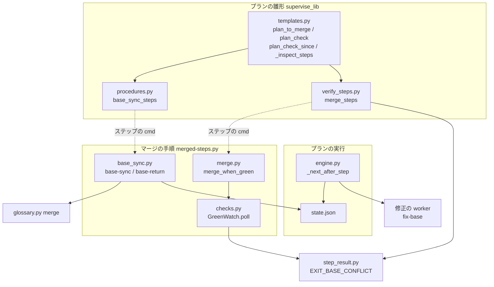
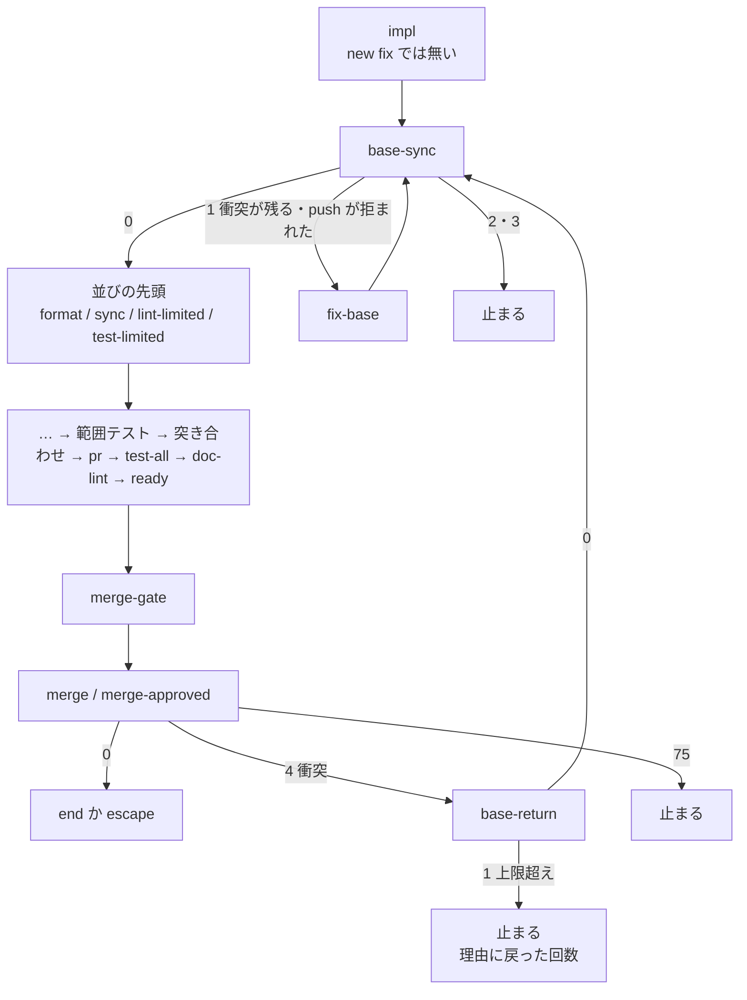
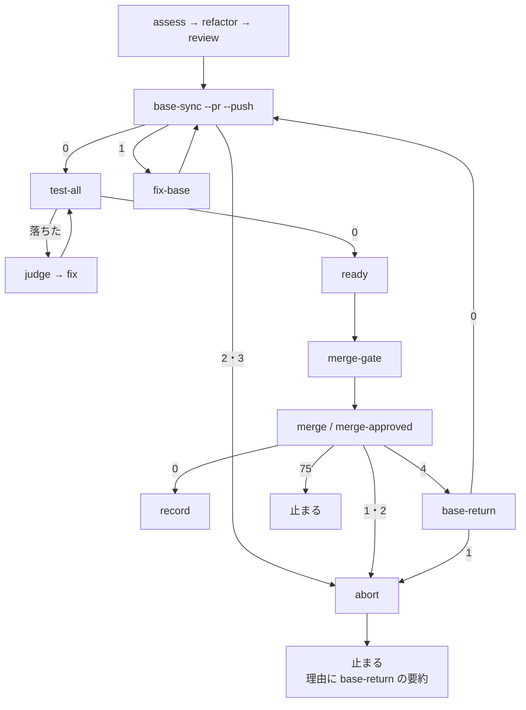
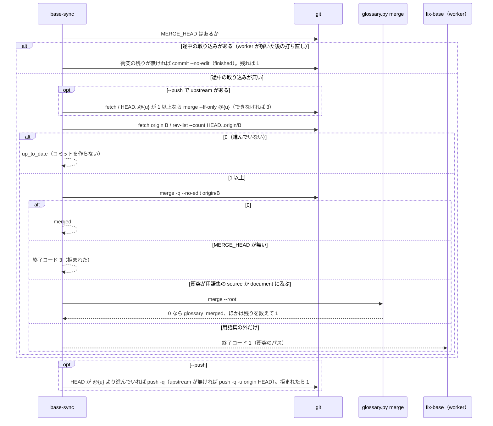

# ベースブランチの取り込み: 実装と検査のプランが合成の上で検査し、マージの直前の衝突から取り込みへ戻ってマージまで進む

## 概要

**実装のプラン・検査のプラン・差分の検査は、検査の前に `merged-steps.py base-sync` でベースブランチを作業ブランチへマージのコミットで
取り込み、取り込んだ合成の上で検査する。** 用語集だけの衝突は `glossary.py merge` で解き、ほかの衝突は修正の worker（`fix-base`）が
解く。**マージの直前に PR がベースブランチと衝突すると、`merge-when-green` は終了コード 4（`EXIT_BASE_CONFLICT`）で終わり、
実装のプランと検査のプランは `base-return` を通って取り込みへ戻る。** 戻りは 1 回の実行で 3 回までで、4 回目の衝突で戻った回数を
理由に載せて止まる。rebase・強制 push は打たない。

例: スプリントの検査のプランが `review` を終えた後、並行のスプリントの本番リリースで develop が進んだ。`base-sync --pr 2034 --push` は
develop を取り込み、`docs/glossary/glossary.json` だけが衝突したので `glossary.py merge` で解いて push し、`test-all` へ進む。
`merge` の待ちの間にまた develop が進み、PR の `mergeStateStatus` が `DIRTY` になると、`merge` は 4 で終わり、`base-return`
（1 回目）→ `base-sync` → `test-all` → `ready` → `merge-gate` → `merge` とやり直してマージする。conductor は手を出さない。

この文書は、その形に**なぜしたか**（背景・決定と理由・常に成り立つ条件・入出力の契約・既知の限界・テスト観点）を残す。
**コマンドの引数と振る舞いの正はスクリプトにある。**

| 何を | 正本 |
| --- | --- |
| `base-sync`・`base-return` の手順と終了コード | [`merged_lib/base_sync.py`](../../plugins/ndf/scripts/merged_lib/base_sync.py) の docstring |
| `merge-when-green` の終了コードの一覧 | [`merged-steps.py`](../../plugins/ndf/scripts/merged-steps.py) の冒頭と [`lib/README.md`](../../plugins/ndf/scripts/lib/README.md) の終了コードの表 |
| 取り込みのステップの形 | [`supervise_lib/procedures.py`](../../plugins/ndf/scripts/supervise_lib/procedures.py) の `base_sync_steps`・`BASE_FIX_PROMPT` |
| 用語集の衝突の解き方 | [ndf-glossary-merge.md](ndf-glossary-merge.md) |
| プランの `上限` に戻りの輪を足す計算 | [`supervise_lib/limits.py`](../../plugins/ndf/scripts/supervise_lib/limits.py) の docstring |
| 検査とマージの工程の手順 | `development-workflow` の SKILL.md と `references/` が正 |

決定の番号は #1917 の設計の番号である。#2003 は #1917 の実装に取り込んだ。

## 用語

定義は用語集（[docs/glossary.md](../glossary.md)）が正である。「ベースブランチ」「ベースブランチの取り込み」「全体テスト」
「スプリントブランチ」は「NDF の開発ワークフロー（`ndf-workflow`）」に、「用語集の取り込み」「語の衝突」は
「プロジェクトの用語集（`project-glossary`）」にある。マージの読み（`merged_lib`）も `ndf-workflow` の語を使う。

## 背景

- **マージの直前の衝突でプランが止まった（#1917）。** 検査のプランの `merge` は失敗を `abort` へ送るだけで、並行のスプリントの本番リリースで
  develop が進むたびに、conductor が develop の取り込み・衝突の解消・全体テスト・`--from` での流し直しを手で打った（セッション 26 で 3 回）。
  `merged_lib/checks.py` は `mergeStateStatus` を取っていたが、判定に使っていなかった
- **ブランチ単独の検査は、合成で初めて落ちるチェックを見逃した（#2003）。** PR 1995 はプランの `sync` と `doc-lint` を通ったのに、
  CI の `doc-line-limit-check` と `runtime-plugin-validate` で落ちた（run 38516089004）。起点を取り込んでから測る形は、差分の検査の
  `test-all` がシェルの 1 行（`git merge origin/<base>`）で持っていただけだった
- **取り込みの後の push が遅れた `HEAD` で拒まれ続けた（PR 2034 の round 2）。** 別の worktree が PR の head へ送った分を受けずに
  マージすると、push が non-fast-forward で拒まれ、`fix-base` の worker へ回り続けた。`--push` のときは取り込みの前に upstream へ
  早送りする形に直した（f08b42fac）

一時リポジトリでの実測（2026-10-16）: 衝突した `git merge` は終了コード 1 で `MERGE_HEAD` と衝突のパスを残す。未コミットの変更と
重なる取り込みは同じ終了コード 1 で何も始めず、`MERGE_HEAD` を残さない。重ならない未コミットの変更は残したまま取り込む。

## 決定と理由

| # | 決定 | 理由 | 採らなかった案 |
| ---: | --- | --- | --- |
| 1 | 取り込みの手順をスクリプトのサブコマンドにし、ステップは 1 つの関数 `base_sync_steps` で組む | 取り込み・用語集の判定・push の要否は判断の要らない手順で、終了コードで行き先を分けられる。3 つの雛形が同じ関数を呼べば直す場所が 1 つになる | 雛形ごとにシェルのコマンドを組む（同じ役割の文字列が 3 か所に分かれ、#2003 と同じ食い違いがまた起きる） |
| 2 | サブコマンドの置き場を `merged-steps.py` にする | `merge-when-green` と衝突の終了コードの持ち主で、取り込みはその対になる手順。衝突の判定（`MERGE_HEAD`・`mergeStateStatus`）の意味が 1 つに揃う | `pr-steps.py`（PR を作る・更新する手順で、マージの読みを持たない）。新しいスクリプト（同じ役割のエントリポイントが増える） |
| 3 | 衝突と拒否を `MERGE_HEAD` の有無で分け、拒否は worker へ回さない（終了コード 3） | 終了コードだけでは両者を分けられない（背景の実測）。拒否は worker が解く衝突ではない | `--autostash`（退避の置き場は worktree の間で共有され、衝突のときに戻せない退避が残る） |
| 4 | 実装のプランの取り込みは push せず、検査のプランと差分の検査の取り込みは `--push` する | 実装のプランは取り込みの後に必ず `pr` のステップを通り、そこで push する。最初の取り込みの時点では PR も upstream も無い。検査のプランは `pr` を通らず、全体テストのコマンドが `git pull --rebase` を打つため、送らずにおくとマージのコミットが平らに書き換わる | 部品が PR の有無を実行の時点で調べて push を決める（雛形のテストで縛れない） |
| 5 | 戻りの回数は、戻りだけが通る `base-return` が `state.json` の `log` から数える | `merge` から直接 `base-sync` へ戻すと最初の取り込みと区別できない。`log` は実行ごとに空から始まるため `--from` で流し直すと数え直し、プランにも状態ファイルにも数を書き足さない。上限は `base_sync.RETURN_LIMIT` の 1 か所 | エンジンにステップごとの訪問回数の上限を足す（すべてのプランの意味が変わる）。取り込みのステップが自分の状態ファイルに数える（実行をまたいで残り、流し直しの直後に止まる） |
| 6 | 承認ゲート 2 の後（`merge-approved`）から戻ったときも `merge-gate` を通り直す | 戻った後は取り込みのコミットが足され、承認した内容と違う。宛先が承認ゲート 2 に当たるプランは新しい内容でもう一度人の承認を求める | 戻りの後に `merge-approved` へ進む（人が見ていない取り込みのコミットが本番チャネルへ入る） |
| 7 | エンジンが行き先の無い失敗で止まるとき、そのステップの `summary` と、`on_fail` でそこへ回した直前の失敗の `summary` を理由へ添える | 検査のプランは上限超えで `abort` を通って止まり、「ステップ abort が失敗した」だけではなぜ来たかが読めない | 記録のスクリプトの要約へ落ちたステップの出力を写す（記録のスクリプトがエンジンの出力の置き場を知る）。`base-return` の上限超えを `stop` へ送る（検査の記録を飛ばす） |
| 8 | 衝突の終了コードを 4 にし、`step_result.py` の `EXIT_BASE_CONFLICT` で定める | 共通の契約で空いている値で、衝突に当たる `sysexits.h` の値は無い。雛形（`verify_steps.py`）とマージの手順（`merged_lib`）が同じ名前を読む。`code_matches` の `stopped` に 4 を含める | 1 のまま `summary` の文言で見分ける（文言の変更で経路が黙って変わる） |
| 9 | 差分の検査は部品へ置き換えるが、マージの直前の衝突で戻らない | 差分の検査は `finish` で PR の宛先を付け替え、変更が無ければ `record` へ飛ぶ。`finish` を 2 度通ると飛ばし先の判定が変わる恐れがある。全体テストの修正の後を `base-sync` へ戻し、毎回取り込んでから測る | 差分の検査にも戻りを足す（`finish` の再入を確かめないまま経路だけが増える） |
| 10 | 検査のプランは PR の宛先（`baseRefName`）から、実装のプランと差分の検査は引数（`a.base`）からベースブランチを読む | 単発の `new check --pr` の引数は PR の宛先と一致するとは限らない（スプリントブランチ宛の PR）。実装のプランは最初の取り込みの時点で PR が無く、差分の検査の PR の宛先は検査の間 `check-base/<名>` である | すべてを引数にする（宛先の違う PR へ別のブランチを取り込む） |
| 11 | `--push` のときは取り込みの前に作業ブランチを upstream へ早送りする（`--ff-only`）。早送りできなければ 3 | 別の worktree が PR の head へ送った分を先に受けないと、push が拒まれて worker へ回り続ける（背景）。分かれた upstream を worker に解かせない | push の拒否を worker が直す（取り込みの衝突ではなく、直す手段が rebase か強制 push になる） |

## 仕様

### 構成要素と責務

| 要素 | 責務 |
| --- | --- |
| `merged-steps.py base-sync`（本体は `merged_lib/base_sync.py` の `take`） | ベースブランチを取り込む決まった手順。終了コードで「進めてよい / worker が直せば進める / 読めない / 拒まれた」を分ける |
| `merged-steps.py base-return`（同じモジュールの `back`・`count_returns`） | `merge` の衝突から戻る前に、この実行で戻った回数を `state.json` から数え、上限を超えたら止まる。`state.json` は読むだけ |
| `merged_lib/checks.py` の `GreenWatch.poll`・`_stop_conflict` | 読みのたびに `mergeStateStatus` を見て、`DIRTY` なら終了コード 4 で抜ける。`UNKNOWN`（計算中）は待ち続ける |
| `merged_lib/merge.py` の `merge_when_green`・`_conflicted` | `gh pr merge` の拒否が衝突（標準エラーに `cannot be cleanly created`、または読み直した `mergeStateStatus` が `DIRTY`）なら 4 で抜ける。ほかの拒否は 1 のまま |
| `lib/step_result.py` | `EXIT_BASE_CONFLICT = 4` を定め、`code_matches` の `stopped` に含める |
| `supervise_lib/procedures.py` の `base_sync_steps`・`BASE_FIX_PROMPT` | 取り込みの 3 ステップ（`base-sync`・`fix-base`・`base-return`）を組む唯一の部品 |
| `supervise_lib/verify_steps.py` の `merge_steps` | 引数 `on_conflict` を受けたときだけ、`merge` と `merge-approved` の `on_exit` に `"4": <on_conflict>` を足す |
| `supervise_lib/templates.py` の `plan_to_merge`・`plan_check`・`plan_check_since`・`_inspect_steps` | 部品を置く場所と、マージの衝突の行き先を決める |
| `supervise_lib/engine.py` の `_next_after_step`・`_stop_detail` | 行き先の無い失敗で止まるとき、理由に要約を添える（決定 7） |
| `supervise_lib/limits.py` | `kind` が「戻り」のステップを含む輪（`merge →(4) base-return → base-sync → … → merge`）を戻りの輪として数え、プランの `上限` に足す |

`T` から `P`・`V` へは関数の呼び出し、`P`・`V` から `B`・`M` へはステップの `cmd` に書くコマンドである（点線）。
`base-return` は `state.json` を読むだけで書かない。プロセスも置き場も増やしていない。外の系は origin と GitHub で、書くのは作業ブランチへの push だけである。

### 常に成り立つ条件

| # | 条件 | 破れたときの扱い |
| --- | --- | --- |
| I1 | 実装のプランでは、作業の後・取り込みの後の検査の並びの前に `base-sync` が 1 つある。検査のプランと差分の検査では、全体テストの前に 1 つある | 雛形のテストが落ちる |
| I2 | 取り込みのステップは `base_sync_steps` だけが組む。雛形が `git merge` の文字列を自分で組まない | 雛形のテストが落ちる |
| I3 | 取り込みはマージのコミットだけで行う。rebase・強制 push を打たない（早送りは `--ff-only`） | `base-sync` が打つ git のコマンドの記録で縛る |
| I4 | ベースブランチが進んでいなければコミットを作らない。push するのは `--push` があり、`HEAD` が upstream より進んでいる（または upstream が無い）ときだけ | 既存のプランの結果が変わる／worker が解いた取り込みが送られず、PR が衝突したまま残る |
| I5 | 用語集の取り込みで自動で解ける衝突だけは LLM を起動せずに解く。語の衝突か用語集の外の衝突が 1 つでも残れば、`MERGE_HEAD` を残したまま `fix-base` へ渡す | 自動で解ける衝突で worker が起動する／worker が衝突の印の無い worktree を受け取る |
| I6 | `merge` / `merge-approved` から取り込みへ戻るのは 1 回の実行で 3 回まで。4 回目の衝突で止まり、理由に「ベースブランチが進み続けて衝突した」と戻った回数が載る | 衝突が続く間プランが回り続け、`上限` だけで止まる |
| I7 | `merge-when-green` が 4 で終わるのは、`mergeStateStatus` が `DIRTY` のときと、`gh pr merge` が衝突で拒んだときだけ | 衝突でない失敗が取り込みへ戻る／衝突が 1 のまま `abort` へ行く |
| I8 | 4 の行き先を持たない `merge-when-green` の呼び手は、今までの失敗と同じ行き先へ進む | リリース・`promote`・スプリント PR・差分の検査のマージの振る舞いが変わる |

### 雛形ごとの置き場所

| 雛形 | `source` | `nxt` | `push` | `on_error` | `returns` | `stage` | マージの衝突の行き先 |
| --- | --- | --- | --- | --- | --- | --- | --- |
| `plan_to_merge`（`new impl`・`new fix`・スプリントの実装） | `--base <a.base>` | 取り込みの後の検査の並びの先頭 | しない（`pr` のステップが push する） | `None`（止まる） | する | `実装` | `merge_steps(a, next="end", on_conflict="base-return")` |
| `plan_check`（`new check --pr`。スプリントの検査も `plan_sprint_check` がこれを呼ぶ） | `--pr <番号>` | `test-all` | する | `"abort"` | する | `完了判定` | `merge_steps(a, on_fail="abort", next="record", on_conflict="base-return")` |
| `plan_check_since`（差分の検査） | `--base <a.base>` | `test-all` | する | `"abort"` | しない | `完了判定` | 持たない（`on_fail: abort`。決定 9） |

- **実装のプランの並びは `impl → base-sync → format → sync → lint-limited → test-limited` である。** `base-sync` の `nxt` は
  `pre_test_steps(a)` が返す並びの先頭（`format`・`sync`・`lint-limited` のうち宣言で置いたもの）で、並びが空なら `test-limited`。
  `new fix` は `impl` を持たず、先頭が `base-sync` になる。整形を取り込みの後に置くのは、取り込んだ合成の形を整えてから sync と範囲テストへ
  渡すためである。`fix-base` の後は `base-sync` を打ち直してから並びの先頭へ進む
- **検査のプランでは `review` の次が `base-sync`、その次が `test-all` で、`ready` より前にある。** スプリントの検査は先頭に `collect` → `pr` が付く。
  全体テストの修正（`fix`）の後は `test-all` へ戻る
- **差分の検査では全体テストの修正の後を `base-sync` へ戻す。** 毎回取り込んでから測るため、`test-all` の `cmd` は `git merge` を持たない
- **`base-return` はプランの並びの末尾に置く。** `merge` から `base-return` への遷移を並びで後ろへ行くものにし、`limits.py` の「ループを
  通らない最長の経路」と「戻りの輪」の数え方に乗せるためである。`base-return` の `next` は `base-sync` で、そこから `ready` → `merge-gate`
  を通り直す（決定 6）

### 処理の流れ

実装のプラン（`plan_to_merge`）:

戻った後は並びの先頭からやり直し、`pr` のステップが取り込みのコミットを push する。

検査のプラン（`plan_check`）:

取り込みのステップの中（`base-sync`）:

## データ・設定

### `merged-steps.py base-sync`

`python3 merged-steps.py base-sync (--base B | --pr N) [--push] [--root DIR]`

| 項目 | 内容 |
| --- | --- |
| 入力 | `--base` と `--pr` はどちらか 1 つが必須（排他）。`--pr` は宛先 `baseRefName` を `gh pr view` で 1 回読む。`--push` は取り込みの前の早送りと、取り込みの後の push を足す |
| 出力（成功） | `status: ok`。`items` に `{kind: "base", name: B, result: "up_to_date" \| "merged" \| "glossary_merged" \| "finished"}`、早送りしたら `{kind: "upstream", result: "fast_forwarded"}`、push したら `{kind: "push", result: "pushed"}`。`metrics` は `{base, behind, pushed}`（`behind` は `HEAD..origin/<B>` のコミット数） |
| 出力（衝突） | `status: stopped`。`items` に `{kind: "conflict", path, result: "unresolved"}`。取り込みは途中のまま（`MERGE_HEAD` を残す）。`next` に「両方の変更を残して解き、git add してマージのコミットを作ってから打ち直す（push しない）」 |
| 用語集の設定 | `.ndf/glossary.json` の `source` と `document`。設定が無い・読めない・衝突に含まれなければ `glossary.py` を打たない |

### `merged-steps.py base-return`

`python3 merged-steps.py base-return --state DIR [--limit N]`

| 項目 | 内容 |
| --- | --- |
| 入力 | `--state` はプランの状態ディレクトリ（ステップの `cmd` では `{state_dir}`）。`--limit` の既定は `base_sync.RETURN_LIMIT`（3） |
| 数え方 | `state.json` の `log` のうち、`id` が `base-return` で `exit` が 0 の行の数に 1 を足したものを今回の回数 k とする |
| 出力 | k ≤ limit: `status: ok`、`summary` は「ベースブランチの取り込みへ戻る（k 回目）」、`items` に `{kind: "return", result: "back"}`。k > limit: `status: stopped`、`summary` は「ベースブランチが進み続けて衝突した（マージの直前の衝突 k 回目。戻りの上限 limit 回）」、`items` に `{kind: "return", result: "limit"}`。どちらも `metrics: {returns: k, limit}` |

### `merged-steps.py merge-when-green` の衝突

| 項目 | 内容 |
| --- | --- |
| 4 で終わるとき | `GreenWatch.poll` が `mergeStateStatus == "DIRTY"` を読んだとき（draft を外す処理の後、CI を読む前）と、`gh pr merge` の拒否が衝突のとき |
| 出力 | `status: stopped`、`summary` は「#N はベースブランチと衝突している（<理由>）」、`items` に `{kind: "pr", name: "#N", result: "conflict"}`、`next` は「ベースブランチを取り込んで push してから打ち直す」 |
| 変わらない約束 | `UNKNOWN`・`BEHIND`・`BLOCKED` は待つか CI を読む。CI の失敗とほかの拒否は 1、基盤待ちは 75、承認ゲート 2 は 10 |
| 呼び手 | `release-steps.py` の `wait_and_merge` は 75 以外を 1 に読み替える。プランの `merge` / `merge-approved` は `on_exit` に 4 が無ければ `on_fail`（あれば）へ、無ければ止まる。`promote` も同じ判定で 4 を返しうるが、行き先は今までの失敗と同じ |

### プランのステップ

`base_sync_steps(source, nxt, *, push, on_error, returns, stage=None) -> list[dict]`

| ステップ | 型 | `cmd` / `prompt` | 行き先 |
| --- | --- | --- | --- |
| `base-sync` | run（`stage` は呼び手の工程。`timeout` 600） | `python3 merged-steps.py base-sync <source>[ --push] --root .` | `next: nxt`、`on_exit: {"1": "fix-base"}`、`on_fail: on_error`（`None` なら持たない） |
| `fix-base` | work（`kind: 修正`、`inputs: ["base-sync"]`） | `BASE_FIX_PROMPT`（衝突を両方の変更を残して解きマージのコミットを作る・push 前の検査の指摘を直してコミットする。push・`git merge --abort`・rebase・強制 push をしない） | `next: base-sync` |
| `base-return` | run（`returns` のときだけ。`kind: "戻り"`、`timeout` 120。返す並びの最後の要素） | `python3 merged-steps.py base-return --state {state_dir}` | `next: base-sync`、`on_fail: on_error`（`None` なら持たない） |

## エラー処理

| コマンド | 終了コード | 意味 | プランの行き先 |
| --- | ---: | --- | --- |
| `base-sync` | 0 | 進めてよい（進んでいない・きれいに取り込んだ・用語集を解いた・worker の解いた取り込みを閉じた） | `nxt` |
| `base-sync` | 1 | 衝突が残る・取り込みのコミットを作れない・push が拒まれた（worker が直せば進む） | `fix-base` |
| `base-sync` | 2 | 読めない（`git fetch`・`gh pr view`・`origin/<B>` の読みの失敗） | 実装は止まる、検査は `abort` |
| `base-sync` | 3 | 拒まれた（未コミットの変更が取り込みと重なり `git merge` が始まらない。upstream へ早送りできない） | 実装は止まる、検査は `abort` |
| `base-return` | 0 / 1 / 2 | 戻る / 上限を超えた / `state.json` を読めない | `base-sync` / 実装は止まる・検査は `abort` |
| `merge-when-green` | 4 | PR がベースブランチと衝突している | `on_conflict` を渡した雛形は `base-return`、ほかは今までの失敗と同じ |

止まったときの理由は「ステップ <id> が失敗した（exit=N）」に、そのステップの `summary` と、`on_fail` でそこへ回した直前のステップの
`<id>: 
` が続く（決定 7）。実装のプランは `base-return` の要約が、検査のプランは `abort` の理由の後に `base-return:` の要約が載る。
どちらの `summary` も、結果 JSON の `status` が `stopped` で `metrics.exit` が整数なら、後ろへ「（元の終了コード N）」が添う（#1593）。

## セキュリティ

- rebase・強制 push・`--no-verify` を打たない。push は作業ブランチの upstream（無ければ `origin` の同名ブランチ）だけである
- 戻った後は `merge-gate` を通り直すため、承認ゲート 2 に当たる宛先では取り込みのコミットを含む内容でもう一度人の承認を求める（決定 6）。
  ai-plugins の実装と検査の宛先（スプリントブランチ・develop）は承認ゲート 2 に当たらない

## 運用

### 既知の限界

| 項目 | 内容 |
| --- | --- |
| `gh pr merge` の拒否の文言 | `cannot be cleanly created` は要求の記録から取った文言で、実物の `gh` では再現していない。読み直した `mergeStateStatus` でも判定するため、文言が変わっても `DIRTY` が読めれば 4 になる |
| `DIRTY` を読む時点 | push の直後、GitHub は `mergeStateStatus` を `UNKNOWN` にしてから計算し直す。計算し直す前に古い `DIRTY` を読む時間があるかは実測していない |
| 検査のプランの `git pull --rebase` | 全体テストの `cmd` は `git pull -q --rebase` から始まる。取り込みを push した後は何もしないが、全体テストの修正の worker が push しないまま終えたときに取り込みのコミットが平らになるかは確かめていない |
| 衝突を解く worker の質 | `fix-base` → `base-sync` の繰り返しは judge を通らず、同じ衝突が残り続けるときはプランの `上限` で止まる |
| 戻らない範囲 | 衝突の無い合成で、取り込みの後（`merge` の直前）に起点が進んだときの検査のやり直しはしない。差分の検査・リリースのプラン・`promote`・スプリント PR の `merge` は戻らない。`BEHIND` は扱わない |

## テスト観点

テストは `plugins/ndf/scripts/tests/test_base_sync.py`（一時リポジトリ・雛形・スタブのエンジン）と `tests/test_sprint_close_merge_green.py`
（`gh` のスタブ）、上限の計算は `tests/test_supervise_limits.py` にある。

- スプリントの検査と `new check --pr` のプランで、`review` の次が `base-sync`、`base-sync` の次が `test-all` で、`ready` より前にあること（#1917-1・I1）
- 用語集だけを衝突させて `base-sync` を打つと、0 で取り込みのコミットができ、worker のステップへ進まないこと（#1917-2・I5）
- 用語集の外も衝突させると 1 で `MERGE_HEAD` と衝突の印が残り、解いてコミットした後に打ち直すと 0（`finished`）になること（#1917-3）
- `mergeStateStatus: DIRTY` を返すと `merge-when-green` が 4 で終わり `gh pr merge` を打たないこと。`UNKNOWN` では待ち続けること。`gh pr merge` の拒否は、衝突の文言か読み直した `DIRTY` のときだけ 4 で、`BLOCKED` は 1 のままであること（#1917-4・I7）
- 実装のプランと検査のプランの `merge` と `merge-approved` の `on_exit` に `"4": "base-return"` があり、`base-return` の次が `base-sync` であること。スタブのエンジンで 3 回戻ってマージまで進むこと（#1917-5・#1917-6）
- `state.json` に `base-return` の成功が 3 行あると `base-return` が 1 で終わり、`summary` に回数が載ること。止まった理由に、実装の形では `base-return` の要約が、検査の形では `abort` の理由に `base-return:` の要約が載ること（#1917-7・I6）
- 取り込みのステップを持たないプランの `merge-when-green`・`promote` のステップは 4 の行き先を持たず、`merge_steps` を `on_conflict` 無しで呼ぶと `on_exit` が `{"75": "stop"}` のままであること（#1917-8・I8）
- `new impl` で `impl` の次が `base-sync`、`base-sync` の次が並びの先頭（宣言が無ければ `test-limited`）、`new fix` では先頭が `base-sync` であること（#2003-1・I1）
- ベースブランチ側と作業ブランチ側が同じ文書の別の行へ 1 行ずつ足し、合成で初めて行数の上限を超える形で、取り込んだ後のチェックが落ちること（#2003-2）
- 3 つの雛形の取り込みのステップが `base_sync_steps` の返す形と一致し、`plan_check_since` の `test-all` の `cmd` に `git merge` が無いこと（#2003-3・I2）
- ベースブランチが進んでいないときの `base-sync --push` がコミット数も upstream も変えずに `up_to_date` を返すこと（#2003-5・I4）
- `--push` のとき、upstream が進んでいれば取り込みの前に早送りし（`fast_forwarded`）、分かれていれば 3 で止まること。重なる未コミットの変更は 3、知らないベースブランチは 2、`--pr` は PR の宛先を読むこと（決定 3・10・11）
- `base-sync` が打つ git のコマンドに `rebase`・`--force` が無いこと（I3）
- `base-return` の `kind: "戻り"` で、上限の計算が実装のプランと検査のプランの戻りの輪（`merge→base-return`）を数えること

## 関連リンク

- [`merged_lib/base_sync.py`](../../plugins/ndf/scripts/merged_lib/base_sync.py)・[`merged_lib/checks.py`](../../plugins/ndf/scripts/merged_lib/checks.py)・[`merged_lib/merge.py`](../../plugins/ndf/scripts/merged_lib/merge.py)・[`merged-steps.py`](../../plugins/ndf/scripts/merged-steps.py)・[`lib/step_result.py`](../../plugins/ndf/scripts/lib/step_result.py)
- [`supervise_lib/procedures.py`](../../plugins/ndf/scripts/supervise_lib/procedures.py)・[`verify_steps.py`](../../plugins/ndf/scripts/supervise_lib/verify_steps.py)・[`templates.py`](../../plugins/ndf/scripts/supervise_lib/templates.py)・[`engine.py`](../../plugins/ndf/scripts/supervise_lib/engine.py)・[`limits.py`](../../plugins/ndf/scripts/supervise_lib/limits.py)
- [ndf-glossary-merge.md](ndf-glossary-merge.md)（用語集の取り込み）・[ndf-sprint-acceptance-check-and-prepush-fix.md](ndf-sprint-acceptance-check-and-prepush-fix.md)（`pr` のステップの push 前の検査の修正）
- [ndf-supervise-plan-limits-and-slow-watch.md](ndf-supervise-plan-limits-and-slow-watch.md)（戻りの輪を数える上限）・[ndf-supervise-impl-prompt-format-and-transient-failures.md](ndf-supervise-impl-prompt-format-and-transient-failures.md)（取り込みの後に通る整形と範囲の静的解析）
- [issue #1917](https://github.com/devbasex/ai-plugins/issues/1917)・[issue #2003](https://github.com/devbasex/ai-plugins/issues/2003)（この形を決めた課題）、#1913（`glossary.py merge`）、#1909・#1676（上限を経路から決める形）
