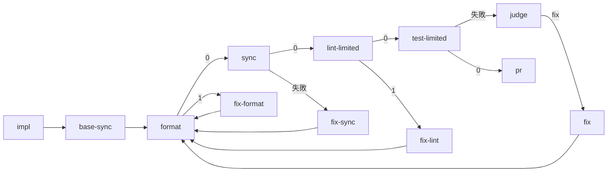
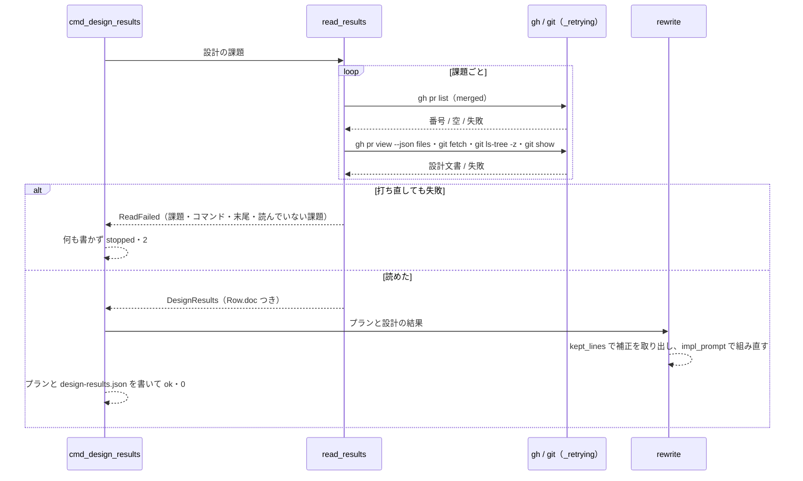

# 実装の指示の補正・整形と静的解析のステップ・GitHub の一時的な失敗: 「設計の結果」で conductor の補正を残し、整形と範囲の静的解析をステップが受け持ち、読めないときは書き換えずに止まる

## 概要

**`supervise.py design-results` は実装のプランの `impl` の `prompt` のうち雛形の部分（課題・設計文書・触る範囲・共通の規則）だけを組み直し、
conductor が足した行（補正）を順のまま残す。実装のプランは宣言があれば `impl → base-sync → format → sync → lint-limited → test-limited`
と並び、整形（`.ndf/supervise.json` の `format`）と範囲の静的解析（`.ndf/project.json` の `kind: lint` の suite）を worker への指示ではなく
ステップで当てる。cross-review の修正の送信（`result_posts.push_fix`）も同じ宣言の整形を push の前に当てる。設計の結果を読む `gh` / `git` の
一時的な失敗は打ち直し、それでも読めなければ何も書かずに `stopped`・終了コード 2 で止まる。**

この文書は、その形に**なぜしたか**（背景・決定と理由・常に成り立つ条件・境界・データの形・既知の限界・テスト観点）を残す。
**引数・ステップのキー・終了コードの正はスクリプトにある。**

| 何を | 正本 |
| --- | --- |
| プランの鍵 `設計文書`・`.ndf/supervise.json` の `format`・run の preset `format` | [`supervise_lib/plan.py`](../../plugins/ndf/scripts/supervise_lib/plan.py) の docstring |
| `supervise.py format [--root DIR] [--commit]` の終了コード | [`supervise.py`](../../plugins/ndf/scripts/supervise.py) の epilog と [`supervise_lib/commands.py`](../../plugins/ndf/scripts/supervise_lib/commands.py) の `cmd_format` |
| `test-run.py scope --only-kind test\|lint` | [`test-run.py`](../../plugins/ndf/scripts/test-run.py) の冒頭の説明 |
| 整形の部品の一覧と使う側 | [`plugins/ndf/scripts/lib/README.md`](../../plugins/ndf/scripts/lib/README.md) の `formatting.py`・`result_posts.py` の行 |
| ステージの並びと担い手 | `development-workflow` の `references/agent-layers.md` |

決定の番号は #1651 の設計の番号である（#1941 #1507 は #1651 へ取り込んだ）。コードのコメントの「#1651 の決定 5・6」「#1507 の I8」「#1941 の I4」は
同じ設計の決定と不変条件を指す。

## 用語

「補正」「整形」「一時的な失敗」「suite の種別」の定義は用語集（[docs/glossary.md](../glossary.md)）が正である。cross-review の文脈の
「一時的な失敗」は投稿の失敗を指し（[cross-review-transient-post-failure.md](cross-review-transient-post-failure.md)）、この文書では
`gh` / `git` の読み取りの失敗を指す。

工程（`ndf-workflow`）と cross-review（`ndf-cross-review`）の関係は**共有カーネル**で、共有するのは整形の宣言の形と、それを読んで当てる
`lib/formatting.py` だけである。

## 背景

| 実物 | 何が起きたか |
| --- | --- |
| スプリント m725（2026-10-03） | conductor が `5-impl-725/1289/842/824.json` の `prompt` に足した補正（設計文書のパス・`check-lint.sh --fix`・用語集の確認）が、`design-results` の後に 4 本とも消えた |
| m464（PR 1700） | `prompt` に `check-lint` の補正が残っていても、`pr` が push 前の整形の検査で落ちた。worker への指示では整形が保証されない |
| m1693（PR 1716） | `test-limited` が静的解析（`script-structure` → `lint` → `script-structure`）で 3 回落ち、範囲テスト 1 回約 310 秒を 3 往復した。`check-lint.sh --fix` は構造検査を含まない |
| m1982 | 5 本のプランに同じ 3 行（設計文書のパス・`check-lint --fix`・用語集の確認）を手で足した |
| #1941 | `design-results` が GraphQL の `HTTP 504` を「設計の結果を読めなかった」と同じに扱い、`status: ok` で `触るファイル` の無いプランを書いた。打ち直すと 5 件とも読めた |
| #1507 | cross-review の round 2 の修正コミット（554d14d1）が `ruff format` 違反のまま pre-push の `check-lint` で落ち、ラウンドが止まった |

## 決定と理由

| # | 決定 | 理由 | 採らなかった案 |
| ---: | --- | --- | --- |
| 1 | 補正は、書き直しの前の状態と後の状態から組んだ指示の空でない行の和（雛形の行）に無い行として取り出す（`kept_lines`） | conductor は今のまま `prompt` へ行を足せばよく、覚える約束が増えない。後の状態も和に入れるため 2 回流しても重ならない | 補正を別のキーへ置かせる・印で囲ませる（忘れると黙って消える形が残る） |
| 2 | 設計文書のパスはプランの `設計文書` と `Row.doc` に持つ | 前回入れたパスを読み戻せないと、2 回目の書き直しで古い行が補正と見なされる。`design-results.json` からも同じパスを辿れる | `prompt` の中だけに持つ |
| 3 | 用語集の行は `glossary.py gate --mode standard` が 0 のときだけ入れる（`decl.glossary_ready`） | 設計の工程の入口と同じ判定で、用語集の無いプロジェクトへ打てないコマンドを指示しない | 常に入れる |
| 4 | 整形のコマンドは `.ndf/supervise.json` の `format`（`{"name", "command"}` の並び）に置き、読むのは `formatting.format_commands` だけ | `sync_checks` と同じ形で、雛形と送信が同じ関数を通る。ai-plugins のコマンドを NDF に埋め込まない | `sync_checks` の lint を `--fix` 付きにする（重い並びを毎回打つ）。`project.json` の suite に `kind: format` を足す（解析で作り直される宣言） |
| 5 | 範囲の静的解析は既存の `kind: lint` の suite を `test-run.py scope --only-kind lint` で当て、`lint-limited` を置くプランの `test-limited` は `--only-kind test` にする | 新しい宣言が要らず、同じ suite を同じ範囲へ 2 度当てない | `sync_checks` に構造検査を足す（全体に当たり変更起因かを分けられない） |
| 6 | 範囲テストの前の並びは `format → sync → lint-limited` で、`fix-format`・`fix-sync`・`fix-lint`・`fix` はすべて並びの先頭へ戻る | `sync` の中の lint が整形だけの違反で落ちないよう `format` を先に置く。修正の worker が入れた整形の違反も push の前に直る。`sync` の宣言は静的解析も打つため、`fix-sync` の直しも整形を通し直す | `pr` の直前に整形を置く（範囲テストと突き合わせが整形の前のコードを見る） |
| 7 | 送信の前の整形は `result_posts.push_fix` の中で当てる | cross-review の `merge-fix` と `/ndf:fix` の単独の送信（`result_posts.py fix`）が共に通る部品で、送る側どうしで整形の有無が分かれない | `merge_fix._record_new_fix` で整形する（`/ndf:fix` に穴が残る） |
| 8 | 整形は新しいコミットとして上に足し、整形の前に変更の無かった追跡ファイルのうち整形で変わったものだけを入れる | `fix_commit` を書き換えないので送り先の祖先の判定がそのまま通る。worker の作業途中のファイルを巻き込まない | amend で混ぜる（`fix_commit` の SHA が変わる）。`git add -A` |
| 9 | 打ち直しは `waits.retry_call` で 15 秒間隔・1 コマンド 30 秒まで・1 回の実行で合計 120 秒まで | #1941 は 1 度の打ち直しで読めた。合計がステージの `timeout` 600 秒の内に収まる | `gh_call.gh` の中で一律に打ち直す（打ち直しの扱いが別に決まっている呼び手まで変わる） |
| 10 | 打ち直しても失敗が残った最初の課題で止め、残りは「読んでいない」として出す | 障害の間に残りの課題でも待ちを重ねても得る情報が無い。やり直すときは全課題を最初から読む | 残りも読み続けて失敗を集める |
| 11 | `git show` は `git ls-tree` で `origin/<base>` にあるパスだけに打つ | 設計 PR の後で消えた・改名した文書は何度打っても落ち、一時的な失敗と取り違える | 消えたパスも打ち直しの対象にする |

## 仕様

### 構成要素と責務

| 要素 | 責務 |
| --- | --- |
| [`lib/formatting.py`](../../plugins/ndf/scripts/lib/formatting.py) | `format_commands`（宣言の形の検査。違えば `FormatError`）・`read_format_commands`（根の `.ndf/supervise.json` を読む。ファイルが無ければ `[]`）・`apply_format`（根で順に打ち、整形で変わったファイルだけを 1 つのコミットにする）・`format_before_push`（送る前の整形。送れない理由か空文字を返す） |
| [`supervise_lib/templates.py`](../../plugins/ndf/scripts/supervise_lib/templates.py) | `IMPL_RULES`・`GLOSSARY_RULE`・`DESIGN_DOCS_LINE` と `impl_prompt`（課題・設計文書・触る範囲・共通の規則・用語集の行・補正の順に組む）。`plan_to_merge` が `pre_test_steps` の並びを起点の取り込みの後に置き、`base-sync` と `fix` の `next` をその先頭（空なら `test-limited`）へ向け、`lint-limited` があれば `test-limited` の `cmd` に `--only-kind test` を足す |
| [`supervise_lib/verify_steps.py`](../../plugins/ndf/scripts/supervise_lib/verify_steps.py) | `pre_test_steps(a, fix_prompt)`: 宣言のあるものだけで `format`・`sync`・`lint-limited` とそれぞれの `fix-*` を組む |
| [`supervise_lib/design_stage.py`](../../plugins/ndf/scripts/supervise_lib/design_stage.py) | `_retrying`（`Budget` の残りの内で打ち直す）・`ReadFailed`・`merged_design_pr`・`changed_design_docs`・`read_results`・`kept_lines`・`rewrite`・`cmd_design_results` |
| [`supervise_lib/decl.py`](../../plugins/ndf/scripts/supervise_lib/decl.py) | `format_of`（`formatting.format_commands` を通し、誤りは `DeclError`）と `glossary_ready` を `apply_decls` で `a` に載せ、`decl_fields` でスプリントの子のプランへ引き継ぐ |
| [`supervise_lib/commands.py`](../../plugins/ndf/scripts/supervise_lib/commands.py)・[`paths.py`](../../plugins/ndf/scripts/supervise_lib/paths.py) | `cmd_format`（`supervise.py format`）と preset `format`（`supervise.py format --commit`） |
| [`test-run.py`](../../plugins/ndf/scripts/test-run.py) | `scope --only-kind test\|lint` |
| [`lib/design_results.py`](../../plugins/ndf/scripts/lib/design_results.py) | `Row.doc`（その行を読んだ設計文書のパス）と `DesignResults.docs_of`。`design-results.json` の `rows[].doc` へ写す |
| [`lib/result_posts.py`](../../plugins/ndf/scripts/lib/result_posts.py) | `push_fix` が `formatting.format_before_push` → `tool_paths.before_push` の後に push する |
| [`.ndf/supervise.json`](../../.ndf/supervise.json) | ai-plugins の `format`: `[{"name": "lint-fix", "command": "bash scripts/check-lint.sh --fix"}]` |

### 常に成り立つ条件

| # | 条件 | 破れたときの扱い |
| --- | --- | --- |
| I1 | 書き直しの前の `prompt` にあった補正の行は、書き直しの後も同じ順ですべて残る（雛形の行を書き換えた行も補正として残る） | テストで落とす |
| I2 | 同じ入力で書き直しを 2 回流した結果は 1 回の結果と同じ（補正・触る範囲・設計文書の行が重ならない）。用語集の行は有無のどちらの判定でも雛形の行とみなす | テストで落とす |
| I3 | 雛形が組む行に、整形や静的解析のコマンドを打てという worker への指示を含めない | テストで落とす |
| I4 | 一時的な失敗が打ち直しの後も残ったときは、実装のプランと `design-results.json` を 1 つも書き換えない | `status: stopped`・終了コード 2 |
| I5 | 整形のコミットは `fix_commit` の上に足し、`fix_commit` は送り先の祖先のまま残る | `push_fix` が祖先の判定で止まる |
| I6 | 整形でコミットするのは、整形の前に変更が無く整形で変わった追跡ファイルだけ | テストで落とす |
| I7 | 整形と静的解析の宣言が無いプロジェクトのステップの並びは `impl → base-sync → test-limited` のまま | テストで落とす |
| I8 | 実装のプランと修正の送信は、同じ関数（`formatting.format_commands`）で同じ宣言を読む | テストで落とす |

### 実装のプランのステップの並び

- **宣言ごとに置くかを決める。** `format` と `fix-format` は `format` の宣言、`sync` と `fix-sync` は `sync_checks`、`lint-limited` と `fix-lint` は
  範囲の雛形（`scope_command`）を持つ `kind: lint` の suite があり、かつ解いた戦略が round-only でないときだけ置く
- 図の `format` への矢印は「並びの先頭」を指す。`format` を置かないプランでは置いたうちの最も前（`sync`、無ければ `lint-limited`）、
  どれも置かなければ `test-limited` へ向く
- `format` と `lint-limited` の終了コード 2 は止まる（`on_exit: {"2": "stop"}`）。1 は修正の worker（`FIX_PROMPT`）へ回る
- `fix` から先頭への矢印は取り込みを通らない（取り込みへ戻るのは `merge` の衝突と `fix-base` だけ。起点の取り込みの部品は
  [`supervise_lib/procedures.py`](../../plugins/ndf/scripts/supervise_lib/procedures.py) の `base_sync_steps`）。`pr` の後の `fix-push` は
  [ndf-sprint-acceptance-check-and-prepush-fix.md](ndf-sprint-acceptance-check-and-prepush-fix.md) が扱う
- `上限`・`test-limited` から後のステップは変えない。経路が長くなる分は上限を経路から数える形が受ける

### 「設計の結果」の書き直し

- 「PR が無い」は `gh pr list` が 0 で空のとき、「表が無い」は文書を読めたうえで「設計の結果」の表が無いときで、どちらも `metrics.unread` に
  入って `ok` で進む。一時的な失敗は `gh` / `git fetch` / `git ls-tree` / `git show` が打ち直しの後も 0 以外のとき
- `rewrite` が触るのは `impl` の `prompt` と、プランの `課題`・`触るファイル`・`設計文書`・`実行の条件` だけで、`timeout` などは残す

### 修正の送信（`push_fix`）

`push_fix` は `fix_commit` が無ければ送らずに通す。ある場合は `format_before_push`（宣言が無ければ何もしない）→ `tool_paths.before_push` →
`push origin HEAD:<ブランチ>` → `fetch` → `fix_commit` が `FETCH_HEAD` の祖先か、の順に見る。整形が落ちると
`PushResult(ok=False)` の `detail` に理由（`整形で直らない違反が残る（<名前>）: <末尾 300 文字>` か `整形を当てられない（…）`）を入れ、
`merge-fix` は今の `review_lib.die` で止まる。ホストが自分で送った修正（`record-fix`）は `push_fix` を通らないため整形しない。
cross-refactoring の送信は `push_fix` を通らず、整形しない。

### 境界の決まり

- **整形のコマンドは宣言のまま根で打つ。** 範囲を渡す口を持たない（ai-plugins の `check-lint.sh --fix` は追跡ファイルすべてに当たる）。
  コミットに入る範囲は I6 で絞る
- 整形の前から変更があり整形でも変わったファイルはコミットに入れず、`supervise.py format` の `items` に `{name: "skipped", files, reason}` として出す
- コミットは `git --literal-pathspecs commit -- <ファイル>...` で列挙したファイルだけを入れる。変更の読み取りは `git diff --name-only -z HEAD`
- `test-run.py scope --only-kind` の当てる範囲は絞った後も今の `scope` と同じ（テストの suite は `--paths`、静的解析の suite は `--changed`）
- `--only-kind lint` は範囲に入るファイルが無ければ `ok`・0。`--only-kind test` は範囲の雛形を持つ `kind: test` の suite が無ければ `ok`・0
  （静的解析の suite だけを宣言したプロジェクトで、`lint-limited` の後に judge へ落とさない）。付けないときの「対象なし」は今のまま 2
- round-only の戦略では範囲に当てず、`round_runs()` を渡した種別で絞って打つ（その種別が無ければ `ok`・0）
- `.ndf/supervise.json` の `format` が無い・空・null なら整形のステップを置かず、送信の前にも整形しない。形が違えば雛形は `DeclError`
  （プランを書かずに止まる）、`supervise.py format` は終了コード 2、送信は送らずに止まる

### データの形

**整形の宣言**（`.ndf/supervise.json`）:

| 項目 | 形 | 省略したとき |
| --- | --- | --- |
| `format` | `[{"name": "<名前>", "command": "<シェルのコマンド>"}, ...]`。根で順に打つ | 整形のステップを置かず、送信の前にも整形しない |

コマンドの終了コードの約束は 0 = 整形の後に違反が残らない / 1 = 整形で直らない違反が残る / それ以外 = 仕組みの失敗である。

**`supervise.py format [--root DIR] [--commit]`**（ツール名 `supervise-format`）:

| 終了コード | status | いつ |
| --- | --- | --- |
| 0 | `ok` | すべてのコマンドが 0。`--commit` なら整形で変わったファイルを 1 つのコミットにした（無ければコミットしない） |
| 1 | `stopped` | どれかのコマンドが 1 |
| 2 | `stopped` | 宣言が無い・形が違う・コマンドが 0 と 1 以外・git が落ちた・コミットが落ちた |

`items` はコマンドごとの `{name, result, exit, tail}`（`tail` は落ちたときだけ、末尾 1500 文字）と、コミットしたときの `{name: "commit", sha, files}`。
コミットの件名は `Update: 宣言の整形を当てる（<名前>・…）`。`metrics.changed` は整形で変わったファイルの数。

**実装のプラン:**

| 項目 | 形 |
| --- | --- |
| `設計文書`（省略可） | `design-results` が書く設計文書のパスの並び。`impl_prompt` が `設計文書: <パス>、…（決定の記録と「設計の結果」を読んでから実装する）` の行を組む |
| `format` のステップ | `{"type": "run", "preset": "format", "stage": "実装", "on_exit": {"2": "stop"}, "on_fail": "fix-format"}` |
| `sync` のステップ | `{"type": "run", "preset": "sync-check", "stage": "実装", "on_fail": "fix-sync"}` |
| `lint-limited` のステップ | `{"type": "run", "stage": "完了判定", "cmd": "<範囲テストの cmd> --only-kind lint", "on_exit": {"2": "stop"}, "on_fail": "fix-lint"}` |
| `fix-*` のステップ | `{"type": "work", "kind": "修正", "inputs": [<元のステップ>], "prompt": FIX_PROMPT, "next": <並びの先頭>}` |

**実装の指示（`impl` の `prompt`）** の並び: 課題への参照 → `設計文書:`（`設計文書` が空なら出さない）→ `触る範囲:` → `共通:` の規則
（`IMPL_RULES`）→ 用語集の行（`glossary_ready` が真のときだけ。`glossary.py check --file <文書>`）→ 補正の行（書き直しの前の順のまま）。
`--prompt` / `--prompt-file` を渡したときは、その文が課題への参照から触る範囲までの部分に代わる。

**`supervise.py design-results` の結果:**

| 場合 | status | 終了コード | 書くもの |
| --- | --- | --- | --- |
| すべて読めた・PR が無い・表が無い | `ok` | 0 | 実装のプランと `design-results.json`（`rows[].doc` を持つ）。`metrics` は `rows`・`unread`・`design_prs` |
| 打ち直しても `gh` / `git` が 0 以外 | `stopped` | 2 | 何も書かない。`summary` に読めなかった課題・コマンド・出力の末尾 300 文字・読んでいない課題。`metrics` は `failed_issue`・`not_read` |
| 取り込み先に流れる実装のプランが無い | `stopped` | 2 | 何も書かない（`DesignResultsError`） |

## 運用

### 既知の限界

| 項目 | 内容 |
| --- | --- |
| 修正のループの `sync` の秒 | 修正の行き先が並びの先頭になったため、修正のたびに `sync` が通る。その秒を範囲テストと CI の 1 往復と比べた実測はまだ無い |
| 直らない違反の往復 | `format` が変更に起因しない既存の違反で 1 を返し続けると、`fix-format` との往復は経路の上限で止まる。judge で切るかは起きた回数を数えてから決める |
| 整形の前から変わっていたファイル | worker が未コミットのまま残したファイルを整形が変えたときは、コミットに入れず `items` に出すだけである |
| cross-refactoring の送信 | `push_fix` を通らないため、送信の前の整形は当たらない |

## テスト観点

テストは `plugins/ndf/scripts/tests/test_impl_format_steps.py`（雛形・`--only-kind`・`supervise.py format`・`push_fix` の整形）と
`test_design_results_rewrite.py`（書き直しと一時的な失敗）にある。

- 補正の行を途中と末尾に足したプランへ `rewrite` を流すと、補正が同じ順で残り、触る範囲と課題が設計の結果のとおりになること。同じ入力で 2 回流しても
  1 回目と同じであること（I1・I2）
- 設計の結果を読めた課題の `prompt` と `設計文書` に `Row.doc` のパスが入り、取り込んだ課題の文書のパスも入ること
- 用語集の設定と用語集があるときだけ `glossary.py check` の行が入り、1 行だけであること
- 雛形が組む `prompt` に、宣言の整形・静的解析のコマンドが現れないこと（I3）
- 宣言がすべてあるプランが `impl → base-sync → fix-base → format → fix-format → sync → fix-sync → lint-limited → fix-lint → test-limited` と並び、
  `fix-format`・`fix-sync`・`fix-lint`・`fix` の `next` がすべて `format` であること。`test-limited` の `cmd` が `--only-kind test` を持つこと
- 宣言が無いプランに `format`・`sync`・`lint-limited` が無く、`base-sync` と `fix` の `next` が `test-limited` で、`--only-kind` を持たないこと（I7）
- `format` の宣言が無いプランで、`fix-lint`・`fix`・`base-sync` の `next` が実在するステップ（`sync`、無ければ `lint-limited`）を指すこと
- round-only の宣言のプランは `lint-limited` を置かず、`--only-kind lint` は静的解析の suite の `command` だけを打つこと
- `--only-kind test` はテストの suite を `--paths` へ、`--only-kind lint` は静的解析の suite を `--changed` へ当てること。静的解析の suite だけの宣言で
  `--only-kind test` が `ok`・0 を返すこと
- `supervise.py format --commit` が整形で変わったファイルだけをコミットし、前から変更のあったファイルを入れないこと（I6）。`[id]` などの名前を
  そのまま扱うこと。コマンドの 1 / 2 で終了コード 1 / 2 になり、宣言が無ければ 2 であること
- 宣言の誤った形で、雛形と `push_fix` が同じ誤りを出すこと（I8）
- `push_fix` が整形違反のコミットに整形のコミットを足して送り、`fix_commit` が送り先の祖先であること（I5）。整形で何も変わらなければコミットが
  増えないこと。整形が落ちれば送らず、`detail` に名前と末尾が入ること
- 1 回目に 504 で落ち 2 回目に通る応答で、失敗が無いときと同じプランを書いて `ok` になること。起点から消えた文書を失敗にしないこと
- 打ち直しても落ちる応答で、プランと `design-results.json` が書き換わらず `stopped`・2 で、`summary` に課題とコマンドの末尾が出ること（I4）。
  待ちの合計が 120 秒を超えないこと
- `gh` が 0 で空の課題と表の無い文書が `unread` に入り `ok` で進むこと

## 関連リンク

- [`supervise_lib/templates.py`](../../plugins/ndf/scripts/supervise_lib/templates.py)・[`verify_steps.py`](../../plugins/ndf/scripts/supervise_lib/verify_steps.py)・[`design_stage.py`](../../plugins/ndf/scripts/supervise_lib/design_stage.py)・[`decl.py`](../../plugins/ndf/scripts/supervise_lib/decl.py)・[`lib/formatting.py`](../../plugins/ndf/scripts/lib/formatting.py)・[`lib/result_posts.py`](../../plugins/ndf/scripts/lib/result_posts.py)・[`lib/design_results.py`](../../plugins/ndf/scripts/lib/design_results.py)・[`lib/waits.py`](../../plugins/ndf/scripts/lib/waits.py)
- [quality-gates-design-match.md](quality-gates-design-match.md) — `standard` の実装プランで `test-limited` と `pr` の間に置く設計との突き合わせ
- [ndf-supervise-step-budgets.md](ndf-supervise-step-budgets.md) — `impl` の `timeout`。`design_stage.rewrite` は `prompt` だけを書き換えて `timeout` を残す
- [ndf-sprint-acceptance-check-and-prepush-fix.md](ndf-sprint-acceptance-check-and-prepush-fix.md) — `sync_checks` と、`pr` の push 前の検査の不合格を受ける `fix-push`
- [cross-review-transient-post-failure.md](cross-review-transient-post-failure.md) — cross-review の投稿の一時的な失敗（別の意味の同じ語）
- [issue #1651](https://github.com/devbasex/ai-plugins/issues/1651)・[issue #1941](https://github.com/devbasex/ai-plugins/issues/1941)・[issue #1507](https://github.com/devbasex/ai-plugins/issues/1507)
