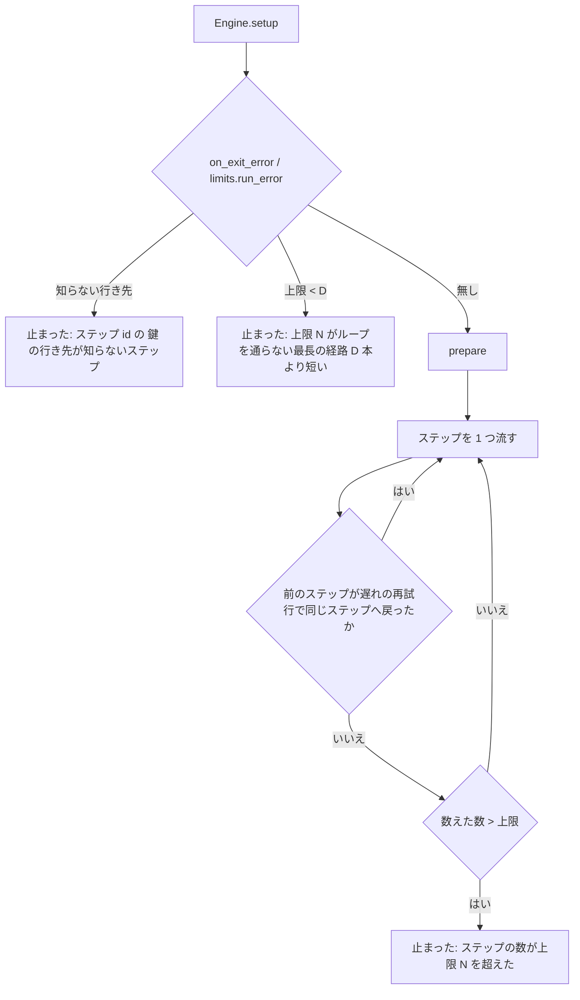

# ステップの上限と遅れの見張り: `supervise.py` のプランの `上限` を遷移から求めて流す前に照らし、`--from` の再開は前の実行の結果で判定し、進んでいるステップを打ち切らない

## 概要

**`supervise.py new` / `new sprint` が書くプランの `上限` は、雛形の固定の数でなく、プランの遷移から
`上限 = D + 3 × Σ 修正のループ + 3 × Σ 戻りの輪` で求めた値である。** `run` は最初のステップを流す前に、`上限` が
流し始めるステップからのループを通らない最長の経路（D）より短くないか、遷移の行き先がすべて知っているステップかを照らす。
上限と比べるステップの数に、遅れの見張りの再試行は入らない。`run --from` の再開では、judge と work の `inputs` のうち
今の実行でまだ流れていないステップへ、前の実行の最後の結果を渡す。遅れの見張りは、work のステップでは worker の
セッションの記録の伸びを、drive のステップでは Pull Request の投稿・レビュー・コミットの時刻を、進みに数える。

例: スプリントの実装のプランは、#1702 の経路（範囲テストの修正 3 回と doc-lint の修正 1 回で 27 本）でも `上限` 141 の
内側で merge まで届く。手で `上限` 12 と書いた設計のプラン（D は 15）は、`run` が最初のステップを流す前に
`理由: 上限 12 がループを通らない最長の経路 15 本（glossary から）より短い。上限を上げるか supervise.py new で書き直す`
で止まる。

この文書は、その形に**なぜしたか**（背景・決定と理由・常に成り立つ条件・計算の定義・既知の限界・テスト観点）を残す。
**プランの鍵・進捗ログの行・遅れの見張りの設定の正は [`supervise_lib/plan.py`](../../plugins/ndf/scripts/supervise_lib/plan.py)
の docstring にある**（「上限」の鍵・「途中の報告」・「遅れの見張り」の節）。止まったプランを `--from` で流し直す手順は
`development-workflow` の [references/interrupt-resume.md](../../plugins/ndf/skills/development-workflow/references/interrupt-resume.md) が正である。

| 何を | 正本 |
| --- | --- |
| 上限・D・修正のループ・戻りの輪の計算と、流す前の照合の文 | [`supervise_lib/limits.py`](../../plugins/ndf/scripts/supervise_lib/limits.py) |
| 上限と比べるステップの数え方 | [`supervise_lib/flow.py`](../../plugins/ndf/scripts/supervise_lib/flow.py) の `_plan_steps` |
| 前の実行の範囲（`--from` を付けない最後の実行の始まりより後）と、そこから Pull Request を読み直すこと | [ndf-supervise-resume-pr.md](ndf-supervise-resume-pr.md)（`RunState.prior_rows` を共有する） |
| 前の実行の結果を読むこと・入力の組み方 | [`supervise_lib/steps.py`](../../plugins/ndf/scripts/supervise_lib/steps.py) の `prior_results`・`StepContext.inputs_text` |
| 一次の調査の印 | [`lib/slow_step.py`](../../plugins/ndf/scripts/lib/slow_step.py) の `session_size`・`probe_worker`・`pr_latest`・`probe_drive` と、[`supervise_lib/slow.py`](../../plugins/ndf/scripts/supervise_lib/slow.py) の `SlowWatch` |
| 戻りの上限の回数 | [`merged_lib/base_sync.py`](../../plugins/ndf/scripts/merged_lib/base_sync.py) の `RETURN_LIMIT` |

`上限` はステップの**数**の上限である。ステップの**時間**の枠（`impl` の `timeout` と `refactor` の想定最大時間）は
[ndf-supervise-step-budgets.md](ndf-supervise-step-budgets.md) が扱い、この文書は触れない。

決定の番号は #1909（#1676 #1623 #1496 を取り込んだ）の設計の番号である。

## 用語

「ステップの上限」「修正のループ」「戻りの輪」「失敗の遷移」「ループを通らない最長の経路」「遅れの見張り」「前の実行」
「worker のセッションの記録」の定義は用語集（[docs/glossary.md](../glossary.md)）の「NDF の開発ワークフロー（`ndf-workflow`）」が正である。

## 背景

`上限` は雛形の関数ごとに固定の数で書かれ、雛形がステップを足すたびに数え直しが要った。4 つの課題はどれもその数え直しの
漏れか、見張りの見方の不足から起きた。

| 課題 | 起きたこと |
| --- | --- |
| #1909 | 実装のプラン（上限 20）が全体テストの修正 1 回と doc-lint の修正 1 回で `ready` の後に止まり、conductor が `--from merge-gate` で続けた（m1683 の #1833・PR #1903）。#1702（PR 1993）は範囲テストの修正 3 回で `--from ready`。検査のプラン（上限 12）も全体テストの修正 1 回で `record` の手前で止まった（m1910） |
| #1676 | 設計のプラン（上限 12）が用語の修正を通って最長の経路（14 本）を超え、`--from gate` の judge は前の実行の結果を読めずに「（入力なし）」で stop を返した（m1847） |
| #1623 | コミットも worker の行も足さない要求・設計の worker を、遅れの見張りが作業中に打ち切り、その再試行がステップの上限を食った（devbasex/devbase#381） |
| #1496 | 段の出力へ書かずに Pull Request への投稿とコミットで進む cross-review を、4 ラウンドで収束した後でも「出力なし」で打ち切った（volareinc/carmo-cdk PR #454） |

見張りの進みの見方は、2026-10-16 の実測（claude 2.1.301・gh 2.101.0）で決めた。`--output-format json` の claude -p は標準エラーへ
0 バイトしか書かないが、`--session-id` で決めたセッションの記録は作業の間ずっと伸びた（4 秒目から 24 秒目まで 247,156 → 367,366 バイト）。
`gh pr view --json comments,reviews,commits` は 1 回 0.8 秒で、投稿・レビュー・コミットの最も新しい時刻を返した。

## 決定と理由

| # | 決定 | 理由 | 採らなかった案 |
| ---: | --- | --- | --- |
| 1 | 上限は `new` / `new sprint` の書き出しで遷移から求めてプランへ書く | conductor はプランを開くだけで上限を読め、手で上げた値もそのまま効く。`上限` の無いプランの既定 30 も変えない | `run` のときに求め直す（書き済みのプランの値を黙って上書きする） |
| 2 | D は、プランの並びで後ろのステップへ行く遷移だけをたどった最長の経路にする | 輪を持たないグラフになり、並びの逆順に 1 回たどれば求まる。すべての単純な経路を数えた最長を超えないので、照合（I5）が正しく流れるプランを止めない。今の雛形では両者が一致し、テストが縛る | すべての単純な経路を数える（ステップの数に対して指数の時間が掛かりうる） |
| 3 | 修正のループは検査のステップの失敗の遷移ごとに数え、長さは修正の work を含む最長の単純な輪にする | 要求の実測の伸び（全体テストの修正 1 回で +8 本・doc-lint で +2 本）と同じ長さになる。最短の輪は `skip_to` で突き合わせを飛ばす短い輪を選び、実際の経路より短い。直さない work（突き合わせ）だけを通る輪は修正と数えない | 後ろへ戻る遷移 1 本ごとに 1 つ（範囲テストと全体テストが修正の遷移を共有し、両方を 3 回ずつ通す経路を数え足りない） |
| 4 | 雛形の関数は `上限` の数を持たず、書き出しの 1 か所（`templates.cmd_new`・`sprint.cmd_new_sprint`）が埋める | ほかの主題が雛形へステップを足しても `上限` に触れずに済む | 雛形の数を残して計算の値と大きい方を取る（意味を持たない数が上限に見える） |
| 5 | 遅れの見張りの再試行をステップの数に数えない | 再試行の回数は `max_retry` が既に止める。数えると、同じ経路でも見張りの判定しだいで止まるかが変わる。数えないのは再試行で同じステップへ戻った回だけで、上限は有限の歯止めのまま残る | 上限に再試行の分を足す（何本が再試行されるかは流すまで分からない） |
| 6 | 進捗ログの `step` の行へ出力ファイルの名前（`out`）を足し、前の実行の結果はそれで引く | `state.json` は実行のたびに今の実行だけで書き直され、本文を持たない。`.out` の番号は実行ごとに 1 から振り直されるため、行の順から番号を数える形は確かでない | 実行ごとに状態の置き場を分ける（振り返りと `report.md` を読む手順が追従を要する） |
| 7 | 前の実行の範囲の切り方は `RunState.prior_rows` の 1 か所にし、`recorded_pr` と `prior_results` が共有する | 再開で戻す Pull Request とステップの結果が別の実行を指さない | 切り方を書き写す（片方だけ直すと食い違う） |
| 8 | 会話を残す claude -p に `--session-id` を渡し、セッションの記録の大きさの伸びを work の進みに数える | id を起動の前に決めれば、終わる前に記録の置き場を引ける。遅れの見張りの既定の値（`floor` 300 秒・`default` 900 秒ほか）は変えない | 出力を `stream-json` にする（結果の読み方と使用量の帳簿の契約が変わる）。下限を延ばす |
| 9 | drive の一次の調査で、Pull Request の投稿・レビュー・コミットの最も新しい時刻を前の確認の時刻と比べる | cross-review の駆動を変えずに、cross-review にも cross-refactoring にも効く。gh は遅れたステップの確認 1 回につき 1 回だけ呼ぶ | cross-review が段ごとに 1 行を書く（ラウンドの途中と修正の worker の間は書かれない）。段の種類ごとの既定（既定の値を変える） |
| 10 | 上限と行き先の照合は `Engine.setup` で最初のステップの前に返す | `setup` はファイルを書かない準備で、`prepare`（worktree を作る）より前に止まるため、流さないプランが worktree も実行の始まりの行も作らない | `_plan_steps` の繰り返しの手前で照らす（`prepare` の後になる） |

## 仕様

### 構成要素と責務

| 要素 | 責務 |
| --- | --- |
| `supervise_lib/limits.py` | プランの遷移を読む純粋な計算（ファイルもプロセスも触らない）。`longest_path`（D）・`loops`（修正のループと戻りの輪）・`step_limit`・`fill`・`fill_all`・`unknown_targets`・`run_error`。既定の次のステップの決め方 `default_next` も持ち、`Engine.next_of` はこれを使う。知らない行き先では `LimitError` を投げる |
| `templates.cmd_new` | ファイルを書く前に `limits.fill` を呼ぶ。`LimitError` なら書かずに `stopped` を返す |
| `sprint.cmd_new_sprint` | すべてのプランを `limits.fill_all` で埋める。どれかが知らない行き先を持てば、どのファイルも書かずに `stopped` を返す |
| `Engine.setup` | `--from` なら `ctx.resumed` を立てる。`on_exit_error`（`on_exit` の形だけ）と `limits.run_error`（行き先と上限）で照らし、誤りなら最初のステップの前に止まる |
| `flow._plan_steps` | 上限と比べる数を、遅れの再試行を除いて数える。耐久ステップの番号はすべての回で増やす |
| `RunState`（`supervise_lib/state.py`） | 進捗ログの `step` の行へ `out` を書く。`prior_rows` で前の実行の範囲を切る。`session` に会話を残す claude -p のセッションの id と設定の置き場を持つ |
| `steps.prior_results`・`StepContext.inputs_text` | 前の実行の範囲の `step` の行から、ステップごとに最後の行の `exit` と `out` の本文を引き、今の実行 → 前の実行 → 無い の順に入力を組む |
| `claude.call_claude`（`ClaudeRunner.call` から） | `session` を渡され、`full` で `resume` でない起動なら、uuid を `--session-id` で渡して `session` に id と設定の置き場を入れる |
| `SlowWatch`（`start_watch`・`slow_probe`・`session_grown`） | ステップの開始でセッションの記録の大きさを覚え、`pr_checked` に開始の時刻を入れる（gh は呼ばない）。一次の調査で work はセッションの記録の伸びを、drive は Pull Request の時刻を足して見る |
| `lib/slow_step.py` | `session_size`（記録の大きさ。見つからなければ 0）・`probe_worker`・`pr_latest`（最も新しい時刻。読めなければ None）・`probe_drive` |

### 常に成り立つ条件

| # | 条件 | 破れたときの扱い |
| --- | --- | --- |
| I1 | 書き出しが書く `上限` は `limits.step_limit` の値で、D に各修正のループと各戻りの輪を `FIX_ROUNDS`（3）回ずつ足した長さである | 書き出しが計算するので起こらない。テストが雛形ごとに `上限 == step_limit` と、各修正のループを 3 回通す経路が上限で止まらないことを縛る |
| I2 | 雛形の関数は `上限` の数を書かない。書いていても `fill` が計算の値で置き換え、`steps` の直前へ置く | — |
| I3 | 書き済みのプランの `上限` は、`run` も `queue` も書き換えない。`上限` の無いプランは既定 30（`limits.DEFAULT_LIMIT`） | テストが `run` の前後でプランのファイルが同じことを縛る |
| I4 | 遷移の行き先は、プランのステップか終わりの値（judge 以外は `end`・`stop`、judge の `choices` は `gate`・`stop`・`next`・`end`）である | `new` はプランを書かずに `stopped`（終了コード 1）、`run` は最初のステップの前に止まる |
| I5 | `上限` が流し始めるステップからの D より短ければ、最初のステップを流さない。`--from` では開始のステップからの D で照らす | `結果: 止まった` で、理由に上限と D と開始のステップが載る |
| I6 | 上限と比べる数は、直前のステップが遅れの見張りの再試行（`slow.act == "retry"`）で同じステップへ戻った回を除いた、流したステップの数である | 超えたら `ステップの数が上限 N を超えた` で止まる |
| I7 | `inputs` の各ステップの結果は、今の実行の結果 → （`--from` の再開なら）前の実行の最後の結果 → 無い（名前と理由）の順に決まる | 無い入力も名前つきの見出しで渡り、全体が「（入力なし）」になるのは `inputs` が空のときだけである |
| I8 | 前の実行は、`--from` を付けない最後の実行の始まりの行より後の記録である。`--from` を付けない実行は前の結果を渡さない | それより前の `.out` は渡らない |
| I9 | 一次の調査の印のどれかが前の確認から伸びていれば、`class: progress`・`action: wait` で待ち直す | — |
| I10 | どの印も伸びていなければ、今と同じく判定（retry / fix / stop / wait）へ回る。セッションの記録が見つからない・gh が落ちたことは「伸びた」に数えない | — |

### 上限の計算

**プランの遷移を有向グラフとして読む。** `parts` を持つ work は `expand_parts` で展開した後のステップで数える（`Engine` が流す形と同じ）。

| 遷移 | 鍵 | 成功 / 失敗 |
| --- | --- | --- |
| 次のステップ | `next`。無ければ `default_next`（並びの次。どこかの `on_fail` が指すステップと、そこから `next` で戻る修正の work は飛ばす） | 成功 |
| judge の選択 | `choices` のうちステップの id。`next` は既定の次のステップ。`choices` が無ければ既定の次のステップ | 成功 |
| 飛ばす・承認ゲートの後 | `skip_to`・`gate_next` | 成功 |
| 終了コードの表 | `on_exit` の `0` の行き先 / 0 以外の行き先 | 成功 / 失敗 |
| 落ちたとき | `on_fail`・`on_section_missing` | 失敗 |
| 直した後の戻り | `back_to_failed` の work から、そのループの検査のステップへ | 成功 |

- **D**（`longest_path`）: 並びで後ろのステップへ行く遷移だけをたどった最長の経路のステップの数。流し始めるステップを含む
- **修正のループ**（`loops` の 1 つ目）: 検査のステップ `c` の失敗の遷移 `c → f` 1 本ごとに 1 つ。長さは `f` から成功の遷移だけを
  通って `c` へ戻る単純な輪のうち、修正の work（`type` が `work` で `kind` が無いか「修正」）を含む最も長いもののステップの数。
  そういう輪が無ければ数えない（例: 設計のプランの `glossary-recheck → push-glossary`）
- **戻りの輪**（`loops` の 2 つ目）: 修正の work を含む輪が無く、`kind` が「戻り」（`limits.RETURN_KIND`）のステップを含む輪。
  数え方は修正のループと同じ。今の雛形では、`procedures.base_sync_steps` が組む `base-return` を通る
  `merge →（終了コード 4）base-return → base-sync → … → merge` の輪である（取り込みの経路は #1917 #2003）。
  `base-return` が許す戻りの回数（`base_sync.RETURN_LIMIT`）は `FIX_ROUNDS` 以下でなければならず、テストが縛る
- 輪の探索が `SEARCH_CAP`（100,000 回の展開）を超えたら、そのループの長さを「`f` から行けて `c` へ戻れるステップの数」で代える（多めに見る側）

想定の回数 3 は前提（1 本の実行で、それぞれの修正のループを 3 回まで通る。出所は #1702 の範囲テストの修正 3 回）で、値を持つのは
`limits.FIX_ROUNDS` の 1 か所である。4 回目以降は judge の「2 回直しても同じ失敗なら stop」か上限が止める。

2026-10-17 の develop で `supervise.py new` / `new sprint`（試験の宣言で `sync_checks` を 1 つ）が書いた値を示す。**雛形がステップを
足せば書き出しが同じ式で数え直すため、この表は控えで、正はその時点の `step_limit` である。**

| プラン | D | 修正のループ（検査 → 失敗の行き先: 長さ） | 戻りの輪 | 上限 |
| --- | ---: | --- | --- | ---: |
| スプリントの設計 | 15 | 無し | 無し | 15 |
| 設計の結果・スプリントブランチ | 1 | 無し | 無し | 1 |
| 実装（`new impl`・スプリントの実装） | 15 | base-sync→fix-base: 2、sync→fix-sync: 2、test-limited→judge: 4、pr→fix-push: 2、pr→judge: 8、test-all→judge: 9、doc-lint→fix-doc: 2 | merge→base-return: 13 | 141 |
| `new fix` | 14 | 実装と同じ | merge→base-return: 13 | 140 |
| 検査（`new check`） | 11 | base-sync→fix-base: 2、test-all→judge: 3 | merge→base-return: 6 | 44 |
| スプリントの検査 | 13 | 検査と同じ | merge→base-return: 6 | 46 |
| 開発版の配布（`new release`・スプリント） | 11 | bump・changelog・notes・sync→judge: 各 3、release→judge: 4、verify: 5、facts: 6、explain: 7、others: 8 | 無し | 137 |

### 流す前の照合と数え方

`run_error` は開始のステップが知らない id なら照らさずに返し、流す側が「知らないステップ」で止める。

### 前の実行の結果を入力へ渡す

`StepContext.inputs_text` は `inputs` のステップごとに次の見出しで組む（本文は末尾の `TAIL` 文字）。

| 場合 | 見出し |
| --- | --- |
| 今の実行で流れた | `### ステップ <id>（exit=<N>）` |
| `--from` の再開で、前の実行に結果がある | `### ステップ <id>（exit=<N>、前の実行）` |
| `--from` の再開で、前の実行の記録にも無い | `### ステップ <id>（今の実行でまだ流れておらず、前の実行の記録にも無い）` |
| `--from` を付けない実行で、まだ流れていない | `### ステップ <id>（この実行でまだ流れていない）` |

`prior_results` は前の実行の範囲（`prior_rows`）の `step` の行を順に読み、同じステップは最後の行で上書きする。本文は `out` の
ファイルから読み、`out` の無い古い行か読めないファイルは `summary` で代える。状態の置き場は実行の始まりに消さないため、
前の実行の `.out` は後の実行が同じ名前を書くまで残る。同じ名前を書き直すのは今の実行で流れたステップだけで、その結果は
今の実行の結果が先に使われる（I7）。

### 遅れの見張りの一次の調査

想定の時間・待ち直し・判定の規則と設定の鍵は `plan.py` の docstring の「遅れの見張り」が正である。この主題で足した印は次のとおり。

| ステップ | 既定の `probe` | 進みの印 |
| --- | --- | --- |
| work | `worker` | worker の行の数・コミットの数・worker のセッションの記録の大きさ（`<設定の置き場>/projects/*/<id>.jsonl`）。設定の置き場は子へ渡す環境の `CLAUDE_CONFIG_DIR`、無ければ `~/.claude`。ステップの途中で新しいセッションに替わっていれば、その記録の大きさ全部を伸びに数える |
| drive | `output` | 出力（stderr）の大きさと、プランの Pull Request の投稿・レビュー・コミットの最も新しい時刻が `pr_checked` より後か。gh を呼ぶのは遅れたステップの確認のときだけで、読んだ後に `pr_checked` を今の時刻へ進める |
| run | `output` | 出力の大きさ（変えていない） |

進捗ログの `slow` の行の `probe` は、work が `name: worker` で `summary` にセッションの記録の伸び（バイト）を、drive が
`name: drive` で `summary` に出力の伸びと Pull Request の最も新しい時刻が前の確認より後か前かを書く。ステップの `probe` に
`{"cmd": …}` か `false` を書いたステップはこの印を使わない。

## データ・設定

**プランの JSON の鍵と `supervise.py` の引数は変えていない。** 変わったのは次の値と行である。

| 対象 | 形 |
| --- | --- |
| 雛形が書く `上限` | `limits.step_limit` の値。`steps` の直前に置く |
| 進捗ログの `step` の行 | 鍵 `out`（`NN-<ステップ>.out` のファイル名）を足した。ほかの鍵の意味は変えない |
| 会話を残す claude -p の起動（`full: true`、`--resume` でない） | `--session-id <uuid>` を足した。`--resume` で起こし直すときは足さない |

## エラー処理

| 場合 | 振る舞い |
| --- | --- |
| `new` / `new sprint` のプランの行き先が知らないステップ | `status: "stopped"`・`summary: "プランの遷移の行き先が知らないステップ: <ステップ> の <鍵> → <行き先>。プランを書かない"`・終了コード 1（`step_result.EXIT_VIOLATION`）。`new sprint` はどのファイルも書かない |
| `run` のプランの行き先が知らないステップ | 最初のステップを流さず `結果: 止まった`・`理由: ステップ <id> の <鍵> の行き先が知らないステップ: <行き先>` |
| `run` の `上限` が D より短い | 最初のステップを流さず `理由: 上限 <N> がループを通らない最長の経路 <D> 本（<開始のステップ> から）より短い。上限を上げるか supervise.py new で書き直す` |
| 流している途中で上限を超えた | `理由: ステップの数が上限 <N> を超えた（遅れの再試行 <k> 回は数えていない）`。k が 0 なら括弧を付けない |
| セッションの記録が見つからない | 大きさ 0 として、ほかの印だけで判定する |
| Pull Request がまだ無い・gh が落ちた | 時刻を比べず、出力の大きさだけで判定する。`summary` にどちらかを書く |

## 運用

### 既知の限界

| 項目 | 内容 |
| --- | --- |
| 想定回数 3 の釣り合い | 実装のプランは 141、開発版の配布は 137 になる。上限まで回ったときの費用は測っていない。変えるなら `limits.FIX_ROUNDS` の 1 か所 |
| 書き済みの古いプラン | この形より前に書いた設計のプラン（上限 12）は、D 15 より短いため流し始める前に止まる。理由の文が `上限` を上げるか `new` で書き直すよう示す |
| セッションの記録の置き場 | `<CLAUDE_CONFIG_DIR>/projects/<作業場所>/<id>.jsonl` は claude 2.1.301 での実測である。claude が置き場を変えると見つからず、今までと同じく判定へ回る |
| GitHub の上限 | drive の遅れの確認ごとに gh を 1 回呼ぶ。確認は想定の時間（下限 300 秒）ごとだが、並べた drive の数だけ増える |
| 輪の探索の打ち切り | `SEARCH_CAP` を超える雛形は今は無い。超えたときは多めに見積もった上限が付く |

## テスト観点

テストは `plugins/ndf/scripts/tests/test_supervise_limits.py`（上限・照合・数え方・実測の経路）と `test_base_sync.py`（戻りの輪の経路）にある。
ステップの結果はハンドラーをスタブに替え、遷移は `Engine` の本物の決め方で流す。

- 雛形のすべてのプランで、`上限` が `step_limit` と等しく、各修正のループを 3 回ずつ落としてから通す経路が上限で止まらない（I1・I2）
- 今のすべての雛形で、D がすべての単純な経路を数えた最長と一致する（決定 2 の前提）
- 実装のプランの修正のループの中に run のステップを 1 本足すと、`fill` の `上限` が 1 + `FIX_ROUNDS` 以上増え、`steps` の直前に置かれる
- `上限` が D より短い手書きのプランは、どの `.out` も作られずに止まり、理由に上限と D が載る。`--from` では開始のステップからの D で照らす（I5）
- `run` の前後でプランのファイルが変わらない（I3）
- 修正のループを回り続けるプランは上限で止まり、遅れの再試行は数に入らず、止まった理由に回数が載る（I6）
- 知らない行き先は、`fill` が `LimitError`、`fill_all` がどれも埋めず、`run` が最初のステップの前に止まる（I4）
- 実測の経路が上限の内側で通る: #1833 の経路が merge まで、#1702 の経路（27 本）が merge まで、m1910 の経路が record まで、
  設計の用語の修正の経路に design の再試行 1 回を足して gate まで、再試行 2 回でも gate まで（上限を超える本数でも）
- `base_sync.RETURN_LIMIT` が `FIX_ROUNDS` 以下である。戻りを 3 回通す実装と検査の経路が上限で止まらずに merge・record まで届き、
  雛形の取り込みを持つプランの `loops` に `merge→base-return` が戻りの輪として載る
- `--from` の再開で、前の実行の結果が `前の実行` の印つきで入力に載り、同じステップが 2 回流れていれば後の方が載る。前の実行にも
  無い入力は名前と理由が載る。`--from` を付けない実行より前の結果は渡らない（I7・I8）
- work がセッションの記録だけを伸ばしている間は `progress` で待ち直し、記録も伸びなければ判定へ回る。drive が Pull Request の投稿か
  コミットを重ねている間は待ち直し、出力も時刻も進まないか gh が落ちたときは判定へ回る（I9・I10）

## 関連リンク

- [`supervise_lib/limits.py`](../../plugins/ndf/scripts/supervise_lib/limits.py)・[`flow.py`](../../plugins/ndf/scripts/supervise_lib/flow.py)・[`engine.py`](../../plugins/ndf/scripts/supervise_lib/engine.py)・[`steps.py`](../../plugins/ndf/scripts/supervise_lib/steps.py)・[`state.py`](../../plugins/ndf/scripts/supervise_lib/state.py)・[`slow.py`](../../plugins/ndf/scripts/supervise_lib/slow.py)・[`claude.py`](../../plugins/ndf/scripts/supervise_lib/claude.py)・[`lib/slow_step.py`](../../plugins/ndf/scripts/lib/slow_step.py)
- [ndf-supervise-resume-pr.md](ndf-supervise-resume-pr.md)（前の実行の範囲と、再開の Pull Request の読み直し）
- [ndf-supervise-step-budgets.md](ndf-supervise-step-budgets.md)（ステップの時間の枠。ステップの数の上限とは別）
- `development-workflow` の [references/interrupt-resume.md](../../plugins/ndf/skills/development-workflow/references/interrupt-resume.md)（落ちたプランを `--from` で流し直す手順）
- #1909 #1676 #1623 #1496（この形を決めた課題）、#1917 #2003（取り込みの経路と戻りの上限）
