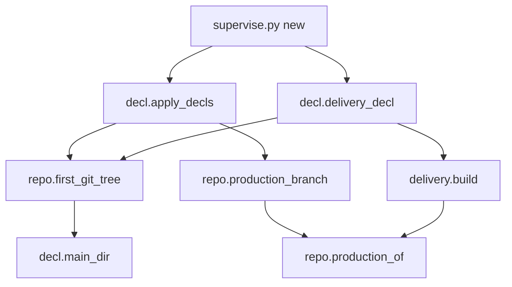
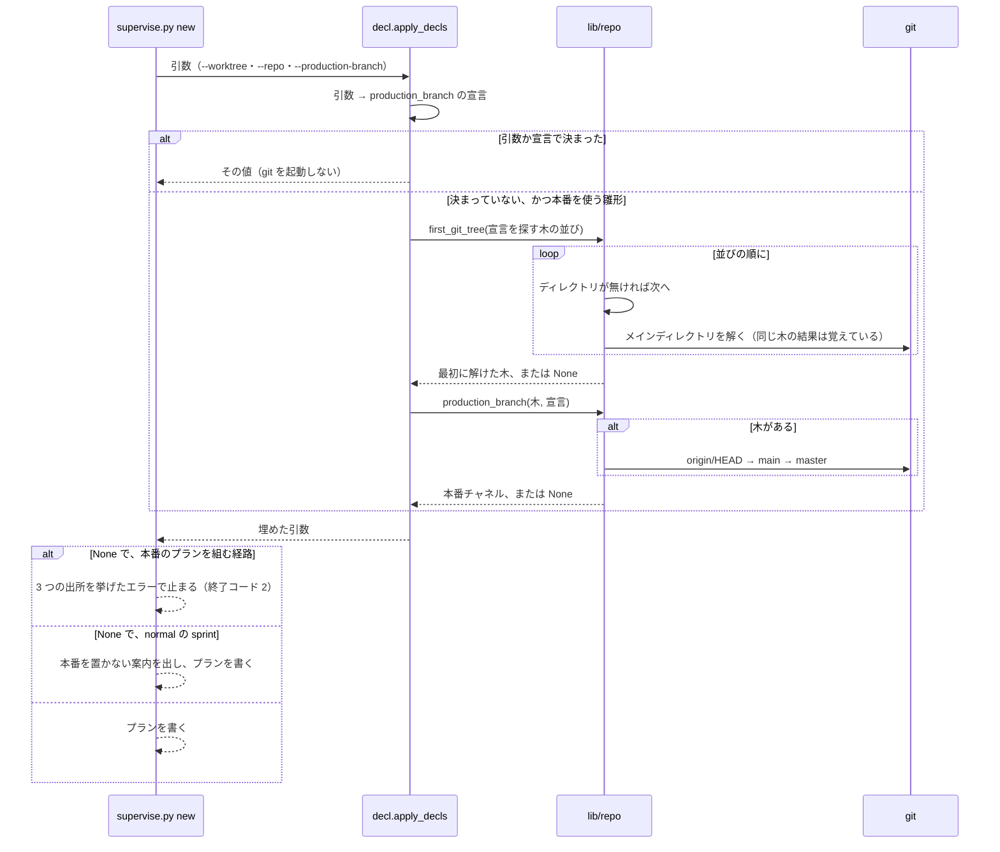

# 本番チャネルの既定ブランチへの後退: まだ作っていない worktree を渡しても、supervise.py new が本番のプランを組む

## 概要

**`supervise.py new` の `release`・`sprint`・`close` は、本番チャネルを `--production-branch` → `.ndf/worktree.json` の
`production_branch` → 既定ブランチの順で決める。** 既定ブランチは、宣言を探す木の並びのうち最初に存在する git の木から解く。
そのため、`--worktree` にまだ作っていない worktree のパスを渡しても、`production_branch` を宣言しないリポジトリで
リリースプラン・リリース承認ゲート・本番のステージが組まれる。リリースの経路の判定（`lib/delivery.py`）も同じ木から既定ブランチを
解き、プランと同じ本番チャネルを使う。

例: origin の HEAD が `main` で、`.ndf/worktree.json` が `{"base_branch":"main"}` だけのリポジトリで、
`supervise.py new release --version 1.0.0 --prs 1 --channel prod --worktree <メインディレクトリ>/.worktrees/release/v1.0.0 --out <パス>`
を打つ。worktree のパスはまだ無い。既定ブランチはメインディレクトリから `main` と解かれ、`approve`・`snapshot`・`release`・
`verify` を持つプランが書かれる（終了コード 0、`status: ok`）。`verify` が確かめる本番の ref は `main` である。
worktree を作った後に同じコマンドを打っても、同じステップの並びのプランになる。

この文書は、その形に**なぜしたか**（背景・決定と理由・常に成り立つ条件・入出力の契約・既知の限界・テスト観点）を残す。
**コマンドの引数と振る舞いの正はスクリプトにある。**

| 何を | 正本 |
| --- | --- |
| 本番チャネルの決め方 | [`lib/repo.py`](../../plugins/ndf/scripts/lib/repo.py) の `production_of`・`production_branch` |
| 既定ブランチを解く木の選び方 | [`lib/repo.py`](../../plugins/ndf/scripts/lib/repo.py) の `first_git_tree` |
| 宣言を探す木の並び・引数への補完 | [`supervise_lib/decl.py`](../../plugins/ndf/scripts/supervise_lib/decl.py) の `decl_roots`・`apply_decls`・`delivery_decl` |
| 本番チャネルを 1 か所へ寄せた理由 | [ndf-entrypoint-contracts.md](ndf-entrypoint-contracts.md) の「1 か所へ寄せた値」 |

決定の番号は #2097 の設計の番号である。

## 用語

定義は用語集（[docs/glossary.md](../glossary.md)）が正である。「本番チャネル」「既定ブランチ」「メインディレクトリ」
「リリースプラン」「宣言を探す木」は「NDF の開発ワークフロー（`ndf-workflow`）」に、「リリースの経路」は
「リリース（`ndf-release`）」にある。

## 背景

- **既定ブランチを本番にしているリポジトリで、本番のプランを組めなかった（#2097）。** `production_branch` を書かないリポジトリでは、
  雛形が既定ブランチを `--worktree` のパスから解こうとする。そのパスはまだ無いため、`git -C <存在しないパス>` が終了コード 128 で
  失敗する。結果として、`new release --channel prod` は「リリースに要る本番のブランチが無い」で止まり（終了コード 2）、
  `new sprint` は本番のステージを置かなかった。同じ宣言で、リリースの経路の判定は既定ブランチを本番チャネルにして経路を雛形と判定しており、
  2 つの判定が食い違っていた
- origin の HEAD はリポジトリで 1 つのため、メインディレクトリから解いても、そのリポジトリの worktree から解いても同じ値になる

## 決定と理由

| # | 決定 | 理由 |
| --- | --- | --- |
| 決定 1 | 既定ブランチは、宣言を探す木の並び（`decl_roots`）から最初に存在する git の木を選んで解く（`first_git_tree`）。git の木かどうかはメインディレクトリを解けるか（`decl.main_dir`）で判定する | 並びは宣言を探す順として既に決まっている。worktree が存在するときは今までどおり `--worktree` の木を使い、存在しないときだけ次の木へ進む。git の木の判定を別に作らない |
| 決定 2 | リリースの判定の宣言（`delivery_decl`）も、同じ `first_git_tree` の木から既定ブランチを解く | 雛形の側だけを直すと、存在しない worktree ではリリースの経路の判定が本番チャネルを持たないまま残る。本番チャネルへ入れるリリースプラン（`plan_promote`）も同じ補完を受け、worktree の有無で本番チャネルへ入れるリリースプランの有無が変わらない |
| 決定 3 | 本番チャネルの 3 つの出所を並べた文面は、定数 `PRODUCTION_SOURCES`（`supervise_lib/decl.py`）1 つに置く | 文面はリリースプランのエラー・本番チャネルへのマージのエラー・スプリントの案内・引数の help の 4 か所で使う。1 か所でも古い並びが残ると、既定ブランチへの後退が無いと読まれる。利用者へ「どこで直すか」を示すのは雛形の側の役割なので、雛形の側に置き、`lib/repo.py` には置かない |

## 仕様

### 構成要素と責務

| 要素 | 責務 |
| --- | --- |
| `lib/repo.py` の `production_of` | 本番チャネルの決め方の正本。`worktree.json` の `production_branch` → 渡された既定ブランチの順で、値と出所を返す |
| `lib/repo.py` の `production_branch(root, decl)` | `production_branch` の宣言があるか `root` が `None` なら、既定ブランチを問い合わせずに `production_of` の結果を返す。それ以外は `root` から既定ブランチ（origin/HEAD → ローカルの `main` / `master`）を解いて渡す |
| `lib/repo.py` の `first_git_tree(roots)` | 木の並びから、存在するディレクトリで、かつメインディレクトリを解ける最初の木を返す。無ければ `None`。存在しないパスには git を起動しない |
| `supervise_lib/decl.py` の `apply_decls` | 引数に本番チャネルが無いとき、まず `production_branch` の宣言を写す。それでも無く、種類が本番を使う雛形（`USES_PRODUCTION` = `release`・`sprint`・`close`）のときだけ、`first_git_tree` の木を `repo.production_branch` に渡して補う |
| `supervise_lib/decl.py` の `delivery_decl` | `delivery.build` に渡す既定ブランチを、`first_git_tree` の木から解く（`_default_branch_of`）。引数の本番チャネルは宣言より先に効く |
| `supervise_lib/decl.py` の `PRODUCTION_SOURCES` | 3 つの出所（`--production-branch`・`.ndf/worktree.json` の `production_branch`・既定ブランチ（origin/HEAD → main / master））を並べた文 |
| `release_templates.py` の `_validate_release_decl`・`delivery_templates.py` の `plan_promote`・`sprint.py` の案内・`new_args.py` の `--production-branch` の help | 本番チャネルが無いときのエラーと案内、既定の決め方の説明を `PRODUCTION_SOURCES` の並びで示す |

宣言を探す木の並びは、`--worktree` のパス → `--repo` → `--worktree` のパスの `/.worktrees/` より前 → 今のディレクトリの順である。



### 常に成り立つ条件

| # | 条件 | 破れたときの扱い |
| --- | --- | --- |
| I1 | 本番チャネルは、`--production-branch` → `production_branch` の宣言 → 既定ブランチの順で、最初に決まった値である | 結合のテストで落ちる |
| I2 | 既定ブランチは、宣言を探す木の並びのうち最初に存在する git の木から解く。worktree のパスが存在しないことで結果が変わらない | 結合のテストで落ちる |
| I3 | 同じ起動の中で、雛形の引数の本番チャネル（`a.production_branch`）と、リリースの判定の宣言の本番チャネル（`delivery_decl(a).production`）は同じ値である | 結合のテストで落ちる |
| I4 | `production_branch` の宣言か引数があるときは、木の選択も既定ブランチの問い合わせも行わない | 単体のテストで落ちる |
| I5 | 3 つの出所のどれでも決まらないとき、止まるのは本番のプランを組む経路（`new release --channel prod`・本番チャネルへ入れるリリースプラン・fast / auto の `new sprint`・`new close`）だけである。開発版のデプロイ（`--channel dev`）は本番チャネルを使わずにプランを書き、normal の `new sprint` はリリース承認ゲートと本番のステージを置かずに案内を出してプランを書く | 結合のテストで落ちる |

### 処理の流れ



`new sprint` と `new close` では、`sprint_routes.apply_routes` が `delivery_decl` を呼ぶ。`delivery.build` は引数の本番チャネルを宣言より
先に使い、引数が無いときも同じ木から解いた既定ブランチを使うため、I3 が成り立つ。

## データ・設定

コマンドの引数と宣言の形は変えていない。本番チャネルの出所は次の 3 つである。

| 出所 | 置き場 |
| --- | --- |
| 引数 | `supervise.py new` の `--production-branch` |
| 宣言 | `.ndf/worktree.json` の `production_branch` |
| 既定ブランチ | origin の HEAD → ローカルの `main` → `master` |

ai-plugins は `production_branch` を宣言しているため、既定ブランチへの後退の経路を通らない。

## エラー処理

3 つの出所のどれでも本番チャネルが決まらないとき、`new release --channel prod` は終了コード 2 で止まり、次の文面を出す。

```text
supervise.py: error: リリースに要る本番のブランチが無い（--production-branch・.ndf/worktree.json の production_branch・既定ブランチ（origin/HEAD → main / master））
```

本番チャネルへ入れるリリースプランは「本番チャネルへのマージに要る本番チャネルが無い（…）」、normal の `new sprint` は結果 JSON の `next` に
「本番のブランチ（…）が無いため、リリース承認ゲートと本番は置いていない」を出す。括弧の中はどれも `PRODUCTION_SOURCES` である。

## 運用

### 既知の限界

| 項目 | 内容 |
| --- | --- |
| 今のディレクトリが別のリポジトリのとき | `--repo` も `/.worktrees/` も無く、`--worktree` のパスが存在しないときは、今のディレクトリの木から既定ブランチを解く。今のディレクトリが別のリポジトリなら、そのリポジトリの既定ブランチが入る。conductor は `--worktree` に `.worktrees/` の下のパスを渡すため、この組み合わせは手で打ったときだけ起こる |
| fast / auto の `new sprint` の前提 | 本番チャネルが決まっても、fast / auto のプランを組むには MVV の承認と `.ndf/pace.json` の許可が要る。この変更は承認の要否を変えない |

## テスト観点

テストは [`plugins/ndf/scripts/tests/test_production_default_branch.py`](../../plugins/ndf/scripts/tests/test_production_default_branch.py) にある。
一時の git リポジトリ（bare の origin と clone、origin の HEAD を設定）を作り、`supervise.py new` を通す。

- まだ作っていない worktree のパスで `new release --channel prod` が終了コード 0 で、`approve`・`snapshot`・`release`・`verify` を持つプランを書き、
  `verify` の ref が既定ブランチ（`main` と `main` 以外の名前の両方）であること。worktree を作った後も同じステップの並びになること（I1・I2）
- origin の HEAD もローカルの `main` / `master` も無いとき、`--channel prod` が終了コード 2 で 3 つの出所を挙げ、`--channel dev` と normal の
  `new sprint` は終了コード 0 でプランを書くこと（I5）
- まだ作っていない worktree のパスで、`new sprint` の normal・fast・auto がリリース承認ゲートと本番のステージを置き、本番を置かない案内を出さないこと
- `production_branch` の宣言（既定ブランチと違う値を含む）と `--production-branch` が既定ブランチより先に効くこと（I1）
- 同じ起動で、雛形の引数とリリースの判定の宣言の本番チャネルが一致すること（I3）
- `production_branch` を宣言した組で、既定ブランチと木の選択を問い合わせないこと（I4）
- `first_git_tree` が存在しないパスと git でないディレクトリを飛ばし、無ければ `None` を返すこと（I2）
- 起点が既定ブランチと違い `production_branch` の無い組で、worktree の有無で `new sprint` のステージ（本番チャネルへ入れるリリースプランを含む）が変わらないこと（決定 2）

## 関連リンク

- [ndf-entrypoint-contracts.md](ndf-entrypoint-contracts.md) — 宣言の読み方と、本番チャネルを 1 か所へ寄せた値
- [ndf-production-release-record.md](ndf-production-release-record.md) — 本番のリリース記録
- #2097
