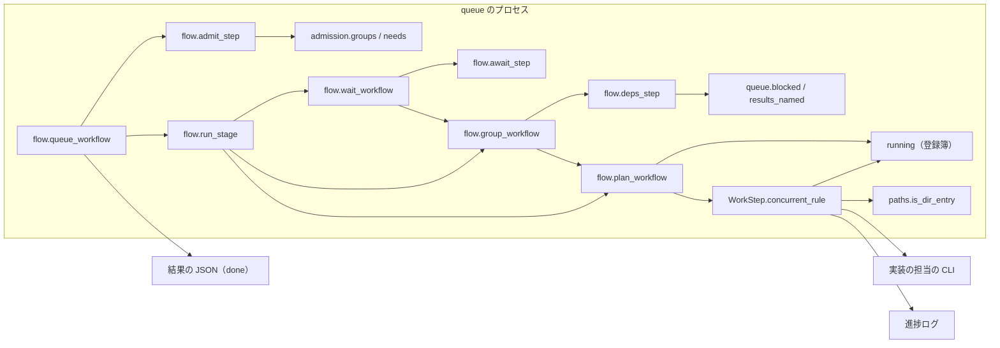
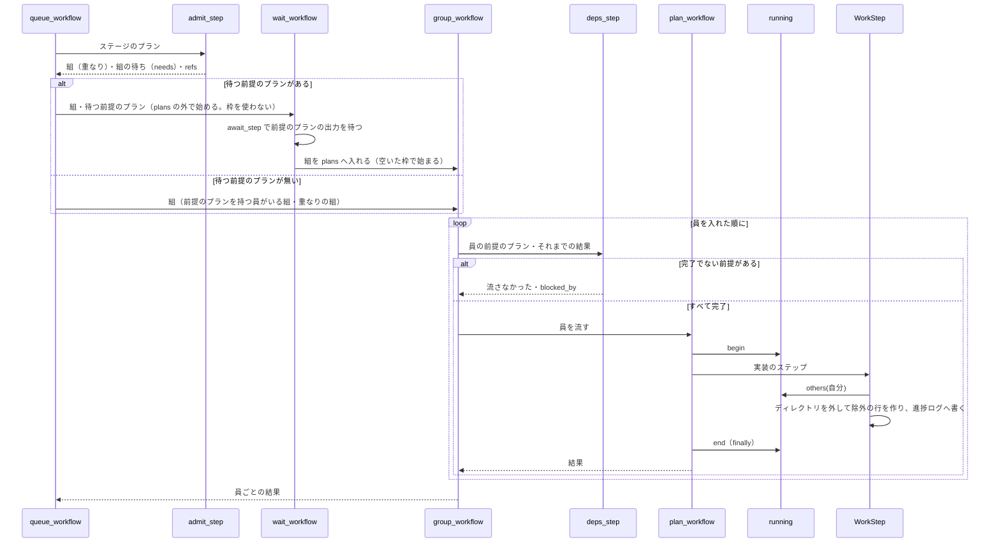

# supervise の queue の除外の行と前提のプラン: 実装の担当へは起動の時点で走っている他のプランのファイルだけを渡し、前提のプランが完了でないプランは流さない

## 概要

**`supervise.py queue` が実装の担当の指示文へ足す除外の行（「並行して別のプランが次を触る。それらは変えない: …」）には、
担当を起動する時点で走っている他のプランの `触るファイル` のうち、ディレクトリでないものだけを入れる。** `--max 1`・
重なりの組の中・まだ始まっていないプラン・既に終わったプランのファイルは入らない。入れたものと外したディレクトリは、
実装のステップのたびに進捗ログへ `kind: concurrent` の 1 行で残る。

**プランの JSON の `前提のプラン` に名前を挙げたプランは、前提のプランの結果が `完了` でなければ担当の CLI を起動しない。**
流さなかったプランは queue の結果の JSON に `result: 流さなかった`・理由・`blocked_by` で載る。同じステージの前提のプランを
待つ間は耐久キュー `plans` の外で待ち、`--max` の枠を塞がない。`前提のプラン` を持たないプランの流れ方は変わらない。

例: 同じステージに A・B・C があり、B と C が `前提のプラン: ["A"]` を持ち、3 本の触るファイルが重ならないとき、組は
{A}・{B}・{C} の 3 つで、{B} と {C} が A の終わりを待つ。A が `完了` で終わると、`--max 2` 以上なら B と C は同時に流れ、
どちらの指示文にも A のファイルは入らない（A は既に終わっている）。A が止まれば B と C は流れず、結果の JSON に
`"blocked_by": [".../A.json"]` で載る。

この文書は、その形に**なぜしたか**（背景・決定と理由・常に成り立つ条件・構成要素・契約・既知の限界・テスト観点）を残す。
**`new impl` の引数の正は [`supervise_lib/new_args.py`](../../plugins/ndf/scripts/supervise_lib/new_args.py) の `--files`・`--after` の help である。**
重なりの組の判定（同時に流さない組）はこの文書の範囲の外で、変えていない。

決定の番号は #1674 の設計の番号である。

## 用語

「除外の行」「前提のプラン」「重なりの組」の定義は用語集（[docs/glossary.md](../glossary.md)）の「NDF の工程（`ndf-workflow`）」が正である。

## 背景

除外の行は、受け付け（`admit_step`）の時点で「他の組のすべてのプラン」の `触るファイル` を静的に入れていた。`--max` の枠も
始まる時刻も見ていなかったため、同時には走らないプランのファイルまで「変えない」と渡り、担当が受け入れ条件の作業をせずに
止まった。3 回再発し、そのたびに conductor が 1 本ずつ流し直した。

| 回 | 何が起きたか |
| --- | --- |
| devbase のスプリント m7c（ndf 10.17.56） | `--max 1` で直列に流したのに、1 本目の担当へ残り 3 本の触るファイル（テスト・確定仕様・用語集・CHANGELOG・Dockerfile）が渡り、担当が止まった。キューはそのまま 1 本目の結果を前提にする 2 本目を始めた |
| スプリント m815（PR #1763） | #1685 の担当へ、直す先の `merged-steps.py`・`merged_lib/merge.py`・`plugins/ndf/scripts/tests/` が渡った |
| スプリント m1910（ndf 10.17.71、PR #1930） | #1915 と #1908 の担当へ、まだ始まっていない #1916 の `plugins/ndf/scripts/tests/` と `supervise_lib/templates.py` が渡り、両方とも作業前に止まった（進捗ログでは 2 本の `impl` の起動が 19:43:04Z、#1916 の最初の行が 21:06:02Z） |

ディレクトリ 1 行（`plugins/ndf/scripts/tests/`）は、ほぼすべての実装の受け入れ条件（テストを足す・既存のテストが通る）と
衝突した。あわせて、前のプランの結果を前提にするプランを、前のプランが止まったまま流さない手段が無かった。

## 決定と理由

| # | 決定 | 理由 | 採らなかった案 |
| ---: | --- | --- | --- |
| 1 | 除外の行を、受け付けの時点でなく担当の起動の時点の登録簿（`running`）から作る | queue のプランは同じプロセスの中で流れるため、`plan_workflow` が始まりと終わりを登録簿へ書き、実装のステップが起動の時点で読めば「走っているプラン」がそのまま得られる。同じ組の員は 1 本ずつ流れ、前提のプランを待つ組は前提のプランが終わってから始まるため、組どうしのファイルも登録簿だけで入らなくなる | 受け付けの時点で `--max` から同時に走りうるプランを推す（プランごとの所要が違い、`--max 2` 以上では推した集合と実際に走っている集合が食い違う） |
| 2 | 除外の行からディレクトリを外す | 同時に走る 2 本は重なりの組でないため、相手のディレクトリは自分の `触るファイル` と包含で重ならない。それでも担当がそこへ触るのは宣言に無いテストの追加・直しで、受け入れ条件が求める作業である。#1811 の「ファイルの単位で同じものを触るときだけ直列にする」と同じく、ファイルの単位に揃える | 「中の既存のファイルを変えない」と書き換える（m1910 の #1915 は既存のフィクスチャの書き直しが受け入れ条件で、書き換えた行でも止まる） |
| 3 | 前提はプランの JSON の項目 `前提のプラン` にし、`new impl --after` で書く。名前の照合は `{queue_pr:<名>}` と同じにする | 前提はプランの性質で、どの queue で流しても同じである。照合の関数を 1 つにする。スプリントの分解（`sprint_waves.py`）は書かない。スプリントの表の「依存」の列は自由な文で、読むと推すことになる | `supervise.py queue --after A=B` の引数にする（プランの外に前提が置かれ、`wait` や振り返りでプランだけを読んでも前提が分からない） |
| 4 | 同じステージの前提のプランを待つ組は、耐久キュー `plans` に入れずに始める `wait_workflow` で待ち、前提のプラン自身の耐久ワークフローの出力を読み終えてから組を `plans` へ入れる | 待つ間は枠を使わない。待つのは前提のプランの終わりだけで、前提のプランと同じ重なりの組にいる他のプランの終わりは待たない。組（1 本ずつ流れるまとまり）は触るファイルの重なりだけで決まり、依存の待ちと重なりの直列を分ける。待ちが循環する組（G1 の員が G2 の員を、G2 の員が G1 の員を前提にする）は待ち合って進まないため、まとめて 1 つの組にして入れた順に流す | 前提のプランと後ろのプランを和集合で同じ組にする（B と C がともに A だけを前提にして重ならないときも 1 本ずつ流れ、所要が延びる）。後ろのプランを `plans` へ入れてから中で待たせる（待つ間も枠を 1 つ塞ぎ、`--max 1` で前提のプランが後ろの並びにあると進まない） |
| 5 | 流さなかった item に `blocked_by` を足す | `reason` は文で、どのプランかを機械で読めない | `reason` だけで知らせる |

## 仕様

### 常に成り立つ条件

| # | 条件 | 破れたときの扱い |
| --- | --- | --- |
| I1 | 登録簿にあるのは、`plan_workflow` が始まって終わっていない（例外で抜けたものを除く）プランだけである | 抹消を `finally` で行う。残ると後のプランの除外の行が広がる |
| I2 | 除外の行に入るのは、担当を起動する時点で登録簿にある自分以外のプランの `触るファイル` のうち、ディレクトリでないものだけである。1 つも無ければ行を付けない | テストが落とす |
| I3 | `前提のプラン` に挙げたプランの結果が `完了` でないプラン（`関門`・止まった・結果が無い・後ろにある・見つからないを含む）は、担当の CLI を起動しない | items に `流さなかった`・理由・`blocked_by` を残す |
| I4 | `前提のプラン` を持たないプランの流し方（ステージ・枠・重なりの組・`--then`）は変わらない | 既存のテストが落とす |
| I5 | 同じステージの前提のプランを待つ組は、前提のプラン自身が終わるまで `plans` の外で待ち、`--max` の枠を塞がない。前提が終わった後、触るファイルの重ならない組どうしは空いた枠で同時に流れる。1 本ずつ流れる同じ組に入るのは、触るファイルが重なるプランと、前提で互いを待ち合う組だけである | テストが落とす |

### 構成要素と責務

| 要素 | 責務 |
| --- | --- |
| `supervise_lib/running.py` | 走っているプランの登録簿（queue のプロセスに 1 つ。永続しない）。`begin(plan, files)`・`end(plan)`・`others(plan)`（自分以外の登録の `触るファイル` を登録の順に重ねずに返す）。排他は `threading.Lock`。`flow` が `engine` を経て `worker_steps` を読むため、`worker_steps` が `flow` を読むと循環する。そのため独立したモジュールにする |
| `supervise_lib/paths.py` の `is_dir_entry(path, root)` | `触るファイル` の 1 行がディレクトリか（末尾が `/` か、`root` の下の既存のディレクトリ）。ファイルシステムを読むため、ファイルを読まない `admission` には置かない |
| `supervise_lib/worker_steps.py` の `WorkStep.concurrent_rule` | `kind: 実装` のステップで、`running.others` から `is_dir_entry`（`root` はステップの作業場所）に当たるものを外して除外の行を作り、進捗ログへ `kind: concurrent` を書く |
| `supervise_lib/admission.py` | `groups(plans, shared, after)` が重なりの組を返し、待ちが循環する組を 1 つにまとめる。`needs(plans, grouped, after)` が組ごとの待つ前提のプラン（他の組にいるもの）を返す。待ちの辺は、前提のプランが queue の並びで前にあるときだけ張る（`_edges`） |
| `supervise_lib/flow.py` | `plan_workflow` が始めに `running.begin`、`finally` で `running.end`。`admit_step` が `前提のプラン` を読み、同じステージのプランへ名前を解いて `groups`・`needs` へ渡す。`run_stage` は `前提のプラン` を持つ員のいる組を必ず `group_workflow` で入れ、待つ前提のプランがある組は `wait_workflow` で包む。`wait_workflow` は `await_step` で前提のプランの耐久ワークフローの出力を待つ（前提のプランを含む組が前提のプランを始めずに終わったときは、組の出力にある前提のプランの item で代える）。`group_workflow` は員を流す前に `deps_step` を呼ぶ |
| `supervise_lib/queue.py` | `deps_of(body)`（プランの JSON の `前提のプラン`）・`blocked(plan, deps, items, queued)`（完了でない前提があれば流さなかった item）・`results_named(name, items, plan)`（名前の一致する計画の結果。`{queue_pr:<名>}` と前提の確かめで共有）・`plan_item`（流さなかった出力はそのまま item にする）・`_queue_result`（要約を「N 本は流さなかった」にする） |
| `supervise_lib/new_args.py`・`procedures.py`・`templates.py` | `new impl --after NAME...` を受け、`with_after` がプランへ `前提のプラン` を書く（渡さなければ項目を書かない）。`--files` の help は除外の行の新しい意味を言う |



`new_args`・`procedures`・`templates` はプランを作る側（`supervise.py new impl`）で、queue のプロセスの外にある。

### 処理の流れ



`前提のプラン` を持たない 1 本だけの組は、今までどおり `plan_workflow` を直接 `plans` へ入れ、`deps_step` を通らない。

`deps_step` が読む「それまでの結果」は、前のステージの items・このステージで記録のある（流し直さない）プランの出力・待った
前提のプランの出力・同じ組で先に流れた員の出力の 4 つである。どれにも無く queue の後ろの並びにある名前は「結果が無い
（後ろにある）」とする。queue に無い名前は `results_named` で同じディレクトリのプランの報告を読み（承認ゲートの後に単独で
流すときと同じ）、報告も無ければ「見つからない」として流さない。前提のプランが後ろの並びにあるときは待ちの辺を張らないため、
queue は止まらずに終わる。

## データ・設定

### プランの JSON

| 項目 | 型 | 必須 | 意味 |
| --- | --- | --- | --- |
| `触るファイル` | 文字列の配列 | 任意 | 重なりの組の判定に使い、同時に走る他のプランの除外の行に載る（ディレクトリは載らない） |
| `前提のプラン` | 文字列の配列 | 任意 | 前提にするプランの名前。照合は `{queue_pr:<名>}` と同じ（ファイル名の拡張子を除いた部分が名前と同じか、`-<名>` で終わる） |

`前提のプラン` が無いプランは今までどおり流れる。既存のプランの JSON は書き直さずに使える。

### 結果の JSON（`done`）の item

```json
{"plan": ".../5-impl-1686.json", "result": "流さなかった",
 "reason": "前提のプランが完了でない: .../5-impl-1685.json（止まった）",
 "blocked_by": [".../5-impl-1685.json"]}
```

| 場合 | `reason` の文 | `blocked_by` に入るもの |
| --- | --- | --- |
| 前提のプランの結果が `完了` でない | `前提のプランが完了でない: <パス>（<結果>）` | パス |
| 前提のプランが queue の後ろの並びにある | `前提のプラン <パス> の結果が無い（後ろにある）` | パス |
| 名前に一致するプランが queue にも同じディレクトリの報告にも無い | `前提のプラン <名> が見つからない` | 名前 |

前提が複数欠けたときは理由を `。` でつなぐ。`blocked_by` は足した項目で、既存の項目は変えない。要約は「N 本は流さなかった」
（同じステージの中のプランも数に入るため「後続」とは書かない）。

### 進捗ログの行（`kind: concurrent`）

```json
{"kind": "concurrent", "at": "...", "step": "impl", "files": ["lib/a.py"], "dirs": ["plugins/ndf/scripts/tests/"]}
```

`kind: 実装` のステップのたびに 1 行書く。`files` が空なら除外の行は付いていない。

## 運用

### 既知の限界

| 項目 | 内容 |
| --- | --- |
| 落ちた後の打ち直し | 登録簿は永続しない。打ち直しで続きから流れ始めたプランが登録し直す前に別のプランの実装のステップが起動すると、そのプランのファイルが除外の行から漏れる。漏れても除外の行が狭まるだけで、担当が止まる側には倒れない |
| 起動の時点の先後 | `--max 2` 以上でほぼ同時に始まった 2 本は、先に実装のステップへ着いた側の除外の行が空になる。後から着いた側には必ず先の側のファイルが入るため、組のどちらか一方へは知らされる |
| スプリントの分解 | `sprint_waves.py` は `前提のプラン` を書かない（決定 3）。conductor が `new impl --after` か JSON で書く |
| 実運用での確認 | 担当が除外の行を理由に止まらないことは、`~/.local/state/ndf/sv/<スプリント>/` の進捗ログの `kind: concurrent` で見る |

## テスト観点

テストは `plugins/ndf/scripts/tests/test_supervise.py`（除外の行・`new impl --after`）と `test_supervise_queue.py`（組と待ち・前提のプラン）にある。
担当の CLI を偽物にして、指示文と結果の JSON・進捗ログを読む。

- 重ならない 2 本以上を `--max 1` で流すと、どの実装の指示文にも除外の行が無いこと
- 重なりの組の 2 本と、前提でつながる 2 本の指示文に、互いのファイルが入らないこと
- `--max 2` で、後から始まったプランの指示文には先に走っているプランのファイルが入り、先に始まったプランの指示文には後から始まったプランのファイルが入らないこと。終わったプランのファイルは入らないこと（I2）
- 相手の `触るファイル` が末尾 `/` のディレクトリと末尾 `/` の無い既存のディレクトリのとき、除外の行に入らず、進捗ログの `dirs` に残ること
- 例外で終わったプランの後に始まったプランの指示文に、そのファイルが入らないこと（I1）
- 前提のプランが止まったとき、後ろのプランの担当の CLI が起動されないこと。同じステージ・前のステージ・結果が `関門` の記録のそれぞれで（I3）
- 流さなかった item に `result: 流さなかった`・前提のプランを含む `reason`・`blocked_by` があり、要約が「N 本は流さなかった」になること
- 前提の名前に一致するプランが queue にも同じディレクトリの報告にも無いとき、後ろの並びにあるときに流さないこと
- 重ならない A・B・C で B と C が A だけを前提にするとき、`--max 2` で B と C が A の後に同時に走り、`--max 1` でも待つ B・C が枠を塞がずに A が流れること。A が X と重なりの組 {A, X} にあるとき、A だけを前提にする B は X の終わりを待たないこと。待ちが循環する 2 組は 1 つの組として入れた順に流れること（I5）
- 前提を持たないプランは、同じステージの別のプランが止まっても流れること。`--then` の後ろのステージは今までどおり流れないこと（I4）
- 実装のステップのたびに進捗ログへ `kind: concurrent` が 1 行書かれること
- `new impl --after a b` でプランの `前提のプラン` が `["a", "b"]` になり、渡さなければ項目が無いこと

## 関連リンク

- [`supervise_lib/flow.py`](../../plugins/ndf/scripts/supervise_lib/flow.py)・[`running.py`](../../plugins/ndf/scripts/supervise_lib/running.py)・[`admission.py`](../../plugins/ndf/scripts/supervise_lib/admission.py)・[`worker_steps.py`](../../plugins/ndf/scripts/supervise_lib/worker_steps.py)・[`queue.py`](../../plugins/ndf/scripts/supervise_lib/queue.py)・[`paths.py`](../../plugins/ndf/scripts/supervise_lib/paths.py)・[`new_args.py`](../../plugins/ndf/scripts/supervise_lib/new_args.py)
- [ndf-execution-plan-and-parallel-capacity.md](ndf-execution-plan-and-parallel-capacity.md)（並行してよい本数と変更重複の目安）
- #1674（この形を決めた課題）、#1811（重なりの判定でテストのディレクトリの包含を重なりとしない）、#1248（除外の行を足した課題）
