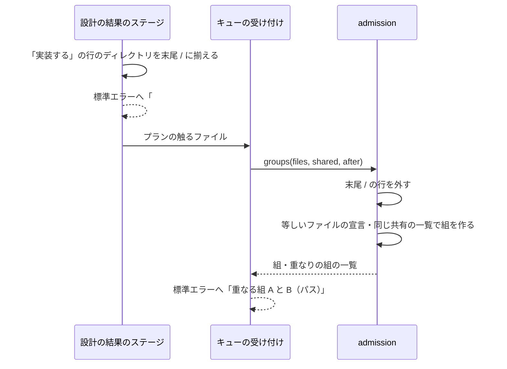

# supervise の queue の重なりの組: 同じファイルを宣言したプランだけを直列にし、別のファイルを触るプランは同時に流す

## 概要

**`supervise.py queue` は、同じステージの 2 本のプランが等しいファイルの宣言を持つか、同じ共有の一覧に当たるときだけ、
その 2 本を重なりの組として直列に流す。** ディレクトリの宣言（`触るファイル` の末尾が `/` の行）は、重なりの組の判定の
どこにも使わない。テストのディレクトリ `plugins/ndf/scripts/tests/` を宣言したプランも、同じディレクトリの別のファイルを
触るプランと同時に流れる。

例: プラン A が `plugins/ndf/scripts/tests/` と `a.py`、プラン B が `plugins/ndf/scripts/tests/test_b.py` と `b.py` を宣言
したとき、2 本は重ならず `--max 2` で同時に流れる。A と B がともに `supervise_lib/admission.py` を宣言していれば重なりの組に
なり、標準エラーへ「重なる組 A と B（plugins/ndf/scripts/supervise_lib/admission.py）を同時には流さない」が 1 回出る。

設計の結果のステージ（`supervise.py design-results`）は、設計の結果の「実装する」の行の触るファイルのうち、作業場所に既存の
ディレクトリを末尾 `/` の形へ揃えてからプランへ書き、課題の番号とパスを標準エラーへ知らせて止まらずに進む。

実装の担当へ渡す除外の行と前提のプランは [ndf-supervise-queue-concurrent-files-and-prerequisites.md](ndf-supervise-queue-concurrent-files-and-prerequisites.md) が持つ。

## 用語

「重なりの組」「ディレクトリの宣言」「偽の重なり」「共有の一覧」の定義は用語集（[docs/glossary.md](../glossary.md)）の
「NDF の工程（`ndf-workflow`）」が正である。

## 背景

衝突は、同じファイルの同じ箇所を並行した 2 つの変更が両方とも変えたときに起きる（git の 3-way マージ。
https://git-scm.com/docs/git-merge の「HOW CONFLICTS ARE PRESENTED」）。同じディレクトリの別のファイルどうしは衝突しない。
重なりの組をディレクトリの包含で決めると、ほぼすべての実装が触るテストのディレクトリを通じて、衝突の起きない組まで
直列になる。8 スプリント（実装のプラン 28 本・比べた組 60）で数えると、包含で決めた規則は重なり 31 組・偽の重なり 10 組、
ファイルの単位の規則は重なり 16 組・偽の重なり 2 組だった（数え方は「運用」）。

## 仕様

### 常に成り立つ条件

| 条件 | 破れたときの扱い |
| --- | --- |
| ディレクトリの宣言は、重なりの組の判定のどこにも使わない（ファイルの宣言との包含・ディレクトリの宣言どうしの一致・共有の一覧への当たり） | テストが落とす |
| 2 本のプランが等しいファイルの宣言を 1 つ以上持つなら、重なりの組になる。等しさはパスの要素の並びで比べる（`./a.py` と `a.py` は等しい） | テストが落とす |
| 2 本のプランのファイルの宣言が同じ共有の一覧に当たるなら、重なりの組になる。当たりは `touched_by`（無ければ一覧のパス）とファイルの宣言の包含で見る（`a/b` は `a/b/c` を含み、`a/bc` を含まない） | テストが落とす |
| 判定はファイルシステムを読まず、組ごとの比較（N×(N−1)/2 回）だけで決まる | テストが落とす（存在しないパスだけで呼んでも結果が変わらない） |
| 設計の結果のステージが書くプランでは、「実装する」の行の触るファイルのうち末尾が `/` の行と `--root` の下の既存のディレクトリの行が末尾 `/` の形になる。ステージは止まらない | テストが落とす |
| 進捗の「重なる組」の行は、組を作ったパスを 1 つだけ示す | テストが落とす |

重なりは推移的でないため、組は和集合の森でまとめる（A と B、B と C が重なれば A・B・C が 1 つの組になる）。組の中は
1 本ずつ、組の間は並行に流す。

### 構成要素と責務

| 要素 | 責務 |
| --- | --- |
| [`supervise_lib/admission.py`](../../plugins/ndf/scripts/supervise_lib/admission.py) | 重なりの規則の唯一の置き場。`overlap_of` はディレクトリの宣言を外し、残ったファイルの宣言の一致と共有の一覧への当たりで重なりを返す。`shared_hits` もディレクトリの宣言を当たりに使わない。副作用を持たず、ファイルを読まない |
| `supervise_lib/flow.py` の `admit_step` | 規則を呼び、重なりの組ごとに「重なる組」の行を標準エラーへ出す |
| [`supervise_lib/design_stage.py`](../../plugins/ndf/scripts/supervise_lib/design_stage.py) の `marked_dirs` | 設計の結果の「実装する」の行で、`paths.is_dir_entry(パス, --root)` が真のパスを末尾 `/` の形に揃え、課題ごとに「#番号 の触るファイルにディレクトリ …」を標準エラーへ出す。結果の JSON の `metrics.dirs`（課題の番号 → ディレクトリの宣言）に載せる |
| `supervise_lib/new_args.py` | `new impl --files` の help に、ディレクトリ（末尾 `/`）は重なりの判定にも除外の行にも使わないことを書く |
| `design` の `references/design-template.md` の「設計の結果の書き方」 | 触るファイルはファイル単位で書く。テストのように複数の課題が同時に触る置き場はファイルを 1 つずつ書き、索引のように行を書き足すファイルは、書き足すならそのファイルを書く |
| [`scripts/experimental/queue-overlap-replay.py`](../../plugins/ndf/scripts/experimental/queue-overlap-replay.py)（実験版） | 過去のスプリントのプランの触るファイルで重なりの組を `admission.overlaps` で判定し直し、両方の PR の変更ファイルと突き合わせて偽の重なりを数える。規則を自分では持たない |

### 処理の流れ

設計文書の表が読めないと設計の結果のステージは止まる。プランが読めないと触るファイルを空として扱う。ディレクトリかどうかを
ファイルシステムで読めない（権限など）ときは `Path.is_dir` が偽を返し、そのパスはファイルの宣言として残る。

### 決定と理由

| 決定 | 理由 |
| --- | --- |
| ディレクトリの宣言を判定に使わず、等しいファイルの宣言だけで重ねる | 衝突の最小の単位はファイルである。ファイルの宣言どうしの包含は起こりえないため、比較は等しさだけでよい。ディレクトリをその時点の既存のファイルへ展開する形は、同じディレクトリへ別々のファイルを足す 2 本を重ねたまま残すため採らない。テストのディレクトリだけを外す形は、外す置き場の一覧がリポジトリごとに要るため採らない。PR の実際の変更で組を決める形（マージキューの製品のスコープ）は、流す前に変更が分からないため採れない |
| ディレクトリの判定と知らせは設計の結果のステージが行い、宣言は消さずに末尾 `/` の形へ揃える | 判定の関数はファイルを読まない。末尾に `/` の無いディレクトリを判定で見分けるには、判定の前に形を揃える必要があり、作業場所を `--root` で持つのはこのステージである。宣言を消すと実装の担当へ渡る触る範囲の情報が減る。`new impl --files` で conductor が直に書いたプランは揃えないが、末尾 `/` の無いディレクトリはファイルの宣言として等しさだけで比べられ、包含で広がらない |
| 共有の一覧（`.ndf/supervise.json` の `queue.shared`）の仕組みは残し、ai-plugins の設定からは `plugins/ndf/scripts/lib/README.md` の行を消した | この行に当たった 19 組のうち、両方の PR が `lib/README.md` を変えた組は 0 組だった。索引へ行を書き足す課題は、設計の結果に `lib/README.md` を書けば等しいファイルの宣言として重なる。全体に効くファイルを宣言で名指す仕組みは、ほかのリポジトリが使える |

## データ・設定

| 置き場 | 項目 | 意味 |
| --- | --- | --- |
| プランの JSON | `触るファイル` | 等しいファイルの宣言と共有の一覧への当たりで重なりの組の判定に使う。末尾 `/` の行は判定に使わない |
| `.ndf/supervise.json` | `queue.shared[]`（`path`・`touched_by`） | 複数のプランが同じ行の並びへ書き足すファイル。形と読み込み（`decl.py`）は変わらない |
| `design-results` の結果の JSON | `metrics.dirs` | 課題の番号 → 末尾 `/` の形に揃えたディレクトリの宣言 |

## 運用

### 既知の限界

| 項目 | 内容 |
| --- | --- |
| 宣言に無い同じファイルの変更 | 8 スプリントの記録では、PR が同じファイルを変えたのに重ならない組が 21 組あった。多くは確定仕様・`plugins/ndf/contracts/index.md` など宣言に無いファイルで、衝突になるかはスプリントのブランチへのマージで git の衝突として分かる |
| 同じファイルの宣言による偽の重なり | 両方の設計の結果が同じファイルを宣言し、どちらの PR もそのファイルを変えない組は直列のまま残る（8 スプリントで 2 組）。等しいファイルの宣言を重ねる条件を保つ限り、判定の規則では外せない |
| 実際の経過の短縮 | 偽の重なりの組の数だけを数え、経過の分は測っていない。未確認 |

### 偽の重なりを数え直す

`queue-overlap-replay.py` を過去のスプリントの記録へ打つと、スプリントごとの組の数と偽の重なりの一覧を Markdown の表で出す。
`--before <コミット>` で前の版の規則と並べる。数えるのは、実装のステップの記録と報告の PR を持つ実装のプランである。結果は
実験版の台帳（[docs/ndf-experiments.md](../ndf-experiments.md)）にある。

## テスト観点

- `tests/` と `a.py`、`tests/test_b.py` と `b.py` の 2 本を `queue --max 2` で流すと、実行の区間が重なり、「重なる組」の行が出ないこと
- 両方が `tests/` を持ち、ファイルの宣言に共通の無い 2 本が同時に流れること
- 両方が同じファイルを持つ 2 本が直列に流れ、「重なる組」の行が 1 回、パス 1 つで出ること。`./a.py` と `a.py` も重なること
- ファイルの宣言が同じ共有の一覧の `touched_by` に当たる 2 本は重なり、ディレクトリの宣言だけが当たる 2 本は重ならないこと
- 存在しないパスだけを渡しても `overlaps`・`groups` の結果が同じであること
- 「実装する」の行に `x/` と `--root` の下の既存のディレクトリ `y` を持つ設計の結果でステージを流すと、プランの触るファイルが `x/`・`y/` になり、標準エラーに課題の番号と 2 つのパスが出て、結果が `ok` であること
- 除外の行にディレクトリが入らないこと（[ndf-supervise-queue-concurrent-files-and-prerequisites.md](ndf-supervise-queue-concurrent-files-and-prerequisites.md)）

テストは `plugins/ndf/scripts/tests/test_supervise_queue.py`・`test_sprint_procedures.py`・`test_design_results_rewrite.py` にある。

## 関連リンク

- [ndf-supervise-queue-concurrent-files-and-prerequisites.md](ndf-supervise-queue-concurrent-files-and-prerequisites.md) — 除外の行と前提のプラン
- [docs/ndf-experiments.md](../ndf-experiments.md) — 実験版の台帳
- Issue #1811
