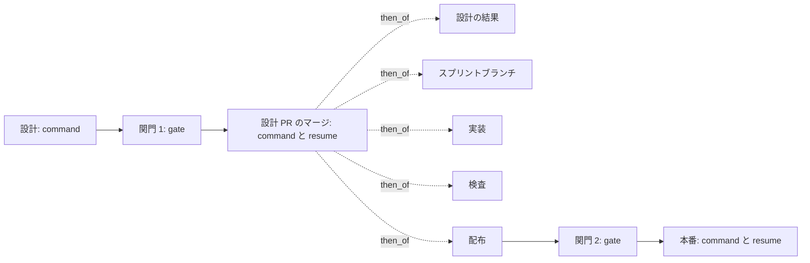
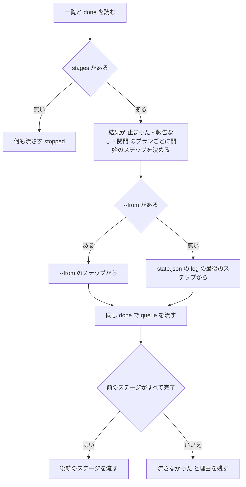

# キューの続きと承認の証跡: `pace: normal` の承認ゲートの後をキュー 1 回で流し、止まったプランを `queue --resume` で続け、取り込みを `new sprint --absorb` で決める

## 概要

**`pace: normal` の `supervise.py new sprint` は、承認ゲート 1 の後（設計 PR のマージ → 設計の結果 → スプリントブランチ → 実装 →
検査 → 配布）を最初のステージの `command` 1 本に `--then` でつなぐ。** 設計 PR のマージは設計 PR ごとのプラン `design-merge-<N>`
が受け持ち、PR の番号を設計のプランの報告から読み、承認の証跡（承認ラベルか、スプリント状態ファイルの承認ゲート 1 の利用者の承認の記録）
が無ければ承認ゲート（終了コード 10）で止まる。承認ゲート 2 の後の本番は別の `command` のままで、先頭の `approve` が承認の記録を書く。

**止まったプランは `supervise.py queue --resume <done>` の 1 回で、止まったステップから続き、後続のステージも流れる。** 前の起動が
done の隣に残した一覧（`<done>.plans.json`）からステージの並びを読むため、conductor が知る必要があるのは done のパスだけである。
目録（`sprint.json`）の `resume` がこの形を持つ。

**設計の前に取り込みを決めるときは `new sprint --absorb <課題>:<取り込み先>` を渡す。** 取り込んだ課題は設計のプランを持たず、
実装のプランは `実行の条件` で飛ぶ。取り込みは進め方によらず、ステージを組み立てた後の 1 か所で当てる。

例: スプリント m6（課題 1052・1053、設計 1052、`--state` あり）。設計のキューが承認ゲート 1 で `gate` を返し、利用者が承認すると、
conductor は `sprint-state.py gate <状態> "関門 1" --pr <設計 PR> --by user --outcome approved` を打ってから「設計 PR のマージ」の
ステージの `command`（`queue 3-design-merge-1052.json --max 3 --done done-3.json --then …`）と `wait` を打つ。マージのプランが
CI の失敗で止まったら、原因を片付けて `queue --resume done-3.json` を打つ。`design-merge-1052` は落ちた `merge-gate` から続き、
設計の結果から配布までが流れる。

この文書は、その形に**なぜしたか**（背景・決定と理由・常に成り立つ条件・スクリプトの契約・既知の限界・テスト観点）を残す。
**conductor が打つ手順とステージの並びは Skill が、引数の正はスクリプトが持つ。** 次の正本の内容をここへ書き写さない。

| 何を読むか | 正本 |
| --- | --- |
| `normal` の 1 スプリントで conductor が打つコマンド（承認ゲート 1・2 の記録、ステージの `command` と `resume`、止まったときの手当て、`--state` を渡さないとき） | `plugins/ndf/skills/development-workflow/references/waiting.md` の「1 スプリントの流し方」「スプリントを流すコマンド」 |
| `pace: auto` / `fast` のステージの並びと、`resume`・`--from <プラン名>=<ステップ>` の打ち方 | `plugins/ndf/skills/development-workflow/references/pace.md` の「プランのステージ」 |
| 本番のプランの先頭の `approve`（`--facts-from`・`--answer-from`）の照合と終了コード | [ndf-release-approved-commit.md](ndf-release-approved-commit.md) |
| `normal` の「配布」→「`関門 2`」→「本番」のステージと、本番のプランの組み立て（`--dev-state`・`{queue_state:release}`） | [ndf-production-release-record.md](ndf-production-release-record.md) の「`pace: normal` のスプリントの本番のステージ」 |
| 受け入れ条件の確認から取り込んだ課題を除くこと（`sprint_inputs.py`） | [ndf-sprint-acceptance-check-and-prepush-fix.md](ndf-sprint-acceptance-check-and-prepush-fix.md) |
| 引数の名前と help | `plugins/ndf/scripts/supervise.py`・`plugins/ndf/scripts/supervise_lib/new_args.py`・`plugins/ndf/scripts/sprint-state.py` |

## 用語

「キューの続き」「承認の証跡」「取り込んだ課題」「承認ゲート」の定義は用語集（[docs/glossary.md](../glossary.md)）の
「NDF の工程（`ndf-workflow`）」が正である。

## 背景

**スプリントの間、conductor はプランのテンプレートが持たない手当てを、シェルのつなぎで毎回足していた。** #1426 は、承認ゲートの後に
conductor が打つコマンドをキューと `wait` だけにすることを求めた。残っていた手当ては 4 つである。

| 手当て | 実測 |
| --- | --- |
| 承認ゲート 1 の後に `merge-when-green`・スプリントブランチ・実装を別々に打つ | #1407 の設計 PR 1423 のマージで、`sleep 20; merge-when-green …; git pull && queue …` を 3 回つなぎ直した |
| 承認ゲート 2 の後に `release-steps.py approve --approved-sha <SHA>` を手で打つ | PR 1845（2026-10-08）で打たずに会話を切り、本番のプランが「承認の記録が無い」で止まった（止まり方は安全側） |
| 止まったプランを途中から続けられない | マイルストーン 26 で、止まったプランを `4b-impl-1334-cont.json`・`4c-impl-1334-pr.json` に写して作り直した |
| 取り込む課題を設計の前に手で寄せる | 再発の記録 m1693・m653・m1290・m1743 の 4 回 |

`pace: auto` は最初のステージの `command` 1 本に `--then` で後続をつなぐ形を既に持っていた（#1370）。同じ形を `normal` へ広げ、
新しい仕組みは止まった後の続きと承認の証跡の読み取りにだけ足した。

## 対象範囲

| 含む | 含まない |
| --- | --- |
| `normal` の承認ゲート 1 の後のステージの連結と、設計 PR のマージのプラン | `pace: auto` / `fast` のステージの並び（変えない） |
| `queue --resume <done>` | hook の歯止め（#1426 の表の 12）。#2208 で扱う |
| 承認ゲートの利用者の承認の記録の書き込み（`sprint-state.py gate --pr`）と読み取り（`lib/gate_answer.py`） | 後片付けで消えた作業ディレクトリから起動したキューの `--then`（#1886） |
| `new sprint --absorb` | 取り込む課題を AI が選ぶこと |

## 決定と理由

| # | 決定 | 理由 | 採らなかった案 |
| ---: | --- | --- | --- |
| 1 | 承認の証跡を、conductor が利用者の答えを受けた時点で打つ `sprint-state.py gate … --by user --outcome approved` の記録にする。承認ゲート 1 は `--pr <N>` で PR ごとに書く | プランが答えを作り出さないためには、答えを受けた者が書くほかない。この記録は `--state` を渡した `normal` で承認ゲートの文が既に求めていたもので、新しいコマンドを足さない | 状態のファイルを `new sprint` が黙って作る（`--state` を渡すと助言の MVV 判定が入り、引数の意味が変わる）。キューに本番のプランを入れたこと・`queue` の印を証跡に数える（プランを流す操作と承認の答えが 1 つの操作に混ざる） |
| 2 | 止まったプランの続きを `queue --resume <done>` の 1 つの形にする。開始のステップはプランの `state.json` の最後のステップ | conductor が知るのは done のパスだけで済み、目録の `resume` にそのまま書ける。承認ゲートで止まったマージのプランも、手動確認の印を待った検査の `merge-gate` も同じ形で続く | `queue <プラン>... --from <プラン>=<ステップ>` だけを足す（止まったプランとステップを報告から読み取り、`--then` の並びを打ち直す手当てが残る）。目録の `resume` に止まった続きを書き足す（書き出しの時点では止まる場所が分からない） |
| 3 | 取り込みを `--absorb <課題>:<取り込み先>` で受け、取り込んだ課題の実装のプランは書いたうえで `実行の条件` で飛ばす | 左右の向きは設計の結果の表の列（課題・取り込み先）と同じ。プランの並びが 2 つの経路（設計の前の `--absorb` と承認ゲート 1 の後の設計の結果の表）で揃い、`design-results` がどちらも同じ形で扱える | 実装のプランを書かない（`design-results` が取り込み先のプランを探す照合と食い違う） |
| 4 | 設計 PR のマージは設計 PR ごとの別のプラン `design-merge-<N>` にし、番号を `{queue_pr:design-<N>}` で読む。`{queue_pr:<名>}` を結果が `関門` のプランからも埋める | 設計のプランは承認ゲート 1 の judge で終わり、結果は `関門` である。PR ごとに分けると、1 本が CI の失敗で止まってもほかは進み、止まった 1 本だけを続けられる。名前を `merge-design-<N>` にしないのは、`named`（名前の末尾の一致）で `design-<N>` に当たり自分を設計のプランと取り違えるため | 設計のプランの後ろにマージのステップを足す（`auto` の形。承認ゲート 1 の前の耐久の記録と承認の後の実行の回が 1 本のプランに混ざる） |
| 5 | `normal` のマージから配布までを 1 本の `--then` の列にし、承認ゲート 2 の後の本番は別の `command` のままにする | 並びは `auto_sprint_plans` と同じ形で、連結（`write_stage_index`）と後続の条件（`fill_stage`）を作り直さずに使える。承認ゲート 2 は本番系へ届く操作の前の承認で、答えを受けるまで流してはならない | 本番まで 1 本につなぐ |
| 6 | 目録の `command` に `--done <出力先>/done-<番号>.json` を書き、`resume` を `queue --resume <done>` にそろえる。`auto` の承認ゲート 1 の文も `--from design-<N>=approve` を足した `resume` の 1 手にする | `--resume` は done のパスで前の起動を引く。止まったときの手順が進め方ごとに分かれると「1 つだけ示す」が崩れる | 手順書が「`--done` を足して打つ」と書く（目録だけからは打つコマンドが決まらない） |
| 7 | `approve --facts-from` の誤りと証跡の無さを 10（承認ゲート）で返す | 本番のプランの先頭のステップが承認ゲートとして終わり、キューの続きでそのステップから続けられる | 今の `approve` の失敗（1〜3）で返す |
| 8 | `--absorb` を、進め方ごとのステージの組み立ての中でなく、組み立てた後のプランへ `absorb.py` が 1 か所で当てる。`design-results` はプランの `取り込み先` を表の取り込みと合わせる | 組み立ての関数（`sprint_plans`・`fast_sprint_plans`・`auto_sprint_plans`）ごとに分岐を足すと同じ規則が 3 か所へ写る。表の内容だけで `課題` を作り直すと書き出しの取り込みが消える | 組み立ての関数ごとに扱う |

## 仕様

### 構成要素と責務

| 要素 | 責務 |
| --- | --- |
| [`supervise_lib/sprint.py`](../../plugins/ndf/scripts/supervise_lib/sprint.py) | `sprint_plans` が `normal` の承認ゲート 1 の後のステージ（`MERGE_STAGE` = 「設計 PR のマージ」から配布まで）を最初のステージの `then_of` に並べる。`_stage_entry` が `command` に `--done` を書き、`add_resume` が `command` を持つステージと `then_of` のステージへ `resume` を書く。`--absorb` の拒否（`absorb_refusal`）・`--issue` への追加・プランへの適用を組み立ての前後で呼ぶ |
| [`supervise_lib/design_merge.py`](../../plugins/ndf/scripts/supervise_lib/design_merge.py) | `plan_design_merge` が `design-merge-<N>` のプラン（`approved` → `merge_steps`）を組む。`cmd_design_approved` が副命令 `design-approved` の本体 |
| [`supervise_lib/queue_resume.py`](../../plugins/ndf/scripts/supervise_lib/queue_resume.py) | `resume_targets` が前の起動の一覧と done から、ステージの並び・`--max`・続けるプランと開始のステップ（`ResumeTarget`）を決める。`cmd_queue_resume` が `queue.cmd_queue` へ `starts`・`rerun` を渡す |
| [`supervise_lib/queue.py`](../../plugins/ndf/scripts/supervise_lib/queue.py) | 一覧 `<done>.plans.json` を書く（`start_listing`）。`plan_pr` が結果 `完了` か `関門` のプランの PR で `{queue_pr:<名>}` を埋める。結果の `items` に `resumed_from` を足す |
| [`supervise_lib/flow.py`](../../plugins/ndf/scripts/supervise_lib/flow.py) | `admit_step` がプランごとの開始のステップで実行の回（`prefix_of` の `start`）を選び、`rerun` のプランは結果 `関門` の記録を終わりと扱わない |
| [`supervise_lib/absorb.py`](../../plugins/ndf/scripts/supervise_lib/absorb.py) | `--absorb` の形の確認（`absorb_arg`）・拒否の理由（`absorb_refusal`）・プランへの適用（`apply_absorb`） |
| [`supervise_lib/design_stage.py`](../../plugins/ndf/scripts/supervise_lib/design_stage.py) | 承認ゲート 1 の後の `design-results` が、プランの `取り込み先` を表の取り込みと合わせる |
| [`lib/gate_answer.py`](../../plugins/ndf/scripts/lib/gate_answer.py) | スプリント状態ファイルから承認ゲートの利用者の承認の記録（`Answer`）を読む（`approved`）。書き込みの置き換えの規則（`replaces`）を `sprint-state.py` と共有する |
| [`sprint-state.py`](../../plugins/ndf/scripts/sprint-state.py) | `gate` が利用者の承認の記録に `by` と `--pr` の `pr` を書き、承認ゲートの名と `pr` の組で置き換える |

### 常に成り立つ条件

| # | 条件 | 破れたときの扱い |
| --- | --- | --- |
| I1 | `design-merge-<N>` は、その PR の承認の証跡（承認ラベル `design-approved` か、承認ゲート 1 の `pr` の一致する利用者の承認の記録）が無ければ `merge-gate` へ進まない | `approved` のステップが 10 を返し、`gate_next: end` でプランが `関門` で終わる |
| I2 | 本番のプランの先頭の `approve` は、利用者の承認の証跡が無ければ承認の記録を書かず `release` へ進まない | 10 で止まる（照合の詳細は [ndf-release-approved-commit.md](ndf-release-approved-commit.md)） |
| I3 | キューの続きは、前の起動で完了したプランを流し直さない | 完了の記録があるプランは耐久の記録から結果を返す |
| I4 | キューの続きでも、後続のステージは前のステージがすべて `完了` のときだけ流れる | 流さず `流さなかった` と理由を残す |
| I5 | キューの続きは前の起動のステージの並びをそのまま使い、並びを読めなければ何も流さない | `stopped`（終了コード 1）を返し、`next` に「元の queue のコマンドを打ち直す」と書く |
| I6 | `--absorb` で取り込んだ課題は設計のプランを持たず、実装のプランは `取り込み先` と `実行の条件`（`absorbed_condition`）を持つ。取り込み先のプランのうち存在するもの（`design-<取り込み先>`・`impl-<取り込み先>`）の `課題` に取り込んだ課題が入る | — （書き出しと `design-results` が常にこの形で書く） |
| I7 | `--absorb` の組が拒否の条件（下の表）に当たれば、`sprint.json` もプランのファイルも書かない | `stopped`（終了コード 1）と理由を返す |
| I8 | `normal` の承認ゲート 1 の後のステージは、最初のステージの `command` 1 本に `--then` でつながる。「本番」は `then_of` を持たない | — （テストで縛る） |
| I9 | `fast` と `auto` のステージの並びと、本番のプランの先頭のステップは変わらない | — （既存のテストで縛る） |

### `normal` の目録のステージ

`--design` を渡したときの並び（`--state` の有無で変わらない）。番号はステージの数で変わり、正は `new sprint` が書く `sprint.json` である。

`--design` が無ければ「設計」「`関門 1`」「設計 PR のマージ」を置かず、最初のステージは「設計の結果」（`--designed` があるとき）か
「スプリントブランチ」になる。「配布」より後は [ndf-production-release-record.md](ndf-production-release-record.md) の形である。

### 設計 PR のマージのプラン（`design-merge-<N>`）

| 項目 | 値 |
| --- | --- |
| `Pull Request` | `{queue_pr:design-<N>}`。キューが前のステージ（無ければ同じディレクトリ）の `design-<N>` の報告から埋める。埋まらなければ `0` |
| ステップ | `approved`（`supervise.py design-approved --pr {pr} [--state <状態>]`、`gate_next: end`）→ `merge_steps`（`merge-gate` → `merge`） |

`supervise.py design-approved --pr <N> [--state <状態>]` の契約:

| 状態 | `status` | 終了コード |
| --- | --- | --- |
| PR に承認ラベル `design-approved` がある（完全一致） | `ok` | 0 |
| ラベルは無いが、状態に承認ゲート 1 の `pr` が一致する利用者の承認の記録がある。ラベルを付けた | `ok` | 0 |
| PR の番号が `0`・承認の証跡が無い | `gate` | 10 |
| `gh` でラベルを読めない・付けられない | `stopped` | 2 |

### キューの続き（`queue --resume`）

`supervise.py queue --resume <done> [--from <プラン名>=<ステップ>]... [--max N] [--poll S]`。`--resume` は位置引数のプラン・`--then`・
`--done` と併せて渡さず、`--from` は `--resume` とだけ使う（どちらも引数の誤りで終了コード 2）。

- **続ける対象は、done の `items` の結果が `止まった`・`報告なし`・`関門` のプランである。** 開始のステップは `state.json` の `log` を
  後ろから読み、`judge` でない最後の行の `id` とする（judge は落ちたステップの後の判断のため飛ばす）。`log` が無ければ頭から流す
- **`--from` は開始のステップの上書きである。** プラン名の照合は `{queue_pr:<名>}` と同じ（`named`。末尾の一致）で、一覧に当たる
  プランが無ければ `stopped`。承認の後に別の入口から入るステップ（`merge-approved`・`promote-approved`・`auto` の `approve`）に使う
- **開始のステップが違えば別の実行の回になる。** 実行の鍵（`prefix_of`）は `plan-<パス鍵>-<中身鍵>-<開始>` で、続けた回は新しい耐久ワークフローとして
  `run --from` と同じく前の実行の結果を読む（[ndf-supervise-plan-limits-and-slow-watch.md](ndf-supervise-plan-limits-and-slow-watch.md)）
- **続ける対象（`rerun`）は、結果 `関門` の記録があっても新しい実行の回で流す。** 承認を記録した後に、過去の `関門` の結果を返し続けないためである。
  続けないプランも一覧の `starts` に残した前の開始のステップを保ち、元の実行の回の結果を拾う
- **done が無い（前の起動が落ちて書けなかった）ときは、一覧の `starts` をそのまま使い、同じ耐久の記録から続く。**
  落ちた後に同じ `--resume` を打ち直しても続きから流れる

### 承認ゲートの記録の書き込みと読み取り

`sprint-state.py gate <状態> <関門の名> --what <要約> --by user --outcome approved [--pr N]` は、記録に `by: user` と、`--pr` を渡したときの
`pr` を書く。**置き換えるのは、承認ゲートの名と `pr`（どちらも無いを含む）の組が同じ記録だけである**（`gate_answer.replaces`）。
同じ承認ゲート 1 で複数の設計 PR を承認した記録は並んで残り、`--pr` を渡さない書き込み（承認ゲート 2・`--by mvv`）は `pr` を持たない
記録だけを置き換える。今のまま名前だけで置き換えると、`pr` を持たない承認ゲート 1 の書き込みが先に承認した各 PR の記録を消し、
`design-approved` が止まる。

`lib/gate_answer.approved(state, gate, pr=None, after=None)` は、利用者の承認の記録を新しい順に探して 1 件返す。

| 数えるもの | 数えないもの |
| --- | --- |
| `by` が無いか `user`、かつ `outcome` が無いか `approved` の記録（`--outcome` を省いた既定の打ち方と、この変更より前の記録を含む。`gate_word` と同じ読み方） | `by: mvv`・`outcome: rejected` の記録 |
| `pr` を渡したときは `pr` が一致する記録 | 別の PR の記録 |
| `after` を渡したときは `at` がそれより後の記録 | `at` が `after` 以前か読めない記録 |

状態のファイルが無い・読めないときは `None`（証跡なし）を返す。承認ゲート 2 は `release-steps.py approve --answer-from` が
`after` に開発版の `facts` の出力の時刻を渡して読む。

### 取り込み（`new sprint --absorb`）

`--absorb <課題>:<取り込み先>` は整数の組で、何度でも並べられる（形が違えば終了コード 2）。左が取り込む課題、右が取り込み先である。

拒否の条件（I7。どれかに当たればファイルを書かない）:

| 条件 | 理由の文の要点 |
| --- | --- |
| 取り込む課題と取り込み先が同じ | 同じ番号 |
| 取り込む課題が `--design` にある | 設計のプランを持たない |
| 取り込み先が `--design` にも `--issue` にも無い | 取り込み先が無い |
| 取り込み先が `--issue` に無い | 取り込んだ受け入れ内容を実装するプランが無い |
| 取り込み先が別の組で取り込む課題になっている | 取り込みが連なる |

拒否に当たらなければ、組み立ての前に取り込んだ課題を `--issue` へ足し（実装のプランを書き、スプリント PR の閉じる行に入れる）、
組み立ての後に次を書く。

| プラン | 書くもの |
| --- | --- |
| `design-<取り込み先>`（あれば） | `課題` に取り込んだ課題を足し、`requirements` と `design` のステップの `prompt` へ「取り込んだ課題 #M の受け入れ内容も #H に含める」の 1 文を足す |
| `impl-<取り込み先>` | `課題` に取り込んだ課題を足す |
| `impl-<取り込んだ課題>` | `取り込み先` と `実行の条件`（`absorbed_condition`） |

承認ゲート 1 の後の `design-results` は、プランの `取り込み先` を表の取り込みと合わせ、どちらの取り込みも取り込み先に流れる実装の
プランがあることを確かめる。無ければプランを書き換える前に止まる。

## データ・設定

足した項目はどれも足すだけで、今の項目の意味は変えない（移行は要らない）。

| ファイル | 項目 | 型 | 中身 |
| --- | --- | --- | --- |
| 目録 `sprint.json` のステージ | `command` | 文字列 | `python3 <supervise.py> queue <プラン>... --max 3 --done <出力先>/done-<番号>.json`（`then_of` のステージは持たない） |
| 同上 | `resume` | 文字列 | `python3 <supervise.py> queue --resume <done>`。`command` を持つステージはその done、`then_of` のステージはつながる先の done。`gate` / `manual` のステージは持たない |
| `<done>.plans.json` | `stages` | 文字列の配列の配列 | ステージごとのプランのパス |
| 同上 | `max` | 整数 | 前の起動の `--max`。`--resume` が `--max` を省いたときに使う |
| 同上 | `starts` | オブジェクト | `{プラン: 開始のステップ}`。どの起動も書き、空でないのはキューの続きが開始のステップを渡したときだけ |
| done の `items` の 1 件 | `resumed_from` | 文字列 | 開始のステップ。開始のステップを持って流れたプランだけ |
| 取り込んだ課題の実装のプラン | `取り込み先` | 整数 | 取り込み先の課題の番号 |
| スプリント状態ファイルの `gates` の 1 件 | `by`・`pr` | 文字列・整数 | `--by user` の記録の `by: user` と、`--pr` を渡したときの番号 |

`stages` の無い一覧（この版より前の queue が書いたもの）は続きに使えない（I5）。位置引数と `--then` の `queue` は今のまま動くため、
前の版の目録とプランは今のキューで流せる。

## 運用

### 既知の限界

| 項目 | 内容 |
| --- | --- |
| `--state` を渡さない `normal` | 状態のファイルが無いため、承認ゲート 1 で `gh pr edit <N> --add-label design-approved` を、承認ゲート 2 で `release-steps.py approve --approved-sha …` を conductor が打つ形が残る（決定 1）。手当てが残るかは、リリースの後の最初の `normal` のスプリントで数える |
| 開始のステップの読み方 | `state.json` の `log` の最後の judge でない行が、落ちたステップ・承認ゲートを返したステップ・遅れの再試行の後に打ち切られたステップを必ず指すかは、実物のスプリントで確かめる |
| `{queue_pr:<名>}` を `関門` のプランへ広げた影響 | まとめの `{queue_pr:release-prod}` が、後片付けの承認ゲートで終えた本番のプランからも埋まる。リリース後テストが流れるのは正しい向きと見ているが、実物では確かめていない |
| 用語集の衝突 | 並行の設計 PR の語の追加どうしの衝突は `merge-when-green` が解く前提で（[ndf-glossary-merge.md](ndf-glossary-merge.md)）、マージのプランの中で起きたときの実物の確認はリリースの後のスプリントで行う |
| 作業ディレクトリの後片付け | 消えた作業ディレクトリから起動したキューは `--then` で落ちる（#1886）。手順書はキューをリポジトリの根から起動する形で書く |

## テスト観点

テストは `plugins/ndf/scripts/tests/` の `test_supervise_sprint_chain.py`（目録の連結・マージのプラン・`resume`・`design-approved`・`--absorb`）、
`test_supervise_queue_continue.py`（キューの続き）、`test_gate_answer.py`・`test_sprint_state.py`（承認ゲートの記録の読み書き）、
`test_sprint_procedures.py`（`--absorb`）、`test_design_results_rewrite.py`（`design-results` の取り込みの合流）、
`test_release_approved_commit.py`（`approve --facts-from`）、`test_supervise_pace.py`（`auto` / `fast` の並び）にある。

- `normal` で `--design` を渡すと、承認ゲート 1 の直後に設計 PR ごとの `design-merge-<N>` があり、`approved` → `merge-gate` → `merge` を持ち、`Pull Request` が `{queue_pr:design-<N>}` であること
- 同じ目録で「設計 PR のマージ」だけが `command` を持ち、設計の結果から配布までが `then_of` を持ち、`--then` の順がステージの順と一致すること。「本番」が `then_of` を持たないこと（I8）
- `--design` を渡さない `normal` では、マージのステージが無く、スプリントブランチ（`--designed` があれば設計の結果）の `command` に配布までがつながること
- `command` を持つステージと `then_of` のステージの `resume` が、どれも `queue --resume <その done>` の形であること
- 3 ステップ目で落ちるプランと後続のステージを流し、原因を除いて `queue --resume` を打つと、3 ステップ目から流れて後続のステージまで完了すること
- 同じステージで完了したプランは続きで流し直さないこと（I3）。続けたプランが再び止まると後続のステージが `流さなかった` になること（I4）
- `stages` の無い一覧・一覧の無い done では、何も流さず `stopped` を返すこと（I5）
- 承認ラベルも承認ゲート 1 の記録も無いと `design-approved` が 10 を返し、マージのプランが `merge` へ進まないこと。別の PR の記録を証跡に数えないこと（I1）
- `gate "関門 1" --pr 1` の後に `--pr 2` を書くと両方が `by: user` と `pr` を持って残り、続けて `--pr` を渡さない書き込みや `--by mvv` の書き込みをしても `pr` を持つ 2 件が残ること
- `by` も `outcome` も無い承認ゲート 2 の記録を利用者の承認として返し、`outcome: rejected` と `by: mvv` の記録を返さないこと
- `--absorb 1693:1688` で、`design-1688` の `課題` が `[1688, 1693]` で `requirements` と `design` の `prompt` が両方を参照し、`design-1693` が無く、`impl-1693` が `取り込み先` と `実行の条件` を持つこと（I6）
- 拒否の条件に当たる `--absorb` では、どのファイルも書かずに `stopped` を返すこと（I7）
- `design-results` が書き出しの取り込みを保ち、表の取り込みと合わせること。表で後から取り込んだ課題の流れた設計のプランを消さないこと
- `fast` と `auto` の目録のステージの並びと、本番のプランの先頭（`mvv`）が変わらないこと（I9）
- 前の版の形の目録（`resume` が `queue <プラン> --then …` の形）とプランを、今の `queue` で流せること

## 関連リンク

- [`supervise.py`](../../plugins/ndf/scripts/supervise.py)・[`sprint-state.py`](../../plugins/ndf/scripts/sprint-state.py)・[`release-steps.py`](../../plugins/ndf/scripts/release-steps.py)・[`release_lib/approval.py`](../../plugins/ndf/scripts/release_lib/approval.py)
- [ndf-production-release-record.md](ndf-production-release-record.md)（`normal` の本番のステージ）、[ndf-release-approved-commit.md](ndf-release-approved-commit.md)（`approve --facts-from` の照合）
- [ndf-supervise-plan-limits-and-slow-watch.md](ndf-supervise-plan-limits-and-slow-watch.md)（`--from` の再開で前の実行の結果を読む）、[ndf-supervise-resume-pr.md](ndf-supervise-resume-pr.md)（`run --from` の再開の Pull Request）
- [ndf-supervise-queue-concurrent-files-and-prerequisites.md](ndf-supervise-queue-concurrent-files-and-prerequisites.md)（`named` の照合を共有する前提のプラン）
- #1426（この形を決めた課題。子課題 #1912・#1918・#1920・#1921）、#2208（hook の歯止め。#1426 の表の 12 と元の受け入れ条件 5 を分離）、#1370（`auto` の `--then` の連結）、#1886（後片付けと `--then`）
