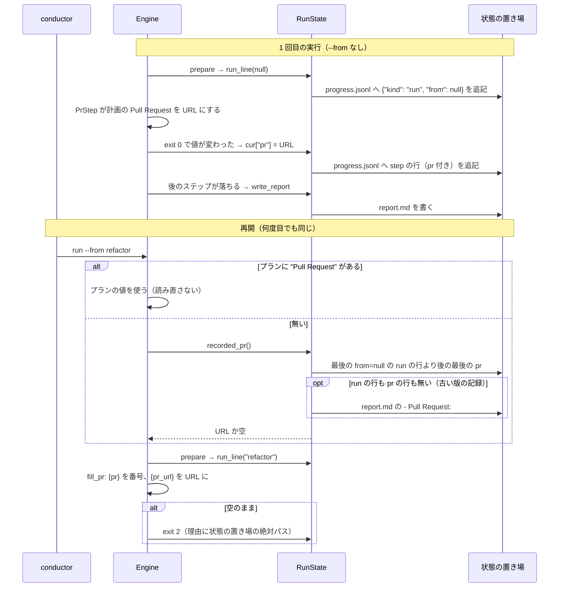

# `supervise.py run --from` の再開の Pull Request: 状態の置き場の追記だけの記録から前の実行の Pull Request を読み直し、何度再開しても `{pr}` が埋まる

## 概要

**`supervise.py run <プラン> --from <ステップ>` で再開するとき、プランに `"Pull Request"` が無ければ、前の実行が決めた
Pull Request を状態の置き場の `progress.jsonl` から読み直して `{pr}` / `{pr_url}` に使う。** `progress.jsonl` は追記だけの
記録で、`report.md` が `Pull Request: 無し` で上書きされても消されても、同じ Pull Request を何度でも読み直せる。
読み直せずに `{pr}` で止まるときは、誤りの文に状態の置き場の絶対パスが出る。

例: 検査のプランが `pr` のステップで #308 を作り、`refactor` で落ちた。`--from refactor` の再開が別の理由で落ちて
`report.md` を `Pull Request: 無し` で書き直しても、もう 1 度の `--from refactor` は `progress.jsonl` の `pr` のステップの行の
`"pr": "https://github.com/devbasex/devbase/pull/308"` を読み、`{pr}` を `308` に置き換える。

この文書は、その形に**なぜしたか**（背景・決定と理由・常に成り立つ条件・記録の形・既知の限界・テスト観点）を残す。
`progress.jsonl` のほかの行の種類は [`supervise_lib/plan.py`](../../plugins/ndf/scripts/supervise_lib/plan.py) の docstring の「途中の報告」が持つ。
`pr_from` の run のステップがプランの Pull Request を決める規則は [ndf-production-release-record.md](ndf-production-release-record.md) の「プランのステップの鍵 `pr_from`」が持つ。

決定の番号は #1296 の設計の番号である。

## 用語

「状態の置き場」の定義は用語集（[docs/glossary.md](../glossary.md)）の「NDF の工程（`ndf-workflow`）」が正である。
この文書の「前の実行」は、同じ状態の置き場で最後に `--from` を付けずに流した実行と、その後の `--from` の再開の並びを指す。

## 背景

再開は前の実行の Pull Request を `report.md` の `- Pull Request:` からだけ読み直していた。`report.md` は実行のたびに
書き直されるため、再開が 1 度 `Pull Request: 無し` で書くと、以後の再開はすべて「cmd の {pr} を置き換える Pull Request が
まだ無い」で止まった。devbasex/devbase issue #273 の検査のプラン（ndf 10.17.29）で起き、conductor は番号を直書きしたプランを
別の状態の置き場で流して回避した。

| 時刻 | ステップ | exit | 要約 |
| --- | --- | ---: | --- |
| 20:15:51 | pr | 0 | https://github.com/devbasex/devbase/pull/308 |
| 20:15:53 | refactor | 1 | （別件） |
| 20:16:17 | refactor（`--from refactor`） | 2 | cmd の {pr} を置き換える Pull Request がまだ無い |

1 回目の `pr` のステップの行は再開の後も `progress.jsonl` に残っていた。失ったのは `report.md` だけである。
最初の再開で `report.md` を読めなかった原因（再開の cwd が違った / 1 回目が `report.md` を書く前に止まった）は確かめていない。

## 決定と理由

| # | 決定 | 理由 | 採らなかった案 |
| ---: | --- | --- | --- |
| 1 | `progress.jsonl` のステップの行に任意の欄 `pr` を足し、読み直しの正にする | 状態の置き場で唯一の追記だけの記録で、「最後に成功した回」は最後の行として決まる。新しいファイルが要らない | 既存の `summary` を読む（出力の最後の空でない行を 160 文字で切った値で、`gh pr create` の stderr に行があると URL にならない）。`state.json` の `log`（新しい実行が空から書き直す）。専用のファイル（上書きの記録になり成功の順序を持てない） |
| 2 | 「終了コード 0 で終わり、計画の Pull Request をステップの前と違う空でない値にしたステップ」に印を付ける | 計画の Pull Request を決めるのは `pr` のステップと `pr_from` の run のステップの 2 つで、`Engine.execute` が前後を比べれば種類で分岐せずに両方が同じ規則で残る。値が変わらない成功には印を付けないが、前の行が同じ値を持つため読み直しの結果は変わらない | `pr` のステップの型だけに印を付ける（`pr_from` の経路で同じ不具合が残る） |
| 3 | `progress.jsonl` に実行の始まりの行も `pr` も 1 行も無いときだけ `report.md` を読む | 修正より前の版が書いた状態の置き場は `report.md` にしか PR を持たない。新しい版の記録が 1 行でもあれば、上書きされずに残った古い `report.md` の PR を使わない | 2 つを読んで新しい方を選ぶ（`report.md` に時刻が無く比べられない） |
| 4 | `{pr}` の誤りの文に状態の置き場の絶対パスを常に添える | 誤りの文はステップの出力になり、`.out` と進捗ログに残る。devbase の事例はどのパスを読んだかが残っておらず原因を絞れなかった。`fill_pr` は再開かどうかを知らないため、再開に限らず添える | 報告の `- 理由:` の行を書き換える（すべての失敗の理由の文を変える）。状態の置き場を絶対パスへ解決し直す（同じ cwd では既に読めており、cwd が違う再開は別のディレクトリを指すため直らない） |
| 5 | 実行の始まりの行（`"kind": "run"`）を足し、最後の `--from` を付けない実行より後の `pr` だけを読む | `progress.jsonl` は実行をまたいで追記され続ける。全体の最後の `pr` を読むと、`--from` を付けずに流し直した実行が `pr` のステップの前で止まった後の再開が、それより前の実行の（マージ済みかもしれない）Pull Request へ書き込む。`--from` の再開は前の実行の続きとして同じ範囲に含める | 状態の置き場のこれまでのすべての実行を範囲にする（流し直した後の再開が古い Pull Request へ書き込む経路が残る） |

## 仕様

### 常に成り立つ条件

| # | 条件 | 破れたときの扱い |
| --- | --- | --- |
| I1 | `progress.jsonl` の行は追記だけで、前の実行の行を書き換えも消しもしない | 再開で前の実行の Pull Request を読めない。テストが落とす |
| I2 | ステップの行に `pr` が付くのは、そのステップが終了コード 0 で終わり、計画の Pull Request をステップの前と違う空でない値にしたときだけである | 失敗した `pr` のステップの値や、プランに書かれた値を、作った Pull Request として読み直す。テストが落とす |
| I3 | 再開で使う Pull Request は、プランの `"Pull Request"` > `progress.jsonl` の、最後の `"from": null` の実行の始まりの行より後の最後の `pr` > `report.md` の `- Pull Request:` の順に、最初に見つかったものである。`report.md` を読むのは、`progress.jsonl` に実行の始まりの行も `pr` も 1 行も無いときだけである | プランの値が記録で上書きされる・古い PR が新しい PR に勝つ・流し直した後の再開がそれより前の実行の PR を使う |
| I4 | 読み直しは状態の置き場のファイルだけで決まり、LLM も GitHub も呼ばない（`{pr_url}` を番号から引く既存の経路は、記録の値が URL なら通らない） | テストが `gh` を偽物にして落とす |
| I5 | `fill_pr` が `{pr}` を埋められずに返す誤りの文は、状態の置き場の絶対パスを含む（`--state-dir` を相対で渡しても） | テストが落とす |
| I6 | 実行は 1 回につき 1 行だけ、ステップを流す前に実行の始まりの行を追記する。耐久ワークフローの続きでは書き直さない | 「前の実行」の範囲が決まらず、I3 の読み直しが `--from` を付けない実行をまたぐ。テストが落とす |

### 構成要素と責務

| 要素 | 責務 |
| --- | --- |
| `Engine.execute`（`supervise_lib/engine.py`） | ステップの前の計画の Pull Request を覚え、終了コード 0 で終わって値が変わっていれば、記録の前に `cur["pr"]` へ入れる（I2） |
| `Engine.prepare` | 耐久ステップの中で 1 回だけ、実行の条件を見る前に `RunState.run_line(start)` を呼ぶ（I6） |
| `Engine.setup` → `Engine._restore_pr` | `--from` でプランに `"Pull Request"` が無いとき、`RunState.recorded_pr()` の値を計画の Pull Request にする（I3）。状態の置き場のファイルを直に読まない |
| `RunState.step_line`（`supervise_lib/state.py`） | `cur["pr"]` があればステップの行へ `pr` として書く |
| `RunState.run_line` | `progress.jsonl` へ `{"kind": "run", "from": <start か null>}` を追記する |
| `RunState.recorded_pr` | `progress.jsonl` の、最後の `"from": null` の実行の始まりの行より後（その行が無ければ全体）の最後の `pr` を返す。実行の始まりの行も `pr` も無いときだけ `report.md` の `- Pull Request:` の URL（`/pull/<番号>` の形だけ）を返し、どれも無ければ空を返す。壊れた行は飛ばす |
| `StepContext.fill_pr`（`supervise_lib/steps.py`） | `{pr}` を番号、`{pr_url}` を URL に置き換える。埋められなければ誤りの文に `状態の置き場: <絶対パス>` を添える（I5） |

状態の置き場へ書くのは `RunState` だけである。`Engine` は計画の Pull Request を決め、`RunState` は記録へ書く値と記録から読み直した
値だけを渡す。読み直し（`setup` の中の `_restore_pr`）は実行の始まりの行を書く前（`prepare` の前）に流れるため、今の実行の行を
範囲の境目に取り違えない。再開の報告の `- Pull Request:` は、読み直した値が計画の Pull Request に入るため、既存の `write_report` の
ままで URL になる。

### 処理の流れ



## データ・設定

**変えたのは `progress.jsonl` の 2 つだけである。** `state.json`・`report.md`・`.out` の形は変えない。`state.json` の `log` にも
`cur` の写しとして `pr` が載るが、読み直しには使わない（決定 1）。

ステップの行（`"kind": "step"`）に足した欄:

| 欄 | 型 | 空を許すか | 意味 |
| --- | --- | --- | --- |
| `pr` | 文字列 | 欄ごと無い | そのステップが終了コード 0 で終わり、計画の Pull Request をこの値に変えた（I2）。`pr` のステップでは PR の URL、`pr_from` の run のステップでは `metrics` の値。欄が無い行は「このステップは Pull Request を決めていない」を表し、Pull Request が無いことは表さない |

実行の始まりの行（実行ごとに 1 行、その実行のステップの行より前）:

```json
{"kind": "run", "at": "...", "from": null}
```

| 欄 | 型 | 意味 |
| --- | --- | --- |
| `kind` / `at` | 文字列 | `"run"` と書いた時刻（`progress_write` が付ける） |
| `from` | 文字列か null | その実行の `--from` のステップ。null は `--from` を付けない実行で、読み直しの範囲の境目になる |

既存の状態の置き場は移さない。`progress.jsonl` の読み手（`queue` の attention・`slow_step.import_progress`・
`RunState.read_worker_lines`）は `kind` と欄を名前で取るため、知らない欄と行の種類を読み捨てる。

## エラー処理

| 場合 | 振る舞い |
| --- | --- |
| 前の実行が Pull Request を決めていない（範囲に `pr` が無い） | `{pr}` を含むステップで終了コード 2。出力は `cmd の {pr} を置き換える Pull Request がまだ無い（状態の置き場: <絶対パス>）` |
| `--from` を付けない実行が `pr` のステップの前で止まった後の再開 | その実行より前の `pr` は範囲の外のため使わず、上と同じく止まる |
| `progress.jsonl` に壊れた行がある | その行を飛ばして読む |
| 計画の値が番号で `{pr_url}` を含む | 既存の経路で `gh pr view` から URL を引く。読めなければ `cmd の {pr_url} を置き換える Pull Request #<番号> の URL を読めない` |

## 運用

### 既知の限界

| 項目 | 内容 |
| --- | --- |
| devbase の事例の原因 | cwd が違った / 1 回目が `report.md` を書く前に止まった、のどちらかは確かめていない。次に起きたときは誤りの文の絶対パスで読んだ場所が分かる。cwd が違い別のディレクトリを指す再開は直らない |
| 誤りの文の長さ | 状態の置き場の絶対パスが長いと、`progress.jsonl` の `summary`（160 文字）ではパスの末尾が切れる。`.out` とステップの結果には全文が残る |
| 耐久ワークフローの続きとの重なり | 落ちた前の起動を続ける経路（`Engine.replay`）は耐久ステップの出力の `pr` から計画の Pull Request を戻し、`setup` の読み直しの後に上書きする。値は同じ実行の記録から来る |

## テスト観点

テストは `plugins/ndf/scripts/tests/test_supervise.py` の `test_run_from_*` にある。`gh` を偽物にした状態の置き場で `Engine` を 2 度以上流す。

- `pr` のステップが成功した後で落ちたプランを `--from <後のステップ>` で再開すると、`{pr}` が番号、`{pr_url}` が URL に置き換わり、「まだ無い」で止まらないこと
- その再開を落とした後、`report.md` を `Pull Request: 無し` に書き換えても消しても、もう 1 度の再開で同じ PR になること（I1）
- 再開の `report.md` と標準出力の `## フェーズの報告` の `- Pull Request:` が前の実行の URL になること
- `pr` のステップを成功させていない状態の置き場で再開し `{pr}` に当たると止まり、出力に状態の置き場の絶対パスが含まれること（相対パスで渡しても）。PR を作った実行の後に `--from` を付けない実行が `pr` のステップの前で止まった状態の置き場でも同じく止まること（I3・I5）
- プランに `"Pull Request"` がある再開では、記録に別の PR があってもプランの値で `{pr}` が埋まること
- `pr` のステップが 2 回、別の PR で成功した記録からは後の PR を読み直すこと
- `pr` のステップが計画の Pull Request を入れたが終了コード 0 以外で終わったとき、その値は記録に残らず、再開は前の成功の PR を使うこと（I2）
- `--from` の再開を 2 度挟んだ状態の置き場で、実行の始まりの行が実行ごとに 1 行あり、`from` がそれぞれの値（最初の実行は null）になること。耐久ワークフローの続きで行が増えないこと（I6）
- 読み直しの間に `gh` を呼ばないこと（I4）
- `progress.jsonl` に `pr` の欄が無く `report.md` にだけ URL がある状態の置き場から再開すると、`report.md` から読み直すこと（`test_run_from_restores_pr_from_previous_report`）

## 関連リンク

- [`supervise_lib/engine.py`](../../plugins/ndf/scripts/supervise_lib/engine.py)・[`state.py`](../../plugins/ndf/scripts/supervise_lib/state.py)・[`steps.py`](../../plugins/ndf/scripts/supervise_lib/steps.py)
- [ndf-production-release-record.md](ndf-production-release-record.md)（`pr_from` と、その値を `pr` の記録へ残すこと）
- `development-workflow` の [references/interrupt-resume.md](../../plugins/ndf/skills/development-workflow/references/interrupt-resume.md)（落ちたプランを `--from` で流し直す手順）
- #1296（この形を決めた課題）、devbasex/devbase issue #273 / PR #308（由来）
