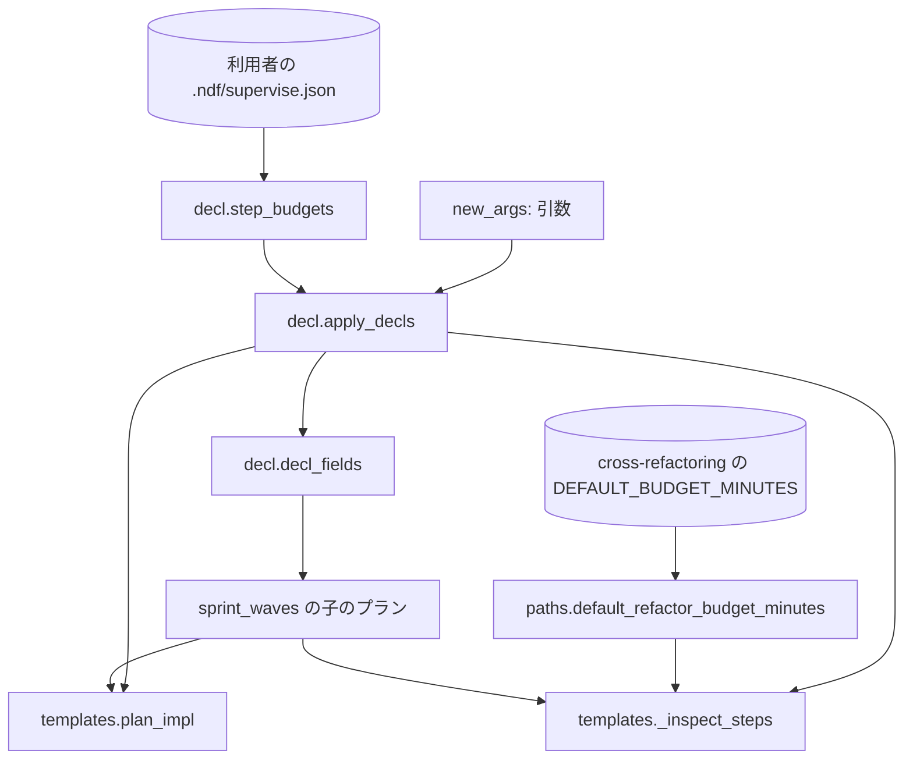

# 実装の上限と構造改善の想定最大時間: `supervise.py new` のプランの `impl` と `refactor` の時間の枠を、`.ndf/supervise.json` か引数の 1 か所で決める

## 概要

**`supervise.py new` が書くプランの `impl` の `timeout`（実装の上限・秒）と、`refactor` の cross-refactoring へ渡す想定最大時間
（`--budget-minutes`・分）は、`new` の引数 → `.ndf/supervise.json` → 値なし の順で 1 つに決まる。** `new sprint` / `new close` は
同じ値を課題ごとの実装のプランと検査のプランのすべてへ引き継ぐ。**`refactor` の `timeout` は常に `with_margin(M × 60)` で、
M は想定最大時間、無ければ cross-refactoring の既定の予算（`DEFAULT_BUDGET_MINUTES`）である。** NDF は実装の上限・想定最大時間の
固定値を新しく持たない。

この文書は、その形に**なぜしたか**（背景・決定と理由・常に成り立つ条件・境界・既知の限界・テスト観点）を残す。
**宣言の形と引数の正はスクリプトにある。**

| 何を | 正本 |
| --- | --- |
| `.ndf/supervise.json` の `impl_timeout` / `refactor_budget_minutes` の形（型・単位・無いときの扱い） | [`supervise_lib/plan.py`](../../plugins/ndf/scripts/supervise_lib/plan.py) の docstring の「宣言」の節 |
| `--impl-timeout`（`impl` `sprint`）・`--refactor-budget-minutes`（`check` `sprint` `close`）と、`new <種別> --help` の「任意の設定」 | [`supervise_lib/new_args.py`](../../plugins/ndf/scripts/supervise_lib/new_args.py) の `NEW_ARGS`・`DECL_WORDS` |
| 引数と宣言から値を決める順（`apply_decls`）と子のプランへの引き継ぎ（`decl_fields`） | [`supervise_lib/decl.py`](../../plugins/ndf/scripts/supervise_lib/decl.py) |
| 想定最大時間の意味と cross-refactoring の中の配分 | [cross-refactoring-time-budget.md](cross-refactoring-time-budget.md) と `cross-refactoring` の Skill |
| 最終ゲートの後の取り消しの所要と `refactor` の `timeout` の関係 | [cross-refactoring-verify-and-final-gate.md](cross-refactoring-verify-and-final-gate.md) の運用の「時間の上限」 |

決定の番号は #1916 の設計の番号である。

## 用語

「実装の上限」「想定最大時間」の定義は用語集（[docs/glossary.md](../glossary.md)）が正である。課題の本文の「リファクタリングの予算」は
想定最大時間と同じものを指す。工程（`ndf-workflow`）は cross-refactoring（`ndf-cross-refactoring`）の **順応者** の関係にあり、
プランは想定最大時間を cross-refactoring の意味（分・1 以上の整数・目安の上限）のまま受けて `--budget-minutes` へそのまま渡す。
工程の側で配分や解釈を足さない。

## 背景

`supervise.py new` が書くプランの `impl` と `refactor` の `timeout` は 3600 秒の固定値で、cross-refactoring の想定最大時間も渡せなかった。
conductor はスプリントのたびに jq で値を書き足していた（実装の `timeout` 3600 → 5400 を m1693・m1385・m744・m815・m653・m1290・
m1743・m1847・m1683 の 9 回。#1334。検査のプランへ `--budget-minutes 60`・`timeout` 3600 → 4200 を #1370・m1693・m1385）。
構造改善が 3600 秒ちょうどで exit=124 になり、結果を失った回もあった。merge・release のステップは既に `with_margin(上限)` で余裕を
足していた。

## 決定と理由

| # | 決定 | 理由 | 採らなかった案 |
| ---: | --- | --- | --- |
| 1 | 置き場を `.ndf/supervise.json` にする | `supervise.json` は `supervise.py` の雛形が読む、利用者が手で書く設定（`test`・`sync_checks`・`queue`・`release`）の置き場で、2 つの値はこの雛形にだけ効く。`.ndf/project.json` は解析が書くプロジェクトの形で、スキーマが `additionalProperties: false` を持ち、再解析が書き直す | `.ndf/project.json` に置く（スキーマの改訂が要り、解析の出力に運用の値が混ざる）。新しいファイル |
| 2 | 項目名を `impl_timeout` / `refactor_budget_minutes`、引数を `--impl-timeout` / `--refactor-budget-minutes` にする | 宣言の項目名と引数の `dest` を同じにし、「引数が無ければ宣言」を同じ名前で書ける。単位はステップの `timeout` の秒と `--budget-minutes` の分をそのまま使う | `--budget-minutes` をそのまま `new` の引数名にする（`new sprint` は実装と検査の両方を書くため、何の時間かが読めない） |
| 3 | `refactor` の `timeout` を常に `with_margin(M × 60)`（10%、最低 30 秒）にし、M は想定最大時間、無ければ cross-refactoring の既定の予算とする | 予算と打ち切りの秒を 1 つの式で結ぶ。`--budget-minutes` を足さないときも cross-refactoring は同じ既定の予算で動くため、`timeout` は実際の予算より常に余裕の分だけ長い。承認ゲート 1 の利用者の指示（2026-10-11「margin は 10% とし、紛らわしいので固定値は書かない」） | 予算を渡さないときに今の固定の秒を下限として残す（予算との関係が読めない固定値が残る）。余裕を 10% より大きくする |
| 4 | `apply_decls` が引数と宣言から値を決めて `a` に載せ、雛形（`plan_impl`・`_inspect_steps`）は `a` だけを読む | ベースブランチ・テストの宣言と同じ経路に乗せれば、`decl_fields` でスプリントの子のプランへ届き、スプリントの雛形を変えずに済む | 雛形が宣言を直接読む（スプリントが組む子の引数は宣言の場所を持たず、読む所が雛形の数だけ増える） |
| 5 | 宣言は厳密な 1 以上の整数（`StrictInt` に `gt=0`）だけを受け、引数があっても宣言の形を検査する | `schema.Shape` の既定の緩い整数では `"60"`・`60.0`・`true`（1 になる）が通る。引数を渡した回だけ宣言の誤りを見逃さない | 引数を渡したときは宣言を読まない（壊れた宣言が次の回まで見つからない） |
| 6 | 2 項目の形は `plan.py` の docstring の「宣言」の節に足し、`DECL_WORDS` には値の出どころの 1 行だけを足す | `supervise.json` の形（`test`・`sync_checks`・`release`）の正本はこの節で、`supervise.py` の epilog もそこを指す。形を書く所を 1 か所に保つ | `DECL_WORDS` だけへ足す（形の正本の一覧に載らない）。`agent-layers.md` に説明の節を置く（正本が 2 か所になる） |
| 7 | ai-plugins の `.ndf/supervise.json` には値を書かない | conductor が手当てで使ってきた値は、既定の予算への根拠の無い上乗せ（既定の予算は中にバッファを持つ。#1522）か、1 回の実測を写しただけの固定値だった。値が要るときは `new` の引数で渡し、宣言へ書くかは所要の実測が揃ってから別に決める。承認ゲート 1 の利用者の指示（2026-10-11） | 手当ての値を宣言へ書く（`timeout` がどの式から来た値かが読めなくなる） |
| 8 | 既定の予算は cross-refactoring の `refactor_lib/vocabulary.py` の `DEFAULT_BUDGET_MINUTES` を読み込んで使う（`paths.py` の `default_refactor_budget_minutes`） | 既定の予算を 2 か所に持たない。cross-refactoring が既定を変えれば、`refactor` の `timeout` も同じ値から追う | 値を `supervise_lib` へ写す（片方だけ変わると食い違う）。`vocabulary.py` の文を構文として読む。定数を `scripts/lib` へ移す（cross-refactoring の持ち物を動かす） |

## 仕様

### 構成要素と責務

| 要素 | 責務 |
| --- | --- |
| `supervise_lib/new_args.py` | `--impl-timeout`・`--refactor-budget-minutes` を受け、1 以上の整数でなければ argparse の誤り（`positive_int`）で止める。値の出どころの 1 行を受ける種別の `--help` に出す |
| `supervise_lib/decl.py` | `StepBudgets`（`impl_timeout` / `refactor_budget_minutes`。`PositiveInt` か `None`）で `supervise.json` の 2 項目だけを取り出して検査し（`step_budgets`。ほかの項目は拒まない）、違えば項目の名前を含む `DeclError`。`apply_decls` が引数 → 宣言で `a` に載せ、`decl_fields` が子のプランへ引き継ぐ |
| `supervise_lib/paths.py` | `DRIVES` が指す cross-refactoring の置き場から `refactor_lib/vocabulary.py` を読み込み、`default_refactor_budget_minutes()` で既定の予算を返す |
| `supervise_lib/templates.py` | `plan_impl` は `impl` の `timeout` を `a.impl_timeout`、無ければ雛形の値にする。`_inspect_steps` は想定最大時間があれば cmd に `--budget-minutes N` を足し、`timeout` を `with_margin(M × 60)` にする |

スプリントの雛形（`sprint_waves.py`）は既に `**decl_fields(a)` で子のプランの引数を組むため、変えずに値が届く。
設計の結果のステージ（`design_stage.rewrite`）は `impl` の `prompt` だけを書き換え、`timeout` を残す。

### 常に成り立つ条件

| # | 条件 | 破れたときの扱い |
| --- | --- | --- |
| I1 | 値は「`new` の引数 → `.ndf/supervise.json` → 値なし」の順で 1 つに決まる | 起こさない（`apply_decls` の 1 か所で決める。決定 4） |
| I2 | 値は 1 以上の整数（JSON の数の整数。文字列・小数・真偽値・0・負は違う） | プランを書かずに終了コード 2 で止まり、違う項目の名前を出す |
| I3 | `impl` の `timeout` は、実装の上限があればその値、無ければ雛形の値（3600 秒） | — |
| I4 | `refactor` の cmd が `--budget-minutes N` を含むのは想定最大時間があるときだけで、N は想定最大時間に等しい | — |
| I5 | `refactor` の `timeout` は `with_margin(M × 60)`。`with_margin` が最低 30 秒を足すため、常に M × 60 より大きい | — |
| I6 | `new sprint` / `new close` が書く課題ごとの実装のプランと検査のプラン（最終の検査を含む）は、同じ入力から作られ、I3〜I5 の値がそろう | — |

### 境界の決まり

- **検査の順は、引数の形（argparse）→ 宣言の形 → 値の決定 → プランの書き出しである。** プランのファイルは最後に書くため、どちらの検査で
  止まってもファイルは残らない
- **宣言の形は、`supervise.py new` のすべての種別で、引数を渡したときも検査する**（`test` の形の検査と同じ時点）
- **受けない種別へ渡した引数は、argparse が知らない引数として止める。** `fill_new_defaults` がその属性を `None` で埋めるため、雛形は種別をまたいで
  `getattr` で読める
- **宣言も引数も無いプランは、`impl` の `timeout` が雛形の値で、`refactor` の cmd に `--budget-minutes` を持たず、`refactor` の `timeout` が
  `with_margin(既定の予算 × 60)` になる。** 既定の予算 30 分で 1980 秒である
- `with_margin` の式と最低 30 秒（`MARGIN_FLOOR`）・cross-refactoring の既定の予算・ほかのステップの `timeout` は変えない
- `vocabulary.py` は読み込むときに `refactoring` の `references/vocabulary.md` を読む。読めなければ例外のまま止まり、プランを書かない
  （cross-refactoring の駆動も同じ読み込みをするため、止まる形は増えない）

## 運用

### 既知の限界

| 項目 | 内容 |
| --- | --- |
| 予算を余裕より長く超える run | 想定最大時間は目安の上限で、cross-refactoring は予算を超えても実行中の CLI を止めない。超えた秒が `with_margin` の余裕より長い run は打ち切られる（exit=124）。最終ゲートの後の取り消しと確かめ直しまで含めた所要は 1.2·B + 7 分（既定の B = 30 分で 43 分）で、既定の `timeout`（1980 秒 = 33 分）より長い（[cross-refactoring-verify-and-final-gate.md](cross-refactoring-verify-and-final-gate.md) の決定 8）。想定最大時間を渡さないプランでは、項目ごとの取り消しが打ち切られうる。リリース後テストで exit=124 が出れば、渡す想定最大時間を見直す（余裕の割合は 10% のまま） |
| ai-plugins の値 | ai-plugins の宣言には書かない（決定 7）。値が要るかは所要の実測が揃ってから決める |
| 説明の置き場 | 宣言の形の正本は `plan.py` の docstring で、`.md` の文書を新設していない |

## テスト観点

テストは `plugins/ndf/scripts/tests/test_supervise_step_budgets.py` と、契約の fixture（`tests/fixtures/supervise-contract/`）にある。

- `new impl` / `new sprint` に実装の上限を宣言か引数で渡すと、`impl` の `timeout` がその値になり、どちらも無ければ変更前と同じ値であること（I3）
- 想定最大時間を宣言か引数（`new check` / `new sprint` / `new close`）で渡すと、`refactor` の cmd に `--budget-minutes N`、`timeout` が `with_margin(N × 60)` になること（I4・I5）
- 想定最大時間が無いと、cmd に `--budget-minutes` が無く、`timeout` が `with_margin(DEFAULT_BUDGET_MINUTES × 60)` で、定数を差し替えると `timeout` も追うこと（決定 8）
- 値を既存の `.ndf/supervise.json` に書くとプランに入ること
- `new sprint`（normal と `--pace fast`）と `new close` が書く課題ごとの実装のプランと検査のプラン（最終の検査を含む）に同じ値が入ること（I6）
- 引数と宣言の両方があると引数の値が入ること（I1）
- 0・負・小数・文字列・真偽値を引数か宣言で渡すと、プランを書かずに 0 以外で終わり、項目名が出ること。宣言の誤りは引数があっても止まること（I2）
- `new sprint --help` と `new check --help` の「任意の設定」に 2 項目が出ること

## 関連リンク

- [`supervise_lib/decl.py`](../../plugins/ndf/scripts/supervise_lib/decl.py)・[`new_args.py`](../../plugins/ndf/scripts/supervise_lib/new_args.py)・[`paths.py`](../../plugins/ndf/scripts/supervise_lib/paths.py)・[`plan.py`](../../plugins/ndf/scripts/supervise_lib/plan.py)・[`templates.py`](../../plugins/ndf/scripts/supervise_lib/templates.py)・[`verify_steps.py`](../../plugins/ndf/scripts/supervise_lib/verify_steps.py)（`with_margin`）
- [cross-refactoring-time-budget.md](cross-refactoring-time-budget.md)・[cross-refactoring-verify-and-final-gate.md](cross-refactoring-verify-and-final-gate.md)
- #1916（この形を決めた課題）、#1336（3600 秒ちょうどの exit=124）、#1334・#1370（conductor の手当ての記録）
