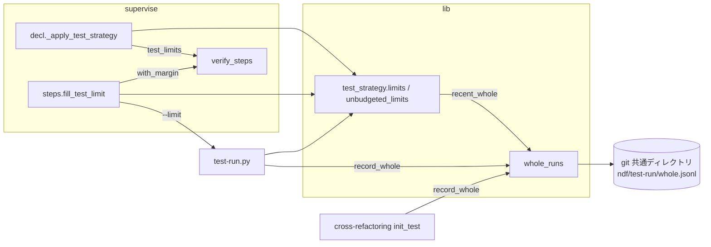
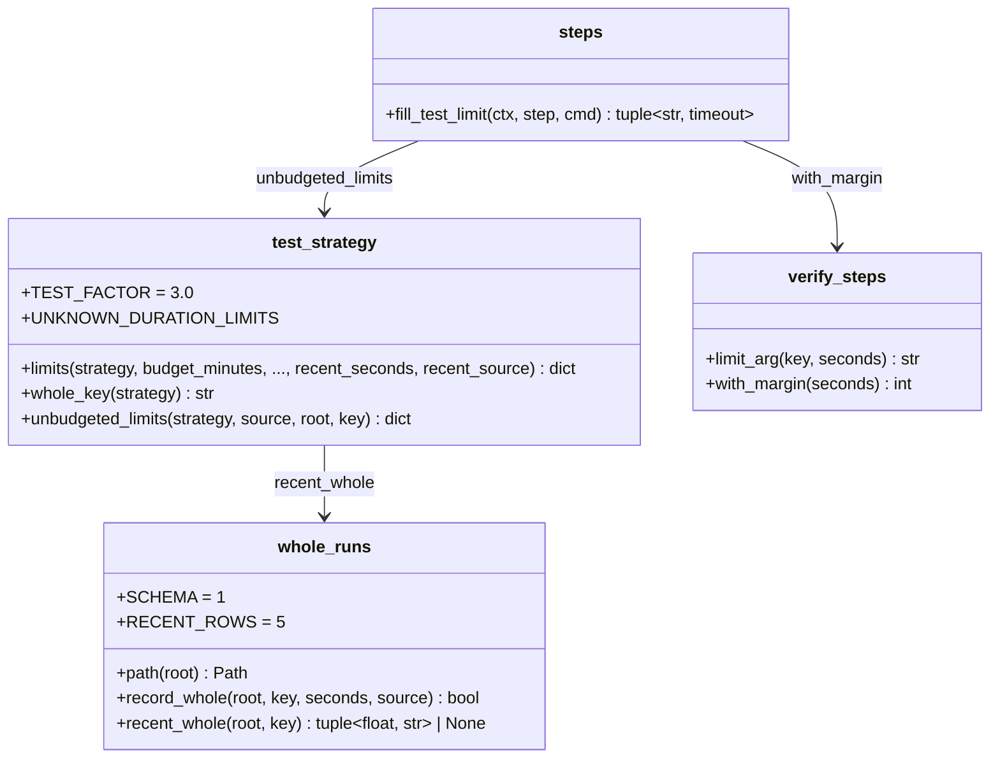

# テストの上限と全体テストの実測: 予算なしのテストの上限を所要の記録と直近の全体テストの実測の大きい方の 3 倍で決め、テストのステップの開始で決め直す

## 概要

**`supervise.py` のプランと `test-run.py` が使う予算なしのテストの上限（`whole_timeout`・`test_timeout`・`init_test_timeout`）は、
`.ndf/project.json` の所要の記録 w と、同じリポジトリで先に走った全体テストの実測 m の大きい方の 3 倍（`ceil(3·max(w, m))`）である。**
手元の全体検証が上限の中で終わるたびに、その秒をリポジトリの git の共通ディレクトリへ 1 行追記する。範囲テストと全体テストの
ステップは、開始の時点で上限を決め直し、同じ秒をステップの `timeout`（`with_margin(上限)`）と `test-run.py --limit` の両方に使う。
`.ndf/project.json` は書き換えない。

例: 記録が 2.7 秒（`ndf-record`）で、テストを足して全体テストが約 12 秒になったリポジトリ（#1631 の報告。takemi-ohama/novel のスプリント world）。

| 時点 | 上限 | 根拠（「テストの時間」の `basis`） |
| --- | ---: | --- |
| `new sprint` で全フェーズのプランを作る（実測が無い） | 9 | `w` 2.7・`recent` `null`・`limit_from` `record` |
| 実装のフェーズの `test-all` が 11.8 秒で終わる | — | 1 行追記（`source` `test-run`） |
| 検査のフェーズの cross-refactoring の着手前の全体テストが 12.6 秒で終わる | — | 1 行追記（`source` `cross-refactoring`） |
| 検査のフェーズの `test-all` の開始で決め直す | `max(9, ceil(3·12.6))` = 38 | `recent` 12.6・`recent_source` `cross-refactoring`・`limit_from` `recent`。ステップの `timeout` は `with_margin(38)` = 68 |

変更の前は、検査のフェーズの `test-all` が上限 9 秒で止まり、利用者か conductor が `test_duration` を手で直してプランを作り直していた。

**手順と文言を持つ Skill は無い。** 上限は Skill から呼ばれるスクリプトの中で決まり、Skill の本文には載らない。引数と置き場の正はスクリプトにある。

| 何を | 正本 |
| --- | --- |
| 実測の置き場（`NDF_WHOLE_RUNS_DIR`・git の共通ディレクトリ・`XDG_STATE_HOME`）、追記と直近の読み出し | [`lib/whole_runs.py`](../../plugins/ndf/scripts/lib/whole_runs.py) の docstring と `record_whole`・`recent_whole` |
| 予算なしの上限の式と `basis` の欄 | [`lib/test_strategy.py`](../../plugins/ndf/scripts/lib/test_strategy.py) の `limits`・`_unbudgeted`・`unbudgeted_limits`・`whole_key` |
| `test-run.py scope` / `whole` の `--limit` | [`test-run.py`](../../plugins/ndf/scripts/test-run.py) の冒頭の説明と `--help` |
| ステップの開始の決め直し | [`supervise_lib/steps.py`](../../plugins/ndf/scripts/supervise_lib/steps.py) の `fill_test_limit` |
| `with_margin` の式（10%・最低 30 秒） | [`supervise_lib/verify_steps.py`](../../plugins/ndf/scripts/supervise_lib/verify_steps.py)。理由は [ndf-supervise-step-budgets.md](ndf-supervise-step-budgets.md) |
| 所要の記録（`test_duration`）の測り方 | [project-decl-ci-representative-run.md](project-decl-ci-representative-run.md) と `development-workflow` の [`references/project-analysis.md`](../../plugins/ndf/skills/development-workflow/references/project-analysis.md) |
| 予算を持つ呼び出し（cross-refactoring）の上限 | [cross-refactoring-time-budget.md](cross-refactoring-time-budget.md)・[cross-refactoring-init-test-and-phase-windows.md](cross-refactoring-init-test-and-phase-windows.md) と `cross-refactoring` の `docs/02-plan-and-implement.md` |

この文書は、その形に**なぜしたか**（背景・決定と理由・常に成り立つ条件・データの形・既知の限界・テスト観点）を残す。
決定の番号は #1631 の設計の番号である。コードのコメントの「#1631 の決定 3」「決定 4」はこの番号を指す。

## 用語

「所要の記録」「全体テストの実測」「テストの上限」「全体テストの鍵」の定義は用語集（[docs/glossary.md](../glossary.md)）が正である。
この文書の w は所要の記録、m は直近の全体テストの実測、c は CI の壁時計の秒を指す。

コンテキストは NDF の開発ワークフロー（`ndf-workflow`）の 1 つである。cross-refactoring の着手前のテストは同じコンテキストの中の
呼び出し元で、全体テストの実測を同じ関数（`whole_runs.record_whole`）で書く。

## 背景

予算なしの上限は `TEST_FACTOR`（3.0）× w だけで決まっていた。w は宣言の解析が書く記録で、実行の実測では更新されない。
スプリントでテストが増えて全体テストが 3·w を超えると、後のフェーズの `test-all` が上限で止まった（#1631。記録 2.7 秒・上限 9 秒・
全体テストの実測 約 12 秒）。

`new sprint` は検査のプランを実装のフェーズより前に組み、上限を `decl_fields` の `test_limits` で各プランへ引き継ぐ。
このため、プランの作成の時点だけで実測を読んでも、同じスプリントの検査のフェーズには届かない（決定 3）。

要求の受け入れ条件 2（後のプランの上限は `3·max(w, m)` 以上）と、当初の受け入れ条件 5（実測が記録の 3 倍以下なら今と同じ値）は
`w < m ≤ 3w` で両立しなかった（例: w 2.7・m 5 で、条件 2 は 15 秒以上、条件 5 は 9 秒）。承認ゲート 1（2026-10-30）で条件 2 を採り、
条件 5 を「実測が記録以下のとき」へ直した。

## 決定と理由

| # | 決定 | 理由 | 採らなかった案 |
| ---: | --- | --- | --- |
| 1 | 上限を `ceil(3·max(w, m))` の 1 つの式にする | 実測が記録を超えた分だけ上限が追い付き、記録以下なら今の値のままで、ハングを見つけるまでの時間が延びない。「実測が上限の一定の割合を超えたら決め直す」の割合を 1/3 に置いた形と同じになる | 実測が 3·w を超えるまで今の値のまま（条件 5 の当初の文）。9 割で通った次の全体テストが少し伸びるだけで止まる |
| 2 | 実測の置き場を git の共通ディレクトリ（`<共通ディレクトリ>/ndf/test-run/whole.jsonl`）にし、範囲はリポジトリ全体、直近は同じ鍵の最新 5 行の最大とする | スプリントの実装（課題ごとの worktree）と検査（スプリントのブランチの worktree）は別の worktree で走る。共通ディレクトリは worktree の間で 1 つで、コミットされず、利用者の設定でもない。ブランチやスプリントで分けると新しいスプリントの最初のプランで実測が無くなる。最新 1 行にすると、落ちたテストが早く止まった短い行で上限が 3·w へ戻る | worktree ごとの `.ndf/tmp/`（検査が実装の実測を読めない）。`.ndf/project.json` の `test_duration` を書き換える（利用者の設定を書き換える） |
| 3 | テストのステップの開始で上限を決め直し、同じ秒を `--limit` で `test-run.py` へ渡し、ステップの `timeout` もその秒から作る。決め直した値はプランの作成の時点の値を下回らせない（`max`） | `test-run.py` が自分でもう一度計算すると、その間に別のプランが実測を書けば、ステップの `timeout` より長い上限で走りうる。下回らせると同じプランの中で上限が揺れ、記録より速くなったことを理由に上限を詰めることになる | `test-run.py` に実測を読ませ、`timeout` をプランの作成の時点の値で上から押さえる（上限が `timeout` で頭打ちになり、検査のフェーズで広がらない） |
| 4 | cross-refactoring の着手前の全体テスト（`mode: whole` で打ち切られなかったもの）も実測として残す | 決定 3 で、同じプランの中で先に走った着手前のテストの秒も `test-all` に届く。実装のフェーズの実測が無いリポジトリでも検査のフェーズが止まらない（#1631 の 12.6 秒はこの値） | 着手前のテストを残さない。範囲テスト・ラウンドテストも残す（範囲が変わると所要が変わる） |
| 5 | 絶対値の下限（例: 60 秒）を足さない | 記録 2.7 秒のリポジトリの上限が 9 秒から 60 秒になり、速いテストのハングを見つける時間が延びる。ステップの `timeout` には `with_margin` の最低 30 秒が既にあり、下限はその余白に余白を重ねる。伸びた分は決定 1 の実測が受け持つ | 60 秒の下限（下限だけで直すと、所要が下限の 1/3 を超えて伸びたとき同じ時間切れが起きる） |
| 6 | 実測は静的解析を含む手元の全体検証の壁時計にする | `test-run.py whole` は静的解析とテストを 1 つの `whole_timeout` に収める。テストだけの秒を残すと、静的解析が重いリポジトリで実測が上限の受け持ちより短くなる。着手前の全体テストも全 suite を走らせた秒で、同じ意味になる | テストの suite だけの秒 |

## 仕様

### 構成要素と責務

**上限の値を計算するのは `test_strategy.limits` だけで、予算なしの呼び出し元 3 つ（`test-run.py`・`supervise_lib/decl.py`・
`supervise_lib/steps.py`）はどれも `unbudgeted_limits` を通す。** 実測を書くのは `whole_runs.record_whole` だけである。

| 要素 | 責務 |
| --- | --- |
| `lib/whole_runs.py` | 置き場を解き（`path`）、行を追記し（`record_whole`。書けたら真）、鍵ごとの直近（`recent_whole`。最新 `RECENT_ROWS` = 5 行の最大の秒とその行の出所）を返す。読み書きの失敗は例外にしない |
| `lib/test_strategy.py` | `limits` の予算なしの枝（`_unbudgeted`）が `recent_seconds`・`recent_source` を受けて上限を決め、`basis` に載せる。`whole_key(strategy)` が全体テストの鍵を作る。`unbudgeted_limits(strategy, source, root, key=None)` が直近の実測を読んで `limits` を呼び、`basis.key` を足す |
| `test-run.py` | `scope` / `whole` が `--limit <秒>` を受ける。`whole` は手元の全体検証が上限の中で終わったら `record_whole(..., "test-run")` を呼ぶ |
| `supervise_lib/decl.py` | `_apply_test_strategy` がプランの作成の時点の上限（`a.test_limits`）を `unbudgeted_limits` で決める |
| `supervise_lib/verify_steps.py` | 範囲テスト（`scope_cmd`）と手元の全体テスト（`whole_cmd`）のコマンドに `--limit {test_limit:<鍵>:<作成の時点の秒>}` を入れる（`limit_arg`）。CI に任せる戦略（`local-scoped-ci-whole`）の全体テストには入れない。`test_meta` が上限の表を「テストの時間」へ書く |
| `supervise_lib/steps.py` | run のステップの開始で `fill_test_limit` が `{test_limit:…}` を決め直した秒へ置き換え、`timeout` を決め、`cur.test_limit` に残す |
| cross-refactoring の `refactor_lib/init_test.py` | `record_whole_run` が、着手前のテストが `mode: whole` で打ち切られなかったときだけ `record_whole(..., "cross-refactoring")` を呼ぶ |

### 上限の式

予算なし（`budget_minutes is None`）の `limits` は次の表を返す。`ceil` は切り上げの整数、m は直近の実測（無ければ 0 として扱う）。

| 上限 | 所要が分かるとき（w か x がある） | 所要が不明のとき（w も x も無い） |
| --- | --- | --- |
| `whole_timeout` | `ceil(3·max(w, m))`（w が無ければ x） | `max(1800, ceil(3·m))` |
| `test_timeout` | `ceil(3·max(x, m))`（x が無ければ w） | `max(900, ceil(3·m))` |
| `init_test_timeout` | `whole_timeout` と同じ | `whole_timeout` と同じ |
| `ci_wait_timeout` | `ceil(3·c)`（c が無ければ 3600）。m を使わない | 同左 |

`unbudgeted_limits` は x（`measured_seconds`）を渡さないため、supervise と `test-run.py` では `test_timeout` も w から決まる。

`basis.limit_from` は、所要が分かるときは m が w（w が無ければ x）を上回れば `recent`、それ以外は `record`。所要が不明のときは
`whole_timeout` が 1800 を上回れば `recent`、それ以外は `unknown`。

実測で値を確かめた例（`local-full`、w 2.7・`ndf-record`）:

| m | `whole_timeout` / `test_timeout` | `limit_from` |
| --- | ---: | --- |
| 無し | 9 | `record` |
| 2.5 | 9 | `record` |
| 5 | 15 | `recent` |
| 12.6 | 38 | `recent` |
| 所要不明・m 無し | 1800 / 900 | `unknown` |
| 所要不明・m 700 | 2100 / 2100 | `recent` |

### ステップの開始の決め直し

`fill_test_limit` は run のステップのコマンドに `{test_limit:<鍵>:<秒>}` があるときだけ働く（`{pr}`・`{base}`・`{state_dir}` の置き換えの後）。

1. プランの「テストの時間」の `basis` に `key` があり、`budget_minutes` が `null` なら、`basis` の `strategy`・`w`・`w_source`・`c`・`key` を
   `unbudgeted_limits` へ渡して、その時点の上限を得る
2. 上限 = `max(作成の時点の秒, その時点の上限の <鍵>)`。決め直せない（`basis` が無い・`key` が無い・読めない）ときは作成の時点の秒
3. 上限が作成の時点の秒を上回ったときだけ、`timeout` を `max(ステップの timeout, with_margin(上限))` にする
4. `{test_limit:…}` を上限の秒へ置き換え、`cur.test_limit` に `key`・`planned`・`seconds`・`timeout`・`basis` を残す

`test-run.py` は `--limit` を受けたら、`scope` では `test_timeout`、`whole` では `whole_timeout` をその秒に置き換える（`LIMIT_KEY`）。
ほかの上限（`ci_wait_timeout`、落ちたテストの分類に使う `test_timeout`）は `unbudgeted_limits` の値のままである。`--limit` を省くと
起動の時点の `unbudgeted_limits` の値を使う。出力の `items[0].limits` は置き換えた後の値を出し、終了コードは変えない。

### 実測を残す条件

| 呼び出し | 残す | 残さない |
| --- | --- | --- |
| `test-run.py whole`（手元の戦略） | 静的解析とテストが `whole_timeout` の中で終わった（通った・落ちたを問わない）。テストのコマンドが無く静的解析の全体テストだけが終わったときも残す | 打ち切り・起動の失敗・CI に任せる戦略（CI の待ち） |
| `test-run.py scope` | — | すべて（範囲が変わると所要が変わる） |
| cross-refactoring の着手前のテスト | `mode: whole` で打ち切られなかった | `scope`・`round`・打ち切り |

秒は全体検証を始めてから終わるまでの壁時計（`time.monotonic` の差。cross-refactoring は着手前のテストの `seconds`）である。

### 常に成り立つ条件

| # | 条件 | 破れたときの扱い |
| --- | --- | --- |
| I1 | 予算なしで w が既知のとき、`whole_timeout` は `ceil(3·max(w, m))`。m が無いか w 以下なら変更の前の `limits` と同じ値 | 単体テストが値の不一致で落とす |
| I2 | 予算なしで所要が不明のとき、上限は `UNKNOWN_DURATION_LIMITS`（900 / 1800 秒）を下回らない。`3·m` が上回るときだけ広げる | 単体テストが落とす |
| I3 | 予算を持つ呼び出しの返す値は、`recent_seconds` を渡しても渡さなくても同じ。`basis` に `recent` の欄も載らない | 予算ありの単体テストが落とす |
| I4 | 上限には余裕の係数も定数も足さない。余裕はステップの `timeout` の `with_margin(上限)` だけが持つ | 単体テストが落とす |
| I5 | テストのステップで `test-run.py` が使う上限は、そのステップの `timeout` を決めた上限と同じ秒である（`--limit` で渡す） | 結合テストが落とす |
| I6 | 行は追記だけで書き換えない。残すのは「実測を残す条件」の表の「残す」だけで、秒は 0 より大きい | 結合テストが落とす |
| I7 | 実測の読み書きの失敗は、全体テストの合否・終了コード・プランの作成を変えない | 結合テストが落とす |
| I8 | ステップの開始で決め直した上限は、プランの作成の時点の上限を下回らない | 単体テストが落とす |

### 境界の決まり

- 変えないもの: `.ndf/project.json`（`test_duration` は今どおり宣言の解析だけが書く）、予算を持つ呼び出しの上限、`ci_wait_timeout`、
  `with_margin` の式、`TEST_FACTOR`、実装の上限（`impl_timeout_estimate`）
- `{test_limit:…}` を持たないステップ（この変更の前に作ったプラン・CI に任せる戦略の全体テスト）は今どおり動く
- `basis.key` を持たない「テストの時間」（宣言も `--test-cmd` も無く `plan_limits` が所要不明の値を出したプラン）では決め直さない

## データ・設定

### 全体テストの実測の記録

| 置き場 | 条件 |
| --- | --- |
| `$NDF_WHOLE_RUNS_DIR/whole.jsonl` | 環境変数があるとき（テストの隔離に使う。`plugins/ndf/scripts/tests/conftest.py` が全テストで設定する） |
| `<git の共通ディレクトリ>/ndf/test-run/whole.jsonl` | git のリポジトリの中（worktree を含む）。共通ディレクトリは `estimate_records.find_git_dir` で解く（`git` を起動しない） |
| `${XDG_STATE_HOME:-~/.local/state}/ndf/test-run/<解いた root の絶対パスの sha256 の先頭 12 文字>/whole.jsonl` | git でないとき |

1 行 1 つの JSON（JSON Lines）。

| 列 | 型 | 意味 |
| --- | --- | --- |
| `schema` | 整数 | 行の形の版。今は 1。違う版の行は読み飛ばす |
| `key` | 文字列 | 全体テストの鍵（`whole_key`。戦略の全体テストのコマンドの集合を並べ替えて改行でつないだものの sha256 の先頭 16 文字） |
| `seconds` | 実数 | 全体検証の壁時計の秒。小数 1 桁。0 より大きい |
| `source` | 文字列 | `test-run` / `cross-refactoring` |
| `at` | 文字列 | 書いた時刻（ISO 8601・UTC・秒まで） |

壊れた行・`schema` の違う行・鍵の違う行・`seconds` が正の数でない行は読み飛ばす。長さを詰める処理は持たない。

### プランの「テストの時間」の `basis`

予算なしの枝でだけ次の欄が載る。既存の欄（`budget_minutes`・`w`・`w_source`・`c`・`x`・`strategy`・`unknown_duration`）の意味は変えない。

| 欄 | 値 |
| --- | --- |
| `recent` | 読んだ直近の実測の秒（w 以下で上限に効かなかったときも出る）。無ければ `null` |
| `recent_source` | その行の `source`。無ければ `null` |
| `limit_from` | `record` / `recent` / `unknown`（「上限の式」） |
| `key` | 全体テストの鍵（`unbudgeted_limits` が足す）。ステップの開始の決め直しが読む |

### ステップのコマンドと状態

| 置き場 | 形 |
| --- | --- |
| run のステップの `cmd` | `test-run.py scope … --limit {test_limit:test_timeout:<秒>}` / `test-run.py whole --pr {pr} … --limit {test_limit:whole_timeout:<秒>}`。`timeout` は `with_margin(<秒>)` |
| ステップの状態の `cur.test_limit` | `{"key", "planned", "seconds", "timeout", "basis"}`。`basis` は決め直せなかったとき `null` |

## エラー処理

| 場面 | 振る舞い |
| --- | --- |
| 置き場が書けない（`OSError`） | `record_whole` が標準エラーへ「⚠ 全体テストの実測を残せませんでした（…）。結果は変えません」を 1 行出して偽を返す。`test-run.py` と cross-refactoring の結果・終了コードは変わらない |
| 置き場が読めない・行が壊れている | `recent_whole` は読めなければ `None`、壊れた行は読み飛ばす。上限は記録だけで決まる |
| ステップの開始で決め直せない（`OSError`・`ValueError`・`KeyError`・`TypeError`） | 作成の時点の秒で流す（`cur.test_limit.basis` は `null`） |
| 上限で止まる | 変更の前と同じ。`test-run.py` は `stopped`・終了コード 2 |

## 運用

### 既知の限界

| 項目 | 内容 |
| --- | --- |
| 最初に超えた全体テスト | 3·w を初めて超えた全体テストは止まり、打ち切りは実測に残さない。cross-refactoring の着手前のテスト（予算で決まる上限で走る）か `test_duration` の再解析が実測を作るまで同じ上限のままである。打ち切りを「少なくとも上限の秒」として残すかは、実際に起きた回数を見てから決める |
| 記録のファイルの長さ | 追記だけで詰めない。1 回 約 150 バイトで、1,000 回で 約 150 KB。読む時間が問題になる長さに届くかは実測で見る |
| 速くなった後の上限 | テストを減らして速くなっても、伸びた実測が最新 5 行に残る間は上限が詰まらない。ハングを見つけるまでの時間が延びるだけで止まらない |
| `ci_wait_timeout` との関係 | CI に任せる戦略の全体テストのステップは `with_margin(ci_wait_timeout)` で、その中で走る手元の静的解析は `whole_timeout` を使う。この食い違いはこの変更の前からあり、扱っていない |

## テスト観点

テストは `plugins/ndf/scripts/tests/test_whole_runs_limits.py` にある（実行は `uv run --frozen --project . --all-extras pytest plugins/ndf/scripts/tests -q -n 4`）。

- 実測が無いとき、#1631 の再現（w 2.7・`ndf-record`）の上限が 9 秒のままであること（I1。`test_the_reported_case_is_unchanged_without_a_measurement`）
- 実測が記録以下なら上限が変わらず、上回れば `ceil(3·m)` へ広がり、`basis` の `recent`・`recent_source`・`limit_from` が出ること
  （I1・I4。`test_a_measurement_at_or_below_the_record_keeps_the_limit`・`test_a_longer_measurement_widens_the_limit_to_three_times_it`）
- 所要が不明のとき、実測で 900 / 1800 秒より詰めず、`3·m` が上回るときだけ広げること（I2。`test_an_unknown_duration_is_not_narrowed_by_a_measurement`）
- 予算を持つ呼び出しの値が実測の有無で変わらないこと（I3。`test_a_budgeted_call_ignores_the_measurement`）
- 直近は同じ鍵の最新 5 行の最大で、鍵の違う行・壊れた行は読まないこと（決定 2。`test_recent_is_the_largest_of_the_last_five_rows_of_the_same_key`・`test_broken_rows_are_skipped`）
- 置き場が書けなくても例外にならず、`test-run.py whole` の結果が変わらないこと（I7。`test_an_unwritable_place_returns_false_without_raising`・`test_test_run_keeps_its_result_when_the_record_cannot_be_written`）
- 別の worktree で残した実測を同じリポジトリの別の worktree から読めること（決定 2。`test_another_worktree_reads_the_same_record`）
- `test-run.py whole` が終わった全体テストを残し、次の起動の上限が広がること（I6。`test_test_run_records_a_finished_whole_and_the_next_run_widens`）
- 実装の `test-all` の前に作った検査のプランの `test-all` が、開始の決め直しで上限にもステップの `timeout` にも止まらず、
  `.ndf/project.json` が変わらないこと（I5。`test_a_check_plan_made_before_the_impl_run_does_not_stop`）
- 決め直した上限が作成の時点の値を下回らないこと（I8。`test_the_step_limit_never_drops_below_the_planned_one`）
- cross-refactoring の着手前のテストは `mode: whole` で打ち切られなかったときだけ残ること（I6・決定 4。`test_only_a_finished_whole_baseline_is_recorded`）

## 関連リンク

- 課題: [#1631](https://github.com/devbasex/ai-plugins/issues/1631)
- Pull Request: [#2238](https://github.com/devbasex/ai-plugins/pull/2238)（実装）・[#2247](https://github.com/devbasex/ai-plugins/pull/2247)（スプリント m1426）
- 用語集: [docs/glossary.md](../glossary.md)
- ステップの `timeout` の余裕（`with_margin`）: [ndf-supervise-step-budgets.md](ndf-supervise-step-budgets.md)
- 所要の記録の測り方: [project-decl-ci-representative-run.md](project-decl-ci-representative-run.md)
- 予算を持つ呼び出しの上限: [cross-refactoring-time-budget.md](cross-refactoring-time-budget.md)・[cross-refactoring-init-test-and-phase-windows.md](cross-refactoring-init-test-and-phase-windows.md)
