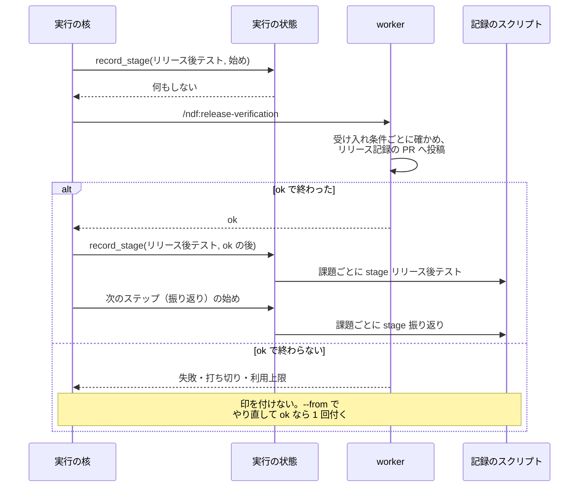

# プランの実行の核が「リリース後テスト」の進行の印を、記録を投稿したステップが ok で終わった後に付ける

課題の本文の「進行」の「リリース後テスト」の印は、受け入れ条件ごとに確かめた記録（リリース記録の Pull Request への
`## リリース後テスト` のコメント）があることの印である。プランの実行の核は、この工程の印だけをステップが ok で
終わった後に付け、ほかの工程の印は今までどおりステップの始めに付ける（#2288。#2356 と同じ振る舞い）。

**手順は各 Skill の本文が正である。** プランの外で `/ndf:release-verification` を通すときの印の時点と、
進捗記録の規則の本文はここへ書き写さない。

| 何を読むか | 正本 |
| --- | --- |
| プランの外で通すときの印の時点（記録を投稿した後に打つ・起動指示が打たないと言うときは打たない） | `plugins/ndf/skills/release-verification/SKILL.md` の「モードごとの要否」 |
| 進捗記録を打つ時点の規則と、リリース後テストだけの例外 | `plugins/ndf/skills/progress-tracking/SKILL.md` の「呼び方」 |
| スプリントを閉じる工程が記録を読んで課題を閉じるか残す判定 | [ndf-sprint-close-final-stage.md](ndf-sprint-close-final-stage.md) |

## 概要

この文書に出るプランは 2 種類ある。

| プラン | 何をするか | 「リリース後テスト」の印 |
| --- | --- | --- |
| まとめのプラン（`supervise.py new close`） | スプリントの仕上げで `merge →（リリース記録があれば）release-verify → retro → close → refine` を流す。`release-verify` のステップ（stage「リリース後テスト」）で worker が `/ndf:release-verification` を通す | ステップが ok で終わった後に付く |
| 本番のリリースプラン（`release-prod`） | 本番へリリースし、`verify` のステップで版の導入だけを確かめる | 付かない（`verify` の stage は「デプロイ」） |

印を付けるのは実行の核の 1 か所（`RunState.record_stage`）である。そこで工程の名前から印の時点を決めるため、
どのプランのどのステップでも同じ規則になる。プランの JSON の形は変えない。

スプリントを閉じる工程（`sprint-close.py`）は印でなく記録を読む。印の時点はこの工程の判定に影響しない。

## 用語

進捗記録・通過工程・リリース後テストの定義は、用語集（[docs/glossary.md](../glossary.md)）にある。

## 構成要素

| 要素 | 責務 |
| --- | --- |
| `plugins/ndf/scripts/supervise_lib/state.py` の定数 `STAGES_AFTER_OK` | 印をステップの ok の後へ回す工程の集合。要素は「リリース後テスト」の 1 つで、工程表の行名と同じ文字列 |
| `plugins/ndf/scripts/supervise_lib/state.py` の `RunState.record_stage(stage, plan, cwd, after_ok=False)` | 呼ばれた時点（`after_ok`）と工程から、今印を付けるかを決め、付けるときは計画の `記録` のスクリプトを課題ごとに呼ぶ |
| `plugins/ndf/scripts/supervise_lib/engine.py` の `Engine._run_step` | ステップの始めに `record_stage(stage, …)` を呼ぶ |
| `plugins/ndf/scripts/supervise_lib/engine.py` の `Engine._next_after_step` | ok の分岐（`if ok:`）で `record_stage(stage, …, after_ok=True)` を呼ぶ |
| `plugins/ndf/scripts/supervise_lib/release_templates.py` の `release_verify_step` | まとめのプランの `release-verify` の worker への指示に「進捗記録は打たない（このステップが ok で終わった後にプランが打つ）」を含める |
| `plugins/ndf/scripts/supervise_lib/release_templates.py` の `_release_verify_steps` | 本番と開発版の `verify` を stage「デプロイ」で組む。導入の確認だけを流すステップを「リリース後テスト」と記録しない |

## 仕様

### 印を付ける時点

| 呼ぶ時点 | `after_ok` | 工程が「リリース後テスト」 | 工程がそれ以外 |
| --- | --- | --- | --- |
| ステップの始め（`_run_step`） | 偽 | 何もしない（最後に記録した工程も変えない） | 印を付ける |
| ok の分岐（`_next_after_step` の `if ok:`） | 真 | 印を付ける | 何もしない |

ok の分岐は、次の分岐より後にある。これらの分岐を通ったステップでは ok の後の印を求めない。

- スキップ
- `on_exit`（プランの JSON で終了コードごとの行き先を決める欄）
- 承認ゲートとして数えない終わり（`gate_as_ok`）
- 承認ゲート（終了コード 10〜19）

失敗（`on_fail` へ回る・止まる）・遅れでの打ち切り・利用上限・認証の欠けは ok の分岐を通らない。

### 常に成り立つ条件

| # | 条件 |
| --- | --- |
| I1 | stage が「リリース後テスト」のステップでは、印はステップが ok で終わった後にだけ付き、始めた時点では付かない |
| I2 | ステップが ok で終わらなければ（失敗・承認ゲートで止まる・遅れでの打ち切り・利用上限・認証の欠け）、「リリース後テスト」の印は付かない |
| I3 | 1 回の実行（`--from` の再開を含む）で、同じ工程の印は 1 回だけ付く。再開では記録した工程の一覧を耐久ステップの出力から組み直す（`RunState.replay`）。ok で終わらなかったステップの工程は一覧に入らないため、やり直して ok で終わったときに 1 回だけ付く |
| I4 | 「リリース後テスト」以外の工程の印は、ステップを始めた時点で付く |
| I5 | 印の書き込みが落ちても、プランを止めない。結果 JSON の `process`（進捗記録のうち書けなかったものの一覧）に残して先へ進む |

### 印の書き手

プランの中で印を付けるのは実行の核だけである。まとめのプランの `release-verify` の worker は、指示に従って
進捗記録を打たない。worker が打つと、記録を投稿した後にステップが落ちた場合に印だけが残るためである。

worker への起動指示と手順の本文が食い違うときは、起動指示を優先する（`agents/worker.md` の「手順は起動指示の
「手順」に従う」と同じ向き）。手順の本文にも、プランのステップとして起動され起動指示が打たないと言うときは
打たないことを書いてある。

### 印を後へ回す工程を 1 つに限る理由

ほかの工程（振り返りなど）の印は「工程に入った」ことを表し、途中で止まった実行の現在地を残すために始めに付ける。
「リリース後テスト」の印だけが、スプリントを閉じる判断の前に「確かめ終わった」と読まれる。工程を足すときは
`STAGES_AFTER_OK` へ足す。

## 運用

印が付いていればリリース記録の Pull Request に記録がある、という読み方は、worker が記録を投稿し終えてから ok を
返すことを前提にする。次の 2 つの経路では記録が無いまま印が付きうる。どちらでもスプリントを閉じる工程は記録を
読んで課題を残すため、確かめていない課題は閉じない。

| 経路 | 塞ぐ課題 |
| --- | --- |
| worker が投稿に失敗したことを ok で返す | #2337（結果の契約をそろえ、失敗・未収束・判定できないを ok で返す経路を無くす） |
| リリース記録の番号が実行の時点で 0 になる（`queue_fill.py` の `_fill_prs` が `{queue_pr:release-prod}` を `0` に置き換え、指示が「番号が 0 なら何もせずに終える」と定める） | #2408（ステップを置く条件を直す） |

ok の後に印を付けた直後、耐久ステップの出力が書かれる前にプロセスが落ちると、`--from` の再開がステップを
流し直して印をもう一度打つ。進行の記録（`progress-record.sh`）は同じ工程の 2 度目の記録で時刻を書き換えないため、
課題の本文は変わらない。始めに付ける印にも同じ性質がある。

**印は最初に付いた時刻を保つ。** 前のスプリントで「リリース後テスト」を通った課題は、もう一度その工程を通っても
前の時刻の印のままになる。この課題の印の時刻と記録の時刻を比べても、印が記録の後に付いたかは分からない。
確かめるときは、初めて「リリース後テスト」を通る課題で比べる。

## テスト観点

テストは `plugins/ndf/scripts/tests/test_stage_after_ok.py` にある。

| 観点 | 満たすこと |
| --- | --- |
| I1・I4 | 「リリース後テスト」の印はステップの中身が動いた後に、ほかの工程の印は中身が動く前に付くこと（呼ばれた順で見る） |
| I2 | 同じステップが失敗・承認ゲート・遅れでの打ち切り・利用上限で終わると、「リリース後テスト」の印が付かないこと |
| I3 | 落ちた後に `--from` で同じステップをやり直して ok で終わると、印が 1 回だけ付くこと |
| I5 | 記録のスクリプトが落ちても、ok の後の印でもプランを止めず `process` に残すこと |
| 工程名の一致 | `STAGES_AFTER_OK` の各要素が工程表の工程名として `workflow-common.sh` の `wf_is_stage` を通り、`release_verify_step` が組む stage と一致すること |
| 印の書き手 | まとめのプランの `release-verify` の指示に、進捗記録を打たないことが含まれること |
| 本番の `verify` | テンプレートが組む本番と開発版のプランで、`verify` の stage が「デプロイ」であること |
| 閉じる判定 | 記録の無いリリース記録の Pull Request で `sprint-close.py --with-verification --dry-run` が課題を `kept_open` にすること |

## 関連リンク

- [ndf-sprint-close-final-stage.md](ndf-sprint-close-final-stage.md)
- [ndf-sprint-close-record-pr-at-run-time.md](ndf-sprint-close-record-pr-at-run-time.md)
- [ndf-step-result-gaps-and-reading.md](ndf-step-result-gaps-and-reading.md)
