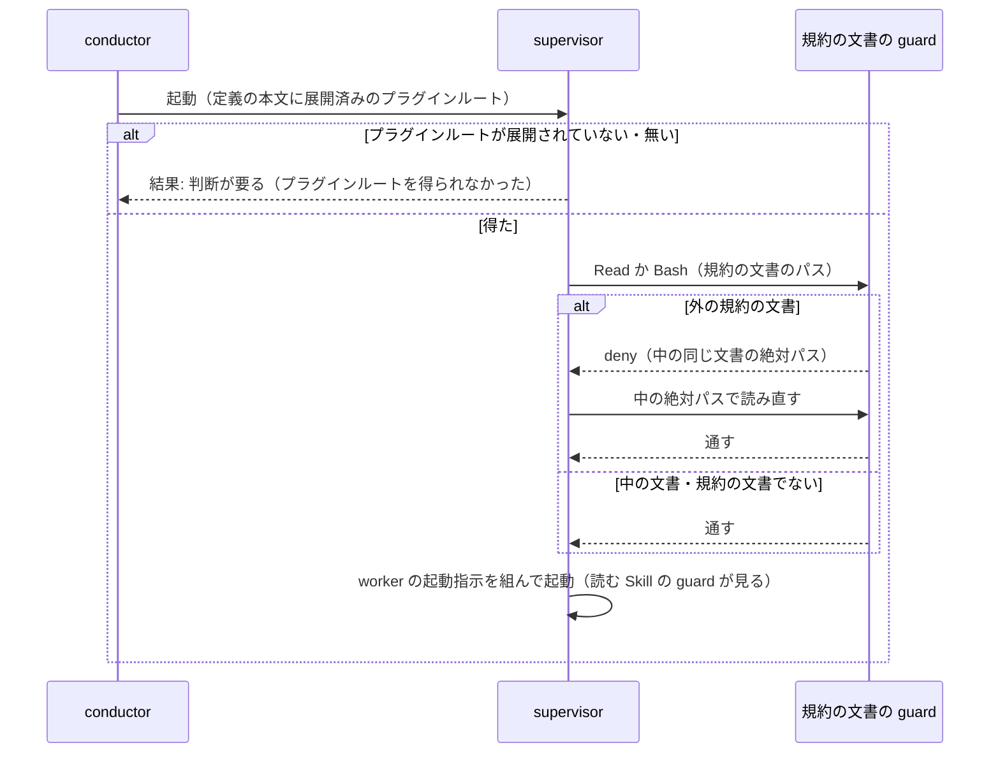

# 規約の文書の guard: supervisor は規約の文書を読み込まれたプラグインから読む

Agent の `ndf:supervisor`（と `ndf:supervisor-waits`）は、worker の起動指示を組むために規約の文書
（NDF の Skill の `SKILL.md` と `references/` の下の文書）を読む。supervisor はこの文書を、定義の本文に
展開されたプラグインルートから絶対パスで読む。読み込まれたプラグインの外（開発中のリポジトリの
メインディレクトリの `plugins/ndf` など）の規約の文書を Read か Bash で読もうとすると、PreToolUse の hook が
止め、読み込まれたプラグインの中の同じ文書の絶対パスを理由で返す。読み込まれたプラグインと違う版の規則で、
worker の起動指示が組まれることを防ぐ。

例: 作業場所に `plugins/ndf` が無い設計のフェーズで、supervisor がメインディレクトリの checkout を探す。

| 順 | 起きること |
| --- | --- |
| 1 | supervisor が `find /work/ai-plugins/plugins/ndf/skills -name agent-layers.md` を打とうとする |
| 2 | hook が呼び手 `ndf:supervisor` とコマンドの中の外のプラグインルートを見つけ、止める。理由に読み込まれたプラグインのプラグインルートの絶対パスと、パスを置き換えて打ち直すことが入る |
| 3 | supervisor が `<プラグインルート>/skills/development-workflow/references/agent-layers.md` を Read で読む。hook は通す |

この文書が扱うのは、supervisor の定義の決まり・guard の判定の規則・構成要素の責務・決定の理由である。
worker の起動指示の「読む Skill」の欄を見る guard は [ndf-supervisor-worker-skills-guard.md](ndf-supervisor-worker-skills-guard.md) にある。

## コンテキスト

| コンテキスト | 何の語が 1 つの意味に決まるか |
| --- | --- |
| NDF の開発ワークフロー（`ndf-workflow`） | 3 層（conductor・supervisor・worker）・起動指示・規約の文書・読み込まれたプラグイン・プラグインルート |

1 つのコンテキストに収まる。hook は同じコンテキストの語をそのまま使い、翻訳しない。

## 用語

用語の定義は用語集 [docs/glossary.md](../glossary.md) が正である。この文書で使う語は「読み込まれたプラグイン」「規約の文書」「規約の文書の guard」「プラグインルート」。

## 対象範囲

- NDF を Claude Code へ導入したすべてのリポジトリの、Agent の supervisor を起動するフェーズ全般で働く。Codex には Agent の supervisor が無いため働かない
- 判定するのは supervisor（`ndf:supervisor`・`ndf:supervisor-waits`）の Read と Bash だけである。conductor（メインセッション）・`ndf:worker`・ほかのエージェントの読み込みは判定しない
- プロジェクトの設定は読まない。判定は hook 自身のプラグインルートと読む先のパスだけで決まる
- `$SCRIPTS` の解決の順（`resolve.sh`）と規約の文書の中身は、この仕組みの対象でない

## 仕様

### 集約と常に成り立つ条件

| 集約 | 持ち主（書き換えてよいもの） | 根 | 値オブジェクト |
| --- | --- | --- | --- |
| supervisor の定義 | `plugins/ndf/agents/supervisor.md`・`supervisor-waits.md`（2 本は frontmatter を除いて同じ本文） | 定義の本文 | プラグインルート（Claude Code が起動時に展開する絶対パス） |
| 規約の文書の読み込み | supervisor（読む先を選ぶ） | Tool の呼び出し 1 回（Read か Bash） | 読む先のパス・プラグインルート・中の同じ文書のパス |

guard は止めるか通すかだけを決め、読む先を書き換えない。

| # | 条件 | 破れたときの扱い |
| --- | --- | --- |
| I1 | supervisor が Read と Bash で読む規約の文書は、読み込まれたプラグインのプラグインルートの下にある | guard が呼び出しを止め、理由に中の同じ文書の絶対パス（無ければ中の `skills/` の絶対パス）を書く |
| I2 | 定義の本文はプラグインルートを展開された絶対パスで持ち、得られないときは別の checkout を探さず `結果: 判断が要る` で返すと書く | 2 本の本文の一致は `test_supervisor_agents.py` が見る |
| I3 | supervisor 以外の読み込みは判定しない。会話の記録も読まない | guard が呼び手の `agent_type` だけを見て通す |
| I4 | 読み込まれたプラグインの中の規約の文書と、規約の文書でないファイルの読み込みは止めない | guard が通す |
| I5 | `NDF_SUPERVISOR_DOCS_GUARD=0` のとき・判定の途中で失敗したときは止めない | guard が判定をせずに通す（hook の原則「どの失敗も終了コード 0 で通す」） |

### supervisor の定義の決まり

2 本の定義の本文に、同じ段落で次の 4 点を書く。

| # | 決まり |
| --- | --- |
| 1 | 読み込まれたプラグインのプラグインルートは `${CLAUDE_PLUGIN_ROOT}` であり、規約の文書はこの下（`skills/<Skill>/SKILL.md`・`references/`）を絶対パスで読む |
| 2 | 別の checkout（開発中のリポジトリの `plugins/ndf` など）を探して読まない |
| 3 | 上のパスが `$` で始まる（展開されていない）か、そのディレクトリが無いときは、別の場所を探さずに `結果: 判断が要る` で返し、理由にプラグインルートを得られなかったことを書く |
| 4 | 外の規約の文書を読もうとして hook に止められたら、理由に書かれた中の絶対パスを読み直す |

### 判定の規則

`hook_lib/supervisor_docs.py` の `docs_decision` が判定のエントリポイントで、`hook.py` の振り分けが
Claude Code の PreToolUse の Read と Bash でだけ、判定の名前 `supervisor-docs` として呼ぶ。上から順に見て、
最初に当たった行で決まる。

| # | 条件 | 結果 |
| --- | --- | --- |
| 1 | `NDF_SUPERVISOR_DOCS_GUARD=0` | 通す |
| 2 | 呼び手の `agent_type` が `ndf:supervisor`・`ndf:supervisor-waits` のどちらでもない | 通す（会話の記録を読まない） |
| 3 | 読む先の候補のどれも外の規約の文書でない | 通す |
| 4 | Read で、中に同じ相対パスの文書がある | 止める。理由に中の同じ文書の絶対パス |
| 5 | Read で、中に同じ相対パスの文書が無い | 止める。理由に中の `skills/` の絶対パスと、この版に同じ文書が無いこと |
| 6 | Bash で、コマンドに外の規約の文書のパスがある | 止める。理由に当たったパス・中のプラグインルートの絶対パスと、パスを置き換えて打ち直すこと。当たったパスと同じ相対パスのファイルが中にあれば、その絶対パスも入れる |
| 7 | 判定の途中で失敗した | 通す |

- **読む先の候補**: Read は `tool_input.file_path`。Bash は `tool_input.command` を `hook_lib/words.py` の語の並びへ分け、`/` を含む語を取る。リダイレクトの語（`</x`・`2>/x`）は記述子と演算子を外し、`a=/x` の形は `=` の後も候補にする。`~` は展開し、相対パスは入力の `cwd` から解く。`$` を含む語（変数で組んだパス）は候補にしない
- **外の規約の文書**: 候補のパスについて、パス自身とその祖先のうち `.claude-plugin/plugin.json` を持つ最も近いディレクトリをプラグインルートとみなし、次をすべて満たすもの。シンボリックリンクは解決して比べる

| # | 条件 |
| --- | --- |
| 1 | そのプラグインの `plugin.json` の `name` が、読み込まれたプラグインの `name`（`ndf`）と同じ |
| 2 | そのプラグインルートが、hook 自身のプラグインルートと違う |
| 3 | プラグインルートからの相対パスが、プラグインルート自身・`skills`・`skills/<Skill>`・`skills/<Skill>/SKILL.md`・`skills/<Skill>/references/` の下のどれか |

止めたときは、既存の guard と同じ形（`token_guard.deny`）で返す。理由の末尾に、止める環境変数 `NDF_SUPERVISOR_DOCS_GUARD=0` を書く。

```json
{
  "hookSpecificOutput": {
    "hookEventName": "PreToolUse",
    "permissionDecision": "deny",
    "permissionDecisionReason": "<理由>"
  }
}
```

### 処理の流れ



### 構成要素

| 要素 | 責務 |
| --- | --- |
| supervisor の定義（`plugins/ndf/agents/supervisor.md`・`supervisor-waits.md`） | 上の「supervisor の定義の決まり」の 4 点を 1 段落で書く |
| 規約の文書の guard（`plugins/ndf/scripts/hook_lib/supervisor_docs.py`） | 上の判定の規則。拒否の形・環境変数の判定・入力の取り出しは token の guard（`hook_lib/token_guard.py`）の部品を使う |
| hook のエントリポイント（`plugins/ndf/scripts/hook.py`） | Claude Code の PreToolUse の Read と Bash で guard を締め切りの中で打ち、途中の例外は通す |
| 読む Skill の guard（`plugins/ndf/scripts/hook_lib/worker_skills.py`） | 呼び手の一覧 `SUPERVISORS` を持つ。規約の文書の guard はこれを読み込み、同じ値を持たない |

hook の登録（`plugins/ndf/hooks/claude.json`）の PreToolUse の matcher は Read と Bash を含み、guard のために足したものは無い。

## 背景

- **プラグインルートは定義の本文の `${CLAUDE_PLUGIN_ROOT}` で渡す。** Claude Code はプラグインのエージェントの本文でこの変数を読み込まれたプラグインの絶対パスへ置き換える（[plugins-reference](https://code.claude.com/docs/en/plugins-reference) 。Claude Code 2.1.319 で実起動して確かめた）。起動のたびに Claude Code が値を入れるため、conductor の書き方や `resolve.sh` の候補の順に左右されない。展開されなかったときは本文に `$` で始まる文字列が残り、supervisor が見分けられる
- **警告でなく止める。** 止めれば外の文書の中身が supervisor の文脈へ入らない。`deny` の理由は呼び出した側へ渡るため（[hooks](https://code.claude.com/docs/en/hooks) ）、supervisor はそのまま中のパスを読み直せる。止めた呼び出しは supervisor の会話の記録に Tool の結果として残るため、別の記録のファイルを持たない
- **Bash のコマンドに現れるパスも対象にする。** 実際に観測された読み方は Bash の `find` である。語の分解は既存の guard と同じ tree-sitter-bash（`hook_lib/words.py`）を使う。Python 標準の `shlex` はパイプや `;` で語を割らない
- **判定の範囲は同じ名前のプラグインの `skills/` の下に限る。** プラグインルートの形をパスの文字列（`plugins/ndf/skills/`）で決めないのは、導入したキャッシュ（`~/.claude/plugins/cache/ai-plugins/ndf/<版>/`）の形がリポジトリの形と違うためである。`scripts/` の下は読む Skill の guard が見ている
- **開発中のリポジトリの checkout は、変更の対象であっても supervisor には読ませない。** 変更の対象を読んで直すのは worker である。「変更の対象」は hook の入力から見分けられないため例外を置かず、どうしても読ませたい起動では利用者が環境変数で切る
- **エージェントだけに効く hook は作れない。** プラグインのエージェントの frontmatter の `hooks` は無視され、SubagentStart の hook は止められない（[sub-agents](https://code.claude.com/docs/en/sub-agents) ）。そのためプラグインの PreToolUse で呼び手を見分ける

## データ・設定

| 設定 | 意味 |
| --- | --- |
| 環境変数 `NDF_SUPERVISOR_DOCS_GUARD=0` | guard を外す |

## 運用

- supervisor 以外の呼び出しでは、判定の 2 行目（呼び手の判定）で抜ける。Bash の語の分解とパスの解決は supervisor の呼び出しでだけ行い、会話の記録はどの経路でも読まない
- NDF を開発するリポジトリで、supervisor に作業場所の `plugins/ndf/skills/` を読ませたい起動は `NDF_SUPERVISOR_DOCS_GUARD=0` で起動する

## 扱わないもの

検出が働かない経路は次のとおり。

| 経路 | 理由 |
| --- | --- |
| 変数で組んだパス（`$SCRIPTS/../skills/...`） | 変数を展開しない |
| プラグインルートより上を指すパス（`grep -rn <語> /work/ai-plugins/plugins`・`find /work/ai-plugins -name agent-layers.md` など） | パス自身とその祖先に `plugin.json` を持つディレクトリが無い。止めると作業場所の外を探すすべての操作が対象に入る。`grep` では外の文書の中身が supervisor へ届く |
| Grep と Glob の Tool | hook の matcher に無い。入れるとすべてのセッションの Grep と Glob で hook が起動する |
| Bash の中で別のスクリプトがパスを組んで読む場合 | コマンドの語にパスが現れない |
| Codex などほかのランタイム | Agent の supervisor が無い |

## テスト観点

テストは `plugins/ndf/scripts/tests/test_supervisor_docs_guard.py`。

- 呼び手が `ndf:supervisor`・`ndf:supervisor-waits` で、別のプラグインルート（`name` が `ndf`）の規約の文書を Read すると拒否が返り、理由に hook 自身のプラグインルートの下の同じ文書の絶対パスが入ること
- 外のプラグインにだけある相対パスを Read すると拒否が返り、理由に中の `skills/` の絶対パスが入ること
- Bash の `find <外のプラグインルート>`・`cat <外の文書>`・入力のリダイレクトが拒否になり、`cat` の理由には中の同じ文書の絶対パスが入ること。相対パスは `cwd` から解くこと
- 呼び手の `agent_type` が無い（メインセッション）・`ndf:worker`・ほかのエージェントの入力は通り、存在しない `transcript_path` でも結果が変わらないこと
- hook 自身のプラグインルートの下の規約の文書（シンボリックリンク経由を含む）・作業場所の文書・外のプラグインの `scripts/` の下・`name` が違うプラグインの `skills/` の下は通ること
- `NDF_SUPERVISOR_DOCS_GUARD=0` のとき、外のプラグインの `plugin.json` が JSON でないときは例外を出さずに通ること
- 2 つの supervisor の定義の本文が同じこと（`test_supervisor_agents.py`）と、読む Skill の guard のテスト（`test_worker_skills_guard.py`）が通ること
- 実際の supervisor の読み込みは、作業場所を `plugins/ndf` を持たない独立した git リポジトリにし、`claude -p --plugin-dir <プラグインルート>` で設計のフェーズの supervisor を起動して、会話の記録の Read の `file_path` と Bash のコマンドに現れる規約の文書のパスがすべてプラグインルートの下にあることで確かめる

## 未確認・残リスク

| 項目 | 内容 |
| --- | --- |
| 同じ名前のプラグインが 2 つ読み込まれるとき | 両方の hook が走ると、互いの文書を外とみなして止め合う。実起動では `init` の `plugins` の `ndf` は `--plugin-dir` の 1 つだけだったが、仕様の記述では確かめていない |
| 展開の挙動の版による違い | 本文の `${CLAUDE_PLUGIN_ROOT}` の展開は Claude Code 2.1.319 で確かめた。ほかの版では未確認で、展開されないときは定義の決まりの 3 点目により `結果: 判断が要る` で止まる |

## 関連リンク

- [ndf-supervisor-worker-skills-guard.md](ndf-supervisor-worker-skills-guard.md): 読む Skill の guard（`SUPERVISORS` の持ち主）
- [cross-review-reopen-and-hook-deadline.md](cross-review-reopen-and-hook-deadline.md): hook の締め切り
- [agent-layers.md](../../plugins/ndf/skills/development-workflow/references/agent-layers.md): 3 層の起動指示の正本
