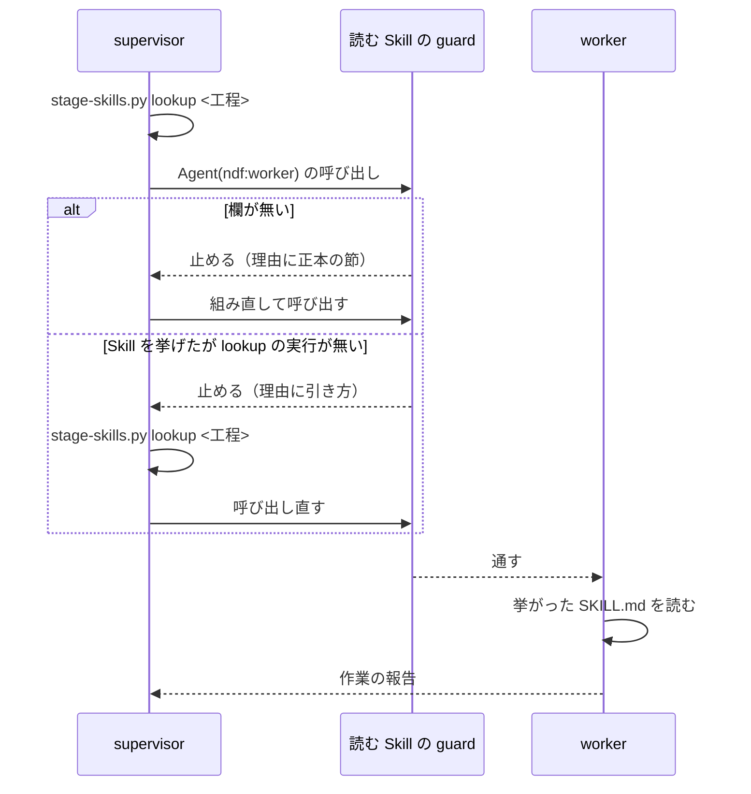

# 読む Skill の guard: supervisor が起動する ndf:worker の起動指示に「読む Skill」の欄を持たせる

Agent の `ndf:supervisor`（と `ndf:supervisor-waits`）が `ndf:worker` を起動するとき、起動指示の `prompt` に
「読む Skill」の欄が無い起動と、Skill の対応表を引かずに Skill を挙げた起動を、PreToolUse の hook が止める。
止めた理由には、起動指示の形の正本（`development-workflow` の `references/agent-layers.md` の「supervisor → worker」の節）を
その場でファイルから読み出して添える。conductor が supervisor をどの形で起動しても、設計・確定仕様化・振り返りなど
文書を書く工程の worker に、工程の規則の Skill（たとえば `document-style`）が届く。

例: 設計の工程で supervisor が「読む Skill」の欄を書かずに `ndf:worker` を起動する。

| 順 | 起きること |
| --- | --- |
| 1 | hook が Agent の呼び出しを見て、呼び手が `ndf:supervisor`・相手が `ndf:worker`・`prompt` に欄が無いことを確かめ、起動を止める。理由に「supervisor → worker」の節の本文と `$SCRIPTS` の絶対パスが入る |
| 2 | supervisor が `python3 "<NDF の scripts の絶対パス>/stage-skills.py" lookup 設計` を打ち、出力の `name` と `path` を欄へ並べて起動し直す |
| 3 | hook が supervisor の会話の記録に、読み込まれた NDF の `stage-skills.py` で打った `lookup` を見つけ、通す |
| 4 | worker が欄に挙がった `SKILL.md` を読んでから作業する |

起動指示の項目と「読む Skill」の決め方の正本は `agent-layers.md` の「supervisor → worker」で、この文書は写さない。
工程と Skill の組の正本は Skill の対応表（[ndf-worker-stage-skills.md](ndf-worker-stage-skills.md)）である。
この文書が扱うのは、guard の判定の規則・構成要素の責務・決定の理由である。

## コンテキスト

| コンテキスト | 何の語が 1 つの意味に決まるか |
| --- | --- |
| NDF の開発ワークフロー（`ndf-workflow`） | 3 層（conductor・supervisor・worker）・起動指示・読む Skill・Skill の対応表・工程 |

1 つのコンテキストに収まる。hook は同じコンテキストの正本の節をそのまま読み、語を翻訳しない。

## 用語

用語の定義は用語集 [docs/glossary.md](../glossary.md) が正である。この文書で使う語は「読む Skill の guard」「読む Skill」「Skill の対応表」。

## 対象範囲

- NDF を Claude Code へ導入したすべてのリポジトリで働く。Codex には Agent の supervisor が無いため働かない
- 対象は supervisor が起動する `ndf:worker` だけである。プランの worker（`supervise.py` が起動する `claude -p`）の Skill の渡し方は変わらない
- プロジェクトの設定は読まない。工程と Skill の組は NDF の対応表が持つ

## 仕様

### 集約と常に成り立つ条件

| 集約 | 持ち主（書き換えてよいもの） | 根 | 値オブジェクト |
| --- | --- | --- | --- |
| worker の起動指示 | supervisor（`ndf:supervisor`・`ndf:supervisor-waits`） | 起動指示（Agent の呼び出し 1 回） | 読む Skill の欄（Skill の名前と `SKILL.md` の絶対パスの並び、または「無し」）・作業・入力・手順・返す形・置き場所 |
| Skill の対応表 | `plugins/ndf/scripts/lib/stage-skills.json` | 対応表 | Skill の名前とパスの組 |

guard は起動指示を書き換えない。止めるか通すかだけを決め、直すのは持ち主の supervisor である。

| # | 条件 | 破れたときの扱い |
| --- | --- | --- |
| I1 | supervisor が起動する `ndf:worker` の `prompt` は「読む Skill」の欄を持つ（値は Skill の並びか「無し」） | guard が起動を止め、正本の節を理由に添えて返す |
| I2 | 欄に Skill を挙げた起動の前に、その supervisor が読み込まれた NDF の `stage-skills.py` を絶対パスで指して `lookup` を打っている | guard が起動を止め、`stage-skills.py` の絶対パスを入れた引き方を返す |
| I3 | 工程と Skill の組は対応表の 1 か所にだけある。supervisor の定義・正本の節・guard のコードは Skill の名前を書かない | `grep -rn "document-style" plugins/ndf/agents plugins/ndf/skills/development-workflow/references/agent-layers.md` が当たる |
| I4 | `ndf:supervisor` と `ndf:supervisor-waits` の定義の本文は、frontmatter を除いて同じである | 2 つの本文の `diff` が 0 以外を返す |
| I5 | supervisor 以外（conductor・人・ほかのエージェント）が起動する `ndf:worker` と、`ndf:worker` 以外の起動は止めない | guard が判定をせずに通す |
| I6 | 呼び手の会話の記録を読めないとき・判定の途中で失敗したときは止めない | 判定をせずに通す（hook の原則「どの失敗も終了コード 0 で通す」）。ただし欄が無い起動で正本の節が読めないときは止め、理由に正本のファイルのパスと見出しの名前を書く |

### 判定の規則

`hook_lib/worker_skills.py` の `skills_decision` が判定のエントリポイントで、`hook.py` の振り分けからだけ呼ばれる。
上から順に見て、最初に当たった行で決まる。

| # | 条件 | 結果 |
| --- | --- | --- |
| 1 | `NDF_WORKER_SKILLS_GUARD=0` | 通す |
| 2 | Tool が Agent・Task でない、または `subagent_type` が `ndf:worker` でない | 通す |
| 3 | 呼び手の `agent_type` が `ndf:supervisor`・`ndf:supervisor-waits` のどちらでもない | 通す |
| 4 | `prompt` に「読む Skill」の欄が無い | 止める。理由は欄が無いことと、正本の節の本文と、`$SCRIPTS` の絶対パス |
| 5 | 欄の値が「無し」（「なし」も同じ） | 通す |
| 6 | 呼び手の会話の記録が読めない | 通す |
| 7 | 呼び手の会話の記録に、この hook のプラグインの `scripts/stage-skills.py`（絶対パス。シンボリックリンクは解決して比べる）で打った `lookup` の実行が無い | 止める。理由は対応表を引いていないことと、`stage-skills.py` の絶対パスを入れた引き方と、正本の節の在りか |
| 8 | 上のどれにも当たらない | 通す |

- **欄の見分け方**: 行の先頭の箇条書きの記号・表の区切り・見出しの記号・強調を除いたところに「読む Skill」の語があり、区切り（`:`・`：`・`|`）か行末が続く行を欄とする。値は同じ行の区切りの後で、空なら次の空でない行である
- **呼び手の会話の記録**: hook の入力の `transcript_path` と `agent_id` から、`<transcript_path の .jsonl を除いたもの>/subagents/agent-<agent_id>.jsonl` を読む
- **数える `lookup`**: 会話の記録の assistant の Bash の呼び出しのコマンドだけを見る。Tool の結果や指示の文は数えない。変数・相対パス・別の場所の `stage-skills.py` で打った `lookup` は数えない
- **正本の節の切り出し**: 見出し `### supervisor → worker` から、次の同じか上の階層の見出しの前まで

### 処理の流れ

### 構成要素

| 要素 | 責務 |
| --- | --- |
| supervisor の定義（`plugins/ndf/agents/supervisor.md`・`supervisor-waits.md`） | worker の起動指示は正本の「supervisor → worker」の項目で組むこと、欄の無い起動と対応表を引かずに Skill を挙げた起動は hook が止めて節か引き方を返すことを、1 段落で指す。規約を写さない |
| 読む Skill の guard（`plugins/ndf/scripts/hook_lib/worker_skills.py`） | 上の判定の規則。拒否の形・環境変数の判定・入力の取り出しは token の guard（`hook_lib/token_guard.py`）の部品を使う |
| hook のエントリポイント（`plugins/ndf/scripts/hook.py`） | Claude Code の PreToolUse で、guard を締め切りの中で判定の名前 `worker-skills` として打ち、拒否をほかの拒否と同じ規則でまとめる |
| 正本の節（`agent-layers.md` の「supervisor → worker」） | 「読む Skill」の行に、欄を `prompt` の本文に置くことと、hook が止める 2 つの起動を書く |

hook の登録（`plugins/ndf/hooks/claude.json`）の PreToolUse の matcher は `Agent|Task` を含み、guard のために足したものは無い。
締め切りの規則は [cross-review-reopen-and-hook-deadline.md](cross-review-reopen-and-hook-deadline.md) にある。

## 背景

- **言語モデルへの指示だけに頼らず hook で止める。** 定義に正本の在りかを書いても、実起動の 2 回とも supervisor は正本の節を読まず、対応表も引かなかった。欄の有無は機械で判定できるため hook が持つ。案内（`additionalContext`）を足す形は呼び出しを止めないため、欄の無い起動のまま worker が動く
- **経路を supervisor の定義と hook に置き、conductor の規則には足さない。** conductor の起動指示の規則は、10 項目の形で書いたときにしか supervisor へ届かない。定義と hook は起動の形に依らずに働く
- **止めた理由に正本の節をその場で読み出して添える。** 正本はファイルの 1 か所のままで、節を直せば次の拒否からその文が届く。節は 4,965 バイトで、`agent-layers.md` の全体（41,294 バイト）を毎回読ませるより少ない。supervisor の起動の時点で節を注入する形（SubagentStart の hook）は、worker を起動しないフェーズでも毎回費用が掛かるため採らない
- **欄の値の検査は「無し」かどうかと、対応表を引いた記録の有無までにする。** 挙げた名前とパスが `lookup` の出力と一致するかは見ない。起動指示は自由な文で、欄の範囲を切り出す規則が外れると正しい起動を止めるためである
- **引いた記録は、読み込まれた NDF の `stage-skills.py` を絶対パスで指したものだけを数える。** 実起動で、supervisor が別の checkout の正本・対応表・`SKILL.md` を探し当て、読み込まれた版と違う規則が worker へ届いた。引いた位置で縛ると、止めた理由の絶対パスが読み込まれたプラグインの対応表へ導く
- **token の guard と別のモジュールに置く。** token の guard は文脈の大きさと待ち方を見る判定の集まりで、起動指示の中身は見ない

## データ・設定

| 設定 | 意味 |
| --- | --- |
| 環境変数 `NDF_WORKER_SKILLS_GUARD=0` | guard を外す |

## 運用

- 工程に入る前の作業と、対応表が空の工程は、欄に「無し」と書けば通る
- 判定にかかる秒は、hook の 1 回（44〜52 ms）の中で、312 KB の会話の記録の走査が 1 ms 程度である（2026-11-02 の実測）

## テスト観点

テストは `plugins/ndf/scripts/tests/test_worker_skills_guard.py`。

- supervisor から `ndf:worker` を起動し `prompt` に欄が無いと拒否が返り、理由に正本の節の見出しの下の本文が入ること（一時ファイルの正本で節の中身を差し替えて確かめる）
- 欄に Skill を挙げ、会話の記録にこの hook のプラグインの `stage-skills.py` の `lookup` が無いと拒否、有ると通ること。別のパスの `stage-skills.py` だけでは拒否、シンボリックリンク越しの同じファイルは通ること
- 欄の値が「無し」の起動は、`lookup` の記録が無くても通ること
- 呼び手が supervisor でない、または `subagent_type` が `ndf:worker` でない入力は、欄が無くても通ること
- 会話の記録が読めない入力・環境変数で外したときは通ること。正本の節が見つからないときは止め、理由に正本のパスが入ること
- 定義・正本の節・guard のコードに Skill の名前が無いこと（I3）と、2 つの supervisor の定義の本文が同じこと（I4）

## 未確認・残リスク

| 項目 | 内容 |
| --- | --- |
| 「無し」による抜け | 工程に入っているのに欄に「無し」と書いた起動は止められない |
| 「入力」「手順」の欄の欠け | guard が見るのは「読む Skill」だけで、欄があれば「入力」「手順」が欠けても通る |
| 費用の増分 | 止めずに通った起動と、1 回止められた起動の費用の増分は測っていない |

## 関連リンク

- [ndf-worker-stage-skills.md](ndf-worker-stage-skills.md): Skill の対応表と `stage-skills.py lookup`
- [ndf-worker-agent-and-skill-excerpts.md](ndf-worker-agent-and-skill-excerpts.md): `ndf:worker` の起動指示の項目
- [cross-review-reopen-and-hook-deadline.md](cross-review-reopen-and-hook-deadline.md): hook の締め切り
- [agent-layers.md](../../plugins/ndf/skills/development-workflow/references/agent-layers.md): 起動指示の正本
