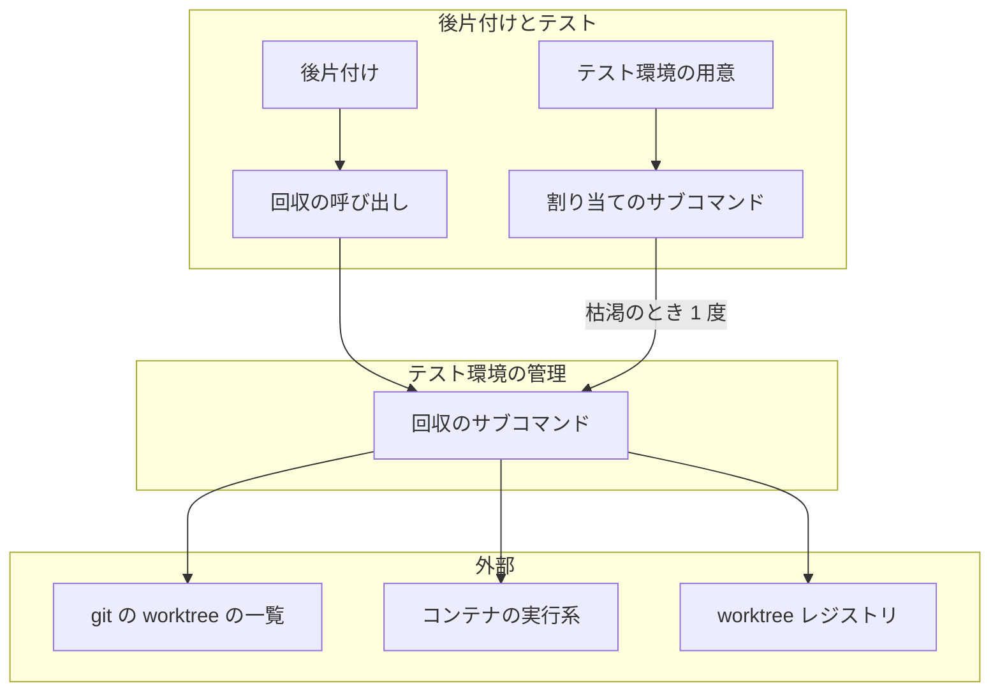
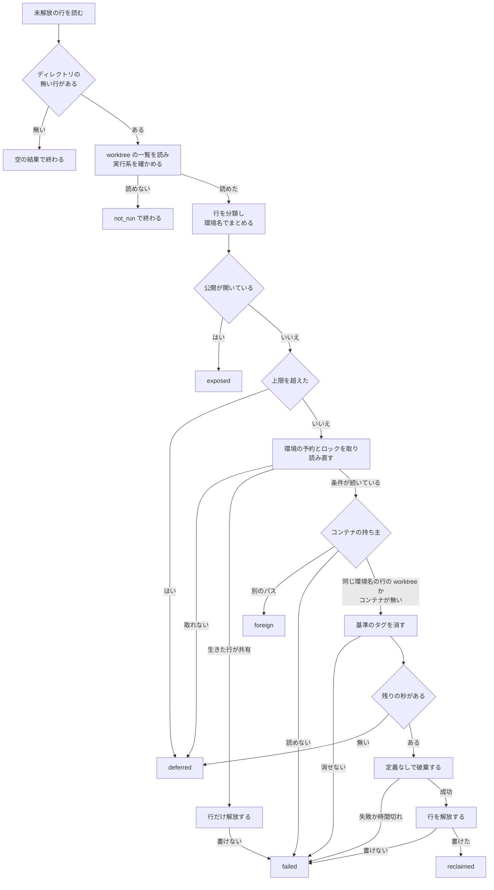
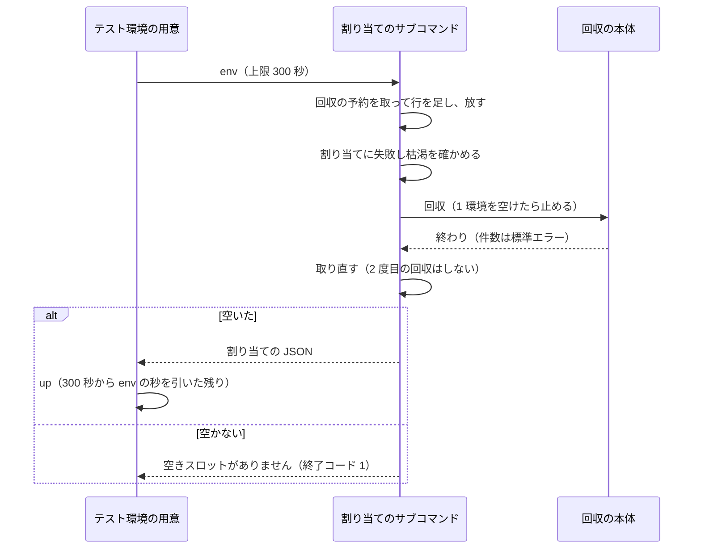

# テスト環境の回収: 消えた worktree の割り当てとコンテナを片付ける

worktree が消えた後に残るテスト環境の割り当てとコンテナを、人の操作なしに片付ける仕組み（`worktree-testenv.sh reclaim`）の
決定と理由、常に成り立つ条件、入出力の契約を残す。

**コマンドの打ち方・結果ごとにすること・残ったボリュームの消し方は
[`worktree` の references/test-execution.md](../../plugins/ndf/skills/worktree/references/test-execution.md) の「後片付け」が正である。**
ここに書き写さない。ロックの陳腐化の判定と、worktree レジストリへ書けなかったときの扱いは
[ndf-testenv-lock-and-registry.md](ndf-testenv-lock-and-registry.md) が持つ。

## 概要

**残った割り当ての判定と破棄は、テスト環境の管理（`worktree-testenv.sh`）の 1 か所だけが持つ。** 呼び出し側は
2 つで、`/ndf:merged` の後片付け（`merged-steps.py cleanup`、`merge-when-green` に続く後片付けも同じ）と、
テスト環境のスロットが尽きたときの `env` である。どちらも回収のサブコマンドを呼んで結果の JSON を読むだけで、
割り当てへ直接触らない。

**破棄は compose の定義を読まずに、環境名だけで行う。** worktree が消えると compose の定義も消えるため、
`down` では破棄できない。回収は `/` から `COMPOSE_FILE` などを外して `docker compose -p <環境名> down` を打つ。

**確かめられないものは消さない。** 置き場を確かめられない行、別の位置から起動されたコンテナ、開いた公開、
破棄の成功を確かめられない行は、破棄も解放もせずに理由を付けて結果に載せる。

| 構成要素 | 責務 |
| --- | --- |
| `plugins/ndf/scripts/worktree-testenv.sh` | `reclaim` のエントリポイント。`env` がスロットの枯渇のときに回収を 1 度試す。`env` と使い始め（`ensure_assignment`）と `expose` が回収の予約を通る。基準のタグを消す処理を `down` と回収で共有する |
| `plugins/ndf/scripts/lib/worktree-testenv-sweep.sh` | 回収の本体（`reclaim_run`）と、使われていない割り当ての選別（`reap`）。行を分類し、環境ごとに予約とロックを取って読み直し、持ち主を確かめて破棄と解放を行い、結果の JSON を作る |
| `plugins/ndf/scripts/lib/run-limited.sh` | 破棄を別のプロセスグループで起動し、期限か回収のシェルの消失で止める |
| `plugins/ndf/scripts/lib/lock-common.sh` | 持ち続ける上限の秒を受け、別の PID 名前空間の持ち主のロックをその時刻まで捨てない |
| `plugins/ndf/scripts/lib/container_reach.py` | `reclaim_testenv`（回収を呼んで結果を読む）と `reclaim_summary`（後片付けの件数と要約の末尾を作る）。`_wake` は `env` と `up` で 1 つの上限 300 秒を分け合う |
| `plugins/ndf/scripts/merged-steps.py` | メインディレクトリの取り込みの後に回収を呼び、結果を `items` と `metrics` へ足す |
| `plugins/ndf/scripts/supervise_lib/verify_steps.py` | マージのステップの上限へ回収の上限を足す |



## 用語

この文書で使う語（テスト環境のスロット・テスト環境の割り当て・残った割り当て・テスト環境の回収・見えない位置の割り当て・
回収の予約）の定義は、用語集 [docs/glossary.md](../glossary.md) が正である。この文書で「環境」と単独で書くときは
テスト環境を指す。環境変数と環境名は複合語で意味が決まる。

## 背景

worktree が消えた後も、テスト環境の割り当てが未解放のまま残り、コンテナも動き続けた。ある利用先のリポジトリでは、
未解放の 56 行のうち 41 行の worktree が無く、スロットの空きは上限 64 のうち 8 だった（2026-11-07 の実測）。
空きが尽きるとテストのステップが「空きスロットがありません」で止まり、残ったコンテナはメモリとディスクを使い続ける。

残った割り当てができる経路は、破棄の失敗（`down` の失敗か上限の超過で、worktree を外して割り当てを残す）と、
後片付けを通らない worktree の削除である。経路ごとに破棄を足すと、すでに消えた worktree の分が残る。
そのため、残った割り当てを 1 か所が見つけて回収する。git の `prune` と Kubernetes のガベージコレクションが同じ形を取る。

## 決定と理由

| 決定 | 理由 |
| --- | --- |
| 判定と破棄をシェル（`worktree-testenv.sh`）に置き、Python は呼んで結果を読むだけにする | 割り当ての持ち主がシェルで、スロットの枯渇のときはシェルの中で回収を試す必要がある |
| 判定はディレクトリの有無と `git worktree list --porcelain` の `locked` で行い、`prunable` は使わない | git の `prune` と同じ判定である。`prunable` は `locked` の行に出ないが、ディレクトリの有無で同じことが分かり、属性の文言に依らない |
| Docker の側をラベルや名前のパターンで探さない。破棄の対象は行の環境名に完全に一致するプロジェクトだけにする | 同じ Docker を別のリポジトリと開発コンテナが共有する。パターンで探すと開発コンテナを巻き込む |
| 常駐する回収の仕組み（Testcontainers の Ryuk）は使わない | 接続が切れたことをきっかけに動くため、worktree が消えたことを判定できず、常駐のコンテナも要る |
| 破棄は `/` から `COMPOSE_FILE`・`COMPOSE_PROFILES`・`COMPOSE_ENV_FILES` を外して打つ | Compose は定義を作業ディレクトリと親から探し、`COMPOSE_FILE` は `-f` と同じ意味である。メインディレクトリから打つと別の定義と `.env` を読む。定義の無い位置に固定すれば、版と導入先の定義に左右されない。`COMPOSE_ENV_FILES` を残すと相対の指定が `/` から引かれて破棄が失敗する |
| `--remove-orphans` を付けない | 定義に無いコンテナを消す指定で、対象を広げる。定義なしの `down` はプロジェクトのコンテナをすべて消すため要らない（Docker Compose v5.6.1 の実測） |
| メインディレクトリの外の行は、親のディレクトリがメインディレクトリと同じファイルシステムにあると確かめられたときだけ判定する | 同じ Docker を使う開発コンテナは `/work` を共有し、`/tmp` はコンテナごとに別である。別のコンテナの `/tmp` にある生きた worktree は「親はあるがディレクトリが無い」と見え、親の有無だけで判定すると生きたテスト環境のボリュームまで消す。ファイルシステムの番号なら区別できる |
| git の worktree の一覧に載っているかで生死を見分けない | 後片付けが回収の前に `git worktree prune` を打つため、別のコンテナの生きた worktree も一覧から消える |
| 回収全体のロックは取らず、環境ごとに回収の予約と実行中のロックを取ってから読み直す | 全体のロックだと、後から来た回収が最大 300 秒待つか何もせず終わり、スロットの枯渇の試行が空きを得られない。環境ごとなら同じ環境へ `down` を 2 本打たない |
| 割り当てには実行中のロックでなく回収の予約を使う | `test` は実行の間、実行中のロックを持つ。割り当てに使うと、テスト中の `env` と `up` が待ちの上限で落ちる |
| 予約の待ちは 5 秒で、取れなければ終了コード 1 にする | 競合は回収の窓の中でしか起きず、打ち直せば通る。実測の破棄 12 秒より短い待ちで止める |
| ロックに「持ち続ける上限の秒」を足し、持ち主の PID 名前空間を記録する | git の共通ディレクトリはコンテナの間で共有され、PID 名前空間はコンテナごとに別である。`kill -0` だけで生死を読むと、別のコンテナの `env` と `up` が動いている回収の予約を捨てて通る。判定はホスト名でなく PID 名前空間で行う（compose の `hostname:` で同じ名前を付けられる） |
| カーネルのロック（`flock`・`filelock`）は使わない | `flock` コマンドは macOS に標準で無く、無いホストだけ別の排他へ分けると同じ資源に 2 つの仕組みが動いて互いを見落とす。`filelock` は Python を起動しないシェルの割り当ての経路へ Python と任意の依存を足す |
| 上限の秒を渡すのは回収の予約と回収が取る実行中のロックだけにする | worktree レジストリの排他へ広げると、持ち主が落ちたときに全行の更新が上限まで止まる |
| スロットの枯渇のときは 1 環境を空けたら止め、`env` と `up` で 300 秒を分け合う | テストのステップの上限は起動の分として 300 秒だけを持つ。回収に別の 300 秒を許すと、2 つ続いたときにステップの上限を超える。要るスロットは 1 個で、残りは次の後片付けが回収する |
| 打ち切りを環境ごとにシェルの中で行い、`timeout` コマンドに頼らない | 外の上限だけで止めると結果の JSON が失われ、残した件数が報告に載らない。`timeout` と `gtimeout` の有無で経路を分けると、片方が導入先でしか動かない |
| 回収の結果を共通の結果の形（`tool`・`status`・`summary`・`items`・`metrics`）で出す | 人と判定の worker が同じ材料を読み、後片付けは `items` を読み替えずに足せる |
| `deferred`・`exposed`・`foreign` を失敗にしない | 公開を閉じるまで終了コードが 1 のままになり、人が確かめる失敗と区別できなくなる |
| 回収はメインディレクトリの排他（`main_dir_lock`）の外で走らせ、マージのステップの上限へ回収の上限を足す | 排他の中に置くと、並列のレーンの後片付けが最大 300 秒待つ。上限を足さないと、CI の待ちが上限に近いときに回収の間にステップが止まり、マージの後の報告が失われる |
| 背景で回収を走らせない | 結果が後片付けの報告に載らない |
| 残った割り当てのボリュームも、`down` と同じく宣言（`testenv.discard_volumes`）に従って消す | テスト環境のデータは worktree が無ければ使われない。残すとディスクの圧迫が続く。作り直せないデータを持つプロジェクトは `false` を宣言して残す |
| 破棄の前に実行系を `docker compose ls -q` で 1 度確かめる | `down` は実行系が無いと破棄せず解放するが、回収で同じことをするとコンテナが残ったままスロットが渡る。`compose ls` は Compose のプラグインと接続の両方を 1 回で確かめる |
| 破棄の前にコンテナの作業ディレクトリのラベルで持ち主を確かめる | 環境名はディレクトリ名とブランチ名から作り、worktree レジストリは複製ごとにある。別の親にある同じ名前の複製が同じブランチを使うと環境名が重なり、片方の回収がもう片方の環境を破棄できる |
| 環境名の作り方へメインディレクトリのパスを足さない | 動いている環境の名前が行と食い違い、すでに動いている環境も守れない |

## 仕様

### 常に成り立つ条件

| 条件 | 破れそうなときの扱い |
| --- | --- |
| worktree のディレクトリがある行と、`git worktree lock` された行は回収しない | 破棄を打たず、解放の時刻も書かない |
| 生きた行（残った割り当て以外の未解放の行）と環境名を共有する残った割り当ては、破棄せず行だけを解放する | 破棄を打たない |
| 破棄が成功したと確かめられない行は解放しない（スロットを別の worktree へ渡さない） | 行を残し、`failed` に環境名と理由を載せる |
| worktree レジストリ・worktree の一覧・コンテナの実行系のどれかを読めなければ、1 行も回収しない | `not_run` と理由を載せる |
| 開いた公開の記録を持つ環境は、破棄も解放もしない。解放済みの行の公開が開いていても同じである | `exposed` に環境名と URL を載せる |
| 破棄の対象は行の環境名に完全に一致する compose のプロジェクトだけである。プロジェクトのコンテナがすべて、同じ環境名の行（解放済みを含む）のどれかの worktree から起動されたと確かめられないときは破棄しない | `foreign` か `failed` にする |
| 回収の破棄は compose の定義と `COMPOSE_FILE` を読まない | — |
| ボリュームを消すかはメインディレクトリの宣言の `testenv.discard_volumes` で決め、読めない値は残す | — |
| 行の基準のタグは破棄の前に消す | 消せなければ破棄せず `failed` にする |
| 見えない位置の割り当ては、残った割り当てとして判定しない | 破棄も解放もせず `unseen` にする |
| 1 回の回収は 300 秒を超えて次の環境へ進まない | 残した環境を `deferred` にする。次の回収の対象になる |
| 回収の失敗で、後片付けの `status` と終了コードは変わらない | — |
| 環境名の共有を確かめてから破棄と解放が終わるまで、同じ環境名の割り当ての追加と既存の割り当ての使い始めは、回収の予約を待つか拒否される | 割り当てず起動せず、「同じ環境名のテスト環境を回収しています」で終了コード 1 |
| 破棄のプロセスは、呼び出しの経路とホストのコマンドの有無によらず、回収の予約の上限の時刻より前に終わる。回収のシェルが消えたら破棄も残さない | 破棄を打たず `deferred` にする。打った破棄は止めて `failed` にする |

### 行の分類

未解放の行を上から順に当てはめる。

| 順 | 条件 | 分類 |
| --- | --- | --- |
| 1 | ディレクトリがある | 生きた行 |
| 2 | worktree の一覧で `locked` の属性を持つ | 生きた行 |
| 3 | パスがメインディレクトリの下に無く、親のディレクトリが無いか、親のファイルシステムがメインディレクトリと別か、確かめられない | 見えない位置の割り当て（環境名の共有の判定では生きた行に数える） |
| 4 | それ以外 | 残った割り当て |

ファイルシステムの番号は GNU の `stat -c %d`、BSD の `stat -f %d` の順で読む。同じ環境名の残った割り当てが 2 行あれば、
破棄は 1 度にして 2 行を解放する。

ディレクトリの無い行が 1 つも無ければ、git とコンテナの実行系を呼ばずに空の結果で終わる。追加の処理は
worktree レジストリの読み取り 1 回である。

### 回収の本体



予約とロックを取った後に、行が未解放で、ディレクトリが無く、`locked` でなく、開いた公開が無く、生きた行と共有して
いないことを読み直す。`locked` は worktree の一覧を、公開は worktree レジストリを読み直す。どちらかのロックを取れなければ、
別の回収かテストが処理中とみなして待たずに `deferred` にする。

打つ破棄のコマンドは次のとおりである。`--volumes` は宣言が消す側のとき（無し・`null`・`true`）か、`reclaim --volumes` のときに付く。

```bash
cd / && env -u COMPOSE_FILE -u COMPOSE_PROFILES -u COMPOSE_ENV_FILES <実行系> compose -p <環境名> down [--volumes]
```

### 持ち主の確認

破棄の前に、環境名に完全に一致するコンテナの作業ディレクトリのラベルを読む。照合先は、同じ環境名の行（解放済みの行を含む）の
worktree のパスすべてである。環境名の要約値はブランチ名から作るため、同じブランチを別のパスで作り直すと同じ環境名の行が
2 つでき、コンテナのラベルはどちらか一方のパスしか持たない。

```bash
<実行系> ps -a --filter label=com.docker.compose.project=<環境名> --format '{{.Label "com.docker.compose.project.working_dir"}}'
```

| 読めた内容 | 扱い | 結果 |
| --- | --- | --- |
| コンテナがあり、すべての値が同じ環境名の行のどれかの worktree のパスか、その下である | 宣言に従って破棄し、解放する | `reclaimed` |
| 別のパスか空の値が 1 つでもある | 破棄も解放もしない。相手の環境が消えた後の回収で解放される | `foreign` |
| コンテナが無い | ボリュームを消さずに `down` を打ち、解放する。ボリュームのラベルには作業ディレクトリが無く、持ち主を確かめられないためである。宣言と `--volumes` より優先する | `reclaimed`（`volumes` は `kept`） |
| `ps` が失敗する | 破棄も解放もしない | `failed` |

ラベルは破棄の対象から外すためにだけ読む。破棄の対象を探すためには使わない。

### 回収の予約とロック

回収は環境ごとに 2 つのロックを、読み直しから解放の記録まで持つ。

| ロック | 位置 | 誰が取るか | 何を防ぐか |
| --- | --- | --- | --- |
| 回収の予約 | `<共通 git ディレクトリ>/ndf/<環境名>.reclaim.d` | 回収が持ち続ける。`env` の行の追加と使い始め（`ensure_assignment`）は 5 秒まで待って短く取って通る。`expose` は公開の記録の間だけ持つ | 共有の確認の後に同じ環境名の割り当てや公開が増え、破棄がその環境へ当たること |
| 実行中のロック | `<共通 git ディレクトリ>/ndf/<環境名>.inuse.d` | 回収が持ち続ける。`test` は実行の間持つ | 作り直した worktree のテストと破棄が重なること |

`env` は回収の予約を取ってから行を足し、足したら放す。使い始めは行を読んだ後に予約を取って放し、行を読み直す。
回収が先に予約を取っていれば、5 秒の待ちの後に「同じ環境名のテスト環境を回収しています」で終了コード 1 になる。
予約より先に行を足していれば、回収の読み直しが生きた行として見つけて破棄しない。

`ndf_lock_acquire` の 3 つ目の引数は「持ち続ける上限の秒」である。

| 位置 | 振る舞い |
| --- | --- |
| 取る側 | 引数があれば、持ち主の PID 名前空間（`readlink /proc/self/ns/pid`。読めないホストではホスト名）と上限の時刻をロックの中のファイル `owner_scope` へ書く。`pid` より先に書く |
| 判定する側（`_ndf_lock_is_stale`） | `owner_scope` が無いか PID 名前空間が自分と同じなら、`kill -0` で生死を読む。別なら上限の時刻までは生きているものとして扱い、過ぎたら捨ててよい |
| 引数を渡す呼び出し | 回収の予約を取る 4 か所（回収・`env`・`ensure_assignment`・`expose`）と、回収が取る実行中のロック。値はどれも 330 秒（`RECLAIM_HOLD`） |

回収の全体の上限 300 秒は回収の開始から測り、環境ごとの予約はそれより後に取る。そのため予約の上限の時刻は開始から 330 秒より
後で、破棄は開始から 305 秒までに止まり、生きた持ち主のロックが先に切れない。

### 打ち切り

`lib/run-limited.sh <秒> <猶予の秒> <回収のシェルの番号> <コマンド…>` が環境ごとの破棄を打ち切る。

| 項目 | 振る舞い |
| --- | --- |
| 起動 | `set -m` を張った部分シェルから背景で起動して `wait` する。起動した番号がそのままプロセスグループの番号になる（`setsid` は macOS に標準で無い）。標準入力は `/dev/null` にする |
| 期限 | 秒が尽きたらグループへ SIGTERM を送り、猶予 5 秒の後に SIGKILL を送る。呼び出し側は終了コード 137 を時間切れと読む。それ以外の終了コードはコマンドの値をそのまま返す |
| 回収のシェルが消えたとき | 0.1 秒ごとに番号を見て、消えていれば猶予なしでグループへ SIGKILL を送る |
| 破棄の直前の確認 | 残りの秒を読み直し、0 以下なら破棄を打たず `deferred` にする |

回収を呼ぶ Python の側の外の上限 `RECLAIM_LIMIT` は 330 秒で、内側の 300 秒に打ち切りの猶予 5 秒と worktree レジストリの
排他の待ちを足した値である。破棄の無応答は内側で止まるため、外の上限は `git` の無応答などの保険である。

### スロットが尽きたとき



未解放の行の数が 64 以上のときだけを枯渇とする。worktree レジストリの排他を取れずに割り当てに失敗したときは回収しない。
回収の結果は標準出力へ出さず、空いたときだけ標準エラーへ「残った割り当てを回収しました: N 件」を出す。`env` の時間切れは
「テスト環境の割り当てが 300 秒で終わらなかった」を理由として返す。

### 後片付けからの呼び出し

`merged-steps.py` は worktree を外してメインディレクトリを取り込んだ後、`main_dir_lock` の外で回収を呼ぶ。取り込みが
失敗しても回収は走る。

| 項目 | 振る舞い |
| --- | --- |
| `items` | 回収の `items` をそのまま足す。残った割り当てが無ければ何も足さない |
| `metrics` | `reclaimed_testenvs`・`reclaim_failed`（`failed` と `not_run` の数）・`reclaim_deferred` を足す。無いときは 0 |
| `summary` | 回収か失敗か残した環境があるときだけ、末尾に「テスト環境 N 件を回収した（失敗 M 件・残した K 件）」を足す |
| `status`・終了コード | 変わらない |

回収の `items[].result` の値は worktree の後片付けの値（`removed`・`kept` など）と重ならず、後片付けの件数に入らない。
上限の超過・JSON の誤り・終了コードが 0 と 1 以外のときは、`kind` が `testenv-reclaim`、`result` が `not_run` の行を
1 つ足す。この行と結果の `reason` は `secret_redact` で伏せてから載せる。

マージのステップ（`merge` と `merge-approved`）の `timeout` は `with_margin(ci_wait) + RECLAIM_LIMIT` である。宣言の無い
リポジトリでも足す。プランを作る時点で宣言を読まずに済み、上限が長くなるだけで動きは変わらない。本番のリリースプランの
後片付けのステップと周回の境の後片付けは、上限を持たない（既定の 3600 秒か上限なし）ため足さない。

## データ・設定

### `worktree-testenv.sh reclaim`

| 項目 | 内容 |
| --- | --- |
| 形 | `worktree-testenv.sh reclaim [リポジトリの中のパス] [--volumes]` |
| 入力 | パスは省略可で、既定は今のディレクトリである。後片付けはメインディレクトリを渡す。`--volumes` は宣言より優先してボリュームを消す |
| 出力 | 標準出力に結果の JSON を 1 行で出す |
| 上限 | 300 秒（`RECLAIM_SECONDS`）。テストだけが環境変数 `WT_RECLAIM_SECONDS` で短くする |
| 宣言が無いとき | `.ndf/worktree.json` に `testenv` が無ければ、何も出力せず終了コード 0。コンテナの実行系を呼ばない |

```json
{
  "tool": "testenv-reclaim",
  "status": "ok",
  "summary": "テスト環境 1 件を回収した（失敗 0 件・残した 0 件）",
  "items": [
    {"kind": "testenv", "name": "carul-wt-a-1f2e3d", "result": "reclaimed", "worktree": "/work/carul/.worktrees/a", "volumes": "discarded"}
  ],
  "metrics": {"reclaimed": 1, "released": 0, "failed": 0, "deferred": 0, "exposed": 0, "unseen": 0, "foreign": 0}
}
```

| `items[].result` | 意味 | 追加の項目 | 終了コードへの影響 |
| --- | --- | --- | --- |
| `reclaimed` | 破棄して解放した | `worktree`・`volumes`（`discarded` / `kept`）。コンテナが無くボリュームを残したときは `reason` | なし |
| `released` | 生きた行と環境名を共有するため、行だけを解放した | `worktree` | なし |
| `failed` | 破棄か解放ができなかった。行は残る | `worktree`・`reason` | 1 |
| `foreign` | 別の位置から起動されたコンテナがあるため残した。行も残る | `worktree`・`reason` | なし |
| `exposed` | 公開が開いているため残した | `worktree`・`url` | なし |
| `deferred` | 上限を超えたか、別の回収やテストが同じ環境を処理している。次の回収の対象である | `worktree`・`reason` | なし |
| `unseen` | 見えない位置の割り当てである | `worktree`・`reason` | なし |

| 場合 | `status` | 終了コード | `items` |
| --- | --- | --- | --- |
| 残った割り当てが無い | `ok` | 0 | 空 |
| すべて処理した | `ok` | 0 | 上の表の行 |
| `failed` の行がある | `stopped` | 1 | 上の表の行 |
| 実行系が無い・繋がらない・worktree の一覧や worktree レジストリを読めない | `stopped` | 1 | `kind` が `testenv-reclaim`、`name` がメインディレクトリ、`result` が `not_run`、`reason` が理由の 1 行だけ |

**worktree レジストリの形は変えていない。** 回収は行に解放の時刻（`released_at`）を書くだけである。新しい設定項目は無く、
プロジェクトごとの違いは `testenv.discard_volumes` で受ける。無し・`null`・`true` で消し、`false` と読めない値で残す。

## セキュリティ

同じ Docker を複数のリポジトリと開発コンテナが共有する。破棄に渡すのは `-p <環境名>` だけで、破棄の対象を探す検索を置かない。
`docker ps` は行の環境名に完全一致するコンテナの持ち主を確かめるためにだけ打ち、結果で対象を減らす。`reason` は呼び出しの側で
伏せ字にする。

## 運用

版を上げた後の最初の後片付けで、既存の残った割り当てが回収される。行の解放は取り消せるが、ボリュームは戻せない。
作り直せないデータを持つプロジェクトは、上げる前に `testenv.discard_volumes` に `false` を宣言する。

未確認・残リスク:

| 項目 | 内容 |
| --- | --- |
| Docker Compose の版 | 定義なしの破棄は v5.6.1 だけで確かめた。古い版では、テスト環境が消えずに終了コード 0 で返り、行だけが解放される恐れがある。定義なしの `docker compose -p <名前> down` を保証する公式の記述は見つかっていない |
| 定義なしの `down` と文書の差 | 公式の文書は定義に無いサービスのコンテナを `--remove-orphans` の対象と書くが、定義なしでもプロジェクトのコンテナはすべて消えた（v5.6.1） |
| 匿名ボリューム | コンテナが先に消えた環境の匿名ボリュームは、プロジェクト名のラベルを持たず回収できない。手で消す |
| 同じ位置に見える別の複製 | 持ち主の確認は起動の位置が違う複製を守る。コンテナごとに別のボリュームを同じパスへ付ける形は作業ディレクトリのラベルが一致し、片方の回収がもう片方の環境を破棄する。今の構成では見つかっていない。持ち主の確認と破棄の間に相手の複製が起動した環境も破棄に当たる |
| 同じファイルシステムの別のマウント | ファイルシステムの番号で見分けるため、同じファイルシステムの別のディレクトリを別々にマウントした形は区別できない |
| 別のコンテナの `test` の実行中のロック | `test` は実行の長さに上限が無いため上限の秒を渡さず、別のコンテナの回収からは持ち主の消えたロックに見える。ディレクトリが無いと確かめられた行でだけ起きる |
| 持ち主が落ちた後の待ち | 回収のシェルが異常終了すると、別のコンテナの `env` と `up` が最大 330 秒止まる。頻度は未測定である |
| 破棄を止めた後のデーモンの処理 | SIGKILL はクライアントの `docker compose` を止めるだけで、Docker デーモンが受け付け済みの呼び出しは続きうる。破棄の停止の期限 305 秒と予約の上限 330 秒の間の 25 秒で終わることは実測していない |
| `run-limited.sh` の macOS での動き | Linux の bash 5.3 だけで確かめた。macOS の実機では未確認である |
| 見えない位置の割り当ての解放 | `unseen` の行を解放する自動の手段は無い。`/tmp` に置いた worktree が消えた行はスロットを占め続ける |

## テスト観点

テストは `plugins/ndf/skills/worktree/tests/test_testenv_reclaim.py` と `test_testenv.py`、後片付けとステップの上限は
`plugins/ndf/scripts/tests/` にある。コンテナの実行系は `WT_DOCKER_COMMAND` で偽物へ差し替える。

- 残った割り当てへの `reclaim` が `compose -p <環境名> down --volumes` を 1 回打ち、行に解放の時刻が入り、結果に環境名が載り、終了コード 0 で終わること
- `testenv.discard_volumes` が `false`（文字列の `"false"` を含む）のとき `--volumes` が付かないこと
- 消すものの無い破棄が 0 を返せば解放されること
- ディレクトリのある行と `locked` の行で破棄が打たれず、解放の時刻が空のままであること
- 生きた行と同じ環境名の残った割り当てで破棄が打たれず、残った行だけが解放されること。残った行が 2 行なら破棄は 1 回であること
- 破棄が失敗すると行が残り、`failed` に環境名と理由が載り、ほかの環境は続き、終了コード 1 で終わること。直った後の `reclaim` で回収されること
- 公開の開いた行（解放済みの行を含む）で破棄も解放もされず、結果に環境名と URL が載ること
- 破棄の `-p` の値が環境名に完全に一致し、`--remove-orphans` が無く、作業ディレクトリが `/` で、`COMPOSE_FILE` が渡らず `-f` が付かないこと
- 実行系が無いときと `compose ls` が失敗するときに、どの行も解放されず `not_run` と理由が載ること
- 宣言の無いリポジトリの `reclaim` が何も出さず終了コード 0 で、実行系を呼ばないこと
- `reclaim` を 2 本同時に打つと、どちらも終了コード 0 で、同じ環境への破棄は 1 回で、対象の行がすべて解放されること
- 回収の予約を持つ間、同じ環境名の `env` と使い始めが終了コード 1 で止まり、テストの実行中の `env` と `up` は待たずに通ること。別の PID 名前空間の予約は上限の時刻まで捨てられず、過ぎたら捨てられること。上限の秒を渡さないロックに `owner_scope` が書かれないこと
- `timeout` と `gtimeout` の無い `PATH` で、SIGTERM を無視し子プロセスを持つ破棄が、残りの秒と猶予の後に親も子も消え、`failed` に時間切れが載ること。回収をプロセスグループごと止めると破棄のプロセスが 1 秒以内に消えること。残りの秒が 0 以下なら破棄が打たれず `deferred` になること
- 別のパスか空の作業ディレクトリのコンテナがある環境が `foreign` で残ること。同じ環境名の行（解放済みを含む）のどれかのパスなら回収されること。コンテナが無くボリュームがある環境に `--volumes`（`reclaim --volumes` を含む）が付かず解放されること
- 行の基準のタグが破棄の時点で消えていること。消せないときに破棄を打たず `failed` になること
- メインディレクトリの外で親が無い行と、親のファイルシステムが別の行が `unseen` になり、破棄も解放もされないこと
- 上限を短くし破棄を遅くすると、まだ処理していない環境が `deferred` になり、次の `reclaim` で回収されること
- 枯渇の `env` が 1 環境を回収して番号を返し、標準出力が割り当ての JSON だけであること。空かなければ「空きスロットがありません」で終了コード 1 になり、回収は 1 度であること
- `cleanup` と `merge-when-green` の経路で、回収した環境名が `items` に、件数が `metrics` に載ること。回収の失敗・時間切れ・読めない結果でも `status` と終了コードが変わらないこと
- 残った割り当てが無い `cleanup` の `items` と `summary` が変わらず、回収からの実行系と `git worktree list` の呼び出しが無いこと
- `env` に掛かった秒が `up` の上限から引かれること。`merge` と `merge-approved` の `timeout` が `with_margin(ci_wait) + RECLAIM_LIMIT` であること

## 関連リンク

- [`worktree` の references/test-execution.md](../../plugins/ndf/skills/worktree/references/test-execution.md)（手順の正）
- [ndf-testenv-lock-and-registry.md](ndf-testenv-lock-and-registry.md)（ロックの陳腐化の判定と worktree レジストリの書き込みの失敗）
- [docker compose down](https://docs.docker.com/reference/cli/docker/compose/down/)
- [docker compose の定義の探し方とプロジェクト名](https://docs.docker.com/compose/how-tos/project-name/)
- [git worktree](https://git-scm.com/docs/git-worktree)
