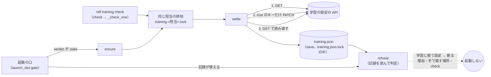
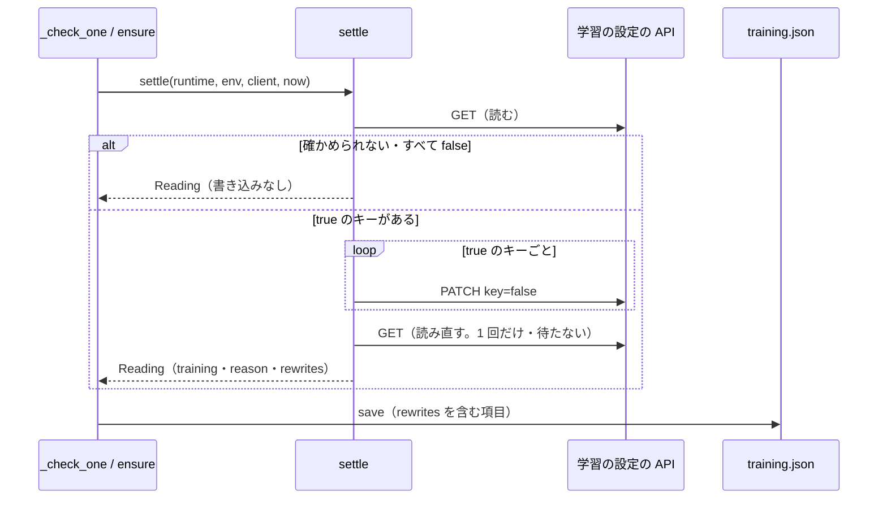

# 学習の設定の書き換え: 学習に使う設定なら Off へ書き換えてから claude・codex を起動する

NDF は claude・codex へ作業を渡す前に、そのアカウントが入力を学習に使わない設定かを確かめる。学習に使う設定（On）なら、
NDF が true の設定だけを false へ書き込み、1 回読み直す。読み直して false なら、書き換えた時刻と前後の値を記録して起動を続ける。
そうでなければ今までどおり起動を断り、手で Off にする場所と、Off にした後に打つ `ndf training check` を示す。書き換えを止める手段は持たない。

例: 2026-11-20、利用者が claude.ai の「Help improve Claude」と ChatGPT の「Improve the model for everyone」を On にした後、
`ndf training check` を打った（PR #3929 のリリース前の確かめ）。

| 順 | 起きること |
| ---: | --- |
| 1 | codex: `GET chatgpt/settings/user` で `training_allowed` が true と読む |
| 2 | true のキー `training_allowed` だけに `PATCH .../settings/account_user_setting?feature=training_allowed&value=false` を送る |
| 3 | もう 1 回 `GET` し、3 つのキーとも false と読む。項目は `training: false`、`rewrites` に `{"key": "training_allowed", "before": true, "after": false, "at": "2026-11-20T13:49:32+00:00"}` |
| 4 | claude: `grove_enabled` が true と読み、`PATCH oauth/account/settings`（本文 `{"grove_enabled": false}`）が 202 を返す。直後の読み直しで false を読む |
| 5 | 結果は `ok`、`summary` に「Off へ書き換えた: claude」などが載り、`training.json` にも同じ `rewrites` が残る |

| 何を読むか | 正本 |
| --- | --- |
| 引数と結果の項目の一覧 | `plugins/ndf/docs/contracts/commands.md` の `ndf training`（スキーマから生成する） |
| 結果の `items` の形 | `plugins/ndf/contracts/schemas/io/training.result.schema.json` |
| 時間の上限の値 | `plugins/ndf/contracts/limits/` の `claude-training.call`・`codex-training.call`・`training.save-lock`・`training.check-valid` |
| 利用者向けの説明 | [plugins/ndf/README.md](../../plugins/ndf/README.md) の「学習の設定を確かめる」 |

## 概要

### 構成要素と責務

依存の向きは `training.py` → `training_cache.py` の一方向である。起動の口（`launch_slot.gate`）は、記録を読むときは
`training_cache.py` だけを読み、記録が確かめ直せば直りうる（`verdict` の `stale`）ときだけ `training.py` を読む。
`training_cache.py` は httpx を読まない。

| 要素 | 置き場 | 責務 |
| --- | --- | --- |
| `settle` | `plugins/ndf/src/ndf/adapters/training.py` | 1 つの担当の学習の設定を読み、学習に使う設定なら true のキーだけを false へ書き込んで 1 回読み直し、結果（`Reading`）を返す。例外を出さない |
| `Endpoint`・`Patch`・`CLAUDE_ENDPOINT`・`CODEX_ENDPOINT` | 同上 | 担当ごとの読む口（URL・時間の上限・キーごとの真偽値の取り出し）と書く口（1 つのキーを false へ書き込む要求の形） |
| `_send_off`・`_send_all_off` | 同上 | 1 つのキーを `PATCH` で false へ書き込む。2xx なら受け付けられたとし、応答の本文は読まない |
| `check`・`_check_one`・`_summary` | 同上 | `ndf training check`。担当ごとに同じ担当の排他の中で `settle` と保存を行い、結果 JSON を組む |
| `ensure`・`_read_now` | 同上 | 起動の口のその場の確かめ。`_read_now` は名前に反して書き込みも送る（`settle` を呼ぶ） |
| `_locked_check`・`_in_context`・`_save_or_forget` | 同上 | `check` と `ensure` が共有する、排他の中の確かめ・認証の文脈の照らし・保存（書けなければ古い記録の取り消し） |
| `Reading`・`Rewrite` | `plugins/ndf/src/ndf/adapters/training_cache.py` | 確認の結果と、書き換えた 1 つのキーの記録。`Reading.item()` が結果の `items` と `training.json` の両方の項目を作る |
| `save`・`forget` | 同上 | 記録の保存（`training.json.lock` の排他の中）と、確かめ直した結果を保存できないときの古い記録の取り消し |
| `verdict`・`refusal`・`_cached_verdict` | 同上 | 記録を読んで起動を断るかを決める。学習に使う設定の記録の断りには、手で Off にする場所を載せる |
| `manual_off`・`off_by_hand` | 同上 | 担当ごとの手で Off にする場所と、それと `ndf training check --runtime <担当>` を並べた案内の文 |

## 用語

この仕様で使う語（学習の設定・学習の設定の確認・学習の設定の書き換え・OAuth でない接続・ChatGPT でないログイン）の定義は、
用語集 [docs/glossary.md](../glossary.md) のコンテキスト `ndf-training-optout`（[docs/glossary/ndf-training-optout.md](../glossary/ndf-training-optout.md)）にある。

## 背景

11.0.0 の作り直しで、学習の設定の確かめは読むだけになった（10 系の #1597 は SessionStart の hook で書き換えていた）。
そのため、学習に使う設定のアカウントでは、NDF は claude・codex を起動するたびに断り、利用者がブラウザで 2 つのサービスの
設定画面を探して Off にし、確かめ直すまで工程が止まった。人のいない実行（並列の計画のレーン・Factory の実行）では、
人が気づくまで止まったままになる。

書き換えは、確かめの 1 か所（`settle`）に置く。`ndf training check` と起動の口が同じ振る舞いになり、記録を読む規則
（`training_cache.py`）は外部への接続を持たないままでいられるためである。

## 対象範囲

含む:

- `ndf training check` と、起動の口のその場の確かめ（`ensure`）で、学習に使う設定を Off へ書き換えて読み直すこと
- 書き換えの記録（`training.json`）と結果 JSON の `rewrites`、実行の記録（`run_log.record`）の 1 行
- 書き換えに失敗したときの断る理由と、手で Off にする場所の案内
- 記録の保存と同じ担当の確かめの排他、確かめる間の認証の文脈の照らし、保存できないときの古い記録の取り消し

含まない:

- kiro・agy の学習の設定（確かめる口が無いので、確かめずに起動を通す）
- OAuth でない接続（API キー・Bedrock・Vertex など）と ChatGPT でないログインの codex（学習の設定が無く、読みも書きも送らない）
- 学習の設定を On へ戻す手段と、書き換えを止める手段

## 仕様

### 常に成り立つ条件

- **書き込みは、読んで true だったキーにだけ送る。** 学習に使わない設定（すべて false）と、確かめられないとき
  （トークンが無い・期限切れのトークン・OAuth でない接続・ChatGPT でないログイン・応答の形が違う）は、書き込みを 1 回も送らない
- **成否は書き込みの応答ではなく、読み直した値で決める。** 最初に true だったキーがすべて読み直しの応答に明示的に false としてあり、
  ほかのキーにも true が無いときだけ `training` を false にする。読み直しは全部の書き込みの後に 1 回だけで、待たず、繰り返さない
- **書き換えられなかったときは、学習に使う設定として記録する**（`training: true`）。「確かめられない」（`null`）にはしない
- **書き込みを送ったら、受け付けられたキーは `rewrites` に、失敗は理由の文に残る。** 受け付けられなかったキーは `rewrites` に載らない
- **期限内の学習に使う設定の記録では、起動の口は確かめ直さない。** 書き込みは担当ごとに記録の期限（24 時間）に 1 回までで、
  失敗した後は利用者が手で Off にして `ndf training check` を打つまで断る
- **トークンとアカウントの識別子は要求ヘッダにだけ置く。** 記録・結果 JSON・理由の文・実行の記録には、キーの名前・HTTP の状態・
  例外の型名・読めない理由だけを入れ、要求ヘッダ・応答の本文・URL の問い合わせの文字列を入れない
- **確かめる間に認証の文脈が変わった結果は、学習に使わない設定として残さない。** 確かめる直前と直後で文脈のハッシュが違えば、
  結果を「確かめられない」に替えて記録する

### 処理の流れ





- codex は true のキーごとに 1 回ずつ送り、1 つが失敗しても残りのキーは送る。各 `rewrites[].at` はそのキーの書き込みを送る直前の時刻である
- 書き込みを送ったときは、実行の記録に `record("training", runtime=…, state="rewritten" か "rewrite-failed", keys=[最初に true だったキー])` を 1 行残す（実行の記録を開いているときだけ書かれる）

### 書き込みの形

要求ヘッダは読むときと同じものを使い、リダイレクトを辿らない。

| 担当 | 読む | 書く |
| --- | --- | --- |
| claude | `GET https://api.anthropic.com/api/oauth/account/settings` の `grove_enabled`。見出しは `Authorization: Bearer <トークン>`・`anthropic-beta: oauth-2025-04-20` | `PATCH` 同じ URL、本文 `{"grove_enabled": false}` |
| codex | `GET https://chatgpt.com/backend-api/settings/user` の `settings` の `training_allowed`（必ず真偽値）・`codex_training_allowed`・`codex_training_allowed_v2`（あれば真偽値）。見出しは `Authorization: Bearer <トークン>`・`User-Agent: ndf-training-check`・あれば `ChatGPT-Account-Id` | `PATCH https://chatgpt.com/backend-api/settings/account_user_setting?feature=<キー>&value=false` をキーごとに 1 回 |

どちらも公開されていない API で、形の根拠は、Claude Code 本体が Grove の通知で同じ口へ書いていること（claude）と、10 系が確かめた
形（codex）と、2026-11-20 の実際の書き換え（「運用」）である。codex の `User-Agent` は、Python の既定の値では 403 が返るため固定する。

### 結果の決め方（`settle`）

| 条件 | `training` | `reason` | `rewrites` |
| --- | --- | --- | --- |
| 確かめる口の無い担当 | `null` | `unsupported` | 空。何も送らない |
| claude で、クラウドの提供元の接続（`CLAUDE_CODE_USE_BEDROCK`・`CLAUDE_CODE_USE_VERTEX`・`CLAUDE_CODE_USE_FOUNDRY`）が有効 | `false` | `クラウドの提供元の接続（<変数>）。提供元の規約で入力を学習に使わない` | 空。何も送らない（#4119） |
| 要求ヘッダが作れない・最初の読み取りが読めない | `null` | 読めない理由（例: `HTTP 401`・`応答に学習の設定の真偽値が無い`） | 空。書き込まない |
| 読めて true のキーが無い | `false` | `source`（claude は `oauth/account/settings.grove_enabled`、codex は `chatgpt/settings/user.training_allowed`） | 空。書き込まない |
| 1 つでも書き込みが受け付けられなかった | `true` | 失敗したキーの理由を `・` でつないだもの（`<キー> が HTTP <状態>`・`<キー> が通信の失敗（<例外の型名>）`） | 受け付けられたキーだけ。読み直しは行い、`after` を埋める |
| すべて受け付けられ、読み直せない | `true` | `書き換えた後に読み直せない（<理由>）` | 全キー。`after` は null |
| 読み直しで true のキーが残る | `true` | `書き換えた後も学習に使う設定のまま: <キー>` | 全キー |
| 読み直しの応答から、最初に true だったキーが消えた | `true` | `書き換えた後の読み直しにキーが無い: <キー>` | 全キー。消えたキーの `after` は null |
| 最初に true だったキーがすべて明示的に false で、ほかに true が無い | `false` | `<place>（Off へ書き換えた: <キー>・…。読み直して false: <キー>・…）`（`place` は claude が `oauth/account/settings`、codex が `chatgpt/settings/user`） | 全キー |

判定の順は表の上から下である（書き込みの失敗は読み直しの失敗より先に理由に載る）。クラウドの提供元の接続は OAuth の
設定を読む口を持たず、提供元の規約で入力をモデルの学習に使わないため、確かめずに通す。API キー・トークンの変数
（`ANTHROPIC_API_KEY`・`ANTHROPIC_AUTH_TOKEN`）は中継の先が分からないため、要求ヘッダが作れない行（`null`）のままとする。
codex の `codex_training_allowed`・
`codex_training_allowed_v2` は応答に無くてもよいキーなので、消えたキーを false とみなすと形の判定が通ってしまう。そのため消えたキーは失敗とする。

### 結果の `status` と `summary`

| 場合 | `ndf training check` | 起動の口 |
| --- | --- | --- |
| すべて学習に使わない設定で記録できた | `ok`。`summary` は `学習に使わない設定: <担当>…`、書き換えた担当があれば `Off へ書き換えた: <担当>` を添える | 起動する |
| 書き換えて読み直したら false | 同上 | 起動する |
| 書き換えられなかった | `stopped`（`refused`） | 断る |
| 確かめられない | `stopped`（`precondition`） | 断る |
| 同じ担当のほかの確かめが期限までに終わらない | その担当は `training: null`・`reason` が `ほかの確かめが終わらない`。`stopped`（`precondition`）。残りの担当は確かめる | 今の記録で断り、理由に `（ほかの確かめが終わらない）` を足す |
| 確かめた後に記録できない | その担当の要素は確かめた結果と `rewrites` のまま、`reason` に `。記録できなかった（<例外の型名>）` を足す。`stopped`（`precondition`） | 断る。理由は `（その場で確かめた結果を記録できなかった: <例外の型名>…）` で、書き換えていれば Off を確かめたキーとそうでないキーを足す |

`--runtime` を省くと両方の担当を確かめるので、担当ごとの場合が混ざる。

- `cause.kind` は、確かめられない担当か記録できなかった担当が 1 つでもあれば `precondition`、そうでなく学習に使う設定の担当があれば `refused` とする
- `summary` は、断る理由のある担当をすべて `。` で区切って並べる。順は `確かめられない: <担当>（<理由>）, …` → 学習に使う設定の担当ごとの `学習に使う設定: <担当>（<理由>）` とその `off_by_hand` → `Off へ書き換えた: <担当>` → 記録できなかった担当ごとの `記録できなかった: <担当>。`ndf training check --runtime <担当>` で確かめ直す`
- 書き換えて false になった担当は、ほかの担当で止まったときも `summary` に「Off へ書き換えた」と載る。アカウントの値が変わったことを、止まった結果からも読めるようにするためである

起動の口がその場で確かめて起動を続けられないときの理由は、`バックアップが無いか期限切れのため、その場で確かめた: <refusal の理由>` である。
学習に使う設定の記録による断り（`_cached_verdict`）は `<担当> のアカウントが入力を学習に使う設定なので起動しない（<記録の reason>）。<off_by_hand>` で、
記録の `reason` が空でも場所とコマンドが載る。

### 手で Off にする場所

`training_cache.py` の `_manual_off()` の 1 か所に置き、`summary` と起動の口の理由のどちらもそこから文を作る（`off_by_hand`）。
担当の集まりが表 `runtimes` の `training_check` と食い違えば import で止まる。

| 担当 | 場所 |
| --- | --- |
| claude | claude.ai の設定の「プライバシー」の「Help improve Claude」 |
| codex | ChatGPT の設定の「データコントロール」の「すべての人のためにモデルを改善する」と、Codex の設定のデータの学習（環境を含める設定） |

案内の文は `手で Off にする場所: <場所>。Off にした後に `ndf training check --runtime <担当>` で確かめ直す` である。

### 排他

| 同時に走りうる処理 | 共有する資源 | 排他 | 振る舞い |
| --- | --- | --- | --- |
| 並列のレーンの起動の口が、同じ担当で `ensure` を呼ぶ | アカウントの学習の設定・`training.json` の担当の項目 | `training.<担当>.lock`。取った後に記録を読み直し、もう確かめ直さなくてよければ確かめない | 書き込みは 1 回だけ送られ、遅れた確かめが先の成功を上書きしない |
| `ndf training check` と起動の口が同じ担当を確かめる | 同上 | 同上。`check` は取った後に必ず確かめる | 確かめは順に並び、最後に確かめた結果が残る |
| claude と codex の確かめが同時に保存する | `training.json` の全体 | `save` が `training.json.lock` の中で読み・更新・一時ファイルからの置き換えを行う | 互いの担当の項目を消さない |

- 同じ担当の排他を待つ側が打ち切る期限は、要求の数（読む 1・書き込めるキーの数・読み直す 1。claude 3・codex 5）×
  httpx の上限が掛かる 3 つの待ち（接続・送信・受信）× `call` の秒で、claude 27 秒・codex 45 秒である（`_settle_wait`）。
  持ち手の処理の上限ではなく、持ち手は期限を超えても打ち切られずに終えて保存する
- 排他の順は、いつも担当の排他 → 保存の排他である。逆の順で取る箇所は無いので、互いを待ち合って止まらない

### 認証の文脈と記録の取り消し

- 記録は確かめ始めたときの認証の文脈のハッシュ（`context`）を持つ。材料は、claude が設定の保存先・`.claude.json` のアカウント・
  確かめに使う認証情報（`CLAUDE_CODE_OAUTH_TOKEN` が無ければ認証ファイルかキーチェーンのトークン）・認証の環境変数、codex が
  `CODEX_HOME`・`auth_mode`・`account_id`・API キーの環境変数である。材料そのものは記録・出力へ写さない
- `_in_context` は確かめる直前と直後のハッシュを比べ、違えば結果を `training: null`・`確かめる間に認証の文脈（…）が変わった（<元の理由>）` に替える。
  途中でアカウントが切り替わった結果を、新しいアカウントの Off として残さないためである
- 学習に使わない設定の記録でも、起動先の文脈のハッシュが違えば起動の口は確かめ直す（`stale`）。トークンの更新でも変わる
- 確かめた結果を保存できず、その結果が学習に使わない設定でないときは、`forget` が担当ごとの取り消しのファイル
  （`training.<担当>.revoked`）に時刻を書き、その時刻までに確かめた記録を次の起動に使わせない。この確かめで否定された古い Off で
  起動が通らないようにするためである。取り消しのファイルは `training.json` の外に置き、ほかの担当の保存が古い内容を書き戻しても消えない
  - 取り消す時刻は `now` と今ある記録の時刻の遅い方である。排他を待つ間にほかの確かめが保存した Off も取り消す
  - `training.json` が在るのに読めなければ、中身を `all` にし、時刻によらずすべての記録を取り消す
  - 次の `save` が書けたら、その担当の取り消しのファイルを消す
- `verdict` は取り消しのファイル・`training.json`・取り消しのファイルの順に読み、前後の取り消しのファイルが同じときの組で判定する。
  3 回そろわなければ確かめ直しを求めて断る。取り消しのファイルが読めない（壊れた UTF-8 を含む）ときも、確かめ直しを求めて断る

## データ・設定

### 結果の `items` の要素と `training.json` の担当の項目

`training.json` の項目は `Reading.item()` に `context` を足したものである。`rewrites` は書き込みが 1 つでも受け付けられたときだけ載り、
今の 4 項目は変えない。`rewrites` の無い記録もそのまま読める（読む側は `rewrites` を見ない）。

| 項目 | 型 | 中身 |
| --- | --- | --- |
| `runtime` | string | 担当 |
| `training` | boolean か null | 学習に使う設定か（確かめられなければ null） |
| `reason` | string | 読んだ結果か、確かめられない・書き換えられない理由 |
| `checked_at` | string | 確かめた時刻（ISO 8601、UTC、秒まで） |
| `rewrites` | 配列（任意） | 書き込みが受け付けられた（2xx の）キーごとに 1 要素。要素は閉じていて、次の 4 つがすべて必須 |
| `rewrites[].key` | string | 書き換えたキー（`grove_enabled`・`training_allowed`・`codex_training_allowed`・`codex_training_allowed_v2`） |
| `rewrites[].before` | boolean | 書き込む前に読んだ値。true のキーしか書き込まないので常に true だが、1 つの要素だけを読んでも「書き込む前に読んだら true だった」と分かるよう載せる |
| `rewrites[].after` | boolean か null | 読み直した値。読み直せなかった・応答にそのキーが無ければ null |
| `rewrites[].at` | string | 書き込みを送った時刻（ISO 8601、UTC、秒まで） |
| `context` | string | 確かめ始めたときの認証の文脈のハッシュ（`training.json` だけ） |

例（codex の 2 つのキーが true だったとき）:

```json
{"runtime": "codex", "training": false, "reason": "chatgpt/settings/user（Off へ書き換えた: training_allowed・codex_training_allowed_v2。読み直して false: training_allowed・codex_training_allowed・codex_training_allowed_v2）", "checked_at": "2026-11-21T01:00:03+00:00",
 "rewrites": [{"key": "training_allowed", "before": true, "after": false, "at": "2026-11-21T01:00:01+00:00"},
              {"key": "codex_training_allowed_v2", "before": true, "after": false, "at": "2026-11-21T01:00:02+00:00"}]}
```

### 状態の保存先のファイル

| ファイル | 中身 |
| --- | --- |
| `training.json` | 担当ごとの記録 |
| `training.json.lock` | 保存の排他 |
| `training.claude.lock`・`training.codex.lock` | 同じ担当の確かめの排他 |
| `training.<担当>.revoked` | 取り消した時刻か `all` |

### 上限（`contracts/limits/`）

| キー | 秒 | 使う箇所 |
| --- | ---: | --- |
| `claude-training.call`・`codex-training.call` | 3 | 読み・書き込み・読み直しの 1 回ごとに httpx の `timeout=` へ渡す。接続・送信・受信の待ちのそれぞれの上限で、要求全体の経過時間は縛らない。目安は要求の数 × 3 秒（claude 9 秒・codex 15 秒）で、上限ではない |
| `training.save-lock` | 2 | 保存の排他の待ちの上限 |
| `training.check-valid` | 86400 | 記録の期限 |

要求 1 回の全体に期限を足さないのは、httpx に要求全体の期限が無く、読み取りと書き込みで同じ上限が 2 通りの意味を持つことになるためである。
担当ごとの全体の上限で打ち切ることもしない。途中で止めると一部のキーだけが変わるためである。

## 外部連携

| 送り先 | 送るもの | 公開されているか |
| --- | --- | --- |
| `api.anthropic.com/api/oauth/account/settings` | `GET` 1 回、学習に使う設定なら `PATCH` 1 回と `GET` 1 回 | 公開されていない |
| `chatgpt.com/backend-api/settings/user`・`settings/account_user_setting` | `GET` 1 回、学習に使う設定なら true のキーの数だけ `PATCH`（最大 3）と `GET` 1 回 | 公開されていない |

claude の書き込みは 202 を返す。HTTP の 202 は受け付けただけで処理の完了を約束しない（RFC 9110 の 15.3.3）ため、書き込みの応答の本文では成否を決めず、読み直しで決める。

## エラー処理

| 失敗 | 扱い | 利用者に見える出力 | 再実行 |
| --- | --- | --- | --- |
| 書き込みが 2xx でない（403 のスコープ不足・422 の知らないキー・組織の設定など） | `<キー> が HTTP <状態>` を理由に `training: true` | `check` は `stopped`（`refused`）、起動の口は断る。どちらも手で Off にする場所とコマンドを示す | 手で Off にして `ndf training check` を打つ |
| 書き込みの通信の失敗 | `<キー> が通信の失敗（<例外の型名>）` を理由に `training: true` | 同上 | 同上。期限内は起動の口が確かめ直さないので、最長 24 時間断る |
| 読み直しても true・キーが消えた・読み直せない | 「結果の決め方」の表の理由で `training: true` | 同上 | 同上 |
| 同じ担当の排他を期限まで取れない | 確かめも保存もしない | `check` はその担当だけ `precondition`。起動の口は今の記録で断る | `ndf training check` を打ち直す。持ち手の結果が記録に残る |
| 確かめた後に保存できない（`filelock.Timeout`・`OSError`・`identity.IdentityError`） | 担当ごとに受け、例外を伝えない。学習に使わない設定でなければ古い記録を取り消す | `check` は `precondition`、起動の口は断る。書き換えの事実は結果 JSON と実行の記録に残る | 打ち直せば読み直して記録する（書き換え済みなら false を読んで送らない） |

`settle` は例外を出さない。

## セキュリティ

- トークン・`account_id` は要求ヘッダにだけ置く。理由の文に入るのはキーの名前・HTTP の状態・例外の型名・`_values` の理由だけである
- 認証の文脈はハッシュだけを記録し、材料（トークン・アカウントの識別子）を写さない
- 書き換えはアカウント全体に効く（ブラウザの claude.ai・ChatGPT の設定も Off になる）。claude では会話の保存期間も変わりうる。利用者の操作なしに変わるが、
  書き換えるのは `check` か起動の口が claude・codex へ作業を渡すときだけで、セッションを開くたびには書き換えない

## 運用

### 書き換えを止める手段を持たない理由

止めたときの振る舞いは「今までどおり断る」で、学習に使う設定のままでは NDF は claude・codex を起動できず、止めて得られるものが無い。
学習に使う設定のままにしておきたいアカウントは、claude・codex を担当に選ばないことで書き換えを避ける。書き換えたことは、
`check` の `summary`・`training.json` と結果の `rewrites`・実行の記録の `rewritten` の行で後から確かめられる。

### 実際の書き換えの確かめ（2026-11-20）

利用者がアカウントを On にし、`ndf training check` を打った（AI は On 側へ書き込んでいない）。

| 担当 | 結果 | `rewrites` | 読み直し |
| --- | --- | --- | --- |
| codex | `ok`（「Off へ書き換えた: codex」） | `training_allowed`: true → false（13:49:32 UTC） | 3 キーとも false |
| claude | `ok`（「Off へ書き換えた: claude」） | `grove_enabled`: true → false（13:52:05 UTC） | 202 の直後の読み直しで false |

- claude の `grove_enabled` と codex の `training_allowed` は、true → false へ実際に変わる
- claude の 202 の直後の読み直しで新しい値が読めた。反映の遅れで効いた書き換えを断る振る舞いは、この確かめでは起きなかった
- 画面で On にした操作が API に届かないことがある（1 回目の操作で `grove_updated_at` が変わらなかった）。そのとき `check` は書き込みを送らずに `ok` で終わる

### 確かめていないこと

| 項目 | 内容 |
| --- | --- |
| codex の `codex_training_allowed`・`codex_training_allowed_v2` の true → false | 2026-11-20 の確かめでは true にならず、送っていない。false → false の書き込みが 200 を返すことだけを確かめた |
| 手で直す場所の項目の名前 | codex の 2 つのキーと Codex の設定の画面の項目の対応は名前からの推定である。画面の名前はサービスが変えうるので、変わったら `_manual_off()` を直す |
| Team・Enterprise のアカウント | 組織が学習の設定を決めるアカウントで書き込みが拒まれるかは確かめていない。拒まれれば書き換えの失敗として断る |

## 決定と理由

- **書き換えは `settle` の 1 か所に置き、`read_claude`・`read_codex`・`read_setting` は読むだけのまま残す。** `ensure` の中だけに置くと `check` が書き換えず、
  記録を読む規則（`refusal`）に置くと起動の口が新しい記録でも httpx を読む。`_read_now` と `ensure` の差し替え口 `read` は名前と形を変えず、意味だけが「確かめて書き換える」に変わった
- **書き込みの後に 1 回だけ読み直し、待たない。** 読み直さないと学習に使う設定のまま起動しうる。待つ秒の根拠が無く、起動の口の時間が延びる
- **true だったキーだけを 1 キーずつ書き込み、失敗しても残りを送る。** 送れたキーだけでもアカウントは学習に使わない側へ寄り、送った結果は `rewrites` と理由に残る
- **書き換えは記録と出力の同じ項目 `rewrites` にキーごとに載せる。** codex はキーが 3 つあり、担当ごとに 1 つの値では表せない。履歴の別のファイルは持たず、後から見るための履歴は 30 日残る実行の記録が持つ
- **書き換えられないときは学習に使う設定として記録し、手で直す場所は 1 か所から示す。** 場所の文を記録の `reason` に書き込むと、場所を持たない記録で起動の口の文が場所を欠く
- **期限内の学習に使う設定の記録では、起動の口は確かめ直さない。** 直らない失敗（スコープ不足・組織の設定）で、起動のたびに書き込みを送り続けないためである。
  一時的な失敗だけ期限を短くする案は、読み取りの通信の失敗も 24 時間確かめ直さない今の規則と食い違うので採らない
- **10 系（#1597）の実装は写さず、確かめた形と理由だけを採る。** 採ったのは、OAuth でない接続では送らないこと・1 回 3 秒・codex の問い合わせの文字列の形である。
  SessionStart での書き換え・環境変数での停止・読み直さないこと・期限切れのトークンでも送ることは採らない
- **記録の保存と同じ担当の確かめに排他を取る。** 取らないと、担当の違う保存が互いの項目を消し、遅れて保存された失敗が新しい成功を上書きする

## テスト観点

`plugins/ndf/tests/adapters/test_training_optout.py` と、`plugins/ndf/tests/cli/test_every_output.py` の `test_training_check_rewrite_output` が縛る。
書き換えに当たらない場合の振る舞いは、今の `test_training.py`・`test_training_ensure.py` が変えずに縛る。

| 観点 | 満たすこと |
| --- | --- |
| claude の書き換え | `grove_enabled` が true → `PATCH` → 読み直して false で、`check --runtime claude` が `ok` で終わり、記録と出力の `rewrites` に `grove_enabled`・true・false・時刻が載ること。送った本文が `{"grove_enabled": false}` で、要求ヘッダが読むときと同じであること |
| codex の書き換え | true だったキーだけに `feature=<キー>&value=false` が 1 キーずつ送られ、読み直して 3 つとも false なら `ok` で、`rewrites` がキーごとに載ること。1 つのキーが拒まれても残りが送られること。最初に true だったキーが読み直しの応答から消えたら、その `after` が null で `refused` になること |
| 起動の口のその場の確かめ | 記録が無いとき、差し替えない `_read_now` が書き換えて起動を続け、記録に `rewrites` が残ること。書き換えに失敗した後は断り、理由に記録の `reason`・手で直す場所・コマンドが載ること |
| 失敗のとき断る | 書き込みが 403・通信の失敗・読み直しても true・読み直しが 500 のとき、記録が `training: true`、`check` が `stopped`（`refused`）で、`summary` と起動の口の理由に失敗の中身・手で Off にする場所・`ndf training check --runtime <担当>` が載ること。失敗したキーが順にすべて名指されること |
| 書き込みを送らない場合 | 学習に使わない設定・トークンが無い・OAuth でない接続・API キーのログイン・応答の形が違う・確かめる口の無い担当で、送られる要求が `GET` だけか 0 件であること |
| 秘密を含めない | 書き換えた場合と失敗した場合の記録・出力・理由の文に、トークンと `account_id` が現れないこと |
| 混在の `summary` | claude が確かめられず codex の書き込みが 403 のとき `precondition` で、`summary` に両方の担当の理由が載ること。ほかの担当で止まっても、書き換えた担当が `summary` に載ること |
| 並行の保存と確かめ | claude と codex の保存を同時に走らせても両方の項目が残ること。同じ担当の起動の口が 2 つ重なると確かめは 1 回だけであること。排他を期限まで取れないと確かめずに断り、`check` は残りの担当を続けること |
| 保存できないとき | `check` が例外を伝えずに `precondition` で、書き換えを `summary` と `items` に載せること。起動の口の理由が、読み直して Off のキーだけを Off と名指すこと。学習に使わない設定でない結果を保存できなければ、古い Off の記録が取り消され、ほかの担当の保存が書き戻しても取り消しが残ること |
| 取り消しのファイル | 読めない・壊れた UTF-8・`all` の取り消しのファイルで確かめ直しを求めて断ること。取り消しの後に保存した新しい記録は使われること。バックアップと取り消しのファイルを読む間の保存を、古い Off として読まないこと |
| 認証の文脈 | claude の Off が確かめに使った認証情報にひも付き、認証情報が変わると確かめ直しになること。確かめる間に認証情報かアカウントが切り替わった結果を、学習に使わない設定として記録しないこと |
| スキーマ | `rewrites` を持つ `check` の出力が `training.result.schema.json` を通り、項目の足りない `rewrites` の要素が通らないこと |
| 実際の書き換え | モックでは分からない。リリースの前に利用者のアカウントを On にして確かめる（「運用」） |

## 関連リンク

- 用語集: [docs/glossary/ndf-training-optout.md](../glossary/ndf-training-optout.md)
- 利用者向けの説明: [plugins/ndf/README.md](../../plugins/ndf/README.md) の「学習の設定を確かめる」
- 実装: [training.py](../../plugins/ndf/src/ndf/adapters/training.py)・[training_cache.py](../../plugins/ndf/src/ndf/adapters/training_cache.py)
- 10 系の書き換えの決定: [issues/old/issue-1597-design-decisions.md](../../issues/old/issue-1597-design-decisions.md)
- RFC 9110 の 15.3.3「202 Accepted」: https://www.rfc-editor.org/rfc/rfc9110#section-15.3.3
- Issue: https://github.com/devbasex/ai-plugins/issues/3907（設計 PR #3926、実装 PR #3929）
