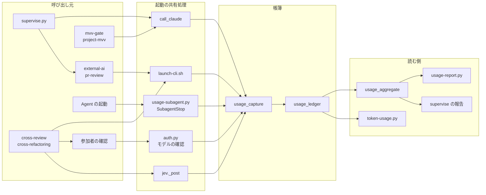

# 使用量の帳簿: NDF が起動した呼び出しを経路を問わずランタイムごとに数える

NDF のコードが起動したエージェントの呼び出し（Agent で起動したサブエージェント、NDF のスクリプトが起動した
`claude -p`・codex・kiro-cli・agy、Jev の要求）を、1 回につき 1 行、そのランタイムの帳簿に残す。集計のコマンド
`usage-report.py` が、帳簿を 1 つ選んで期間・スプリント・呼び出し元ごとの合計と、同じ期間の閉じた課題の数を出す。
Claude の帳簿では「サブエージェントだけ」と「全体（サブエージェント＋`claude -p`）」を並べる。この文書は、帳簿の
置き場と行の形、記録を書く場所、集計の値の求め方と、決めたことの理由を残す。

| 何を読むか | 正本 |
| --- | --- |
| トークン消費を数える範囲と、トークン削減の課題の受け入れ条件に使う値 | [ndf-context-window-metrics.md](ndf-context-window-metrics.md) の「トークン消費を数える範囲」 |
| 帳簿の置き場と行の形、記録を書く場所、集計の値と `usage-report.py` の契約 | この文書 |
| agy の `--output-format json` の出力の形（本文の `response`・使用量の `usage`） | `plugins/ndf/skills/external-ai/references/cli-agy.md` の「出力ストリーム」 |
| 帳簿の部品の docstring（置き場の決め方・行の列・取り出しの出所） | `plugins/ndf/scripts/lib/usage_ledger.py`・`usage_capture.py`・`usage_aggregate.py` |

## 例: 2026-10-13 の codex の帳簿を集計するとき

supervise.py の `runtime: codex` の work のステップと、リリース後テストが codex を 1 回ずつ起動した。どちらも
`plugins/ndf/scripts/lib/launch-cli.sh` を通り、包みのサブシェルが CLI の終わりに codex の帳簿
`~/.local/state/ndf/usage/codex/devbasex__ai-plugins.jsonl` へ 1 行ずつ書いた。集計はリポジトリの根で 1 行打つ。

```bash
python3 plugins/ndf/scripts/usage-report.py --ledger codex --since 2026-10-13 --format table
```

```text
帳簿: codex・リポジトリ: devbasex/ai-plugins・期間: 2026-10-13 〜 最後
閉じた課題: 7

| codex | 回数 | 不明 | cache_write_input_tokens | cached_input_tokens | input_tokens | output_tokens | reasoning_output_tokens | total_tokens |
| --- | ---: | ---: | ---: | ---: | ---: | ---: | ---: | ---: |
| release-test:verify-1953 | 1 | 0 | 0 | 12,288 | 19,532 | 5 | 0 | 19,537 |
| supervise:work | 1 | 0 | 0 | 12,288 | 20,699 | 51 | 44 | 20,750 |
| 合計 | 2 | 0 | 0 | 24,576 | 40,231 | 56 | 44 | 40,287 |
```

行の見出しは呼び出し元（`source:kind`）で、列は codex の記録の鍵のままである。claude の帳簿の値とは足さない。
`--ledger claude` で同じ期間を集計すると、表の後に「サブエージェントだけ」「全体」「会話の記録だけ」「数えられない」の
4 行が付く。

## 概要

| 機能 | 誰が使うか |
| --- | --- |
| NDF が起動した `claude -p`・codex・kiro-cli・agy・Jev の呼び出しを、ランタイムの帳簿へ 1 行ずつ残す | NDF のスクリプトと Skill（利用者は意識しない） |
| Agent で起動したサブエージェントを、Claude の帳簿へ 1 行ずつ残す | Claude Code の SubagentStop の hook |
| 帳簿を 1 つ選び、期間・スプリント・呼び出し元ごとの合計と閉じた課題の数を出す | トークン削減の効果を測る人・振り返り |
| Claude の帳簿で「サブエージェントだけ」「全体」「会話の記録だけ」を並べる | 同上 |
| supervise の報告の「LLM の使用量」に、drive と `runtime` を指定した work の中の CLI の分をランタイムごとに載せる | supervise の報告を読む conductor・利用者 |
| 起動の共有処理を通らない LLM の起動を足すと落ちる検査 | NDF の開発者 |
| テストが本物の帳簿へ書いたら落ちる検査 | NDF の開発者 |

**NDF を入れたどのリポジトリでも働く。** 帳簿は利用者の手元に置き、リポジトリごとのファイルに分ける。閉じた課題の
数は `.ndf/project.json` の `issues.primary` が `github` のときだけ数え、ほかは `unknown` と出す。ai-plugins の形
（リポジトリ名・`docs/metrics/`）を既定に埋め込まない。

## 用語

使用量の帳簿・呼び出し元・起動の共有処理・Claude の帳簿の全体・会話の記録だけの呼び出しの定義は、用語集
[docs/glossary.md](../glossary.md)（正本は `docs/glossary/glossary.json`、文脈は `ndf-workflow`）にある。

**語の関係は公開された言語である。** 起動の共有処理は帳簿の行の形（「データ・設定」）だけを介して帳簿へ書き、
帳簿を読む側（集計・supervise の報告・`scripts/token-usage.py`）は起動の仕組みを知らない。読む側が 3 つあり、
行の形を先に固めて互いに独立して変えるためである。

## 背景

使用量の数え方が経路ごとに 3 つ（会話の記録のサブエージェント・`claude -p` の帳簿・supervise のステップの記録）に
分かれ、どれも全体を覆わなかった。`launch-cli.sh` を通る起動・Jev・参加者の確認・codex / kiro / agy は帳簿に
1 行も残らなかった。処理をサブエージェントから `claude -p` や他の CLI へ移すと、移した分が計測の外へ出る。#845 では
サブエージェントの中は −86% だったが、`claude -p` を足すと総量は移行前と同じ程度だった。#1871 で数えた約 99 万
トークン（supervise.py が起動した `claude -p` が Skill の本文を読み込んだ量）も、この数え方の外にあった。

**帳簿をランタイムごとに分ける。** codex・kiro-cli・agy・Jev はそれぞれ別のアカウントで料金体系も違い、1 つの帳簿に
混ぜた合計は意味を持たない。Claude はサブエージェントと `claude -p` が同じアカウント・同じ料金体系なので 1 つにまとめる。

## 決定と理由

| # | 決定 | 理由 | 採らなかった形 |
| --- | --- | --- | --- |
| 1 | 置き場を `<帳簿のディレクトリ>/<ランタイム>/<owner>__<repo>.jsonl` にする | ディレクトリを読む単位がそのまま帳簿の単位になり、1 つの帳簿を読む処理が別の帳簿の行に触れない | 1 ファイルに `runtime` の列を足して混ぜる（絞り忘れが単位の混ざった合計を生む）。ファイル名に接尾辞を付ける（版 1 の直下を読む処理が他のランタイムの行を Claude の行として読む） |
| 2 | 記録を起動の共有処理の 4 か所と SubagentStop の hook に集める | 起動の経路を足しても書き手が増えず、書き忘れを静的な検査で落とせる | 呼び出し元ごとに書く（起動と書く場所が離れる）。参加者の確認を `call_claude` に寄せる（codex と kiro の確認も持つ） |
| 3 | codex と kiro はセッションの記録から、claude と agy は JSON の標準出力から使用量を読む | 起動の形を変えずに使用量を得る。codex に `--json` を付けると標準出力の形が変わり、結果の読み手と監視の照合を直す範囲が広がる。agy は JSON の出力にしか使用量が無い | — |
| 4 | サブエージェントは SubagentStop の hook で、終わった時点に 1 行にする | 会話の記録は Claude Code の保存期間を過ぎると消えるが、帳簿の行は残る | 集計の時に会話の記録から取り込むだけ（同じ期間を測り直すたびに値が変わる）。取り込みは帳簿ができる前の期間を埋めるためだけに使う |
| 5 | `claude -p` の行は親の会話の `usage` だけを持ち、中のサブエージェントは別の行か `modelUsage` の残りで数える | `usage` は親の会話だけ、`modelUsage` は中のサブエージェントを含む（2026-10-13 の実測で 22,347 と 43,955）。2 回数えない | `modelUsage` だけで数える（5 分と 1 時間の書き込みの区別を失う） |
| 6 | `launch-cli.sh` は CLI を包みのサブシェルで起動し、包みが終わりに記録する | 背景で起動した CLI の終わりを書き手が知る。`external-ai.py run` のように監視を通らない呼び出しも同じ経路で書ける | 監視が終わりを見つけたときに書く（書き手が経路ごとに分かれる） |
| 7 | 呼び出し元を環境変数 `NDF_USAGE_SOURCE`・`NDF_USAGE_KIND`・`NDF_USAGE_PLAN`・`NDF_USAGE_STEP` で渡す | `launch-cli.sh` の呼び手の引数の並びを変えずに済み、入れ子の起動（supervise の drive の中の cross-review）にもそのまま渡る | 引数を足す（4 つの呼び手の引数の並びが変わる） |
| 8 | Jev は独自の帳簿 `jev` を持つ | `AI_GATEWAY_API_KEY` の別アカウント・別料金で、呼び出し元の帳簿へ入れると帳簿の間で単位を足すことになる | — |
| 9 | テストの隔離の fixture を配布物の `plugins/ndf/conftest.py` に置き、テストの書いた行に印を付けて終わりに探す | 2026-10-11 にプラグインのキャッシュの中で走ったテストが本物の帳簿へ書いた。根の `conftest.py` はキャッシュに配られない | ファイルの一覧と大きさの変化で落とす（テストの間に利用者の会話のサブエージェントが本物の帳簿へ書くと落ちる。変化は失敗の文に出すだけにする） |
| 10 | 集計を配布物の `usage-report.py` と `lib/usage_aggregate.py` に置き、スプリントの期間をマイルストーンの日時から決める | `scripts/token-usage.py` はリポジトリ固有で配布先では使えない。行はマイルストーンを持たない | 行にマイルストーンを書く（起動の時点でマイルストーンを知らない呼び出し元が多い） |
| 11 | drive と `runtime` を指定した work のステップは、終わりに帳簿からそのステップの行を集め直して報告へ載せる | drive.py の中で起動した CLI の結果は supervise へ戻らない | drive.py に使用量を標準出力で返させる（2 つの drive の出力の形が変わり、帳簿と別の書き手が増える） |

## 仕様

### 構成要素と責務

| 要素 | 置き場所 | 責務 |
| --- | --- | --- |
| 帳簿 | `plugins/ndf/scripts/lib/usage_ledger.py` | 行の形（版 2）・置き場・追記・読み出し（版 1 の直下の行を Claude の行として読む）。追記は `append_safely` を通す。テストの中で書いた行に `pytest` の印を付ける |
| 使用量の取り出し | `plugins/ndf/scripts/lib/usage_capture.py` | ランタイムごとに使用量を読んで行を作り、`append_safely` へ渡す。CLI の `record-cli` と、関数 `record_claude`・`record_probe`・`record_jev`・`record_subagent` |
| 集計 | `plugins/ndf/scripts/lib/usage_aggregate.py` | 帳簿 1 つ × 期間の合計、Claude の 3 つの値、閉じた課題の数、supervise のステップの集め直し（`step_totals`）。読むだけで書かない |
| 集計の CLI | `plugins/ndf/scripts/usage-report.py` | 引数を受けて `usage_aggregate.usage_report` を呼び、JSON か表を出す |
| SubagentStop の hook | `plugins/ndf/scripts/usage-subagent.py`（登録は `plugins/ndf/hooks/claude.json`） | 入力の会話の記録を読み、サブエージェント 1 回を Claude の帳簿へ 1 行書く |
| テストの隔離と検査 | `plugins/ndf/conftest.py` | テストごとに帳簿・supervise の状態・耐久の記録のディレクトリを一時ディレクトリへ向け、終わりに本物の帳簿へ印の付いた行が増えていれば落とす |
| 起動の検査 | `plugins/ndf/scripts/tests/test_launch_sites.py` | 起動の共有処理の外にある LLM の起動を落とす |



### 常に成り立つ条件

| # | 条件 | 破れたときの扱い |
| --- | --- | --- |
| I1 | NDF のコードが起動した LLM の呼び出し 1 回につき、行がちょうど 1 行、そのランタイムの帳簿にある（Jev は `jev`、サブエージェントは `claude`） | 起動の共有処理を通らない起動は `test_launch_sites.py` が落とす。名乗りの無い行も `source`・`kind` を `unknown` にして残す |
| I2 | 行の `runtime` と、行を置いたファイルのランタイムのディレクトリが一致する | 書く側は `runtime` からだけパスを決め、呼び手はパスを渡せない。違う帳簿へ書こうとすると `ValueError` |
| I3 | 使用量を取れなかった行は `usage` が `"unknown"` で、0 の数値を書かない | 取り出しが例外・空・形の違いを返したら `"unknown"` に落とす。空の dict も `"unknown"` にする |
| I4 | 既存の行を書き換えない（追記だけ） | 追記の開き方しか持たない |
| I5 | 帳簿への追記が失敗しても、呼び出しの結果と呼び出し元の処理の結果は変わらない | `append_safely` が例外を捕まえて標準エラーに 1 行を出し、False を返す。`record-cli` と hook は常に終了コード 0 |
| I6 | 行にプロンプトの本文・環境変数の値・認証情報を書かない | 行の鍵は決まった一覧だけ。取り出しは使用量・モデル・セッション ID だけを読む |
| I7 | 集計の出力は帳簿ごとに分かれ、帳簿をまたぐ合計を持たない | 集計は帳簿を 1 つだけ引数に取る |
| I8 | 同じ呼び出しを 2 回数えない（帳簿の行と会話の記録、`claude -p` とその中のサブエージェント） | `claude -p` はセッション ID、サブエージェントは `agent_id` で突き合わせる |
| I9 | テストの実行は本物の帳簿へ書かない | テストの書いた行は印を持ち、テストの終わりの検査が本物の帳簿に印の付いた行を見つけたら落ちる |

### 記録を書く場所

| 起動の共有処理 | 起動する呼び出し元 | 書く行 |
| --- | --- | --- |
| `plugins/ndf/scripts/lib/launch-cli.sh` | cross-review のレビュー担当と反証、cross-refactoring の全フェーズ、external-ai の run、pr-review、supervise の `runtime` を指定した work | CLI の終わり（TERM で止めたときを含む）にそのランタイムの行 |
| `plugins/ndf/scripts/supervise_lib/claude.py` の `call_claude` | supervise.py の work・full・judge・slow・pr、mvv-gate、project-mvv | Claude の行。起動に失敗（`OSError`）しても `error`、時間切れは `timeout` の行を残す |
| `plugins/ndf/scripts/lib/auth.py` のモデルの確認 | 参加者の確認 | そのランタイムの行（`kind=probe`。応答の無い時間切れは `timeout`） |
| `plugins/ndf/scripts/lib/jev.py` の `_post` | Jev の要求 | `jev` の行（`kind=evaluate`。応答が無ければ `error`） |
| SubagentStop の hook（`usage-subagent.py`） | Agent で起動したサブエージェント | Claude の行（`source=subagent`・`kind=subagent`） |

**`launch-cli.sh` は CLI を包みのサブシェルで起動する。** 包みは `set -m` の背景起動でプロセスグループの先頭になり、
CLI を前景で走らせ、終わった後に `usage_capture.py record-cli` を打つ。`<stem>.pid` は CLI ではなく包みを指す。
止める側の TERM はグループの全員へ届き、包みの trap が `status=killed` を控える。記録の間は包みが TERM と INT を
無視する（監視が CLI の終わった後もグループへ TERM を送るため）。上限は猶予の後の KILL が保つ。HUP は `nohup` と
同じく無視する。`launch-cli.sh` の引数・出力ファイルの名前・終了コードは変えていない。

**mvv-gate と project-mvv は自前で `claude -p` を起動しない。** どちらも `call_claude` で起動する。mvv-gate の
`NDF_MVV_CLAUDE` は起動するコマンドの差し替えとして残る。`ClaudeRunner.record_usage` は帳簿へ書かず、報告の数え上げ
（`state.add_usage`）だけを持つ。

**起動の検査は `plugins/ndf/` の `scripts/`・`skills/`・`hooks/` のテスト以外のコードを見る。** `claude -p`・
`codex exec`・`kiro-cli chat`・`agy … -p`・`claude_agent_sdk` の `query` の起動が、起動の共有処理（`SHARED`）と
除外の一覧（`EXCLUDED`、理由を添える）の外にあれば落ちる。LLM を呼ばない起動（`claude plugin`・`claude auth`・
`codex login`・`agy models`・版の確認）は見つける規則に当てはまらない。実験版の置き場（`scripts/experimental/`）は見ない。

### 呼び出し元の名乗り

| 変数 | 決める者 | 行の列 |
| --- | --- | --- |
| `NDF_USAGE_SOURCE` | cross-review の `launch-reviewer.sh`・`critique.sh`、cross-refactoring の `launch-cli.sh`、pr-review の `pr-review-steps.py` は上書きする。cross-refactoring の `refactor.py` と external-ai の `external-ai.py` は無いときだけ置く。supervise の `runtime` を指定した work は `supervise` | `source` |
| `NDF_USAGE_KIND` | 同上（`review`・`critique`・cross-refactoring のフェーズ名・`run`・`work`） | `kind` |
| `NDF_USAGE_PLAN` / `NDF_USAGE_STEP` | supervise の run・work・drive のステップが子の環境へ置く | `plan` / `step`。入れ子の Skill の起動にも渡る |

Python の起動の共有処理（`call_claude`・`record_probe`・`record_jev`）は呼び出し元を引数で受け、引数が無いときに
環境変数を読む。どちらも無ければ `source`・`kind` は `unknown`、`plan`・`step` は空（supervise の外）。`call_claude` の
`kind` の既定はステップの役割（`claude_kind`）で、supervise.py は `source=supervise` と今のプランとステップを渡す。

### 使用量の取り出し

| ランタイム | 出所 | 取れないとき |
| --- | --- | --- |
| claude | `--output-format json` の標準出力の `usage`・`modelUsage`。`is_error` の結果は `status=error` | `"unknown"` |
| codex | 標準エラーの `session id:` から `$CODEX_HOME/sessions`（既定 `~/.codex/sessions`）の `rollout-*-<セッション ID>.jsonl` を引き、最後の `token_count` の `info.total_token_usage` を鍵のまま。モデルは最後の `turn_context` | rollout が無ければ標準エラーの `tokens used` の次の行の合計を `total_tokens` に置く。それも無ければ `"unknown"` |
| kiro | `~/.kiro/sessions/cli/*.json` のうち `cwd` が作業ディレクトリと一致し、`created_at` が起動から終わりの間（前後 1 秒）のもの。その `user_turn_metadatas` の `metering_usage`（unit が `credit`）の和と往復の数。モデルは `rts_model_state` の `model_id` | 候補が 0 か 2 つ以上なら `"unknown"` |
| agy | `--output-format json` の標準出力の `usage`（形は `cli-agy.md`） | 数値が 1 つも 0 より大きくなければ `"unknown"` |
| jev | 要求の数（1）・要求の本文の問いの数と、応答に `usage` があればその鍵 | 応答が無ければ `status=error`（要求の数は残す） |
| サブエージェント | hook の入力の `agent_transcript_path` の会話の記録。assistant の `message.usage` を `message.id` ごとに 1 回足し、書き込みを 5 分と 1 時間に分ける | 記録が読めなければ `"unknown"` |

`record-cli` の起動の時刻と作業ディレクトリは `<stem>-launch.json` の `started_at`・`workdir` から読む。

### 集計

```text
usage-report.py --ledger <claude|codex|kiro|agy|jev>
                [--since YYYY-MM-DD] [--until YYYY-MM-DD] [--milestone <番号|名前>]
                [--by caller|day|plan] [--repo <owner/repo> | --all-repos] [--format json|table] [--root <dir>]
```

| 項目 | 内容 |
| --- | --- |
| 期間 | `--since`・`--until` は JST の日付で両端を含む。`--milestone` はマイルストーンの `created_at` から `closed_at`（開いていれば今）を JST の日付で期間にする。どちらも無ければ帳簿の全期間 |
| まとめ方 | `--by caller`（既定。`source:kind`）・`day`（JST の日付）・`plan`（空は「supervise の外」） |
| リポジトリ | 既定は `--root`（既定は今のディレクトリ）を含む作業ツリーのリポジトリのファイルだけ。`--repo` で選び、`--all-repos` で全リポジトリ。課題とマイルストーンは `--root` のリポジトリ（`--repo` を渡せばそのリポジトリ）から引く |
| 閉じた課題の数 | `--root` の `.ndf/project.json` の `issues.primary` が `github` のときだけ数える。`--milestone` ならそのマイルストーンの `closed_issues`、期間なら `gh api search/issues` の `is:issue closed:<since>..<until>` の件数。ほか・`gh` の失敗は `"unknown"` |
| 出力（JSON） | `{ledger, repo, period:{since, until}, groups:[{key, calls, unknown_calls, usage}], totals:{calls, unknown_calls, usage}, closed_issues, claude?:{subagent_only, total, transcript_only, uncountable_note}}`。`usage` の鍵はその帳簿の記録の名前のまま（入れ子は `.` でつなぐ）。`"unknown"` の行は `unknown_calls` に数え、使用量に足さない |
| 出力（表） | 呼び出し元などごとの回数・不明の回数・使用量の列と合計。Claude の帳簿は 4 行（サブエージェントだけ・全体・会話の記録だけ・数えられない）を足す |
| 終了コード | 0 = 集計した（帳簿が無い・空も 0 件として 0）/ 2 = 引数の誤り（日付の形、`--milestone` と `--since`・`--until` の併用、引けないマイルストーン） |

**Claude の帳簿の 3 つの値。** 会話の記録は Claude Code の設定のディレクトリの `projects/` から、期間とリポジトリ（記録の
`cwd`。作業ツリーがもう無ければパスにリポジトリ名を含むか）で絞って読む。

| 値 | 求め方 |
| --- | --- |
| サブエージェントだけ | `kind=subagent` の行と、会話の記録の `subagents/agent-*.jsonl` のうち `agent_id` が帳簿に無いもの |
| 全体（Claude の帳簿の全体） | `claude -p` の行（`kind≠subagent`）の `usage` + サブエージェント（上と同じ）+ `claude -p` の行ごとの `modelUsage` の和から `usage` と親を同じくするサブエージェントを引いた残り（0 未満は 0。hook の効かない中のサブエージェントの分で、書き込みは 5 分として数える）+ 会話の記録だけの `claude -p`（`entrypoint` が `sdk-cli` で、セッション ID が帳簿に無いもの） |
| 会話の記録だけ | 全体のうち会話の記録から足した分 |
| 数えられない | 会話の記録も行も残さない呼び出し。値は出さず、帳簿の最初の行の時刻を添えて「この時刻より前の、会話の記録を残さない `claude -p` は含まない」と出す |

利用者が自分で開いた会話（conductor）の親の会話は数えない。その中で起動したサブエージェントは数える。突き合わせに使う
既知の `agent_id`・セッション ID は期間で絞る前の帳簿の全行から取る。

### supervise の報告

run・work・drive のステップは子の環境に `NDF_USAGE_PLAN`・`NDF_USAGE_STEP` を置く。drive のステップと `runtime` を
指定した work のステップは、終わりに `usage_aggregate.step_totals` で帳簿からそのプランとステップの行（ステップの開始の
1 秒前より後）をランタイムごとに合計し、`cur["llm_runtimes"]` へ置く。supervise 自身の `claude -p`（`source=supervise` の
Claude の行）は報告が別に数えるため除く。報告の「LLM の使用量」の次の行「CLI（drive・work の中）」が、ランタイムごとの
回数と使用量（不明の回数があれば添える）を出す。帳簿の間で足さない。`runtime` を指定した work は `claude -p` の回数に
数えず、Claude の帳簿へ `usage: {}` の行を書かない。

## データ・設定

### 置き場

```text
<帳簿のディレクトリ>/
├── <owner>__<repo>.jsonl           # 版 1 の行（#1142）。読むだけ。Claude の行として読む
├── claude/<owner>__<repo>.jsonl    # claude -p とサブエージェント
├── codex/<owner>__<repo>.jsonl
├── kiro/<owner>__<repo>.jsonl
├── agy/<owner>__<repo>.jsonl
└── jev/<owner>__<repo>.jsonl
```

帳簿のディレクトリは `NDF_USAGE_DIR` → `${CLAUDE_PLUGIN_DATA}/usage` → `${XDG_STATE_HOME}/ndf/usage` →
`~/.local/state/ndf/usage` の順に決める（検査の記録 `check-trigger.py` と同じ順）。`<owner>__<repo>` は origin の URL から
決め、決められなければ `unknown`。帳簿のランタイムは 5 つで、`jev` は cross-review の席順の `ALL_RUNTIMES`（4 つ）に
入らない。

**移行は行わない。** 版 1 の行はそのまま読み、新しい行は版 2 の置き場へ書く。本物の帳簿に既に混ざったテストの行
（直下の `test_*__origin.jsonl`・`unknown.jsonl`）は消さず、集計の既定が今のリポジトリのファイルだけを読むことで外す
（`--all-repos` で含める）。

### 帳簿の行（版 2）

| 鍵 | 型 | 空を許すか | 意味 |
| --- | --- | --- | --- |
| `schema` | int | 許さない | `2`。鍵が無い行は版 1 |
| `runtime` | str | 許さない | `claude` / `codex` / `kiro` / `agy` / `jev`。置き場のディレクトリと一致する。版 1 の行は読むときに `claude` |
| `source` | str | 許さない | 呼び出し元のスクリプトか Skill（`supervise`・`mvv-gate`・`project-mvv`・`cross-review`・`cross-refactoring`・`external-ai`・`pr-review`・`subagent` など）。名乗りが無ければ `unknown` |
| `kind` | str | 許さない | 呼び出しの役割（`work`・`full`・`judge`・`slow`・`pr`・`mvv`・`mvv-vet`・`mvv-propose`・`review`・`critique`・cross-refactoring のフェーズ名・`run`・`probe`・`evaluate`・`subagent` など）。名乗りが無ければ `unknown` |
| `plan` / `step` | str | 空を許す | supervise の中で起動したときのプランとステップ。空は supervise の外 |
| `model` | str | 空を許す | 実際に動いたモデル。claude は `modelUsage` の中で費用（無ければ出力）の最も大きいもの。空は取れなかった |
| `usage` | object または `"unknown"` | 許さない | ランタイムの記録の鍵のままの使用量（「使用量の取り出し」）。`"unknown"` は取れなかった。版 1 の `{}` は読むときに `"unknown"` |
| `model_usage` | object | null を許す | claude の `modelUsage` をそのまま。claude 以外と取れなかったときは null |
| `status` | str | 許さない | `ok`（終了コード 0）・`error`（0 以外・起動の失敗）・`timeout`・`killed`（TERM で止めた）。版 1 の行は読むときに `ok` |
| `session_id` | str | null を許す | ランタイムのセッション ID（agy は会話の ID、サブエージェントは `agent_id`）。突き合わせの鍵 |
| `parent_session_id` | str | null を許す | サブエージェントの行だけ。親の会話のセッション ID |
| `agent_type` / `agent_id` | str | null を許す | サブエージェントの行だけ |
| `pytest` | str | 無いことを許す | テストの中で書いた行だけ。`PYTEST_CURRENT_TEST` のテストの名前 |
| `cost_usd` / `turns` / `seconds` | number | null を許す | claude の `total_cost_usd`・`num_turns`、呼び出しの秒 |
| `at` / `ndf_version` | str | 許さない | 書いた時刻（UTC）と、書いたプラグインの版（読めなければ `unknown`） |

claude の `usage` は `input_tokens`・`cache_read_input_tokens`・`cache_creation_input_tokens`・`cache_creation` の
`ephemeral_5m_input_tokens` と `ephemeral_1h_input_tokens`・`output_tokens` を加工せずに持つ。5 分と 1 時間の書き込みの
区別は `cache_creation` にしか無く、合計にした時点で戻らないためである。

### `usage_capture.py record-cli`

| 項目 | 内容 |
| --- | --- |
| 入力 | `--stem <パス>`（必須。`-stdout.log`・`-err.log`・`-launch.json` を読む）・`--runtime <claude\|codex\|kiro\|agy>`（必須）・`--rc <終了コード>`・`--status <ok\|error\|timeout\|killed>`（省けば `--rc` から）・`--model <モデル>`。呼び出し元は環境変数 |
| 出力 | 帳簿へ 1 行。標準出力には何も出さない |
| 失敗の形 | 引数の誤りを含めて常に終了コード 0。記録できなければ標準エラーに 1 行（`launch-cli.sh` は `<stem>-err.log` へ足す） |

## 外部連携

### SubagentStop の hook

入力は Claude Code の SubagentStop の JSON（`session_id`・`agent_id`・`agent_type`・`agent_transcript_path`・`cwd`）。
行は `source=subagent`・`kind=subagent`・`session_id=agent_id`・`parent_session_id=session_id`。出力は無く、常に終了
コード 0（hook の失敗で会話を止めない）。登録は `plugins/ndf/hooks/claude.json` の `SubagentStop` で、プラグインの根が
分からなければ何もしない。時間の上限は 10 秒。

### CLI の記録を読むだけ

codex の rollout・kiro のセッションの記録・Claude Code の会話の記録は読むだけで書き換えない。閉じた課題の数とマイル
ストーンを引くときだけ `gh` を打つ。記録のために LLM の呼び出しもネットワークの通信も足さない。

## セキュリティ

- 行にプロンプトの本文・環境変数の値・認証情報を書かない（I6）。取り出しは使用量・モデル・セッション ID だけを読む
- 帳簿は利用者の手元にだけ置き、内容をどこへも送らない

## 運用

### 既知の限界

| 項目 | 内容 |
| --- | --- |
| 帳簿ができる前の期間 | 会話の記録を残さない最小構成の `claude -p` は、帳簿ができた 2026-10-03 より前の分を数えられない。推定で埋めず「数えられない」と出す |
| SubagentStop が `claude -p` の中で起きるか | 最小構成の `claude -p` でプラグインの hook が読まれるかは確かめていない。読まれなくても全体の値は `modelUsage` の残りで数える。サブエージェントだけの値には入らない |
| 包みのサブシェルが KILL で止められたとき | trap が走らず行が残らない |
| kiro の使用量 | クレジットだけで、トークン数は取れない（セッションの記録のトークン数の欄は 0）。同じ作業ディレクトリで同時に 2 つ起動すると絞れず `"unknown"` になる |
| relay の `claude -p` | relay は `-p` の起動を本物の claude へパススルーするだけで、自分では起動しない。パススルーされる `-p` は起動した側の共有処理が記録する。NDF のコードの外で打った `claude -p` は帳簿に入らず、会話の記録が残れば「会話の記録だけ」に出る |
| `scripts/token-usage.py`（このリポジトリ固有） | 帳簿は `read_usage_ledger("claude")` で版 1 と版 2 の両方を読むが、層へ足すのは `kind` が `work`・`judge`・`slow`・`pr`・`mvv` の行だけ。会話の記録から数える席・サブエージェントと 2 回数えないためである |
| 本物の帳簿に混ざったテストの行 | 2026-10-11 以前のテストが書いたファイルは残っている。消すかは利用者が決める |

## テスト観点

テストは `plugins/ndf/scripts/tests/` の `test_usage_ledger.py`・`test_usage_capture.py`・`test_usage_aggregate.py`・
`test_launch_sites.py` にある。外部の CLI の実物は呼ばず、偽の CLI と一時ディレクトリの帳簿で確かめる。

| 観点 | 確かめ方 |
| --- | --- |
| `call_claude` を通る呼び出し元（supervise の各ステップ、mvv-gate、project-mvv）から偽の claude を 1 回起動すると、`claude/` に 1 行増え、`source`・`kind` が呼び出し元を指す。mvv-gate は `kind=mvv` の行が 1 行増える。子の起動にプランとステップが渡る | `test_usage_ledger.py` |
| `launch-cli.sh` を 4 ランタイムの偽の CLI で 1 回ずつ起動すると、そのランタイムの帳簿にだけ 1 行増え、使用量はランタイムごとの形になる。グループへの TERM（CLI の終わった後に届いたときも）で `status=killed` の 1 行が残る | `test_usage_capture.py` |
| 参加者の確認でランタイムごとに `kind=probe` の 1 行。`jev._post` を偽の応答で 1 回呼ぶと `jev/` に 1 行、鍵が無ければ送らず書かない | `test_usage_capture.py` |
| SubagentStop の入力と会話の記録の見本から `kind=subagent`・`agent_type` 付きの 1 行。会話の記録が読めなくても終了コード 0。hook が `SubagentStop` に登録されている | `test_usage_capture.py` |
| 使用量を出さない偽の CLI の行は `usage="unknown"` で数値の 0 を持たない。claude の行は 5 分と 1 時間の書き込みを分けて持つ | `test_usage_capture.py`・`test_usage_ledger.py` |
| `runtime` を指定した work は `claude/` に行を書かず、そのランタイムの帳簿に `source=supervise`・`kind=work`・`step` 付きの 1 行。drive のステップの中で 2 つのランタイムが起動されると、報告にランタイムごとの行が出る | `test_usage_ledger.py`・`test_usage_aggregate.py`（`step_totals`） |
| 版 1 の行だけの帳簿を読むと Claude の行として値が出る | `test_usage_capture.py`・`test_usage_aggregate.py` |
| 帳簿のディレクトリを書けなくしても、`call_claude` の戻り値と `launch-cli.sh` の結果ファイル・終了コードが書けるときと同じ | `test_usage_ledger.py`・`test_usage_capture.py` |
| 追記の前後で既存の行のバイト列が変わらない | `test_usage_ledger.py`・`test_usage_capture.py` |
| 起動の共有処理と除外の一覧の外に LLM の起動を足すと落ちる。LLM を呼ばない起動は見つけない。一覧が実在の起動を指す | `test_launch_sites.py` |
| 2 つのランタイムの帳簿を置いて `--ledger codex` で集計すると claude の行が合計に入らない。`--by caller` で呼び出し元ごと、期間の両端の行が入る。帳簿が空なら 0 件。引数の誤りは終了コード 2 | `test_usage_aggregate.py` |
| 偽の `gh` が数を返すと `closed_issues` に出る。`issues.primary` が `github` でない・`gh` が失敗すると `"unknown"`。`--milestone` が期間と数を決める | `test_usage_aggregate.py` |
| full の `claude -p` の行とその中のサブエージェントの行・会話の記録を置くと、`claude -p` の `usage` は全体に入りサブエージェントだけには入らない。同じサブエージェントを行と会話の記録の両方に置いても 1 回だけ数える。hook の効かないサブエージェントは `modelUsage` の残りで入る | `test_usage_aggregate.py`・`test_usage_ledger.py` |
| codex の偽の CLI がセッションの記録に `token_count` を残すと、`--ledger codex` の集計に入力トークンが 0 より大きく出る（会話への結び付けを使わない）。記録が無ければ `tokens used` に落ちる | `test_usage_capture.py` |
| 偽の CLI の出力と環境・Jev の鍵に秘密とプロンプトの文字列を置いても、行に現れない | `test_usage_capture.py` |
| テストの中で書いた行がテストの名前の印を持ち、増えた部分の印の付いた行が見つかる。本物の帳簿へ書いたテストは `plugins/ndf/conftest.py` の終わりの検査が落とす | `test_usage_capture.py` と `plugins/ndf/conftest.py` |

## 関連リンク

- [issue #1953](https://github.com/devbasex/ai-plugins/issues/1953) — 経路を問わずすべての呼び出しをランタイムごとの帳簿で数える
- [PR #1970](https://github.com/devbasex/ai-plugins/pull/1970) — 要求と設計
- [PR #1972](https://github.com/devbasex/ai-plugins/pull/1972) — 実装
- [issue #1142](https://github.com/devbasex/ai-plugins/issues/1142) — `claude -p` の使用量の帳簿（版 1）
- [issue #1871](https://github.com/devbasex/ai-plugins/issues/1871)・[issue #845](https://github.com/devbasex/ai-plugins/issues/845)・[issue #827](https://github.com/devbasex/ai-plugins/issues/827) — 数え方の外にあった読み込みと、サブエージェントだけの計測
- [ndf-context-window-metrics.md](ndf-context-window-metrics.md) — 数える範囲と、トークン削減の課題に使う値
- [ndf-release-steps-and-token-usage-snapshot.md](ndf-release-steps-and-token-usage-snapshot.md) — 版ごとのトークン消費の記録（`token-usage.py`）
