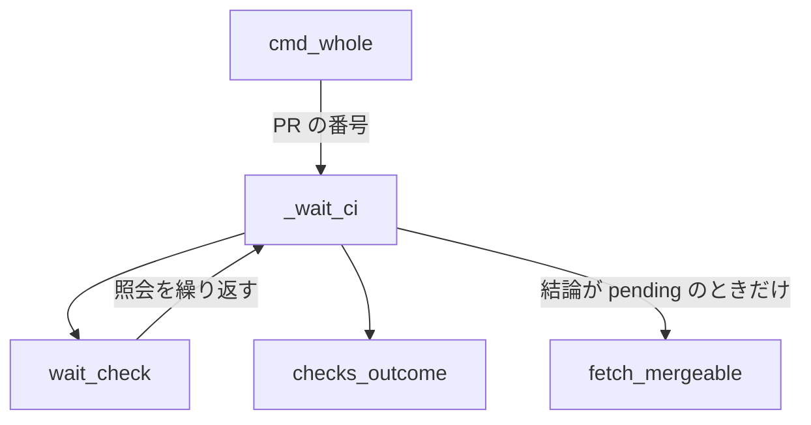

# 全体テストの CI の待ち: 衝突した Pull Request では上限まで待たずに止まり、ベースブランチの取り込みを示す

全体テストを CI に任せる戦略（`.ndf/project.json` の `test.whole_on_ci`）で `test-run.py whole --pr <番号>` を打つと、
`test-run.py` は Pull Request のチェックの結論が出るまで照会を繰り返す（CI の待ち）。Pull Request がベースブランチと
衝突していると、GitHub は `pull_request` のワークフローを起動せず、チェックが一覧に現れない。CI の待ちは、照会が
未完了を返すたびに衝突の状態を読み、衝突を読んだ時点で `stopped`・終了コード 2 で戻り、次の 1 手にベースブランチの
取り込みのコマンドを示す（#3076）。衝突の無い Pull Request の待ちは変えていない。

2026-11-12 の PR #3069 では、衝突した Pull Request の CI の待ちが上限（`ci_wait_timeout`）まで 40 分以上続いていた。

**手順の正本はスクリプトにある。** この文書は、決めたことの理由と、書く側と読む側が共有する形を残す。

| 何を読むか | 正本 |
| --- | --- |
| CI の待ち | [`test-run.py`](../../plugins/ndf/scripts/test-run.py) の `_wait_ci` |
| 衝突の状態の読み方 | [`lib/gh_pr_info.py`](../../plugins/ndf/scripts/lib/gh_pr_info.py) の `fetch_mergeable` |
| CI に任せる戦略の全体 | [ndf-ci-only-tests.md](ndf-ci-only-tests.md) |
| CI の待ちの数え方（合流の待ち） | [ndf-ci-wait-superseded-failures-and-infra-wait.md](ndf-ci-wait-superseded-failures-and-infra-wait.md) |

## 用語

衝突の状態・CI の待ちの定義は、用語集（[docs/glossary.md](../glossary.md)）にある。

## コンテキスト

テストの実行（`ndf-test`）が下流、GitHub が上流で、照会の層を腐敗防止層にする。GitHub の語は REST の `mergeable` の
`true` / `false` / `null` で、照会の層（`lib/gh_pr_info.py`）がこれを `MERGEABLE` / `CONFLICTING` / `UNKNOWN` へ訳す。
`test-run.py` はこの 3 つの値だけを読む。

## 構成要素

| 要素 | 責務 |
| --- | --- |
| `lib/gh_pr_info.py` の `fetch_mergeable(repo, pr)` | REST の `repos/<owner>/<repo>/pulls/<番号>` を `gh_call.rest_cached`（githubkit。ETag 付き）で 1 回読み、`mergeable` を 3 つの値へ訳す。照会の失敗は例外を投げず `None` |
| `test-run.py` の `_wait_ci(root, ctx, base, pr)` | 照会の中で、チェックの結論が `pending` で `pr` があるときだけ衝突の状態を読み、`CONFLICTING` なら照会の結論を `CONFLICTING` にする。待ちの後、`CONFLICTING` を `stopped` の結果へ組む |
| `test-run.py` の `cmd_whole` | `--pr` の値を `_wait_ci` へ渡す |
| `lib/test_triage.py` の `wait_check` | `pending` の間だけ照会を繰り返し、`pending` 以外の値はそのまま返す（変えていない） |
| `lib/gh_checks.py` の `checks_outcome` | コミットのチェックの結論（`success` / 失敗の結論 / `pending` / 照会の失敗 `None`）を返す（変えていない） |

## 仕様

### 常に成り立つ条件

| # | 条件 |
| --- | --- |
| I1 | 衝突の状態を読むのは、`--pr` が渡され、かつその回のチェックの照会が `pending` を返したときだけで、照会 1 回につき 1 回までである |
| I2 | 衝突の状態が `CONFLICTING` のときだけ待ちを打ち切る。`MERGEABLE`・`UNKNOWN`・読めなかったとき（`None`）は待ちを続ける |
| I3 | 衝突で打ち切ったときは、状態 `stopped`・終了コード 2 で戻り、要約に Pull Request の番号と衝突を、`next` にベースブランチの取り込みのコマンドを置く。CI の JUnit による見分けへ進まない |

### 照会の結論ごとの扱い

照会の結論の値の集合は `None`・`success`・失敗の結論・`pending`・`CONFLICTING` である。`CONFLICTING` は `_wait_ci` の
照会だけが作り、`checks_outcome` は作らない。`_wait_ci` は `CONFLICTING` を `None` と `success` より前に判定する。

| 結論 | 扱い |
| --- | --- |
| `CONFLICTING` | `stopped`・終了コード 2（下の形） |
| `None`（上限か照会の失敗） | `stopped`・終了コード 2、要約は `<待ちの詳細> の結論を得られなかった（上限か照会の失敗）` |
| `success` | 通過 |
| 失敗の結論 | CI の JUnit を取って見分ける |

衝突で止まったときの結果の形:

| 欄 | 値 |
| --- | --- |
| `status` | `stopped`（終了コード 2） |
| `summary` | `PR #<番号> はベースブランチと衝突していて CI が起動しない（衝突の状態 CONFLICTING）。<待ちの詳細>`。待ちの詳細はチェックの名前・コミット・待った秒・照会の回数・上限 |
| `items` | `[{"waited_seconds": <待った秒>}]` |
| `next` | `python3 <scripts>/merged-steps.py base-sync --pr <番号> --push --root <リポジトリ>` |

`next` の `base-sync` には `--push` を付ける。手元で取り込むだけでは GitHub 上の Pull Request の衝突が解けず、CI が
起動しないためである。

## データ・設定

新しい設定は無い。待つチェックの名前と上限は今と同じく宣言（`test.ci.check` か `ci.required_checks`、
`ci_wait_timeout`）から読む。

## エラー処理

| 事象 | 扱い |
| --- | --- |
| 衝突の状態の照会が失敗した | `None` を返し、待ちを止めずに次のチェックの照会へ進む |
| `mergeable` が `null`（GitHub が計算中） | `UNKNOWN` として待ちを続け、次の照会で読み直す |

## 決定と理由

- **衝突の状態はチェックの照会が未完了を返すたびに読む。** 待ちの最初は計算中（`UNKNOWN`）のことがあり、待つ間にベースブランチが進んで衝突が生じることもある。待ちの前に 1 回だけ読む形は計算中の値で衝突を見逃すため採らない。打ち切りは待ちの共通部品へ止める条件を足さず、照会の結論を `CONFLICTING` にして「`pending` 以外で終える」規則に乗せる。共通部品の引数を増やすと、ほかの待ちにも衝突の概念が入るためである
- **REST の Pull Request を ETag 付きで読み、照会の層で 3 つの値へ訳す。** 値が変わらなければ 304 が返り、REST のレート制限に数えられない。`gh pr view --json mergeable`（GraphQL）は照会のたびにレート制限を消費し、ETag の読み直しを持たないため採らない。GraphQL の `mergeStateStatus`（`gh_pr_status` が使う）は、スレッドと課題の照会と一緒に読む部品で、衝突だけを繰り返し読むには照会が大きい。REST の `false` と GraphQL の `CONFLICTING` の対応は PR #3069 の実測で一致した
- **衝突で止まったときは既存の `stopped`・終了コード 2 で返す。** 衝突を表す 4（`EXIT_BASE_CONFLICT`）は `merge-when-green` が返し、プランのマージのステップがベースブランチの取り込みへ戻る契約である。全体テストのステップが 4 を返すと工程の側の読み方を変える必要が出る。衝突であることは要約に、次の 1 手は `next` に書く。自動で `base-sync` を打つことはしない
- **衝突で止まったときは CI の JUnit による見分けへ進まない。** CI が動いておらず見分ける JUnit が無い。見分けへ進めると成果物の取得の照会が増え、結果が「テストが落ちた」と読める

## 運用

未確認のまま残っていることは次の 2 つである。

| 項目 | 内容 |
| --- | --- |
| `pull_request_target` で動くチェックを待つリポジトリ | `pull_request_target` のワークフローは衝突があっても動く。待つチェックがそれだけのリポジトリでは、衝突で止めると結論の出るチェックを待たずに止まる。このリポジトリのワークフローは `pull_request_target` を使っていない（`grep -c pull_request_target .github/workflows/*.yml` がすべて 0、2026-11-12） |
| REST の `mergeable` が `false` になるのは衝突だけか | GitHub の文書は `false` の理由を衝突に限って書いていない。運用の記録で確かめる |

## テスト観点

- チェックの照会が `pending`、衝突の状態が `CONFLICTING` のとき、`whole --pr` が `stopped`・終了コード 2 で返り、チェックの照会が 1 回で終わること
- その結果の `summary` に PR の番号と衝突が、`next` に `merged-steps.py base-sync --pr <番号>` が入り、JUnit の取得が呼ばれないこと
- 衝突の状態が `MERGEABLE` のとき、成功なら通過・失敗の結論なら見分け・上限なら既存の文言の `stopped` になること
- `UNKNOWN` と照会の失敗では次のチェックの照会へ進み、その後に `CONFLICTING` を読めば止まること
- `--pr` を渡さないときと、チェックの照会が最初から結論を返すとき、Pull Request の照会が 0 回であること
- `pending` を N 回返す間の Pull Request の照会が N 回以下であること
- `fetch_mergeable` が `false`→`CONFLICTING`・`true`→`MERGEABLE`・`null`→`UNKNOWN`・照会の失敗→`None` に訳し、例外を投げないこと

GitHub の照会と待ちの `sleep` は差し替え、実際の GitHub へ問い合わせない。テストは
`plugins/ndf/scripts/tests/test_test_run.py` と `test_gh_pr_info.py` にある。

## 関連リンク

- [ndf-ci-only-tests.md](ndf-ci-only-tests.md)
- [ndf-ci-wait-superseded-failures-and-infra-wait.md](ndf-ci-wait-superseded-failures-and-infra-wait.md)
- [ndf-supervise-base-sync.md](ndf-supervise-base-sync.md)
- GitHub REST API の Pull Request: https://docs.github.com/en/rest/pulls/pulls?apiVersion=2022-11-28
- GitHub Actions のワークフローを起動するイベント: https://docs.github.com/en/actions/reference/workflows-and-actions/events-that-trigger-workflows
