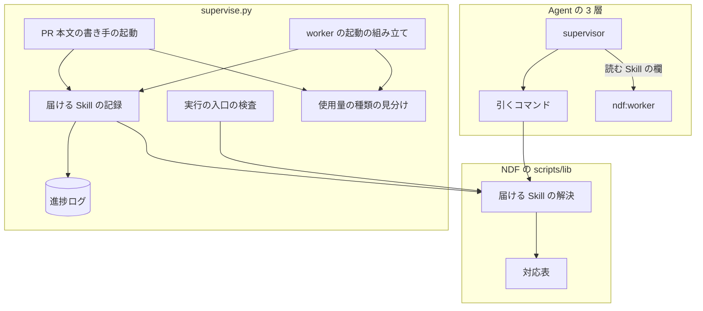
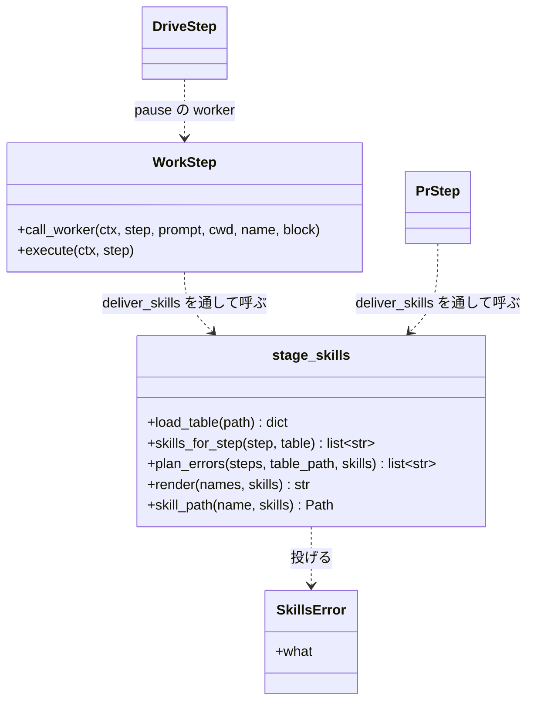
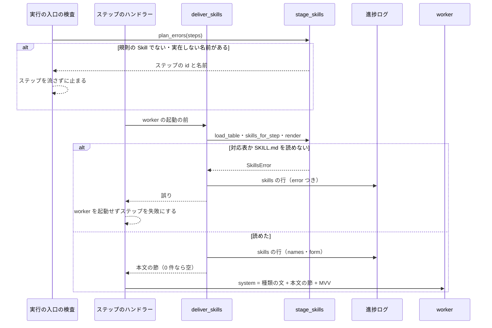

# worker へ届ける Skill: ステップの工程に要る規則の Skill だけを、worker の種類に合った形で届ける

## 概要

**worker が動くとき、そのステップの工程に要る規則の Skill だけが届く。** 工程と Skill の組は
Skill の対応表（`plugins/ndf/scripts/lib/stage-skills.json`）の 1 か所にだけあり、プランの worker
（`supervise.py` が起動する `claude -p` とランタイム指定の worker）と、supervisor が起動する
`ndf:worker` の両方がそこを読む。新しい規則の Skill をある工程へ届ける変更は、対応表の 1 行の追加で済む。

例: 設計の工程（`stage: 設計`）の work ステップでは、`supervise.py` が `document-style` の
`SKILL.md` の本文を worker の system プロンプトへ入れ、進捗ログに次の 1 行を書いてから起動する。

```json
{"kind": "skills", "step": "design", "stage": "設計", "names": ["document-style"], "form": "本文"}
```

`stage` を持たないテストの修正のステップ（`fix`）には何も届かず、`names` が空の行が残る。

渡し方は worker の種類で 2 つに分かれる。

| worker | 渡し方（`form`） | 形 |
| --- | --- | --- |
| プランの通常の worker（`WORK_SYSTEM`。ランタイム指定と drive の pause の worker を含む） | 本文 | `SKILL.md` の frontmatter を除いた本文を system プロンプト（ランタイム指定ではプロンプトのファイル）へ入れる |
| プランの full の worker（`FULL_SYSTEM`） | 本文 | 同じ本文の節を `--append-system-prompt` へ入れる |
| PR 本文の書き手（`PR_SYSTEM`） | 本文 | 同じ本文の節を `PR_SYSTEM` の後ろへ入れる。Tool なしで読める |
| Agent の `ndf:worker` | パス | supervisor が起動指示の「読む Skill」に名前と `SKILL.md` の絶対パスを並べ、worker はそこに挙がった `SKILL.md` だけを作業の前に読む |

**規約は次の文書が正である。** ここへ書き写さない。

| 何を読むか | 正本 |
| --- | --- |
| プランの `skills`・`skills_add` 欄と進捗ログの `kind: skills` の行 | [`supervise_lib/plan.py`](../../plugins/ndf/scripts/supervise_lib/plan.py) の docstring |
| supervisor → worker の起動指示の「読む Skill」の書き方と worker の規則 6 | `development-workflow` の [references/agent-layers.md](../../plugins/ndf/skills/development-workflow/references/agent-layers.md) |
| worker の定義 | [`plugins/ndf/agents/worker.md`](../../plugins/ndf/agents/worker.md) |
| worker が工程 Skill の本文を読まず、抜粋で手順を受け取る仕組み | [ndf-worker-agent-and-skill-excerpts.md](ndf-worker-agent-and-skill-excerpts.md) |

## 用語

Skill の対応表・Skill の渡し方・読む Skill・規則の Skill の定義は、用語集（[docs/glossary.md](../glossary.md)）が正である。

## コンテキスト

NDF の開発ワークフロー（`ndf-workflow`）の 1 つに収まる。工程の名前は、同じコンテキストの工程表
（`development-workflow` の「モードごとに起動する Skill」の表と、`workflow-common.sh` の `WF_STAGE_MATRIX`。
行名は関数 `wf_stages` が 1 行に 1 つずつ返す）の行名をそのまま使う。

## 背景

プランの worker と `ndf:worker` は、もともとステップに要る Skill を受け取る仕組みを持たなかった。
`document-style` を AI が Skill として起動した回数は、2026-09 後半の 49 回から 10 月後半の 1 回へ落ちた（#2372 の実測）。
規則を当てるかを起動される側の判断に任せていたことと、作業が Skill のツールを外した worker へ移ったことが重なったためである。
#2372 では `document-style` だけを 3 つの system プロンプトと worker の定義へ書き足した。その結果、文書を書かないステップにも常に載り、別の Skill を届けるたびに同じ書き足しが要った。
この仕組みは、その書き足しを対応表 1 か所へ寄せたものである。

## 決定と理由

| 決定 | 理由 |
| --- | --- |
| 対応表は JSON のデータのファイルにし、worker を起動する前のたびに読む | Python の定数にすると、読めないときに `supervise.py` の読み込みごと落ちる。ファイルなら壊れたときの失敗がそのステップに閉じ、行の追加にコードの変更が要らない。工程表（`WF_STAGE_MATRIX`）の列にしないのは、1 つの表がモードごとの要否と Skill の 2 つの責務を持つことになるためである |
| 対応表のキーは工程だけにする | 初期値の行はどれも工程の中の作業を問わずに要る規則である。作業の名前は雛形ごとに自由に付くため、工程と作業の組をキーにすると、どこにも当たらず何も届かないステップが黙って生まれる。作業ごとの差はステップの `skills`・`skills_add` で表す |
| 置き換えは `skills`、追加は `skills_add` の 2 つの欄に分ける | どちらも文字列の配列で、値の型で意味が変わらない。両方を書けば `skills` に `skills_add` を足したものになり、意味が 1 つに決まる |
| プランの worker には本文を system プロンプトへ入れる | `skills:` を持つサブエージェントが得る状態（Skill の本文を最初から文脈に持つ）を、起動を 1 段のまま得られる。どのランタイムの worker と、Tool の無い PR 本文の書き手にも同じ組み立てで届く。パスを渡して読ませる形は毎回 1 ターンと $0.08〜0.14 が増え、読むかどうかが worker に委ねられる |
| `ndf:worker` には起動指示の「読む Skill」でパスを渡す | 目的ごとに `skills:` つきの定義を用意すると、Skill の組み合わせの数だけ定義が要り、対応表の 1 行を足すたびに定義も増える |
| 対応表とプランの欄に置ける Skill は規則の Skill（`rule_skills`）に限る | 工程 Skill を読ませると、進捗記録・確認・承認ゲートの判断のように worker が持たない責務が worker の文脈で動く。規則か工程かは `SKILL.md` に区別の印が無いため、`rule_skills` の一覧で決める。工程 Skill の手順は今と同じく抜粋（`references/excerpt.md`）で渡す |
| 記録の行は worker を起動する前に書く | 打ち切り・利用上限で起動が戻らなくても、何を渡そうとしたかが残る |
| `document-style` は、他者が読む文書を書く 10 工程に置く | #2372 の書き足しでは工程を問わず届いていた。要求と受け入れ条件・設計・ドキュメント再構成・計画・ドキュメントレビュー・完了判定・Pull Request・確定仕様化・振り返り・棚卸しのどれかを外すと、その工程で「他者が読む文書に規則が当たらない」状態が戻る |
| supervisor が `lookup` に渡す工程の名前は、起動指示の「フェーズ」に挙がった工程から取る | 作業の中身から推し量ると、起動ごとに推す工程が変わって届く Skill が揺れる。`lookup` は工程表に無い名前にも空の一覧を返すため、推した名前の誤りは失敗として現れない |
| 届ける Skill の起動 1 回あたりの増分の上限は、費用 $0.10・秒 +2 秒とする | `rule_skills` のすべて（28,578 バイト）を 1 ステップへ届けたときのキャッシュへ書き込む起動の見積り $0.092 を切り上げた値である。`rule_skills` に Skill を足して見積りが上限を超えるときは、上限を黙って上げず設計で決める |

## 仕様

### 構成要素と責務

| 要素 | 責務 | 置き場 |
| --- | --- | --- |
| 対応表 | 規則の Skill の一覧（`rule_skills`）と、工程の名前 → Skill の名前の一覧 | `plugins/ndf/scripts/lib/stage-skills.json` |
| 届ける Skill の解決 | 対応表を読む（`load_table`）、ステップから届ける Skill を決める（`skills_for_step`）、プランの欄を照らす（`plan_errors`）、本文の節を組む（`render`）。どれも副作用を持たず、読めないときは `SkillsError` を投げる | `plugins/ndf/scripts/lib/stage_skills.py` |
| 引くコマンド | 工程を受け、名前と `SKILL.md` の絶対パスを統一 JSON レポートで返す | `plugins/ndf/scripts/stage-skills.py` |
| 実行の入口の検査 | ステップを 1 つも流す前に `skills`・`skills_add` を照らす | `supervise_lib/engine.py` の `Engine.setup` |
| 届ける Skill の記録 | worker の起動の前に解決を呼び、進捗ログへ 1 行書き、本文の節か誤りを返す | `supervise_lib/steps.py` の `deliver_skills` |
| worker の起動の組み立て | 本文の節を「種類の文 → 本文の節 → MVV の節」の順で system プロンプトへ入れる | `supervise_lib/worker_steps.py` の `WorkStep.execute`・`WorkStep.call_worker`・`DriveStep._delegate_pause` |
| PR 本文の書き手の起動 | 本文の節を `PR_SYSTEM` の後ろへ入れる | `supervise_lib/pr.py` の `_llm_body` |
| 使用量の種類の見分け | system プロンプトが `PR_SYSTEM` で始まれば、後ろに本文の節が付いても `pr` に数える | `supervise_lib/claude.py` の `claude_kind` |
| worker の定義と規約 | Skill の名前を持たず、「読む Skill」に挙がった `SKILL.md` だけを読むと定める | `plugins/ndf/agents/worker.md`、`development-workflow` の `references/agent-layers.md` |

### 実行時の関係



境界をまたいで流れるのは Skill の本文（プランの worker）と `SKILL.md` の絶対パス（`ndf:worker`）だけである。
どちらも NDF に同梱した文書で、秘密を含まない。本文は `supervise.py` 自身と同じプラグインの `skills/` から読むため、
プラグインを読み込まない最小構成の起動（`--setting-sources ""`・`--disable-slash-commands`）にも届く。

### 構造



### 常に成り立つ条件

| # | 条件 | 破れたときの扱い |
| --- | --- | --- |
| I1 | 工程と Skill の組は対応表のファイルにだけある。Skill を worker へ届ける経路（`supervise_lib` の全ファイル・`lib/stage_skills.py`・`stage-skills.py`・`worker.md`・`agent-layers.md`）は、`rule_skills` に載るどの Skill の名前も持たない | テストで落ちる |
| I2 | 対応表のキーはすべて工程表の行名で、値の Skill はすべて `rule_skills` に載り、`plugins/ndf/skills/<名前>/SKILL.md` が実在する。`rule_skills` に工程 Skill（`development-workflow` の「モードごとに起動する Skill」の表に載る Skill）は載らない | テストで落ちる。値に `rule_skills` に無い名前がある対応表は、`load_table` が読めない対応表として扱う |
| I3 | プランの `skills`・`skills_add` 欄の名前は、すべて `rule_skills` に載る | ステップを 1 つも流す前に `止まった` で終わる |
| I4 | 届ける Skill は「`skills` があればその一覧、無ければ対応表のその工程の一覧（工程が無い・対応表に無ければ空）」に `skills_add` を足し、重ねずに並べたものである | テストで落ちる |
| I5 | worker に渡す Skill の本文は I4 の結果だけである。full の work の起こし直し（報告が無いときに同じ会話を `resume` で最大 3 回呼び直す）は、最初の起動と同じ system プロンプトを渡し、解決し直さない。judge の起動は Skill を含まない | テストで落ちる |
| I6 | 対応表か届ける Skill の `SKILL.md` を読めないときは worker を起動せず、ステップを失敗にする | 進捗ログの行に `error` が残る |
| I7 | 記録の行は worker の起動 1 回に 1 行で、起動の前に書く。0 件のときも空の一覧で書く | テストで落ちる |
| I8 | `ndf:worker` の定義は Skill の名前を持たず、`Skill` と `Agent` のツールを外したままである | テストで落ちる |

### 解決と記録の時点

解決と記録（`deliver_skills`）は、worker を起動する単位ごとに 1 回行う。

| ステップ | 解決と記録の時点 | 行の数 |
| --- | --- | --- |
| work | 最初の起動の前に 1 回。full の起こし直し（`resume`）は起動に数えない | 1 行 |
| pr | 本文を LLM に書かせる（`body` が `llm`）ときだけ、`_llm_body` の起動の前 | `llm` のとき 1 行、それ以外は 0 行 |
| drive | pause の worker を起動する前ごと | pause の起動の回数だけ（`step` は drive のステップの `id`）。pause が無ければ 0 行 |

worker を起動しない pr と pause の無い drive は解決しないため、対応表が読めなくても失敗にならない。



### `ndf:worker` の経路

`ndf:worker` の経路は `supervise.py` を通らない。supervisor は作業を 1 つ渡すとき、いま通している工程の名前
（起動指示の「フェーズ」に挙がった工程。進捗記録の `stage` と同じ字）で `stage-skills.py lookup <工程>` を打ち、
出力の `items` の `name` と `path` を起動指示の「読む Skill」に並べる。工程に入る前の作業と、`items` が空のときは
「無し」と書く。1 つの作業が 2 つの工程にまたがるときは、工程ごとに作業を分けて渡す。終了コードが 0 以外なら
欄を空にせず、supervisor が `結果: 判断が要る` で返す。

## データ・設定

### 対応表のファイル

```json
{
  "version": 1,
  "rule_skills": ["document-style", "logging-guidelines"],
  "stages": {
    "要求と受け入れ条件": ["document-style"],
    "設計": ["document-style"],
    "ドキュメント再構成": ["document-style"],
    "ドキュメントレビュー": ["document-style"],
    "計画": ["document-style"],
    "実装": ["logging-guidelines"],
    "完了判定": ["document-style"],
    "Pull Request": ["document-style"],
    "確定仕様化": ["document-style"],
    "振り返り": ["document-style"],
    "棚卸し": ["document-style"]
  }
}
```

規則の Skill を足すときは `rule_skills` へ 1 つ足し、届ける工程の行に名前を足す。

### プランのステップの欄

| 欄 | 型 | 必須か | 意味 |
| --- | --- | --- | --- |
| `skills` | 文字列の配列 | 任意 | 対応表の値を置き換える。空の配列なら何も届けない |
| `skills_add` | 文字列の配列 | 任意 | 対応表の値（`skills` があればその値）へ足す。重なる名前は 1 つにする |

名前は `plugins/ndf/skills/` の下のディレクトリ名である（`ndf:` を付けない）。どちらの欄も無いプランは対応表の値で動く。
パートへの展開（`expand_parts`）はステップの欄を写すため、`skills` もそのまま写る。

雛形が作る `fix-doc` の work（`doc-lint` で当たった文書の行を直す）は、入力の `doc-lint` と同じ `stage: 完了判定` を持ち、
`document-style` が届く。テストの失敗を直す `fix` の work は `stage` を持たず、何も届かない。

### 本文の節

```text
## このステップで従う Skill

### document-style
置き場: /abs/plugins/ndf/skills/document-style/SKILL.md（本文の相対パスはこのファイルから読む）

<SKILL.md の frontmatter を除いた本文>
```

Skill が 0 件のときは節ごと入れない。

### 進捗ログの行

```json
{"kind": "skills", "step": "design", "stage": "設計", "names": ["document-style"], "form": "本文"}
{"kind": "skills", "step": "test-fix", "stage": null, "names": [], "form": "本文"}
{"kind": "skills", "step": "impl", "stage": "実装", "names": [], "form": "本文", "error": "SKILL.md が無い: /abs/.../logging-guidelines/SKILL.md"}
```

| 項目 | 型 | 空を許すか | 意味 |
| --- | --- | --- | --- |
| `step` | 文字列 | 許さない | ステップの `id` |
| `stage` | 文字列 | 許す | 空（`null`）は「ステップに `stage` が無い」 |
| `names` | 文字列の配列 | 空の配列を許す | 届けた Skill。`error` があるときは空 |
| `form` | 文字列 | 許さない | 渡し方。プランの worker は `本文` |
| `error` | 文字列 | 項目ごと省く | 読めなかった名前かファイル。項目があるときステップは失敗している |

行は追記だけで書き換えない。同じステップを打ち直せば行が増え、打ち直しごとに何が届いたかを追える。
進捗ログを読むほかの部品（`slow_step.py`・`estimate_records.py`・`RunState` の数え上げ）は `kind` で行を絞り、この行を読み飛ばす。

## 外部連携

### 引くコマンド

| 項目 | 内容 |
| --- | --- |
| 呼び方 | `python3 "$SCRIPTS/stage-skills.py" lookup <工程>` |
| 入力 | 工程の名前（必須。工程表の行名） |
| 出力 | 統一 JSON レポート（`lib/step_result.py` の形）。`{"tool": "stage-skills", "status": "ok", "summary": "<工程>: N 件", "items": [{"name": "document-style", "path": "/abs/.../SKILL.md"}], "metrics": {"count": N}}`。対応表に無い工程は `items` が空で `status` は `ok` |
| 終了コード | 0: 引けた / 1: 対応表か `SKILL.md` を読めない（`status` は `stopped`、`items` に読めなかった名前かファイル）/ 2: 引数の誤り |

## エラー処理

| 起きたこと | 扱い |
| --- | --- |
| プランの欄に工程 Skill を書いた | ステップを 1 つも流さずに `止まった` で終わる。理由は `<ステップの id>: <名前> は規則の Skill でない（工程 Skill の手順は起動指示の「手順」へ抜粋で渡す）` |
| プランの欄に実在しない名前を書いた | 同じく止まる。理由は `<ステップの id>: <名前> の SKILL.md が無い` |
| プランの欄が名前の配列でない | 同じく止まる。理由は `<ステップの id>: <欄> は Skill の名前の配列でない` |
| 検査の時点で対応表を読めない | 欄を書いたステップごとに `<ステップの id>: 欄を照らせない（<読めなかったもの>）` で止まる。欄の無いプランは検査で止まらない |
| ステップの起動の前に対応表か `SKILL.md` を読めない | worker を起動せず、進捗ログの行に `error` を付けてステップを失敗にする（`届ける Skill を読めない: <読めなかったもの>`） |
| 工程 Skill を黙って外して流す扱い | 採らない。書き手が届いたと思ったまま、worker が規則なしで動くためである |

## 運用

- 規則の Skill をある工程へ届けるときは、対応表の行に名前を足す。コードと worker の定義は変えない
- 特定のステップだけ届ける Skill を変えるときは、プランのステップに `skills`（置き換え）か `skills_add`（追加）を書く
- どのステップに何が届いたかは、進捗ログ（`progress.jsonl`）の `kind: skills` の行で読む

### 既知の限界

| 項目 | 内容 |
| --- | --- |
| 費用の上限（$0.10・+2 秒）の実測 | 設計の時点の測定（2026-11-02、Claude Code v2.1.316、問い 1 つの起動）では、本文を入れた起動はキャッシュへ書き込む 1 回目で $0.0868（届けない起動 $0.0115〜0.0185）、秒は 3.1〜3.7 秒（届けない起動 3.1〜4.1 秒）だった。実在のステップで上限に収まるかは測っていない |
| 10 工程の外で `document-style` が要る工程 | 実装・コードレビューなどの worker が他者の読む文書を書くかは、工程ごとに数えていない。見つかったら対応表に 1 行足す |
| full の worker での重なり | full の worker はプラグインを読み込むため、本文を持ったうえで同じ Skill を Skill のツールで読み直すことがありうる |
| `ndf:worker` の「読む Skill」 | supervisor は LLM のため、欄を引くコマンドで決めるかは振る舞いで縛れない |

## テスト観点

`plugins/ndf/scripts/tests/test_stage_skills.py` が縛る。テストは `claude` を起動せず、起動の引数と system プロンプトを組み立てる関数と、偽の `ctx.claude` で見る。

- 対応表の `rule_skills` のどの名前も I1 の範囲のファイルに無く、対応表のファイルにだけあること
- 対応表のキーがすべて工程表（`wf_stages` の出力）の行名で、値の Skill がすべて `rule_skills` に載って `SKILL.md` が実在し、`rule_skills` に工程 Skill が無いこと。値に `rule_skills` に無い名前がある対応表を `load_table` が読めない対応表として扱うこと
- `stage` の無いステップと、対応表に無い工程のステップの解決が空の一覧になり、本文の節が入らないこと
- `skills` を書いたステップは指定した Skill だけになり、空の配列なら空になること。`skills_add` は重ならずに足され、両方を書けば `skills` に足されること
- 実在しない名前と工程 Skill を書いたプランが、ステップを 1 つも流さずに止まり、理由にステップの `id` と名前と理由が出ること。欄の無いプランは検査を通り、工程どおりに届くこと
- 通常の worker（ランタイム指定と drive の pause を含む）と full の worker の system プロンプトに、解決した Skill の本文だけが入ること。full の起こし直しも同じ文になること
- pr のステップで LLM に渡す system プロンプトが `PR_SYSTEM` で始まり、`Pull Request` の工程の Skill の本文を含み、使用量の種類が `pr` のままであること
- `lookup 設計` が `document-style` の名前と実在するパスを返し、対応表に無い工程は空の `items` と終了コード 0、対応表を読めないと終了コード 1 を返すこと
- `worker.md` の frontmatter が `disallowedTools` に `Skill` と `Agent` を持ち、本文が Skill の名前を持たないこと
- 10 工程のステップと、雛形の `fix-doc`（`stage: 完了判定`）に `document-style` が届くこと
- work のステップは記録が 1 行で起動の前に書かれ、0 件のときは空の一覧であること。full の起こし直しで行が増えないこと。pr は `body` が `llm` のときだけ 1 行で、それ以外は対応表を壊しても失敗しないこと。drive は pause の起動の回数だけ行があり、pause が無ければ対応表を壊しても失敗しないこと
- 対応表を壊すか `SKILL.md` を消すと、worker を起動せずにステップが失敗し、行の `error` に読めなかったものが出ること
- judge のステップの system プロンプトは、対応表の行がある工程でも `JUDGE_SYSTEM` のままであること

## 関連リンク

- [ndf-worker-agent-and-skill-excerpts.md](ndf-worker-agent-and-skill-excerpts.md): worker が工程 Skill の本文を読まず、抜粋で手順を受け取る仕組み
- [ndf-agent-layers-unattended-run.md](ndf-agent-layers-unattended-run.md): conductor / supervisor / worker の 3 層の運転
- [Claude Code のサブエージェントの文書](https://code.claude.com/docs/en/sub-agents): `skills` 欄が Skill の本文全体を起動の時点で読み込むこと
- 課題: #2376、#2372
