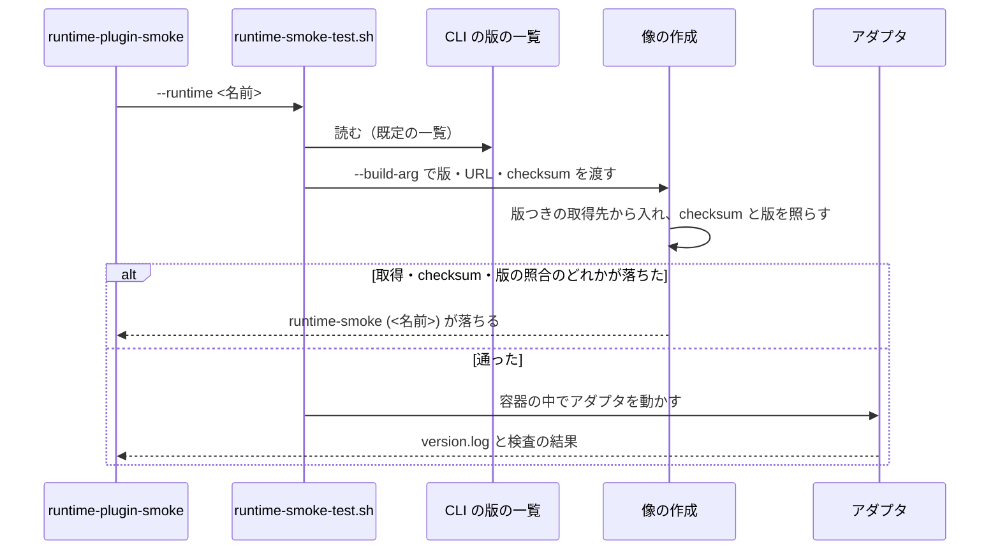
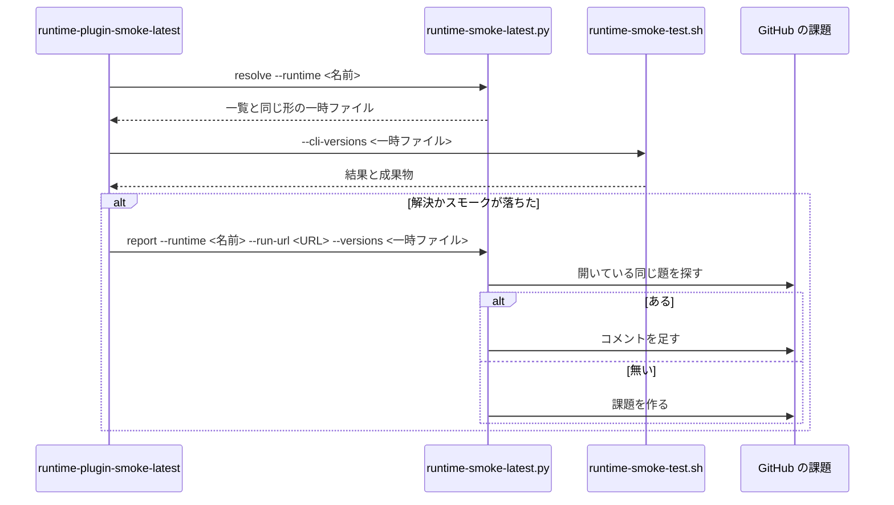

# Runtime Smoke CLI の版の固定と最新の版のスモーク 仕様

## 概要

継続的統合のスモークが入れる 4 ランタイム（claude・codex・kiro・agy）の CLI の版を、リポジトリの
中の 1 つのファイルに固定する仕様。あわせて、その時点の最新の CLI を毎日別の workflow で試し、
落ちたらランタイムごとに 1 件の課題に残す。

- **配布の経路**（develop・main 宛の Pull Request と、develop・main への push で走る継続的統合）の
  スモークは、リポジトリに書いた版の CLI だけを入れる。配布の可否は、こちらの変更と書いた版だけで決まる
- **最新の版のスモーク**は配布の経路の外で走り、新しい版との食い違いを配布の前に見つける

スモークそのもの（像・アダプタ・検査・成果物・secret mode）の仕様は
[Runtime Plugin Container Smoke Test 仕様](runtime-plugin-container-smoke.md) にあり、この文書は
版の固定と最新の版のスモークに関わる契約と判断だけを持つ。

## 用語

用語の定義は [用語集](../glossary.md) にある（「CLI の版の一覧」、`repo-dev-checks`）。
「配布の経路」と「最新の版のスモーク」は、上の概要の意味でこの文書の中だけで使う言い方であり、
用語集には載せない。

## 背景

2026-10-13 の本番 10.17.74 で、main 宛の
[PR #1976](https://github.com/devbasex/ai-plugins/pull/1976) の `runtime-smoke (agy)` が、
こちらの変更と関係なく agy 1.3.4 の出力の変化（`agy plugin list` の既定がテキストになり、JSON は
`--json` のときだけ・形も配列）だけで落ちた。本番のプランは 7 回打ち直して上限で止まり
（[#1983](https://github.com/devbasex/ai-plugins/issues/1983)）、即時修正
（[PR #1977](https://github.com/devbasex/ai-plugins/pull/1977)）と承認ゲート 2 の再承認が要った。
当時のスモークは 4 ランタイムの CLI を版を決めずに公式のインストーラか npm の最新で入れており、
kiro と agy は取得の失敗を `|| true` で読み飛ばしていた。kiro はこのため、一度も CLI が入らないまま
通っていた。

## 対象範囲

含む:

- 配布の経路のスモーク（`runtime-plugin-smoke.yml` の `runtime-smoke (<ランタイム>)`）、
  認証つきのスモーク（`runtime-plugin-authenticated-smoke.yml`）、手元の
  `scripts/runtime-smoke-test.sh` が入れる CLI の版
- 最新の版のスモーク（`runtime-plugin-smoke-latest.yml`）と、その失敗を課題に残す仕組み

含まない:

- 基底の像（`Containerfile.base` の `node:22-bookworm-slim` と apt のパッケージ）の版の固定
- 新しい版へ合わせるアダプタ・検査の修正（最新の版のスモークが見つけた後に、別の課題か PR で扱う）
- 必須のチェックの名前（ruleset が待つ `runtime-smoke (<ランタイム>)`）と、配布の PR でスモークを
  省く判定（`scripts/ci-heavy-skip.py`）。どちらもこの仕組みで変えない
- NDF の配布物（`plugins/`）と、利用者の環境へ入る CLI の版

## 仕様

### 構成要素と責務

| 要素 | 責務 |
| --- | --- |
| CLI の版の一覧（`tests/runtime-smoke/cli-versions.env`） | 4 ランタイムの版数・取得先・checksum を持つ。版を上げるときに書き換える唯一の場所。持ち主は版を上げる PR で、workflow は書き換えない |
| ランタイムの像（`tests/runtime-smoke/Containerfile.{claude,codex,kiro,agy}`） | 既定値の無い `ARG` で版を受け、版数を含む取得先から入れ、作成の中で版を照らす |
| スモークの起動（`scripts/runtime-smoke-test.sh`） | 一覧の各行を `--build-arg` として像の作成へ渡す。`--cli-versions <パス>` で別の一覧を受ける |
| アダプタ（`tests/runtime-smoke/adapters/kiro.sh`・`agy.sh`） | CLI が無いときに読み飛ばす分岐を持たない。`kiro-cli --version`・`agy --version` を `version.log` に残す |
| 最新の版の解決と課題の報告（`scripts/runtime-smoke-latest.py`） | `resolve` が取得元の最新を一覧と同じ形で出す。`report` が失敗の課題を作るか、開いている課題へコメントを足す |
| 最新の版のスモーク（`.github/workflows/runtime-plugin-smoke-latest.yml`） | 毎日と手で起動し、`resolve` → スモーク → 失敗なら `report` をランタイムごとに回す |

### 常に成り立つ条件

| # | 条件 | 破れたときの扱い |
| --- | --- | --- |
| I1 | 配布の経路の像に入った CLI の `--version` の出力から取り出した最初の版数（`[0-9]+(\.[0-9]+)+`）は、一覧の版数と完全に一致する（`1.3.4` に対する `1.3.40` は一致としない） | 像の作成が落ち、スモークが落ちる |
| I2 | 4 つの Containerfile が宣言する `ARG` の名前の和集合は一覧のキーの集合と一致する。各 `ARG` は接頭辞（`CLAUDE_CODE_`・`CODEX_`・`KIRO_CLI_`・`AGY_`）のランタイムの Containerfile にだけ現れ、既定値を持たない。一覧の値は空でない | 検査のテストが落ちる。値の無い `ARG` は像の作成で落ちる |
| I3 | 配布の経路の取得先は版数を含むものだけである。`latest` と公式のインストーラを使わない | 検査のテストが落ちる |
| I4 | 同じランタイムの、開いている最新の版のスモークの失敗の課題は高々 1 件である | 2 度目以降はコメントを足し、新しい課題を作らない |
| I5 | 最新の版のスモークは Pull Request と push で起動せず、権限は `contents: read`・`issues: write` だけで、secret を参照しない | 検査のテストが落ちる |

### 処理の流れ

### 設計判断

| 決定 | 理由 |
| --- | --- |
| 4 ランタイムの版を 1 つの一覧のファイルに置き、起動が build-arg で渡す | 最新の版のスモークは Containerfile を書き換えずに全部の版を差し替える必要がある。kiro と agy は版のほかに arch ごとの checksum と url を持ち、`ARG` 1 行に収まらない。`ARG` の既定値に版を書くと、版の出所が既定値と上書きの 2 つになる |
| 最新の版は先に具体的な版へ解決し、Containerfile は具体的な版だけを受ける | Containerfile に「`latest` なら公式のインストーラ」の分岐を持たせると、配布の経路が通らない取得の手順が残る。先に解決すれば、試した版が一覧の形で残り、版を上げる PR へそのまま写せる |
| claude・codex は npm の版つきの取得先、kiro・agy は版つきの tarball と一覧の checksum で入れ、公式のインストーラを使わない | kiro のインストーラは版を受けず、bookworm の glibc 2.36 では glibc 版が動かない（musl 版は動く）。agy のインストーラは最新の manifest だけを読む。codex のインストーラは `--release` を受けるが、インストーラ自体が版の無い URL にあり中身が版を変えずに変わりうる。kiro の版ごとの manifest は 403 で checksum を引けないため、checksum は一覧に持つ |
| 取得の失敗を読み飛ばさず像の作成を落とし、作成の中で版を照らす | `\|\| true` のままでは CLI が入らないまま通る（kiro が実際にそうだった）。CLI が無い状態が配布の経路で起こらなくなるため、アダプタの読み飛ばしの分岐も外した |
| 最新の版のスモークが落ちたら課題を作り、PR は作らない | 落ちたときに要るのは多くの場合アダプタの修正で、版だけを上げる PR は自分の必須のチェックで落ちる。`GITHUB_TOKEN` で作った PR では `pull_request` の workflow が走らず、必須のチェックの結果が返らない。PR を作る権限（`contents: write`・`pull-requests: write`）は課題の `issues: write` より広い |
| 課題はランタイムごとの題の完全一致で探し、通っても閉じない | 落ちる原因も直す PR もランタイムごとに別である。ラベルを使うと先に作る手順が増える。通ったことで閉じると、版を上げないまま課題が消える。閉じるのは直す PR である |
| develop を毎日 1 回試す | 次に配布するのは develop の中身である。claude は 30 日に 25 版を 21 日に分けて出しており（2026-09-13〜10-13、npm の `time`）、週 1 回では配布の日までに気づけない日がある。公開リポジトリのため実行時間は課金されない |
| 定期の起動が止まったことに気づく仕組みは持たない | 止まるのは公開リポジトリで 60 日動きが無いときで、develop へほぼ毎日 push がある。気づく仕組みも定期の起動に頼るため、同じ条件で止まる |
| 解決と報告を 1 本の Python スクリプトの 2 つの副命令にする | 取得元ごとの JSON の読み方と、作るかコメントするかの分岐は、workflow の YAML に書くとテストできない。版を上げる手順も同じ `resolve` を使い、解決の書き手を 1 つにする |

## データ・設定

### CLI の版の一覧（`tests/runtime-smoke/cli-versions.env`）

| 項目 | 契約 |
| --- | --- |
| 形 | 1 行 1 つの `KEY=VALUE`。`#` で始まる行と空行は読み飛ばす。値は引用符で囲まない |
| キー | 下の 10 個。Containerfile の `ARG` の名前と同じ |
| arch | キーの末尾は `uname -m` の値を大文字にしたもの（`X86_64`・`AARCH64`）。継続的統合の runner は x86_64、手元の Docker は aarch64 で動く |
| 欠け | キーが欠ける・値が空なら、像の作成と検査のテストが落ちる |

| キー | 値 |
| --- | --- |
| `CLAUDE_CODE_VERSION` | npm の `@anthropic-ai/claude-code` の版数 |
| `CODEX_VERSION` | npm の `@openai/codex` の版数 |
| `KIRO_CLI_VERSION` | kiro の版数 |
| `KIRO_CLI_SHA256_X86_64` / `KIRO_CLI_SHA256_AARCH64` | `kirocli-<arch>-linux-musl.tar.gz` の sha256 |
| `AGY_VERSION` | agy の版数 |
| `AGY_URL_X86_64` / `AGY_URL_AARCH64` | agy の manifest の `url`（版とビルド番号を含む） |
| `AGY_SHA512_X86_64` / `AGY_SHA512_AARCH64` | agy の manifest の `sha512` |

キーごとの取得先と、版を上げる手順（どの行を書き換え、何で確かめるか）は
[Runtime smoke README](../../tests/runtime-smoke/README.md#cli-の版) にある。

### `scripts/runtime-smoke-test.sh` の `--cli-versions`

| 項目 | 契約 |
| --- | --- |
| 形 | `--cli-versions <パス>` と `--cli-versions=<パス>` |
| 省いたとき | `tests/runtime-smoke/cli-versions.env` を読む。既存の呼び出し（配布の経路・認証つき・手元）は引数を変えずに固定した版を入れる |
| 出力 | 各行を `--build-arg KEY=VALUE` で各像の作成へ渡す（像が使わないキーは docker が警告して読み捨てる）。読んだ一覧を成果物の `cli-versions.env` に写す |
| 失敗 | ファイルが無い・読めないときは docker を呼ぶ前に終了コード 2。値の欠けは像の作成の失敗として 1 |

## 外部連携

### `scripts/runtime-smoke-latest.py`

| 副命令 | 入力 | 出力 | 失敗 |
| --- | --- | --- | --- |
| `resolve --runtime <claude\|codex\|kiro\|agy\|all>` | claude・codex は npm の `dist-tags` の `latest`、kiro は `stable/latest/manifest.json` の `version` と `packages[].download` が `<版>/kirocli-<arch>-linux-musl.tar.gz` の要素の `sha256`、agy は `linux_amd64`・`linux_arm64` の manifest の `version`・`url`・`sha512` | 標準出力へ、そのランタイムのキーを一覧と同じ形で出す（`all` は 4 ランタイム分） | 取得元に届かない・版数や checksum の形が読めない・agy の arch ごとの版が違う・agy の `url` が版を含まないときは終了コード 1 で、標準エラーへ取得元の URL を書く |
| `report --runtime <名前> --run-url <URL> [--versions <パス>] [--repo <owner/name>]` | 落ちたランタイム・実行の URL・入れた版の一覧 | 題 `最新の版のスモークが落ちた: <ランタイム>` の開いている課題があれば、番号の最も小さいものへコメントを足し、無ければ作る。本文とコメントにランタイム・入れた版・実行の URL を書く。一覧が無いか空なら版は「解決できなかった」と書く | `gh` が失敗したら終了コード 1（workflow の実行が失敗として残る） |

`--repo` を省くと `GITHUB_REPOSITORY`、それも無ければ `gh` の既定のリポジトリを使う。課題の本文に
GitHub の closing keywords（`Closes` などの後に番号を書くと、マージで課題を閉じる機能）は書かない。

### `.github/workflows/runtime-plugin-smoke-latest.yml`

| 項目 | 契約 |
| --- | --- |
| 起動 | `schedule`（毎日 21:00 UTC = 06:00 JST）と `workflow_dispatch`（入力 `ref`、既定 `develop`）だけ。定期の起動は `develop` を試す |
| ジョブ | `runtime-smoke-latest`、matrix `runtime: [claude, codex, kiro, agy]`、`fail-fast: false`。チェックの名前 `runtime-smoke-latest (<ランタイム>)` は必須のチェック `runtime-smoke (<ランタイム>)` と重ならない |
| 同時の実行 | `concurrency` の 1 つのグループで並べ、取り消さない |
| 報告の条件 | 解決かスモークの段が落ちたとき（`if: failure()`）に `report` を打つ |
| 残すもの | 解決した一覧を step summary へ、`tmp/runtime-smoke/<ランタイム>`（`version.log`・`cli-versions.env` を含む）を成果物 `runtime-smoke-latest-<ランタイム>` へ |

workflow の一覧の表（trigger・permissions・job・artifact）は
[Runtime Plugin Container Smoke Test 仕様](runtime-plugin-container-smoke.md#ci) にもある。

## エラー処理

| 起きたこと | 扱い |
| --- | --- |
| 一覧の版が取得元に無い・checksum が合わない・入った版が一覧と違う | 像の作成が落ち、`runtime-smoke (<ランタイム>)` が落ちる。版を上げる PR を進めず、一覧かアダプタを直す |
| 外部に新しい版が出た | 配布の経路は影響を受けない。最新の版のスモークが落ちれば課題が 1 件できるか、開いている課題へコメントが足される |
| 最新の版を解決できない | 解決の段が落ち、版を「解決できなかった」とした課題かコメントが残る |
| 課題を作れない（`gh` の失敗） | workflow の実行が失敗として残る |
| 定期の起動が止まった | 検知しない（設計判断を参照） |

## セキュリティ

- 最新の版のスモークの書き込みの権限は課題を作る `issues: write` だけにし、secret を参照せず
  `--with-secrets=off` で走らせる。`issues: write` は認可の変更に当たり、承認ゲート 2 で人が見た
- kiro と agy の取得物は、一覧に持つ checksum（sha256・sha512）で確かめてから置く
- 配布の経路は版数を含む取得先だけを使い、版を変えずに中身が変わりうるインストーラを通さない

## 運用

- 版を上げる手順は [Runtime smoke README](../../tests/runtime-smoke/README.md#版を上げる) にある。
  失敗の課題は、直す PR（版を上げる PR かアダプタの修正）のマージの後に閉じる
- 定期の起動は既定ブランチ（main）の workflow で動く。workflow を変えても、配布で main に載るまで
  定期の起動には効かない。ブランチの上の変更は `workflow_dispatch` の `ref` で試す
- 新しい workflow は `.ndf/project.json` の `ci.workflows` に自動では載らない。解析を走らせ直すまで
  食い違う

## テスト観点

| 観点 | 確かめ方 |
| --- | --- |
| 一覧のキーと `ARG` の対応・既定値の無さ・値の空でなさ（I2） | `scripts/tests/test_runtime_smoke_versions.py`。一覧から 1 行を消す・`ARG` に既定値を足す・値を空にすると落ちる |
| 版数と agy の `url` が具体的な版である | 同上。版数を版の形でない値にする・`url` を別の版にすると落ちる |
| 取得先が版つきで、`latest` と公式のインストーラを使わず、版を照らす（I1・I3） | 同上。Containerfile を `curl ... install.sh \| bash` や版の無い npm の取得先へ戻す・照合の行を消すと落ちる |
| 入った版が一覧と一致する（I1） | `runtime-smoke (<ランタイム>)` の成果物の `version.log` の版が一覧と一致する。一覧の版数だけを別の版にすると像の作成が落ちる |
| 最新の版のスモークの起動と権限（I5） | `test_runtime_smoke_versions.py`。`on` に `pull_request` を足す・`permissions` に `contents: write` を足す・secret を参照すると落ちる |
| `--cli-versions` の無いパス | 同上。docker を呼ぶ前に終了コード 2 |
| `resolve` が一覧と同じ形を出す | `scripts/tests/test_runtime_smoke_latest.py`（取得元を偽物にする）。4 ランタイム・2 つの arch のキーが出る。応答の形を壊すと終了コード 1 で取得元の URL が出る |
| `report` が課題を作る・開いている課題へコメントする（I4） | 同上（`gh` を偽物にする）。同じ題が無ければランタイム・版・実行の URL を書いて作り、あれば作らずにコメントする。`gh` が落ちると終了コード 1 |
| 必須のチェックと省く判定が変わらない | `runtime-plugin-smoke.yml` のジョブ名を変えると `required-checks-check` が落ちる。既存の `test_ci_heavy_skip.py`・`test_check_required_checks.py` が通る |
| 最新の版のスモークの落ちる経路 | ブランチの上で `workflow_dispatch` を起動し、取得か検査を一時的に落とした起動で課題ができ、2 度目で増えないことを見る |

## 関連リンク

- [issue #1982](https://github.com/devbasex/ai-plugins/issues/1982) — CLI の版の固定と最新の版のスモーク
- [Runtime Plugin Container Smoke Test 仕様](runtime-plugin-container-smoke.md)
- [Runtime Plugin Distribution 仕様](runtime-plugin-distribution.md)
- [Runtime smoke README](../../tests/runtime-smoke/README.md)
- [CLI の版の一覧](../../tests/runtime-smoke/cli-versions.env)
- [最新の版の解決と課題の報告](../../scripts/runtime-smoke-latest.py)
- [Runtime plugin smoke (latest CLI) workflow](../../.github/workflows/runtime-plugin-smoke-latest.yml)
- [Runtime plugin smoke workflow](../../.github/workflows/runtime-plugin-smoke.yml)
