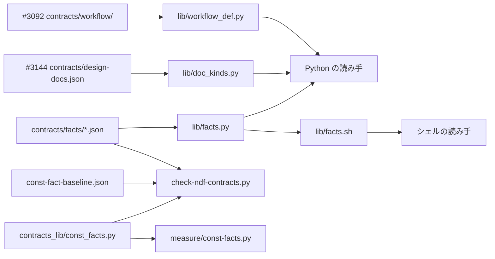
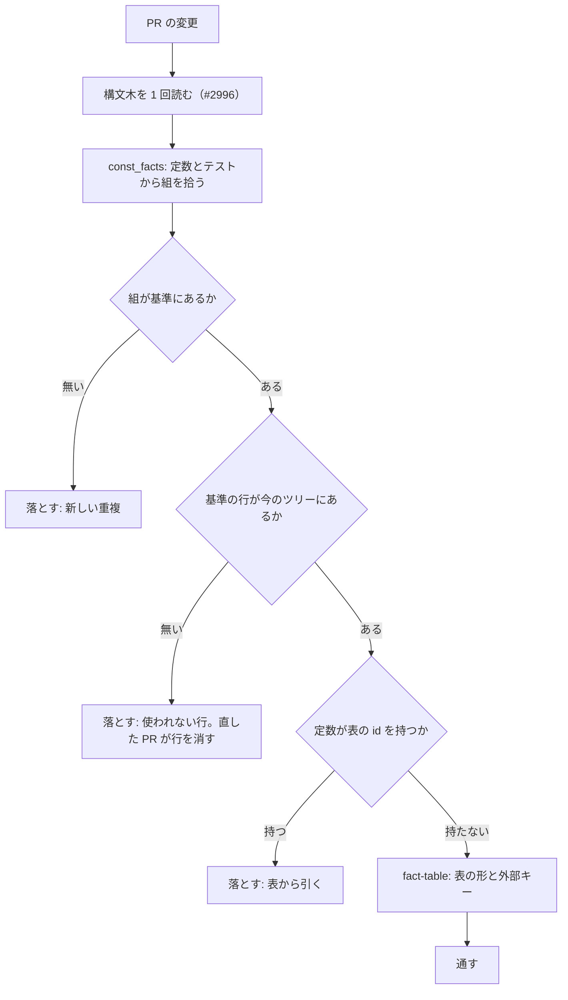

# 定数からデータへ: 同じ事実を 1 か所の表に置き、読む側はそこから引き、新しい重複を CI が止める（#1142）

## 目的

- **今どうなっているか**: 同じ事実（ランタイムの名前・モード・設計文書の種類・閾値など）を、複数のファイルの最上位の定数がそれぞれ文字列で持ち、一致はテストで確かめている。例: #3144 の詳細設計では、設計文書の種類を 1 つ足すのに 4 つの定数を直す形になった（`glossary.DEFAULT_PATHS`・`classifications.DESIGN_DOC_FILE_SUFFIXES`・`categories.DESIGN_DOC_SUFFIXES`・新設の `design_detail.DETAIL_SUFFIX`）。詳細設計を通るモードは、`workflow-common.sh` の `WF_STAGE_MATRIX` とテストの 2 か所に書かれた
- **誰に効くか**: NDF のスクリプトを直す worker と、そのレビュー。値を 1 つ足すたびに直す場所を探す手間と、直し漏れの不具合が減る
- **変えると何が成り立つか**: 事実ごとに文字列で書く場所が 1 つになり、値を足すときに直すファイルが 1 つになる。一致を確かめるテストが要らなくなり、新しく同じ事実を定数で書くと CI が落とす

## 適用範囲

- **働く範囲**: このリポジトリの `plugins/ndf` のスクリプト（テストと `experimental/` を除く `.py` と `.sh`）と、そのテスト。利用先のリポジトリでは働かない（検査は ai-plugins の CI だけで走る）
- **プロジェクトごとに違うもの**: 無い。表は NDF の事実を持ち、プロジェクトごとに違う値は今どおり `.ndf/` の宣言か引数で受ける（表は宣言の既定値の置き場にならない）
- **当たるモード**: #1142 の `standard`。移行ステップはそれぞれ #1142 の実装の PR として流す

## あるべき姿の根拠

| 根拠 | 種類 | 何を示すか |
| --- | --- | --- |
| 「定数が多すぎる。全体再設計で直すしかない」（2026-11-13、#3144 の詳細設計を見て） | 利用者の指示の原文 | 定数の重複をこの Issue の範囲で直す |
| 要求の決めたこと「同じ事実を複数の定数に持たせ、一致をテストで縛る作りをやめ、事実を 1 か所のデータ（宣言・契約の JSON・表）に置いて、読む側はそこから引く」 | 利用者の指示の原文 | 置き場はデータで、読む側は引く |
| `python3 scripts/measure/const-facts.py`（develop 01a53e912、2026-11-13）: 文字列の定数 1,563 個のうち 479 個が 417 組に入る | 実測 | 重複は点でなく面で起きている |
| STD1（JSON Schema の `enum`） | 外部の一次情報 | 値の集まりをデータとして宣言し、形を機械で確かめる標準の形がある |
| PRD1（GitHub Linguist の `languages.yml`） | 外部の一次情報 | 言語の一覧という事実を 1 つのデータに置き、ID は生成で足す運用が広く使われている |

要求と受け入れ条件は #1142 の本文にある。コピーは [issue-1142-requirements.md](issue-1142-requirements.md) の「定数からデータへ（2026-11-13 追記）」と、受け入れ条件「定数からデータへ」にある。この文書は「どう作るか」だけを扱う。

| 何を | どこにあるか |
| --- | --- |
| 全体の設計 | [issue-1142-design.md](issue-1142-design.md) |
| 移行の順序の全体 | [issue-1142-design-migration.md](issue-1142-design-migration.md) |
| 決定 1〜25 | [issue-1142-design-decisions.md](issue-1142-design-decisions.md) |
| 工程とモードの表（並行の設計） | #3092 の [issue-3092-design.md](issue-3092-design.md) |
| 設計文書の種類の契約（並行の設計） | #3144 の確定仕様 `docs/specifications/ndf-detailed-design-stage.md` の「設計文書の種類の契約」 |

## ドメインモデル

### コンテキスト

| コンテキスト | 何の語が 1 つの意味に決まるか |
| --- | --- |
| 契約（`plugins/ndf/contracts/`） | 事実の表・行・列・持ち主のモジュール・基準の行 |

コンテキストマップ: 契約は共有カーネル（[issue-1142-design.md](issue-1142-design.md) のライブラリと同じ扱い）で、各コンテキストは読み手として従う。表の形を変える PR は、読み手とそのテストを同じ PR で直す。

### 集約

| 集約 | 持ち主（書き換えてよいもの） | 根 | エンティティ | 値オブジェクト |
| --- | --- | --- | --- | --- |
| 事実の表 | 表の `owner` に書いた 1 つのコンテキスト（表ごとに 1 つ。ほかのコンテキストは読むだけ） | `contracts/facts/<名前>.json` | 行（`id` で決まる） | 列の値 |
| 外部の表: 既存の契約 | 契約（このコンテキスト。値を移す移行ステップの PR が、読み手とそのテストを同じ PR で直す） | `contracts/limits.json`・`contracts/settings/`・`contracts/forms/` | 行・方針 | — |
| 外部の表: 工程とモードの表 | #3092 の NDF の開発ワークフロー（工程の定義） | `contracts/workflow/` | 行・方針 | — |
| 外部の表: 設計文書の種類の契約 | #3144 の開発の工程（設計文書の種類） | `contracts/design-docs.json` | 種類の行 | — |
| 外部の表: 止まった理由の表 | #1142 のライブラリ（[issue-1142-design-scripted-flow.md](issue-1142-design-scripted-flow.md) の集約） | `contracts/causes.json` | 種類 | — |
| 重複の基準 | 移行ステップの PR（自分が直した行を消す）。定数を別のファイルへ移す PR は行を置き換える（I-DT4c） | `scripts/const-fact-baseline.json` | 基準の行（組のキーで決まる） | 種類・事実・扱い |

### 不変条件

| # | 集約 | 条件 | 破れたときの扱い |
| --- | --- | --- | --- |
| I-DT1 | 事実の表 | 1 つの事実は、1 つの表か 1 つの持ち主のモジュールの定数にだけ文字列で書かれる。ほかは引くか import する | CI の規則 `const-fact` が落とす（基準の行を除く） |
| I-DT2 | 事実の表 | 表は `contracts/facts/fact.schema.json` を満たし、`id` が表の中で重ならない | CI が落とす |
| I-DT3 | 事実の表 | 表の行が別の表を指す値（外部キー）は相手の表にある（例: 収束ループのフェーズと `limits.json` の `monitor.phase.<id>`） | CI が落とす |
| I-DT4a | 重複の基準 | 今のツリーで拾った組は、すべて基準にある | 増えた組として CI が落とす。組を増やした PR の中で直す |
| I-DT4b | 重複の基準 | 基準の行は、すべて今のツリーで見つかる | 使われない行として CI が落とす。組を直した PR が、同じ PR で基準の行を消す |
| I-DT4c | 重複の基準 | 定数を別のファイルへ移す PR は、基準の行を置き換えてよい。merge-base と比べて、種類・事実・定数の名前が同じでファイルだけが違う行を、消した数と同じ数だけ足した分は増えた行に数えない | 置き換えに当たらない行の追加は、決定 50 の比較（merge-base より行が増えた変更）が落とす |
| I-DT5 | 重複の基準 | 基準の行はすべて扱い（`移す: DC<1〜8>` か `移さない: <理由>`。移す先は詳細設計の子 Issue の番号）を持つ | CI が落とす |
| I-DT6 | 事実の表 | 実行時の読み手は標準ライブラリの `json` だけで表を読む（hook の経路でも読む） | 構造チェックの `hook-deps` と同じ形で落とす |

### ドメインイベント

| # | イベント | 発生元 | 受け手 |
| --- | --- | --- | --- |
| E1 | 移行の前の基準を測った（重複の組 417） | `scripts/measure/const-facts.py` | 基準のファイル |
| E5 | 事実を表へ移した（移行ステップ DT2〜DT8） | 移行ステップの PR | 基準のファイル（行を消す） |
| E9 | 移行の後を同じ計測で測り直した | `scripts/measure/const-facts.py` | 振り返り |

### 用語

| 用語 | 意味 | 用語集への反映 |
| --- | --- | --- |
| 事実の表 | 1 つの事実（例: ランタイムの一覧）を行と列で持つ契約の JSON。`contracts/facts/` の 1 ファイル | 追加 |
| 持ち主のモジュール | 1 つのコンテキストの Python だけが読む事実を、定数として 1 か所で持つモジュール。ほかのモジュールは import する | 追加 |
| 重複の組 | 同じ事実を持つと見える 2 つ以上の最上位の定数の組。種類は `same-set`・`subset`・`affix`・`same-str`・`member`・`same-num` | 追加 |
| 重複の基準 | 移行の前に拾った重複の組と、組ごとの扱いの一覧。ラチェットの基準になる | 追加 |

## 外部の調査

| 種類 | 調べるか | 理由 |
| --- | --- | --- |
| 標準・仕様 | 調べる | 値の集まりをデータとして宣言し機械で確かめる形（JSON Schema）を使うか決める |
| 主要な製品 | 調べる | 一覧の事実を 1 つのデータに置く運用と、重複した文字列を落とす静的解析の製品の形を比べる |
| ライブラリとサービス | 調べる | 表の形の検査・読み手の型・重複の検査を、既存のライブラリで得られるか決める |

### 標準・仕様

| # | 標準・仕様 | 何を定めているか | 設計への反映 | 出典 |
| --- | --- | --- | --- | --- |
| STD1 | JSON Schema Validation（draft 2020-12、draft-bhutton-json-schema-validation-01） | `enum` は値が配列の要素のどれかに等しいこと、`const` は 1 つの値に等しいことを定める（6.1.2・6.1.3）。IETF の Internet-Draft の状態 | 表の形を `fact.schema.json` で宣言し、ほかの契約が表の `id` を `enum` で指せる形にする。#3092 も同じ draft で検査する | https://json-schema.org/draft/2020-12/json-schema-validation （2026-11-13） |

### 主要な製品

| # | 製品 | どう解いているか | 設計への反映 | 出典 |
| --- | --- | --- | --- | --- |
| PRD1 | GitHub Linguist | 言語の定義（拡張子・TextMate のスコープ）を `languages.yml` に置き、言語の追加はこのファイルの変更で行う。ID は `script/update-ids` が生成する | 事実は 1 つのデータに置き、そこから導けるもの（部分集合・ID）はコピーせず生成か引く | https://github.com/github-linguist/linguist/blob/main/CONTRIBUTING.md （2026-11-13） |

### ライブラリとサービス

| # | 候補 | 版 | ライセンス | 最後のリリースの日付 | 終了のアナウンス | 要件を満たすか | 出典 |
| --- | --- | --- | --- | --- | --- | --- | --- |
| LIB1 | `jsonschema` | 4.26.0 | MIT | 2026-01-07 | 無し | 満たす。draft 2020-12 で表の形を検査できる。最初に使う DT1 が、手元の検査とデプロイ先の両方で使えるようにする（決定 46）。#3092 は決定 3 で足すとしたが、マージした実装（v10.27.61）は依存に入れていない | https://pypi.org/pypi/jsonschema/json （2026-11-13） |
| LIB2 | `check-jsonschema` | 0.39.0 | PyPI の license 欄は空（確かめていない） | 2026-10-26 | 無し | 一部。スキーマに照らす CLI で、表の外部キーと定数との重複は見られない | https://pypi.org/pypi/check-jsonschema/json （2026-11-13） |
| LIB3 | `pydantic` | 2.14.3 | MIT | 2026-11-05 | 無し | 満たさない。読み手の型は作れるが、hook の経路で外部パッケージを読まない（I-DT6・決定 20） | https://pypi.org/pypi/pydantic/json （2026-11-13） |
| LIB4 | `pylint` の `duplicate-code`（R0801） | 4.1.3 | GPL-2.0-or-later | 2026-10-11 | 無し | 確かめられなかった（下）。名前からは似た行の検出で、定数の値の集合の一致を見るものではない | https://pypi.org/pypi/pylint/json （2026-11-13） |
| LIB5 | `ruff` の `PLR2004`（magic-value-comparison） | 0.16.9（このリポジトリの lock） | MIT | — | 無し | 満たさない。比較の中の名前の無い値を指摘する規則で、2 つの定数が同じ事実を持つことは見ない | https://docs.astral.sh/ruff/rules/magic-value-comparison/ （2026-11-13）、`uv run --frozen --project . --all-extras ruff --version` |

### 確かめられなかったこと

| 対象 | 試した手段 | 結果と理由 |
| --- | --- | --- |
| SonarQube の重複した文字列の規則（python:S1192） | https://rules.sonarsource.com/python/RSPEC-1192/ | HTTP 301 で製品の紹介のページへ移され、規則の本文を取れなかった |
| `pylint` の `duplicate-code` の対象と設定 | https://pylint.readthedocs.io/en/stable/user_guide/messages/refactor/duplicate-code.html | メッセージの一覧のページで、規則の説明が無かった |
| `ruff` に重複した文字列の定数を落とす規則があるか | 検索「ruff rule duplicated string literal constant "PLR" OR "magic value" duplicate literal」 | 見つかったのは `PLR2004` だけ。「無い」とは確かめていない |

調べた量: 候補 7 件・取得の試み 10 回。

## 測った結果

**組は 417 で、組に入る定数は 479 個（文字列の定数 1,563 個の 31%）である。** develop 01a53e912、2026-11-13、`python3 scripts/measure/const-facts.py`（`--json` で 1 行 JSON）。数え方はスクリプトの docstring にある。要求の計測表の「54 / 2,270」は、2 つ以上のファイルで同じ値を持つ値の数と、文字列に限らない最上位の定数の総数で、数え方が違う。

| 種類 | 拾うもの | 組 |
| --- | --- | ---: |
| `same-set` | 2 つ以上のファイルの定数が同じ文字列の集合を持つ | 35 |
| `subset` | 文字列の集まりが別のファイルの集まりに含まれる | 202 |
| `affix` | 6 文字以上の 2 つ以上の要素が、別の集まりの要素の接頭辞か接尾辞になる（例: `-design.md` と `issues/*-design.md`） | 15 |
| `same-str` | 4 文字以上の同じ文字列を 2 つ以上のファイルの定数が丸ごと持つ | 41 |
| `member` | 文字列の定数が別のファイルの集まりの要素になる | 109 |
| `same-num` | 同じ名前で同じ数の定数が 2 つ以上のファイルにある | 15 |
| `test-bind` | テストの assert が別々のモジュールの 2 つの定数の一致を確かめる | 5 |
| `test-parse` | テストが定数の定義の文字列（`NAME=…`）を正規表現で読む | 26 |
| `test-literal` | テストの 3 つ以上の文字列の集まりが、定数の集まりと同じ集合になる | 138 |

#3144 の例のうち、`design_detail.DETAIL_SUFFIX` はまだ無い（`grep -rn "^DETAIL_SUFFIX" plugins/ndf --include=*.py` が 0 件）。残りの 3 つは `affix` 2 組と `subset` 1 組で拾えた。`WF_STAGE_MATRIX` はシェルの表の 1 列目を工程名の並びとして読む。これを読むテストの 1 本（`test_document_rebuild_stage.py`）が `test-parse` で拾えた。

**拾えないもの**が 2 つある。これらは要求の計測表の 6（4 つ以上のファイルに出る文字列）の側で扱う。

| 拾えないもの | 理由と扱い |
| --- | --- |
| 定数と `.md` の表の一致を確かめるテスト（`test_transcript_agents.py` の `STEP_PHASES` と `agent-layers.md`） | 構文木に現れない。`grep -rn "\.md\"" plugins/ndf --include=test_*.py` で手で拾った |
| 関数の中の文字列（定数に名前が無いもの） | 拾わない |

## 事実ごとの移し先

組を、値の中身から事実に分けた。分け方は文字列の規則で、分けたスクリプトは作業の手元の `classify.py` である。

下の表は、事実ごとの組・定義の数と、定義を持つファイルの直近 60 日の変更の回数の合計である（`git log --since=60.days --format= --name-only -- plugins/ndf`）。`glossary.py` は用語の同期のコミットで 1,062 回あり、これを含む事実は大きく出る。

### 上位 10 と、要求が挙げた 2 つ

| 事実 | 組 | 定義 | 変更 | 移し先 | 読む側 | 移さない分と理由 |
| --- | ---: | ---: | ---: | --- | --- | --- |
| 結果の状態の語（`failed`・`pending`・`完了` など） | 46 | 81 | 2,354 | GitHub の check の結論の 2 組（`gh_checks.FAILED_CONCLUSIONS` と `review_lib/ci.CI_FAILED_CONCLUSIONS`、`gh_checks.CI_ONLY_PASSING` と `gh_pr_status.OK_RESULTS`）は持ち主のモジュール `lib/gh_checks.py`。DBOS の状態（`durable.RUNNING` ほか 2 つ）は `lib/durable.py` | import | 残りは移さない。別の状態機械の語が同じ文字列を持つだけで、事実が違う（R3） |
| 閾値と版 | 15 | 38 | 714 | 名前の同じ閾値（`TAIL_LINES`・`RECORD_DAYS`・`ERROR_EXCERPT`・`RECLAIM_LIMIT`・`BODY_MATCH_CHARS` と `OSCILLATION_BODY_CHARS`・`FOREIGN_WINDOW` と `WINDOW`）は既存の `contracts/limits.json` の方針 | `limits.get(<方針>)` | 形式の版（`VERSION = 1`・`DECLARATION_VERSION = 1`）は移さない。ファイルの形式ごとに別の事実（決定 28、R4） |
| 結果 JSON の `tool` の名前 | 17 | 31 | 1,635 | エントリポイントのモジュールの `TOOL` を持ち主にする | 下のモジュールは import か引数で受ける | 偶然の一致（`TOOL = "release"` と `DEV_SERIES = "release"`）は移さない（R3） |
| ランタイム（`claude`・`codex`・`kiro`・`agy`） | 105 | 18 | 175 | 新しい表 `contracts/facts/runtimes.json`。行はランタイム（輪番の順）、列は `default_seat`・`hook_events`・`usage_observable`・`delegate`・`executable`・`label`・`host_env`・`auth_probe`・`model_probe`・`model_args`（詳細設計の「内部のデータと定数」） | `facts.ids("runtimes", default_seat=True)` などの条件で引く。部分集合を定数へコピーしない | 無し。テストの文字列の集まり 79 か所も表から引く形に直す |
| 宣言と状態のファイル名（`.ndf/worktree.json`・`.worktrees`・`glossary.json` ほか） | 8 | 18 | 1,226 | 既存の `contracts/settings/<名前>.json` の `file` と、新しい表 `contracts/facts/places.json`（`.ndf`・`.worktrees`） | `facts.setting_path("worktree.json")`。シェルは `lib/facts.sh` | 無し |
| 工程名とフェーズ（`設計`・`実装`・`検査`・`仕上げ`・`取り込み`） | 8 | 14 | 304 | #3092 の工程の文書 `contracts/workflow/stages/<工程>.json` の `metadata.ndf.phase` に置く（#3092 の後。語彙 `workflow_def.VOCABULARY` へ `phase` を 1 つ足す） | `STEP_PHASES`・`STAGE_PREFIXES`・`POSTS`・`WF_FAST_*_STAGES` は工程の文書から導く | 無し。`agent-layers.md` の表との一致のテストを消す |
| 収束ループのフェーズ（`fix`・`implement`・`add-tests` ほか） | 20 | 13 | 418 | 新しい表 `contracts/facts/loop-phases.json`。列は `coding`・`fix`・`resume_as`。`limits.json` の `monitor.phase.<id>` は外部キー（I-DT3） | cross-review と cross-refactoring の両方が同じ表を引く | 無し |
| 指摘の重さ（`critical`・`major`・`minor`・`nit`） | 14 | 12 | 70 | 新しい表 `contracts/facts/severities.json`。列は `rank`・`blocking` | cross-review・fix・pr-review・`lib/body_findings.py` | 無し |
| 環境変数名（`NDF_CLAUDE_ACCOUNT` ほか） | 7 | 11 | 124 | 持ち主のモジュール（`lib/claude_accounts.py`・`lib/claude_api_keys.py`）の定数。`lib/assignee_env.py` は import | import | `contracts/env/` は登録簿で、コードとの一致を `check-ndf-contracts.py` が既に見るためコピーに数えない |
| PR 本文の見出しと印（`## 利用者向けの変化`・`## 移行の手順`・`## 同意を求めること`・レビューの印） | 7 | 11 | 101 | 既存の置き場 `contracts/forms/` に `pr-body.json` を足す | `pr-steps.py`・`release_lib/`・`lib/step_result.py` が引く | 無し |
| モード（要求の例） | 11 | 7 | 1,187 | #3092 のモードの文書 `contracts/workflow/modes/` から導く。「設計を通るモード」は工程「設計」を持つモード、「詳細設計を通るモード」は工程「詳細設計」を持つモード | `glossary.DESIGN_MODES`・`pace.DEFAULT_MODES` は導出に変える | 無し。`WF_MODES`・`WF_MODE_HEIGHT` を正規表現で読むテスト 5 か所を消す |
| 設計文書の種類（要求の例） | 3 | 3 | 1,075 | #3144 の `contracts/design-docs.json` | #3144 の `lib/doc_kinds.py` | 無し。#3144 の実装が移し終えた（`const-facts.py --json` に `-design.md` を持つ組が 0 件。2026-11-13、HEAD 7fc42b7b8）。基準を作る時点で行が無い |

### 残りの事実（規則で扱う）

上の 12 を除く組は、事実に分けた 35 組と、どの事実にも分けられなかった 121 組（定義 222）である。どれも次の規則で扱い、基準の行に扱いを書く（I-DT5）。

| 規則 | 当てる組 | 扱い |
| --- | --- | --- |
| R1 | 2 つ以上の言語（Python とシェル・`.md` の表）か、2 つ以上のコンテキストが読む事実。機能を足すと値が増える集まり | 表へ移す。既存の契約に置き場があればそこ、無ければ `contracts/facts/<名前>.json` |
| R2 | 1 つのコンテキストの Python だけが読む事実と、外部の仕様の語（GitHub・DBOS） | 持ち主のモジュールの定数にし、ほかは import |
| R3 | 別の事実が同じ文字列を持つだけの組（状態の語・汎用の語・偶然の部分集合） | 移さない。基準に `移さない: 別の事実（<それぞれの事実>）` で残す |
| R4 | ファイルの形式の版 | 移さない（決定 28） |
| R5 | 部分集合で、部分が全体の属性で決まるもの（例: 導入先のランタイム） | 全体の表に列を足し、部分は条件で引く |

> **#3347:** この表の「決定 28」は系統 `dbos` の決定 28（[issue-1142-design-dbos.md](issue-1142-design-dbos.md)。形式の版を NDF の版から切り離す）である。作り直しでの扱いは、#1142 の作り直しの決定 77（next）と #3344 の差分が持つ。

上の表に無い事実のうち、名前を挙げて移し先を決めたものは次のとおりである。

| 事実 | 定義 | 規則 | 移し先 |
| --- | ---: | --- | --- |
| ブランチの接頭辞（`sprint/`・`design/`・`release/`。`WF_DESIGN_PREFIX` をシェルが持つ） | 8 | R1 | `contracts/facts/branches.json` |
| 承認ゲートと承認のラベル（`design`・`release`・`design-approved`。`WF_APPROVAL_LABEL` をシェルが持つ） | 6 | R1 | `contracts/facts/gates.json` |
| 進め方（`auto`・`fast`・`normal`。`WF_PACES`） | 5 | R1 | #3092 の後に `contracts/workflow/paces.json` |
| 指示書のファイル（`AGENTS.md`・`CLAUDE.md`・`KIRO.md`） | 6 | R1 | `contracts/facts/instruction-files.json` |
| テストの置き場と名前の印（`TEST_PATH_MARKERS`・`TEST_NAME_MARKERS`。cross-review と cross-refactoring の 2 つのコンテキストが読む） | — | R1 | `contracts/facts/test-markers.json` |
| 版の上げ幅・実行主体の層・プランの種類 | — | R2 | 持ち主のモジュールへ寄せる |

## 構成要素

| 要素 | 責務 |
| --- | --- |
| `contracts/facts/<名前>.json`（新設） | 事実の表。行と列だけを持ち、コードを持たない |
| `contracts/facts/fact.schema.json`（新設） | 表の共通の形（STD1） |
| `plugins/ndf/scripts/lib/facts.py`（新設） | 実行時の読み手。`contracts/facts/` の表を標準ライブラリの `json` で 1 プロセスに 1 回読み、行・`id`・条件での絞り込みを返す。副命令 `ids`・`value` でシェルにも返す。契約の置き場の探し方（`contract_path`）も持ち、`lib/limits.py`・`lib/doc_kinds.py` はそれを呼ぶ。#3092 と #3144 の文書は読まない（それぞれの読み手 `lib/workflow_def.py`・`lib/doc_kinds.py` が持つ） |
| `plugins/ndf/scripts/lib/facts.sh`（新設） | シェルの読み手。`ndf_fact_ids <表> [<列>=<値>]` が `lib/facts.py ids` を 1 回呼び、改行区切りで受ける |
| `scripts/contracts_lib/const_facts.py`（新設） | 重複の組を拾うコア。`scripts/measure/const-facts.py` と検査が同じコアを呼ぶ |
| `scripts/contracts_lib/const_baseline.py`（新設） | 重複の基準の読み込み・扱いの形の検査・今の組との照合 |
| `scripts/contracts_lib/facts_decl.py`（新設） | 表の形（`jsonschema`）・外部キー・逆引きの節「事実の表」 |
| `scripts/check-ndf-contracts.py`（変更） | 規則 `const-fact`（重複の組と基準の照合）と `fact-table`（表の形・外部キー）を足す |
| `scripts/const-fact-baseline.json`（新設） | 重複の基準。組のキー・種類・事実・扱い |
| `scripts/measure/const-facts.py`（この設計の PR で新設） | 移行の前後を測る。DT1 でコアを `const_facts.py` へ移し、出力は変えない（E9 で同じ計測を使うため。後方互換のためではない） |



## データ構造

**表は 1 事実 1 ファイルで、行の `id` が事実の値である。** 部分集合は列で表し、別の定数へコピーしない。

```json
{
  "version": 1,
  "summary": "NDF が起動するランタイム",
  "owner": "外部 CLI の起動",
  "columns": {
    "default_seat": {"type": "boolean", "summary": "cross-review・cross-refactoring の既定の母集合に入る"},
    "usage_observable": {"type": "boolean", "summary": "使用量の実測を取れる"}
  },
  "rows": [
    {"id": "claude", "default_seat": true, "usage_observable": true},
    {"id": "codex", "default_seat": true, "usage_observable": true},
    {"id": "agy", "default_seat": false, "usage_observable": false},
    {"id": "kiro", "default_seat": true, "usage_observable": false}
  ]
}
```

| キー | 型 | 意味 |
| --- | --- | --- |
| `version` | 整数 | 表の形式の版（決定 28 と同じく NDF の版から切り離す） |
| `summary` | 文字列 | 事実の 1 行の説明。`contracts/index.md` の逆引きに出る |
| `owner` | 文字列 | 表を書き換えてよいコンテキスト（[issue-1142-design.md](issue-1142-design.md) のコンテキストの名前） |
| `columns` | 名前 → `{type, summary, optional?, ref?}` | 列。型は `boolean`・`string`・`integer`・`array`（文字列の配列）。`ref` は外部キーの先（例: `limits.json#monitor.phase.`）。列 `id` にも `ref` を書ける |
| `rows` | 配列 | 並びは意味を持つ（工程の順のように順序が事実のときは並びで表す） |

> **#3347:** この表の「決定 28」は系統 `dbos` の決定 28（[issue-1142-design-dbos.md](issue-1142-design-dbos.md)。形式の版を NDF の版から切り離す）である。作り直しでの扱いは、#1142 の作り直しの決定 77（next）と #3344 の差分が持つ。

**基準の行**（`scripts/const-fact-baseline.json` の `rows`）:

| キー | 意味 |
| --- | --- |
| `key` | 組のキー。種類と、`<ファイル>:<定数の名前>` を並べた文字列（行番号を含めない。行がずれてもキーは変わらない。ファイルを移すと変わるため、移す PR は I-DT4c の置き換えで行を書き換える） |
| `kind` | 重複の組の種類 |
| `fact` | 事実の名前（上の表の 1 列目） |
| `plan` | `移す: DC<1〜8>` か `移さない: <理由>`（移す先は詳細設計の子 Issue の番号。移行ステップ DT との対応は詳細設計の「子 Issue の分け方」） |

読み手の逆引き（どのエントリポイントがどの表を読むか）は、コードの呼び出しから拾う。拾う呼び出しは `facts.ids("<表>")` と `ndf_fact_ids <表>` で、`check-ndf-contracts.py --render` が `contracts/index.md` に節「事実の表」を生成する。表に `readers` を手で書かない（コピーになる）。

## 入出力の契約

`check-ndf-contracts.py` の結果 JSON の形（`{"tool", "status", "summary", "items", "metrics"}`）と終了コードは変えない。`items` に規則を 2 つ足す。

| 規則 | 落とすもの | 項目の `name` |
| --- | --- | --- |
| `const-fact` | 基準に無い重複の組（新しい重複）。基準にあって今のツリーに無い行（使われない行）。扱いの無い基準の行。表の値（`id`）と同じ文字列を持つ新しい定数と、表の `id` を 2 つ以上含む新しい定数の集まり（I-DT1） | 組のキー |
| `fact-table` | `fact.schema.json` を満たさない表・重なる `id`・相手に無い外部キー | `<表>:<行>` |

基準の増減は、既存のラチェット（`contracts_lib/ratchet.py`）と同じく、ベースブランチとの merge-base の基準より行が増えた変更を落とす。

## 処理の流れ



## 決定の記録

### 決定 45: 事実を文字列で書く場所を 1 つにするため、2 つ以上の言語かコンテキストが読む事実は契約の表に、1 つのコンテキストの Python だけが読む事実は持ち主のモジュールの定数に置く

表へ移すと、読み手が増えても値は 1 か所で、シェルと `.md` の検査も同じ値を引ける。1 つのコンテキストの中だけで読む事実まで表へ移すと、import 1 つで済むものにファイルと読み手の呼び出しが増え、読む量が増える。外部の仕様の語（GitHub の check の結論・DBOS の状態）は外部が決めるため、表にせずアダプターが持つ。

すべてを表へ移す案は、1 コンテキストの事実にも表と検査が要り、移す量が 479 定義に広がるため採らない。すべてを持ち主のモジュールの定数にする案は、シェルの定数（`WF_*`）と `.md` の表がコピーのまま残るため採らない。

根拠: Value 8・Value 11（MVV 版 7）

### 決定 46: 表の形をそろえて機械で確かめるため、新しい事実は `contracts/facts/<名前>.json` の 1 事実 1 ファイルにし、JSON Schema の draft 2020-12 で形を確かめる

#3092 と同じ draft と同じ `jsonschema` を使い、別の依存を増やさない。`jsonschema` は、最初に使う移行ステップの DT1（詳細設計の DC1）が依存に足す。

| 置き場 | 足すもの |
| --- | --- |
| リポジトリ直下とプラグインの `pyproject.toml` | グループ `jsonschema` |
| `lib/deps.py` の `GROUPS` | 同じグループ |

これで、手元の検査とデプロイ先（プラグインの依存の導入の経路。#3092 の決定 3 と同じ置き場）の両方で使える。#3092 の決定 3 のグループ名 `workflow` ではなく、このグループを共有する。片方だけだと、DT1 の後に流す scripted-flow の SF6 が、デプロイ先で答えを確かめ直すときに依存が無くて止まる。

#3092 は決定 3 で `jsonschema` を足すとした。しかしマージした実装（PR #3171、v10.27.61）は依存に入れておらず、公式スキーマの検査も置いていない。そのため DT1 が足し、#3092 の決定 3 の検査を後から置くときもこの依存を使う。

1 事実 1 ファイルにすると、移行ステップごとに触るファイルが分かれ、並列の PR が衝突しない。部分集合は列で表し（R5）、Linguist の `languages.yml` と同じく一覧は 1 つのデータにだけ書く。

1 つの大きな JSON に全事実をまとめる案は、すべての移行ステップが同じファイルを触って並列に流せないため採らない。YAML は標準ライブラリで読めず hook の経路で使えないため採らない。

- 作り方: 標準に倣う・ライブラリやサービスを使う
- 比べた候補: STD1 / LIB1 / LIB2 / PRD1

根拠: Value 8・Value 12（MVV 版 7）

### 決定 47: hook の経路でも同じ表を読めるよう、実行時の読み手は標準ライブラリの `json` だけで 1 プロセスに 1 回読む `lib/facts.py` 1 つにし、部分集合は列の条件で引く

hook は用意済みの環境の python を直に起動し、外部パッケージを前提にできない（決定 20）。`lib/limits.py` が `limits.json` を同じ形で読んでおり、読み方を 1 つにそろえる。形の検査は CI（`fact-table`）が `jsonschema`（DT1 が足す依存。決定 46）で行い、実行時は検査しない。

`pydantic` で型付きの読み手を作る案は、hook の経路に外部パッケージを入れるため採らない。表ごとに読み手のモジュールを作る案は、読み方が表の数だけ増えるため採らない。

- 作り方: 自前で作る
- 比べた候補: LIB3 / LIB1

根拠: Value 9・Value 11（MVV 版 7）

### 決定 48: シェルを Python へ書き換えずに同じ表を読むため、シェルは `lib/facts.sh` の関数が `lib/facts.py ids` を 1 回呼んで値を受ける

シェルを書き換えない方針（決定 14）を保ったまま、`WF_DESIGN_PREFIX`・`WF_APPROVAL_LABEL`・`WT_DECLARATION_FILE` のコピーを無くせる。呼ぶのは source の時点の 1 回で、bash 3.2 で動く形（改行区切りの読み）にする。

シェルの定数を残し、表との一致を検査で確かめる案は、値を足すときに直すファイルが 2 つのまま残るため採らない。ビルドの時点でシェルの定数を生成する案は、生成物を持つファイルと生成の手順が増えるため採らない。

根拠: Value 11・Value 3（MVV 版 7）

### 決定 49: 工程・モード・設計文書の種類を 2 か所の表に持たないため、並行の設計の置き場（#3092 の `contracts/workflow/`、#3144 の `contracts/design-docs.json`）をそのまま正とし、この設計は導出と検査だけを足す

工程とモードの文書は #3092 が、設計文書の種類の契約は #3144 が作る。この設計が別の表を作ると、同じ事実が 2 つの表に分かれる。工程とフェーズの対応は工程の文書の `metadata.ndf.phase` に置き（#3092 の後の DT6）、「詳細設計を通るモード」はモードの文書から導く。

工程とモードの表をこの設計で先に作る案は、#3092 と同じファイルを触り、置き場が食い違うため採らない。

根拠: Value 11・Value 8（MVV 版 7）

### 決定 50: 新しい重複を止めるため、`check-ndf-contracts.py` に規則 `const-fact` と `fact-table` を足し、基準を `scripts/const-fact-baseline.json` の 1 ファイルに置いて merge-base より行が増えた変更を落とす

コードと契約を突き合わせる検査は `check-ndf-contracts.py`（ジョブ `ndf-contracts-check`）が持つ。merge-base との比較（`fetch-depth: 0`）と `allow-added` のラチェットも既にある。

基準は 417 組と多い。既存の例外リストの 1 項目 1 ファイルの形にすると 400 余りのファイルになるため、1 ファイルの行で持つ。

「AI が陥りやすい作り」の兆候の基準ファイル（[issue-1142-design-smells.md](issue-1142-design-smells.md) の決定 37）は、元のファイル 1 本に 1 つで持つ。置き方が違うのは、書き換える者の数が違うためである。兆候の基準は、兆候を減らしたどの PR も書き換える（決定 38）。そのため 1 ファイルにすると、並列の PR が同じファイルで衝突する（#1249）。重複の基準の行を書き換えるのは、次の 2 つの PR である。

- 事実を移す移行ステップの PR
- 定数を別のファイルへ移す PR（子 Issue #2990〜#2995）。行を同じ数だけ置き換えるだけで、行は増えない（I-DT4c）

重複を拾うコアは `contracts_lib/const_facts.py` に置き、計測のスクリプトも同じコアを呼ぶ（数え方を 2 つにしない）。構文木は #2996 の 1 回の解析を使う。

静的解析の既存の規則で済ませる案は採らない。`ruff` の `PLR2004` は比較の中の名前の無い値だけを見て、2 つの定数が同じ事実を持つことを見ない。`pylint` の `duplicate-code` は対象を確かめられず、似た行の検出で値の集合の一致を見るものではないと判断した。構造チェック（`check-script-structure.py`）に置く案は、merge-base との比較を持たず、#2991 と同じファイルを触るため採らない。

- 作り方: 自前で作る
- 比べた候補: LIB4 / LIB5 / LIB2

根拠: Value 11・Value 3（MVV 版 7）

### 決定 51: 一覧の箇所ごとに扱いを残すため、基準の行は `移す: <移行ステップ>` か `移さない: <理由>` を持ち、別の事実が同じ文字列を持つだけの組と形式の版は移さない

要求の受け入れ条件は、箇所ごとに移したか移さない理由が残ることを求める。文字列が同じでも事実が違う組（CI の結論の `failed` と投稿キューの `failed`）を 1 つにすると、片方の事実の変更がもう片方を壊す。形式の版はファイルの形式ごとに別に上がる（決定 28）。扱いの無い行は検査が落とす（I-DT5）。

組をすべて移す対象として扱う案は、偶然の一致を結び付けて結合を増やすため採らない。

根拠: Value 14・Value 8（MVV 版 7）

### 決定 52: 一致を確かめるテストを残さないため、移した事実の一致のテストはその移行ステップの PR で消し、振る舞いのテストは表から引いた値で書き直す

事実が 1 か所になれば、2 つの定数の一致は成り立つ以外にない。テストに値をコピーした文字列の集まり（`test-literal` 138 か所）は、表の行を足すたびにテストも直すコピーになる。表の形と外部キーは `fact-table` が見るため、テストで重ねて確かめない。

一致のテストを移行の後も残す案は、同じことを検査とテストが重ねて確かめるため採らない。

**事実を移す PR は後方互換を持たない（2026-11-13 利用者の方針）。** 形を変える定数・状態ファイル・検査の結果は最終の形へ 1 回で変え、古い形を読む分岐と別名を同じ PR で消す。例: ランタイムを移す DC3 は、cross-review の `review_lib/participants.py` から次を消す。

- `LEGACY_AGENTS` と別名 `AGENTS`
- `participants` を持たない状態ファイルを読む 2 つの分岐（その状態は `AssignmentError` で止める）

テストは観点から作り直し、古いテストを安全網にしない。古い形を残すと、事実を 1 か所にしても読み手の側に古い値のコピーが残る。

根拠: Value 11（MVV 版 7）

### 決定 53: 子 Issue と触るファイルを重ねないため、検査の土台は #2996 の後、工程とモードは #3092 の後に置き、残りは子 Issue が触るファイルを除いて先に流し、除いた分を子 Issue の後に置く

#2996 は構造の検査と契約の検査の構文木の解析を 1 回にし、`check-ndf-contracts.py` を触る。先に規則を足すと、#2996 が解析を組み直すときに規則も書き直しになる。子 Issue が触るファイルに当たる分は DT8 にまとめ、子 Issue の後に流す。当たるのは `parallel_*`（#2992）・`sprint_loop_*`（#2994）・`release_lib/`（#2995）・`durable.py`（#2990）・`supervise_lib/`（#2993）である。子 Issue の PR が同じ事実に触れたときは、その PR で表から引く形にしてよい。その分 DT8 の行が減る。

子 Issue より先にすべてを移す案は、子 Issue の PR と同じファイルで衝突するため採らない。

**#2996 を待つのは検査（DC2）だけで、事実を移す子 Issue（DC3〜DC8）は読み手（DC1）の後に流す。** 移す PR は `check-ndf-contracts.py` を触らない。基準が無い間に移した組は、DC2 が基準を作る時点で初めから基準に無い。DC2 の前は新しい重複を CI が止めない。ただし移した事実は表にしか無いため、読み手が文字列の集まりを書き戻さない限り組は増えない。

根拠: Value 5（MVV 版 7）

## テスト設計

| 受け入れ条件・不変条件 | どの振る舞いで縛るか | どう壊したら落ちるべきか |
| --- | --- | --- |
| 要求「同じ事実を 2 か所以上の定数に持つ箇所の一覧がある」 | `const-facts.py --json` が組の一覧を返し、基準のファイルが全組を持つ | コアから種類を 1 つ外す（例: `affix` を拾わない）と、#3144 の例の 3 組が一覧から消える |
| 要求「箇所ごとに、移したか移さない理由が残る」・I-DT5 | 扱いの無い基準の行で検査が落ちる | 扱いを空にした行を通す |
| 要求「値を足すときに直すファイルが 1 つになる」・I-DT1 | ランタイムの表に行を 1 つ足すだけで、`default_seat` の条件で引く読み手の結果に現れる | 読み手が文字列の集まりを持つ |
| 要求「新しく足す定数が既にあるデータと同じ事実を持たないことを CI が確かめる」 | 表の `id` を 2 つ含む集まりを持つ定数を足したツリーで、`const-fact` が落ちる | 表の値との照合を外す |
| I-DT2 | `id` の重なる表・列の型の違う行で `fact-table` が落ちる | スキーマの検査を外す |
| I-DT3 | `loop-phases.json` に `limits.json` の `monitor.phase.<id>` に無い行を足すと落ちる | 外部キーの照合を外す |
| I-DT4a | 基準に無い組を足すと「増えた組」で落ちる | 拾った組と基準の照合を外す |
| I-DT4b | 直した組の行を基準に残すと「使われない行」で落ちる | 基準の行と今のツリーの照合を外す |
| I-DT4c | 定数を別のファイルへ移し、基準の行のファイルだけを同じ数だけ書き換えた PR が通る。種類か事実か定数の名前の違う行を足した PR と、消した数より多く足した PR は落ちる | 置き換えを数えずに増えた行として落とす・ファイル以外の違う行も置き換えとして通す |
| I-DT6 | `lib/facts.py` を hook の経路から import したツリーで、構造チェックの `hook-deps` が外部パッケージの import を見つけない | `lib/facts.py` が `jsonschema` を import する |
| 決定 48 | `ndf_fact_ids runtimes default_seat=true` が bash 3.2 で既定の母集合のランタイムを改行区切りで返す | 列の条件を読まずに全行を返す |

## 移行の順序

**子 Issue が触るファイルを避けて先に流せる分を流し、重なる分は子 Issue の後に置く。** 関わる子 Issue と並行の設計は次のとおりである。

| Issue | 中身 |
| --- | --- |
| #2988 | step_result と cross-refactoring の import の循環を解く（閉じた） |
| #2990 | 耐久ワークフローの判断を純粋な関数にする |
| #2991 | 構造の検査の基準を責務へ置き直す |
| #2963 | supervise の遷移の判断を耐久の起動から切り離す |
| #2993 | supervise の engine・flow・queue の循環を解く |
| #2992 | 並列の計画の `parallel_*` を組み直す |
| #2994 | 開発ループの `sprint_loop_*` を分ける |
| #2995 | release-steps.py をリリースの工程ごとに分ける |
| #2996 | 構造の検査と契約の検査の構文木の解析を 1 回にする |
| #3092（並行の設計） | 工程の進行表 |
| #3144（並行の設計） | 詳細設計の工程 |

| 移行ステップ | 中身 | 触るファイル | 後に置く Issue |
| --- | --- | --- | --- |
| DT1 | 検査の土台: コア・規則・基準・読み手・表の形・`jsonschema` の依存 | 依存の宣言と固定（`pyproject.toml`・`uv.lock`・`plugins/ndf/pyproject.toml`・`plugins/ndf/uv.lock` のグループ `jsonschema` と `plugins/ndf/scripts/lib/deps.py`、使う側のエントリポイント `plugins/ndf/scripts/supervise.py` の `deps.require`。v10.27.61 の時点で `jsonschema` はどちらにも無い）、`scripts/contracts_lib/const_baseline.py`、`scripts/contracts_lib/facts_decl.py`、`scripts/contracts_lib/const_facts.py`、`scripts/check-ndf-contracts.py`、`scripts/const-fact-baseline.json`、`scripts/measure/const-facts.py`、`plugins/ndf/scripts/lib/facts.py`、`plugins/ndf/scripts/lib/facts.sh`、`plugins/ndf/contracts/facts/fact.schema.json`、`plugins/ndf/contracts/index.md`、`.github/workflows/script-structure.yml`、`docs/specifications/ndf-entrypoint-contracts.md`、`scripts/tests/test_const_facts.py`、`plugins/ndf/scripts/tests/test_facts.py` | #2996（構文木の 1 回の解析に乗る）。#2991 とは触るファイルが重ならない |
| DT2 | ランタイム | `plugins/ndf/contracts/facts/runtimes.json`、`plugins/ndf/scripts/lib/assignment.py`、`plugins/ndf/scripts/lib/auth.py`、`plugins/ndf/scripts/lib/usage_capture.py`、`plugins/ndf/scripts/lib/models.py`、`plugins/ndf/scripts/lib/wait_notice.py`、`plugins/ndf/scripts/hook.py`、`plugins/ndf/scripts/hook_lib/wait_notify.py`、`plugins/ndf/scripts/training-optout.py`、`plugins/ndf/skills/external-ai/scripts/external-ai.py`、`plugins/ndf/skills/cross-review/scripts/review_lib/participants.py`、`plugins/ndf/skills/pr-review/scripts/pr-review-steps.py` と、文字列の集まりを直すテスト | DT1 |
| DT3 | 収束ループのフェーズ・指摘の重さ・テストの印 | `plugins/ndf/contracts/facts/loop-phases.json`、`plugins/ndf/contracts/facts/severities.json`、`plugins/ndf/scripts/lib/body_findings.py`、`plugins/ndf/skills/cross-review/scripts/review_lib/findings.py`、`plugins/ndf/skills/cross-review/scripts/review_lib/categories.py`、`plugins/ndf/skills/cross-review/scripts/review_lib/ci.py`、`plugins/ndf/skills/cross-refactoring/scripts/assignee_launch.py`、`plugins/ndf/skills/cross-refactoring/scripts/safety_net.py`、`plugins/ndf/skills/cross-refactoring/scripts/refactor_lib/pathkinds.py`、`plugins/ndf/skills/fix/scripts/fix-steps.py`、`plugins/ndf/skills/pr-review/scripts/pr_review_findings.py` | DT1 |
| DT4 | 閾値（`limits.json` へ） | `plugins/ndf/contracts/limits.json`、`plugins/ndf/scripts/hook_lib/token_guard.py`、`plugins/ndf/scripts/issue-file.py`、`plugins/ndf/scripts/issue-items.py`、`plugins/ndf/scripts/hook_lib/wait_notify.py`、`plugins/ndf/scripts/relay_lib/version_dir.py`、`plugins/ndf/scripts/lib/run_owner.py`、`plugins/ndf/scripts/lib/post_queue.py`、`plugins/ndf/scripts/lib/finding_match.py`、`plugins/ndf/scripts/lib/container_reach.py`、`plugins/ndf/scripts/supervise_lib/verify_steps.py` | DT2（`hook_lib/wait_notify.py` が重なる） |
| DT5 | 宣言のファイル名・環境変数名・PR 本文の見出し・指示書のファイル | `plugins/ndf/contracts/forms/pr-body.json`、`plugins/ndf/contracts/facts/instruction-files.json`、`plugins/ndf/scripts/hook_lib/worktree.py`、`plugins/ndf/scripts/lib/worktree-common.sh`、`plugins/ndf/scripts/lib/worktree_deps.py`、`plugins/ndf/scripts/lib/worktree_base.py`、`plugins/ndf/scripts/glossary.py`、`plugins/ndf/scripts/merged_lib/base_sync.py`、`plugins/ndf/scripts/lib/diff_kinds.py`、`plugins/ndf/scripts/lib/assignee_env.py`、`plugins/ndf/scripts/pr-steps.py`、`plugins/ndf/scripts/lib/pr_mode.py`、`plugins/ndf/scripts/instructions_lib/declaration.py`、`plugins/ndf/scripts/project_lib/fingerprint.py`、`plugins/ndf/scripts/project_lib/measure_repo.py`、`plugins/ndf/scripts/project_lib/mvv_collect.py` | DT1。`supervise_lib/decl.py` は #2993 の後（DT8） |
| DT6 | モード・工程名とフェーズ・進め方・ブランチの接頭辞・承認ゲートとラベル | `plugins/ndf/contracts/workflow/stages/`（`metadata.ndf.phase`）、`plugins/ndf/scripts/lib/workflow_def.py`（語彙に `phase`）、`plugins/ndf/contracts/workflow/paces.json`、`plugins/ndf/contracts/facts/branches.json`、`plugins/ndf/contracts/facts/gates.json`、`plugins/ndf/skills/development-workflow/scripts/lib/workflow-common.sh`、`plugins/ndf/scripts/lib/transcript_agents.py`、`plugins/ndf/scripts/hook_lib/token_guard.py`、`plugins/ndf/scripts/lib/pace.py`、`plugins/ndf/scripts/glossary.py`、`plugins/ndf/scripts/lib/branch_flow.py`、`plugins/ndf/scripts/lib/legacy_names.py`、`plugins/ndf/scripts/lib/gate_rejections.py`、`plugins/ndf/scripts/mvv-gate.py`、`plugins/ndf/skills/cross-review/scripts/classifications.py`、`plugins/ndf/scripts/tests/test_transcript_agents.py`、`plugins/ndf/skills/development-workflow/tests/test_document_rebuild_stage.py`、`plugins/ndf/skills/development-workflow/tests/test_documentation_mode.py`、`plugins/ndf/skills/development-workflow/tests/test_operation_mode.py` | #3092（工程とモードの文書）・#3144（設計文書の種類）。`hook_lib/token_guard.py` が重なる DT4 と、`glossary.py` が重なる DT5 の後 |
| DT7 | 設計文書の種類 | 無し（#3144 の実装が移し終えた。DC2 に吸収） | — |
| DT8 | 子 Issue が触るファイルの残り: `tool` の名前・状態の語の持ち主・閾値の残り | `plugins/ndf/scripts/lib/sprint_loop_record.py`（#2994）、`plugins/ndf/scripts/release_lib/materials.py`・`plugins/ndf/scripts/release_lib/others.py`・`plugins/ndf/scripts/release_lib/carry.py`（#2995）、`plugins/ndf/scripts/lib/parallel_switch.py`・`plugins/ndf/scripts/lib/parallel_lane.py`・`plugins/ndf/scripts/lib/parallel_ledger.py`（#2992）、`plugins/ndf/scripts/lib/durable.py`（#2990）、`plugins/ndf/scripts/supervise_lib/decl.py`（#2993） | それぞれの子 Issue の後。子 Issue の PR が同じ事実に触れたら、その PR で表から引く形にしてよい |
| E9 | 測り直し | `scripts/measure/const-facts.py` を実行し、前後の数を Issue のコメントへ | DT1〜DT8 |

DT2・DT3・DT5 は触るファイルが重ならず、並列に流せる。DT4 は DT2 の後に流す。どの移行ステップも、直した組の基準の行を同じ PR で消す（I-DT4b が使われない行を落とすため、消し忘れは残らない）。

**子 Issue への組み直し**: 実装の PR は、詳細設計（[issue-1142-design-data-design-detail.md](issue-1142-design-data-design-detail.md) ）の DC1〜DC8 で切る。

- DT1 は読み手（DC1。先に要るもの無し）と検査（DC2。#2996 の後）に分ける
- 事実を移す DT2〜DT6・DT8（DC3〜DC8）は、DC2 を待たず DC1 の後に流す（決定 53）
- DT7 は #3144 の実装が移し終えたため、DC2 に吸収した
- 各子 Issue の触るファイルの正本は、詳細設計のファイル配置の表である。上の表の DT2・DT3 のファイルの一覧に無い読み手もそちらにある（`lib/procs.py`・`lib/usage_ledger.py`・`review_lib/commands/report.py`・`cross-refactoring/scripts/drive.py`・`refactor_lib/commands/phases.py`・`refactor_lib/commands/reassign.py`・`refactor_lib/vocabulary.py`・`mode-materials.py` ほか）
- DT3 の `cross-refactoring/scripts/safety_net.py` は、`cross-refactoring/scripts/refactor_lib/safety_net.py` が正しい置き場である

## 消す一致のテスト

**移した事実の一致を確かめるテストは、その移行ステップの PR で消す。** 読み手のテストは、詳細設計の「単体テストの観点」から子 Issue ごとに新しく作る。置き換えた範囲の古いテスト（一致の確認・定数の値そのものを確かめる assert・消す分岐のテスト）は同じ PR で消す。古いテストを移行の安全網として残さない。

| テスト | 確かめているもの | 消す移行ステップ |
| --- | --- | --- |
| `plugins/ndf/scripts/tests/test_relay.py:2885` | `relay_version_dir.FOREIGN_WINDOW == run_owner.WINDOW` | DT4 |
| `plugins/ndf/skills/cross-review/tests/test_measure.py:687` | `measure_mod.COUNTED_CLASSIFICATIONS == review_lib.matching.COUNTED_CLASSIFICATIONS` | DT3（値は既に `cross-review/scripts/classifications.py` の 1 か所にあり、テストは import の経路の一致だけを確かめる） |
| `plugins/ndf/skills/cross-review/tests/test_queue_idempotency.py:52` | `queue_mod.BODY_MATCH_CHARS == review_lib.matching.OSCILLATION_BODY_CHARS` | DT4 |
| `plugins/ndf/skills/worktree/tests/test_testenv_reclaim.py:862` | `verify_steps.RECLAIM_LIMIT == container_reach.RECLAIM_LIMIT` | DT4 |
| `plugins/ndf/scripts/tests/test_transcript_agents.py:243` | `STEP_PHASES` と `agent-layers.md` の表 | DT6 |
| `plugins/ndf/skills/development-workflow/tests/test_document_rebuild_stage.py:37`、`test_documentation_mode.py:28・62`、`test_operation_mode.py:50・56・94` | `WF_STAGE_MATRIX`・`WF_MODES`・`WF_MODE_HEIGHT` の定義の文字列を正規表現で読む | DT6（工程とモードの文書を読む #3092 のテストへ寄せる） |
| `test-literal` の 138 か所（うちランタイムの集まり 79 か所。7da134096 で数え直した。多いのは `cross-review/tests/test_state_review_pool.py` 15・`cross-refactoring/tests/test_init.py` 14・`cross-review/tests/test_state_resume_args.py` 12） | 定数の値をテストへコピーする | 事実の移行ステップ（ランタイムは DT2） |

`test-bind` の残りの 1 件（`test_claude_api_keys.py:232`）と `test-parse` の残り 20 件は、出力の `KEY=value` の行を読むテストである。定数の一致は確かめていない。基準に `移さない: 一致の確認でない` で残す。

## 設計の結果

| 課題 | 扱い | 取り込み先 | 触るファイル |
| --- | --- | --- | --- |
| #1142 | 実装する | — | `scripts/measure/const-facts.py`、`scripts/contracts_lib/const_facts.py`、`scripts/check-ndf-contracts.py`、`scripts/const-fact-baseline.json`、`scripts/tests/test_const_facts.py`、`.github/workflows/script-structure.yml`、`docs/specifications/ndf-entrypoint-contracts.md`、`scripts/contracts_lib/const_baseline.py`、`scripts/contracts_lib/facts_decl.py`、`pyproject.toml`、`uv.lock`、`plugins/ndf/pyproject.toml`、`plugins/ndf/uv.lock`、`plugins/ndf/scripts/lib/deps.py`、`plugins/ndf/scripts/supervise.py`、`plugins/ndf/scripts/lib/facts.py`、`plugins/ndf/scripts/lib/facts.sh`、`plugins/ndf/scripts/tests/test_facts.py`、`plugins/ndf/contracts/facts/fact.schema.json`、`plugins/ndf/contracts/facts/test-markers.json`、`plugins/ndf/contracts/facts/places.json`、`plugins/ndf/contracts/facts/runtimes.json`、`plugins/ndf/contracts/facts/loop-phases.json`、`plugins/ndf/contracts/facts/severities.json`、`plugins/ndf/contracts/facts/branches.json`、`plugins/ndf/contracts/facts/gates.json`、`plugins/ndf/contracts/facts/instruction-files.json`、`plugins/ndf/contracts/forms/pr-body.json`、`plugins/ndf/contracts/limits.json`、`plugins/ndf/contracts/index.md` |

移行ステップごとの触るファイルは「移行の順序」の表と、詳細設計のファイル配置の表（子 Issue DC1〜DC8 ごと。こちらが正本）にあり、DT2〜DT8 の各 PR がその行のファイルを触る。#1142 の先頭の設計文書の表へは、移行ステップを並べる時点でコピーする（DT6・DT8 は #3092 と子 Issue の後のため、この設計の承認の時点では並べない）。

## 人へ残す判断

無し

## 未確認のまま残ること

| 項目 | 内容 |
| --- | --- |
| 基準の行の数 | 417 組のうち R3（別の事実）で移さない組の数は、基準のファイルを作る DT1 で 1 組ずつ扱いを書いた時点で決まる。上の表の事実への分け方は文字列の規則で、`その他` の 121 組はまだ分けていない |
| 検査の所要時間 | `const-facts.py` は手元で約 3.6 秒（`time` で測った）。#2996 の 1 回の解析に乗せた後の増分は DT1 の CI で測る |
| `lib/facts.sh` の起動の費用 | source のたびに引く値ごとに python を 1 回起動する。worktree の hook の経路のシェル（`worktree-common.sh`）で体感の遅れが出るかは DT5 で測る |
| #3092 の工程の文書にフェーズを置く場所 | #3191（#3092 の実装、未マージ）の詳細設計は、付帯情報を `metadata.ndf` に置き、語彙を閉じた一覧（`stage`・`when`・`kind`・`range`・`subject`・`per_issue`。`lib/workflow_def.py` の `VOCABULARY`）にする。`phase` は一覧に無いため、DT6（DC7）が語彙へ `phase` を足し、`metadata.ndf.phase` に書く（`gh pr diff 3191` と `origin/design/issue-3092` の `issues/issue-3092-design-runtime.md` で確かめた）。#3191 のマージの後に実装の名前と突き合わせる |
