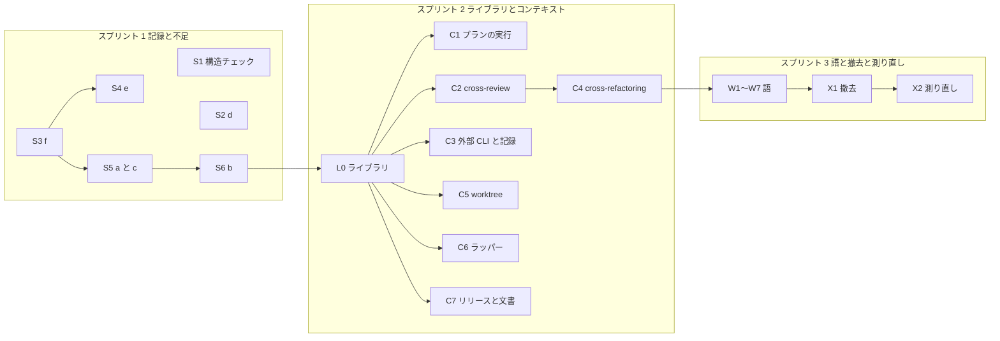

# 1142: エントリポイントの一覧と移行の順序

[issue-1142-design.md](issue-1142-design.md) の続きである。エントリポイントの一覧・変えるエントリポイント・移行の順序（移行ステップごとに触るファイル）を持つ。

**スプリント 1〜2c は実装済みで、この文書の大半はその記録である。** 残りは 2b の 4 種類・撤去・語の移行で、詳細設計は [issue-1142-design-base-design-detail.md](issue-1142-design-base-design-detail.md) が持つ。
残りに当てる方針は決定 65〜68（[issue-1142-design-decisions.md](issue-1142-design-decisions.md) ）にある。

| 節 | 中身 | 残りの実装との関係 |
| --- | --- | --- |
| 実装の状況（2026-11-13） | 移行ステップごとの済み・未着手と根拠 | 残りを決めた根拠 |
| スプリント 3 の行き先 | 前の設計の W1〜W7・X1・X2 が、どの子 Issue になったか | 対応表 |
| 戻し方 | 落ちたときの扱い | 当てる |
| 変えるエントリポイント | 追加・値として読まれる古い語・撤去 | 古い語と撤去を当てる |
| エントリポイントの一覧・移行の順序 | スプリント 1〜2c の記録 | 記録 |

パスは `plugins/ndf/` からの相対で書く（`scripts/check-script-structure.py` などリポジトリのルートのものは「ルートの」と添える）。

## 実装の状況（2026-11-13）

`gh pr list --state merged --search 1142` と、develop（7fc42b7b8 の時点の origin/develop）のファイルの有無と語の数で判定した。

| スプリント | 移行ステップ | 状況 | 根拠 |
| --- | --- | --- | --- |
| 1 記録と不足 a〜f | S1〜S6 | 済み | PR #1214（S1）・#1216（S2）・#1218（S3）・#1219（S4）・#1228（S5）・#1229（S6）、まとめ #1230、v10.17.29（#1235） |
| 2 ライブラリとコンテキスト | L0・C1〜C7 | 済み | PR #1242（L0）・#1247（C1）・#1244（C2）・#1254（C3）・#1252（C4）・#1243（C5）・#1245（C6）・#1246（C7）、まとめ #1255、v10.17.30（#1268） |
| 2b 汎用の処理をライブラリへ | T2・即時修正・L1・L1b・D1〜D8 | 済み（20 種類のうち 4 種類が残る） | PR #1264（T2）・#1267（T2b）・#1261・#1262（即時修正）・#1270（L1）・#1279（L1b）・#1282（D1）・#1281（D2）・#1283（D3）・#1280（D4）・#1294（D5）・#1293（D6）・#1285（D7）・#1284（D8）、まとめ #1300、v10.17.31（#1313）。残りは表の下の段落 |
| 2c プランの実行とキューを DBOS へ | Q0〜Q7 | 済み | PR #1538（Q0）・#1548（Q1）・#1545（Q2）・#1540（Q3）・#1541（Q4）・#1551（Q5）・#1553（Q6）・#1552（Q7）、まとめ #1554 |
| 3 語・撤去・測り直し | W1〜W7 | 未着手 | 用語集の廃止語がスクリプト 223 本に 1,256 か所残る（テストと `experimental/`、旧名を読むための表 `lib/legacy_names.py`・`data/legacy-values.json` を除く。`glossary_words.word_pattern` で数えた。7da134096 で数え直し、詳細設計の W1〜W7 の和と合わせた）。`関門` は結果の値として 12 ファイルに残る |
| 3 | X1 | 未着手 | `scripts/phase-steps.py`・`scripts/bundle-close.py` が残る |
| 3 | X2（E9） | 未着手 | #1142 のコメントに測り直しの表が無い（2026-09-26 のコメントが「2c と E9 が残る」と書いたまま） |

**2b で残る 4 種類の根拠は次のとおりである。**

- 構造チェックの例外リストに wrapped の 4 項目が残る（`gh_sections.py`・`wait_notice.py` の fence-regex、`jev.py`・`refresh.py` の urllib.request）。理由の欄には「D4 / D5 / D7 が置き換えたら消す」とあるまま
- `lib/pace.py:glob_re`（種類 10）が残る
- `lib/comment_mask.py`（種類 12）が残る。pygments は `textparse` のグループに入っているが、import は 0 件

**残りの詳細設計は [issue-1142-design-base-design-detail.md](issue-1142-design-base-design-detail.md) にある。** 2b の残りは K1〜K3、X1 は smells の A1a（旧 K4。同じファイルを消すためまとめた）、W1〜W7 は同じ名前の子 Issue と W8 である。
X2（E9）は、頭の設計文書の「3 つの主題をまとめた順序」が最後に流す。

## スプリント 3 の行き先

**スプリント 3 は版の区切りとして流さず、子 Issue に分ける**（決定 67）。中身の対応は次のとおりである。
触るファイル・関数・先に要るものは、詳細設計の文書の「子 Issue の案」と「ファイル配置」が持つ。

| 前の設計の移行ステップ | 子 Issue | 変えた点 |
| --- | --- | --- |
| W1〜W7 | W1〜W7（同じ名前） | 対象を用語集の廃止語に揃えた（R3・R4 を外す）。触るファイルは C1〜C7 の区切りでなく、2026-11-13 の develop で廃止語の当たるファイルから決めた。読み替えを置かない（決定 65）。W1 はフェーズの結果の語を `lib/report_fields.py` に集める |
| — | W8 | W1〜W7 で外した廃止語を禁止語（`.ndf/glossary.json`）に足し、戻るのを CI で止める |
| X1 | smells の A1a（旧 K4） | 読み替えを外す Issue の起票を外した（読み替えを置かない）。投稿キューの移行の前のファイルの取り込みを足した（X-c） |
| X2（E9） | 頭の設計文書の順序の最後 | 3 主題の計測（`ai-smells.py`・`const-facts.py`）とまとめて流す |

語の移行の子 Issue は、`glossary.py check --file` を対象のファイルに掛け、廃止語の行が 0 になることを確かめる。

**残りの順序は、詳細設計の文書の「子 Issue の案」と、頭の設計文書の「3 つの主題をまとめた順序」が決める**（決定 67）。

## 戻し方

| 何が落ちたか | 扱い |
| --- | --- |
| 子 Issue の PR の全体テスト | その PR をマージしない。置き換えた範囲のテストは同じ PR で作り直したものなので、古いテストに照らして戻さない（決定 66） |
| マージ後に開発版の `verify-install` | 落ちた子 Issue の PR を revert する。形を変えた子 Issue は呼ぶ側を同じ PR で直しているため、revert 1 つで前の形へまとめて戻る |
| ほかの子 Issue との衝突 | 触るファイルが重なる 2 つは並列に流さず、先に要るものの列に書いた側の後へ置く（頭の設計文書の規則 2） |

## 変えるエントリポイント

**残りの実装に当たるのは「値として読まれる古い語」と「撤去」である。** 「追加」と「足すインタフェースの形」はスプリント 1〜2 で済んだ。

### 値として読まれる古い語（5 件）

#1166 の古い語のうち、ほかのスクリプトや conductor が値として読むものである。
**書く側と読む側を同じ子 Issue の PR で新しい語へ替え、古い語を受ける読み替えを置かない**（決定 65）。

前の設計の割り当ては次の表のとおりである。

| # | 値 | 古い語 → 新しい語 | 読む側 | 移行ステップ |
| --- | --- | --- | --- | --- |
| R1 | フェーズレポートの `結果:` の値 | `関門` → `承認ゲート` | conductor の手順・`mission-state.py` | W1 |
| R2 | プランの `"フェーズ"` の値 | `配布（開発版）` / `配布（本番）` → `リリース（開発版）` / `リリース（本番）` | `mission-state.py`・`check-trigger.py` | W1 |
| R3 | `supervise.py new` の出力の文 | `計画を書いた` → `プランを書いた` | conductor の手順 | W1 |
| R4 | ラッパーの境の行 | `── ndf-relay: 区間 N ──` → `── ndf-relay: セッション N ──` | `experimental/resume.py`・利用者 | W6 |
| R5 | フェーズレポートの見出し | `## フェーズの報告` → `## フェーズレポート` | conductor の手順・`scripts/measure/claude-p-usage.py` | W1 |

**2026-11-13 の時点で、移行の対象は R1 と R5 だけである。** 表の移行ステップの列は前の設計の割り当てで、残りの実装では次のように扱う。

| 語 | 扱い |
| --- | --- |
| R1（`関門`）・R5（`フェーズの報告`） | 用語集の廃止語に載っている。移行の対象 |
| R2 | 禁止語として済み |
| R3（`計画を書いた`）・R4（`区間`） | 用語集の廃止語に無い。移行の対象から外す |

`log.jsonl` のキー `section` と、状態ファイルのキーは変えない（I11）。docstring・コメント・stderr の案内の語は、読む側が無いため読み替えを置かずに替える。

### 撤去（3 件）

| # | エントリポイント | 理由 | 移行ステップ |
| --- | --- | --- | --- |
| X-a | `scripts/phase-steps.py` | 呼び出し元が 0 件の試作 | X1 |
| X-b | `scripts/bundle-close.py` | `sprint-close.py` の旧名の中継（`lib/legacy_names.py` の `SCRIPTS`）。手順書・プランのテンプレートからの呼び出しが 0 件 | X1 |
| X-c | 投稿キューの移行の前のファイルの取り込み（`post_queue.Queue._import_legacy`） | 2c の前に積まれた項目を読む互換の経路（決定 65） | X1 |

### 追加（5 件。スプリント 1〜2 で済み）

| # | エントリポイント | 理由 | 移行ステップ |
| --- | --- | --- | --- |
| V1 | `supervise.py new fix` | 即時修正を worker の実装のステップ無しで流す（不足 a） | S5 |
| V2 | `release-steps.py changed-plugins` | 本番のリリースプランが ndf 以外の差分を知る（不足 c） | S5 |
| V3 | `lib/limits.py cli-timeout` の `--override`・`--no-floor` | 3 つの `resolve_print_timeout` を 1 つにする | L0 |
| V4 | ルートの `scripts/check-script-structure.py` | 構造チェック（I4・I5） | S1 |
| V5 | ルートの `scripts/measure/structure-baseline.py`・`claude-p-usage.py` | E1 と E9 を同じコマンドで打つ | S1 |

### 足すインタフェースの形（スプリント 1〜2 で済み）

| 名前 | 入力 | 出力（成功） | 失敗の形 | 互換性 |
| --- | --- | --- | --- | --- |
| `supervise.py new fix` | 必須 `--worktree` か `--branch`・`--tests`・`--title`。任意 `--issue`・`--escape-of`・`--summary`・`--out` | 結果 JSON（`tool: supervise-new`）。プランは `test-limited` → `pr` → `test-all` → `doc-lint` → `ready` → `merge` | 必須が欠ければ終了コード 2 | 追加だけ |
| `release-steps.py changed-plugins` | `--since <タグ>`・`--root` | 結果 JSON。`items` は差分のあるプラグイン（ndf を除く）ごとの `{name, from, to}`。`to` は PATCH を 1 つ上げた版 | タグが無ければ 2 | 追加だけ |
| 本番のリリースプランの `bump-others` | `changed-plugins` の `items` | プラグインごとに `bump --plugin <名> --to <to>` | 1 つでも落ちたら止まる | 本番のプランにステップが 1 つ増える |
| `mvv-gate.py check --gate design` | 今のまま | 記録の `material` に読んだ設計文書のパス | 読めない文書は飛ばし、記録に `material_skipped` | 追加だけ |
| `check-script-structure.py` | `--root`・`--allow <json>` | 結果 JSON。`items` に違反 | 違反があれば 1、例外リストの使われない行も 1 | 新設 |
| `limits.py cli-timeout` | 今の 2 引数に任意 `--override N`・`--no-floor` | 秒数 1 行 | 今のまま | 追加だけ |
| `token-usage.py` | 今のまま | 帳簿の行を版と層（supervisor / worker）へ加える | 帳簿が無ければ今の値だけ | 値が増える |

### 中身が変わるが形は変わらないもの

- `~/.claude/ndf/relay.py` は、ラッパーのバージョンディレクトリを読むランチャーになる。rc の関数が呼ぶパスと引数は変わらない
- `<プラン>-state/` は、プランが一時ディレクトリの下にあるとき、状態の置き場へのシンボリックリンクになる

## エントリポイントの一覧

**この節はスプリント 1〜2c の記録である。** 残りの実装は I3 に縛られない（決定 65）。
形を変えるときは一番綺麗な最終形へ直接変え、呼ぶ Skill の手順・hook・プランのテンプレート・テストを同じ子 Issue の PR で書き換える。

外から呼ばれるスクリプトは 45 本である（2026-09-26 の調査）。手順書・hook・宣言・プランのテンプレート・CI・ほかのスクリプトから、パスと副命令の形で呼ばれるものを数えた。
スプリント 1〜2c は、45 本すべてのパスと副命令と引数と出力の形を変えずに、中身の置き場所だけを移した（I3）。

表のパスは 2026-09-26 の名前である。`mission-state.py`・`mission-close.py` は #1407 で `sprint-state.py`・`sprint-close.py` へ改名した。

呼び出し元の略号: S = Skill の手順、A = エージェント、H = hook、N = `.ndf/`、P = プランのテンプレート、X = ほかのスクリプト、CI = CI のワークフロー。

### 中身を移すもの（11 本）

| エントリポイント | コンテキスト | 呼び出し元 | 移行後の中身の置き場 | 移行ステップ |
| --- | --- | --- | --- | --- |
| `scripts/supervise.py`（new / run / queue / wait / note / history / expected / example / design-glossary / sync-check） | プランの実行 | S・P・X | `scripts/supervise_lib/` | C1 |
| `scripts/mission-state.py` | プランの実行 | S | ライブラリ（時刻・JSON・`state_dir_of`） | C1 |
| `scripts/mvv-gate.py check` | プランの実行 | S・P | ライブラリ（時刻・gh・`sha256_of`） | C1 |
| `scripts/check-trigger.py`（eval ほか 8 個） | プランの実行 | S・P | ライブラリ（時刻・git・gh・JSON） | C1 |
| `scripts/mission-close.py` | プランの実行 | S・P | ライブラリ | C1 |
| `skills/cross-review/scripts/drive.py` | 収束ループ | S・P | `lib/loop_drive.py`。drive.py が起動する内部の `state.py`（副命令 14 個）の中身は `review_lib/` | C2 |
| `skills/cross-refactoring/scripts/drive.py` | 収束ループ | S・P | `lib/loop_drive.py` | C4 |
| `skills/cross-refactoring/scripts/refactor.py` | 収束ループ | S・P・X | `refactor_lib/`（時刻と slug をライブラリへ） | C4 |
| `scripts/relay.py`（run / stop / install / uninstall / status / startup / question / is-child / notice / mark） | ラッパー | H・S・X | `scripts/relay_lib/` とラッパーのバージョンディレクトリ | C6 |
| `lib/worktree-common.sh`（source） | worktree | S・X | 同じディレクトリの 4 本 | C5 |
| `scripts/instructions-check.py` | 文書の検査 | S・N・CI | `scripts/instructions_lib/` | C7 |

### 重複だけをライブラリへ置き換えるもの（22 本）

| エントリポイント | コンテキスト | 移行ステップ |
| --- | --- | --- |
| `scripts/merged-steps.py`・`release-steps.py`・`release-verification-steps.py`・`pr-steps.py`・`plan-to-spec-steps.py`・`pr-body-decisions.sh` | リリース | C7 |
| `skills/fix/scripts/fix-steps.py` | リリース | C7 |
| `scripts/glossary.py`・`spec-copy.py`・`doc-lint.py`・`skills/issue-upkeep/scripts/upkeep.py` | 文書の検査 | C7 |
| `scripts/worktree-setup.sh`・`worktree-localenv.sh`・`worktree-testenv.sh`・`worktree-guard.sh`・`worktree-session.sh` | worktree | C5 |
| `skills/external-ai/scripts/external-ai.py`・`scripts/wait-notify.py`・`lib/transcript_agents.py` | 外部 CLI の起動 / 記録と測定 | C3 |
| `skills/skill-stats/scripts/skill-stats.py`・`scripts/parallel-measure.py`・`lib/bg-wait.sh` | 記録と測定 | C3 |

### 変えないもの（12 本）

重複を持たず、500 行以下のものである（500 行を超えるものは例外リストに行数付きで残す）。語の移行（W1〜W7）で文面だけ触るものがある。

- `scripts/` の `projects-sync.sh`・`progress-record.sh`・`resolve.sh`・`token-guard.sh`・`ensure-retention.sh`・`statusline-switch.sh`・`statusline.sh`・`install-official-skills.sh`
- `skills/development-workflow/scripts/` の `workflow-guard.sh`・`stage-check.sh`
- `skills/google-auth` と `google-drive` の 2 本（`google_auth.py`・`gdrive_fetch.py`）

### 内部だけのもの

外から呼ばれないのは 85 本（ライブラリ 27・cross-refactoring 33・cross-review 12・試行 4・データ 4・そのほか 5）である。
パスを変えてよいが、この設計で動かすのは上の表の移行ステップが挙げるものだけにする。
`.ndf/pace.json` の `paths` と `boundary_paths` はスクリプトのパスを並べているため、パスを動かした移行ステップが同じ PR で書き換える。

## 移行の順序

**この節はスプリント 1〜2c の実施の記録である。**

**3 つのスプリントに分け、各スプリントが版を 1 つ出した**（前提 2）。1 移行ステップは 1 本の PR で閉じる（I10）。
同じステージの移行ステップは触るファイルが重ならず、並列に流せる（6 本まで）。
**着手の前に、開いている PR の変更ファイルと突き合わせ、重なれば同じステージの中で順序を入れ替える**（前提 3）。

**スプリントの間は版で区切った。** 次のスプリントは、前のスプリントの本番（リリース承認ゲート）の後に始める。
図のスプリントをまたぐ矢印はその順序を表し、特定の移行ステップへの依存ではない。
スプリント 3 は、この図の形では流さない（「スプリント 3 の行き先」）。

**d と f を最初のスプリントに置いたのは、移行の前後を同じ物差しで比べるためである**（要求の「決めたこと」）。
スプリント 1 の版から、検査の件数と `claude -p` の消費が記録に残る。

### スプリント 1: 記録と不足 a〜f

| ステージ | 移行ステップ | 触るファイル |
| --- | --- | --- |
| 1 | S1 構造チェック | ルートの `scripts/check-script-structure.py`・`scripts/script-structure-allow/`・`scripts/measure/structure-baseline.py`・`scripts/measure/claude-p-usage.py`（パスを引数へ）・`scripts/tests/test_check_script_structure.py`・`.github/workflows/script-structure.yml` |
| 1 | S2 検査の件数（d） | `skills/cross-review/scripts/drive.py`・`skills/cross-refactoring/scripts/drive.py`・両方の `tests/test_drive.py` |
| 1 | S3 消費の記録（f と d の入れ子） | `scripts/lib/usage_ledger.py`（新設）・`scripts/supervise.py`（`claude_cmd`・`call_claude`・`add_usage`・`do_drive`・`state_dir_of` だけ）・`scripts/mvv-gate.py`（`ask` だけ）・ルートの `scripts/token-usage.py`・`scripts/experimental/phase_cost.py`（既定の glob）・`skills/development-workflow/references/relay.md`（例のパス）・テスト |
| 2 | S4 設計文書の材料（e） | `scripts/mvv-gate.py`（`cmd_check`・`record`）・`scripts/tests/test_mvv_gate.py` |
| 2 | S5 即時修正と他のプラグイン（a・c） | `scripts/supervise.py`（`NEW_KINDS`・`NEW_REQUIRED`・`NEEDS`・`NEW_ARGS`・`cmd_new`・`plan_fix`・`plan_release_package_plugin`）・`scripts/release-steps.py`・`skills/release/references/form-package-plugin.md`・`skills/development-workflow/references/pace.md`（即時修正の 1 行）・テスト |
| 3 | S6 conductor の一覧（b） | `skills/development-workflow/references/conductor-entrypoints.md`（新設）・`references/scripts-lookup.md`（参照 1 行）・一覧のスクリプトが実在するかのテスト |

S1 の例外リストは、その時点の違反をすべて載せて始めた（行数 6 件・同じ名前で本体の違う関数・本体の同じ関数）。
**以後の移行ステップは、自分が直した行だけを例外リストから消す。** 使われない行は構造チェックが落とすため、消し忘れは同じ PR で分かる。

### スプリント 2: ライブラリとコンテキスト

| ステージ | 移行ステップ | 触るファイル | 見積りの行数（移行後の最大） |
| --- | --- | --- | --- |
| 1 | L0 ライブラリ | 下の表 | 各 150 以下 |
| 2 | C1 プランの実行 | `scripts/supervise.py`・`scripts/supervise_lib/`（新設 19 本。`__init__` を含む）・`mission-state.py`・`mvv-gate.py`・`check-trigger.py`・`mission-close.py`・`scripts/tests/test_supervise*.py` ほか差し替え先 | 最大 `queue.py` 約 295 |
| 2 | C2 cross-review | `skills/cross-review/scripts/state.py`・`review_lib/`（新設 21 本。`__init__` を含む）・`drive.py`・`measure.py`・`critique.sh`・`launch-reviewer.sh`・`skills/cross-review/tests/`・`skills/fix/tests/test_fix_steps.py`（差し替え先だけ） | 最大 `commands/init.py` 約 435 |
| 2 | C3 外部 CLI と記録 | `lib/monitor.py`・`lib/monitor_patterns.py`・`monitor_scan.py`・`monitor_proc.py`・`monitor_types.py`・`monitor_loop.py`（新設 5 本）・`lib/monitor_outcome.py`・`lib/run_metrics.py`・`lib/post_queue.py`・`lib/transcript_agents.py`・`skills/external-ai/scripts/external-ai.py`・`scripts/wait-notify.py`・`skills/skill-stats/scripts/skill-stats.py`・`scripts/parallel-measure.py`・テスト | 最大 `monitor_loop.py` 約 300 |
| 2 | C5 worktree | `lib/worktree-common.sh`・`lib/worktree-declaration.sh`・`worktree-branch.sh`・`worktree-shell-lex.sh`・`worktree-write-target.sh`・`worktree-write-target-scan.sh`・`worktree-write-target-track.sh`・`worktree-registry.sh`（新設 7 本）・`scripts/worktree-*.sh` 5 本・`lib/README.md` の worktree の行 | 最大 `worktree-write-target-scan.sh` 約 475 |
| 2 | C6 ラッパー | `scripts/relay.py`・`scripts/relay_lib/`（新設 11 本。`__init__` を含む）・`scripts/experimental/resume.py`・`scripts/tests/test_relay.py`・`skills/install-wrapper/SKILL.md`（バージョンディレクトリの説明だけ） | 最大 `relay_lib/run.py` 約 350 |
| 2 | C7 リリースと文書 | 「重複だけを置き換えるもの」のリリースと文書の検査の 11 本・`scripts/instructions-check.py`・`scripts/instructions_lib/`（新設 7 本）・`scripts/tests/test_instructions_check.py`（複製の対象に `instructions_lib/` のディレクトリを足す） | 最大 `instructions-check.py` 約 245 |
| 3 | C4 cross-refactoring | `skills/cross-refactoring/scripts/drive.py`・`launch-cli.sh`・`refactor_lib/clock.py`・`paths.py`・`commands/converge.py`・`commands/implement.py`・`commands/setup.py`・`refactor_lib/gitfacts.py` と新設 6 本（`pathkinds`・`process`・`github`・`worktree`・`publish`・`results`）・`tests/conftest.py` の `_MODULES`・テスト | 最大 `gitfacts.py` 約 255 |

**L0 の触るファイル。** **呼び出し側はまだ変えない。** C1〜C7 が、移すファイルの `gh pr` / `gh issue` の呼び出しを `gh_parts` の関数へ置き換える。

| ファイル | 中身 |
| --- | --- |
| `lib/` の `clock.py`・`jsonio.py`・`proc.py`・`repo.py`・`loop_drive.py` | 新設 |
| `lib/limits.py` | `resolve_cli_timeout`・V3 |
| `lib/launch-cli.sh` | `resolve_print_timeout` を `limits.py` の 1 回へ |
| `lib/step_result.py` | `git`・`gh_json` を `proc` の上へ |
| `lib/statefile.py` | `now`・`die`・`info` を再エクスポート |
| `lib/deps.py` | 新設。`require()`・不足 h |
| `plugins/ndf/pyproject.toml` と `plugins/ndf/uv.lock` | 新設。不足 h |
| `lib/gh_parts.py` | ETag 付きの読み直し・PR と Issue の単発の読み書きの REST の関数・枠の使い分けと上限の代替・待ちの間隔の伸長（不足 g）。試行が成り立てば githubkit の上に置く（決定 17）。`gh_call`・`gh_quota`・`gh_fields`・`gh_rest`・`gh_graphql`・`gh_checks`・`gh_pr_info`・`gh_sections` の 8 本を新設して分け、`gh_parts.py` はエントリポイントと再エクスポートにする。分け方は [issue-1142-design-modules.md](issue-1142-design-modules.md) |
| ルートの `scripts/check-script-structure.py` と `scripts/script-structure-allow/` | 行数の上限を 500 へ下げ、500 行を超えるファイルを行数付きで例外リストへ載せ、載せた行数を超えたら落とす（決定 18） |
| `lib/README.md`・テスト | — |

**ステージ 2 は 6 本で、並列の上限に収まる。** C4 は C2 と同じ `lib/loop_drive.py` の呼び出しを揃えるため、C2 の後に置く。
`lib/README.md` の索引は、各移行ステップが自分の行だけを直す。

**テストは差し替え先と import だけを変えた**（スプリント 2 の受け入れ条件「置き換え先の変更だけで通る」。残りの実装は決定 66 でテストを作り直してよい）。

- `state.py` の `monkeypatch.setattr(state_mod, ...)` のうち名前で渡す 131 か所と、`supervise.py` の 8 か所を、定義元のモジュールへ向け直す（決定 3）。差し替え先の件数の内訳は、[issue-1142-design-modules.md](issue-1142-design-modules.md) の各節が指すコミット ca52d46cf の版にある
- `lib/monitor.py` は、シム越しの 43 か所のうち 41 か所が `monitor_types`・`monitor_proc` へ向き直る。シムの名前空間を確かめる `test_monitor_generic_stem.py` の assert は、`_run_all.__globals__` を見る形に変わる

### スプリント 2b: 汎用の処理をライブラリへ（決定 19・20）

スプリント 2 の開発版の後、スプリント 3 の前に置いた。ステージと触るファイルは [issue-1142-design-libraries.md](issue-1142-design-libraries.md) の「移行の順序」にある。
計画の実行とキュー（不足 i）は決定 21（DBOS）で、スプリント 2b の後のスプリント 2c にした。
