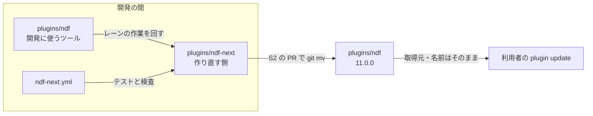

# NDF の作り直し: 別のディレクトリで 0 から作り、できたら ndf と入れ替える（#1142 #3092）

## 目的

- **今どうなっているか**: #1142 は、今の `plugins/ndf/` を子 Issue 72 本・22 の順番で段階的に直す計画だった（PR #3250 で承認）。#3092（工程の進行表）は実装 PR #3247 を出した。しかし 246 ファイルを書き換えて major の指摘 25 件と CI の失敗 70 件が残り、cross-review を 4 ラウンド回しても直らずに閉じた。今のコードを動かしたまま置き換える形では、旧い経路との互換・移行・旧いテストの書き換えが変更の大半を占める
- **誰に効くか**: NDF を作り直すレーン（lrebuild と lr-* の 6 本）と、NDF を使う利用者
- **変えると何が成り立つか**: 新しいディレクトリ `plugins/ndf-next/` に、承認済みの設計（#1142・#3092・#3097・#3098）の最終形を最初から作る。今の `plugins/ndf/` には触らず、開発に使うツールとして使い続けられる。入れ替えは 1 本の PR で行い、revert 1 回で戻せる

## 適用範囲

- **働く範囲**: このリポジトリの次の 3 つ
  - `plugins/ndf-next/`（新設）
  - CI のジョブ 1 本（新設）
  - 入れ替えの PR が触る配布の定義（`plugins/ndf/` 全体・`.claude-plugin/marketplace.json`・`.ndf/project.json` の suite・`scripts/*-allow/`）
- **プロジェクトごとに違うもの**: 足さない。利用先のリポジトリには、入れ替えの後の版（11.0.0）として届く
- **当たるモード**: `standard`（#1142 の「決めたこと」のまま）

## あるべき姿の根拠

| 根拠 | 種類 | 何を示すか |
| --- | --- | --- |
| 利用者の決定（2026-11-13 23:1x JST。原文は `.ndf/handoff/lrebuild-note-rebuild-1142-label.md` の「作り直しの置き場の決め直し」） | 指示 | 同じリポジトリの別のディレクトリで 0 から作り、できたら `ndf` と入れ替える。今の NDF は壊さない |
| PR #3247 を閉じたときのコメント（https://github.com/devbasex/ai-plugins/pull/3247 ） | 実測 | 段階的な置き換えで、設計の欠け 6 件と新しい経路が通らない指摘 19 件が残った |
| `docs/versioning-and-distribution.md` の「ランタイムごとの取得と導入」 | 仕様 | 導入の鍵は取得元の名前とプラグイン名で、リポジトリの中のディレクトリは含まない |
| 承認済みの設計（#1142 の設計と詳細設計・PR #3191・PR #3250） | 設計 | 新しい実装の材料。ここで決め直すのは置き場・順番・食い違いだけ |

要求と受け入れ条件は #1142 の本文にある（コピーは [issue-1142-requirements.md](issue-1142-requirements.md) ）。**受け入れ条件「ラベル `rebuild-1142` の Issue がすべて閉じる」は変えない。** 入れ替えの時点で閉じる形でよい。

この文書は「どこに・どの順で作り、どう入れ替えるか」だけを扱う。部品の中身は、末尾の「材料にする設計」の文書が持つ。

**詳細設計は [issue-1142-design-next-design-detail.md](issue-1142-design-next-design-detail.md) にある。** ファイル配置・子 Issue の表・流す順番・レーンの割り当て・ラベルの付け替えを持つ。

## 人へ残す判断

**承認する人が答えるのは、次の 5 つである。** (a)〜(c) はレッドラインに当たる。レッドラインの番号（P1・C3）は `.ndf/mvv.md` と共通原則の番号で、新しい子の P1・C3 とは別である。

| # | 判断 | 当たるレッドライン | なぜ当たるか | 材料 | 推奨 |
| --- | --- | --- | --- | --- | --- |
| (a) | 入れ替えを `git mv` で行い、プラグイン名と取得元を変えないか | P1（配布物の取得元・版の規則を変える） | 入れ替えは配布物の中身を一度に替え、利用者全員に効く | 名前と取得元を保てば、利用者は登録し直さずに `plugin update` で届く（決定 73）。別名の配布や `source` の差し替えは、利用者の再導入か 600 箇所近い参照の向け直しが要る | `git mv` で入れ替える。版は 11.0.0 にする |
| (b) | 入れ替えの後、利用者の手元の旧い状態（`~/.local/state/ndf` の記録・進行中のプラン）を読まないことを受け入れるか | C3（利用者のデータを変える・移す） | 利用者の手元の記録の読まれ方が変わる | 新しい実装は旧い形を読み替えない（後方互換を置かない方針）。旧い置き場は消さず、名前を変えて残す（決定 79） | 受け入れる。入れ替えの前に、動いているスプリントを終わらせる |
| (c) | 開発の間、`ndf-next` をマーケットプレイスへ載せないか | P1（配布物の取得元・版の規則を変える） | 載せると取得元の中身が増え、開発版の利用者に届く | 載せない場合、試すのは `claude --plugin-dir plugins/ndf-next` だけになる。載せると hook と状態の置き場が `ndf` と二重に働く（決定 74） | 載せない |

**(d)・(e) はレッドラインに当たらない。** 承認済みの要求と今の NDF の扱いを変えるため、ここに並べる。

- (d) #3092 の前提 7 の `progress.py adopt`（動いているスプリントの取り込み）を外すか
  - 材料: 入れ替えの前に、動いているスプリントを終わらせれば取り込むものが無い（決定 76）。外すと #3092 の受け入れ条件の 1 項目が消える
  - 推奨: 外す。承認の後に #3092 の本文を直す
- (e) #3153（CI の結果の監視の読み違え）を今の `plugins/ndf/` でも直すか
  - 材料: 今の NDF は開発に使うツールとして使い続ける。新しい実装では AD1 で作る
  - 推奨: 今の NDF では直さない。レーンの作業が止まったときだけ、即時修正の 4 条件で直す

## 設計の結果

**置き場は `plugins/ndf-next/`。** 開発の間のプラグイン名は `ndf-next`、版は `11.0.0-dev.N` とし、入れ替えの PR で名前を `ndf` に、版を `11.0.0` にする。

**子 Issue は 26 本・9 の順番に組み直す。** 72 本の旧い子は、20 本を新しい子へそのまま引き継ぎ、13 本を形を変えて引き継ぎ、18 本を他の子へまとめ、21 本を要らなくする（表は詳細設計の「旧い子の行き先」）。#3092・#3097・#3098 は新しい子 P1・P3・P4 としてそのまま使う。

**レーンは 6 本のまま使う**（lrebuild・lr-flow・lr-data・lr-rf・lr-fix-a・lr-fix-b。各プラン 2 本）。after から lflow・lbr2・lsw を外す。新しいディレクトリは今の NDF のファイルと重ならないためである。

**ラベル `rebuild-1142` の Issue は、旧い子の行き先の表で新しい子へ付け替える。** 付け替えの規則と件数は詳細設計の「ラベルの付け替え」にある。

## ドメインモデル

### コンテキスト

| コンテキスト | 何の語が 1 つの意味に決まるか |
| --- | --- |
| 配布 | プラグイン・取得元・版・プラグインの入れ替え |
| 進行 | 工程・進行表・行・承認ゲート・レーン（#3092・#3097 の設計のまま） |
| プランの実行 | プラン・ステップ・止まった理由・行き先（#1142 の scripted-flow のまま） |

**コンテキストマップ。** 契約の形を決めるのは上流で、下流はその形に従う。下流は上流の定義を書かない。

| 上流（契約を決める） | 下流（従う） | 関係 | 契約 |
| --- | --- | --- | --- |
| 配布 | 進行 | 顧客と供給者 | プラグインの定義のプラグイン名と版。進行は読むだけで、プラグインの定義は書かない |
| 配布 | プランの実行 | 顧客と供給者 | 同じくプラグインの定義のプラグイン名と版。状態の置き場の名前もここから求める（決定 75） |
| プランの実行 | 進行 | 公開ホストサービス / 順応者 | 進行表の行が、工程から作業を呼ぶ層（上の節の規約）を通してプランを呼び、プランの結果 JSON（`cause`・`outputs`）を読む。プランの実行は進行表を読まず、書かない（scripted-flow のコンテキストマップと同じ向き） |

### 集約

**集約ごとに持ち主は 1 つである。** 部品の子 Issue の PR が書いてよいのは次の 3 つだけである。

- 詳細設計の「ファイル配置」で自分の子の列に載るファイルと、自分のパッケージのテスト（`plugins/ndf-next/tests/<自分のパッケージ>/`。置き場は X0 が作り、中身は各子が書く）
- `cli.py` の副命令の表への自分の副命令の 1 行（詳細設計の「並行と排他」）
- 契約（D1）を変える PR だけは、その契約の下流の読み手とそのテストも同じ PR で直してよい（下の表の「止まった理由の表」の行）

| 集約 | 持ち主（書き換えてよいもの） | 根 | エンティティ | 値オブジェクト |
| --- | --- | --- | --- | --- |
| プラグインの定義 | lrebuild のレーンの PR（X0 が作り、S2 が名前と版を `ndf`・`11.0.0` へ替える）。部品の子の PR は書かない | `plugins/ndf-next/.claude-plugin/plugin.json` | — | プラグイン名・版 |
| 新しいプラグイン | 部品の子 Issue の PR（詳細設計の「ファイル配置」の子の列） | `plugins/ndf-next/` | 部品のパッケージ | — |
| プラン | プランの雛形のモジュール（C3） | `plan.json` | ステップ | ステップの型・条件・ステップの `on_cause` |
| プランの実行 | プランの実行の核（C2） | プランの実行 | ステップの試行 | 止まった理由・行き先・再試行の回数 |
| 止まった理由の表 | 契約（D1。結果 JSON の契約を変える PR が、下流の読み手とそのテストを同じ PR で直す）。実行の中では読むだけ | 止まった理由の表 | 種類 | 終了コード・既定の行き先・再試行の方針 |
| 進行表 | `progress` の書き手（#3092 の設計の書き手の表） | 進行表 | 行・事象 | 状態・止まった理由 |

プラン・プランの実行・止まった理由の表の中身（エンティティの形と不変条件 IS1〜IS12）は scripted-flow の設計のまま使う。この表が決めるのは、新しいディレクトリでの持ち主の子だけである。

### 不変条件

| # | 集約 | 条件 | 破れたときの扱い |
| --- | --- | --- | --- |
| I1 | 新しいプラグイン | `plugins/ndf-next/` の中のコードは、自分のディレクトリ名・プラグイン名・状態の置き場の名前を文字で持たない（決定 75） | 検査（X1）が CI で落とす |
| I2 | 新しいプラグイン | 子 Issue の PR は `plugins/ndf/` を変えない（即時修正を除く） | 検査（X1）が差分で落とす |
| I3 | 新しいプラグイン | `plugins/ndf-next/` の中から `plugins/ndf/` の Python を import しない | 検査（X1）が落とす |
| I4 | 進行表 | 進行表のほかに、工程の遷移を決めるものを置かない（#3092 の受け入れ条件 11 のまま） | 工程の定義の登録が断る |

### ドメインイベント

**要求のイベント（E1〜E9）は、番号のままこの設計の中の起き方へ引き継ぐ。**

| # | イベント（要求） | この設計での発生元 | 受け手 |
| --- | --- | --- | --- |
| E1 | 移行の前の基準を測った | 済み（全体の設計の数） | E9 の比べる相手 |
| E2 | スクリプトの語を用語集に揃えた | 設計（この文書の「用語」の表） | 用語集（承認の後に反映） |
| E3 | 設計を承認した（設計承認ゲート） | 利用者（この設計 PR） | X0 |
| E4 | ライブラリを 1 か所へまとめた | X0・D1 のマージ（新しいディレクトリで最初から 1 か所に作る） | 順番 3 以降の子 |
| E5 | コンテキストごとのモジュールへ移した | 部品の子の PR のマージ（移さず、最初からコンテキストごとに作る） | S1 |
| E6 | エントリポイントの形が変わらないことを確かめた | S1 の受け入れの確かめ（テスト設計）。旧い形との互換は確かめない（決定 76） | S2 |
| E7 | 開発版を導入して確かめた | EN1 の後の開発版 | E8 |
| E8 | 本番を承認した（リリース承認ゲート） | 利用者 | 本番のリリース |
| E9 | 移行の後を同じ物差しで測り直した | conductor（E1 と同じ測り方） | 振り返り（Issue のコメント） |

**この設計で足すイベントは `EN` の番号を付ける。**

| # | イベント | 発生元 | 受け手 |
| --- | --- | --- | --- |
| EN1 | 入れ替えた（`plugins/ndf-next/` が `plugins/ndf/` になった） | S2 の PR のマージ | リリース（開発版のデプロイ）・ラベルの Issue がすべて閉じたかの確かめ |

**進行表とプランの実行の状態の変化（止まった・行き先が決まった・工程が失敗した など）は、材料の設計のイベントを番号のまま使う。** 進行表の側は #3092 の E1〜E15、プランの実行の側は scripted-flow の ES1〜ES5 で、発生元と受け手もそれらの表のとおりである。新しいディレクトリで足すものは無い。

### 用語

| 用語 | 意味 | 用語集への反映 |
| --- | --- | --- |
| プラグインの入れ替え | 作り直した `plugins/ndf-next/` を 1 本の PR で `plugins/ndf/` へ `git mv` し、名前と版を替えること。取得元とプラグイン名は変えない（決定 73）。この文書では「入れ替え」と略す。ラッパーの入れ替えとは別 | 追加（`ndf-workflow`） |
| 新しいプラグイン | 入れ替えまでの間、`plugins/ndf-next/` に作る作り直しの側のプラグイン。開発の間の名前は `ndf-next` | 追加（`ndf-workflow`） |
| プラグインの定義 | プラグインの `plugin.json` が持つプラグイン名と版（文書の中で「配布の定義」と書いていた語。「配布」は用語集で「リリース」へ置き換えた語のため改めた） | 追加（`ndf-workflow`） |
| 初期構成 | 新しいディレクトリに最初に置く `plugin.json`・依存の lock・エントリポイント・CI のジョブ・テストの置き場（子 X0）。スケルトン（SKILL.md の bash）とは別 | 追加（`ndf-workflow`） |

## 外部の調査

省く: 置き場と入れ替えは、このリポジトリの配布の仕組み（`docs/versioning-and-distribution.md`）の中で閉じる。部品の外部の調査は、材料にする設計の「外部の調査」をそのまま引き継ぐ。

## 機能一覧

| # | 機能 | 誰が使うか |
| --- | --- | --- |
| F1 | 新しいディレクトリの初期構成（パッケージ・依存の lock・CI のジョブ・テストの置き場） | レーン |
| F2 | 新しいディレクトリだけを見る検査（兆候 0 件・構造の規則・I1〜I3） | CI |
| F3 | 部品（契約・アダプター・核・進行表・領域）を、承認済みの設計の最終形で作る | レーン |
| F4 | 工程から作業を呼ぶ層（PR #3247 の欠けを埋める） | 進行表 |
| F5 | 入れ替えの PR と、ラベルの Issue がすべて閉じたかの確かめ | lrebuild |

## 構成要素

| 要素 | 責務 |
| --- | --- |
| `plugins/ndf-next/`（新設） | 新しいプラグインの全体。配置は詳細設計の「ファイル配置」 |
| `.github/workflows/ndf-next.yml`（新設） | `plugins/ndf-next/**` の変更で、新しいディレクトリのテストと検査を走らせる。S2 で消し、既存のジョブへ戻す |
| `plugins/ndf/`（変えない） | 開発に使うツール。S2 で消える |
| 入れ替えの PR（S2） | `git rm plugins/ndf`・`git mv plugins/ndf-next plugins/ndf`・名前と版・許可ファイルと suite の作り直し |

## 工程から作業を呼ぶ層

**PR #3247 の指摘の大半は、進行表の行から実際の作業（プラン・Skill・スクリプト）を呼ぶ決まりが無かったことに集まる。** #3092 の設計は、この層を「`supervise.py new` を呼ぶ」で済ませていた。新しい実装では、工程の定義がこの層の規約を持つ。

| 規約 | 中身 | 埋める指摘（PR #3247） |
| --- | --- | --- |
| 呼び出し先 | 工程の定義の `metadata.ndf.run` が、種類（`plan`・`skill`・`script`）と名前を持つ | 設計と詳細設計が同じ Skill 全体を呼ぶ |
| 入力 | 工程の定義の `metadata.ndf.inputs` が、スプリントの文脈から読む鍵（`pr`・`worktree`・`issues`・`mode`・`delivery`）を列挙する。足りなければ行を始めずに止まった理由 `input_missing` で返す | 引数を組み立てていない・PR の番号が届かない |
| 出力 | 作業が返す結果 JSON の `outputs` を、進行表の事象 `outputs_recorded` としてスプリントの文脈へ書く | 前の工程の出力を次へ渡していない |
| 作業ディレクトリ | 文脈の `worktree` があれば、作業はそこで動く | 用意した worktree を反映していない |
| 配布の経路 | デプロイの工程は `.ndf/project.json` の `delivery` から経路を選ぶ（固定しない） | デプロイの経路が固定 |
| 範囲の重なり | 同じ範囲を 2 つの工程が受け持つ定義は、登録で断る | 実装の雛形がマージまで行う |

詳しい形は詳細設計にある（文脈の鍵の一覧は「内部のデータと定数」、関数と事象の形は「関数の仕様」）。

## 決定の記録

### 決定 73: 入れ替えは `git mv` で行い、プラグイン名と取得元を変えない

開発の間は `plugins/ndf-next/` に置き、S2 の PR で `plugins/ndf/` を消してから `git mv plugins/ndf-next plugins/ndf` を打つ。名前は `ndf`、取得元は `./plugins/ndf` のまま、版は 11.0.0 にする。

導入の鍵は取得元の名前とプラグイン名である。そのため利用者は登録し直さず、`plugin update` で新しい版が届く。外側の参照（CI のジョブ 8 本・検査のスクリプト 10 本・`.ndf/` の宣言・許可ファイル 526 個）もパスを向け直さずに済む。

- 採らない案 1: `plugins/ndf-next/` を残し、マーケットプレイスの `source` だけを差し替える。外側の参照を 600 箇所近く向け直すことになり、漏れると検査が空のディレクトリを見て 0 件で通る
- 採らない案 2: `ndf-next` の名前のまま配る。利用者が再導入し、Skill の前置き `ndf:` が変わる
- 作り方: ライブラリやサービスを使う

### 決定 74: 開発の間は `ndf-next` をマーケットプレイスへ載せない

試すのは `claude --plugin-dir plugins/ndf-next` と CI のテストだけにする。載せると、開発版の利用者の手元で hook が `ndf` と二重に走り、状態の置き場も混ざる。さらに、develop が main へ入るときに外す決まりが要る。

### 決定 75: 新しいディレクトリの中では、自分の名前を文字で持たない

ディレクトリは `CLAUDE_PLUGIN_ROOT` か `__file__` から、プラグイン名と Skill の前置きは `plugin.json` の `name` から求める。状態の置き場の名前もプラグイン名から求める。こうすれば、入れ替えで書き換えるのは `plugin.json` 2 本の `name` と `version` だけになる。検査（X1）が I1 として固定の文字を落とす。

### 決定 76: #3092 の互換と `adopt` は作らない

新しい CLI は副命令名・引数・`plan.json` の形を今の `supervise.py`・`parallel.py` に合わせない。動いているスプリントの取り込み（#3092 の決定 19・前提 7 の `progress.py adopt`）も作らない。

入れ替えの前に、今の NDF で動いているスプリントをすべて終わらせる（S2 の手順 1）。取り込むものが無ければ、取り込みの経路を作っても使われない。#3092 の本文の前提 7 は、承認の後に直す（判断 (d)）。

### 決定 77: #1142 と #3092 の設計の食い違いは #3092 の側にそろえる

| 食い違い | 採る形 | 理由 |
| --- | --- | --- |
| 承認ゲートの待ち方 | #3092 の決定 7（`recv` で待ってプロセスを抜け、`answer` の後の `next` で続ける）。#1142 の決定 27（`--from` で続ける）は採らない | 0 から作るなら、`--from` を手で組み立てる経路を持つ理由が無い |
| アプリの版 | #3092 の決定 21（NDF の版が上がって回復できない実行は取り消し、行を失敗にする）。#1142 の決定 28 は採らない | 版の固定の値を手で上げ忘れる経路が無くなる |
| DBOS の記録の置き場 | #3092 の決定 2（git の共通ディレクトリの下の 1 つの DB に、進行表と同居）。プランの実行も同じ DB を使い、`executor_id` は進行表の行の ID にする | 置き場が 1 つなら、再開の鍵を探す処理が要らない。詰まるときの逃がし方は #3092 の決定 18 のまま |
| 終了コード | #1142 の IS11（止まった理由の種類から引く）。#3092 の「工程の失敗は 1」は採らない | 呼び手が終了コードだけで行き先を選べる |
| `jsonschema` の依存 | `plugins/ndf-next/` の依存の宣言に 1 つだけ置く（グループに分けない） | 新しいディレクトリは自分の依存の宣言を持つ（決定 78） |

### 決定 78: 新しいディレクトリは自分の依存の宣言と lock を持つ

`plugins/ndf-next/pyproject.toml` と `uv.lock` を置き、テストは `uv run --project plugins/ndf-next` で走らせる。リポジトリのルートの `pyproject.toml` は今の NDF のために変えない。S2 で、ルートの宣言を新しい側へ寄せる。

### 決定 79: 状態の置き場は入れ替えのときに旧い分を退避する

新しい実装の状態の置き場は `<状態のホーム>/<プラグイン名>/` で、先頭に形の版のファイル（`format.json`）を置く。入れ替えの後の最初の起動で、形の版のファイルが無い旧い置き場を見つけた場合は消さない。名前を `<プラグイン名>.v10-<日付>` に変えて退避してから、新しく始める。退避は名前の変更だけなので戻せる（判断 (b)）。

### 決定 80: 旧い子 Issue は閉じずに新しい子へ結び、入れ替えまでに閉じる

新しい子 26 本は新しく起票し（P1・P3・P4 は #3092・#3097・#3098 を使う）、#1142 の sub-issue に結ぶ。旧い子 72 本は消さない。行き先の新しい子の本文に「取り込む旧い子」として番号を書く。旧い子は、取り込んだ新しい子の PR の closing keywords で閉じる。要らなくなった 21 本は、S2 の PR で理由を添えて閉じる。

ラベルの件数を受け入れ条件の目印にしているため、要らなくなった子を先に閉じると、残りの件数が実際の進み具合とずれる。

## テスト設計

- 新しいテストは `plugins/ndf-next/tests/` に置き、詳細設計の「単体テストの観点」から書く。今のテストは移さない
- 入れ替えの前に、新しいディレクトリで受け入れの確かめ（S1 の振る舞いの確認。主要な Skill を `claude --plugin-dir` で 1 回ずつ起動する）を通す
- 入れ替えの PR では、既存の CI のジョブ（pytest・構造の検査・契約の検査）が新しい中身に当たって通ることを確かめる

## 未確認のまま残ること

| 項目 | 内容 |
| --- | --- |
| 1 つの DB の詰まり | プランの実行と進行表を 1 つの SQLite に置いて、6 本のレーンが同時に書いたときに詰まるかは測っていない。詰まれば #3092 の決定 18 の逃がし方を使う |
| 入れ替えの時点のラベルの Issue | 26 本の子で閉じきれない Issue が出たら、S2 の前に理由を添えてオーガナイザーへ送る |

## 材料にする設計

| 材料 | 文書 | 新しい実装での扱い |
| --- | --- | --- |
| #1142 の 3 主題 | [issue-1142-design-smells.md](issue-1142-design-smells.md)・[issue-1142-design-data.md](issue-1142-design-data.md)・[issue-1142-design-scripted-flow.md](issue-1142-design-scripted-flow.md) と各詳細設計 | 規則・表・関数の仕様を使う。移行ステップ（ラチェット・読み替えの経路・分割の順序）は使わない |
| 前の企画の設計 | [issue-1142-design-modules.md](issue-1142-design-modules.md)・[issue-1142-design-dbos.md](issue-1142-design-dbos.md)・[issue-1142-design-libraries.md](issue-1142-design-libraries.md)・[issue-1142-design-decisions.md](issue-1142-design-decisions.md) | モジュールの分け方とライブラリの選択を使う。[issue-1142-design-migration.md](issue-1142-design-migration.md) は使わない |
| リファクタリング計画 | [issue-2963-design.md](issue-2963-design.md)・[issue-2963-design-detail.md](issue-2963-design-detail.md) | 判断の関数と耐久の殻の形（RF1）を核の土台にする |
| ラベルの残り | [issue-1142-design-fixes.md](issue-1142-design-fixes.md)・[issue-1142-design-fixes-design-detail.md](issue-1142-design-fixes-design-detail.md) | N 系の振る舞いを新しい部品の仕様として使う |
| 工程の進行表 | [issue-3092-design.md](issue-3092-design.md)・[issue-3092-design-runtime.md](issue-3092-design-runtime.md)・[issue-3092-design-detail.md](issue-3092-design-detail.md)・[issue-3092-design-dbos-behavior.md](issue-3092-design-dbos-behavior.md) | データの形・工程の定義の書式・DBOS の使い方を使う。互換と `adopt` は使わない（決定 76） |
| PR #3247 の指摘 | 閉じたときのコメントと指摘のスレッド 35 件 | 「工程から作業を呼ぶ層」（上の節）の要件にする |
